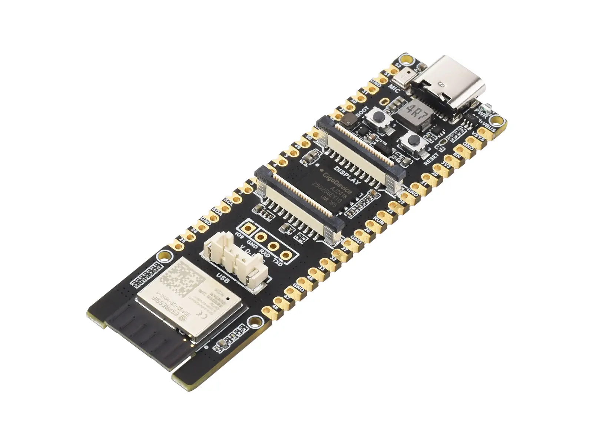

<!-- Copyright 2015-2026 Zephyr Project members and individual contributors. -->
<!-- SPDX-License-Identifier: Apache-2.0 -->
<!-- 中文翻译；编号、导航与译注为本地新增。 -->

<a id="esp32p4_wifi6"></a>

# 第6章\_ESP32-P4-WIFI6

原文：[官方页面](https://docs.zephyrproject.org/latest/boards/waveshare/esp32p4_wifi6/doc/index.html)。读取日期：2026-10-16；来源摘要见[来源记录](../SOURCES.md)。

开发板概览（Board Overview）

<a id="id1"></a>

[](images/esp32p4_wifi6.webp)

ESP32-P4-WIFI6

名称（Name）：

`esp32p4_wifi6`

厂商（Vendor）：

[Waveshare Electronics微雪电子](https://docs.zephyrproject.org/latest/boards/index.html#vendor=waveshare)

状态（Status）：

当前未积极维护（Not Actively Maintained）

架构（Architecture）：

[`riscv`](https://docs.zephyrproject.org/latest/boards/index.html#arch=riscv)

片上系统（SoC）：

[esp32p4](https://docs.zephyrproject.org/latest/boards/index.html#soc=esp32p4)

<a id="board-github-link"></a>

[浏览开发板源码（Browse Board Sources）](https://github.com/zephyrproject-rtos/zephyr/blob/main//boards/waveshare/esp32p4_wifi6/doc/index.rst/../..)<a id="overview"></a>

## 概述（Overview）

ESP32-P4-WIFI6是基于ESP32-P4的多媒体开发板，堆叠32 MB PSRAM并连接32 MB NOR闪存。提供Type-C USB转UART烧录及控制台接口、4引脚高速USB OTG、MIPI CSI／DSI FPC、MicroSD卡槽及采用Raspberry Pi Pico引脚布局的40针GPIO排针，兼容Pico HAT。板载ESP32-C6-MINI-1经SDIO提供无线连接。

此板定义提供高性能核（HP Core）与低功耗核（LP Core）目标。Zephyr控制台连接UART0的GPIO37／38，即Type-C USB转UART桥接的端口。

<a id="hardware"></a>

## 硬件（Hardware）

板上包含以下外设：


- ESP32-P4 SoC，硅片修订版v1.3，堆叠32 MB PSRAM及板载32 MB NOR闪存
- CH343P Type-C USB转UART端口，用于供电、烧录及串口控制台
- 4引脚USB 2.0 OTG高速连接器
- 双通道MIPI摄像头串行接口（CSI）连接器
- 双通道MIPI DSI显示接口
- MicroSD卡槽，4位SDHC、40 MHz；clk=43、cmd=44、d0=39、d1=40、d2=41、d3=42，由GPIO45负载开关供电
- I2C0总线：SDA=GPIO7、SCL=GPIO8，400 kHz
- 40针GPIO扩展排针，Raspberry Pi Pico引脚布局
- BOOT键为GPIO35，另有复位键

32 MB闪存采用定制分区表：两个15.75 MB MCUboot应用槽image-0／image-1、两个32 KB低功耗核镜像槽，之后是192 KB存储分区；image-scratch与coredump位于闪存末尾。

三个内部LDO配置为常开：ldo1及ldo4为3.3 V，ldo2为1.8 V。此初始移植尚未启用MIPI DSI／CSI、I2S音频及ESP32-C6 SDIO无线协处理器。

<a id="esp32-p4-features"></a>

### ESP32-P4特性（Features）

ESP32-P4是乐鑫高性能MCU，具有最高400 MHz的双核32位RISC-V高性能（HP）处理器，以及一个低功耗（LP）32位RISC-V协处理器。它面向人机界面（HMI）及边缘计算应用，集成二级缓存（L2 Cache）、高带宽存储器接口及丰富连接选项。

ESP32-P4包含以下功能：


- 双核32位RISC-V高性能处理器，最高400 MHz
- 32位RISC-V低功耗处理器，最高40 MHz
- 768 KB高性能SRAM
- 32 KB低功耗SRAM
- 128 KB只读存储器（ROM）
- 一级指令及数据缓存，加统一二级缓存（Unified L2 Cache）
- 最高64 MB外部PSRAM，支持十六线（HEX）或八线（Octal）模式
- 最高16 MB外部闪存

数字接口（Digital Interfaces）：


- 55个可编程GPIO
- 五路UART
- 1路低功耗通用异步收发器（LP UART）
- 两路通用SPI
- 2路I2C总线
- 1路低功耗I2C接口（LP I2C）
- 三路I2S
- 一个SDIO 3.0主机控制器，带两个插槽
- 一个USB 2.0 OTG高速（HS）接口，集成物理层（PHY）
- 1个USB串口／JTAG控制器（USB Serial/JTAG Controller）
- 一个10/100 Mbit以太网媒体访问控制器（MAC），采用RMII接口
- 一个MIPI摄像头串行接口（CSI）
- 一个MIPI显示串行接口（DSI）
- 一个JPEG编解码器（Codec）
- 一个二维像素处理加速器（PPA / Pixel Processing Accelerator）
- LED脉宽调制控制器（PWM Controller），最多8个通道
- 两个电机控制PWM（MCPWM）
- 三个TWAI控制器，兼容ISO 11898-1，即CAN规范2.0
- 1个脉冲计数器（Pulse Counter）
- 一个远程控制外设（Remote Control Peripheral）
- 通过AHB及AXI总线工作的通用DMA控制器（GDMA）
- 事件任务矩阵（ETM / Event Task Matrix）

模拟接口（Analog Interfaces）：


- 一个12位SAR ADC
- 1个温度传感器（Temperature Sensor）

定时器（Timers）：


- 1个52位系统定时器（System Timer）
- 两个54位通用定时器
- 两个看门狗定时器

低功耗（Low Power）：


- 面向典型场景的多种电源模式：活动（Active）、调制解调器睡眠（Modem-Sleep）、浅度睡眠（Light-Sleep）及深度睡眠（Deep-Sleep）
- 四通道可编程片上低压差稳压器（LDO）
- 带专用保持DMA（Retention DMA）的电源管理单元（PMU）

安全（Security）：


- 安全启动（Secure Boot）
- 闪存加密（Flash Encryption）
- 密码硬件加速：AES-128／256、SHA、RSA、ECC、HMAC、数字签名（Digital Signature）及ECDSA
- 真随机数发生器（TRNG）
- 密钥管理器（Key Manager）

<a id="low-power-cpu-lp-core"></a>

### 低功耗处理器（LP CORE / Low-Power CPU）

ESP32-P4 SoC除双HP内核外，还具有一个低功耗（LP）32位RISC-V协处理器。LP内核具有超低功耗特性、中断控制器、调试模块，以及用于访问存储器和外设的系统总线接口。

LP内核默认处于睡眠模式（Sleep Mode），有以下两类应用场景：


- 对功耗不敏感的场景：HP内核处于活动状态时，LP内核可辅助执行对速度及效率要求不高的控制与计算。
- 对功耗敏感的场景：HP内核为省电而断电时，可唤醒LP内核处理某些外部唤醒事件。

LP内核支持已完整集成到[系统构建（Sysbuild / System Build）](../sysbuild/P001_系统构建.md#sysbuild)中。可以在项目中加入以下配置来启用LP内核：

```text
CONFIG_ESP32_ULP_COPROC_ENABLED=y
```

代码参考见[低功耗处理器（LP CORE / Low-Power CPU）](../board_samples/P101_低功耗CPU示例目录.md#low-power-cpu-lp-core)目录。

<a id="id3"></a>

<a id="id5"></a>

更多信息见ESP32-P4数据手册[注1](#id2)或ESP32-P4技术参考手册[注2](#id4)。（[ESP32-P4数据手册（Datasheet）](https://www.espressif.com/sites/default/files/documentation/esp32-p4_datasheet_en.pdf)；[ESP32-P4技术参考手册（Technical Reference Manual）](https://www.espressif.com/sites/default/files/documentation/esp32-p4_technical_reference_manual_en.pdf)）

<a id="supported-features"></a>

### 支持的功能（Supported Features）

`esp32p4_wifi6`开发板支持下表所列的硬件功能。

片上／板载（On-Chip / On-Board）

功能集成在片上系统（SoC）内／位于开发板上。

2 / 2

分别表示已启用／已禁用的实例数。点击数量标签，可查看开发板或SoC设备树源码（DTS）中该功能的第一个实例。

`vnd,foo`

与此功能匹配的设备树绑定兼容字符串（Compatible String）；点击链接可查看绑定文档。

<a id="esp32p4_wifi6-hw-features"></a>

<a id="esp32p4_wifi6-esp32p4_wifi6/esp32p4/hpcore-hw-features-section"></a>

#### `esp32p4_wifi6/esp32p4/hpcore`目标（Target）

<a id="esp32p4_wifi6-esp32p4_wifi6/esp32p4/hpcore-hw-features-panel"></a>

<a id="esp32p4_wifi6-esp32p4_wifi6/esp32p4/hpcore-hw-features-memory"></a>

此目标可用存储：768 KiB RAM、32 MiB闪存。

<a id="esp32p4_wifi6-esp32p4_wifi6/esp32p4/hpcore-hw-features-table"></a>

<table>
<tr>
<th>类型（Type）</th>
<th>位置（Location）</th>
<th>说明（Description）</th>
<th>兼容字符串（Compatible）</th>
</tr>
<tr>
<td rowspan="1">中央处理器（CPU）</td>
<td>片上（On-Chip）</td>
<td>乐鑫（Espressif）RISC-V处理器（CPU）（<a href="https://github.com/zephyrproject-rtos/zephyr/blob/main/dts/riscv/espressif/esp32p4/esp32p4_common.dtsi?plain=1#L40">已启用：2</a>）</td>
<td><a href="../cpu_cortex_xtensa_binding_reference/P024_espressif_riscv.md#std-dtcompatible-espressif-riscv"><code>espressif,riscv</code></a></td>
</tr>
<tr>
<td rowspan="1">模数转换器（ADC）</td>
<td>片上（On-Chip）</td>
<td>ESP32模数转换器（ADC）（<a href="https://github.com/zephyrproject-rtos/zephyr/blob/main/dts/riscv/espressif/esp32p4/esp32p4_common.dtsi?plain=1#L581">已禁用：1</a>）</td>
<td><a href="../hardware/P889_ESP32模数转换器绑定.md#dtbinding-espressif-esp32-adc"><code>espressif,esp32-adc</code></a></td>
</tr>
<tr>
<td rowspan="1">控制器局域网（CAN）</td>
<td>片上（On-Chip）</td>
<td>ESP32双线汽车接口（TWAI / Two-Wire Automotive Interface）（<a href="https://github.com/zephyrproject-rtos/zephyr/blob/main/dts/riscv/espressif/esp32p4/esp32p4_common.dtsi?plain=1#L428">已禁用：3</a>）</td>
<td><a href="../can_adi_atmel_nxp_binding_reference/P005_espressif_esp32-twai.md#std-dtcompatible-espressif-esp32-twai"><code>espressif,esp32-twai</code></a></td>
</tr>
<tr>
<td rowspan="1">时钟控制（Clock Control）</td>
<td>片上（On-Chip）</td>
<td>ESP32时钟模块（Clock Module，电源与时钟控制器模块 / Power &amp; Clock Controller Module）（<a href="https://github.com/zephyrproject-rtos/zephyr/blob/main/dts/riscv/espressif/esp32p4/esp32p4_common.dtsi?plain=1#L86">已启用：1</a>）</td>
<td><a href="../clock_esp_infineon_microchip_binding_reference/P004_espressif_esp32-clock.md#std-dtcompatible-espressif-esp32-clock"><code>espressif,esp32-clock</code></a></td>
</tr>
<tr>
<td rowspan="1">比较器（Comparator）</td>
<td>片上（On-Chip）</td>
<td>乐鑫模拟比较器（Analog Comparator），ana_cmpr（<a href="https://github.com/zephyrproject-rtos/zephyr/blob/main/dts/riscv/espressif/esp32p4/esp32p4_common.dtsi?plain=1#L743">已禁用：2</a>）</td>
<td><a href="../hardware/P754_ESP32模拟比较器绑定.md#dtbinding-espressif-esp32-ana-cmpr"><code>espressif,esp32-ana-cmpr</code></a></td>
</tr>
<tr>
<td rowspan="3">计数器（Counter）</td>
<td>片上（On-Chip）</td>
<td>ESP32通用定时器（General-purpose Timers）（<a href="https://github.com/zephyrproject-rtos/zephyr/blob/main/dts/riscv/espressif/esp32p4/esp32p4_common.dtsi?plain=1#L215">已禁用：2</a>）</td>
<td><a href="../counter_binding_reference/P017_espressif_esp32-timer.md#std-dtcompatible-espressif-esp32-timer"><code>espressif,esp32-timer</code></a></td>
</tr>
<tr>
<td>片上（On-Chip）</td>
<td>ESP32计数器（Counters）（<a href="https://github.com/zephyrproject-rtos/zephyr/blob/main/dts/riscv/espressif/esp32p4/esp32p4_common.dtsi?plain=1#L225">已禁用：2</a>）</td>
<td><a href="../counter_binding_reference/P015_espressif_esp32-counter.md#std-dtcompatible-espressif-esp32-counter"><code>espressif,esp32-counter</code></a></td>
</tr>
<tr>
<td>片上（On-Chip）</td>
<td>基于RTC主定时器（Main Timer）的ESP32计数器驱动（Counter Driver）（<a href="https://github.com/zephyrproject-rtos/zephyr/blob/main/dts/riscv/espressif/esp32p4/esp32p4_common.dtsi?plain=1#L247">已禁用：1</a>）</td>
<td><a href="../counter_binding_reference/P016_espressif_esp32-rtc-timer.md#std-dtcompatible-espressif-esp32-rtc-timer"><code>espressif,esp32-rtc-timer</code></a></td>
</tr>
<tr>
<td rowspan="2">密码学加速器（Cryptographic Accelerator）</td>
<td>片上（On-Chip）</td>
<td>乐鑫（Espressif）ESP32 SHA硬件加速器（Hardware Accelerator）（<a href="https://github.com/zephyrproject-rtos/zephyr/blob/main/dts/riscv/espressif/esp32p4/esp32p4_common.dtsi?plain=1#L660">已启用：1</a>）</td>
<td><a href="../crypto_aes_sha_ccm_binding_reference/P008_espressif_esp32-sha.md#std-dtcompatible-espressif-esp32-sha"><code>espressif,esp32-sha</code></a></td>
</tr>
<tr>
<td>片上（On-Chip）</td>
<td>乐鑫（Espressif）ESP32系列AES硬件加速器（Hardware Accelerator）（<a href="https://github.com/zephyrproject-rtos/zephyr/blob/main/dts/riscv/espressif/esp32p4/esp32p4_common.dtsi?plain=1#L667">已启用：1</a>）</td>
<td><a href="../crypto_aes_sha_ccm_binding_reference/P007_espressif_esp32-aes.md#std-dtcompatible-espressif-esp32-aes"><code>espressif,esp32-aes</code></a></td>
</tr>
<tr>
<td rowspan="1">显示（Display）</td>
<td>片上（On-Chip）</td>
<td>乐鑫ESP32 MIPI DSI显示像素接口（DPI）扫描输出控制器（Scanout Controller）（<a href="https://github.com/zephyrproject-rtos/zephyr/blob/main/dts/riscv/espressif/esp32p4/esp32p4_common.dtsi?plain=1#L674">已禁用：1</a>）</td>
<td><a href="../display_adi_chipone_eink_binding_reference/P014_espressif_esp-dsi-display.md#std-dtcompatible-espressif-esp-dsi-display"><code>espressif,esp-dsi-display</code></a></td>
</tr>
<tr>
<td rowspan="1">直接存储器访问（DMA）</td>
<td>片上（On-Chip）</td>
<td>ESP32通用直接存储器访问（GDMA / General Direct Memory Access）（<a href="https://github.com/zephyrproject-rtos/zephyr/blob/main/dts/riscv/espressif/esp32p4/esp32p4_common.dtsi?plain=1#L593">已启用：2</a>）</td>
<td><a href="../dma_binding_reference/P015_espressif_esp32-gdma.md#std-dtcompatible-espressif-esp32-gdma"><code>espressif,esp32-gdma</code></a></td>
</tr>
<tr>
<td rowspan="3">以太网（Ethernet）</td>
<td>片上（On-Chip）</td>
<td>ESP32以太网（Ethernet）（<a href="https://github.com/zephyrproject-rtos/zephyr/blob/main/dts/riscv/espressif/esp32p4/esp32p4_common.dtsi?plain=1#L719">已禁用：1</a>）</td>
<td><a href="../ethernet_mac_mdio_binding_reference/P008_espressif_esp32-eth.md#std-dtcompatible-espressif-esp32-eth"><code>espressif,esp32-eth</code></a></td>
</tr>
<tr>
<td>片上（On-Chip）</td>
<td>Synopsys DesignWare MAC 的管理数据输入输出控制器（MDIO Controller）（<a href="https://github.com/zephyrproject-rtos/zephyr/blob/main/dts/riscv/espressif/esp32p4/esp32p4_common.dtsi?plain=1#L730">已禁用：1</a>）</td>
<td><a href="../ethernet_mdio_microchip_binding_reference/P010_snps_dwmac-mdio.md#std-dtcompatible-snps-dwmac-mdio"><code>snps,dwmac-mdio</code></a></td>
</tr>
<tr>
<td>片上（On-Chip）</td>
<td>Synopsys DesignWare MAC 精确时间协议时钟（Precision Time Protocol，PTP Clock）（<a href="https://github.com/zephyrproject-rtos/zephyr/blob/main/dts/riscv/espressif/esp32p4/esp32p4_common.dtsi?plain=1#L737">已启用：1</a>）</td>
<td><a href="../ethernet_synopsys_st_xilinx_binding_reference/P006_snps_dwmac-ptp-clock.md#std-dtcompatible-snps-dwmac-ptp-clock"><code>snps,dwmac-ptp-clock</code></a></td>
</tr>
<tr>
<td rowspan="1">闪存控制器（Flash Controller）</td>
<td>片上（On-Chip）</td>
<td>ESP32闪存控制器（Flash Controller）（<a href="https://github.com/zephyrproject-rtos/zephyr/blob/main/dts/riscv/espressif/esp32p4/esp32p4_common.dtsi?plain=1#L291">已启用：1</a>）</td>
<td><a href="../flash_adi_microchip_nordic_binding_reference/P012_espressif_esp32-flash-controller.md#std-dtcompatible-espressif-esp32-flash-controller"><code>espressif,esp32-flash-controller</code></a></td>
</tr>
<tr>
<td rowspan="1">通用输入输出与接插件（GPIO &amp; Headers）</td>
<td>片上（On-Chip）</td>
<td>ESP32通用输入输出控制器（GPIO Controller）（<a href="https://github.com/zephyrproject-rtos/zephyr/blob/main/dts/riscv/espressif/esp32p4/esp32p4_common.dtsi?plain=1#L316">已启用：2</a>）</td>
<td><a href="../gpio_connectors_bflb_esp_binding_reference/P022_espressif_esp32-gpio.md#std-dtcompatible-espressif-esp32-gpio"><code>espressif,esp32-gpio</code></a></td>
</tr>
<tr>
<td rowspan="1">集成电路间总线（I2C）</td>
<td>片上（On-Chip）</td>
<td>ESP32 I2C控制器（<a href="https://github.com/zephyrproject-rtos/zephyr/blob/main/dts/riscv/espressif/esp32p4/esp32p4_common.dtsi?plain=1#L344">已启用：1</a>；<a href="https://github.com/zephyrproject-rtos/zephyr/blob/main/dts/riscv/espressif/esp32p4/esp32p4_common.dtsi?plain=1#L467">已禁用：2</a>）</td>
<td><a href="../i2c_adi_atmel_esp_binding_reference/P018_espressif_esp32-i2c.md#std-dtcompatible-espressif-esp32-i2c"><code>espressif,esp32-i2c</code></a></td>
</tr>
<tr>
<td rowspan="1">集成电路间音频总线（I2S）</td>
<td>片上（On-Chip）</td>
<td>ESP32芯片间音频接口（I2S）（<a href="https://github.com/zephyrproject-rtos/zephyr/blob/main/dts/riscv/espressif/esp32p4/esp32p4_common.dtsi?plain=1#L506">已禁用：3</a>）</td>
<td><a href="../i2s_binding_reference/P003_espressif_esp32-i2s.md#std-dtcompatible-espressif-esp32-i2s"><code>espressif,esp32-i2s</code></a></td>
</tr>
<tr>
<td rowspan="2">输入（Input）</td>
<td>片上（On-Chip）</td>
<td>ESP32触摸传感器输入（Touch Sensor Input）（<a href="https://github.com/zephyrproject-rtos/zephyr/blob/main/dts/riscv/espressif/esp32p4/esp32p4_common.dtsi?plain=1#L336">已禁用：1</a>）</td>
<td><a href="../input_adc_touch_matrix_binding_reference/P013_espressif_esp32-touch.md#std-dtcompatible-espressif-esp32-touch"><code>espressif,esp32-touch</code></a></td>
</tr>
<tr>
<td>板载（On-Board）</td>
<td>一组绑定到 GPIO 的输入按键（GPIO-Bound Input Keys）（<a href="https://github.com/zephyrproject-rtos/zephyr/blob/main/boards/waveshare/esp32p4_wifi6/esp32p4_wifi6_esp32p4_hpcore.dts?plain=1#L32">已启用：1</a>）</td>
<td><a href="../hardware/P563_GPIO按键绑定.md#std-dtcompatible-gpio-keys"><code>gpio-keys</code></a></td>
</tr>
<tr>
<td rowspan="1">中断控制器（Interrupt Controller）</td>
<td>片上（On-Chip）</td>
<td>ESP32中断控制器（Interrupt Controller）（<a href="https://github.com/zephyrproject-rtos/zephyr/blob/main/dts/riscv/espressif/esp32p4/esp32p4_common.dtsi?plain=1#L198">已启用：1</a>）</td>
<td><a href="../soc_interrupt_binding_reference/P005_espressif_esp32-intc.md#std-dtcompatible-espressif-esp32-intc"><code>espressif,esp32-intc</code></a></td>
</tr>
<tr>
<td rowspan="1">邮箱（Mailbox）</td>
<td>片上（On-Chip）</td>
<td>ESP32软件邮箱（Soft Mailbox）（<a href="https://github.com/zephyrproject-rtos/zephyr/blob/main/dts/riscv/espressif/esp32p4/esp32p4_common.dtsi?plain=1#L185">已启用：1</a>）</td>
<td><a href="../intercore_reference/P037_ESP32邮箱绑定.md#dtbinding-espressif-mbox-esp32"><code>espressif,mbox-esp32</code></a></td>
</tr>
<tr>
<td rowspan="1">存储器控制器（Memory Controller）</td>
<td>片上（On-Chip）</td>
<td>ESP32伪静态随机存储器控制器（PSRAM Controller）（<a href="https://github.com/zephyrproject-rtos/zephyr/blob/main/dts/riscv/espressif/esp32p4/esp32p4_common.dtsi?plain=1#L111">已启用：1</a>）</td>
<td><a href="../memory_controller_hyperbus_smc_binding_reference/P009_espressif_esp32-psram.md#std-dtcompatible-espressif-esp32-psram"><code>espressif,esp32-psram</code></a></td>
</tr>
<tr>
<td rowspan="1">MIPI 显示串行接口（MIPI-DSI）</td>
<td>片上（On-Chip）</td>
<td>乐鑫ESP32 MIPI DSI主机控制器（<a href="https://github.com/zephyrproject-rtos/zephyr/blob/main/dts/riscv/espressif/esp32p4/esp32p4_common.dtsi?plain=1#L684">已禁用：1</a>）</td>
<td><a href="../mipi_dbi_dsi_binding_reference/P012_espressif_esp-mipi-dsi.md#std-dtcompatible-espressif-esp-mipi-dsi"><code>espressif,esp-mipi-dsi</code></a></td>
</tr>
<tr>
<td rowspan="1">其他绑定（Miscellaneous）</td>
<td>片上（On-Chip）</td>
<td>乐鑫像素处理加速器（Pixel Processing Accelerator）（<a href="https://github.com/zephyrproject-rtos/zephyr/blob/main/dts/riscv/espressif/esp32p4/esp32p4_common.dtsi?plain=1#L610">已禁用：1</a>）</td>
<td><a href="../misc_adi_nordic_binding_reference/P008_espressif_esp32-ppa.md#std-dtcompatible-espressif-esp32-ppa"><code>espressif,esp32-ppa</code></a></td>
</tr>
<tr>
<td rowspan="1">存储技术设备（MTD）</td>
<td>片上（On-Chip）</td>
<td>闪存（Flash）节点（<a href="https://github.com/zephyrproject-rtos/zephyr/blob/main/dts/riscv/espressif/esp32p4/esp32p4_common.dtsi?plain=1#L299">已启用：1</a>）</td>
<td><a href="../mtd_nxp_st_ti_partition_binding_reference/P013_soc-nv-flash.md#std-dtcompatible-soc-nv-flash"><code>soc-nv-flash</code></a></td>
</tr>
<tr>
<td rowspan="1">引脚控制（Pin Control）</td>
<td>片上（On-Chip）</td>
<td>ESP32引脚控制器（Pin Controller）（<a href="https://github.com/zephyrproject-rtos/zephyr/blob/main/dts/riscv/espressif/esp32p4/esp32p4_common.dtsi?plain=1#L81">已启用：1</a>）</td>
<td><a href="../pinctrl_adi_ambiq_arm_binding_reference/P022_espressif_esp32-pinctrl.md#std-dtcompatible-espressif-esp32-pinctrl"><code>espressif,esp32-pinctrl</code></a></td>
</tr>
<tr>
<td rowspan="1">脉冲输入输出（Pulse IO）</td>
<td>片上（On-Chip）</td>
<td>乐鑫遥控收发器（RMT / Remote Control Transceiver）pulse_io控制器（<a href="https://github.com/zephyrproject-rtos/zephyr/blob/main/dts/riscv/espressif/esp32p4/esp32p4_common.dtsi?plain=1#L571">已禁用：1</a>）</td>
<td><a href="../platform_rmt_openthread_binding_reference/P008_espressif_esp32-rmt.md#std-dtcompatible-espressif-esp32-rmt"><code>espressif,esp32-rmt</code></a></td>
</tr>
<tr>
<td rowspan="2">脉宽调制（PWM）</td>
<td>片上（On-Chip）</td>
<td>ESP32 LED控制（LEDC / LED Control）（<a href="https://github.com/zephyrproject-rtos/zephyr/blob/main/dts/riscv/espressif/esp32p4/esp32p4_common.dtsi?plain=1#L419">已禁用：1</a>）</td>
<td><a href="../pwm_adi_esp_infineon_binding_reference/P015_espressif_esp32-ledc.md#std-dtcompatible-espressif-esp32-ledc"><code>espressif,esp32-ledc</code></a></td>
</tr>
<tr>
<td>片上（On-Chip）</td>
<td>ESP32电机控制脉宽调制器（MCPWM / Motor Control Pulse Width Modulator）（<a href="https://github.com/zephyrproject-rtos/zephyr/blob/main/dts/riscv/espressif/esp32p4/esp32p4_common.dtsi?plain=1#L542">已禁用：2</a>）</td>
<td><a href="../pwm_adi_esp_infineon_binding_reference/P016_espressif_esp32-mcpwm.md#std-dtcompatible-espressif-esp32-mcpwm"><code>espressif,esp32-mcpwm</code></a></td>
</tr>
<tr>
<td rowspan="1">稳压器（Regulator）</td>
<td>片上（On-Chip）</td>
<td>乐鑫ESP32片上低压差（LDO）稳压器（<a href="https://github.com/zephyrproject-rtos/zephyr/blob/main/dts/riscv/espressif/esp32p4/esp32p4_common.dtsi?plain=1#L759">已启用：1</a>）</td>
<td><a href="../hardware/P649_ESP32稳压器绑定.md#dtbinding-espressif-esp32-regulator"><code>espressif,esp32-regulator</code></a></td>
</tr>
<tr>
<td rowspan="1">随机数生成器（RNG）</td>
<td>片上（On-Chip）</td>
<td>ESP32真随机数发生器（TRNG / True Random Number Generator）（<a href="https://github.com/zephyrproject-rtos/zephyr/blob/main/dts/riscv/espressif/esp32p4/esp32p4_common.dtsi?plain=1#L256">已启用：1</a>）</td>
<td><a href="../rng_binding_reference/P007_espressif_esp32-trng.md#std-dtcompatible-espressif-esp32-trng"><code>espressif,esp32-trng</code></a></td>
</tr>
<tr>
<td rowspan="2">SD 主机控制器（SDHC）</td>
<td>片上（On-Chip）</td>
<td>ESP32安全数字主机控制器（SDHC）（<a href="https://github.com/zephyrproject-rtos/zephyr/blob/main/dts/riscv/espressif/esp32p4/esp32p4_common.dtsi?plain=1#L697">已启用：1</a>）</td>
<td><a href="../sdhc_binding_reference/P007_espressif_esp32-sdhc.md#std-dtcompatible-espressif-esp32-sdhc"><code>espressif,esp32-sdhc</code></a></td>
</tr>
<tr>
<td>片上（On-Chip）</td>
<td>ESP32 SDHC控制器插槽（Slot）（<a href="https://github.com/zephyrproject-rtos/zephyr/blob/main/dts/riscv/espressif/esp32p4/esp32p4_common.dtsi?plain=1#L706">已启用：1</a>；<a href="https://github.com/zephyrproject-rtos/zephyr/blob/main/dts/riscv/espressif/esp32p4/esp32p4_common.dtsi?plain=1#L712">已禁用：1</a>）</td>
<td><a href="../sdhc_binding_reference/P006_espressif_esp32-sdhc-slot.md#std-dtcompatible-espressif-esp32-sdhc-slot"><code>espressif,esp32-sdhc-slot</code></a></td>
</tr>
<tr>
<td rowspan="2">传感器（Sensors）</td>
<td>片上（On-Chip）</td>
<td>ESP32内部温度传感器（Internal Temperature Sensor）（<a href="https://github.com/zephyrproject-rtos/zephyr/blob/main/dts/riscv/espressif/esp32p4/esp32p4_common.dtsi?plain=1#L309">已启用：1</a>）</td>
<td><a href="../sensor_espressif_honeywell_invensense_binding_reference/P001_espressif_esp32-temp.md#std-dtcompatible-espressif-esp32-temp"><code>espressif,esp32-temp</code></a></td>
</tr>
<tr>
<td>片上（On-Chip）</td>
<td>ESP32脉冲计数器（PCNT / Pulse Counter）（<a href="https://github.com/zephyrproject-rtos/zephyr/blob/main/dts/riscv/espressif/esp32p4/esp32p4_common.dtsi?plain=1#L562">已禁用：1</a>）</td>
<td><a href="../sensor_bosch_broadcom_espressif_binding_reference/P030_espressif_esp32-pcnt.md#std-dtcompatible-espressif-esp32-pcnt"><code>espressif,esp32-pcnt</code></a></td>
</tr>
<tr>
<td rowspan="3">串行控制器（Serial Controller）</td>
<td>片上（On-Chip）</td>
<td>ESP32通用异步收发器（UART）（<a href="https://github.com/zephyrproject-rtos/zephyr/blob/main/dts/riscv/espressif/esp32p4/esp32p4_common.dtsi?plain=1#L355">已启用：1</a>；<a href="https://github.com/zephyrproject-rtos/zephyr/blob/main/dts/riscv/espressif/esp32p4/esp32p4_common.dtsi?plain=1#L364">已禁用：4</a>）</td>
<td><a href="../uart_espressif_infineon_microchip_binding_reference/P002_espressif_esp32-uart.md#std-dtcompatible-espressif-esp32-uart"><code>espressif,esp32-uart</code></a></td>
</tr>
<tr>
<td>片上（On-Chip）</td>
<td>ESP32通用异步收发器（UART）（<a href="https://github.com/zephyrproject-rtos/zephyr/blob/main/dts/riscv/espressif/esp32p4/esp32p4_common.dtsi?plain=1#L374">已禁用：1</a>）</td>
<td><a href="../uart_espressif_infineon_microchip_binding_reference/P003_espressif_esp32-usb-serial.md#std-dtcompatible-espressif-esp32-usb-serial"><code>espressif,esp32-usb-serial</code></a></td>
</tr>
<tr>
<td>片上（On-Chip）</td>
<td>ESP32低功耗通用异步收发器（Low Power UART）（<a href="https://github.com/zephyrproject-rtos/zephyr/blob/main/dts/riscv/espressif/esp32p4/esp32p4_common.dtsi?plain=1#L637">已禁用：1</a>）</td>
<td><a href="../uart_espressif_infineon_microchip_binding_reference/P001_espressif_esp32-lpuart.md#std-dtcompatible-espressif-esp32-lpuart"><code>espressif,esp32-lpuart</code></a></td>
</tr>
<tr>
<td rowspan="1">串行外设接口（SPI）</td>
<td>片上（On-Chip）</td>
<td>ESP32串行外设接口控制器（SPI Controller）（<a href="https://github.com/zephyrproject-rtos/zephyr/blob/main/dts/riscv/espressif/esp32p4/esp32p4_common.dtsi?plain=1#L263">已禁用：2</a>）</td>
<td><a href="../spi_adi_atmel_esp_binding_reference/P014_espressif_esp32-spi.md#std-dtcompatible-espressif-esp32-spi"><code>espressif,esp32-spi</code></a></td>
</tr>
<tr>
<td rowspan="1">定时器（Timer）</td>
<td>片上（On-Chip）</td>
<td>ESP32系统定时器（System Timer）（<a href="https://github.com/zephyrproject-rtos/zephyr/blob/main/dts/riscv/espressif/esp32p4/esp32p4_common.dtsi?plain=1#L207">已启用：1</a>）</td>
<td><a href="../mcu_timer_binding_reference/P004_espressif_esp32-systimer.md#std-dtcompatible-espressif-esp32-systimer"><code>espressif,esp32-systimer</code></a></td>
</tr>
<tr>
<td rowspan="2">通用串行总线（USB）</td>
<td>片上（On-Chip）</td>
<td>乐鑫USB OTG高速控制器，兼容DWC2，带内部USB收发器宏单元接口（UTMI）PHY（<a href="https://github.com/zephyrproject-rtos/zephyr/blob/main/dts/riscv/espressif/esp32p4/esp32p4_common.dtsi?plain=1#L383">已启用：1</a>）</td>
<td><a href="../usb_controller_binding_reference/P011_espressif_esp32-usb-otg-hs.md#std-dtcompatible-espressif-esp32-usb-otg-hs"><code>espressif,esp32-usb-otg-hs</code></a></td>
</tr>
<tr>
<td>片上（On-Chip）</td>
<td>乐鑫USB OTG全速控制器（Full-speed Controller），兼容DWC2，带内部全速／低速物理层（FS/LS PHY）（<a href="https://github.com/zephyrproject-rtos/zephyr/blob/main/dts/riscv/espressif/esp32p4/esp32p4_common.dtsi?plain=1#L400">已禁用：1</a>）</td>
<td><a href="../usb_controller_binding_reference/P010_espressif_esp32-usb-otg-fs.md#std-dtcompatible-espressif-esp32-usb-otg-fs"><code>espressif,esp32-usb-otg-fs</code></a></td>
</tr>
<tr>
<td rowspan="1">看门狗（Watchdog）</td>
<td>片上（On-Chip）</td>
<td>ESP32看门狗（Watchdog）（<a href="https://github.com/zephyrproject-rtos/zephyr/blob/main/dts/riscv/espressif/esp32p4/esp32p4_common.dtsi?plain=1#L273">已启用：1</a>；<a href="https://github.com/zephyrproject-rtos/zephyr/blob/main/dts/riscv/espressif/esp32p4/esp32p4_common.dtsi?plain=1#L282">已禁用：1</a>）</td>
<td><a href="../watchdog_binding_reference/P013_espressif_esp32-watchdog.md#std-dtcompatible-espressif-esp32-watchdog"><code>espressif,esp32-watchdog</code></a></td>
</tr>
</table>

<a id="esp32p4_wifi6-esp32p4_wifi6/esp32p4/lpcore-hw-features-section"></a>

#### `esp32p4_wifi6/esp32p4/lpcore`目标（Target）

<a id="esp32p4_wifi6-esp32p4_wifi6/esp32p4/lpcore-hw-features-panel"></a>

<a id="esp32p4_wifi6-esp32p4_wifi6/esp32p4/lpcore-hw-features-memory"></a>

此目标可用存储：32 KiB RAM、32 MiB闪存。

<a id="esp32p4_wifi6-esp32p4_wifi6/esp32p4/lpcore-hw-features-table"></a>

<table>
<tr>
<th>类型（Type）</th>
<th>位置（Location）</th>
<th>说明（Description）</th>
<th>兼容字符串（Compatible）</th>
</tr>
<tr>
<td rowspan="1">中央处理器（CPU）</td>
<td>片上（On-Chip）</td>
<td>乐鑫（Espressif）RISC-V处理器（CPU）（<a href="https://github.com/zephyrproject-rtos/zephyr/blob/main/dts/riscv/espressif/esp32p4/esp32p4_lpcore.dtsi?plain=1#L20">已启用：1</a>）</td>
<td><a href="../cpu_cortex_xtensa_binding_reference/P024_espressif_riscv.md#std-dtcompatible-espressif-riscv"><code>espressif,riscv</code></a></td>
</tr>
<tr>
<td rowspan="1">闪存控制器（Flash Controller）</td>
<td>片上（On-Chip）</td>
<td>ESP32闪存控制器（Flash Controller）（<a href="https://github.com/zephyrproject-rtos/zephyr/blob/main/dts/riscv/espressif/esp32p4/esp32p4_lpcore.dtsi?plain=1#L85">已启用：1</a>）</td>
<td><a href="../flash_adi_microchip_nordic_binding_reference/P012_espressif_esp32-flash-controller.md#std-dtcompatible-espressif-esp32-flash-controller"><code>espressif,esp32-flash-controller</code></a></td>
</tr>
<tr>
<td rowspan="1">通用输入输出与接插件（GPIO &amp; Headers）</td>
<td>片上（On-Chip）</td>
<td>ESP32通用输入输出控制器（GPIO Controller）（<a href="https://github.com/zephyrproject-rtos/zephyr/blob/main/dts/riscv/espressif/esp32p4/esp32p4_lpcore.dtsi?plain=1#L112">已启用：1</a>）</td>
<td><a href="../gpio_connectors_bflb_esp_binding_reference/P022_espressif_esp32-gpio.md#std-dtcompatible-espressif-esp32-gpio"><code>espressif,esp32-gpio</code></a></td>
</tr>
<tr>
<td rowspan="1">中断控制器（Interrupt Controller）</td>
<td>片上（On-Chip）</td>
<td>ESP32中断控制器（Interrupt Controller）（<a href="https://github.com/zephyrproject-rtos/zephyr/blob/main/dts/riscv/espressif/esp32p4/esp32p4_lpcore.dtsi?plain=1#L76">已启用：1</a>）</td>
<td><a href="../soc_interrupt_binding_reference/P005_espressif_esp32-intc.md#std-dtcompatible-espressif-esp32-intc"><code>espressif,esp32-intc</code></a></td>
</tr>
<tr>
<td rowspan="1">邮箱（Mailbox）</td>
<td>片上（On-Chip）</td>
<td>ESP32软件邮箱（Soft Mailbox）（<a href="https://github.com/zephyrproject-rtos/zephyr/blob/main/dts/riscv/espressif/esp32p4/esp32p4_lpcore.dtsi?plain=1#L63">已启用：1</a>）</td>
<td><a href="../intercore_reference/P037_ESP32邮箱绑定.md#dtbinding-espressif-mbox-esp32"><code>espressif,mbox-esp32</code></a></td>
</tr>
<tr>
<td rowspan="1">存储技术设备（MTD）</td>
<td>片上（On-Chip）</td>
<td>闪存（Flash）节点（<a href="https://github.com/zephyrproject-rtos/zephyr/blob/main/dts/riscv/espressif/esp32p4/esp32p4_lpcore.dtsi?plain=1#L92">已启用：1</a>）</td>
<td><a href="../mtd_nxp_st_ti_partition_binding_reference/P013_soc-nv-flash.md#std-dtcompatible-soc-nv-flash"><code>soc-nv-flash</code></a></td>
</tr>
<tr>
<td rowspan="1">串行控制器（Serial Controller）</td>
<td>片上（On-Chip）</td>
<td>ESP32低功耗通用异步收发器（Low Power UART）（<a href="https://github.com/zephyrproject-rtos/zephyr/blob/main/dts/riscv/espressif/esp32p4/esp32p4_lpcore.dtsi?plain=1#L102">已启用：1</a>）</td>
<td><a href="../uart_espressif_infineon_microchip_binding_reference/P001_espressif_esp32-lpuart.md#std-dtcompatible-espressif-esp32-lpuart"><code>espressif,esp32-lpuart</code></a></td>
</tr>
<tr>
<td rowspan="1">静态随机存储器（SRAM）</td>
<td>片上（On-Chip）</td>
<td>通用片上静态随机存储器（SRAM）（<a href="https://github.com/zephyrproject-rtos/zephyr/blob/main/dts/riscv/espressif/esp32p4/esp32p4_lpcore.dtsi?plain=1#L38">已启用：1</a>）</td>
<td><a href="../hardware/P567_内存映射SRAM绑定.md#dtbinding-mmio-sram"><code>mmio-sram</code></a></td>
</tr>
</table>

<a id="programming-and-debugging"></a>

## 烧录与调试（Programming and Debugging）

`esp32p4_wifi6`开发板支持下表所列的运行工具（Runners）及相关west命令。

<table>
<tr>
<th></th>
<th>烧录（flash）</th>
<th>调试（debug）</th>
</tr>
<tr>
<td>esp32</td>
<td>✅（默认 / default）</td>
<td></td>
</tr>
</table>

<a id="simple-boot"></a>

### 简单启动（Simple Boot）

可以通过单一二进制镜像加载开发板，无需第二阶段引导加载程序（2nd-Stage Bootloader）。构建应用时没有附加配置，默认使用此方式。

注意（Note）

简单启动不提供安全功能，也不提供空中更新（Over-the-Air，OTA）。

<a id="mcuboot-bootloader"></a>

### MCUboot 引导加载程序（MCUboot Bootloader）

也可选择 MCUboot；此时必须至少构建并烧录一次引导加载程序。

构建应用有两种选择：


1. 系统构建（Sysbuild）
2. 手动构建（Manual Build）

注意（Note）

在开发板默认配置文件加入下面一行即可选择 MCUboot 引导加载程序。

```text
CONFIG_BOOTLOADER_MCUBOOT=y
```

<a id="sysbuild"></a>

### 系统构建（Sysbuild）

Sysbuild 可以统一构建并烧录启动 ESP32 SoC 开发板所需的全部镜像。

使用 Sysbuild 构建示例应用的命令如下：

```text
west build -b <board> --sysbuild samples/hello_world
```

默认情况下，ESP32 Sysbuild 生成引导加载程序（MCUboot）与应用镜像；也可配置为生成其他类型的镜像。

Sysbuild 生成的构建目录结构与传统 Zephyr 构建不同，输出按域（Domain）子目录组织：

```text
build/
├── hello_world
│   └── zephyr
│       ├── zephyr.elf
│       └── zephyr.bin
├── mcuboot
│    └── zephyr
│       ├── zephyr.elf
│       └── zephyr.bin
└── domains.yaml
```

注意（Note）

使用 `--sysbuild` 时，每次执行全新构建（Pristine Build）都会重新构建并重新烧录引导加载程序。

系统构建的更多信息见 Sysbuild（System Build）文档。（[系统构建（Sysbuild / System Build）](../sysbuild/P001_系统构建.md#sysbuild)）

<a id="manual-build"></a>

### 手动构建（Manual Build）

开发期间通常希望尽可能快地构建和烧录，因此可采用传统构建方式，每次只构建一个镜像。

以下说明同时适用于手动构建与 Sysbuild，区别仅在构建目录结构。

注意（Note）

请记住，必须至少烧录一次 MCUboot 引导加载程序。

按通常方式构建并烧录应用，详见“构建应用”（[Building an Application](../application/P001_应用开发.md#build-an-application)）与“运行应用”（[Run an Application](https://docs.zephyrproject.org/latest/develop/application/index.html#application-run)）。

```text
# From the root of the zephyr repository
west build -b <board> samples/hello_world
```

常规 `flash` 目标适用于此开发板配置。下面以 [Hello World](../getting_started/P005_HelloWorld示例.md#hello_world) 应用为例。

```text
# From the root of the zephyr repository
west build -b <board> samples/hello_world
west flash
```

注意（Note）

对于提供内置 USB Serial/JTAG 控制器的目标，芯片在 `west flash` 后可能仍处于下载模式，直到重新断电上电才启动新镜像。遇到此情况，可在烧录时选择看门狗复位（Watchdog Reset），使芯片自行重新启动：

```text
west flash --reset-type watchdog-reset
```

<a id="faster-flashing"></a>

### 加快烧录（Faster Flashing）

`--esp-skip-flashed` 在设备上进行 MD5 校验；若闪存中的二进制文件与待烧录文件相同，就跳过写入，加快开发过程：

```text
west flash --esp-skip-flashed
```

`--esp-diff` 仅写入相对于上次烧录镜像发生变化的区域，可进一步加快重复烧录。它与本地缓存副本比较，而不读取设备；因此仅当自上次 `west flash` 以来，闪存未被其他工具、其他开发板或手动写操作修改时使用：

```text
west flash --esp-diff
```

可关闭进度输出，使日志更简洁，适合持续集成（CI）：

```text
west flash --esp-no-progress
```

使用以下命令打开串口监视器（Serial Monitor）：

```text
west espressif monitor
```

开发板自动复位并启动后，监视器应显示以下消息：

```text
***** Booting Zephyr OS vx.x.x-xxx-gxxxxxxxxxxxx *****
Hello World! <board>
```

<a id="debugging"></a>

### 调试（Debugging）

<a id="openocd-debugging"></a>

### OpenOCD 调试（OpenOCD Debugging）

<a id="id7"></a>

Espressif 芯片需要带 ESP32 专用补丁的自定义 OpenOCD 构建版本。请从 [OpenOCD for ESP32](https://github.com/espressif/openocd-esp32/releases) [注3](#id6) 下载最新发行版。

<a id="id11"></a>

详细的 JTAG 设置步骤见 ESP32 JTAG 调试文档 [注5](#id10)。（[ESP32的JTAG调试（JTAG Debugging）](https://docs.espressif.com/projects/esp-idf/en/latest/esp32/api-guides/jtag-debugging/index.html)）

<a id="zephyr-thread-awareness"></a>

#### Zephyr 线程感知（Zephyr Thread Awareness）

OpenOCD 支持 Zephyr RTOS 线程感知，使 GDB 能够：


- 使用 `info threads` 列出全部线程。
- 显示线程名称、优先级和状态。
- 在线程上下文（Thread Contexts）之间切换。
- 显示任意线程的调用栈回溯（Backtrace）。

要求（Requirements）：


- <a id="id9"></a>

  [OpenOCD ESP32 v0.12.0-esp32-20251215](https://github.com/espressif/openocd-esp32/releases/tag/v0.12.0-esp32-20251215) [注4](#id8) 或更高版本。
- 使用 `CONFIG_DEBUG_THREAD_INFO=y` 构建。

示例（Example）：

```text
# From the root of the zephyr repository
west build -b <board> samples/hello_world -- -DCONFIG_DEBUG_THREAD_INFO=y -DOPENOCD=<path/to/bin/openocd> -DOPENOCD_DEFAULT_PATH=<path/to/openocd/share/openocd/scripts>
west debug
```

<a id="using-a-custom-openocd"></a>

#### 使用自定义 OpenOCD（Using a Custom OpenOCD）

Zephyr SDK 自带 OpenOCD，但该版本可能不支持 ESP32。要使用 Espressif OpenOCD，需在构建时指定其路径：

```text
# From the root of the zephyr repository
west build -b <board> samples/hello_world -- -DOPENOCD=/path/to/openocd -DOPENOCD_DEFAULT_PATH=/path/to/openocd/scripts
west debug
```

<a id="references"></a>

## 参考资料（References）

<a id="id2"></a>

〔[1](#id3)〕 [https://www.espressif.com/sites/default/files/documentation/esp32-p4_datasheet_en.pdf](https://www.espressif.com/sites/default/files/documentation/esp32-p4_datasheet_en.pdf)

<a id="id4"></a>

〔[2](#id5)〕 [https://www.espressif.com/sites/default/files/documentation/esp32-p4_technical_reference_manual_en.pdf](https://www.espressif.com/sites/default/files/documentation/esp32-p4_technical_reference_manual_en.pdf)

<a id="id6"></a>

〔[3](#id7)〕 [https://github.com/espressif/openocd-esp32/releases](https://github.com/espressif/openocd-esp32/releases)

<a id="id8"></a>

〔[4](#id9)〕 [https://github.com/espressif/openocd-esp32/releases/tag/v0.12.0-esp32-20251215](https://github.com/espressif/openocd-esp32/releases/tag/v0.12.0-esp32-20251215)

<a id="id10"></a>

〔[5](#id11)〕 [https://docs.espressif.com/projects/esp-idf/en/latest/esp32/api-guides/jtag-debugging/index.html](https://docs.espressif.com/projects/esp-idf/en/latest/esp32/api-guides/jtag-debugging/index.html)

## 译注

WIFI6型号为v1.3 P4及32 MB NOR，初始移植未启用C6无线协处理器、MIPI和音频；保留硬件具备与软件已支持的区别。

---

[上一章](P005_Waveshare_ESP32-P4-ETH.md) · [返回大纲](大纲.md) · [全站翻译进度](../PROGRESS.md) · [下一章](P007_ESP32-P4-WIFI6-Dev-Kit.md)
