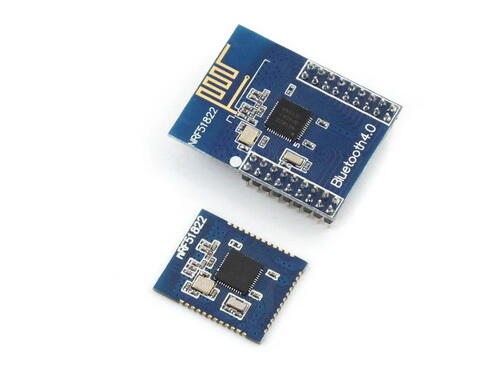
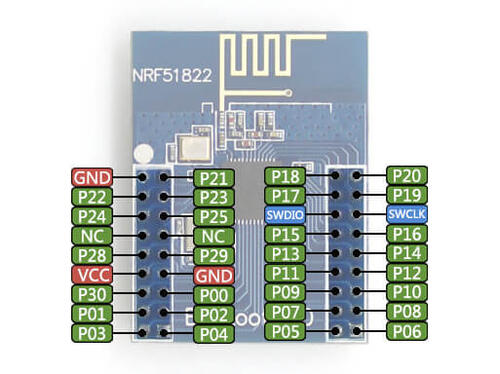
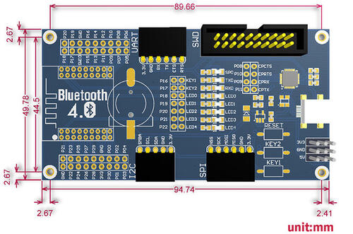

<!-- Copyright 2015-2026 Zephyr Project members and individual contributors. -->
<!-- SPDX-License-Identifier: Apache-2.0 -->
<!-- 中文翻译；编号、导航与译注为本地新增。 -->

<a id="nrf51_ble400"></a>

# 第13章\_BLE400

原文：[官方页面](https://docs.zephyrproject.org/latest/boards/waveshare/nrf51_ble400/doc/index.html)。读取日期：2026-10-16；来源摘要见[来源记录](../SOURCES.md)。

开发板概览（Board Overview）

<a id="id5"></a>

[](images/nrf51_ble400.jpg)

BLE400

名称（Name）：

`nrf51_ble400`

厂商（Vendor）：

[Waveshare Electronics微雪电子](https://docs.zephyrproject.org/latest/boards/index.html#vendor=waveshare)

状态（Status）：

当前未积极维护（Not Actively Maintained）

架构（Architecture）：

[arm](https://docs.zephyrproject.org/latest/boards/index.html#arch=arm)

片上系统（SoC）：

[nrf51822](https://docs.zephyrproject.org/latest/boards/index.html#soc=nrf51822)

<a id="board-github-link"></a>

[浏览开发板源码（Browse Board Sources）](https://github.com/zephyrproject-rtos/zephyr/blob/main//boards/waveshare/nrf51_ble400/doc/index.rst/../..)<a id="overview"></a>

## 概述（Overview）

BLE400是面向BLE蓝牙2.4 GHz无线模块的底板，与Core51822核心板配合使用。

<a id="hardware"></a>

### 硬件（Hardware）

<a id="motherboard"></a>

#### 底板（Motherboard）


- 板载电池座，支持多种供电方式
- 全部I/O均可访问，便于扩展
- 集成CP2102，原文称用于调试；它提供USB转串口功能
- 带LED及用户按键，与其他官方板卡兼容，便于使用

<a id="core-board"></a>

#### 核心板（Core Board）


- 板载芯片：nRF51822
- 通信距离：开阔室外、1 Mbit/s数据速率时30 m
- 频段：2.4 GHz
- 工作电压：2.0—3.6 V
- 工作温度：−40—85 °C
- 扩展排针：除P0.26与P0.27外的全部I/O
- 排针间距：2.00 mm
- 天线：板载天线

<a id="supported-features"></a>

### 支持的功能（Supported Features）

`nrf51_ble400`开发板支持下表所列的硬件功能。

片上／板载（On-Chip / On-Board）

功能集成在片上系统（SoC）内／位于开发板上。

2 / 2

分别表示已启用／已禁用的实例数。点击数量标签，可查看开发板或SoC设备树源码（DTS）中该功能的第一个实例。

`vnd,foo`

与此功能匹配的设备树绑定兼容字符串（Compatible String）；点击链接可查看绑定文档。

<a id="nrf51_ble400-hw-features"></a>

<a id="nrf51_ble400-nrf51_ble400/nrf51822-hw-features-section"></a>

#### `nrf51_ble400/nrf51822`目标（Target）

<a id="nrf51_ble400-nrf51_ble400/nrf51822-hw-features-panel"></a>

<a id="nrf51_ble400-nrf51_ble400/nrf51822-hw-features-memory"></a>

该开发板目标的片上存储容量：32 KiB RAM、256 KiB Flash。

<a id="nrf51_ble400-nrf51_ble400/nrf51822-hw-features-table"></a>

<table>
<tr>
<th>类型（Type）</th>
<th>位置（Location）</th>
<th>说明（Description）</th>
<th>兼容字符串（Compatible）</th>
</tr>
<tr>
<td rowspan="1">中央处理器（CPU）</td>
<td>片上（On-Chip）</td>
<td>ARM Cortex-M0处理器（CPU）（<a href="https://github.com/zephyrproject-rtos/zephyr/blob/main/dts/arm/nordic/nrf51822.dtsi?plain=1#L22">已启用：1</a>）</td>
<td><a href="../cpu_arm_riscv_binding_reference/P018_arm_cortex-m0.md#std-dtcompatible-arm-cortex-m0"><code>arm,cortex-m0</code></a></td>
</tr>
<tr>
<td rowspan="1">模数转换器（ADC）</td>
<td>片上（On-Chip）</td>
<td>Nordic nRF模数转换器（ADC）节点（<a href="https://github.com/zephyrproject-rtos/zephyr/blob/main/dts/arm/nordic/nrf51822.dtsi?plain=1#L178">已禁用：1</a>）</td>
<td><a href="../hardware/P845_NordicNRF模数转换器绑定.md#dtbinding-nordic-nrf-adc"><code>nordic,nrf-adc</code></a></td>
</tr>
<tr>
<td rowspan="3">ARM 架构（ARM Architecture）</td>
<td>片上（On-Chip）</td>
<td>Nordic用户信息配置寄存器（UICR / User Information Configuration Registers）（<a href="https://github.com/zephyrproject-rtos/zephyr/blob/main/dts/arm/nordic/nrf51822.dtsi?plain=1#L48">已启用：1</a>）</td>
<td><a href="../arm_nordic_nxp_control_binding_reference/P007_nordic_nrf-uicr.md#std-dtcompatible-nordic-nrf-uicr"><code>nordic,nrf-uicr</code></a></td>
</tr>
<tr>
<td>片上（On-Chip）</td>
<td>Nordic nRF系列内存保护单元（MPU / Memory Protection Unit）（<a href="https://github.com/zephyrproject-rtos/zephyr/blob/main/dts/arm/nordic/nrf51822.dtsi?plain=1#L97">已启用：1</a>）</td>
<td><a href="../arm_timing_ethosu_control_binding_reference/P020_nordic_nrf-mpu.md#std-dtcompatible-nordic-nrf-mpu"><code>nordic,nrf-mpu</code></a></td>
</tr>
<tr>
<td>片上（On-Chip）</td>
<td>Nordic nRF系列软件中断（SWI / Software Interrupt）（<a href="https://github.com/zephyrproject-rtos/zephyr/blob/main/dts/arm/nordic/nrf51822.dtsi?plain=1#L286">已启用：6</a>）</td>
<td><a href="../arm_nordic_nxp_control_binding_reference/P005_nordic_nrf-swi.md#std-dtcompatible-nordic-nrf-swi"><code>nordic,nrf-swi</code></a></td>
</tr>
<tr>
<td rowspan="4">时钟控制（Clock Control）</td>
<td>片上（On-Chip）</td>
<td>Nordic nRF时钟控制（Clock Control）节点（<a href="https://github.com/zephyrproject-rtos/zephyr/blob/main/dts/arm/nordic/nrf51822.dtsi?plain=1#L80">已启用：1</a>）</td>
<td><a href="../clock_sam_nordic_binding_reference/P015_nordic_nrf-clock.md#std-dtcompatible-nordic-nrf-clock"><code>nordic,nrf-clock</code></a></td>
</tr>
<tr>
<td>片上（On-Chip）</td>
<td>Nordic nRF高频时钟（HFCLK）控制节点（<a href="https://github.com/zephyrproject-rtos/zephyr/blob/main/dts/arm/nordic/nrf51822.dtsi?plain=1#L86">已启用：1</a>）</td>
<td><a href="../clock_sam_nordic_binding_reference/P009_nordic_nrf-clock-hfclk.md#std-dtcompatible-nordic-nrf-clock-hfclk"><code>nordic,nrf-clock-hfclk</code></a></td>
</tr>
<tr>
<td>片上（On-Chip）</td>
<td>Nordic nRF低频时钟（LFCLK）控制节点（<a href="https://github.com/zephyrproject-rtos/zephyr/blob/main/dts/arm/nordic/nrf51822.dtsi?plain=1#L91">已启用：1</a>）</td>
<td><a href="../clock_sam_nordic_binding_reference/P012_nordic_nrf-clock-lfclk.md#std-dtcompatible-nordic-nrf-clock-lfclk"><code>nordic,nrf-clock-lfclk</code></a></td>
</tr>
<tr>
<td>片上（On-Chip）</td>
<td>Nordic nRF高频晶体振荡器，nRF51系列（<a href="https://github.com/zephyrproject-rtos/zephyr/blob/main/dts/arm/nordic/nrf51822.dtsi?plain=1#L30">已启用：1</a>）</td>
<td><a href="../clock_sam_nordic_binding_reference/P021_nordic_nrf51-hfxo.md#std-dtcompatible-nordic-nrf51-hfxo"><code>nordic,nrf51-hfxo</code></a></td>
</tr>
<tr>
<td rowspan="1">比较器（Comparator）</td>
<td>片上（On-Chip）</td>
<td>Nordic nRF低功耗模拟比较器（LPCOMP）（<a href="https://github.com/zephyrproject-rtos/zephyr/blob/main/dts/arm/nordic/nrf51822.dtsi?plain=1#L278">已禁用：1</a>）</td>
<td><a href="../hardware/P753_NordicnRF低功耗比较器绑定.md#dtbinding-nordic-nrf-lpcomp"><code>nordic,nrf-lpcomp</code></a></td>
</tr>
<tr>
<td rowspan="1">计数器（Counter）</td>
<td>片上（On-Chip）</td>
<td>Nordic nRF定时器（Timer）节点（<a href="https://github.com/zephyrproject-rtos/zephyr/blob/main/dts/arm/nordic/nrf51822.dtsi?plain=1#L186">已禁用：3</a>）</td>
<td><a href="../microchip_soc_counter_binding_reference/P017_nordic_nrf-timer.md#std-dtcompatible-nordic-nrf-timer"><code>nordic,nrf-timer</code></a></td>
</tr>
<tr>
<td rowspan="2">密码学加速器（Cryptographic Accelerator）</td>
<td>片上（On-Chip）</td>
<td>Nordic ECB（AES电子密码本模式加密 / Electronic Codebook Mode Encryption）（<a href="https://github.com/zephyrproject-rtos/zephyr/blob/main/dts/arm/nordic/nrf51822.dtsi?plain=1#L240">已启用：1</a>）</td>
<td><a href="../crypto_secure_engine_st_ti_binding_reference/P001_nordic_nrf-ecb.md#std-dtcompatible-nordic-nrf-ecb"><code>nordic,nrf-ecb</code></a></td>
</tr>
<tr>
<td>片上（On-Chip）</td>
<td>Nordic nRF系列CCM（AES CCM模式加密 / CCM Mode Encryption）（<a href="https://github.com/zephyrproject-rtos/zephyr/blob/main/dts/arm/nordic/nrf51822.dtsi?plain=1#L247">已启用：1</a>）</td>
<td><a href="../crypto_aes_sha_ccm_binding_reference/P020_nordic_nrf-ccm.md#std-dtcompatible-nordic-nrf-ccm"><code>nordic,nrf-ccm</code></a></td>
</tr>
<tr>
<td rowspan="1">闪存控制器（Flash Controller）</td>
<td>片上（On-Chip）</td>
<td>Nordic非易失性存储器控制器（NVMC / Non-Volatile Memory Controller）（<a href="https://github.com/zephyrproject-rtos/zephyr/blob/main/dts/arm/nordic/nrf51822.dtsi?plain=1#L328">已启用：1</a>）</td>
<td><a href="../flash_adi_microchip_nordic_binding_reference/P029_nordic_nrf51-flash-controller.md#std-dtcompatible-nordic-nrf51-flash-controller"><code>nordic,nrf51-flash-controller</code></a></td>
</tr>
<tr>
<td rowspan="2">通用输入输出与接插件（GPIO &amp; Headers）</td>
<td>片上（On-Chip）</td>
<td>NRF5 GPIO任务与事件（GPIOTE）（<a href="https://github.com/zephyrproject-rtos/zephyr/blob/main/dts/arm/nordic/nrf51822.dtsi?plain=1#L170">已启用：1</a>）</td>
<td><a href="../gpio_microchip_nordic_nuvoton_binding_reference/P017_nordic_nrf-gpiote.md#std-dtcompatible-nordic-nrf-gpiote"><code>nordic,nrf-gpiote</code></a></td>
</tr>
<tr>
<td>片上（On-Chip）</td>
<td>NRF5通用输入输出（GPIO）（<a href="https://github.com/zephyrproject-rtos/zephyr/blob/main/dts/arm/nordic/nrf51822.dtsi?plain=1#L351">已启用：1</a>）</td>
<td><a href="../gpio_microchip_nordic_nuvoton_binding_reference/P016_nordic_nrf-gpio.md#std-dtcompatible-nordic-nrf-gpio"><code>nordic,nrf-gpio</code></a></td>
</tr>
<tr>
<td rowspan="1">集成电路间总线（I2C）</td>
<td>片上（On-Chip）</td>
<td>Nordic nRF系列双线接口（TWI，TWI主机）（<a href="https://github.com/zephyrproject-rtos/zephyr/blob/main/dts/arm/nordic/nrf51822.dtsi?plain=1#L133">已启用：1</a>；<a href="https://github.com/zephyrproject-rtos/zephyr/blob/main/dts/arm/nordic/nrf51822.dtsi?plain=1#L160">已禁用：1</a>）</td>
<td><a href="../i2c_infineon_ite_nordic_binding_reference/P015_nordic_nrf-twi.md#std-dtcompatible-nordic-nrf-twi"><code>nordic,nrf-twi</code></a></td>
</tr>
<tr>
<td rowspan="1">输入（Input）</td>
<td>板载（On-Board）</td>
<td>一组绑定到 GPIO 的输入按键（GPIO-Bound Input Keys）（<a href="https://github.com/zephyrproject-rtos/zephyr/blob/main/boards/waveshare/nrf51_ble400/nrf51_ble400.dts?plain=1#L66">已启用：1</a>）</td>
<td><a href="../hardware/P563_GPIO按键绑定.md#std-dtcompatible-gpio-keys"><code>gpio-keys</code></a></td>
</tr>
<tr>
<td rowspan="1">中断控制器（Interrupt Controller）</td>
<td>片上（On-Chip）</td>
<td>ARMv6-M嵌套向量中断控制器（NVIC / Nested Vectored Interrupt Controller）（<a href="https://github.com/zephyrproject-rtos/zephyr/blob/main/dts/arm/armv6-m.dtsi?plain=1#L13">已启用：1</a>）</td>
<td><a href="../arm_interrupt_timer_binding_reference/P001_ARMv6_M_NVIC.md#std-dtcompatible-arm-v6m-nvic"><code>arm,v6m-nvic</code></a></td>
</tr>
<tr>
<td rowspan="1">发光二极管（LED）</td>
<td>板载（On-Board）</td>
<td>一组由 GPIO 控制的 LED（GPIO-Controlled LEDs）（<a href="https://github.com/zephyrproject-rtos/zephyr/blob/main/boards/waveshare/nrf51_ble400/nrf51_ble400.dts?plain=1#L37">已启用：1</a>）</td>
<td><a href="../hardware/P564_GPIO指示灯绑定.md#dtbinding-gpio-leds"><code>gpio-leds</code></a></td>
</tr>
<tr>
<td rowspan="2">其他绑定（Miscellaneous）</td>
<td>片上（On-Chip）</td>
<td>Nordic工厂信息配置寄存器（FICR / Factory Information Configuration Registers）（<a href="https://github.com/zephyrproject-rtos/zephyr/blob/main/dts/arm/nordic/nrf51822.dtsi?plain=1#L41">已启用：1</a>）</td>
<td><a href="../misc_adi_nordic_binding_reference/P018_nordic_nrf-ficr.md#std-dtcompatible-nordic-nrf-ficr"><code>nordic,nrf-ficr</code></a></td>
</tr>
<tr>
<td>片上（On-Chip）</td>
<td>Nordic nRF系列可编程外设互连（PPI / Programmable Peripheral Interconnect）（<a href="https://github.com/zephyrproject-rtos/zephyr/blob/main/dts/arm/nordic/nrf51822.dtsi?plain=1#L345">已启用：1</a>）</td>
<td><a href="../misc_adi_nordic_binding_reference/P020_nordic_nrf-ppi.md#std-dtcompatible-nordic-nrf-ppi"><code>nordic,nrf-ppi</code></a></td>
</tr>
<tr>
<td rowspan="1">存储技术设备（MTD）</td>
<td>片上（On-Chip）</td>
<td>闪存（Flash）节点（<a href="https://github.com/zephyrproject-rtos/zephyr/blob/main/dts/arm/nordic/nrf51822.dtsi?plain=1#L335">已启用：1</a>）</td>
<td><a href="../mtd_nxp_st_ti_partition_binding_reference/P013_soc-nv-flash.md#std-dtcompatible-soc-nv-flash"><code>soc-nv-flash</code></a></td>
</tr>
<tr>
<td rowspan="1">网络（Networking）</td>
<td>片上（On-Chip）</td>
<td>Nordic nRF系列无线电（RADIO）外设（<a href="https://github.com/zephyrproject-rtos/zephyr/blob/main/dts/arm/nordic/nrf51822.dtsi?plain=1#L103">已启用：1</a>）</td>
<td><a href="../network_radio_frontend_binding_reference/P009_nordic_nrf-radio.md#std-dtcompatible-nordic-nrf-radio"><code>nordic,nrf-radio</code></a></td>
</tr>
<tr>
<td rowspan="1">引脚控制（Pin Control）</td>
<td>片上（On-Chip）</td>
<td>Nordic nRF系列引脚控制器（Pin Controller）（<a href="https://github.com/zephyrproject-rtos/zephyr/blob/main/dts/vendor/nordic/nrf_common.dtsi?plain=1#L26">已启用：1</a>）</td>
<td><a href="../pinctrl_infineon_nordic_nxp_binding_reference/P009_nordic_nrf-pinctrl.md#std-dtcompatible-nordic-nrf-pinctrl"><code>nordic,nrf-pinctrl</code></a></td>
</tr>
<tr>
<td rowspan="1">电源管理（Power Management）</td>
<td>片上（On-Chip）</td>
<td>Nordic nRF电源控制（Power Control）节点（<a href="https://github.com/zephyrproject-rtos/zephyr/blob/main/dts/arm/nordic/nrf51822.dtsi?plain=1#L63">已启用：1</a>）</td>
<td><a href="../power_control_binding_reference/P008_nordic_nrf-power.md#std-dtcompatible-nordic-nrf-power"><code>nordic,nrf-power</code></a></td>
</tr>
<tr>
<td rowspan="1">脉宽调制（PWM）</td>
<td>片上（On-Chip）</td>
<td>nRFx软件脉宽调制（S/W PWM）（<a href="https://github.com/zephyrproject-rtos/zephyr/blob/main/dts/vendor/nordic/nrf_common.dtsi?plain=1#L39">已禁用：1</a>）</td>
<td><a href="../pwm_intel_microchip_nxp_binding_reference/P016_nordic_nrf-sw-pwm.md#std-dtcompatible-nordic-nrf-sw-pwm"><code>nordic,nrf-sw-pwm</code></a></td>
</tr>
<tr>
<td rowspan="1">保持存储器（Retained Memory）</td>
<td>片上（On-Chip）</td>
<td>Nordic通用保持寄存器（GPREGRET / General Purpose Register Retention）设备（<a href="https://github.com/zephyrproject-rtos/zephyr/blob/main/dts/arm/nordic/nrf51822.dtsi?plain=1#L71">已启用：1</a>）</td>
<td><a href="../hardware/P627_Nordic通用保留寄存器绑定.md#dtbinding-nordic-nrf-gpregret"><code>nordic,nrf-gpregret</code></a></td>
</tr>
<tr>
<td rowspan="1">随机数生成器（RNG）</td>
<td>片上（On-Chip）</td>
<td>Nordic nRF系列随机数发生器（RNG / Random Number Generator）（<a href="https://github.com/zephyrproject-rtos/zephyr/blob/main/dts/arm/nordic/nrf51822.dtsi?plain=1#L233">已启用：1</a>）</td>
<td><a href="../rng_binding_reference/P014_nordic_nrf-rng.md#std-dtcompatible-nordic-nrf-rng"><code>nordic,nrf-rng</code></a></td>
</tr>
<tr>
<td rowspan="1">实时时钟（RTC）</td>
<td>片上（On-Chip）</td>
<td>Nordic nRF实时时间计数器（RTC / Real-Time Counter）（<a href="https://github.com/zephyrproject-rtos/zephyr/blob/main/dts/arm/nordic/nrf51822.dtsi?plain=1#L216">已禁用：2</a>）</td>
<td><a href="../microchip_microcrystal_nxp_rtc_binding_reference/P010_nordic_nrf-rtc.md#std-dtcompatible-nordic-nrf-rtc"><code>nordic,nrf-rtc</code></a></td>
</tr>
<tr>
<td rowspan="2">传感器（Sensors）</td>
<td>片上（On-Chip）</td>
<td>Nordic nRF系列温度（TEMP）节点（<a href="https://github.com/zephyrproject-rtos/zephyr/blob/main/dts/arm/nordic/nrf51822.dtsi?plain=1#L226">已启用：1</a>）</td>
<td><a href="../sensor_microchip_nordic_nxp_binding_reference/P023_nordic_nrf-temp.md#std-dtcompatible-nordic-nrf-temp"><code>nordic,nrf-temp</code></a></td>
</tr>
<tr>
<td>片上（On-Chip）</td>
<td>Nordic nRF正交解码器（QDEC / Quadrature Decoder）节点（<a href="https://github.com/zephyrproject-rtos/zephyr/blob/main/dts/arm/nordic/nrf51822.dtsi?plain=1#L271">已禁用：1</a>）</td>
<td><a href="../sensor_microchip_nordic_nxp_binding_reference/P021_nordic_nrf-qdec.md#std-dtcompatible-nordic-nrf-qdec"><code>nordic,nrf-qdec</code></a></td>
</tr>
<tr>
<td rowspan="1">串行控制器（Serial Controller）</td>
<td>片上（On-Chip）</td>
<td>Nordic nRF系列通用异步收发器（UART）（<a href="https://github.com/zephyrproject-rtos/zephyr/blob/main/dts/arm/nordic/nrf51822.dtsi?plain=1#L115">已启用：1</a>）</td>
<td><a href="../uart_microchip_nordic_nxp_binding_reference/P003_nordic_nrf-uart.md#std-dtcompatible-nordic-nrf-uart"><code>nordic,nrf-uart</code></a></td>
</tr>
<tr>
<td rowspan="1">串行外设接口（SPI）</td>
<td>片上（On-Chip）</td>
<td>Nordic nRF系列串行外设接口（SPI）控制器（<a href="https://github.com/zephyrproject-rtos/zephyr/blob/main/dts/arm/nordic/nrf51822.dtsi?plain=1#L143">已启用：1</a>；<a href="https://github.com/zephyrproject-rtos/zephyr/blob/main/dts/arm/nordic/nrf51822.dtsi?plain=1#L122">已禁用：1</a>）</td>
<td><a href="../spi_microchip_nordic_nxp_binding_reference/P012_nordic_nrf-spi.md#std-dtcompatible-nordic-nrf-spi"><code>nordic,nrf-spi</code></a></td>
</tr>
<tr>
<td rowspan="1">静态随机存储器（SRAM）</td>
<td>片上（On-Chip）</td>
<td>通用片上静态随机存储器（SRAM）（<a href="https://github.com/zephyrproject-rtos/zephyr/blob/main/dts/arm/nordic/nrf51822.dtsi?plain=1#L57">已启用：1</a>）</td>
<td><a href="../hardware/P567_内存映射SRAM绑定.md#dtbinding-mmio-sram"><code>mmio-sram</code></a></td>
</tr>
<tr>
<td rowspan="1">看门狗（Watchdog）</td>
<td>片上（On-Chip）</td>
<td>Nordic nRF系列看门狗定时器（WDT / Watchdog Timer）（<a href="https://github.com/zephyrproject-rtos/zephyr/blob/main/dts/arm/nordic/nrf51822.dtsi?plain=1#L254">已启用：1</a>）</td>
<td><a href="../nxp_nordic_nuvoton_watchdog_binding_reference/P002_nordic_nrf-wdt.md#std-dtcompatible-nordic-nrf-wdt"><code>nordic,nrf-wdt</code></a></td>
</tr>
</table>

<a id="features"></a>

### 功能（Features）


- 2.4 GHz多协议射频收发器（RF Transceiver）
- 32位ARM Cortex-M0处理器
- 128位高级加密标准（AES）硬件加密
- 256 kB闪存及32 kB RAM
- 可编程外设互连（Programmable Peripheral Interconnect，PPI）
- 数字接口：SPI、I2C、UART
- 10位模数转换器（ADC）
- 可编程输出功率：−20至+4 dBm
- 独立的应用开发与协议栈
- 完全兼容NRF24L系列
- 引脚布局兼容NRF51xxx系列
- 全局独立电源管理；原文为Global separate power management
- 工作电压：1.8—3.6 V

<a id="revision-history"></a>

### 修订历史（Revision History）

<a id="id1"></a>

#### 核心板（Core Board）

2015年6月，Core51822及Core51822（B）的板载芯片升级到Rev3，即带32 kB RAM的nRF51822_QFAC。



上：Core51822；下：Core51822（B）

<a id="connections-and-ios"></a>

### 连接与输入输出（Connections and IOs）

<a id="id2"></a>

#### 底板（Motherboard）


1. 无线模块连接器，便于连接Core51822等模块
2. MCU引脚扩展连接器
3. I2C接口
4. 串行外设接口（SPI）
5. 5 V／3.3 V电源输入输出，通常用作输出，并与用户其他板卡共地
6. USB连接器，经CP2102转换为UART
7. 调试接口（Debugging Interface）
8. 通用异步收发器接口（UART）
9. 电池座（Battery Holder）
10. 用户LED
11. 用户按键（User Keys）
12. 复位按键（Reset Button）
13. CP2102
14. USB转UART跳线
15. LED及按键跳线

<a id="id3"></a>

#### 核心板（Core Board）



<a id="ble400-dimensions"></a>

### BLE400尺寸图



<a id="id4"></a>

### 连接与输入输出（Connections and IOs）

<a id="led"></a>

#### 发光二极管（LED）


- LED0（红色）= P0.18
- LED1（红色）= P0.19
- LED2（红色）= P0.20
- LED3（红色）= P0.21
- LED4（红色）= P0.22
- SUSPEND = SUSPEND
- RXD1 = P0.9
- TXD1 = P0.11

<a id="push-buttons"></a>

#### 按键（Push Buttons）


- KEY1 = P0.16
- KEY2 = P0.17
- RESET = SWDIO

<a id="i2c"></a>

#### 集成电路间总线（I2C）


- SMBA = P0.02
- SCL = P0.01
- SDA = P0.00

<a id="spi"></a>

#### 串行外设接口（SPI）


- NSS = P0.30
- `SCK = P0.25`
- MOSI = P0.24
- MISO = P0.23

<a id="usart1"></a>

#### USART1


- RX = P0.05
- TX = P0.06
- 清除发送（CTS）= P0.07
- RTS = P0.12

<a id="uart-usb"></a>

#### 经USB连接的UART


- RX = P0.9
- TX = P0.11
- CTS = P0.8
- RTS = P0.10

<a id="programming-and-debugging"></a>

## 烧录与调试（Programming and Debugging）

`nrf51_ble400`开发板支持下表所列的运行工具（Runners）及相关west命令。

<table>
<tr>
<th></th>
<th>烧录（flash）</th>
<th>调试（debug）</th>
<th>连接调试会话（attach）</th>
<th>实时传输（rtt）</th>
<th>复位（reset）</th>
<th>调试服务器（debugserver）</th>
</tr>
<tr>
<td><a href="https://docs.zephyrproject.org/latest/develop/flash_debug/host-tools.html#runner-jlink">jlink</a></td>
<td>✅</td>
<td>✅（默认 / default）</td>
<td>✅</td>
<td>✅</td>
<td>✅</td>
<td>✅</td>
</tr>
<tr>
<td>nrfjprog</td>
<td>✅</td>
<td></td>
<td></td>
<td></td>
<td></td>
<td></td>
</tr>
<tr>
<td>nrfutil</td>
<td>✅（默认 / default）</td>
<td></td>
<td></td>
<td></td>
<td></td>
<td></td>
</tr>
</table>

<a id="flashing"></a>

### 烧录（Flashing）

按照[Nordic nRF5x Segger J-Link](../debugging/P005_Nordic_Segger_JLink.md#nordic-segger)页面安装并配置所需软件，更多信息见[烧录（Flashing）](../debugging/P005_Nordic_Segger_JLink.md#nordic-segger-flashing)。随后按常规方式构建和烧录应用；详见[构建应用（Building an Application）](../application/P001_应用开发.md#build-an-application)和[运行应用（Run an Application）](https://docs.zephyrproject.org/latest/develop/application/index.html#application-run)。

下面以[Hello World](../getting_started/P005_HelloWorld示例.md#hello_world)应用为例。

首先运行常用终端程序查看输出。

```text
$ minicom -D <tty_device> -b 115200
```

将`<tty_device>`替换为开发板nRF51 DK所在串口（板名依原文保留），例如Linux上的`/dev/ttyACM0`。

随后按通常方式构建并烧录应用。

```text
# From the root of the zephyr repository
west build -b nrf51_ble400 samples/hello_world
west flash
```

<a id="debugging"></a>

### 调试（Debugging）

参阅[Nordic nRF5x Segger J-Link](../debugging/P005_Nordic_Segger_JLink.md#nordic-segger)页面，了解如何使用Segger芯片调试Nordic开发板。

<a id="testing-the-leds-and-buttons-in-the-nrf51-dk"></a>

## 测试nRF51 DK上的LED及按键（Buttons）

下列示例可测试板上按键及LED是否与Zephyr正常配合：


- [闪灯（Blinky）](../getting_started/P004_LED闪烁示例.md#blinky)
- [按键（Button）](../basic_samples/P003_按钮输入.md#button)
- [LED渐变（Fade LED）](../basic_samples/P005_LED渐变.md#fade-led)
- [基本线程操作（Basic Thread Manipulation）](../basic_samples/P002_基本线程操作.md#multi-thread-blinky)

可构建并烧录示例确认Zephyr正常运行，按键与LED定义见[boards/waveshare/nrf51_ble400/nrf51_ble400.dts](https://github.com/zephyrproject-rtos/zephyr/blob/main/boards/waveshare/nrf51_ble400/nrf51_ble400.dts)。

<a id="references"></a>

## 参考资料（References）

## 译注

BLE400为Core51822底板；CP2102仅提供USB串口。2015年6月起Rev3芯片提供32 kB RAM；原文模块与芯片电压范围分别保留。

---

[上一章](P012_Waveshare_Electronics.md) · [返回大纲](大纲.md) · [全站翻译进度](../PROGRESS.md) · [下一章](P014_Open103Z.md)
