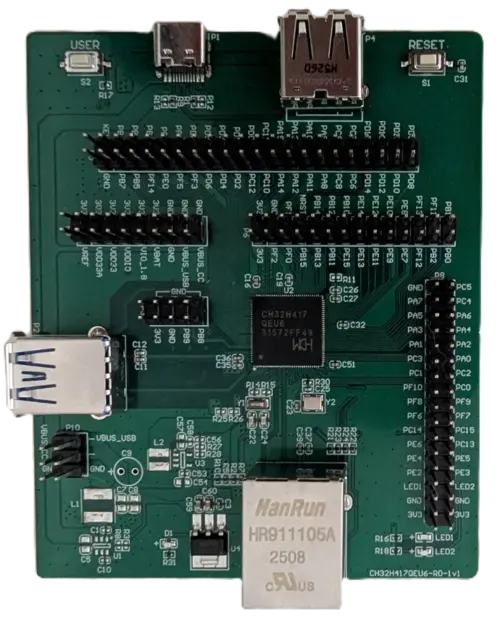

<!-- Copyright 2015-2026 Zephyr Project members and individual contributors. -->
<!-- SPDX-License-Identifier: Apache-2.0 -->
<!-- 中文翻译；编号、导航与译注为本地新增。 -->

<a id="ch32h417evt"></a>

# 第22章\_WCH CH32H417EVT

原文：[官方页面](https://docs.zephyrproject.org/latest/boards/wch/ch32h417evt/doc/index.html)。读取日期：2026-10-16；来源摘要见[来源记录](../SOURCES.md)。

开发板概览（Board Overview）

<a id="id1"></a>

[](images/ch32h417evt.webp)

WCH CH32H417EVT

名称（Name）：

`ch32h417evt`

厂商（Vendor）：

[WinChipHead](https://docs.zephyrproject.org/latest/boards/index.html#vendor=wch)

状态（Status）：

维护中（Maintained）

架构（Architecture）：

[`riscv`](https://docs.zephyrproject.org/latest/boards/index.html#arch=riscv)

片上系统（SoC）：

[ch32h417](https://docs.zephyrproject.org/latest/boards/index.html#soc=ch32h417)

<a id="board-github-link"></a>

[浏览开发板源码（Browse Board Sources）](https://github.com/zephyrproject-rtos/zephyr/blob/main//boards/wch/ch32h417evt/doc/index.rst/../..)<a id="overview"></a>

## 概述（Overview）

<a id="id6"></a>

[WCH](http://www.wch-ic.com)[注1](#id5) CH32H417EVT是CH32H417 SoC评估板，具有两个非对称RISC-V核：


- 青稞（QingKe）V3F启动核，硬件线程hart 0
- 青稞（QingKe）V5F应用核，硬件线程hart 1

CH32H417通过Zephyr硬件模型v2的CPU集群目标支持非对称多处理（AMP）。它不是对称多处理（SMP）系统，不得启用CONFIG_SMP。V3F和V5F镜像须分别构建。

冷复位后只有V3F执行。V5F不会自行启动，须由V3F固件通过CH32H417可编程快速中断控制器（PFIC）的唤醒机制启动。推荐应用目标为ch32h417evt/ch32h417/v5f。

<a id="hardware"></a>

## 硬件（Hardware）

当前支持将V5F配置为480 MHz，HCLK及USART时钟域为120 MHz。原文验证的控制台为USART8 TX，PB4、复用功能11，115200波特率。

V5F Zephyr镜像链接地址为0x08010000，使用0x200c0400的V5F数据紧耦合存储器（DTCM）。V3F唤醒镜像链接到0x00000000。CH32H417将主闪存组映射到低地址0x00000000窗口，因此V5F的0x08010000与下方OpenOCD命令的0x10000偏移指向同一物理闪存。

<a id="supported-features"></a>

### 支持的功能（Supported Features）

`ch32h417evt`开发板支持下表所列的硬件功能。

片上／板载（On-Chip / On-Board）

功能集成在片上系统（SoC）内／位于开发板上。

2 / 2

分别表示已启用／已禁用的实例数。点击数量标签，可查看开发板或SoC设备树源码（DTS）中该功能的第一个实例。

`vnd,foo`

与此功能匹配的设备树绑定兼容字符串（Compatible String）；点击链接可查看绑定文档。

<a id="ch32h417evt-hw-features"></a>

<a id="ch32h417evt-ch32h417evt/ch32h417/v3f-hw-features-section"></a>

#### `ch32h417evt/ch32h417/v3f`目标（Target）

<a id="ch32h417evt-ch32h417evt/ch32h417/v3f-hw-features-panel"></a>

<a id="ch32h417evt-ch32h417evt/ch32h417/v3f-hw-features-memory"></a>

此目标可用存储：458496 B RAM、64 KiB闪存。

<a id="ch32h417evt-ch32h417evt/ch32h417/v3f-hw-features-table"></a>

<table>
<tr>
<th>类型（Type）</th>
<th>位置（Location）</th>
<th>说明（Description）</th>
<th>兼容字符串（Compatible）</th>
</tr>
<tr>
<td rowspan="1">中央处理器（CPU）</td>
<td>片上（On-Chip）</td>
<td>WCH青稞V3F RISC-V微控制器（MCU）（<a href="https://github.com/zephyrproject-rtos/zephyr/blob/main/dts/riscv/wch/qingke-v3f.dtsi?plain=1#L25">已启用：1</a>）</td>
<td><a href="../cpu_vendor_multiarc_binding_reference/P050_wch_qingke-v3f.md#std-dtcompatible-wch-qingke-v3f"><code>wch,qingke-v3f</code></a></td>
</tr>
<tr>
<td rowspan="4">时钟控制（Clock Control）</td>
<td>片上（On-Chip）</td>
<td>WCH CH32V00x复位及时钟控制（RCC）（<a href="https://github.com/zephyrproject-rtos/zephyr/blob/main/dts/riscv/wch/ch32h417/ch32h417.dtsi?plain=1#L101">已启用：1</a>）</td>
<td><a href="../timer_reference/P185_WCH复位与时钟控制绑定.md#dtbinding-wch-rcc"><code>wch,rcc</code></a></td>
</tr>
<tr>
<td>片上（On-Chip）</td>
<td>WCH CH32V00x高速外部时钟（HSE）（<a href="https://github.com/zephyrproject-rtos/zephyr/blob/main/dts/riscv/wch/ch32h417/ch32h417.dtsi?plain=1#L19">已禁用：1</a>）</td>
<td><a href="../timer_reference/P186_CH32V00x高速外部时钟绑定.md#dtbinding-wch-ch32v00x-hse-clock"><code>wch,ch32v00x-hse-clock</code></a></td>
</tr>
<tr>
<td>片上（On-Chip）</td>
<td>WCH CH32V00x高速内部时钟（HSI）（<a href="https://github.com/zephyrproject-rtos/zephyr/blob/main/dts/riscv/wch/ch32h417/ch32h417.dtsi?plain=1#L26">已禁用：1</a>）</td>
<td><a href="../timer_reference/P187_CH32V00x高速内部时钟绑定.md#dtbinding-wch-ch32v00x-hsi-clock"><code>wch,ch32v00x-hsi-clock</code></a></td>
</tr>
<tr>
<td>片上（On-Chip）</td>
<td>WCH CH32H41X锁相环（PLL）（<a href="https://github.com/zephyrproject-rtos/zephyr/blob/main/dts/riscv/wch/ch32h417/ch32h417.dtsi?plain=1#L33">已禁用：1</a>）</td>
<td><a href="../timer_reference/P190_CH32H41x锁相环时钟绑定.md#dtbinding-wch-ch32h41x-pll-clock"><code>wch,ch32h41x-pll-clock</code></a></td>
</tr>
<tr>
<td rowspan="1">通用输入输出与接插件（GPIO &amp; Headers）</td>
<td>片上（On-Chip）</td>
<td>WCH CH32V00x通用输入／输出（GPIO）（<a href="https://github.com/zephyrproject-rtos/zephyr/blob/main/dts/riscv/wch/ch32h417/ch32h417.dtsi?plain=1#L62">已禁用：2</a>）</td>
<td><a href="../gpio_ti_xilinx_sdl_binding_reference/P024_wch_gpio.md#std-dtcompatible-wch-gpio"><code>wch,gpio</code></a></td>
</tr>
<tr>
<td rowspan="1">中断控制器（Interrupt Controller）</td>
<td>片上（On-Chip）</td>
<td>WCH CH32V00x可编程快速中断控制器（PFIC）（<a href="https://github.com/zephyrproject-rtos/zephyr/blob/main/dts/riscv/wch/qingke-v3f.dtsi?plain=1#L42">已启用：1</a>）</td>
<td><a href="../mcu_external_interrupt_binding_reference/P006_wch_pfic.md#std-dtcompatible-wch-pfic"><code>wch,pfic</code></a></td>
</tr>
<tr>
<td rowspan="1">存储技术设备（MTD）</td>
<td>片上（On-Chip）</td>
<td>闪存（Flash）节点（<a href="https://github.com/zephyrproject-rtos/zephyr/blob/main/dts/riscv/wch/ch32h417/ch32h417_v3f.dtsi?plain=1#L22">已启用：1</a>）</td>
<td><a href="../mtd_nxp_st_ti_partition_binding_reference/P013_soc-nv-flash.md#std-dtcompatible-soc-nv-flash"><code>soc-nv-flash</code></a></td>
</tr>
<tr>
<td rowspan="1">引脚控制（Pin Control）</td>
<td>片上（On-Chip）</td>
<td>WCH CH32H41x复用功能I/O（AFIO）（<a href="https://github.com/zephyrproject-rtos/zephyr/blob/main/dts/riscv/wch/ch32h417/ch32h417.dtsi?plain=1#L55">已启用：1</a>）</td>
<td><a href="../pinctrl_stm32_ti_xilinx_binding_reference/P020_wch_h41x-afio.md#std-dtcompatible-wch-h41x-afio"><code>wch,h41x-afio</code></a></td>
</tr>
<tr>
<td rowspan="1">复位控制器（Reset Controller）</td>
<td>片上（On-Chip）</td>
<td>CH32复位及时钟控制（RCC）的复位控制器（<a href="https://github.com/zephyrproject-rtos/zephyr/blob/main/dts/riscv/wch/ch32h417/ch32h417.dtsi?plain=1#L107">已启用：1</a>）</td>
<td><a href="../reset_controller_binding_reference/P019_wch_ch32-rcc-rctl.md#std-dtcompatible-wch-ch32-rcc-rctl"><code>wch,ch32-rcc-rctl</code></a></td>
</tr>
<tr>
<td rowspan="1">串行控制器（Serial Controller）</td>
<td>片上（On-Chip）</td>
<td>WCH CH32V00x UART（<a href="https://github.com/zephyrproject-rtos/zephyr/blob/main/dts/riscv/wch/ch32h417/ch32h417.dtsi?plain=1#L81">已禁用：2</a>）</td>
<td><a href="../uart_ti_wch_virtual_binding_reference/P007_wch_usart.md#std-dtcompatible-wch-usart"><code>wch,usart</code></a></td>
</tr>
<tr>
<td rowspan="1">静态随机存储器（SRAM）</td>
<td>片上（On-Chip）</td>
<td>通用片上静态随机存储器（SRAM）（<a href="https://github.com/zephyrproject-rtos/zephyr/blob/main/dts/riscv/wch/ch32h417/ch32h417_v3f.dtsi?plain=1#L14">已启用：1</a>）</td>
<td><a href="../hardware/P567_内存映射SRAM绑定.md#dtbinding-mmio-sram"><code>mmio-sram</code></a></td>
</tr>
<tr>
<td rowspan="1">定时器（Timer）</td>
<td>片上（On-Chip）</td>
<td>WCH CH32V00x系统节拍（Systick）（<a href="https://github.com/zephyrproject-rtos/zephyr/blob/main/dts/riscv/wch/qingke-v3f.dtsi?plain=1#L51">已启用：1</a>）</td>
<td><a href="../system_timer_binding_reference/P014_wch_systick.md#std-dtcompatible-wch-systick"><code>wch,systick</code></a></td>
</tr>
</table>

<a id="ch32h417evt-ch32h417evt/ch32h417/v5f-hw-features-section"></a>

#### `ch32h417evt/ch32h417/v5f`目标（Target）

<a id="ch32h417evt-ch32h417evt/ch32h417/v5f-hw-features-panel"></a>

<a id="ch32h417evt-ch32h417evt/ch32h417/v5f-hw-features-memory"></a>

此目标可用存储：255 KiB RAM、480 KiB闪存。

<a id="ch32h417evt-ch32h417evt/ch32h417/v5f-hw-features-table"></a>

<table>
<tr>
<th>类型（Type）</th>
<th>位置（Location）</th>
<th>说明（Description）</th>
<th>兼容字符串（Compatible）</th>
</tr>
<tr>
<td rowspan="1">中央处理器（CPU）</td>
<td>片上（On-Chip）</td>
<td>WCH青稞V5F RISC-V微控制器（MCU）（<a href="https://github.com/zephyrproject-rtos/zephyr/blob/main/dts/riscv/wch/qingke-v5f.dtsi?plain=1#L25">已启用：1</a>）</td>
<td><a href="../cpu_vendor_multiarc_binding_reference/P054_wch_qingke-v5f.md#std-dtcompatible-wch-qingke-v5f"><code>wch,qingke-v5f</code></a></td>
</tr>
<tr>
<td rowspan="4">时钟控制（Clock Control）</td>
<td>片上（On-Chip）</td>
<td>WCH CH32V00x复位及时钟控制（RCC）（<a href="https://github.com/zephyrproject-rtos/zephyr/blob/main/dts/riscv/wch/ch32h417/ch32h417.dtsi?plain=1#L101">已启用：1</a>）</td>
<td><a href="../timer_reference/P185_WCH复位与时钟控制绑定.md#dtbinding-wch-rcc"><code>wch,rcc</code></a></td>
</tr>
<tr>
<td>片上（On-Chip）</td>
<td>WCH CH32V00x高速外部时钟（HSE）（<a href="https://github.com/zephyrproject-rtos/zephyr/blob/main/dts/riscv/wch/ch32h417/ch32h417.dtsi?plain=1#L19">已启用：1</a>）</td>
<td><a href="../timer_reference/P186_CH32V00x高速外部时钟绑定.md#dtbinding-wch-ch32v00x-hse-clock"><code>wch,ch32v00x-hse-clock</code></a></td>
</tr>
<tr>
<td>片上（On-Chip）</td>
<td>WCH CH32V00x高速内部时钟（HSI）（<a href="https://github.com/zephyrproject-rtos/zephyr/blob/main/dts/riscv/wch/ch32h417/ch32h417.dtsi?plain=1#L26">已禁用：1</a>）</td>
<td><a href="../timer_reference/P187_CH32V00x高速内部时钟绑定.md#dtbinding-wch-ch32v00x-hsi-clock"><code>wch,ch32v00x-hsi-clock</code></a></td>
</tr>
<tr>
<td>片上（On-Chip）</td>
<td>WCH CH32H41X锁相环（PLL）（<a href="https://github.com/zephyrproject-rtos/zephyr/blob/main/dts/riscv/wch/ch32h417/ch32h417.dtsi?plain=1#L33">已启用：1</a>）</td>
<td><a href="../timer_reference/P190_CH32H41x锁相环时钟绑定.md#dtbinding-wch-ch32h41x-pll-clock"><code>wch,ch32h41x-pll-clock</code></a></td>
</tr>
<tr>
<td rowspan="1">通用输入输出与接插件（GPIO &amp; Headers）</td>
<td>片上（On-Chip）</td>
<td>WCH CH32V00x通用输入／输出（GPIO）（<a href="https://github.com/zephyrproject-rtos/zephyr/blob/main/dts/riscv/wch/ch32h417/ch32h417.dtsi?plain=1#L62">已启用：2</a>）</td>
<td><a href="../gpio_ti_xilinx_sdl_binding_reference/P024_wch_gpio.md#std-dtcompatible-wch-gpio"><code>wch,gpio</code></a></td>
</tr>
<tr>
<td rowspan="1">中断控制器（Interrupt Controller）</td>
<td>片上（On-Chip）</td>
<td>WCH CH32V00x可编程快速中断控制器（PFIC）（<a href="https://github.com/zephyrproject-rtos/zephyr/blob/main/dts/riscv/wch/qingke-v5f.dtsi?plain=1#L42">已启用：1</a>）</td>
<td><a href="../mcu_external_interrupt_binding_reference/P006_wch_pfic.md#std-dtcompatible-wch-pfic"><code>wch,pfic</code></a></td>
</tr>
<tr>
<td rowspan="1">发光二极管（LED）</td>
<td>板载（On-Board）</td>
<td>一组由 GPIO 控制的 LED（GPIO-Controlled LEDs）（<a href="https://github.com/zephyrproject-rtos/zephyr/blob/main/boards/wch/ch32h417evt/ch32h417evt_ch32h417_v5f.dts?plain=1#L24">已启用：1</a>）</td>
<td><a href="../hardware/P564_GPIO指示灯绑定.md#dtbinding-gpio-leds"><code>gpio-leds</code></a></td>
</tr>
<tr>
<td rowspan="1">存储技术设备（MTD）</td>
<td>片上（On-Chip）</td>
<td>闪存（Flash）节点（<a href="https://github.com/zephyrproject-rtos/zephyr/blob/main/dts/riscv/wch/ch32h417/ch32h417_v5f.dtsi?plain=1#L22">已启用：1</a>）</td>
<td><a href="../mtd_nxp_st_ti_partition_binding_reference/P013_soc-nv-flash.md#std-dtcompatible-soc-nv-flash"><code>soc-nv-flash</code></a></td>
</tr>
<tr>
<td rowspan="1">引脚控制（Pin Control）</td>
<td>片上（On-Chip）</td>
<td>WCH CH32H41x复用功能I/O（AFIO）（<a href="https://github.com/zephyrproject-rtos/zephyr/blob/main/dts/riscv/wch/ch32h417/ch32h417.dtsi?plain=1#L55">已启用：1</a>）</td>
<td><a href="../pinctrl_stm32_ti_xilinx_binding_reference/P020_wch_h41x-afio.md#std-dtcompatible-wch-h41x-afio"><code>wch,h41x-afio</code></a></td>
</tr>
<tr>
<td rowspan="1">复位控制器（Reset Controller）</td>
<td>片上（On-Chip）</td>
<td>CH32复位及时钟控制（RCC）的复位控制器（<a href="https://github.com/zephyrproject-rtos/zephyr/blob/main/dts/riscv/wch/ch32h417/ch32h417.dtsi?plain=1#L107">已启用：1</a>）</td>
<td><a href="../reset_controller_binding_reference/P019_wch_ch32-rcc-rctl.md#std-dtcompatible-wch-ch32-rcc-rctl"><code>wch,ch32-rcc-rctl</code></a></td>
</tr>
<tr>
<td rowspan="1">串行控制器（Serial Controller）</td>
<td>片上（On-Chip）</td>
<td>WCH CH32V00x UART（<a href="https://github.com/zephyrproject-rtos/zephyr/blob/main/dts/riscv/wch/ch32h417/ch32h417.dtsi?plain=1#L91">已启用：1</a>；<a href="https://github.com/zephyrproject-rtos/zephyr/blob/main/dts/riscv/wch/ch32h417/ch32h417.dtsi?plain=1#L81">已禁用：1</a>）</td>
<td><a href="../uart_ti_wch_virtual_binding_reference/P007_wch_usart.md#std-dtcompatible-wch-usart"><code>wch,usart</code></a></td>
</tr>
<tr>
<td rowspan="1">静态随机存储器（SRAM）</td>
<td>片上（On-Chip）</td>
<td>通用片上静态随机存储器（SRAM）（<a href="https://github.com/zephyrproject-rtos/zephyr/blob/main/dts/riscv/wch/ch32h417/ch32h417_v5f.dtsi?plain=1#L14">已启用：1</a>）</td>
<td><a href="../hardware/P567_内存映射SRAM绑定.md#dtbinding-mmio-sram"><code>mmio-sram</code></a></td>
</tr>
<tr>
<td rowspan="1">定时器（Timer）</td>
<td>片上（On-Chip）</td>
<td>WCH CH32V00x系统节拍（Systick）（<a href="https://github.com/zephyrproject-rtos/zephyr/blob/main/dts/riscv/wch/qingke-v5f.dtsi?plain=1#L58">已启用：1</a>）</td>
<td><a href="../system_timer_binding_reference/P014_wch_systick.md#std-dtcompatible-wch-systick"><code>wch,systick</code></a></td>
</tr>
</table>

<a id="connections-and-ios"></a>

### 连接与输入输出（Connections and IOs）

<a id="console"></a>

#### 控制台（Console）

V5F控制台使用USART8：

<a id="id2"></a>

<table>
<tr>
<th>信号（Signal）</th>
<th>引脚（Pin）</th>
<th>复用功能（Alternate Function）</th>
<th>设置（Settings）</th>
</tr>
<tr>
<td>USART8发送（TX）</td>
<td>PB4</td>
<td>AF11</td>
<td>115200波特率，8N1</td>
</tr>
</table>

V3F唤醒目标不配置控制台，不应输出内容，以免与V5F控制台冲突。

<a id="led"></a>

#### 发光二极管（LED）

板级DTS在PB1提供led0，供Blinky等示例使用。

<a id="id3"></a>

<table>
<tr>
<th>LED别名（Alias）</th>
<th>引脚（Pin）</th>
<th>极性（Polarity）</th>
</tr>
<tr>
<td>led0</td>
<td>PB1</td>
<td>高电平有效（Active High）</td>
</tr>
</table>

<a id="cpu-cluster-targets"></a>

## CPU集群目标（CPU Cluster Targets）

应用必须面向以下CH32H417 CPU集群目标之一构建：

<a id="id4"></a>

<table>
<tr>
<th>目标（Target）</th>
<th>用途（Purpose）</th>
<th>启动硬件线程（Boot Hart）</th>
<th>镜像地址（Image Address）</th>
</tr>
<tr>
<td><code>ch32h417evt/ch32h417/v3f</code></td>
<td>最小V3F Zephyr唤醒镜像</td>
<td>0</td>
<td>0x00000000</td>
</tr>
<tr>
<td><code>ch32h417evt/ch32h417/v5f</code></td>
<td>主Zephyr应用镜像</td>
<td>1</td>
<td>0x08010000</td>
</tr>
</table>

V3F在soc_early_init_hook()中唤醒V5F后进入空闲状态。此初始支持不打算让V3F拥有应用外设。

<a id="programming-and-debugging"></a>

## 烧录与调试（Programming and Debugging）

此板尚无一步完成的west flash运行工具。可启动配置需要合并V3F与V5F镜像，并在一次OpenOCD操作中编程。

<a id="building"></a>

### 构建（Building）

构建V5F hello_world应用：

```text
$ west build -p always -b ch32h417evt/ch32h417/v5f samples/hello_world
```

构建V5F blinky应用：

```text
$ west build -p always -b ch32h417evt/ch32h417/v5f samples/basic/blinky
```

构建V3F唤醒镜像。V3F从soc_early_init_hook()唤醒V5F，由默认启用的[CONFIG_SOC_CH32H417_BOOT_V5F](https://docs.zephyrproject.org/latest/kconfig.html#CONFIG_SOC_CH32H417_BOOT_V5F)控制，因此使用标准minimal示例即可：

```text
$ west build -p always -b ch32h417evt/ch32h417/v3f samples/basic/minimal
```

<a id="flashing"></a>

### 烧录（Flashing）

完整可启动配置要求两个镜像都在闪存内，并通过OpenOCD使用的低地址别名窗口寻址：


- V3F唤醒镜像位于闪存偏移0x00000000
- V5F应用镜像位于闪存偏移0x00010000，与其链接地址0x08010000指向同一物理闪存

不能假定两次独立OpenOCD program操作会保留两个有效镜像。在原文测试的WCH OpenOCD流程中，写入一个镜像可能擦除另一个。可靠方法是将V3F二进制填充到0x10000，再拼接V5F二进制，一次写入合并文件。

例如将V3F唤醒镜像构建到build-v3f、V5F应用构建到build-v5f后：

```text
$ python3 - <<'PY'
from pathlib import Path

waker = Path('build-v3f/zephyr/zephyr.bin').read_bytes()
app = Path('build-v5f/zephyr/zephyr.bin').read_bytes()
merged = bytearray([0xff]) * 0x10000
merged[:len(waker)] = waker
Path('ch32h417_dual.bin').write_bytes(merged + app)
PY
$ openocd -f boards/wch/ch32h417evt/support/openocd.cfg -c init -c halt -c "program ch32h417_dual.bin 0x00000000 verify" -c reset -c shutdown
```

编程时使用verify校验。一些WCH OpenOCD版本在校验成功后、恢复闪存算法工作区时可能终止；原文说明若日志明确显示校验成功，镜像已写入。

<a id="running"></a>

### 运行（Running）

以115200波特率打开V5F控制台串口，然后复位开发板：

```text
$ screen /dev/ttyACM0 115200
```

V5F上的hello_world应输出：

```text
Hello World! ch32h417evt/ch32h417/v5f
```

V5F上的blinky应以该示例的正常节奏翻转PB1。

<a id="debugging"></a>

### 调试（Debugging）

可通过兼容WCH-LinkE的OpenOCD配置调试。V5F在冷复位后并未立即运行，必须先由V3F唤醒镜像从0x08010000启动V5F。

<a id="references"></a>

## 参考资料（References）

<a id="id5"></a>

〔[1](#id6)〕 [http://www.wch-ic.com](http://www.wch-ic.com)

## 译注

CH32H417是AMP系统，禁止启用SMP。V3F先启动并唤醒V5F；0x08010000与低地址0x10000是闪存别名。两个镜像须填充合并后一次写入并校验，不能假定分两次烧录会保留另一镜像。

---

[上一章](P021_Waveshare_RP2350B_Plus_W.md) · [返回大纲](大纲.md) · [全站翻译进度](../PROGRESS.md) · [下一章](P023_WCH_CH32V003EVT.md)
