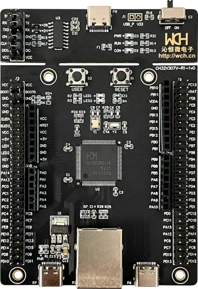

<!-- Copyright 2015-2026 Zephyr Project members and individual contributors. -->
<!-- SPDX-License-Identifier: Apache-2.0 -->
<!-- 中文翻译；编号、导航与译注为本地新增。 -->

<a id="ch32v307v_evt_r1"></a>

# 第30章\_WCH CH32V307V-EVT-R1

原文：[官方页面](https://docs.zephyrproject.org/latest/boards/wch/ch32v307v_evt_r1/doc/index.html)。读取日期：2026-10-16；来源摘要见[来源记录](../SOURCES.md)。

开发板概览（Board Overview）

<a id="id1"></a>

[](images/ch32v307v_evt_r1.webp)

WCH CH32V307V-EVT-R1

名称（Name）：

`ch32v307v_evt_r1`

厂商（Vendor）：

[WinChipHead](https://docs.zephyrproject.org/latest/boards/index.html#vendor=wch)

状态（Status）：

维护中（Maintained）

架构（Architecture）：

[`riscv`](https://docs.zephyrproject.org/latest/boards/index.html#arch=riscv)

片上系统（SoC）：

[ch32v307](https://docs.zephyrproject.org/latest/boards/index.html#soc=ch32v307)

<a id="board-github-link"></a>

[浏览开发板源码（Browse Board Sources）](https://github.com/zephyrproject-rtos/zephyr/blob/main//boards/wch/ch32v307v_evt_r1/doc/index.rst/../..)<a id="overview"></a>

## 概述（Overview）

<a id="id4"></a>

[WCH](http://www.wch-ic.com)[注1](#id3) CH32V307V-EVT-R1是基于RISC-V的CH32V307VCT6 SoC评估板。

板上有电源LED、复位键、USB供电端口及两个用户LED，还带以太网口及内置编程器。

<a id="hardware"></a>

## 硬件（Hardware）

CH32V307V-EVT-R1的青稞V4F 32位RISC-V处理器使用外部晶体，运行于144 MHz。

<a id="id6"></a>

<a id="id12"></a>

处理器信息及数据手册见[WCH CH32V30x页面](https://www.wch-ic.com/downloads/CH32V20x_30xDS0_PDF.html)[注2](#id5)，原理图见[CH32V307 openwch Git仓库](https://github.com/openwch/ch32v307/blob/main/SCHPCB/CH32V307V-R1-1v0/SCH_PCB/CH32V307V-R1.pdf)[注5](#id11)。

<a id="supported-features"></a>

### 支持的功能（Supported Features）

`ch32v307v_evt_r1`开发板支持下表所列的硬件功能。

片上／板载（On-Chip / On-Board）

功能集成在片上系统（SoC）内／位于开发板上。

2 / 2

分别表示已启用／已禁用的实例数。点击数量标签，可查看开发板或SoC设备树源码（DTS）中该功能的第一个实例。

`vnd,foo`

与此功能匹配的设备树绑定兼容字符串（Compatible String）；点击链接可查看绑定文档。

<a id="ch32v307v_evt_r1-hw-features"></a>

<a id="ch32v307v_evt_r1-ch32v307v_evt_r1/ch32v307-hw-features-section"></a>

#### `ch32v307v_evt_r1/ch32v307`目标（Target）

<a id="ch32v307v_evt_r1-ch32v307v_evt_r1/ch32v307-hw-features-panel"></a>

<a id="ch32v307v_evt_r1-ch32v307v_evt_r1/ch32v307-hw-features-memory"></a>

该开发板目标的片上存储容量：32 KiB RAM、480 KiB Flash。

<a id="ch32v307v_evt_r1-ch32v307v_evt_r1/ch32v307-hw-features-table"></a>

<table>
<tr>
<th>类型（Type）</th>
<th>位置（Location）</th>
<th>说明（Description）</th>
<th>兼容字符串（Compatible）</th>
</tr>
<tr>
<td rowspan="1">中央处理器（CPU）</td>
<td>片上（On-Chip）</td>
<td>WCH青稞（QingKe）V4F RISC-V MCU（<a href="https://github.com/zephyrproject-rtos/zephyr/blob/main/dts/riscv/wch/qingke-v4f.dtsi?plain=1#L23">已启用：1</a>）</td>
<td><a href="../cpu_vendor_multiarc_binding_reference/P053_wch_qingke-v4f.md#std-dtcompatible-wch-qingke-v4f"><code>wch,qingke-v4f</code></a></td>
</tr>
<tr>
<td rowspan="5">时钟控制（Clock Control）</td>
<td>片上（On-Chip）</td>
<td>WCH CH32V00x复位及时钟控制（RCC）（<a href="https://github.com/zephyrproject-rtos/zephyr/blob/main/dts/riscv/wch/common/ch32v20x_30x_common.dtsi?plain=1#L177">已启用：1</a>）</td>
<td><a href="../timer_reference/P185_WCH复位与时钟控制绑定.md#dtbinding-wch-rcc"><code>wch,rcc</code></a></td>
</tr>
<tr>
<td>片上（On-Chip）</td>
<td>WCH CH32V00x高速外部时钟（HSE）（<a href="https://github.com/zephyrproject-rtos/zephyr/blob/main/dts/riscv/wch/common/ch32v20x_30x_common.dtsi?plain=1#L21">已启用：1</a>）</td>
<td><a href="../timer_reference/P186_CH32V00x高速外部时钟绑定.md#dtbinding-wch-ch32v00x-hse-clock"><code>wch,ch32v00x-hse-clock</code></a></td>
</tr>
<tr>
<td>片上（On-Chip）</td>
<td>WCH CH32V00x高速内部时钟（HSI）（<a href="https://github.com/zephyrproject-rtos/zephyr/blob/main/dts/riscv/wch/common/ch32v20x_30x_common.dtsi?plain=1#L28">已禁用：1</a>）</td>
<td><a href="../timer_reference/P187_CH32V00x高速内部时钟绑定.md#dtbinding-wch-ch32v00x-hsi-clock"><code>wch,ch32v00x-hsi-clock</code></a></td>
</tr>
<tr>
<td>片上（On-Chip）</td>
<td>通用固定频率时钟提供者（Fixed-Rate Clock Provider）（<a href="https://github.com/zephyrproject-rtos/zephyr/blob/main/dts/riscv/wch/common/ch32v20x_30x_common.dtsi?plain=1#L35">已禁用：1</a>）</td>
<td><a href="../hardware/P566_固定时钟绑定.md#dtbinding-fixed-clock"><code>fixed-clock</code></a></td>
</tr>
<tr>
<td>片上（On-Chip）</td>
<td>WCH CH32V20x／30x PLL（<a href="https://github.com/zephyrproject-rtos/zephyr/blob/main/dts/riscv/wch/common/ch32v20x_30x_common.dtsi?plain=1#L42">已启用：1</a>）</td>
<td><a href="https://docs.zephyrproject.org/latest/build/dts/api/bindings/clock/wch%2Cch32v20x_30x-pll-clock.html#std-dtcompatible-wch-ch32v20x_30x-pll-clock"><code>wch,ch32v20x_30x-pll-clock</code></a></td>
</tr>
<tr>
<td rowspan="2">计数器（Counter）</td>
<td>片上（On-Chip）</td>
<td>用于PWM的WCH高级控制定时器（ADTM / Advanced-control Timer）（<a href="https://github.com/zephyrproject-rtos/zephyr/blob/main/dts/riscv/wch/common/ch32v20x_30x_common.dtsi?plain=1#L217">已禁用：1</a>）</td>
<td><a href="../stm32_ti_xilinx_counter_binding_reference/P012_wch_adtm.md#std-dtcompatible-wch-adtm"><code>wch,adtm</code></a></td>
</tr>
<tr>
<td>片上（On-Chip）</td>
<td>WCH通用定时器（GPTM / General-purpose Timer）（<a href="https://github.com/zephyrproject-rtos/zephyr/blob/main/dts/riscv/wch/common/ch32v20x_30x_common.dtsi?plain=1#L236">已禁用：3</a>）</td>
<td><a href="../stm32_ti_xilinx_counter_binding_reference/P013_wch_gptm.md#std-dtcompatible-wch-gptm"><code>wch,gptm</code></a></td>
</tr>
<tr>
<td rowspan="1">直接存储器访问（DMA）</td>
<td>片上（On-Chip）</td>
<td>WCH DMA控制器（<a href="https://github.com/zephyrproject-rtos/zephyr/blob/main/dts/riscv/wch/common/ch32v20x_30x_common.dtsi?plain=1#L196">已启用：2</a>）</td>
<td><a href="../stm32_ti_xilinx_dma_binding_reference/P015_wch_wch-dma.md#std-dtcompatible-wch-wch-dma"><code>wch,wch-dma</code></a></td>
</tr>
<tr>
<td rowspan="3">以太网（Ethernet）</td>
<td>片上（On-Chip）</td>
<td>WCH CH32系列MCU以太网MAC控制器（<a href="https://github.com/zephyrproject-rtos/zephyr/blob/main/dts/riscv/wch/ch32v307/ch32v307.dtsi?plain=1#L12">已启用：1</a>）</td>
<td><a href="../ethernet_synopsys_st_xilinx_binding_reference/P016_wch_ethernet.md#std-dtcompatible-wch-ethernet"><code>wch,ethernet</code></a></td>
</tr>
<tr>
<td>片上（On-Chip）</td>
<td>Synopsys DesignWare MAC 的管理数据输入输出控制器（MDIO Controller）（<a href="https://github.com/zephyrproject-rtos/zephyr/blob/main/dts/riscv/wch/ch32v307/ch32v307.dtsi?plain=1#L27">已启用：1</a>）</td>
<td><a href="../ethernet_mdio_microchip_binding_reference/P010_snps_dwmac-mdio.md#std-dtcompatible-snps-dwmac-mdio"><code>snps,dwmac-mdio</code></a></td>
</tr>
<tr>
<td>板载（On-Board）</td>
<td>通用媒体独立接口物理层（MII PHY）（<a href="https://github.com/zephyrproject-rtos/zephyr/blob/main/boards/wch/ch32v307v_evt_r1/ch32v307v_evt_r1_common.dtsi?plain=1#L116">已启用：1</a>）</td>
<td><a href="../ethernet_nxp_phy_binding_reference/P019_ethernet-phy.md#std-dtcompatible-ethernet-phy"><code>ethernet-phy</code></a></td>
</tr>
<tr>
<td rowspan="1">闪存控制器（Flash Controller）</td>
<td>片上（On-Chip）</td>
<td>WCH CH32V系列闪存控制器（<a href="https://github.com/zephyrproject-rtos/zephyr/blob/main/dts/riscv/wch/common/ch32v20x_30x_common.dtsi?plain=1#L55">已启用：1</a>）</td>
<td><a href="../flash_renesas_st_ti_binding_reference/P034_wch_ch32v-flash-controller.md#std-dtcompatible-wch-ch32v-flash-controller"><code>wch,ch32v-flash-controller</code></a></td>
</tr>
<tr>
<td rowspan="1">通用输入输出与接插件（GPIO &amp; Headers）</td>
<td>片上（On-Chip）</td>
<td>WCH CH32V00x通用输入／输出（GPIO）（<a href="https://github.com/zephyrproject-rtos/zephyr/blob/main/dts/riscv/wch/common/ch32v20x_30x_common.dtsi?plain=1#L108">已启用：5</a>）</td>
<td><a href="../gpio_ti_xilinx_sdl_binding_reference/P024_wch_gpio.md#std-dtcompatible-wch-gpio"><code>wch,gpio</code></a></td>
</tr>
<tr>
<td rowspan="1">硬件信息（Hardware Information）</td>
<td>片上（On-Chip）</td>
<td>WCH CH32V电子签名（ESIG / Electronic Signature）（<a href="https://github.com/zephyrproject-rtos/zephyr/blob/main/dts/riscv/wch/common/ch32v20x_30x_common.dtsi?plain=1#L293">已启用：1</a>）</td>
<td><a href="../hwinfo_binding_reference/P015_wch_esig.md#std-dtcompatible-wch-esig"><code>wch,esig</code></a></td>
</tr>
<tr>
<td rowspan="1">集成电路间总线（I2C）</td>
<td>片上（On-Chip）</td>
<td>WCH I2C控制器（<a href="https://github.com/zephyrproject-rtos/zephyr/blob/main/dts/riscv/wch/common/ch32v20x_30x_common.dtsi?plain=1#L166">已禁用：2</a>）</td>
<td><a href="../i2c_stm32_ti_mux_binding_reference/P017_wch_i2c.md#std-dtcompatible-wch-i2c"><code>wch,i2c</code></a></td>
</tr>
<tr>
<td rowspan="1">输入（Input）</td>
<td>板载（On-Board）</td>
<td>一组绑定到 GPIO 的输入按键（GPIO-Bound Input Keys）（<a href="https://github.com/zephyrproject-rtos/zephyr/blob/main/boards/wch/ch32v307v_evt_r1/ch32v307v_evt_r1_common.dtsi?plain=1#L23">已启用：1</a>）</td>
<td><a href="../hardware/P563_GPIO按键绑定.md#std-dtcompatible-gpio-keys"><code>gpio-keys</code></a></td>
</tr>
<tr>
<td rowspan="2">中断控制器（Interrupt Controller）</td>
<td>片上（On-Chip）</td>
<td>WCH CH32V00x可编程快速中断控制器（PFIC）（<a href="https://github.com/zephyrproject-rtos/zephyr/blob/main/dts/riscv/wch/qingke-v4f.dtsi?plain=1#L39">已启用：1</a>）</td>
<td><a href="../mcu_external_interrupt_binding_reference/P006_wch_pfic.md#std-dtcompatible-wch-pfic"><code>wch,pfic</code></a></td>
</tr>
<tr>
<td>片上（On-Chip）</td>
<td>WCH CH32V003／20x／30x外部中断及事件控制器（EXTI）（<a href="https://github.com/zephyrproject-rtos/zephyr/blob/main/dts/riscv/wch/common/ch32v20x_30x_common.dtsi?plain=1#L86">已禁用：1</a>）</td>
<td><a href="../mcu_external_interrupt_binding_reference/P005_wch_exti.md#std-dtcompatible-wch-exti"><code>wch,exti</code></a></td>
</tr>
<tr>
<td rowspan="1">发光二极管（LED）</td>
<td>板载（On-Board）</td>
<td>一组由 GPIO 控制的 LED（GPIO-Controlled LEDs）（<a href="https://github.com/zephyrproject-rtos/zephyr/blob/main/boards/wch/ch32v307v_evt_r1/ch32v307v_evt_r1_common.dtsi?plain=1#L33">已禁用：1</a>）</td>
<td><a href="../hardware/P564_GPIO指示灯绑定.md#dtbinding-gpio-leds"><code>gpio-leds</code></a></td>
</tr>
<tr>
<td rowspan="1">存储技术设备（MTD）</td>
<td>片上（On-Chip）</td>
<td>闪存（Flash）节点（<a href="https://github.com/zephyrproject-rtos/zephyr/blob/main/dts/riscv/wch/common/ch32v20x_30x_common.dtsi?plain=1#L64">已启用：1</a>）</td>
<td><a href="../mtd_nxp_st_ti_partition_binding_reference/P013_soc-nv-flash.md#std-dtcompatible-soc-nv-flash"><code>soc-nv-flash</code></a></td>
</tr>
<tr>
<td rowspan="1">引脚控制（Pin Control）</td>
<td>片上（On-Chip）</td>
<td>WCH CH32V20x／30x复用功能I/O（AFIO）（<a href="https://github.com/zephyrproject-rtos/zephyr/blob/main/dts/riscv/wch/common/ch32v20x_30x_common.dtsi?plain=1#L101">已启用：1</a>）</td>
<td><a href="../pinctrl_stm32_ti_xilinx_binding_reference/P017_wch_20x_30x-afio.md#std-dtcompatible-wch-20x_30x-afio"><code>wch,20x_30x-afio</code></a></td>
</tr>
<tr>
<td rowspan="2">脉宽调制（PWM）</td>
<td>片上（On-Chip）</td>
<td>用于PWM的WCH高级控制定时器（ADTM / Advanced-control Timer）（<a href="https://github.com/zephyrproject-rtos/zephyr/blob/main/dts/riscv/wch/common/ch32v20x_30x_common.dtsi?plain=1#L228">已禁用：1</a>）</td>
<td><a href="../pwm_stm32_ti_generic_binding_reference/P018_wch_adtm-pwm.md#std-dtcompatible-wch-adtm-pwm"><code>wch,adtm-pwm</code></a></td>
</tr>
<tr>
<td>片上（On-Chip）</td>
<td>用于PWM的WCH通用定时器（GPTM）（<a href="https://github.com/zephyrproject-rtos/zephyr/blob/main/dts/riscv/wch/common/ch32v20x_30x_common.dtsi?plain=1#L247">已禁用：3</a>）</td>
<td><a href="../pwm_stm32_ti_generic_binding_reference/P019_wch_gptm-pwm.md#std-dtcompatible-wch-gptm-pwm"><code>wch,gptm-pwm</code></a></td>
</tr>
<tr>
<td rowspan="1">复位控制器（Reset Controller）</td>
<td>片上（On-Chip）</td>
<td>CH32复位及时钟控制（RCC）的复位控制器（<a href="https://github.com/zephyrproject-rtos/zephyr/blob/main/dts/riscv/wch/common/ch32v20x_30x_common.dtsi?plain=1#L183">已启用：1</a>）</td>
<td><a href="../reset_controller_binding_reference/P019_wch_ch32-rcc-rctl.md#std-dtcompatible-wch-ch32-rcc-rctl"><code>wch,ch32-rcc-rctl</code></a></td>
</tr>
<tr>
<td rowspan="1">随机数生成器（RNG）</td>
<td>片上（On-Chip）</td>
<td>WCH CH32随机数发生器（RNG / Random Number Generator）（<a href="https://github.com/zephyrproject-rtos/zephyr/blob/main/dts/riscv/wch/common/ch32v20x_30x_common.dtsi?plain=1#L189">已启用：1</a>）</td>
<td><a href="../soc_rng_binding_reference/P020_wch_rng.md#std-dtcompatible-wch-rng"><code>wch,rng</code></a></td>
</tr>
<tr>
<td rowspan="2">串行控制器（Serial Controller）</td>
<td>片上（On-Chip）</td>
<td>WCH SDI控制台（<a href="https://github.com/zephyrproject-rtos/zephyr/blob/main/dts/riscv/wch/qingke-v4f.dtsi?plain=1#L56">已启用：1</a>）</td>
<td><a href="../uart_ti_wch_virtual_binding_reference/P006_wch_sdi-console.md#std-dtcompatible-wch-sdi-console"><code>wch,sdi-console</code></a></td>
</tr>
<tr>
<td>片上（On-Chip）</td>
<td>WCH CH32V00x UART（<a href="https://github.com/zephyrproject-rtos/zephyr/blob/main/dts/riscv/wch/common/ch32v20x_30x_common.dtsi?plain=1#L145">已启用：1</a>；<a href="https://github.com/zephyrproject-rtos/zephyr/blob/main/dts/riscv/wch/ch32v307/ch32v307.dtsi?plain=1#L46">已禁用：7</a>）</td>
<td><a href="../uart_ti_wch_virtual_binding_reference/P007_wch_usart.md#std-dtcompatible-wch-usart"><code>wch,usart</code></a></td>
</tr>
<tr>
<td rowspan="1">串行外设接口（SPI）</td>
<td>片上（On-Chip）</td>
<td>WCH SPI（<a href="https://github.com/zephyrproject-rtos/zephyr/blob/main/dts/riscv/wch/common/ch32v20x_30x_common.dtsi?plain=1#L155">已禁用：3</a>）</td>
<td><a href="../spi_stm32_ti_xilinx_binding_reference/P019_wch_spi.md#std-dtcompatible-wch-spi"><code>wch,spi</code></a></td>
</tr>
<tr>
<td rowspan="1">静态随机存储器（SRAM）</td>
<td>片上（On-Chip）</td>
<td>通用片上静态随机存储器（SRAM）（<a href="https://github.com/zephyrproject-rtos/zephyr/blob/main/dts/riscv/wch/common/ch32v20x_30x_common.dtsi?plain=1#L51">已启用：1</a>）</td>
<td><a href="../hardware/P567_内存映射SRAM绑定.md#dtbinding-mmio-sram"><code>mmio-sram</code></a></td>
</tr>
<tr>
<td rowspan="1">定时器（Timer）</td>
<td>片上（On-Chip）</td>
<td>WCH CH32V00x系统节拍（Systick）（<a href="https://github.com/zephyrproject-rtos/zephyr/blob/main/dts/riscv/wch/qingke-v4f.dtsi?plain=1#L48">已启用：1</a>）</td>
<td><a href="../system_timer_binding_reference/P014_wch_systick.md#std-dtcompatible-wch-systick"><code>wch,systick</code></a></td>
</tr>
<tr>
<td rowspan="1">看门狗（Watchdog）</td>
<td>片上（On-Chip）</td>
<td>WCH独立看门狗（IWDG / Independent Watchdog）（<a href="https://github.com/zephyrproject-rtos/zephyr/blob/main/dts/riscv/wch/common/ch32v20x_30x_common.dtsi?plain=1#L80">已禁用：1</a>）</td>
<td><a href="../stm32_ti_xilinx_watchdog_binding_reference/P009_wch_iwdg.md#std-dtcompatible-wch-iwdg"><code>wch,iwdg</code></a></td>
</tr>
</table>

<a id="ch32v307v_evt_r1-ch32v307v_evt_r1/ch32v307/ram_128k-hw-features-section"></a>

#### `ch32v307v_evt_r1/ch32v307/ram_128k`目标（Target）

<a id="ch32v307v_evt_r1-ch32v307v_evt_r1/ch32v307/ram_128k-hw-features-panel"></a>

<a id="ch32v307v_evt_r1-ch32v307v_evt_r1/ch32v307/ram_128k-hw-features-memory"></a>

该开发板目标的片上存储容量：128 KiB RAM、480 KiB Flash。

<a id="ch32v307v_evt_r1-ch32v307v_evt_r1/ch32v307/ram_128k-hw-features-table"></a>

<table>
<tr>
<th>类型（Type）</th>
<th>位置（Location）</th>
<th>说明（Description）</th>
<th>兼容字符串（Compatible）</th>
</tr>
<tr>
<td rowspan="1">中央处理器（CPU）</td>
<td>片上（On-Chip）</td>
<td>WCH青稞（QingKe）V4F RISC-V MCU（<a href="https://github.com/zephyrproject-rtos/zephyr/blob/main/dts/riscv/wch/qingke-v4f.dtsi?plain=1#L23">已启用：1</a>）</td>
<td><a href="../cpu_vendor_multiarc_binding_reference/P053_wch_qingke-v4f.md#std-dtcompatible-wch-qingke-v4f"><code>wch,qingke-v4f</code></a></td>
</tr>
<tr>
<td rowspan="5">时钟控制（Clock Control）</td>
<td>片上（On-Chip）</td>
<td>WCH CH32V00x复位及时钟控制（RCC）（<a href="https://github.com/zephyrproject-rtos/zephyr/blob/main/dts/riscv/wch/common/ch32v20x_30x_common.dtsi?plain=1#L177">已启用：1</a>）</td>
<td><a href="../timer_reference/P185_WCH复位与时钟控制绑定.md#dtbinding-wch-rcc"><code>wch,rcc</code></a></td>
</tr>
<tr>
<td>片上（On-Chip）</td>
<td>WCH CH32V00x高速外部时钟（HSE）（<a href="https://github.com/zephyrproject-rtos/zephyr/blob/main/dts/riscv/wch/common/ch32v20x_30x_common.dtsi?plain=1#L21">已启用：1</a>）</td>
<td><a href="../timer_reference/P186_CH32V00x高速外部时钟绑定.md#dtbinding-wch-ch32v00x-hse-clock"><code>wch,ch32v00x-hse-clock</code></a></td>
</tr>
<tr>
<td>片上（On-Chip）</td>
<td>WCH CH32V00x高速内部时钟（HSI）（<a href="https://github.com/zephyrproject-rtos/zephyr/blob/main/dts/riscv/wch/common/ch32v20x_30x_common.dtsi?plain=1#L28">已禁用：1</a>）</td>
<td><a href="../timer_reference/P187_CH32V00x高速内部时钟绑定.md#dtbinding-wch-ch32v00x-hsi-clock"><code>wch,ch32v00x-hsi-clock</code></a></td>
</tr>
<tr>
<td>片上（On-Chip）</td>
<td>通用固定频率时钟提供者（Fixed-Rate Clock Provider）（<a href="https://github.com/zephyrproject-rtos/zephyr/blob/main/dts/riscv/wch/common/ch32v20x_30x_common.dtsi?plain=1#L35">已禁用：1</a>）</td>
<td><a href="../hardware/P566_固定时钟绑定.md#dtbinding-fixed-clock"><code>fixed-clock</code></a></td>
</tr>
<tr>
<td>片上（On-Chip）</td>
<td>WCH CH32V20x／30x PLL（<a href="https://github.com/zephyrproject-rtos/zephyr/blob/main/dts/riscv/wch/common/ch32v20x_30x_common.dtsi?plain=1#L42">已启用：1</a>）</td>
<td><a href="https://docs.zephyrproject.org/latest/build/dts/api/bindings/clock/wch%2Cch32v20x_30x-pll-clock.html#std-dtcompatible-wch-ch32v20x_30x-pll-clock"><code>wch,ch32v20x_30x-pll-clock</code></a></td>
</tr>
<tr>
<td rowspan="2">计数器（Counter）</td>
<td>片上（On-Chip）</td>
<td>用于PWM的WCH高级控制定时器（ADTM / Advanced-control Timer）（<a href="https://github.com/zephyrproject-rtos/zephyr/blob/main/dts/riscv/wch/common/ch32v20x_30x_common.dtsi?plain=1#L217">已禁用：1</a>）</td>
<td><a href="../stm32_ti_xilinx_counter_binding_reference/P012_wch_adtm.md#std-dtcompatible-wch-adtm"><code>wch,adtm</code></a></td>
</tr>
<tr>
<td>片上（On-Chip）</td>
<td>WCH通用定时器（GPTM / General-purpose Timer）（<a href="https://github.com/zephyrproject-rtos/zephyr/blob/main/dts/riscv/wch/common/ch32v20x_30x_common.dtsi?plain=1#L236">已禁用：3</a>）</td>
<td><a href="../stm32_ti_xilinx_counter_binding_reference/P013_wch_gptm.md#std-dtcompatible-wch-gptm"><code>wch,gptm</code></a></td>
</tr>
<tr>
<td rowspan="1">直接存储器访问（DMA）</td>
<td>片上（On-Chip）</td>
<td>WCH DMA控制器（<a href="https://github.com/zephyrproject-rtos/zephyr/blob/main/dts/riscv/wch/common/ch32v20x_30x_common.dtsi?plain=1#L196">已启用：2</a>）</td>
<td><a href="../stm32_ti_xilinx_dma_binding_reference/P015_wch_wch-dma.md#std-dtcompatible-wch-wch-dma"><code>wch,wch-dma</code></a></td>
</tr>
<tr>
<td rowspan="3">以太网（Ethernet）</td>
<td>片上（On-Chip）</td>
<td>WCH CH32系列MCU以太网MAC控制器（<a href="https://github.com/zephyrproject-rtos/zephyr/blob/main/dts/riscv/wch/ch32v307/ch32v307.dtsi?plain=1#L12">已启用：1</a>）</td>
<td><a href="../ethernet_synopsys_st_xilinx_binding_reference/P016_wch_ethernet.md#std-dtcompatible-wch-ethernet"><code>wch,ethernet</code></a></td>
</tr>
<tr>
<td>片上（On-Chip）</td>
<td>Synopsys DesignWare MAC 的管理数据输入输出控制器（MDIO Controller）（<a href="https://github.com/zephyrproject-rtos/zephyr/blob/main/dts/riscv/wch/ch32v307/ch32v307.dtsi?plain=1#L27">已启用：1</a>）</td>
<td><a href="../ethernet_mdio_microchip_binding_reference/P010_snps_dwmac-mdio.md#std-dtcompatible-snps-dwmac-mdio"><code>snps,dwmac-mdio</code></a></td>
</tr>
<tr>
<td>板载（On-Board）</td>
<td>通用媒体独立接口物理层（MII PHY）（<a href="https://github.com/zephyrproject-rtos/zephyr/blob/main/boards/wch/ch32v307v_evt_r1/ch32v307v_evt_r1_common.dtsi?plain=1#L116">已启用：1</a>）</td>
<td><a href="../ethernet_nxp_phy_binding_reference/P019_ethernet-phy.md#std-dtcompatible-ethernet-phy"><code>ethernet-phy</code></a></td>
</tr>
<tr>
<td rowspan="1">闪存控制器（Flash Controller）</td>
<td>片上（On-Chip）</td>
<td>WCH CH32V系列闪存控制器（<a href="https://github.com/zephyrproject-rtos/zephyr/blob/main/dts/riscv/wch/common/ch32v20x_30x_common.dtsi?plain=1#L55">已启用：1</a>）</td>
<td><a href="../flash_renesas_st_ti_binding_reference/P034_wch_ch32v-flash-controller.md#std-dtcompatible-wch-ch32v-flash-controller"><code>wch,ch32v-flash-controller</code></a></td>
</tr>
<tr>
<td rowspan="1">通用输入输出与接插件（GPIO &amp; Headers）</td>
<td>片上（On-Chip）</td>
<td>WCH CH32V00x通用输入／输出（GPIO）（<a href="https://github.com/zephyrproject-rtos/zephyr/blob/main/dts/riscv/wch/common/ch32v20x_30x_common.dtsi?plain=1#L108">已启用：5</a>）</td>
<td><a href="../gpio_ti_xilinx_sdl_binding_reference/P024_wch_gpio.md#std-dtcompatible-wch-gpio"><code>wch,gpio</code></a></td>
</tr>
<tr>
<td rowspan="1">硬件信息（Hardware Information）</td>
<td>片上（On-Chip）</td>
<td>WCH CH32V电子签名（ESIG / Electronic Signature）（<a href="https://github.com/zephyrproject-rtos/zephyr/blob/main/dts/riscv/wch/common/ch32v20x_30x_common.dtsi?plain=1#L293">已启用：1</a>）</td>
<td><a href="../hwinfo_binding_reference/P015_wch_esig.md#std-dtcompatible-wch-esig"><code>wch,esig</code></a></td>
</tr>
<tr>
<td rowspan="1">集成电路间总线（I2C）</td>
<td>片上（On-Chip）</td>
<td>WCH I2C控制器（<a href="https://github.com/zephyrproject-rtos/zephyr/blob/main/dts/riscv/wch/common/ch32v20x_30x_common.dtsi?plain=1#L166">已禁用：2</a>）</td>
<td><a href="../i2c_stm32_ti_mux_binding_reference/P017_wch_i2c.md#std-dtcompatible-wch-i2c"><code>wch,i2c</code></a></td>
</tr>
<tr>
<td rowspan="1">输入（Input）</td>
<td>板载（On-Board）</td>
<td>一组绑定到 GPIO 的输入按键（GPIO-Bound Input Keys）（<a href="https://github.com/zephyrproject-rtos/zephyr/blob/main/boards/wch/ch32v307v_evt_r1/ch32v307v_evt_r1_common.dtsi?plain=1#L23">已启用：1</a>）</td>
<td><a href="../hardware/P563_GPIO按键绑定.md#std-dtcompatible-gpio-keys"><code>gpio-keys</code></a></td>
</tr>
<tr>
<td rowspan="2">中断控制器（Interrupt Controller）</td>
<td>片上（On-Chip）</td>
<td>WCH CH32V00x可编程快速中断控制器（PFIC）（<a href="https://github.com/zephyrproject-rtos/zephyr/blob/main/dts/riscv/wch/qingke-v4f.dtsi?plain=1#L39">已启用：1</a>）</td>
<td><a href="../mcu_external_interrupt_binding_reference/P006_wch_pfic.md#std-dtcompatible-wch-pfic"><code>wch,pfic</code></a></td>
</tr>
<tr>
<td>片上（On-Chip）</td>
<td>WCH CH32V003／20x／30x外部中断及事件控制器（EXTI）（<a href="https://github.com/zephyrproject-rtos/zephyr/blob/main/dts/riscv/wch/common/ch32v20x_30x_common.dtsi?plain=1#L86">已禁用：1</a>）</td>
<td><a href="../mcu_external_interrupt_binding_reference/P005_wch_exti.md#std-dtcompatible-wch-exti"><code>wch,exti</code></a></td>
</tr>
<tr>
<td rowspan="1">发光二极管（LED）</td>
<td>板载（On-Board）</td>
<td>一组由 GPIO 控制的 LED（GPIO-Controlled LEDs）（<a href="https://github.com/zephyrproject-rtos/zephyr/blob/main/boards/wch/ch32v307v_evt_r1/ch32v307v_evt_r1_common.dtsi?plain=1#L33">已禁用：1</a>）</td>
<td><a href="../hardware/P564_GPIO指示灯绑定.md#dtbinding-gpio-leds"><code>gpio-leds</code></a></td>
</tr>
<tr>
<td rowspan="1">存储技术设备（MTD）</td>
<td>片上（On-Chip）</td>
<td>闪存（Flash）节点（<a href="https://github.com/zephyrproject-rtos/zephyr/blob/main/dts/riscv/wch/common/ch32v20x_30x_common.dtsi?plain=1#L64">已启用：1</a>）</td>
<td><a href="../mtd_nxp_st_ti_partition_binding_reference/P013_soc-nv-flash.md#std-dtcompatible-soc-nv-flash"><code>soc-nv-flash</code></a></td>
</tr>
<tr>
<td rowspan="1">引脚控制（Pin Control）</td>
<td>片上（On-Chip）</td>
<td>WCH CH32V20x／30x复用功能I/O（AFIO）（<a href="https://github.com/zephyrproject-rtos/zephyr/blob/main/dts/riscv/wch/common/ch32v20x_30x_common.dtsi?plain=1#L101">已启用：1</a>）</td>
<td><a href="../pinctrl_stm32_ti_xilinx_binding_reference/P017_wch_20x_30x-afio.md#std-dtcompatible-wch-20x_30x-afio"><code>wch,20x_30x-afio</code></a></td>
</tr>
<tr>
<td rowspan="2">脉宽调制（PWM）</td>
<td>片上（On-Chip）</td>
<td>用于PWM的WCH高级控制定时器（ADTM / Advanced-control Timer）（<a href="https://github.com/zephyrproject-rtos/zephyr/blob/main/dts/riscv/wch/common/ch32v20x_30x_common.dtsi?plain=1#L228">已禁用：1</a>）</td>
<td><a href="../pwm_stm32_ti_generic_binding_reference/P018_wch_adtm-pwm.md#std-dtcompatible-wch-adtm-pwm"><code>wch,adtm-pwm</code></a></td>
</tr>
<tr>
<td>片上（On-Chip）</td>
<td>用于PWM的WCH通用定时器（GPTM）（<a href="https://github.com/zephyrproject-rtos/zephyr/blob/main/dts/riscv/wch/common/ch32v20x_30x_common.dtsi?plain=1#L247">已禁用：3</a>）</td>
<td><a href="../pwm_stm32_ti_generic_binding_reference/P019_wch_gptm-pwm.md#std-dtcompatible-wch-gptm-pwm"><code>wch,gptm-pwm</code></a></td>
</tr>
<tr>
<td rowspan="1">复位控制器（Reset Controller）</td>
<td>片上（On-Chip）</td>
<td>CH32复位及时钟控制（RCC）的复位控制器（<a href="https://github.com/zephyrproject-rtos/zephyr/blob/main/dts/riscv/wch/common/ch32v20x_30x_common.dtsi?plain=1#L183">已启用：1</a>）</td>
<td><a href="../reset_controller_binding_reference/P019_wch_ch32-rcc-rctl.md#std-dtcompatible-wch-ch32-rcc-rctl"><code>wch,ch32-rcc-rctl</code></a></td>
</tr>
<tr>
<td rowspan="1">随机数生成器（RNG）</td>
<td>片上（On-Chip）</td>
<td>WCH CH32随机数发生器（RNG / Random Number Generator）（<a href="https://github.com/zephyrproject-rtos/zephyr/blob/main/dts/riscv/wch/common/ch32v20x_30x_common.dtsi?plain=1#L189">已启用：1</a>）</td>
<td><a href="../soc_rng_binding_reference/P020_wch_rng.md#std-dtcompatible-wch-rng"><code>wch,rng</code></a></td>
</tr>
<tr>
<td rowspan="2">串行控制器（Serial Controller）</td>
<td>片上（On-Chip）</td>
<td>WCH SDI控制台（<a href="https://github.com/zephyrproject-rtos/zephyr/blob/main/dts/riscv/wch/qingke-v4f.dtsi?plain=1#L56">已启用：1</a>）</td>
<td><a href="../uart_ti_wch_virtual_binding_reference/P006_wch_sdi-console.md#std-dtcompatible-wch-sdi-console"><code>wch,sdi-console</code></a></td>
</tr>
<tr>
<td>片上（On-Chip）</td>
<td>WCH CH32V00x UART（<a href="https://github.com/zephyrproject-rtos/zephyr/blob/main/dts/riscv/wch/common/ch32v20x_30x_common.dtsi?plain=1#L145">已启用：1</a>；<a href="https://github.com/zephyrproject-rtos/zephyr/blob/main/dts/riscv/wch/ch32v307/ch32v307.dtsi?plain=1#L46">已禁用：7</a>）</td>
<td><a href="../uart_ti_wch_virtual_binding_reference/P007_wch_usart.md#std-dtcompatible-wch-usart"><code>wch,usart</code></a></td>
</tr>
<tr>
<td rowspan="1">串行外设接口（SPI）</td>
<td>片上（On-Chip）</td>
<td>WCH SPI（<a href="https://github.com/zephyrproject-rtos/zephyr/blob/main/dts/riscv/wch/common/ch32v20x_30x_common.dtsi?plain=1#L155">已禁用：3</a>）</td>
<td><a href="../spi_stm32_ti_xilinx_binding_reference/P019_wch_spi.md#std-dtcompatible-wch-spi"><code>wch,spi</code></a></td>
</tr>
<tr>
<td rowspan="1">静态随机存储器（SRAM）</td>
<td>片上（On-Chip）</td>
<td>通用片上静态随机存储器（SRAM）（<a href="https://github.com/zephyrproject-rtos/zephyr/blob/main/dts/riscv/wch/common/ch32v20x_30x_common.dtsi?plain=1#L51">已启用：1</a>）</td>
<td><a href="../hardware/P567_内存映射SRAM绑定.md#dtbinding-mmio-sram"><code>mmio-sram</code></a></td>
</tr>
<tr>
<td rowspan="1">定时器（Timer）</td>
<td>片上（On-Chip）</td>
<td>WCH CH32V00x系统节拍（Systick）（<a href="https://github.com/zephyrproject-rtos/zephyr/blob/main/dts/riscv/wch/qingke-v4f.dtsi?plain=1#L48">已启用：1</a>）</td>
<td><a href="../system_timer_binding_reference/P014_wch_systick.md#std-dtcompatible-wch-systick"><code>wch,systick</code></a></td>
</tr>
<tr>
<td rowspan="1">看门狗（Watchdog）</td>
<td>片上（On-Chip）</td>
<td>WCH独立看门狗（IWDG / Independent Watchdog）（<a href="https://github.com/zephyrproject-rtos/zephyr/blob/main/dts/riscv/wch/common/ch32v20x_30x_common.dtsi?plain=1#L80">已禁用：1</a>）</td>
<td><a href="../stm32_ti_xilinx_watchdog_binding_reference/P009_wch_iwdg.md#std-dtcompatible-wch-iwdg"><code>wch,iwdg</code></a></td>
</tr>
</table>

<a id="ch32v307v_evt_r1-ch32v307v_evt_r1/ch32v307/ram_192k-hw-features-section"></a>

#### `ch32v307v_evt_r1/ch32v307/ram_192k`目标（Target）

<a id="ch32v307v_evt_r1-ch32v307v_evt_r1/ch32v307/ram_192k-hw-features-panel"></a>

<a id="ch32v307v_evt_r1-ch32v307v_evt_r1/ch32v307/ram_192k-hw-features-memory"></a>

该开发板目标的片上存储容量：192 KiB RAM、480 KiB Flash。

<a id="ch32v307v_evt_r1-ch32v307v_evt_r1/ch32v307/ram_192k-hw-features-table"></a>

<table>
<tr>
<th>类型（Type）</th>
<th>位置（Location）</th>
<th>说明（Description）</th>
<th>兼容字符串（Compatible）</th>
</tr>
<tr>
<td rowspan="1">中央处理器（CPU）</td>
<td>片上（On-Chip）</td>
<td>WCH青稞（QingKe）V4F RISC-V MCU（<a href="https://github.com/zephyrproject-rtos/zephyr/blob/main/dts/riscv/wch/qingke-v4f.dtsi?plain=1#L23">已启用：1</a>）</td>
<td><a href="../cpu_vendor_multiarc_binding_reference/P053_wch_qingke-v4f.md#std-dtcompatible-wch-qingke-v4f"><code>wch,qingke-v4f</code></a></td>
</tr>
<tr>
<td rowspan="5">时钟控制（Clock Control）</td>
<td>片上（On-Chip）</td>
<td>WCH CH32V00x复位及时钟控制（RCC）（<a href="https://github.com/zephyrproject-rtos/zephyr/blob/main/dts/riscv/wch/common/ch32v20x_30x_common.dtsi?plain=1#L177">已启用：1</a>）</td>
<td><a href="../timer_reference/P185_WCH复位与时钟控制绑定.md#dtbinding-wch-rcc"><code>wch,rcc</code></a></td>
</tr>
<tr>
<td>片上（On-Chip）</td>
<td>WCH CH32V00x高速外部时钟（HSE）（<a href="https://github.com/zephyrproject-rtos/zephyr/blob/main/dts/riscv/wch/common/ch32v20x_30x_common.dtsi?plain=1#L21">已启用：1</a>）</td>
<td><a href="../timer_reference/P186_CH32V00x高速外部时钟绑定.md#dtbinding-wch-ch32v00x-hse-clock"><code>wch,ch32v00x-hse-clock</code></a></td>
</tr>
<tr>
<td>片上（On-Chip）</td>
<td>WCH CH32V00x高速内部时钟（HSI）（<a href="https://github.com/zephyrproject-rtos/zephyr/blob/main/dts/riscv/wch/common/ch32v20x_30x_common.dtsi?plain=1#L28">已禁用：1</a>）</td>
<td><a href="../timer_reference/P187_CH32V00x高速内部时钟绑定.md#dtbinding-wch-ch32v00x-hsi-clock"><code>wch,ch32v00x-hsi-clock</code></a></td>
</tr>
<tr>
<td>片上（On-Chip）</td>
<td>通用固定频率时钟提供者（Fixed-Rate Clock Provider）（<a href="https://github.com/zephyrproject-rtos/zephyr/blob/main/dts/riscv/wch/common/ch32v20x_30x_common.dtsi?plain=1#L35">已禁用：1</a>）</td>
<td><a href="../hardware/P566_固定时钟绑定.md#dtbinding-fixed-clock"><code>fixed-clock</code></a></td>
</tr>
<tr>
<td>片上（On-Chip）</td>
<td>WCH CH32V20x／30x PLL（<a href="https://github.com/zephyrproject-rtos/zephyr/blob/main/dts/riscv/wch/common/ch32v20x_30x_common.dtsi?plain=1#L42">已启用：1</a>）</td>
<td><a href="https://docs.zephyrproject.org/latest/build/dts/api/bindings/clock/wch%2Cch32v20x_30x-pll-clock.html#std-dtcompatible-wch-ch32v20x_30x-pll-clock"><code>wch,ch32v20x_30x-pll-clock</code></a></td>
</tr>
<tr>
<td rowspan="2">计数器（Counter）</td>
<td>片上（On-Chip）</td>
<td>用于PWM的WCH高级控制定时器（ADTM / Advanced-control Timer）（<a href="https://github.com/zephyrproject-rtos/zephyr/blob/main/dts/riscv/wch/common/ch32v20x_30x_common.dtsi?plain=1#L217">已禁用：1</a>）</td>
<td><a href="../stm32_ti_xilinx_counter_binding_reference/P012_wch_adtm.md#std-dtcompatible-wch-adtm"><code>wch,adtm</code></a></td>
</tr>
<tr>
<td>片上（On-Chip）</td>
<td>WCH通用定时器（GPTM / General-purpose Timer）（<a href="https://github.com/zephyrproject-rtos/zephyr/blob/main/dts/riscv/wch/common/ch32v20x_30x_common.dtsi?plain=1#L236">已禁用：3</a>）</td>
<td><a href="../stm32_ti_xilinx_counter_binding_reference/P013_wch_gptm.md#std-dtcompatible-wch-gptm"><code>wch,gptm</code></a></td>
</tr>
<tr>
<td rowspan="1">直接存储器访问（DMA）</td>
<td>片上（On-Chip）</td>
<td>WCH DMA控制器（<a href="https://github.com/zephyrproject-rtos/zephyr/blob/main/dts/riscv/wch/common/ch32v20x_30x_common.dtsi?plain=1#L196">已启用：2</a>）</td>
<td><a href="../stm32_ti_xilinx_dma_binding_reference/P015_wch_wch-dma.md#std-dtcompatible-wch-wch-dma"><code>wch,wch-dma</code></a></td>
</tr>
<tr>
<td rowspan="3">以太网（Ethernet）</td>
<td>片上（On-Chip）</td>
<td>WCH CH32系列MCU以太网MAC控制器（<a href="https://github.com/zephyrproject-rtos/zephyr/blob/main/dts/riscv/wch/ch32v307/ch32v307.dtsi?plain=1#L12">已启用：1</a>）</td>
<td><a href="../ethernet_synopsys_st_xilinx_binding_reference/P016_wch_ethernet.md#std-dtcompatible-wch-ethernet"><code>wch,ethernet</code></a></td>
</tr>
<tr>
<td>片上（On-Chip）</td>
<td>Synopsys DesignWare MAC 的管理数据输入输出控制器（MDIO Controller）（<a href="https://github.com/zephyrproject-rtos/zephyr/blob/main/dts/riscv/wch/ch32v307/ch32v307.dtsi?plain=1#L27">已启用：1</a>）</td>
<td><a href="../ethernet_mdio_microchip_binding_reference/P010_snps_dwmac-mdio.md#std-dtcompatible-snps-dwmac-mdio"><code>snps,dwmac-mdio</code></a></td>
</tr>
<tr>
<td>板载（On-Board）</td>
<td>通用媒体独立接口物理层（MII PHY）（<a href="https://github.com/zephyrproject-rtos/zephyr/blob/main/boards/wch/ch32v307v_evt_r1/ch32v307v_evt_r1_common.dtsi?plain=1#L116">已启用：1</a>）</td>
<td><a href="../ethernet_nxp_phy_binding_reference/P019_ethernet-phy.md#std-dtcompatible-ethernet-phy"><code>ethernet-phy</code></a></td>
</tr>
<tr>
<td rowspan="1">闪存控制器（Flash Controller）</td>
<td>片上（On-Chip）</td>
<td>WCH CH32V系列闪存控制器（<a href="https://github.com/zephyrproject-rtos/zephyr/blob/main/dts/riscv/wch/common/ch32v20x_30x_common.dtsi?plain=1#L55">已启用：1</a>）</td>
<td><a href="../flash_renesas_st_ti_binding_reference/P034_wch_ch32v-flash-controller.md#std-dtcompatible-wch-ch32v-flash-controller"><code>wch,ch32v-flash-controller</code></a></td>
</tr>
<tr>
<td rowspan="1">通用输入输出与接插件（GPIO &amp; Headers）</td>
<td>片上（On-Chip）</td>
<td>WCH CH32V00x通用输入／输出（GPIO）（<a href="https://github.com/zephyrproject-rtos/zephyr/blob/main/dts/riscv/wch/common/ch32v20x_30x_common.dtsi?plain=1#L108">已启用：5</a>）</td>
<td><a href="../gpio_ti_xilinx_sdl_binding_reference/P024_wch_gpio.md#std-dtcompatible-wch-gpio"><code>wch,gpio</code></a></td>
</tr>
<tr>
<td rowspan="1">硬件信息（Hardware Information）</td>
<td>片上（On-Chip）</td>
<td>WCH CH32V电子签名（ESIG / Electronic Signature）（<a href="https://github.com/zephyrproject-rtos/zephyr/blob/main/dts/riscv/wch/common/ch32v20x_30x_common.dtsi?plain=1#L293">已启用：1</a>）</td>
<td><a href="../hwinfo_binding_reference/P015_wch_esig.md#std-dtcompatible-wch-esig"><code>wch,esig</code></a></td>
</tr>
<tr>
<td rowspan="1">集成电路间总线（I2C）</td>
<td>片上（On-Chip）</td>
<td>WCH I2C控制器（<a href="https://github.com/zephyrproject-rtos/zephyr/blob/main/dts/riscv/wch/common/ch32v20x_30x_common.dtsi?plain=1#L166">已禁用：2</a>）</td>
<td><a href="../i2c_stm32_ti_mux_binding_reference/P017_wch_i2c.md#std-dtcompatible-wch-i2c"><code>wch,i2c</code></a></td>
</tr>
<tr>
<td rowspan="1">输入（Input）</td>
<td>板载（On-Board）</td>
<td>一组绑定到 GPIO 的输入按键（GPIO-Bound Input Keys）（<a href="https://github.com/zephyrproject-rtos/zephyr/blob/main/boards/wch/ch32v307v_evt_r1/ch32v307v_evt_r1_common.dtsi?plain=1#L23">已启用：1</a>）</td>
<td><a href="../hardware/P563_GPIO按键绑定.md#std-dtcompatible-gpio-keys"><code>gpio-keys</code></a></td>
</tr>
<tr>
<td rowspan="2">中断控制器（Interrupt Controller）</td>
<td>片上（On-Chip）</td>
<td>WCH CH32V00x可编程快速中断控制器（PFIC）（<a href="https://github.com/zephyrproject-rtos/zephyr/blob/main/dts/riscv/wch/qingke-v4f.dtsi?plain=1#L39">已启用：1</a>）</td>
<td><a href="../mcu_external_interrupt_binding_reference/P006_wch_pfic.md#std-dtcompatible-wch-pfic"><code>wch,pfic</code></a></td>
</tr>
<tr>
<td>片上（On-Chip）</td>
<td>WCH CH32V003／20x／30x外部中断及事件控制器（EXTI）（<a href="https://github.com/zephyrproject-rtos/zephyr/blob/main/dts/riscv/wch/common/ch32v20x_30x_common.dtsi?plain=1#L86">已禁用：1</a>）</td>
<td><a href="../mcu_external_interrupt_binding_reference/P005_wch_exti.md#std-dtcompatible-wch-exti"><code>wch,exti</code></a></td>
</tr>
<tr>
<td rowspan="1">发光二极管（LED）</td>
<td>板载（On-Board）</td>
<td>一组由 GPIO 控制的 LED（GPIO-Controlled LEDs）（<a href="https://github.com/zephyrproject-rtos/zephyr/blob/main/boards/wch/ch32v307v_evt_r1/ch32v307v_evt_r1_common.dtsi?plain=1#L33">已禁用：1</a>）</td>
<td><a href="../hardware/P564_GPIO指示灯绑定.md#dtbinding-gpio-leds"><code>gpio-leds</code></a></td>
</tr>
<tr>
<td rowspan="1">存储技术设备（MTD）</td>
<td>片上（On-Chip）</td>
<td>闪存（Flash）节点（<a href="https://github.com/zephyrproject-rtos/zephyr/blob/main/dts/riscv/wch/common/ch32v20x_30x_common.dtsi?plain=1#L64">已启用：1</a>）</td>
<td><a href="../mtd_nxp_st_ti_partition_binding_reference/P013_soc-nv-flash.md#std-dtcompatible-soc-nv-flash"><code>soc-nv-flash</code></a></td>
</tr>
<tr>
<td rowspan="1">引脚控制（Pin Control）</td>
<td>片上（On-Chip）</td>
<td>WCH CH32V20x／30x复用功能I/O（AFIO）（<a href="https://github.com/zephyrproject-rtos/zephyr/blob/main/dts/riscv/wch/common/ch32v20x_30x_common.dtsi?plain=1#L101">已启用：1</a>）</td>
<td><a href="../pinctrl_stm32_ti_xilinx_binding_reference/P017_wch_20x_30x-afio.md#std-dtcompatible-wch-20x_30x-afio"><code>wch,20x_30x-afio</code></a></td>
</tr>
<tr>
<td rowspan="2">脉宽调制（PWM）</td>
<td>片上（On-Chip）</td>
<td>用于PWM的WCH高级控制定时器（ADTM / Advanced-control Timer）（<a href="https://github.com/zephyrproject-rtos/zephyr/blob/main/dts/riscv/wch/common/ch32v20x_30x_common.dtsi?plain=1#L228">已禁用：1</a>）</td>
<td><a href="../pwm_stm32_ti_generic_binding_reference/P018_wch_adtm-pwm.md#std-dtcompatible-wch-adtm-pwm"><code>wch,adtm-pwm</code></a></td>
</tr>
<tr>
<td>片上（On-Chip）</td>
<td>用于PWM的WCH通用定时器（GPTM）（<a href="https://github.com/zephyrproject-rtos/zephyr/blob/main/dts/riscv/wch/common/ch32v20x_30x_common.dtsi?plain=1#L247">已禁用：3</a>）</td>
<td><a href="../pwm_stm32_ti_generic_binding_reference/P019_wch_gptm-pwm.md#std-dtcompatible-wch-gptm-pwm"><code>wch,gptm-pwm</code></a></td>
</tr>
<tr>
<td rowspan="1">复位控制器（Reset Controller）</td>
<td>片上（On-Chip）</td>
<td>CH32复位及时钟控制（RCC）的复位控制器（<a href="https://github.com/zephyrproject-rtos/zephyr/blob/main/dts/riscv/wch/common/ch32v20x_30x_common.dtsi?plain=1#L183">已启用：1</a>）</td>
<td><a href="../reset_controller_binding_reference/P019_wch_ch32-rcc-rctl.md#std-dtcompatible-wch-ch32-rcc-rctl"><code>wch,ch32-rcc-rctl</code></a></td>
</tr>
<tr>
<td rowspan="1">随机数生成器（RNG）</td>
<td>片上（On-Chip）</td>
<td>WCH CH32随机数发生器（RNG / Random Number Generator）（<a href="https://github.com/zephyrproject-rtos/zephyr/blob/main/dts/riscv/wch/common/ch32v20x_30x_common.dtsi?plain=1#L189">已启用：1</a>）</td>
<td><a href="../soc_rng_binding_reference/P020_wch_rng.md#std-dtcompatible-wch-rng"><code>wch,rng</code></a></td>
</tr>
<tr>
<td rowspan="2">串行控制器（Serial Controller）</td>
<td>片上（On-Chip）</td>
<td>WCH SDI控制台（<a href="https://github.com/zephyrproject-rtos/zephyr/blob/main/dts/riscv/wch/qingke-v4f.dtsi?plain=1#L56">已启用：1</a>）</td>
<td><a href="../uart_ti_wch_virtual_binding_reference/P006_wch_sdi-console.md#std-dtcompatible-wch-sdi-console"><code>wch,sdi-console</code></a></td>
</tr>
<tr>
<td>片上（On-Chip）</td>
<td>WCH CH32V00x UART（<a href="https://github.com/zephyrproject-rtos/zephyr/blob/main/dts/riscv/wch/common/ch32v20x_30x_common.dtsi?plain=1#L145">已启用：1</a>；<a href="https://github.com/zephyrproject-rtos/zephyr/blob/main/dts/riscv/wch/ch32v307/ch32v307.dtsi?plain=1#L46">已禁用：7</a>）</td>
<td><a href="../uart_ti_wch_virtual_binding_reference/P007_wch_usart.md#std-dtcompatible-wch-usart"><code>wch,usart</code></a></td>
</tr>
<tr>
<td rowspan="1">串行外设接口（SPI）</td>
<td>片上（On-Chip）</td>
<td>WCH SPI（<a href="https://github.com/zephyrproject-rtos/zephyr/blob/main/dts/riscv/wch/common/ch32v20x_30x_common.dtsi?plain=1#L155">已禁用：3</a>）</td>
<td><a href="../spi_stm32_ti_xilinx_binding_reference/P019_wch_spi.md#std-dtcompatible-wch-spi"><code>wch,spi</code></a></td>
</tr>
<tr>
<td rowspan="1">静态随机存储器（SRAM）</td>
<td>片上（On-Chip）</td>
<td>通用片上静态随机存储器（SRAM）（<a href="https://github.com/zephyrproject-rtos/zephyr/blob/main/dts/riscv/wch/common/ch32v20x_30x_common.dtsi?plain=1#L51">已启用：1</a>）</td>
<td><a href="../hardware/P567_内存映射SRAM绑定.md#dtbinding-mmio-sram"><code>mmio-sram</code></a></td>
</tr>
<tr>
<td rowspan="1">定时器（Timer）</td>
<td>片上（On-Chip）</td>
<td>WCH CH32V00x系统节拍（Systick）（<a href="https://github.com/zephyrproject-rtos/zephyr/blob/main/dts/riscv/wch/qingke-v4f.dtsi?plain=1#L48">已启用：1</a>）</td>
<td><a href="../system_timer_binding_reference/P014_wch_systick.md#std-dtcompatible-wch-systick"><code>wch,systick</code></a></td>
</tr>
<tr>
<td rowspan="1">看门狗（Watchdog）</td>
<td>片上（On-Chip）</td>
<td>WCH独立看门狗（IWDG / Independent Watchdog）（<a href="https://github.com/zephyrproject-rtos/zephyr/blob/main/dts/riscv/wch/common/ch32v20x_30x_common.dtsi?plain=1#L80">已禁用：1</a>）</td>
<td><a href="../stm32_ti_xilinx_watchdog_binding_reference/P009_wch_iwdg.md#std-dtcompatible-wch-iwdg"><code>wch,iwdg</code></a></td>
</tr>
</table>

<a id="ch32v307v_evt_r1-ch32v307v_evt_r1/ch32v307/ram_64k-hw-features-section"></a>

#### `ch32v307v_evt_r1/ch32v307/ram_64k`目标（Target）

<a id="ch32v307v_evt_r1-ch32v307v_evt_r1/ch32v307/ram_64k-hw-features-panel"></a>

<a id="ch32v307v_evt_r1-ch32v307v_evt_r1/ch32v307/ram_64k-hw-features-memory"></a>

该开发板目标的片上存储容量：64 KiB RAM、480 KiB Flash。

<a id="ch32v307v_evt_r1-ch32v307v_evt_r1/ch32v307/ram_64k-hw-features-table"></a>

<table>
<tr>
<th>类型（Type）</th>
<th>位置（Location）</th>
<th>说明（Description）</th>
<th>兼容字符串（Compatible）</th>
</tr>
<tr>
<td rowspan="1">中央处理器（CPU）</td>
<td>片上（On-Chip）</td>
<td>WCH青稞（QingKe）V4F RISC-V MCU（<a href="https://github.com/zephyrproject-rtos/zephyr/blob/main/dts/riscv/wch/qingke-v4f.dtsi?plain=1#L23">已启用：1</a>）</td>
<td><a href="../cpu_vendor_multiarc_binding_reference/P053_wch_qingke-v4f.md#std-dtcompatible-wch-qingke-v4f"><code>wch,qingke-v4f</code></a></td>
</tr>
<tr>
<td rowspan="5">时钟控制（Clock Control）</td>
<td>片上（On-Chip）</td>
<td>WCH CH32V00x复位及时钟控制（RCC）（<a href="https://github.com/zephyrproject-rtos/zephyr/blob/main/dts/riscv/wch/common/ch32v20x_30x_common.dtsi?plain=1#L177">已启用：1</a>）</td>
<td><a href="../timer_reference/P185_WCH复位与时钟控制绑定.md#dtbinding-wch-rcc"><code>wch,rcc</code></a></td>
</tr>
<tr>
<td>片上（On-Chip）</td>
<td>WCH CH32V00x高速外部时钟（HSE）（<a href="https://github.com/zephyrproject-rtos/zephyr/blob/main/dts/riscv/wch/common/ch32v20x_30x_common.dtsi?plain=1#L21">已启用：1</a>）</td>
<td><a href="../timer_reference/P186_CH32V00x高速外部时钟绑定.md#dtbinding-wch-ch32v00x-hse-clock"><code>wch,ch32v00x-hse-clock</code></a></td>
</tr>
<tr>
<td>片上（On-Chip）</td>
<td>WCH CH32V00x高速内部时钟（HSI）（<a href="https://github.com/zephyrproject-rtos/zephyr/blob/main/dts/riscv/wch/common/ch32v20x_30x_common.dtsi?plain=1#L28">已禁用：1</a>）</td>
<td><a href="../timer_reference/P187_CH32V00x高速内部时钟绑定.md#dtbinding-wch-ch32v00x-hsi-clock"><code>wch,ch32v00x-hsi-clock</code></a></td>
</tr>
<tr>
<td>片上（On-Chip）</td>
<td>通用固定频率时钟提供者（Fixed-Rate Clock Provider）（<a href="https://github.com/zephyrproject-rtos/zephyr/blob/main/dts/riscv/wch/common/ch32v20x_30x_common.dtsi?plain=1#L35">已禁用：1</a>）</td>
<td><a href="../hardware/P566_固定时钟绑定.md#dtbinding-fixed-clock"><code>fixed-clock</code></a></td>
</tr>
<tr>
<td>片上（On-Chip）</td>
<td>WCH CH32V20x／30x PLL（<a href="https://github.com/zephyrproject-rtos/zephyr/blob/main/dts/riscv/wch/common/ch32v20x_30x_common.dtsi?plain=1#L42">已启用：1</a>）</td>
<td><a href="https://docs.zephyrproject.org/latest/build/dts/api/bindings/clock/wch%2Cch32v20x_30x-pll-clock.html#std-dtcompatible-wch-ch32v20x_30x-pll-clock"><code>wch,ch32v20x_30x-pll-clock</code></a></td>
</tr>
<tr>
<td rowspan="2">计数器（Counter）</td>
<td>片上（On-Chip）</td>
<td>用于PWM的WCH高级控制定时器（ADTM / Advanced-control Timer）（<a href="https://github.com/zephyrproject-rtos/zephyr/blob/main/dts/riscv/wch/common/ch32v20x_30x_common.dtsi?plain=1#L217">已禁用：1</a>）</td>
<td><a href="../stm32_ti_xilinx_counter_binding_reference/P012_wch_adtm.md#std-dtcompatible-wch-adtm"><code>wch,adtm</code></a></td>
</tr>
<tr>
<td>片上（On-Chip）</td>
<td>WCH通用定时器（GPTM / General-purpose Timer）（<a href="https://github.com/zephyrproject-rtos/zephyr/blob/main/dts/riscv/wch/common/ch32v20x_30x_common.dtsi?plain=1#L236">已禁用：3</a>）</td>
<td><a href="../stm32_ti_xilinx_counter_binding_reference/P013_wch_gptm.md#std-dtcompatible-wch-gptm"><code>wch,gptm</code></a></td>
</tr>
<tr>
<td rowspan="1">直接存储器访问（DMA）</td>
<td>片上（On-Chip）</td>
<td>WCH DMA控制器（<a href="https://github.com/zephyrproject-rtos/zephyr/blob/main/dts/riscv/wch/common/ch32v20x_30x_common.dtsi?plain=1#L196">已启用：2</a>）</td>
<td><a href="../stm32_ti_xilinx_dma_binding_reference/P015_wch_wch-dma.md#std-dtcompatible-wch-wch-dma"><code>wch,wch-dma</code></a></td>
</tr>
<tr>
<td rowspan="3">以太网（Ethernet）</td>
<td>片上（On-Chip）</td>
<td>WCH CH32系列MCU以太网MAC控制器（<a href="https://github.com/zephyrproject-rtos/zephyr/blob/main/dts/riscv/wch/ch32v307/ch32v307.dtsi?plain=1#L12">已启用：1</a>）</td>
<td><a href="../ethernet_synopsys_st_xilinx_binding_reference/P016_wch_ethernet.md#std-dtcompatible-wch-ethernet"><code>wch,ethernet</code></a></td>
</tr>
<tr>
<td>片上（On-Chip）</td>
<td>Synopsys DesignWare MAC 的管理数据输入输出控制器（MDIO Controller）（<a href="https://github.com/zephyrproject-rtos/zephyr/blob/main/dts/riscv/wch/ch32v307/ch32v307.dtsi?plain=1#L27">已启用：1</a>）</td>
<td><a href="../ethernet_mdio_microchip_binding_reference/P010_snps_dwmac-mdio.md#std-dtcompatible-snps-dwmac-mdio"><code>snps,dwmac-mdio</code></a></td>
</tr>
<tr>
<td>板载（On-Board）</td>
<td>通用媒体独立接口物理层（MII PHY）（<a href="https://github.com/zephyrproject-rtos/zephyr/blob/main/boards/wch/ch32v307v_evt_r1/ch32v307v_evt_r1_common.dtsi?plain=1#L116">已启用：1</a>）</td>
<td><a href="../ethernet_nxp_phy_binding_reference/P019_ethernet-phy.md#std-dtcompatible-ethernet-phy"><code>ethernet-phy</code></a></td>
</tr>
<tr>
<td rowspan="1">闪存控制器（Flash Controller）</td>
<td>片上（On-Chip）</td>
<td>WCH CH32V系列闪存控制器（<a href="https://github.com/zephyrproject-rtos/zephyr/blob/main/dts/riscv/wch/common/ch32v20x_30x_common.dtsi?plain=1#L55">已启用：1</a>）</td>
<td><a href="../flash_renesas_st_ti_binding_reference/P034_wch_ch32v-flash-controller.md#std-dtcompatible-wch-ch32v-flash-controller"><code>wch,ch32v-flash-controller</code></a></td>
</tr>
<tr>
<td rowspan="1">通用输入输出与接插件（GPIO &amp; Headers）</td>
<td>片上（On-Chip）</td>
<td>WCH CH32V00x通用输入／输出（GPIO）（<a href="https://github.com/zephyrproject-rtos/zephyr/blob/main/dts/riscv/wch/common/ch32v20x_30x_common.dtsi?plain=1#L108">已启用：5</a>）</td>
<td><a href="../gpio_ti_xilinx_sdl_binding_reference/P024_wch_gpio.md#std-dtcompatible-wch-gpio"><code>wch,gpio</code></a></td>
</tr>
<tr>
<td rowspan="1">硬件信息（Hardware Information）</td>
<td>片上（On-Chip）</td>
<td>WCH CH32V电子签名（ESIG / Electronic Signature）（<a href="https://github.com/zephyrproject-rtos/zephyr/blob/main/dts/riscv/wch/common/ch32v20x_30x_common.dtsi?plain=1#L293">已启用：1</a>）</td>
<td><a href="../hwinfo_binding_reference/P015_wch_esig.md#std-dtcompatible-wch-esig"><code>wch,esig</code></a></td>
</tr>
<tr>
<td rowspan="1">集成电路间总线（I2C）</td>
<td>片上（On-Chip）</td>
<td>WCH I2C控制器（<a href="https://github.com/zephyrproject-rtos/zephyr/blob/main/dts/riscv/wch/common/ch32v20x_30x_common.dtsi?plain=1#L166">已禁用：2</a>）</td>
<td><a href="../i2c_stm32_ti_mux_binding_reference/P017_wch_i2c.md#std-dtcompatible-wch-i2c"><code>wch,i2c</code></a></td>
</tr>
<tr>
<td rowspan="1">输入（Input）</td>
<td>板载（On-Board）</td>
<td>一组绑定到 GPIO 的输入按键（GPIO-Bound Input Keys）（<a href="https://github.com/zephyrproject-rtos/zephyr/blob/main/boards/wch/ch32v307v_evt_r1/ch32v307v_evt_r1_common.dtsi?plain=1#L23">已启用：1</a>）</td>
<td><a href="../hardware/P563_GPIO按键绑定.md#std-dtcompatible-gpio-keys"><code>gpio-keys</code></a></td>
</tr>
<tr>
<td rowspan="2">中断控制器（Interrupt Controller）</td>
<td>片上（On-Chip）</td>
<td>WCH CH32V00x可编程快速中断控制器（PFIC）（<a href="https://github.com/zephyrproject-rtos/zephyr/blob/main/dts/riscv/wch/qingke-v4f.dtsi?plain=1#L39">已启用：1</a>）</td>
<td><a href="../mcu_external_interrupt_binding_reference/P006_wch_pfic.md#std-dtcompatible-wch-pfic"><code>wch,pfic</code></a></td>
</tr>
<tr>
<td>片上（On-Chip）</td>
<td>WCH CH32V003／20x／30x外部中断及事件控制器（EXTI）（<a href="https://github.com/zephyrproject-rtos/zephyr/blob/main/dts/riscv/wch/common/ch32v20x_30x_common.dtsi?plain=1#L86">已禁用：1</a>）</td>
<td><a href="../mcu_external_interrupt_binding_reference/P005_wch_exti.md#std-dtcompatible-wch-exti"><code>wch,exti</code></a></td>
</tr>
<tr>
<td rowspan="1">发光二极管（LED）</td>
<td>板载（On-Board）</td>
<td>一组由 GPIO 控制的 LED（GPIO-Controlled LEDs）（<a href="https://github.com/zephyrproject-rtos/zephyr/blob/main/boards/wch/ch32v307v_evt_r1/ch32v307v_evt_r1_common.dtsi?plain=1#L33">已禁用：1</a>）</td>
<td><a href="../hardware/P564_GPIO指示灯绑定.md#dtbinding-gpio-leds"><code>gpio-leds</code></a></td>
</tr>
<tr>
<td rowspan="1">存储技术设备（MTD）</td>
<td>片上（On-Chip）</td>
<td>闪存（Flash）节点（<a href="https://github.com/zephyrproject-rtos/zephyr/blob/main/dts/riscv/wch/common/ch32v20x_30x_common.dtsi?plain=1#L64">已启用：1</a>）</td>
<td><a href="../mtd_nxp_st_ti_partition_binding_reference/P013_soc-nv-flash.md#std-dtcompatible-soc-nv-flash"><code>soc-nv-flash</code></a></td>
</tr>
<tr>
<td rowspan="1">引脚控制（Pin Control）</td>
<td>片上（On-Chip）</td>
<td>WCH CH32V20x／30x复用功能I/O（AFIO）（<a href="https://github.com/zephyrproject-rtos/zephyr/blob/main/dts/riscv/wch/common/ch32v20x_30x_common.dtsi?plain=1#L101">已启用：1</a>）</td>
<td><a href="../pinctrl_stm32_ti_xilinx_binding_reference/P017_wch_20x_30x-afio.md#std-dtcompatible-wch-20x_30x-afio"><code>wch,20x_30x-afio</code></a></td>
</tr>
<tr>
<td rowspan="2">脉宽调制（PWM）</td>
<td>片上（On-Chip）</td>
<td>用于PWM的WCH高级控制定时器（ADTM / Advanced-control Timer）（<a href="https://github.com/zephyrproject-rtos/zephyr/blob/main/dts/riscv/wch/common/ch32v20x_30x_common.dtsi?plain=1#L228">已禁用：1</a>）</td>
<td><a href="../pwm_stm32_ti_generic_binding_reference/P018_wch_adtm-pwm.md#std-dtcompatible-wch-adtm-pwm"><code>wch,adtm-pwm</code></a></td>
</tr>
<tr>
<td>片上（On-Chip）</td>
<td>用于PWM的WCH通用定时器（GPTM）（<a href="https://github.com/zephyrproject-rtos/zephyr/blob/main/dts/riscv/wch/common/ch32v20x_30x_common.dtsi?plain=1#L247">已禁用：3</a>）</td>
<td><a href="../pwm_stm32_ti_generic_binding_reference/P019_wch_gptm-pwm.md#std-dtcompatible-wch-gptm-pwm"><code>wch,gptm-pwm</code></a></td>
</tr>
<tr>
<td rowspan="1">复位控制器（Reset Controller）</td>
<td>片上（On-Chip）</td>
<td>CH32复位及时钟控制（RCC）的复位控制器（<a href="https://github.com/zephyrproject-rtos/zephyr/blob/main/dts/riscv/wch/common/ch32v20x_30x_common.dtsi?plain=1#L183">已启用：1</a>）</td>
<td><a href="../reset_controller_binding_reference/P019_wch_ch32-rcc-rctl.md#std-dtcompatible-wch-ch32-rcc-rctl"><code>wch,ch32-rcc-rctl</code></a></td>
</tr>
<tr>
<td rowspan="1">随机数生成器（RNG）</td>
<td>片上（On-Chip）</td>
<td>WCH CH32随机数发生器（RNG / Random Number Generator）（<a href="https://github.com/zephyrproject-rtos/zephyr/blob/main/dts/riscv/wch/common/ch32v20x_30x_common.dtsi?plain=1#L189">已启用：1</a>）</td>
<td><a href="../soc_rng_binding_reference/P020_wch_rng.md#std-dtcompatible-wch-rng"><code>wch,rng</code></a></td>
</tr>
<tr>
<td rowspan="2">串行控制器（Serial Controller）</td>
<td>片上（On-Chip）</td>
<td>WCH SDI控制台（<a href="https://github.com/zephyrproject-rtos/zephyr/blob/main/dts/riscv/wch/qingke-v4f.dtsi?plain=1#L56">已启用：1</a>）</td>
<td><a href="../uart_ti_wch_virtual_binding_reference/P006_wch_sdi-console.md#std-dtcompatible-wch-sdi-console"><code>wch,sdi-console</code></a></td>
</tr>
<tr>
<td>片上（On-Chip）</td>
<td>WCH CH32V00x UART（<a href="https://github.com/zephyrproject-rtos/zephyr/blob/main/dts/riscv/wch/common/ch32v20x_30x_common.dtsi?plain=1#L145">已启用：1</a>；<a href="https://github.com/zephyrproject-rtos/zephyr/blob/main/dts/riscv/wch/ch32v307/ch32v307.dtsi?plain=1#L46">已禁用：7</a>）</td>
<td><a href="../uart_ti_wch_virtual_binding_reference/P007_wch_usart.md#std-dtcompatible-wch-usart"><code>wch,usart</code></a></td>
</tr>
<tr>
<td rowspan="1">串行外设接口（SPI）</td>
<td>片上（On-Chip）</td>
<td>WCH SPI（<a href="https://github.com/zephyrproject-rtos/zephyr/blob/main/dts/riscv/wch/common/ch32v20x_30x_common.dtsi?plain=1#L155">已禁用：3</a>）</td>
<td><a href="../spi_stm32_ti_xilinx_binding_reference/P019_wch_spi.md#std-dtcompatible-wch-spi"><code>wch,spi</code></a></td>
</tr>
<tr>
<td rowspan="1">静态随机存储器（SRAM）</td>
<td>片上（On-Chip）</td>
<td>通用片上静态随机存储器（SRAM）（<a href="https://github.com/zephyrproject-rtos/zephyr/blob/main/dts/riscv/wch/common/ch32v20x_30x_common.dtsi?plain=1#L51">已启用：1</a>）</td>
<td><a href="../hardware/P567_内存映射SRAM绑定.md#dtbinding-mmio-sram"><code>mmio-sram</code></a></td>
</tr>
<tr>
<td rowspan="1">定时器（Timer）</td>
<td>片上（On-Chip）</td>
<td>WCH CH32V00x系统节拍（Systick）（<a href="https://github.com/zephyrproject-rtos/zephyr/blob/main/dts/riscv/wch/qingke-v4f.dtsi?plain=1#L48">已启用：1</a>）</td>
<td><a href="../system_timer_binding_reference/P014_wch_systick.md#std-dtcompatible-wch-systick"><code>wch,systick</code></a></td>
</tr>
<tr>
<td rowspan="1">看门狗（Watchdog）</td>
<td>片上（On-Chip）</td>
<td>WCH独立看门狗（IWDG / Independent Watchdog）（<a href="https://github.com/zephyrproject-rtos/zephyr/blob/main/dts/riscv/wch/common/ch32v20x_30x_common.dtsi?plain=1#L80">已禁用：1</a>）</td>
<td><a href="../stm32_ti_xilinx_watchdog_binding_reference/P009_wch_iwdg.md#std-dtcompatible-wch-iwdg"><code>wch,iwdg</code></a></td>
</tr>
</table>

<a id="ch32v307v_evt_r1-ch32v307v_evt_r1/ch32v307/ram_96k-hw-features-section"></a>

#### `ch32v307v_evt_r1/ch32v307/ram_96k`目标（Target）

<a id="ch32v307v_evt_r1-ch32v307v_evt_r1/ch32v307/ram_96k-hw-features-panel"></a>

<a id="ch32v307v_evt_r1-ch32v307v_evt_r1/ch32v307/ram_96k-hw-features-memory"></a>

该开发板目标的片上存储容量：96 KiB RAM、480 KiB Flash。

<a id="ch32v307v_evt_r1-ch32v307v_evt_r1/ch32v307/ram_96k-hw-features-table"></a>

<table>
<tr>
<th>类型（Type）</th>
<th>位置（Location）</th>
<th>说明（Description）</th>
<th>兼容字符串（Compatible）</th>
</tr>
<tr>
<td rowspan="1">中央处理器（CPU）</td>
<td>片上（On-Chip）</td>
<td>WCH青稞（QingKe）V4F RISC-V MCU（<a href="https://github.com/zephyrproject-rtos/zephyr/blob/main/dts/riscv/wch/qingke-v4f.dtsi?plain=1#L23">已启用：1</a>）</td>
<td><a href="../cpu_vendor_multiarc_binding_reference/P053_wch_qingke-v4f.md#std-dtcompatible-wch-qingke-v4f"><code>wch,qingke-v4f</code></a></td>
</tr>
<tr>
<td rowspan="5">时钟控制（Clock Control）</td>
<td>片上（On-Chip）</td>
<td>WCH CH32V00x复位及时钟控制（RCC）（<a href="https://github.com/zephyrproject-rtos/zephyr/blob/main/dts/riscv/wch/common/ch32v20x_30x_common.dtsi?plain=1#L177">已启用：1</a>）</td>
<td><a href="../timer_reference/P185_WCH复位与时钟控制绑定.md#dtbinding-wch-rcc"><code>wch,rcc</code></a></td>
</tr>
<tr>
<td>片上（On-Chip）</td>
<td>WCH CH32V00x高速外部时钟（HSE）（<a href="https://github.com/zephyrproject-rtos/zephyr/blob/main/dts/riscv/wch/common/ch32v20x_30x_common.dtsi?plain=1#L21">已启用：1</a>）</td>
<td><a href="../timer_reference/P186_CH32V00x高速外部时钟绑定.md#dtbinding-wch-ch32v00x-hse-clock"><code>wch,ch32v00x-hse-clock</code></a></td>
</tr>
<tr>
<td>片上（On-Chip）</td>
<td>WCH CH32V00x高速内部时钟（HSI）（<a href="https://github.com/zephyrproject-rtos/zephyr/blob/main/dts/riscv/wch/common/ch32v20x_30x_common.dtsi?plain=1#L28">已禁用：1</a>）</td>
<td><a href="../timer_reference/P187_CH32V00x高速内部时钟绑定.md#dtbinding-wch-ch32v00x-hsi-clock"><code>wch,ch32v00x-hsi-clock</code></a></td>
</tr>
<tr>
<td>片上（On-Chip）</td>
<td>通用固定频率时钟提供者（Fixed-Rate Clock Provider）（<a href="https://github.com/zephyrproject-rtos/zephyr/blob/main/dts/riscv/wch/common/ch32v20x_30x_common.dtsi?plain=1#L35">已禁用：1</a>）</td>
<td><a href="../hardware/P566_固定时钟绑定.md#dtbinding-fixed-clock"><code>fixed-clock</code></a></td>
</tr>
<tr>
<td>片上（On-Chip）</td>
<td>WCH CH32V20x／30x PLL（<a href="https://github.com/zephyrproject-rtos/zephyr/blob/main/dts/riscv/wch/common/ch32v20x_30x_common.dtsi?plain=1#L42">已启用：1</a>）</td>
<td><a href="https://docs.zephyrproject.org/latest/build/dts/api/bindings/clock/wch%2Cch32v20x_30x-pll-clock.html#std-dtcompatible-wch-ch32v20x_30x-pll-clock"><code>wch,ch32v20x_30x-pll-clock</code></a></td>
</tr>
<tr>
<td rowspan="2">计数器（Counter）</td>
<td>片上（On-Chip）</td>
<td>用于PWM的WCH高级控制定时器（ADTM / Advanced-control Timer）（<a href="https://github.com/zephyrproject-rtos/zephyr/blob/main/dts/riscv/wch/common/ch32v20x_30x_common.dtsi?plain=1#L217">已禁用：1</a>）</td>
<td><a href="../stm32_ti_xilinx_counter_binding_reference/P012_wch_adtm.md#std-dtcompatible-wch-adtm"><code>wch,adtm</code></a></td>
</tr>
<tr>
<td>片上（On-Chip）</td>
<td>WCH通用定时器（GPTM / General-purpose Timer）（<a href="https://github.com/zephyrproject-rtos/zephyr/blob/main/dts/riscv/wch/common/ch32v20x_30x_common.dtsi?plain=1#L236">已禁用：3</a>）</td>
<td><a href="../stm32_ti_xilinx_counter_binding_reference/P013_wch_gptm.md#std-dtcompatible-wch-gptm"><code>wch,gptm</code></a></td>
</tr>
<tr>
<td rowspan="1">直接存储器访问（DMA）</td>
<td>片上（On-Chip）</td>
<td>WCH DMA控制器（<a href="https://github.com/zephyrproject-rtos/zephyr/blob/main/dts/riscv/wch/common/ch32v20x_30x_common.dtsi?plain=1#L196">已启用：2</a>）</td>
<td><a href="../stm32_ti_xilinx_dma_binding_reference/P015_wch_wch-dma.md#std-dtcompatible-wch-wch-dma"><code>wch,wch-dma</code></a></td>
</tr>
<tr>
<td rowspan="3">以太网（Ethernet）</td>
<td>片上（On-Chip）</td>
<td>WCH CH32系列MCU以太网MAC控制器（<a href="https://github.com/zephyrproject-rtos/zephyr/blob/main/dts/riscv/wch/ch32v307/ch32v307.dtsi?plain=1#L12">已启用：1</a>）</td>
<td><a href="../ethernet_synopsys_st_xilinx_binding_reference/P016_wch_ethernet.md#std-dtcompatible-wch-ethernet"><code>wch,ethernet</code></a></td>
</tr>
<tr>
<td>片上（On-Chip）</td>
<td>Synopsys DesignWare MAC 的管理数据输入输出控制器（MDIO Controller）（<a href="https://github.com/zephyrproject-rtos/zephyr/blob/main/dts/riscv/wch/ch32v307/ch32v307.dtsi?plain=1#L27">已启用：1</a>）</td>
<td><a href="../ethernet_mdio_microchip_binding_reference/P010_snps_dwmac-mdio.md#std-dtcompatible-snps-dwmac-mdio"><code>snps,dwmac-mdio</code></a></td>
</tr>
<tr>
<td>板载（On-Board）</td>
<td>通用媒体独立接口物理层（MII PHY）（<a href="https://github.com/zephyrproject-rtos/zephyr/blob/main/boards/wch/ch32v307v_evt_r1/ch32v307v_evt_r1_common.dtsi?plain=1#L116">已启用：1</a>）</td>
<td><a href="../ethernet_nxp_phy_binding_reference/P019_ethernet-phy.md#std-dtcompatible-ethernet-phy"><code>ethernet-phy</code></a></td>
</tr>
<tr>
<td rowspan="1">闪存控制器（Flash Controller）</td>
<td>片上（On-Chip）</td>
<td>WCH CH32V系列闪存控制器（<a href="https://github.com/zephyrproject-rtos/zephyr/blob/main/dts/riscv/wch/common/ch32v20x_30x_common.dtsi?plain=1#L55">已启用：1</a>）</td>
<td><a href="../flash_renesas_st_ti_binding_reference/P034_wch_ch32v-flash-controller.md#std-dtcompatible-wch-ch32v-flash-controller"><code>wch,ch32v-flash-controller</code></a></td>
</tr>
<tr>
<td rowspan="1">通用输入输出与接插件（GPIO &amp; Headers）</td>
<td>片上（On-Chip）</td>
<td>WCH CH32V00x通用输入／输出（GPIO）（<a href="https://github.com/zephyrproject-rtos/zephyr/blob/main/dts/riscv/wch/common/ch32v20x_30x_common.dtsi?plain=1#L108">已启用：5</a>）</td>
<td><a href="../gpio_ti_xilinx_sdl_binding_reference/P024_wch_gpio.md#std-dtcompatible-wch-gpio"><code>wch,gpio</code></a></td>
</tr>
<tr>
<td rowspan="1">硬件信息（Hardware Information）</td>
<td>片上（On-Chip）</td>
<td>WCH CH32V电子签名（ESIG / Electronic Signature）（<a href="https://github.com/zephyrproject-rtos/zephyr/blob/main/dts/riscv/wch/common/ch32v20x_30x_common.dtsi?plain=1#L293">已启用：1</a>）</td>
<td><a href="../hwinfo_binding_reference/P015_wch_esig.md#std-dtcompatible-wch-esig"><code>wch,esig</code></a></td>
</tr>
<tr>
<td rowspan="1">集成电路间总线（I2C）</td>
<td>片上（On-Chip）</td>
<td>WCH I2C控制器（<a href="https://github.com/zephyrproject-rtos/zephyr/blob/main/dts/riscv/wch/common/ch32v20x_30x_common.dtsi?plain=1#L166">已禁用：2</a>）</td>
<td><a href="../i2c_stm32_ti_mux_binding_reference/P017_wch_i2c.md#std-dtcompatible-wch-i2c"><code>wch,i2c</code></a></td>
</tr>
<tr>
<td rowspan="1">输入（Input）</td>
<td>板载（On-Board）</td>
<td>一组绑定到 GPIO 的输入按键（GPIO-Bound Input Keys）（<a href="https://github.com/zephyrproject-rtos/zephyr/blob/main/boards/wch/ch32v307v_evt_r1/ch32v307v_evt_r1_common.dtsi?plain=1#L23">已启用：1</a>）</td>
<td><a href="../hardware/P563_GPIO按键绑定.md#std-dtcompatible-gpio-keys"><code>gpio-keys</code></a></td>
</tr>
<tr>
<td rowspan="2">中断控制器（Interrupt Controller）</td>
<td>片上（On-Chip）</td>
<td>WCH CH32V00x可编程快速中断控制器（PFIC）（<a href="https://github.com/zephyrproject-rtos/zephyr/blob/main/dts/riscv/wch/qingke-v4f.dtsi?plain=1#L39">已启用：1</a>）</td>
<td><a href="../mcu_external_interrupt_binding_reference/P006_wch_pfic.md#std-dtcompatible-wch-pfic"><code>wch,pfic</code></a></td>
</tr>
<tr>
<td>片上（On-Chip）</td>
<td>WCH CH32V003／20x／30x外部中断及事件控制器（EXTI）（<a href="https://github.com/zephyrproject-rtos/zephyr/blob/main/dts/riscv/wch/common/ch32v20x_30x_common.dtsi?plain=1#L86">已禁用：1</a>）</td>
<td><a href="../mcu_external_interrupt_binding_reference/P005_wch_exti.md#std-dtcompatible-wch-exti"><code>wch,exti</code></a></td>
</tr>
<tr>
<td rowspan="1">发光二极管（LED）</td>
<td>板载（On-Board）</td>
<td>一组由 GPIO 控制的 LED（GPIO-Controlled LEDs）（<a href="https://github.com/zephyrproject-rtos/zephyr/blob/main/boards/wch/ch32v307v_evt_r1/ch32v307v_evt_r1_common.dtsi?plain=1#L33">已禁用：1</a>）</td>
<td><a href="../hardware/P564_GPIO指示灯绑定.md#dtbinding-gpio-leds"><code>gpio-leds</code></a></td>
</tr>
<tr>
<td rowspan="1">存储技术设备（MTD）</td>
<td>片上（On-Chip）</td>
<td>闪存（Flash）节点（<a href="https://github.com/zephyrproject-rtos/zephyr/blob/main/dts/riscv/wch/common/ch32v20x_30x_common.dtsi?plain=1#L64">已启用：1</a>）</td>
<td><a href="../mtd_nxp_st_ti_partition_binding_reference/P013_soc-nv-flash.md#std-dtcompatible-soc-nv-flash"><code>soc-nv-flash</code></a></td>
</tr>
<tr>
<td rowspan="1">引脚控制（Pin Control）</td>
<td>片上（On-Chip）</td>
<td>WCH CH32V20x／30x复用功能I/O（AFIO）（<a href="https://github.com/zephyrproject-rtos/zephyr/blob/main/dts/riscv/wch/common/ch32v20x_30x_common.dtsi?plain=1#L101">已启用：1</a>）</td>
<td><a href="../pinctrl_stm32_ti_xilinx_binding_reference/P017_wch_20x_30x-afio.md#std-dtcompatible-wch-20x_30x-afio"><code>wch,20x_30x-afio</code></a></td>
</tr>
<tr>
<td rowspan="2">脉宽调制（PWM）</td>
<td>片上（On-Chip）</td>
<td>用于PWM的WCH高级控制定时器（ADTM / Advanced-control Timer）（<a href="https://github.com/zephyrproject-rtos/zephyr/blob/main/dts/riscv/wch/common/ch32v20x_30x_common.dtsi?plain=1#L228">已禁用：1</a>）</td>
<td><a href="../pwm_stm32_ti_generic_binding_reference/P018_wch_adtm-pwm.md#std-dtcompatible-wch-adtm-pwm"><code>wch,adtm-pwm</code></a></td>
</tr>
<tr>
<td>片上（On-Chip）</td>
<td>用于PWM的WCH通用定时器（GPTM）（<a href="https://github.com/zephyrproject-rtos/zephyr/blob/main/dts/riscv/wch/common/ch32v20x_30x_common.dtsi?plain=1#L247">已禁用：3</a>）</td>
<td><a href="../pwm_stm32_ti_generic_binding_reference/P019_wch_gptm-pwm.md#std-dtcompatible-wch-gptm-pwm"><code>wch,gptm-pwm</code></a></td>
</tr>
<tr>
<td rowspan="1">复位控制器（Reset Controller）</td>
<td>片上（On-Chip）</td>
<td>CH32复位及时钟控制（RCC）的复位控制器（<a href="https://github.com/zephyrproject-rtos/zephyr/blob/main/dts/riscv/wch/common/ch32v20x_30x_common.dtsi?plain=1#L183">已启用：1</a>）</td>
<td><a href="../reset_controller_binding_reference/P019_wch_ch32-rcc-rctl.md#std-dtcompatible-wch-ch32-rcc-rctl"><code>wch,ch32-rcc-rctl</code></a></td>
</tr>
<tr>
<td rowspan="1">随机数生成器（RNG）</td>
<td>片上（On-Chip）</td>
<td>WCH CH32随机数发生器（RNG / Random Number Generator）（<a href="https://github.com/zephyrproject-rtos/zephyr/blob/main/dts/riscv/wch/common/ch32v20x_30x_common.dtsi?plain=1#L189">已启用：1</a>）</td>
<td><a href="../soc_rng_binding_reference/P020_wch_rng.md#std-dtcompatible-wch-rng"><code>wch,rng</code></a></td>
</tr>
<tr>
<td rowspan="2">串行控制器（Serial Controller）</td>
<td>片上（On-Chip）</td>
<td>WCH SDI控制台（<a href="https://github.com/zephyrproject-rtos/zephyr/blob/main/dts/riscv/wch/qingke-v4f.dtsi?plain=1#L56">已启用：1</a>）</td>
<td><a href="../uart_ti_wch_virtual_binding_reference/P006_wch_sdi-console.md#std-dtcompatible-wch-sdi-console"><code>wch,sdi-console</code></a></td>
</tr>
<tr>
<td>片上（On-Chip）</td>
<td>WCH CH32V00x UART（<a href="https://github.com/zephyrproject-rtos/zephyr/blob/main/dts/riscv/wch/common/ch32v20x_30x_common.dtsi?plain=1#L145">已启用：1</a>；<a href="https://github.com/zephyrproject-rtos/zephyr/blob/main/dts/riscv/wch/ch32v307/ch32v307.dtsi?plain=1#L46">已禁用：7</a>）</td>
<td><a href="../uart_ti_wch_virtual_binding_reference/P007_wch_usart.md#std-dtcompatible-wch-usart"><code>wch,usart</code></a></td>
</tr>
<tr>
<td rowspan="1">串行外设接口（SPI）</td>
<td>片上（On-Chip）</td>
<td>WCH SPI（<a href="https://github.com/zephyrproject-rtos/zephyr/blob/main/dts/riscv/wch/common/ch32v20x_30x_common.dtsi?plain=1#L155">已禁用：3</a>）</td>
<td><a href="../spi_stm32_ti_xilinx_binding_reference/P019_wch_spi.md#std-dtcompatible-wch-spi"><code>wch,spi</code></a></td>
</tr>
<tr>
<td rowspan="1">静态随机存储器（SRAM）</td>
<td>片上（On-Chip）</td>
<td>通用片上静态随机存储器（SRAM）（<a href="https://github.com/zephyrproject-rtos/zephyr/blob/main/dts/riscv/wch/common/ch32v20x_30x_common.dtsi?plain=1#L51">已启用：1</a>）</td>
<td><a href="../hardware/P567_内存映射SRAM绑定.md#dtbinding-mmio-sram"><code>mmio-sram</code></a></td>
</tr>
<tr>
<td rowspan="1">定时器（Timer）</td>
<td>片上（On-Chip）</td>
<td>WCH CH32V00x系统节拍（Systick）（<a href="https://github.com/zephyrproject-rtos/zephyr/blob/main/dts/riscv/wch/qingke-v4f.dtsi?plain=1#L48">已启用：1</a>）</td>
<td><a href="../system_timer_binding_reference/P014_wch_systick.md#std-dtcompatible-wch-systick"><code>wch,systick</code></a></td>
</tr>
<tr>
<td rowspan="1">看门狗（Watchdog）</td>
<td>片上（On-Chip）</td>
<td>WCH独立看门狗（IWDG / Independent Watchdog）（<a href="https://github.com/zephyrproject-rtos/zephyr/blob/main/dts/riscv/wch/common/ch32v20x_30x_common.dtsi?plain=1#L80">已禁用：1</a>）</td>
<td><a href="../stm32_ti_xilinx_watchdog_binding_reference/P009_wch_iwdg.md#std-dtcompatible-wch-iwdg"><code>wch,iwdg</code></a></td>
</tr>
</table>

<a id="connections-and-ios"></a>

### 连接与输入输出（Connections and IOs）

<a id="led"></a>

#### 发光二极管（LED）

板上LED未布线连接SoC。运行blinky及threads时须用跳线将LED接到I/O，并在[boards/wch/ch32v307v_evt_r1/ch32v307v_evt_r1.dts](https://github.com/zephyrproject-rtos/zephyr/blob/main/boards/wch/ch32v307v_evt_r1/ch32v307v_evt_r1.dts)将leds状态改为okay。

<a id="id2"></a>

<table>
<tr>
<th>J3排针</th>
<th>J4排针</th>
</tr>
<tr>
<td>LED1</td>
<td>PD0</td>
</tr>
<tr>
<td>LED2</td>
<td>PD1</td>
</tr>
</table>

<a id="programming-and-debugging"></a>

## 烧录与调试（Programming and Debugging）

`ch32v307v_evt_r1`开发板支持下表所列的运行工具（Runners）及相关west命令。

<table>
<tr>
<th></th>
<th>烧录（flash）</th>
<th>调试（debug）</th>
<th>连接调试会话（attach）</th>
<th>实时传输（rtt）</th>
<th>调试服务器（debugserver）</th>
</tr>
<tr>
<td><code>minichlink</code></td>
<td>✅（默认 / default）</td>
<td></td>
<td></td>
<td></td>
<td></td>
</tr>
<tr>
<td><a href="https://docs.zephyrproject.org/latest/develop/flash_debug/host-tools.html#runner-openocd"><code>openocd</code></a></td>
<td>✅</td>
<td>✅（默认 / default）</td>
<td>✅</td>
<td>✅</td>
<td>✅</td>
</tr>
<tr>
<td>wchisp</td>
<td>✅</td>
<td></td>
<td></td>
<td></td>
<td></td>
</tr>
<tr>
<td><code>wlink</code></td>
<td>✅</td>
<td></td>
<td></td>
<td></td>
<td></td>
</tr>
</table>

<a id="id10"></a>

ch32v307v_evt_r1可按常规方式构建及烧录，详见“构建应用”和“运行应用”。板上[WCH LinkE](https://www.wch-ic.com/downloads/WCH-LinkUserManual_PDF.html)编程器[注4](#id9)通过P9 USB-C端口连接。（[构建应用（Building an Application）](../application/P001_应用开发.md#build-an-application)；[运行应用（Run an Application）](https://docs.zephyrproject.org/latest/develop/application/index.html#application-run)）

<a id="flashing"></a>

### 烧录（Flashing）

<a id="id8"></a>

可使用[minichlink](https://github.com/cnlohr/ch32fun/tree/master/minichlink)[注3](#id7)烧录。设置完成后按常规方式构建及烧录，详见“构建应用”和“运行应用”。（[构建应用（Building an Application）](../application/P001_应用开发.md#build-an-application)；[运行应用（Run an Application）](https://docs.zephyrproject.org/latest/develop/application/index.html#application-run)）

以下以[Blinky](../getting_started/P004_LED闪烁示例.md#blinky)应用为例。

```text
# From the root of the zephyr repository
west build -b ch32v307v-evt-r1 samples/basic/blinky
west flash
```

也可用[基本线程操作（Basic Thread Manipulation）](../basic_samples/P002_基本线程操作.md#multi-thread-blinky)示例测试两个LED。

```text
# From the root of the zephyr repository
west build -b ch32v307v-evt-r1 samples/basic/threads
west flash
```

<a id="debugging"></a>

### 调试（Debugging）

可通过minichlink调试此板。

<a id="references"></a>

## 参考资料（References）

<a id="id3"></a>

〔[1](#id4)〕 [http://www.wch-ic.com](http://www.wch-ic.com)

<a id="id5"></a>

〔[2](#id6)〕 [https://www.wch-ic.com/downloads/CH32V20x_30xDS0_PDF.html](https://www.wch-ic.com/downloads/CH32V20x_30xDS0_PDF.html)

<a id="id7"></a>

〔[3](#id8)〕 [https://github.com/cnlohr/ch32fun/tree/master/minichlink](https://github.com/cnlohr/ch32fun/tree/master/minichlink)

<a id="id9"></a>

〔[4](#id10)〕 [https://www.wch-ic.com/downloads/WCH-LinkUserManual_PDF.html](https://www.wch-ic.com/downloads/WCH-LinkUserManual_PDF.html)

<a id="id11"></a>

〔[5](#id12)〕 [https://github.com/openwch/ch32v307/blob/main/SCHPCB/CH32V307V-R1-1v0/SCH_PCB/CH32V307V-R1.pdf](https://github.com/openwch/ch32v307/blob/main/SCHPCB/CH32V307V-R1-1v0/SCH_PCB/CH32V307V-R1.pdf)

## 译注

CH32V307V-EVT-R1板载WCH LinkE位于P9；LED仍须跳线及DTS启用。不同RAM目标分别保留。

---

[上一章](P029_WCH_CH32V305F-EVT-R0.md) · [返回大纲](大纲.md) · [全站翻译进度](../PROGRESS.md) · [下一章](P031_WCH_-_Nanjing_Qinheng_Microelectronics_Co..md)
