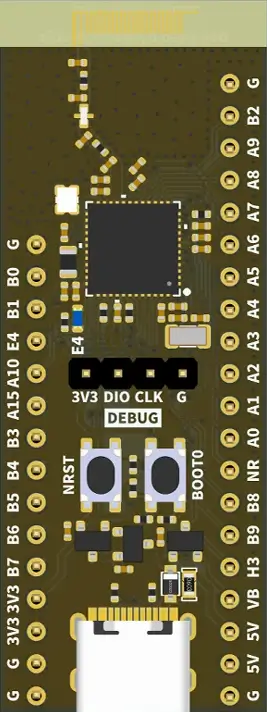

<!-- Copyright 2015-2026 Zephyr Project members and individual contributors. -->
<!-- SPDX-License-Identifier: Apache-2.0 -->
<!-- 中文翻译；编号、导航与译注为本地新增。 -->

<a id="weact_stm32wb55_core"></a>

# 第25章\_STM32WB55核心板V1.0

原文：[官方页面](https://docs.zephyrproject.org/latest/boards/weact/stm32wb55_core/doc/index.html)。读取日期：2026-10-16；来源摘要见[来源记录](../SOURCES.md)。

开发板概览（Board Overview）

<a id="id1"></a>

[](images/weact_stm32wb55_core.webp)

STM32WB55核心板V1.0

名称（Name）：

`weact_stm32wb55_core`

厂商（Vendor）：

[WeAct Studio](https://docs.zephyrproject.org/latest/boards/index.html#vendor=weact)

状态（Status）：

当前未积极维护（Not Actively Maintained）

架构（Architecture）：

[arm](https://docs.zephyrproject.org/latest/boards/index.html#arch=arm)

片上系统（SoC）：

[stm32wb55xx](https://docs.zephyrproject.org/latest/boards/index.html#soc=stm32wb55xx)

<a id="board-github-link"></a>

[浏览开发板源码（Browse Board Sources）](https://github.com/zephyrproject-rtos/zephyr/blob/main//boards/weact/stm32wb55_core/doc/index.rst/../..)<a id="overview"></a>

## 概述（Overview）

WeAct STM32WB55核心板是紧凑、多协议、超低功耗无线开发板，集成符合Bluetooth Low Energy SIG 5.0及IEEE 802.15.4-2011的无线电。


- STM32WB55CGU6，UFQFPN48封装
- 2.4 GHz射频收发器，支持Bluetooth 5.0及IEEE 802.15.4-2011 PHY／MAC
- 专用32位Arm Cortex-M0+，处理实时无线电层
- 1个蓝色用户LED
- 1个BOOT键
- 1个RESET键
- USB Type-C接口
- 板载ME6231A33M3G 3.3 V低压差稳压器（LDO）
- 集成PCB天线及2.4 GHz射频滤波器
- 32 MHz外部高速晶体（HSE）
- RTC使用32.768 kHz外部低速晶体（LSE）
- 2.54 mm间距排针，P1为20针、P2为15针
- 4引脚SWD调试排针

<a id="hardware"></a>

## 硬件（Hardware）

STM32WB55CGU6是超低功耗双核SoC，具有64 MHz Cortex-M4、32 MHz Cortex-M0+、1 MB闪存、Bluetooth 5、802.15.4、USB及AES-256，硬件能力如下：


- 带FlexPowerControl的超低功耗设计，保留RTC及32 KB RAM的待机模式低至600 nA
- 32位ARM Cortex-M4内核，带FPU，最高64 MHz
- 无线电（Radio）：


  - 2.4GHz
  - 射频收发器支持Bluetooth 5、IEEE 802.15.4-2011 PHY／MAC、Thread及Zigbee 3.0
  - 接收灵敏度：Bluetooth LE 1 Mbit/s时−96 dBm，802.15.4时−100 dBm
  - 可编程输出功率最高+6 dBm，步进1 dB
  - 集成平衡不平衡转换器（Balun），减少物料清单（BOM）
  - 支持2 Mbit/s
  - 专用32位Arm Cortex-M0+，处理实时无线电层
  - 精确接收信号强度指示（RSSI），用于功率控制
- 时钟源（Clock Sources）：


  - 32 MHz晶体振荡器，带集成微调电容，用于无线电及CPU时钟
  - 用于实时时钟（RTC）的32 kHz低速外部晶体振荡器（LSE）
  - 内部低功耗32 kHz RC振荡器
  - 内部100 kHz至48 MHz多速振荡器，由LSE自动校准
  - 2个PLL，用于系统时钟、USB及ADC
- 带硬件日历、闹钟及校准功能的实时时钟（RTC）
- 最多24个电容感应通道
- 16个定时器（Timers）：


  - 两个16位高级电机控制定时器（Advanced Motor-Control）
  - 通用定时器：2个32位及5个16位
  - 两个16位基本定时器（Basic Timers）
  - 两个16位低功耗定时器，在停止模式（Stop Mode）下可用
  - 两个看门狗（Watchdogs）
  - 系统节拍定时器（SysTick Timer）
- 存储器（Memories）


  - 1 MB双存储组闪存，支持读写并行
  - 最高256 KB SRAM
- 丰富的模拟外设


  - 12位4.26 MSPS ADC，通过硬件过采样最高16位
  - 2个超低功耗比较器

系统管理总线／电源管理总线（SMBus／PMBus）；原文为不完整括号片段


- 1个无需晶体的USB 2.0全速设备接口，支持电池充电检测（BCD）及链路电源管理（LPM）


- 安全及标识（Security and ID）


  - 3个AES硬件加密单元，最高256位
  - 公钥硬件单元（PKA）；原文将全称写为public key authority
  - 真随机数发生器（RNG）
  - 96位唯一标识（Unique ID）

STM32WB55CG更多信息：


- [ST网站上的STM32WB55CG](https://www.st.com/en/microcontrollers-microprocessors/stm32wb55cg.html)
- [STM32WB55数据手册](https://www.st.com/resource/en/datasheet/stm32wb55cg.pdf)
- [STM32WB55参考手册](https://www.st.com/resource/en/reference_manual/dm00318631.pdf)

<a id="supported-features"></a>

### 支持的功能（Supported Features）

`weact_stm32wb55_core`开发板支持下表所列的硬件功能。

片上／板载（On-Chip / On-Board）

功能集成在片上系统（SoC）内／位于开发板上。

2 / 2

分别表示已启用／已禁用的实例数。点击数量标签，可查看开发板或SoC设备树源码（DTS）中该功能的第一个实例。

`vnd,foo`

与此功能匹配的设备树绑定兼容字符串（Compatible String）；点击链接可查看绑定文档。

<a id="weact_stm32wb55_core-hw-features"></a>

<a id="weact_stm32wb55_core-weact_stm32wb55_core/stm32wb55xx-hw-features-section"></a>

#### `weact_stm32wb55_core/stm32wb55xx`目标（Target）

<a id="weact_stm32wb55_core-weact_stm32wb55_core/stm32wb55xx-hw-features-panel"></a>

<a id="weact_stm32wb55_core-weact_stm32wb55_core/stm32wb55xx-hw-features-memory"></a>

此目标可用存储：192 KiB RAM、876 KiB闪存。

<a id="weact_stm32wb55_core-weact_stm32wb55_core/stm32wb55xx-hw-features-table"></a>

<table>
<tr>
<th>类型（Type）</th>
<th>位置（Location）</th>
<th>说明（Description）</th>
<th>兼容字符串（Compatible）</th>
</tr>
<tr>
<td rowspan="1">中央处理器（CPU）</td>
<td>片上（On-Chip）</td>
<td>ARM Cortex-M4F 处理器（CPU）（<a href="https://github.com/zephyrproject-rtos/zephyr/blob/main/dts/arm/st/wb/stm32wb.dtsi?plain=1#L35">已启用：1</a>）</td>
<td><a href="../cpu_arm_riscv_binding_reference/P025_arm_cortex-m4f.md#std-dtcompatible-arm-cortex-m4f"><code>arm,cortex-m4f</code></a></td>
</tr>
<tr>
<td rowspan="1">模数转换器（ADC）</td>
<td>片上（On-Chip）</td>
<td>STM32模数转换器（ADC）（<a href="https://github.com/zephyrproject-rtos/zephyr/blob/main/dts/arm/st/wb/stm32wb.dtsi?plain=1#L495">已启用：1</a>）</td>
<td><a href="../hardware/P839_STM32模数转换器绑定.md#dtbinding-st-stm32-adc"><code>st,stm32-adc</code></a></td>
</tr>
<tr>
<td rowspan="1">蓝牙（Bluetooth）</td>
<td>片上（On-Chip）</td>
<td>STM32WB无线电设备（Radio Device）（<a href="https://github.com/zephyrproject-rtos/zephyr/blob/main/dts/arm/st/wb/stm32wb.dtsi?plain=1#L703">已启用：1</a>）</td>
<td><a href="../bluetooth_st_transport_binding_reference/P006_st_stm32wb-rf.md#std-dtcompatible-st-stm32wb-rf"><code>st,stm32wb-rf</code></a></td>
</tr>
<tr>
<td rowspan="6">时钟控制（Clock Control）</td>
<td>片上（On-Chip）</td>
<td>STM32WB复位与时钟控制器节点（<a href="https://github.com/zephyrproject-rtos/zephyr/blob/main/dts/arm/st/wb/stm32wb.dtsi?plain=1#L218">已启用：1</a>）</td>
<td><a href="../timer_reference/P172_STM32WB复位与时钟控制绑定.md#dtbinding-st-stm32wb-rcc"><code>st,stm32wb-rcc</code></a></td>
</tr>
<tr>
<td>片上（On-Chip）</td>
<td>通用固定频率时钟提供者（Fixed-Rate Clock Provider）（<a href="https://github.com/zephyrproject-rtos/zephyr/blob/main/dts/arm/st/wb/stm32wb.dtsi?plain=1#L84">已启用：3</a>；<a href="https://github.com/zephyrproject-rtos/zephyr/blob/main/dts/arm/st/wb/stm32wb.dtsi?plain=1#L92">已禁用：2</a>）</td>
<td><a href="../hardware/P566_固定时钟绑定.md#dtbinding-fixed-clock"><code>fixed-clock</code></a></td>
</tr>
<tr>
<td>片上（On-Chip）</td>
<td>STM32多速内部时钟（MSI Clock）（<a href="https://github.com/zephyrproject-rtos/zephyr/blob/main/dts/arm/st/wb/stm32wb.dtsi?plain=1#L106">已禁用：1</a>）</td>
<td><a href="../timer_reference/P132_STM32多速内部时钟绑定.md#dtbinding-st-stm32-msi-clock"><code>st,stm32-msi-clock</code></a></td>
</tr>
<tr>
<td>片上（On-Chip）</td>
<td>STM32低速外部时钟（LSE Clock）（<a href="https://github.com/zephyrproject-rtos/zephyr/blob/main/dts/arm/st/wb/stm32wb.dtsi?plain=1#L113">已启用：1</a>）</td>
<td><a href="../timer_reference/P130_STM32低速外部时钟绑定.md#dtbinding-st-stm32-lse-clock"><code>st,stm32-lse-clock</code></a></td>
</tr>
<tr>
<td>片上（On-Chip）</td>
<td>STM32WB及STM32WL锁相环（PLL）节点（<a href="https://github.com/zephyrproject-rtos/zephyr/blob/main/dts/arm/st/wb/stm32wb.dtsi?plain=1#L135">已禁用：1</a>）</td>
<td><a href="../timer_reference/P151_STM32WB锁相环时钟绑定.md#dtbinding-st-stm32wb-pll-clock"><code>st,stm32wb-pll-clock</code></a></td>
</tr>
<tr>
<td>片上（On-Chip）</td>
<td>STM32 时钟多路复用器（Clock Multiplexer）（<a href="https://github.com/zephyrproject-rtos/zephyr/blob/main/dts/arm/st/wb/stm32wb.dtsi?plain=1#L141">已禁用：1</a>）</td>
<td><a href="../timer_reference/P133_STM32时钟多路复用绑定.md#dtbinding-st-stm32-clock-mux"><code>st,stm32-clock-mux</code></a></td>
</tr>
<tr>
<td rowspan="1">计数器（Counter）</td>
<td>片上（On-Chip）</td>
<td>STM32 计数器（Counters）（<a href="https://github.com/zephyrproject-rtos/zephyr/blob/main/dts/arm/st/wb/stm32wb.dtsi?plain=1#L408">已禁用：4</a>）</td>
<td><a href="../stm32_ti_xilinx_counter_binding_reference/P007_st_stm32-counter.md#std-dtcompatible-st-stm32-counter"><code>st,stm32-counter</code></a></td>
</tr>
<tr>
<td rowspan="1">循环冗余校验（CRC）</td>
<td>片上（On-Chip）</td>
<td>STM32 CRC 计算单元（Calculation Unit）（<a href="https://github.com/zephyrproject-rtos/zephyr/blob/main/dts/arm/st/wb/stm32wb.dtsi?plain=1#L663">已禁用：1</a>）</td>
<td><a href="../crc_clock_monitor_binding_reference/P011_st_stm32-crc.md#std-dtcompatible-st-stm32-crc"><code>st,stm32-crc</code></a></td>
</tr>
<tr>
<td rowspan="1">密码学加速器（Cryptographic Accelerator）</td>
<td>片上（On-Chip）</td>
<td>STM32高级加密标准加速器（AES Accelerator）（<a href="https://github.com/zephyrproject-rtos/zephyr/blob/main/dts/arm/st/wb/stm32wb.dtsi?plain=1#L605">已启用：1</a>）</td>
<td><a href="../crypto_secure_engine_st_ti_binding_reference/P015_st_stm32-aes.md#std-dtcompatible-st-stm32-aes"><code>st,stm32-aes</code></a></td>
</tr>
<tr>
<td rowspan="2">直接存储器访问（DMA）</td>
<td>片上（On-Chip）</td>
<td>STM32直接存储器访问控制器（DMA Controller，V2）（<a href="https://github.com/zephyrproject-rtos/zephyr/blob/main/dts/arm/st/wb/stm32wb.dtsi?plain=1#L539">已禁用：2</a>）</td>
<td><a href="../stm32_ti_xilinx_dma_binding_reference/P008_st_stm32-dma-v2.md#std-dtcompatible-st-stm32-dma-v2"><code>st,stm32-dma-v2</code></a></td>
</tr>
<tr>
<td>片上（On-Chip）</td>
<td>STM32 DMA 多路复用控制器（DMAMUX Controller）（<a href="https://github.com/zephyrproject-rtos/zephyr/blob/main/dts/arm/st/wb/stm32wb.dtsi?plain=1#L561">已禁用：1</a>）</td>
<td><a href="../stm32_ti_xilinx_dma_binding_reference/P011_st_stm32-dmamux.md#std-dtcompatible-st-stm32-dmamux"><code>st,stm32-dmamux</code></a></td>
</tr>
<tr>
<td rowspan="1">闪存控制器（Flash Controller）</td>
<td>片上（On-Chip）</td>
<td>STM32 系列闪存控制器（Flash Controller）（<a href="https://github.com/zephyrproject-rtos/zephyr/blob/main/dts/arm/st/wb/stm32wb.dtsi?plain=1#L149">已启用：1</a>）</td>
<td><a href="../flash_renesas_st_ti_binding_reference/P011_st_stm32-flash-controller.md#std-dtcompatible-st-stm32-flash-controller"><code>st,stm32-flash-controller</code></a></td>
</tr>
<tr>
<td rowspan="1">通用输入输出与接插件（GPIO &amp; Headers）</td>
<td>片上（On-Chip）</td>
<td>STM32 通用输入输出控制器（GPIO Controller）（<a href="https://github.com/zephyrproject-rtos/zephyr/blob/main/dts/arm/st/wb/stm32wb.dtsi?plain=1#L251">已启用：6</a>）</td>
<td><a href="../gpio_silabs_st_connectors_binding_reference/P029_st_stm32-gpio.md#std-dtcompatible-st-stm32-gpio"><code>st,stm32-gpio</code></a></td>
</tr>
<tr>
<td rowspan="1">集成电路间总线（I2C）</td>
<td>片上（On-Chip）</td>
<td>STM32 I2C V2 控制器（Controller）（<a href="https://github.com/zephyrproject-rtos/zephyr/blob/main/dts/arm/st/wb/stm32wb.dtsi?plain=1#L319">已启用：1</a>；<a href="https://github.com/zephyrproject-rtos/zephyr/blob/main/dts/arm/st/wb/stm32wb.dtsi?plain=1#L331">已禁用：1</a>）</td>
<td><a href="../i2c_stm32_ti_mux_binding_reference/P008_st_stm32-i2c-v2.md#std-dtcompatible-st-stm32-i2c-v2"><code>st,stm32-i2c-v2</code></a></td>
</tr>
<tr>
<td rowspan="1">输入（Input）</td>
<td>板载（On-Board）</td>
<td>一组绑定到 GPIO 的输入按键（GPIO-Bound Input Keys）（<a href="https://github.com/zephyrproject-rtos/zephyr/blob/main/boards/weact/stm32wb55_core/weact_stm32wb55_core.dts?plain=1#L36">已启用：1</a>）</td>
<td><a href="../hardware/P563_GPIO按键绑定.md#std-dtcompatible-gpio-keys"><code>gpio-keys</code></a></td>
</tr>
<tr>
<td rowspan="2">中断控制器（Interrupt Controller）</td>
<td>片上（On-Chip）</td>
<td>ARMv7-M 嵌套向量中断控制器（Nested Vectored Interrupt Controller，NVIC）（<a href="https://github.com/zephyrproject-rtos/zephyr/blob/main/dts/arm/armv7-m.dtsi?plain=1#L13">已启用：1</a>）</td>
<td><a href="../arm_interrupt_timer_binding_reference/P002_ARMv7_M_NVIC.md#std-dtcompatible-arm-v7m-nvic"><code>arm,v7m-nvic</code></a></td>
</tr>
<tr>
<td>片上（On-Chip）</td>
<td>STM32 外部中断控制器（External Interrupt Controller）（<a href="https://github.com/zephyrproject-rtos/zephyr/blob/main/dts/arm/st/wb/stm32wb.dtsi?plain=1#L229">已启用：1</a>）</td>
<td><a href="../mcu_external_interrupt_binding_reference/P001_st_stm32-exti.md#std-dtcompatible-st-stm32-exti"><code>st,stm32-exti</code></a></td>
</tr>
<tr>
<td rowspan="1">发光二极管（LED）</td>
<td>板载（On-Board）</td>
<td>一组由 GPIO 控制的 LED（GPIO-Controlled LEDs）（<a href="https://github.com/zephyrproject-rtos/zephyr/blob/main/boards/weact/stm32wb55_core/weact_stm32wb55_core.dts?plain=1#L27">已启用：1</a>）</td>
<td><a href="../hardware/P564_GPIO指示灯绑定.md#dtbinding-gpio-leds"><code>gpio-leds</code></a></td>
</tr>
<tr>
<td rowspan="1">存储器控制器（Memory Controller）</td>
<td>片上（On-Chip）</td>
<td>STM32 电池备份 RAM（Battery-Backed RAM）（<a href="https://github.com/zephyrproject-rtos/zephyr/blob/main/dts/arm/st/wb/stm32wb.dtsi?plain=1#L353">已启用：1</a>）</td>
<td><a href="../memory_controller_sdram_psram_binding_reference/P010_st_stm32-bbram.md#std-dtcompatible-st-stm32-bbram"><code>st,stm32-bbram</code></a></td>
</tr>
<tr>
<td rowspan="1">存储技术设备（MTD）</td>
<td>片上（On-Chip）</td>
<td>STM32闪存（Flash Memory）（<a href="https://github.com/zephyrproject-rtos/zephyr/blob/main/dts/arm/st/wb/stm32wb.dtsi?plain=1#L159">已启用：1</a>）</td>
<td><a href="../mtd_nxp_st_ti_partition_binding_reference/P016_st_stm32-nv-flash.md#std-dtcompatible-st-stm32-nv-flash"><code>st,stm32-nv-flash</code></a></td>
</tr>
<tr>
<td rowspan="1">非易失存储器（NVMEM）</td>
<td>片上（On-Chip）</td>
<td>非易失存储器固定布局（Fixed Layout for Non-Volatile Memory）（<a href="https://github.com/zephyrproject-rtos/zephyr/blob/main/dts/arm/st/wb/stm32wb.dtsi?plain=1#L180">已启用：1</a>）</td>
<td><a href="../memory_protection_binding_reference/P009_fixed-layout.md#std-dtcompatible-fixed-layout"><code>fixed-layout</code></a></td>
</tr>
<tr>
<td rowspan="1">一次性可编程存储器（OTP Memory）</td>
<td>片上（On-Chip）</td>
<td>STM32 嵌入式非易失一次性可编程存储器（NVM OTP）（<a href="https://github.com/zephyrproject-rtos/zephyr/blob/main/dts/arm/st/wb/stm32wb.dtsi?plain=1#L176">已启用：1</a>；<a href="https://github.com/zephyrproject-rtos/zephyr/blob/main/dts/arm/st/wb/stm32wb.dtsi?plain=1#L169">已禁用：1</a>）</td>
<td><a href="../otp_binding_reference/P010_st_stm32-nvm-otp.md#std-dtcompatible-st-stm32-nvm-otp"><code>st,stm32-nvm-otp</code></a></td>
</tr>
<tr>
<td rowspan="1">物理层（PHY）</td>
<td>片上（On-Chip）</td>
<td>用于所有内置于 USB IP 的 USB 收发器（USB Transceivers）的绑定。（<a href="https://github.com/zephyrproject-rtos/zephyr/blob/main/dts/arm/st/wb/stm32wb.dtsi?plain=1#L698">已启用：1</a>）</td>
<td><a href="../phy_binding_reference/P008_usb-nop-xceiv.md#std-dtcompatible-usb-nop-xceiv"><code>usb-nop-xceiv</code></a></td>
</tr>
<tr>
<td rowspan="1">引脚控制（Pin Control）</td>
<td>片上（On-Chip）</td>
<td>STM32 引脚控制器（Pin Controller）（<a href="https://github.com/zephyrproject-rtos/zephyr/blob/main/dts/arm/st/wb/stm32wb.dtsi?plain=1#L244">已启用：1</a>）</td>
<td><a href="../pinctrl_stm32_ti_xilinx_binding_reference/P004_st_stm32-pinctrl.md#std-dtcompatible-st-stm32-pinctrl"><code>st,stm32-pinctrl</code></a></td>
</tr>
<tr>
<td rowspan="2">电源管理（Power Management）</td>
<td>片上（On-Chip）</td>
<td>STM32 电源控制器（Power Controller）（<a href="https://github.com/zephyrproject-rtos/zephyr/blob/main/dts/arm/st/wb/stm32wb.dtsi?plain=1#L623">已启用：1</a>）</td>
<td><a href="../stm32_soc_power_binding_reference/P010_st_stm32-pwr.md#std-dtcompatible-st-stm32-pwr"><code>st,stm32-pwr</code></a></td>
</tr>
<tr>
<td>片上（On-Chip）</td>
<td>STM32唤醒线控制器（Wake-up Lines Controller）（<a href="https://github.com/zephyrproject-rtos/zephyr/blob/main/dts/arm/st/wb/stm32wb.dtsi?plain=1#L627">已禁用：1</a>）</td>
<td><a href="../stm32_soc_power_binding_reference/P009_st_stm32-pwr-wkupctrl.md#std-dtcompatible-st-stm32-pwr-wkupctrl"><code>st,stm32-pwr-wkupctrl</code></a></td>
</tr>
<tr>
<td rowspan="1">脉宽调制（PWM）</td>
<td>片上（On-Chip）</td>
<td>STM32 脉宽调制（PWM）（<a href="https://github.com/zephyrproject-rtos/zephyr/blob/main/dts/arm/st/wb/stm32wb.dtsi?plain=1#L402">已启用：2</a>；<a href="https://github.com/zephyrproject-rtos/zephyr/blob/main/dts/arm/st/wb/stm32wb.dtsi?plain=1#L460">已禁用：2</a>）</td>
<td><a href="../pwm_stm32_ti_generic_binding_reference/P011_st_stm32-pwm.md#std-dtcompatible-st-stm32-pwm"><code>st,stm32-pwm</code></a></td>
</tr>
<tr>
<td rowspan="1">四线串行外设接口（QSPI）</td>
<td>片上（On-Chip）</td>
<td>STM32 四线串行外设接口控制器（QSPI Controller）（<a href="https://github.com/zephyrproject-rtos/zephyr/blob/main/dts/arm/st/wb/stm32wb.dtsi?plain=1#L587">已禁用：1</a>）</td>
<td><a href="../qspi_ospi_xspi_binding_reference/P011_st_stm32-qspi.md#std-dtcompatible-st-stm32-qspi"><code>st,stm32-qspi</code></a></td>
</tr>
<tr>
<td rowspan="1">稳压器（Regulator）</td>
<td>片上（On-Chip）</td>
<td>STM32参考电压缓冲器稳压器（VREFBUF Regulator）（<a href="https://github.com/zephyrproject-rtos/zephyr/blob/main/dts/arm/st/wb/stm32wb.dtsi?plain=1#L614">已禁用：1</a>）</td>
<td><a href="../hardware/P638_STM32参考电压缓冲器绑定.md#dtbinding-st-stm32-vrefbuf"><code>st,stm32-vrefbuf</code></a></td>
</tr>
<tr>
<td rowspan="1">复位控制器（Reset Controller）</td>
<td>片上（On-Chip）</td>
<td>STM32 复位与时钟控制器（Reset and Clock Control，RCC）（<a href="https://github.com/zephyrproject-rtos/zephyr/blob/main/dts/arm/st/wb/stm32wb.dtsi?plain=1#L223">已启用：1</a>）</td>
<td><a href="../reset_controller_binding_reference/P017_st_stm32-rcc-rctl.md#std-dtcompatible-st-stm32-rcc-rctl"><code>st,stm32-rcc-rctl</code></a></td>
</tr>
<tr>
<td rowspan="1">随机数生成器（RNG）</td>
<td>片上（On-Chip）</td>
<td>STM32 随机数生成器（Random Number Generator）（<a href="https://github.com/zephyrproject-rtos/zephyr/blob/main/dts/arm/st/wb/stm32wb.dtsi?plain=1#L597">已启用：1</a>）</td>
<td><a href="../soc_rng_binding_reference/P016_st_stm32-rng.md#std-dtcompatible-st-stm32-rng"><code>st,stm32-rng</code></a></td>
</tr>
<tr>
<td rowspan="1">实时时钟（RTC）</td>
<td>片上（On-Chip）</td>
<td>STM32 实时时钟（RTC）（<a href="https://github.com/zephyrproject-rtos/zephyr/blob/main/dts/arm/st/wb/stm32wb.dtsi?plain=1#L343">已启用：1</a>）</td>
<td><a href="../soc_rtc_binding_reference/P014_st_stm32-rtc.md#std-dtcompatible-st-stm32-rtc"><code>st,stm32-rtc</code></a></td>
</tr>
<tr>
<td rowspan="4">传感器（Sensors）</td>
<td>片上（On-Chip）</td>
<td>STM32 正交解码器（Quadrature Decoder）（<a href="https://github.com/zephyrproject-rtos/zephyr/blob/main/dts/arm/st/wb/stm32wb.dtsi?plain=1#L413">已禁用：2</a>）</td>
<td><a href="../sensor_st_lsm_stm32_binding_reference/P028_st_stm32-qdec.md#std-dtcompatible-st-stm32-qdec"><code>st,stm32-qdec</code></a></td>
</tr>
<tr>
<td>片上（On-Chip）</td>
<td>STM32 系列温度节点（TEMP），用于以两个温度点完成生产校准的传感器。（<a href="https://github.com/zephyrproject-rtos/zephyr/blob/main/dts/arm/st/wb/stm32wb.dtsi?plain=1#L672">已启用：1</a>）</td>
<td><a href="../sensor_st_lsm_stm32_binding_reference/P029_st_stm32-temp-cal.md#std-dtcompatible-st-stm32-temp-cal"><code>st,stm32-temp-cal</code></a></td>
</tr>
<tr>
<td>片上（On-Chip）</td>
<td>STM32 参考电压（VREF+）（<a href="https://github.com/zephyrproject-rtos/zephyr/blob/main/dts/arm/st/wb/stm32wb.dtsi?plain=1#L683">已启用：1</a>）</td>
<td><a href="../sensor_st_ti_power_capacitance_binding_reference/P003_st_stm32-vref.md#std-dtcompatible-st-stm32-vref"><code>st,stm32-vref</code></a></td>
</tr>
<tr>
<td>片上（On-Chip）</td>
<td>STM32 电池电压（VBAT）（<a href="https://github.com/zephyrproject-rtos/zephyr/blob/main/dts/arm/st/wb/stm32wb.dtsi?plain=1#L691">已启用：1</a>）</td>
<td><a href="../sensor_st_ti_power_capacitance_binding_reference/P001_st_stm32-vbat.md#std-dtcompatible-st-stm32-vbat"><code>st,stm32-vbat</code></a></td>
</tr>
<tr>
<td rowspan="2">串行控制器（Serial Controller）</td>
<td>片上（On-Chip）</td>
<td>STM32 通用同步／异步收发器（USART）（<a href="https://github.com/zephyrproject-rtos/zephyr/blob/main/dts/arm/st/wb/stm32wb.dtsi?plain=1#L310">已启用：1</a>）</td>
<td><a href="../uart_silabs_stm32_ti_binding_reference/P016_st_stm32-usart.md#std-dtcompatible-st-stm32-usart"><code>st,stm32-usart</code></a></td>
</tr>
<tr>
<td>片上（On-Chip）</td>
<td>STM32低功耗通用异步收发器（LPUART）（<a href="https://github.com/zephyrproject-rtos/zephyr/blob/main/dts/arm/st/wb/stm32wb.dtsi?plain=1#L382">已启用：1</a>）</td>
<td><a href="../uart_silabs_stm32_ti_binding_reference/P014_st_stm32-lpuart.md#std-dtcompatible-st-stm32-lpuart"><code>st,stm32-lpuart</code></a></td>
</tr>
<tr>
<td rowspan="1">系统管理总线（SMbus）</td>
<td>片上（On-Chip）</td>
<td>STM32 系统管理总线控制器（SMBus Controller）（<a href="https://github.com/zephyrproject-rtos/zephyr/blob/main/dts/arm/st/wb/stm32wb.dtsi?plain=1#L712">已禁用：2</a>）</td>
<td><a href="../i3c_smbus_binding_reference/P013_st_stm32-smbus.md#std-dtcompatible-st-stm32-smbus"><code>st,stm32-smbus</code></a></td>
</tr>
<tr>
<td rowspan="1">串行外设接口（SPI）</td>
<td>片上（On-Chip）</td>
<td>带嵌入式接收和发送先进先出队列（Rx / Tx FIFOs）的STM32 SPI控制器（<a href="https://github.com/zephyrproject-rtos/zephyr/blob/main/dts/arm/st/wb/stm32wb.dtsi?plain=1#L360">已启用：1</a>；<a href="https://github.com/zephyrproject-rtos/zephyr/blob/main/dts/arm/st/wb/stm32wb.dtsi?plain=1#L371">已禁用：1</a>）</td>
<td><a href="../spi_stm32_ti_xilinx_binding_reference/P009_st_stm32-spi-fifo.md#std-dtcompatible-st-stm32-spi-fifo"><code>st,stm32-spi-fifo</code></a></td>
</tr>
<tr>
<td rowspan="3">定时器（Timer）</td>
<td>片上（On-Chip）</td>
<td>ARMv7-M 系统节拍（System Tick）（<a href="https://github.com/zephyrproject-rtos/zephyr/blob/main/dts/arm/armv7-m.dtsi?plain=1#L21">已启用：1</a>）</td>
<td><a href="../arm_interrupt_timer_binding_reference/P006_ARMv7_M_SysTick.md#std-dtcompatible-arm-armv7m-systick"><code>arm,armv7m-systick</code></a></td>
</tr>
<tr>
<td>片上（On-Chip）</td>
<td>STM32 定时器（Timers）（<a href="https://github.com/zephyrproject-rtos/zephyr/blob/main/dts/arm/st/wb/stm32wb.dtsi?plain=1#L391">已启用：2</a>；<a href="https://github.com/zephyrproject-rtos/zephyr/blob/main/dts/arm/st/wb/stm32wb.dtsi?plain=1#L449">已禁用：2</a>）</td>
<td><a href="../stm32_ti_silabs_timer_binding_reference/P008_st_stm32-timers.md#std-dtcompatible-st-stm32-timers"><code>st,stm32-timers</code></a></td>
</tr>
<tr>
<td>片上（On-Chip）</td>
<td>STM32低功耗定时器（LPTIM）（<a href="https://github.com/zephyrproject-rtos/zephyr/blob/main/dts/arm/st/wb/stm32wb.dtsi?plain=1#L527">已启用：1</a>）</td>
<td><a href="../stm32_ti_silabs_timer_binding_reference/P007_st_stm32-lptim.md#std-dtcompatible-st-stm32-lptim"><code>st,stm32-lptim</code></a></td>
</tr>
<tr>
<td rowspan="1">通用串行总线（USB）</td>
<td>片上（On-Chip）</td>
<td>STM32 USB控制器（Controller）（<a href="https://github.com/zephyrproject-rtos/zephyr/blob/main/dts/arm/st/wb/stm32wb.dtsi?plain=1#L573">已启用：1</a>）</td>
<td><a href="../usb_stm32_audio_binding_reference/P006_st_stm32-usb.md#std-dtcompatible-st-stm32-usb"><code>st,stm32-usb</code></a></td>
</tr>
<tr>
<td rowspan="2">看门狗（Watchdog）</td>
<td>片上（On-Chip）</td>
<td>STM32 系统窗口看门狗（System Window Watchdog）（<a href="https://github.com/zephyrproject-rtos/zephyr/blob/main/dts/arm/st/wb/stm32wb.dtsi?plain=1#L302">已禁用：1</a>）</td>
<td><a href="../stm32_ti_xilinx_watchdog_binding_reference/P002_st_stm32-window-watchdog.md#std-dtcompatible-st-stm32-window-watchdog"><code>st,stm32-window-watchdog</code></a></td>
</tr>
<tr>
<td>片上（On-Chip）</td>
<td>STM32 看门狗（Watchdog）（<a href="https://github.com/zephyrproject-rtos/zephyr/blob/main/dts/arm/st/wb/stm32wb.dtsi?plain=1#L521">已启用：1</a>）</td>
<td><a href="../stm32_ti_xilinx_watchdog_binding_reference/P001_st_stm32-watchdog.md#std-dtcompatible-st-stm32-watchdog"><code>st,stm32-watchdog</code></a></td>
</tr>
</table>

<a id="bluetooth-and-stm32wb-copro-wireless-binaries"></a>

### Bluetooth与STM32WB协处理器无线二进制固件

重要：WeAct STM32WB55出厂在Cortex-M0+上预装全栈（Full Stack）无线固件，与Zephyr不兼容。使用Bluetooth前必须换成HCI层（HCI Layer）固件。

使用Bluetooth时，M0+必须烧录有效STM32WB协处理器HCI二进制。固件位于STM32WB Cube包的Projects/STM32WB_Copro_Wireless_Binaries/STM32WB5x/目录。

原文在此板测试过扩展HCI固件stm32wb5x_BLE_HCILayer_extended_fw.bin。

各二进制版本兼容性见[hal_stm32:lib/stm32wb/README.rst](https://github.com/zephyrproject-rtos/hal_stm32/blob/c9550199186236d610092f4005f8c9bae2a6bfcf/lib/stm32wb/README.rst)。

<a id="flashing-the-wireless-coprocessor-binary"></a>

#### 烧录无线协处理器固件

Cortex-M0+无线协处理器固件需要外部调试探针及STM32CubeProgrammer烧录，不能使用DFU。将ST-LINK/V2或J-Link连接P3的4针SWD接口，使用STM32CubeProgrammer将二进制写到对应地址。

STM32WB5xxG的1 MB变体安装地址随二进制类型变化，以下针对v1.23.0：


- BLE_HCILayer_extended安装地址：0x080DB000
- BLE_HCILayer安装地址：0x080E1000

固件升级服务（Firmware Upgrade Services，FUS）v2.1.0安装地址：


- FUS v2.1.0安装地址：0x080EE000

完整地址信息见[STM32无线协处理器二进制表](https://github.com/STMicroelectronics/STM32CubeWB/blob/master/Projects/STM32WB_Copro_Wireless_Binaries/STM32WB5x/Release_Notes.html)。

<a id="connections-and-ios"></a>

### 连接与输入输出（Connections and IOs）

<a id="default-zephyr-peripheral-mapping"></a>

#### Zephyr 默认外设映射（Peripheral Mapping）：


- UART_1 TX／RX：PA9／PA10
- LPUART_1 TX／RX：PA2／PA3，CTS=PA6、RTS=PB1
- `I2C_1_SCL : PB8`
- `I2C_1_SDA : PB9`
- `SPI_1_NSS : PA4`
- `SPI_1_SCK : PA5`
- SPI_1 MISO：PB4
- SPI_1 MOSI：PB5
- PWM_1_CH1：PA8
- PWM_2_CH1：PA15
- ADC_1_IN5：PA0
- ADC_1_IN6：PA1
- 蓝色用户LED：PB2
- BOOT按键：PE4
- `USB_DP : PA12`
- USB_DM：PA11

<a id="system-clock"></a>

#### 系统时钟（System Clock）

WeAct STM32WB55使用32 MHz HSE晶体，默认经PLL生成64 MHz系统时钟。

<a id="power-supply"></a>

#### 电源（Power Supply）

板载ME6231A33M3G 3.3 V LDO接受3.3—5.5 V输入，供电可来自：


- USB Type-C接口，5 V
- P1排针VDD5V引脚
- P2排针VDD33引脚，稳压3.3 V输入

<a id="serial-port"></a>

#### 串口（Serial Port）

板上有1路USART及1路LPUART。Zephyr控制台分配给USART1的PA9／PA10，默认115200波特率、8N1。

<a id="programming-and-debugging"></a>

## 烧录与调试（Programming and Debugging）

`weact_stm32wb55_core`开发板支持下表所列的运行工具（Runners）及相关west命令。

<table>
<tr>
<th></th>
<th>烧录（flash）</th>
<th>调试（debug）</th>
<th>连接调试会话（attach）</th>
<th>实时传输（rtt）</th>
<th>复位（reset）</th>
<th>调试服务器（debugserver）</th>
</tr>
<tr>
<td>dfu-util</td>
<td>✅（默认 / default）</td>
<td></td>
<td></td>
<td></td>
<td></td>
<td></td>
</tr>
<tr>
<td><a href="https://docs.zephyrproject.org/latest/develop/flash_debug/host-tools.html#runner-jlink">jlink</a></td>
<td>✅</td>
<td>✅（默认 / default）</td>
<td>✅</td>
<td>✅</td>
<td>✅</td>
<td>✅</td>
</tr>
<tr>
<td><a href="https://docs.zephyrproject.org/latest/develop/flash_debug/host-tools.html#runner-openocd">openocd</a></td>
<td>✅</td>
<td>✅</td>
<td>✅</td>
<td>✅</td>
<td></td>
<td>✅</td>
</tr>
<tr>
<td><a href="https://docs.zephyrproject.org/latest/develop/flash_debug/host-tools.html#runner-stm32cubeprogrammer">stm32cubeprogrammer</a></td>
<td>✅</td>
<td></td>
<td></td>
<td></td>
<td></td>
<td></td>
</tr>
</table>

WeAct STM32WB55没有板载调试器。Cortex-M4可经DFU烧录，无需外部探针；Cortex-M0+协处理器则须使用连接P3 SWD排针的ST-LINK/V2或J-Link。

<a id="flashing"></a>

### 烧录（Flashing）

<a id="installing-dfu-util"></a>

#### 安装 dfu-util（Installing dfu-util）

建议至少使用[dfu-util](https://dfu-util.sourceforge.net/) 0.8。原文提示Debian／Ubuntu包可能较旧，必要时从源码构建。Windows也可使用，但可能需[Zadig](https://zadig.akeo.ie/)安装正确USB驱动。

<a id="flashing-an-application"></a>

#### 烧录应用（Flashing an Application）

连接USB Type-C供电，按住BOOT并按下再松开RESET，强制进入DFU模式。

此开发板支持`dfu-util`运行工具（Runner），因此可方便地构建及测试示例。

```text
# From the root of the zephyr repository
west build -b weact_stm32wb55_core samples/basic/blinky
west flash
```

```text
# From the root of the zephyr repository
west build -b weact_stm32wb55_core samples/hello_world
west flash
```

若P3 SWD已连接ST-LINK/V2或J-Link，也可通过STM32CubeProgrammer烧录M4应用，使用--runner或-r选项：

```text
$ west flash --runner stm32cubeprogrammer
```

<a id="debugging"></a>

### 调试（Debugging）

调试应用需要外部调试器连接P3 SWD，然后按常规方式调试，以下以[Blinky](../getting_started/P004_LED闪烁示例.md#blinky)为例。

```text
# From the root of the zephyr repository
west build -b weact_stm32wb55_core samples/basic/blinky
west debug
```

## 译注

WB55出厂Full Stack无线固件与Zephyr不兼容，需更换HCI Layer。M4可DFU烧录，M0+需外部SWD探针；HCI v1.23.0及FUS v2.1.0地址具有版本前提，不作为通用固定地址。

## 原文外链核对

2026-10-16核对并重试以下原文外链时未能确认可访问性，保留原始目标，不将访问失败解释为原文内容有误。

- [](https://dfu-util.sourceforge.net/)：HTTP Error 403: Forbidden。
- [stm32wb55cg.html](https://www.st.com/en/microcontrollers-microprocessors/stm32wb55cg.html)：HTTP Error 567: Unknown Status。
- [stm32wb55cg.pdf](https://www.st.com/resource/en/datasheet/stm32wb55cg.pdf)：HTTP Error 567: Unknown Status。
- [dm00318631.pdf](https://www.st.com/resource/en/reference_manual/dm00318631.pdf)：HTTP Error 567: Unknown Status。

---

[上一章](P024_STM32H562_Core_Board.md) · [返回大纲](大纲.md) · [全站翻译进度](../PROGRESS.md) · [下一章](P026_USB2CANFDV1.md)
