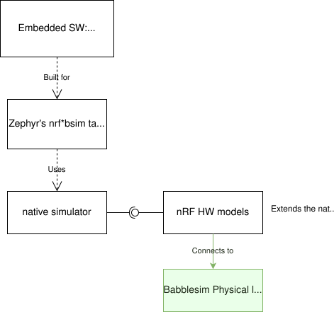
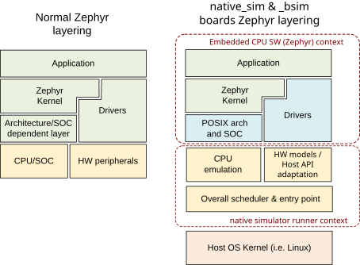
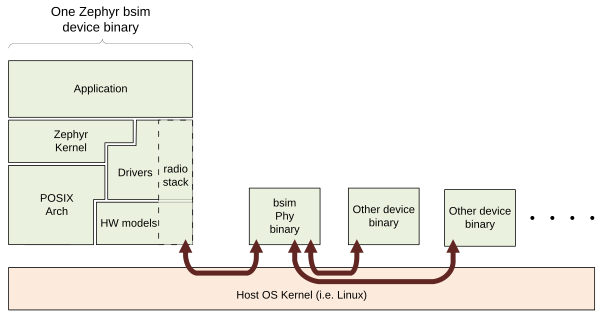

<!-- Copyright 2015-2026 Zephyr Project members and individual contributors. -->
<!-- SPDX-License-Identifier: Apache-2.0 -->
<!-- 中文翻译；编号、导航和明确标注的译注为本地新增。 -->

# 第1章\_Bsim开发板设计

原文：[官方页面](https://docs.zephyrproject.org/latest/boards/native/doc/bsim_boards_design.html)。读取日期：2026-10-16；来源摘要见[来源记录](../SOURCES.md)。

可用的 Bsim 开发板（Bsim Boards）：

- [模拟 nRF52833（nrf52_bsim）](P002_NRF52模拟开发板.md#nrf52-bsim)。
- [模拟 nRF5340（nrf5340bsim）](P003_NRF5340模拟开发板.md#nrf5340bsim)。
- [模拟 nRF54L15（nrf54l15bsim）](P004_NRF54L15模拟开发板.md#nrf54l15bsim)。
- [模拟 nRF54LM20（nrf54lm20bsim）](P005_NRF54LM20模拟开发板.md#nrf54lm20bsim)。

- [总体目标](#overall-objective)
- [测试类型及其与Bsim开发板的关系](#different-types-of-tests-and-how-the-bsim-boards-relate-to-them)
- [设计](#design)
- [Zephyr、本机模拟器、nRF硬件模型与BabbleSim的关系](#relationship-between-zephyr-the-native-simulator-the-nrf-hw-models-and-babblesim)
- [Zephyr的架构、SoC与开发板分层](#layering-zephyr-s-arch-soc-and-board-layers)
- [重要限制与不支持的特性](#important-limitations-and-unsupported-features)
- [CPU与硬件模型的线程及整体调度](#threading-and-overall-scheduling-of-cpu-and-hw-models)
- [时间与time_machine](#time-and-the-time-machine)
- [BabbleSim组件：跟踪、随机数与活动记录](#use-of-babblesim-components-tracing-random-number-generation-logging-activity)
- [使用Zephyr API的注意事项](#about-using-zephyr-apis)
- [posix_print与nsi_print后端](#posix-print-and-nsi-print-backends)
- [bs_tests测试设施](#bs-tests)
- [命令行参数解析](#command-line-argument-parsing)
- [其他注意事项](#other-considerations)

本页说明 `nrf5x_bsim` 及其他类似 Bsim 开发板的设计、架构与设计理由。这些开发板名称以 `_bsim` 为后缀，是因为它们使用 [BabbleSim](https://BabbleSim.github.io)（简称 bsim）模拟无线电环境，并通过[本机模拟器（Native Simulator）](https://github.com/BabbleSim/native_simulator/blob/main/docs/README.md)和 [POSIX 架构（POSIX Architecture）](../native_reference/P002_POSIX架构.md#posix-arch)，在 Linux 上以本机程序方式构建和执行嵌入式代码。

[nRF52](P002_NRF52模拟开发板.md#nrf52-bsim)、[nRF5340](P003_NRF5340模拟开发板.md#nrf5340bsim) 与 [nRF54L15](P004_NRF54L15模拟开发板.md#nrf54l15bsim) 模拟开发板的具体细节及使用方法，见各自文档。

## 1.1\_总体目标

这些 Bsim 开发板的主要用途，是在工作站／模拟环境中为嵌入式代码的集成测试（Integration Testing）提供测试平台（Test Bench）。这里的集成测试至少会像其他[基于 POSIX 架构的开发板](../native_reference/P002_POSIX架构.md#posix-arch-rationale)一样，让待测代码与 Zephyr 实时操作系统（RTOS）共同运行；此外还包含一些硬件模型（Hardware Models），在一定程度上模拟真实嵌入式硬件。

测试在工作站上执行，不需要实际嵌入式硬件，目标是让测试以远快于实时的速度运行，同时保持确定性（Determinism）与可复现性（Reproducibility）。与 [native_sim](../native_reference/P004_Native_Simulator本机模拟器.md#native_sim) 不同，Bsim 开发板不直接与宿主外设交互，执行也不依赖宿主负载或时序。

这些开发板也可作为原型设计（Prototyping）和开发环境，辅助开发应用程序或通信协议栈（Communication Stack）。

## 1.2\_测试类型及其与Bsim开发板的关系

POSIX 架构文档中的[方案比较](../native_reference/P002_POSIX架构.md#posix-arch-compare)同样适用于这些开发板。本节进一步说明嵌入式软件开发者常用测试方法的差异、优缺点，以及与 Bsim 的关系。

**单元测试（Unit Tests）：**典型单元测试框架解决的是隔离测试一个组件的需求。Zephyr 提供 `unit_testing` 单元测试目标，它与 Bsim 开发板没有关联。

**真实硬件上的集成测试（Integration Tests on Real HW）：**可以测试高度依赖硬件细节的真实软件组件，有时甚至不需要相对于最终方案作任何改动。因此，某些情况下它能比模拟提供更充分的集成覆盖；代价是执行较慢、需要真实硬件装置、测试通常不可复现，而且很多故障不易调试。除此之外，它与模拟集成测试的用途十分相近。

**工作站上的集成测试（Integration Tests on Workstation）：**POSIX 架构与这些开发板支持以下方式。

- 使用 Bsim 开发板：把嵌入式软件或其中一部分、操作系统、外设模型等放在一起测试，从而检查组件之间的交互与集成。
- 同时使用 Bsim 开发板与 BabbleSim 物理层模拟（Physical Layer Simulation）：测试多个设备之间的交互。例如，左右耳机如何同步，如何通过无线链路交换数据与音频，以及如何与手机交互。
- 使用 Bsim 开发板与 [EDTT 框架](https://github.com/EDTTool/EDTT)：由外部 Python 测试脚本控制嵌入式待测代码。构建时加入处理 EDTT 通信、即远程过程调用传输（RPC Transport）的专用驱动，以及处理 RPC 调用本身的嵌入式应用；Python 脚本提供测试逻辑。
- 使用 Zephyr 的 [native_sim 开发板](../native_reference/P004_Native_Simulator本机模拟器.md#native_sim)：同样能做嵌入式代码集成测试，但不针对特定硬件，因此依赖具体硬件的许多组件不适合在此测试。它和 Bsim 开发板一样，可以配合 Zephyr 的 ztest 测试系统与 Twister 测试运行器使用，也可以独立使用。二者共用 POSIX 架构与本机模拟器运行器（Runner）。

**Zephyr ztest 基础设施与 Twister：**采用与待测代码一起构建的专用嵌入式测试应用。测试应用自行驱动测试、检查结果，再将结果交给负责指挥测试的 PC。它们最初用于目标硬件上的集成测试，并依赖专用测试应用；Bsim 开发板完整支持这套方法。

## 1.3\_设计

## 1.4\_Zephyr、本机模拟器、nRF硬件模型与BabbleSim的关系

以 Zephyr 的某个 `nrf_bsim` 目标构建嵌入式应用时，会使用[本机模拟器](https://github.com/BabbleSim/native_simulator/blob/main/docs/README.md)，并将对应目标的 nRF 硬件模型与它一起构建，以扩展模拟器能力。应用首先与 Zephyr 内核、所选子系统和网络协议栈链接，其中大多数驱动与实际目标使用的相同；本机模拟器运行器则与所需目标的硬件模型一起构建。最后，将嵌入式软件与运行器链接为 Linux 可执行程序。

图中文字对照：Zephyr’s nrf*bsim targets 为Zephyr的nrf*bsim目标；native simulator 为本机模拟器；nRF HW models 为nRF硬件模型；Uses 为使用；Extends the native simulator 为扩展本机模拟器；Embedded SW: Application + Zephyr kernel + stack + drivers 为嵌入式软件：应用、Zephyr内核、协议栈及驱动；Built for 为针对目标构建；Babblesim Physical layer simulation 为BabbleSim物理层模拟；Connects to 为连接到。

对于 [nrf5340bsim 多微控制器目标](P003_NRF5340模拟开发板.md#nrf5340bsim-multi-mcu-build)这样的多 MCU 片上系统（SoC），可以使用[系统构建（sysbuild）](../sysbuild/P001_系统构建.md#sysbuild)：先分别构建并链接每个 MCU 的应用、Zephyr 内核和子系统，再与本机模拟器运行器一起组装成单个可执行程序。

## 1.5\_Zephyr的架构、SoC与开发板分层

基本分层如下。

1. 本机模拟器运行器负责在宿主上执行代码。
2. Zephyr 的架构（arch）、SoC 与开发板（board）组件由模拟专用组件替换。
3. 架构层是 POSIX 架构层，SoC 层为 `inf_clock`，开发板层由具体模拟器件决定。
4. POSIX 架构将 Zephyr 架构 API（主要处理线程上下文切换，Thread Context Switching）适配到本机模拟器的 CPU 线程仿真，详见 [POSIX 架构设计](../native_reference/P002_POSIX架构.md#posix-arch-architecture)。
5. `inf_clock` SoC 层适配本机模拟器的 CPU“模拟”，并处理“CPU 模拟”（Zephyr 线程）与硬件模型线程之间的控制权转移，见[线程调度](#threading)。
6. 开发板层提供所有与 SoC／集成电路（IC）相关的内容，包括选择在运行器上下文中构建的硬件模型、中断请求（IRQ）处理、[忙等待 API（Busy Wait）](../native_reference/P002_POSIX架构.md#posix-busy-wait)和 Zephyr `printk` 后端。普通 Zephyr 目标通常由 SoC 层提供中断处理及定制忙等待；这里为了使 `inf_clock` 保持通用，偏离常规分层，把这些工作交给开发板层。

开发板层还提供 `bs_tests` 钩子（Hook）、跟踪控制等测试功能，并通过本机模拟器提供 Linux 程序的 `main()` 入口、命令行参数处理，以及模拟设备的整体时间调度。

POSIX 架构与 `inf_clock` SoC 层要求开发板提供一组 API，包括忙等待、基本跟踪、中断控制器与中断处理 API，以及 `posix_exit()` 和 `posix_get_hw_cycle()`；参见 `posix_board_if.h` 与 `posix_soc_if.h`。

图中文字对照：CPU/SOC 为处理器／片上系统；HW peripherals 为硬件外设；Drivers 为驱动；Architecture/SOC dependent layer 为架构／SoC相关层；Zephyr Kernel 为Zephyr内核；Application 为应用；Host OS Kernel (i.e. Linux) 为宿主操作系统内核，例如Linux；Overall scheduler & entry point 为整体调度器与入口；CPU emulation 为CPU仿真；POSIX arch and SOC 为POSIX架构与SoC；Normal Zephyr layering 为常规Zephyr分层；native simulator runner context 为本机模拟器运行器上下文；Embedded CPU SW (Zephyr) context 为嵌入式CPU软件上下文；native_sim & _bsim boards Zephyr layering 为native_sim与_bsim开发板的Zephyr分层；HW models / Host API adaptation 为硬件模型／宿主API适配。

## 1.6\_重要限制与不支持的特性

所有本机及 Bsim 开发板都继承 POSIX 架构和 `inf_clock` 设计带来的同一组[重要限制](../native_reference/P002_POSIX架构.md#posix-arch-limitations)，也继承 POSIX 架构的[不支持特性集合](../native_reference/P002_POSIX架构.md#posix-arch-unsupported)。

## 1.7\_CPU与硬件模型的线程及整体调度

[POSIX 架构设计](../native_reference/P002_POSIX架构.md#posix-arch-architecture)与[本机模拟器设计文档](https://github.com/BabbleSim/native_simulator/blob/main/docs/Design.md)中的线程说明、通用 SoC 和开发板架构，同样适用于 Bsim 开发板。

[用于固件开发与测试的硬件模型架构](https://babblesim.github.io/arch_hw_models.html)介绍 BabbleSim 硬件模型及其调度方式。nRF Bsim 开发板的更多信息见 [nRF 硬件模型设计文档](https://github.com/BabbleSim/ext_nRF_hw_models/blob/main/docs/README_HW_models.md)。

## 1.8\_时间与time_machine

Bsim 开发板的模拟时间（Simulated Time）原则上与真实墙上时钟时间（Wall-clock Time）完全解耦。根据 POSIX 架构设计，模拟时间按需推进到下一个已调度的硬件事件；模拟 CPU 执行代码时，模拟时间不会前进。

通常，模拟时间比实际时间推进得快得多。宿主负载，或者在调试器等工具中“暂停”进程，都不会影响模拟结果。

本机模拟器硬件调度器提供硬件模型所需的事件时间循环：查找下一个事件，将时间推进到该事件，然后执行事件。它还提供 API，供组件通知自己的事件定时器已更新。为保持简单并提高速度，事件在设计时定义，不在运行时动态注册。

## 1.9\_BabbleSim组件：跟踪、随机数与活动记录

硬件模型的相关注意事项同样适用于 Bsim 开发板，见[用于固件开发与测试的硬件模型架构](https://babblesim.github.io/arch_hw_models.html)。

Zephyr 设备通过 Bsim 的 `libPhyCom` 库与其他模拟设备通信。无线电活动对应的通信关系如下。

图中文字对照：HW models 为硬件模型；Drivers 为驱动；POSIX Arch 为POSIX架构；Zephyr Kernel 为Zephyr内核；Application 为应用；One Zephyr bsim device binary 为一个Zephyr Bsim设备的二进制程序；radio stack 为无线电协议栈；Host OS Kernel (i.e. Linux) 为宿主操作系统内核，例如Linux；bsim Phy binary 为Bsim物理层二进制程序；Other device binary 为其他设备二进制程序。

测试代码还可以通过 Bsim 反向通道（Backchannels）与其他设备的测试代码通信。这些通道在设备间提供直接、可靠的管道（Pipe），用于交换测试数据。

## 1.10\_使用Zephyr API的注意事项

虽然部分 Bsim 开发板代码会与 Zephyr 内核链接，一般也不应在开发板代码本身中调用 Zephyr API。尤其不能从原始线程／硬件模型线程调用：此时 Zephyr 代码会处于错误上下文，极有可能导致各种难以调试的问题。

通常应把开发板代码视为比 Zephyr 操作系统更底层、且不依赖它的代码。例如，开发板代码不应使用 `printk`，因为它最终又会回调开发板自身的 Bsim 专用 `printk` 后端，而后端依赖 `bs_trace` API。需要跟踪输出时应直接使用 `bs_trace`；熵（Entropy）等其他 Zephyr API 同样如此。

## 1.11\_posix_print与nsi_print后端

Bsim 开发板为 POSIX 架构及 `inf_clock` 所需的 `posix_print` API，以及本机模拟器所需的 `nsi_print` API 提供后端（Backend）。

这些后端只把调用转交给 Bsim 的 `bs_trace` API。通过这些 API 输出的消息，以及默认情况下通过 Zephyr `printk` 输出的消息，会与其他设备消息一起打印到控制台，即标准输出（stdout）。

## 1.12\_bs_tests测试设施

Bsim 开发板还提供 `bs_tests`。它允许定义、注册测试，并让每个测试使用一组仅在模拟目标中存在的专用钩子。

测试与嵌入式软件一起构建，包含在二进制程序中，但默认不执行。用户可从命令行查询已有测试，并选择要执行的测试，也可以不选择。选定测试后，它注册的回调（Callback）才会被分配给对应钩子。

钩子包括：在硬件与 Zephyr 操作系统不同初始化阶段运行的一次性钩子、处理命令行参数的钩子，以及侦听或捕获中断的钩子。另有一个由嵌入式应用 `main()` 调用的钩子，但要求主应用支持它：应用必须是供模拟使用的版本，并在 Bsim 开发板上运行时调用 `bst_main()`。

除上述钩子外，`bs_tests` 还能构建专用测试“任务”（Task）。该任务在硬件模型线程上下文中执行，但能访问所有软件变量。它由专用定时器驱动，可配置为周期性或一次性节拍（Tick）；节拍到来时，调用已注册的测试节拍函数。这可用于支撑测试逻辑，例如在特定时刻检查状态或执行操作。结合 BabbleSim 的 `tb_defs` 宏，还能构建复杂任务，使其等待指定时长或等待条件满足。

编写 `bs_tests` 测试时，要考虑其他测试也可能与同一应用一起构建。因此，不应使用 `NATIVE_TASKS` 或 Zephyr 的内核前／后初始化（PRE/POST Kernel）驱动 API 注册测试初始化函数或回调，否则即使没有选择该测试，它们也会执行。应改用 `bs_tests` 提供的等价钩子。

对于 [nrf5340bsim](P003_NRF5340模拟开发板.md#nrf5340bsim-multi-mcu-build) 这样的非对称多处理（Asymmetric Multiprocessing，AMP）目标，每个嵌入式 MCU 都带有单独构建的 `bs_tests`。可以通过命令行，分别选择每个 MCU 是否运行测试以及运行哪项测试。

## 1.13\_命令行参数解析

Bsim 开发板需要处理以下几组命令行参数。

- 基本参数：选择跟踪详细程度（Trace Verbosity）、随机种子（Random Seed）、模拟设备编号，以及连接物理层时使用的模拟标识（Simulation ID）等。它们尽量遵循其他 Bsim 设备的约定，以方便开发者使用。
- 硬件模型参数：模型公开需要处理的参数；Bsim 开发板作为实际集成程序，确保这些参数得到处理。
- 测试控制参数：为每个嵌入式 CPU 选择测试、打印可用测试，并向测试本身传入参数。

参数解析使用 BabbleSim `base/libUtilv1` 库的 `bs_cmd_line` 组件。符合约定的基本参数定义由 `bs_cmd_line_typical.h` 提供。

## 1.14\_其他注意事项

**字节序（Endianness）：**代码针对宿主架构构建，通常是 x86。x86 使用小端（Little-endian），嵌入式目标通常也如此。如果二者字节序不同，在一侧工作的嵌入式代码可能因字节序错误而无法在另一侧工作。Zephyr 代码应同时支持大端（Big-endian）与小端。

**字长（Word Size）：**Bsim 目标与普通嵌入式目标一样采用32位。在 Bsim 中，通过明确面向 x86 的 ILP32 应用二进制接口（ABI）而不是 x86_64 来实现。这样可更准确地重现结构体在内存中的布局，更容易复现结构体成员访问或数组越界相关问题。

---

[本册大纲](大纲.md) · [全站进度](../PROGRESS.md) · [下一章](P002_NRF52模拟开发板.md)
