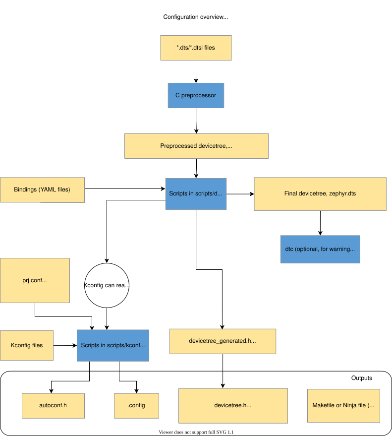
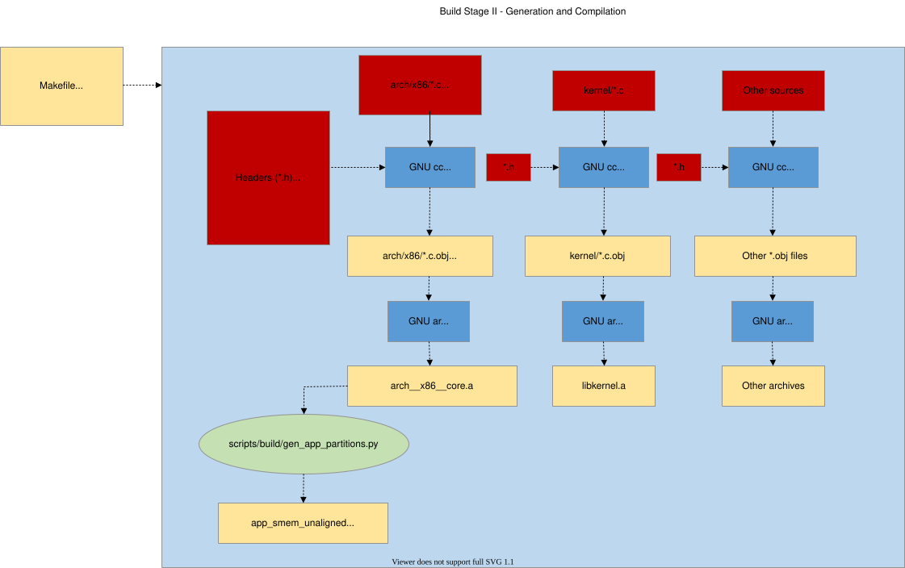
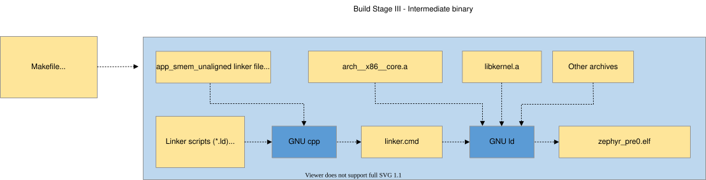
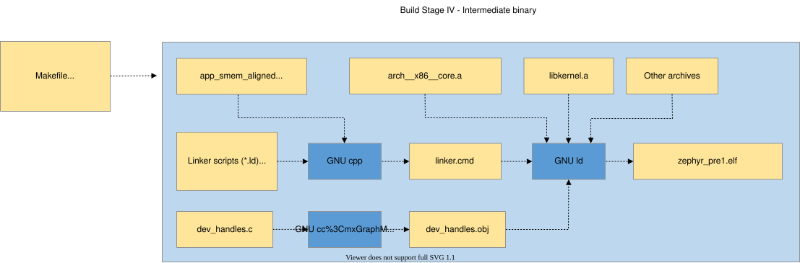
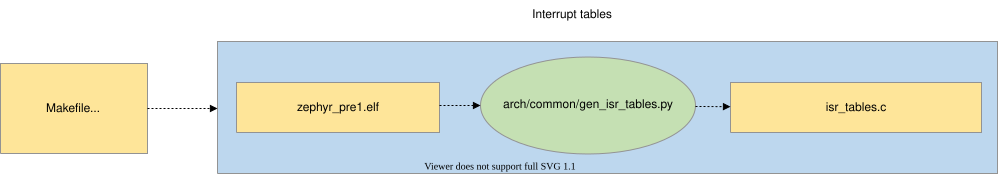
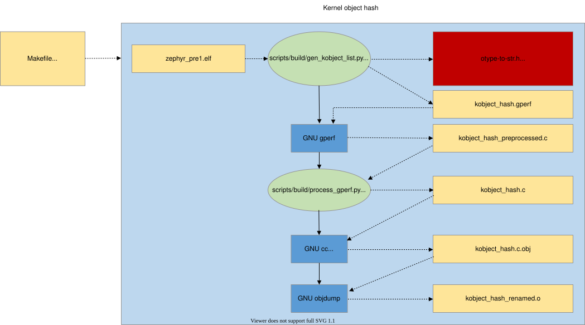
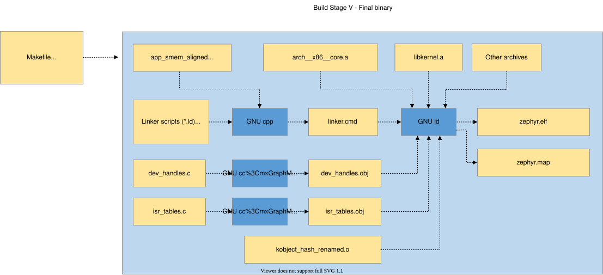
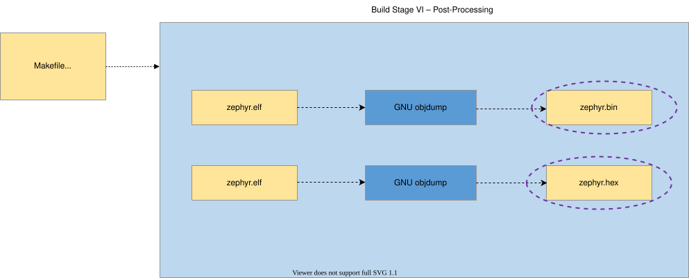

<!-- Copyright 2015-2026 Zephyr Project members and individual contributors. -->
<!-- SPDX-License-Identifier: Apache-2.0 -->
<!-- 中文翻译；阅读编号、导航和译注为本地新增。 -->

# 第1章\_CMake构建系统

原文：[Build System (CMake)](https://docs.zephyrproject.org/latest/build/cmake/index.html)。读取日期：2026-10-12，`latest`。

CMake 用于把应用与 Zephyr 内核一起构建。整个过程分为配置和构建两个主要阶段。配置阶段执行 `CMakeLists.txt`，建立构建内部模型，再生成适合主机平台的原生构建脚本。

CMake 支持多种后端，但 Zephyr 只测试并支持 Ninja 和 Make。配置完成后，运行生成的脚本进入构建阶段。多数普通代码变更只需重新编译，不必重新配置；某些变更则要求再次运行 CMake。构建脚本能识别其中一部分并自动重新配置，其他情况仍需手动处理。

## 1.1\_通过目标组织源码

Zephyr 用 CMake 的目标（target）组织构建。目标可以是可执行文件、库或生成文件。对应用开发者来说，最需要理解的是库目标：进入 Zephyr 构建的所有源码，包括应用代码，都是通过库目标加入的。

例如：

```cmake
target_sources(app PRIVATE src/main.c)
```

这会把 `src/main.c` 加入已经存在的 `app` 库。`PRIVATE` 表示修改该库自身的构建内容；如果这里使用 `PUBLIC`，链接 `app` 的其他库也会继承该源文件，这通常不是预期行为。不过，在设置库的包含路径等使用要求时，`PUBLIC` 可能有用。

增加 CMake 构建代码或文件时，应遵循[官方 CMake 风格规则](../coding_style/P003_CMake编码风格.md)。命令、变量及模块参考见 [CMake Reference](https://docs.zephyrproject.org/latest/build/cmake-ref/index.html)。

## 1.2\_配置阶段

用户调用 CMake，指定应用源码目录和开发板目标后，配置阶段开始。



CMake 先处理应用目录的 `CMakeLists.txt`，后者引用 Zephyr 顶层文件，再直接或间接引用整个构建树内其他 `CMakeLists.txt`。主要输出是 Makefile 或 Ninja 文件，但配置脚本本身也会完成下述处理。后文所有 `build/` 均指运行 CMake 时创建的构建目录。

### 1.2.1\_设备树处理

从目标架构、**片上系统（System on Chip，SoC）**、板和应用目录收集 `.dts`、`.dtsi`。**设备树源文件（Devicetree Source，DTS）** 通过 C 预处理器包含 DTSI；预处理器还合并 `.overlay` 并展开宏。这里的 `cpp` 是 C 预处理器，不是 C++。输出保存在 `build/zephyr/zephyr.dts.pre`。

`gen_defines.py` 解析预处理结果，生成 `build/zephyr/include/generated/zephyr/devicetree_generated.h` 中的预处理宏。源码应包含公共 `devicetree.h`，由它间接包含生成头，不要依赖直接包含内部生成文件。

脚本还输出最终设备树 `build/zephyr/zephyr.dts`，便于调试。如果安装了设备树编译器 `dtc`，构建会对该文件运行它，以收集额外警告和错误；其编译输出不作其他用途，未安装时跳过这一步。

这里只是流程概览，详细内容见[设备树译文](../devicetree/大纲.md)。

### 1.2.2\_Kconfig处理

Kconfig 文件定义架构、SoC、板及应用可用的配置项和依赖关系。初始配置由板和应用的配置片段合并生成，例如 `prj.conf`。

输出包括含预处理定义的 `autoconf.h`，以及既保存配置、又供 CMake 读取的 `.config`。`autoconf.h` 中的定义会在编译时自动引入，源码不必主动包含它。

设备树信息可通过 `kconfigfunctions.py` 定义的函数传入 Kconfig。配置规则详见[Kconfig 译文](../kconfig/大纲.md)。

## 1.3\_构建阶段与预构建

用户运行 `make` 或 `ninja` 后进入构建阶段，最终得到可加载或烧录的完整应用，如 `zephyr.elf`、`zephyr.hex`。概念上可分为预构建、中间二进制、最终二进制及后处理。

预构建必须早于源文件编译，因为此时会生成源文件依赖的头文件。

### 1.3.1\_从结构布局生成常量

有些常量应由 C 结构的真实布局推导，不能硬编码。`zephyr_constants_library()` 自动完成这一流程：将含 `GEN_ABSOLUTE_SYM()` 声明的 C 文件编译成 OBJECT 库，再运行 `gen_offset_header.py`，提取以 `_OFFSET`、`_SIZEOF` 结尾的符号，在 `include/generated/zephyr/` 下生成 `#define`。

目前用于两个地方：

| 生成头 | 用途和输入 |
| --- | --- |
| `offsets.h` | 向汇编提供架构专用结构成员偏移，使无法直接访问 C 类型定义的代码也能访问高层数据结构。输入为 `arch/<arch>/core/offsets/offsets.c`。 |
| `heap_constants.h` | 从真实堆结构计算 `Z_HEAP_MIN_SIZE`、`Z_HEAP_MIN_SIZE_FOR` 等堆容量常量，替代过去在 `kernel.h` 中硬编码的值。输入为 `lib/heap/heap_constants.c`。 |

新增常量时，创建包含 `<gen_offset.h>` 的 C 文件，用 `GEN_ABSOLUTE_SYM()` 声明各常量，然后在 `CMakeLists.txt` 调用 `zephyr_constants_library()`。

如果该库源码包含另一个常量库生成的头文件，必须用 `DEPENDS` 声明顺序，例如 `DEPENDS heap_constants`。生成的 OBJECT 库也可链接进最终镜像，例如 offsets 对象通过链接脚本中的 `$<TARGET_OBJECTS:offsets>` 使用。

### 1.3.2\_生成系统调用样板代码

`gen_syscalls.py` 与 `parse_syscalls.py` 协同工作，把可能的系统调用函数与其实现连接起来。



## 1.4\_中间二进制

正式编译从第一个中间二进制开始。配置阶段决定参与的子系统；C 和汇编文件结合源码树头文件、配置期头文件和预构建头文件，编译并组成归档库。



中间二进制的确切数量由配置决定。启用内存保护时，`gen_app_partitions.py` 扫描生成的归档库并输出链接脚本，使应用分区按目标内存保护硬件要求分组和对齐。

随后 C 预处理器合并架构/SoC、内核、可选分区输出及配置选择的其他链接片段，生成 `linker.cmd`。链接器 `ld` 根据它链接编译后的归档库。

### 1.4.1\_大小尚未固定的中间二进制

启用用户模式或使用设备树时，会生成大小未固定的中间镜像。后续处理仍可改变最终大小。



### 1.4.2\_大小已固定的中间二进制

启用用户模式或生成 **中断请求（Interrupt Request，IRQ）** 表（`CONFIG_GEN_ISR_TABLES`）时，会生成大小固定的中间镜像。此后直到最终镜像，大小不能再改变。



## 1.5\_中间镜像后处理

中间镜像仍有空段或占位段，需要工具通过分析镜像自身结构，补齐最终链接所需内容。按配置执行以下处理。

### 1.5.1\_用户模式分区对齐

启用用户模式时，`gen_app_partitions.py` 扫描未固定大小的镜像，生成应用共享内存对齐链接片段，将分区按大小降序排列。


### 1.5.2\_设备依赖优化

使用设备树时，`gen_device_deps.py` 从未固定大小镜像中读取设备树记录的依赖关系，用更适合定位应用实际设备的值替换原有编码。


### 1.5.3\_中断表生成

启用 `CONFIG_GEN_ISR_TABLES` 时，`gen_isr_tables.py` 扫描固定大小镜像，生成含硬件向量表和/或软件 IRQ 表的 `isr_tables.c`。



### 1.5.4\_内核对象哈希

启用用户模式时，`gen_kobject_list.py` 扫描 **可执行与可链接格式（Executable and Linkable Format，ELF）** 的 DWARF 调试数据，找到全部内核对象地址。列表交给 `gperf` 生成完美哈希函数及地址表，再由 `process_gperf.py` 利用该特定场景的已知属性优化输出。



如果完全不需要中间镜像后处理，第一个中间二进制可直接作为最终二进制。

## 1.6\_最终链接与格式转换

需要后处理时，再次执行前一阶段的链接，此时原先缺失的结构已经补齐。



最后，按需把 ELF 转换成目标加载器或烧录工具所需格式。原文将这一工具称为 `objdump`。

> 译注：通常负责 ELF 到 HEX/BIN 格式转换的是工具链的 `objcopy`，`objdump` 主要用于检查或反汇编。这里标出原文工具名差异，实际输出规则应以目标版本生成的构建命令为准。



## 1.7\_辅助脚本详解

以下保留原文列出的全部构建脚本职责。它们是构建流程说明，不表示本次翻译执行过这些脚本。

### 1.7.1\_gen_syscalls.py

`scripts/build/gen_syscalls.py` 解析 `parse_syscalls.py` 生成的系统调用元数据 JSON，产生：

- 可能未实现系统调用的弱别名，以及将系统调用类型 ID 映射到处理函数的分发表。
- 定义系统调用类型 ID 和全部处理函数原型的头文件。
- 一组生成头文件，每个对应一个含系统调用声明的原始头，内部提供各系统调用的内联调用函数。

### 1.7.2\_gen_device_deps.py

`scripts/build/gen_device_deps.py` 把通用设备句柄转换成适合当前应用的句柄。

设备不可变数据包含依赖，例如某传感器通过某 **集成电路间总线（Inter-Integrated Circuit，I2C）** 总线控制，并用某 **通用输入输出（General-Purpose Input/Output，GPIO）** 控制器上的引脚报告事件。第一遍镜像用来自设备树的标识符编码这些关系；脚本提取后，替换为只面向实际存在设备的紧凑编号。

例如，传感器、I2C 控制器、GPIO 控制器的设备树序号分别为 `52`、`24`、`14`，在静态设备数组中的运行时索引可能是 `6`、`5`、`3`。

输出是 C 源文件，为不可变设备对象所引用的数组提供替代定义，最终链接时覆盖驱动对象文件中的原定义。

### 1.7.3\_gen_kobject_list.py

`scripts/build/gen_kobject_list.py` 生成内核对象元数据的 gperf 表。用户态线程通过地址引用内核对象，用户态与监督态使用同一组内核/驱动 **应用程序编程接口（Application Programming Interface，API）**，因此内核必须验证：地址确实指向内核对象、对象类型符合 API、初始化状态正确、调用线程具备访问权限。

脚本扫描中间 `zephyr_prebuilt.elf` 的 DWARF 信息，寻找被视为内核对象的数据结构实例。各类驱动都使用 `struct device`，因此还需检查构建期填充的 API 指针，以区分具体设备类别。

脚本可产生五类输出：

1. gperf 输入脚本，将对象地址映射到权限、类型、初始化状态及专用数据等元信息。
2. 系统调用处理器用于验证驱动实例的宏头文件。
3. 由 `kernel.h` 包含的代码片段，为内核对象类型和驱动实例提供枚举常量。
4. 由 `kernel/userspace.c` 包含的 `switch/case` 分支，在 `otype_to_str()` 中把对象类型及驱动实例映射成可读名称。
5. 同样由 `kernel/userspace.c` 包含的大小映射分支，供 `obj_size_get()` 在启用 `CONFIG_DYNAMIC_OBJECTS` 时动态分配对象。

### 1.7.4\_gen_offset_header.py

`scripts/build/gen_offset_header.py` 扫描指定对象文件，生成描述结构成员偏移等信息的宏头，尤其处理 `_OFFSET`、`_SIZEOF` 结尾的符号，主要供汇编使用。

### 1.7.5\_parse_syscalls.py

`scripts/build/parse_syscalls.py` 扫描 Zephyr 包含目录中的 C 文件和头文件，收集系统调用及函数原型，输出 JSON 数据库供后续生成样板代码。

它还识别 `__subsystem`、`__net_socket` 等结构声明标签，输出“标签到相应结构声明”的 JSON 字典。如果输出文件已存在且内容没有变化，则不改写文件，避免触发不必要的增量构建。

### 1.7.6\_x86的gen_idt.py

`arch/x86/gen_idt.py` 生成 x86 中断描述符表，详细格式见 IA 架构软件开发手册第 3 卷。

输入是尚未插入 IDT 等生成结构的 `zephyr_prebuilt.elf`。中间镜像已预留足够填充，因此插入结构不会移动其他符号。脚本读取由 `IRQ_CONNECT()` 实例填充的特殊 `intList` 段，取得中断路由配置。

输出三张二进制表：IDT 本身、标记哪些向量可用于动态中断的位图，以及 IRQ 线到 IDT 向量的映射数组，后者用于运行时配置 APIC。

### 1.7.7\_x86的gen_gdt.py

`arch/x86/gen_gdt.py` 生成 x86 全局描述符表（GDT），具体结构及内存管理规则同样见 IA 手册第 3 卷。

输入中间 ELF 已为 GDT 等结构预留空间。脚本取得主任务和双重故障任务的 TSS 地址，用于创建描述符；取得 GDT 自身地址，用于填写伪描述符；并读取用户空间、硬件栈保护配置。

没有内存保护时生成平坦 32 位代码段和数据段。启用硬件栈溢出保护或用户空间时，还为主任务与双重故障 IA 任务创建描述符，以支持用户态提权及双重故障处理。启用用户空间还会生成 ring 3 使用的平坦代码/数据段。

### 1.7.8\_gen_relocate_app.py

`scripts/build/gen_relocate_app.py` 将选定文件的 `.text`、`.rodata`、`.data`、`.bss` 放入指定内存区域。输入文件描述区域及源文件，并可用正则表达式过滤目标段。例如：

> 路径说明：原文示意中的用户目录前缀统一写为 `<zephyr-source>`，表示读者实际使用的 Zephyr 源码根目录。这里展示的是生成文件的格式；占位符不是可直接输入的路径，也不是该格式会自动展开的变量。实际生成器按当前工程位置写入所需路径。

```text
SRAM2:COPY:<zephyr-source>/samples/hello_world/src/main.c,.*foo|.*bar
SRAM1:COPY:<zephyr-source>/samples/hello_world/src/main2.c,.*bar
FLASH2:NOCOPY:<zephyr-source>/samples/hello_world/src/main3.c,
```

也可以指定区域的程序头。原文给出的输入行是 `SRAM2\ :phdr0:COPY:<zephyr-source>/samples/hello_world/src/main.c,`。

调用方式：

```shell
python3 gen_relocate_app.py -i input_file -o generated_linker -c generated_code
```

输入配置规则如下：

- 只写 `SRAM1`、`SRAM2`、`CCD`、`AON` 等区域名时，将所选对象整体放入该区域的相应段。
- 区域名附加 `_DATA`、`_TEXT`、`_RODATA`、`_BSS` 时，只选择相应段，忽略其他段。
- `COPY` / `NOCOPY` 决定是否在 `code_relocation.c` 生成重定位复制代码。
- `NOKEEP` 取消在生成链接脚本中用 `KEEP()` 保留所有重定位符号的默认行为。
- 可组合后缀，例如 `SRAM2_DATA_BSS` 把 data 和 bss 放入 SRAM2。

> 译注：官方输入中的机器路径示例应替换为实际源文件的位置，不要求读者使用特定用户名或目录。该脚本通常由构建系统按配置调用。

### 1.7.9\_process_gperf.py

`scripts/build/process_gperf.py` 后处理 gperf 生成的 C 代码。gperf 通常以指针地址的字符串表示索引 `wordlist`，再用 `memcmp()` 比较传入字符串。原文在这里以 4 字节指针为前提，将生成代码改为直接处理指针，节省空间。

> 译注：4 字节是这段实现说明的假设，不能推广为所有 Zephyr 目标的指针宽度。跨架构分析时应检查所用版本脚本和目标数据模型。

### 1.7.10\_gen_app_partitions.py

`scripts/build/gen_app_partitions.py` 为应用内存分区生成链接脚本。应用可用 `K_APPMEM_PARTITION_DEFINE` 声明构建期分区，用 `K_APP_DMEM`、`K_APP_BMEM` 将全局变量归入分区；每个分区的大小和对齐必须满足内存保护硬件要求。

该脚本在首次内核链接前运行，因为链接依赖其输出。它通过输入段命名约定查找已分配到分区的变量，也允许用命令行指令把整库的全局变量归入指定分区。

输入包括查找编译对象的基目录，以及“静态库文件 → 所属分区”的键值映射。输出是链接脚本片段或链接脚本生成器片段，定义应用共享内存区域，并为找到的每个分区细分 data 和 BSS。

### 1.7.11\_check_init_priorities.py

`scripts/build/check_init_priorities.py` 解析 Zephyr 可执行文件，列出已知设备及实际初始化优先级，与从设备树层次推导的依赖关系比较。

它能发现初始化顺序错误，也能发现互相依赖却处于同一优先级的设备；后一种情况可能因链接顺序改变而失效。脚本还可按需输出各初始化等级的可读调用列表。

---

<!-- reading-navigation:start -->

**主线阅读**

[本模块主线目录](../reading/build_system.md) · [全部主线](../reading/README.md) · [下一篇：Zephyr_CMake包](P002_Zephyr_CMake包.md)

<details>
<summary>原册编号导航（含扩展参考）</summary>

[上一章：应用开发](../application/P001_应用开发.md) · [下一章：Zephyr CMake包](P002_Zephyr_CMake包.md) · [下一模块：Kconfig](../kconfig/大纲.md) · [返回大纲](大纲.md)

</details>

<!-- reading-navigation:end -->
