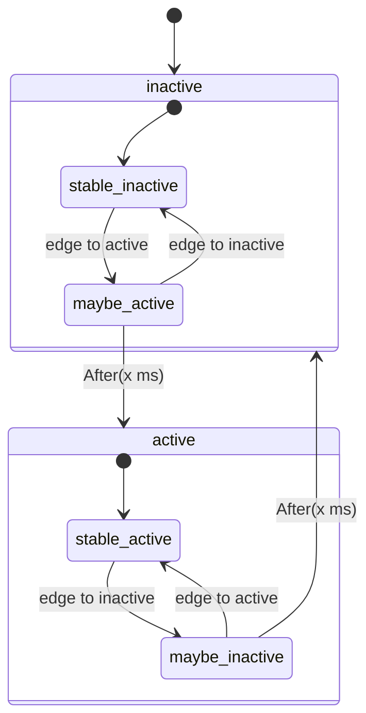

<!-- Copyright 2015-2026 Zephyr Project members and individual contributors. -->
<!-- SPDX-License-Identifier: Apache-2.0 -->
<!-- 中文翻译；编号、导航和明确标注的译注为本地新增。 -->

<a id="documentation-guidelines"></a>
<a id="doc-guidelines"></a>

# 第10章\_文档编写指南

原文：[官方页面](https://docs.zephyrproject.org/latest/contribute/documentation/guidelines.html)。读取日期：2026-10-14；保存的 latest 页面及 HTML 摘要见[来源记录](../SOURCES.md)。

> 关于构建这些文档的步骤，参见[文档生成](P011_文档生成.md#zephyr-doc)。

Zephyr 项目的文档采用重构文本（reStructuredText，reST）标记语言，以 `.rst` 为扩展名，并使用 Sphinx 扩展。Sphinx 将它们处理成排版好的独立网站。开发者既可以直接阅读 `.rst` 源文件，也可以安装 Sphinx 后在本地生成 HTML 或 PDF；HTML 可用网页浏览器查看。[Zephyr 官方文档网站](https://docs.zephyrproject.org)使用的也是同一套 `.rst` 内容。

关于语言和扩展的细节，见文末参考资料 [1]、[2]。本页速查编写 Zephyr 文档常用的 reST 与 Sphinx 指令（directive）和角色（role）。C 应用程序编程接口（Application Programming Interface，API）的说明写法见[Doxygen 风格指南](../coding_style/P008_Doxygen注释规范.md#doxygen-style)。

> 译注——示例的阅读方式：本页保留官方 reST 源码、命令和渲染结果代码，示例中的英文句子在相邻正文翻译。选项卡等网页交互用表格展示全部内容。源码中的图片路径相对于其 `.rst` 文件；本译文实际展示的官方原图另以相对路径引用，不要求读者采用作者的目录。

<a id="content-structure"></a>

## 10.1\_内容结构（Content Structure）

<a id="tabs-spaces-and-indenting"></a>

### 10.1.1\_制表符、空格与缩进

reST 中缩进具有语义，优先使用空格。多余的缩进可能意外改变渲染方式。列表和指令中的续行内容应与上一行正文的第一个非空白字符对齐：

```rst
* List item that spans multiple lines of text
  showing where to indent the continuation line.

1. And for numbered list items, the continuation
   line should align with the text of the line above.

.. code-block::

   The text within a directive block should align with the
   first character of the directive name.
```

示例依次表示：跨行的无序列表项及其续行；有序列表项及对齐的续行；指令内部文本与指令名称首字符对齐。其他要求见[编码风格指南](../coding_style/P001_代码风格指南.md#coding-style)。

<a id="headings"></a>
<a id="id1"></a>

### 10.1.2\_标题

reST 支持上、下装饰线配对的标题，但 Zephyr 只使用标题下方的装饰线：文档标题 `h1` 用 `#`，第一层小节 `h2` 用 `*`，第二层 `h3` 用 `=`，第三层 `h4` 用 `-`。装饰线长度必须与标题文字一致。

```rst
This is a title heading
#######################

some content goes here

First section heading
*********************
```

其中三段文字分别为“这是文档标题”“这里放正文内容”“第一层小节标题”。

<a id="lists"></a>

### 10.1.3\_列表

无序列表以星号 `*` 或短横线 `-` 开始，续行缩进两个空格。列表或子列表的第一项前须留空行，并与前面的段落同级，不额外缩进该列表本身。有序列表可以从 `1.` 或 `a.` 开始，后续项用 `#` 自动编号；续行缩进三个空格。

```rst
* This is a bulleted list.
* It has two items, the second
  item and has more than one line of reST text.  Additional lines
  are indented to the first character of the
  text of the bullet list.

1. This is a new numbered list. If the wasn't a blank line before it,
   it would be a continuation of the previous list (or paragraph).
#. It has two items too.

a. This is a numbered list using alphabetic list headings
#. It has three items (and uses autonumbering for the rest of the list)
#. Here's the third item

#. This is an autonumbered list (default is to use numbers starting
   with 1).

   #. This is a second-level list under the first item (also
      autonumbered).  Notice the indenting.
   #. And a second item in the nested list.
#. And a second item back in the containing list.  No blank line
   needed, but it wouldn't hurt for readability.
```

示例四组列表的文字含义如下：

- 第一组：这是一个无序列表；它有两项，第二项跨越多行 reST 文本，额外行与列表正文的首字符对齐。
- 第二组：这是一个新的数字有序列表。如果前面没有空行，它将成为前一列表或段落的延续；它也有两项。
- 第三组：这是采用字母编号的列表；它有三项，其余项使用自动编号；这是第三项。
- 第四组：这是默认从 1 开始的自动编号列表。第一项下面有一个同样自动编号的二级列表，须注意缩进；二级列表还有第二项。最后回到外层列表的第二项，此处不强制空行，但空行可改善源码可读性。

定义列表（definition list）将术语与解释放在一起，适合说明词语或短语：

```rst
The Makefile has targets that include:

html
   Build the HTML output for the project

clean
   Remove all generated output, restoring the folders to a
   clean state.
```

渲染内容的译文为：Makefile 包括以下目标。

| 目标 | 定义 |
| --- | --- |
| `html` | 为项目生成 HTML 输出。 |
| `clean` | 删除全部生成输出，使文件夹恢复干净状态。 |

<a id="multi-column-lists"></a>

### 10.1.4\_多列列表

当无序列表很长、每项却很短时，可用 `.. rst-class:: rst-columns` 让列表按多列排列。该指令作用于下一个非注释元素，例如段落，或作用于缩进在指令下面的内容。

```rst
.. rst-class:: rst-columns

* A list of
* short items
* that should be
* displayed
* horizontally
* so it doesn't
* use up so much
* space on
* the page
```

原例九个短项依次表示“一份列表”“包含短项目”“这些项目应当”“排列”“为横向”“这样就不会”“占用太多”“空间于”“页面上”，连起来说明横向排列可以节省页面空间。网页最多显示三列，并随可用宽度调整，必要时在手机等窄屏上降为一列。`hlist` 在小屏幕上表现不佳，因此已经弃用。

<a id="tables"></a>

### 10.1.5\_表格

reST 有几种表格写法，各有限制。[网格表格（grid table）](https://docutils.sourceforge.net/docs/ref/rst/restructuredtext.html#grid-tables)对合并行列的支持最强，但维护困难：

```rst
+------------------------+------------+----------+----------+
| Header row, column 1   | Header 2   | Header 3 | Header 4 |
| (header rows optional) |            |          |          |
+========================+============+==========+==========+
| body row 1, column 1   | column 2   | column 3 | column 4 |
+------------------------+------------+----------+----------+
| body row 2             | ...        | ...      | you can  |
+------------------------+------------+----------+ easily   +
| body row 3 with a two column span   | ...      | span     |
+------------------------+------------+----------+ rows     +
| body row 4             | ...        | ...      | too      |
+------------------------+------------+----------+----------+
```

译后的表格保持相同的合并关系：

<table>
<thead><tr><th>表头第 1 列（表头可选）</th><th>表头 2</th><th>表头 3</th><th>表头 4</th></tr></thead>
<tbody>
<tr><td>正文第 1 行，第 1 列</td><td>第 2 列</td><td>第 3 列</td><td>第 4 列</td></tr>
<tr><td>正文第 2 行</td><td>…</td><td>…</td><td rowspan="3">也可以轻松跨行</td></tr>
<tr><td colspan="2">正文第 3 行，跨两列</td><td>…</td></tr>
<tr><td>正文第 4 行</td><td>…</td><td>…</td></tr>
</tbody>
</table>

[列表表格（list table）](https://docutils.sourceforge.net/docs/ref/rst/directives.html#list-table)更容易维护，但不支持跨行、跨列：

```rst
.. list-table:: Table title
   :widths: 15 20 40
   :header-rows: 1

   * - Heading 1
     - Heading 2
     - Heading 3
   * - body row 1, column 1
     - body row 1, column 2
     - body row 1, column 3
   * - body row 2, column 1
     - body row 2, column 2
     - body row 2, column 3
```

其渲染结果的译文如下，表题为“表格标题”。

| 表头 1 | 表头 2 | 表头 3 |
| --- | --- | --- |
| 正文第 1 行，第 1 列 | 正文第 1 行，第 2 列 | 正文第 1 行，第 3 列 |
| 正文第 2 行，第 1 列 | 正文第 2 行，第 2 列 | 正文第 2 行，第 3 列 |

`:widths:` 设置相对列宽，默认各列等宽。三列表格若需要第一列只有其余两列的一半宽，写 `:widths: 1 2 2`；若要浏览器按内容自动分配，则用 `:widths: auto`。

<a id="tabbed-content"></a>

### 10.1.6\_选项卡内容（Tabbed Content）

如[入门指南](../getting_started/P002_入门指南.md#getting-started)所示，可用选项卡向读者提供不同分支的内容。单击某个选项卡即可显示对应内容：

```rst
.. tabs::

   .. tab:: Apples

      Apples are green, or sometimes red.

   .. tab:: Pears

      Pears are green.

   .. tab:: Oranges

      Oranges are orange.
```

| 选项卡 | 显示内容 |
| --- | --- |
| 苹果（Apples） | 苹果是绿色的，有时也呈红色。 |
| 梨（Pears） | 梨是绿色的。 |
| 橙子（Oranges） | 橙子是橙色的。 |

选项卡还可以分组：在一处切换选项卡，会同时切换整页其他同名选项卡。例如下面两组会联动：

| 平台选项卡 | 第一组 | 第二组 |
| --- | --- | --- |
| Linux | Linux 第 1 行 | Linux 第 2 行 |
| macOS | macOS 第 1 行 | macOS 第 2 行 |
| Windows | Windows 第 1 行 | Windows 第 2 行 |

联动形式采用 `.. group-tab::`，而非普通 `.. tab::`。实现来自 Zephyr 环境包含的 [sphinx-tabs](https://github.com/executablebooks/sphinx-tabs) 扩展。选项卡内可放代码块、有序或无序列表、图片、段落等大多数内容，但不能包含标题；详细用法见该扩展的说明。

<a id="text-formatting"></a>

## 10.2\_文本格式（Text Formatting）

本节介绍 Zephyr 文档常用的文本格式。完整清单见文末 reStructuredText 快速参考 [5]、解释文本角色 [6] 以及 Sphinx 增补角色 [7]。

<a id="content-highlighting"></a>

### 10.2.1\_内容强调

常见行内标记为：单星号 `*text*` 表示强调，即斜体；双星号 `**text**` 表示强强调，即粗体；两个反引号包围的 ```` ``text`` ```` 表示行内代码（inline code）。若正文中的星号或反引号可能被误认为标记定界符，在它前面加反斜杠 `\` 转义。

<a id="file-names-and-commands"></a>

### 10.2.2\_文件名与命令

Sphinx 在 reST 上增加了角色，为文本赋予特定含义及对应样式；完整列表见 Sphinx 行内标记 [3]。虽然可用双反引号将文字显示成代码，文件名、命令等特殊文字更适合使用专门角色：

| 角色 | reST 写法 | 表示的对象 |
| --- | --- | --- |
| `file` | ``:file:`CMakeLists.txt` `` | 文件 `CMakeLists.txt`。 |
| `file` | ``:file:`{boardname}_defconfig` `` | 可变路径，花括号包围变量部分；显示为 `boardname_defconfig`，其中板名部分是变量。 |
| `command` | ``:command:`make` `` | 命令 `make`。 |
| `envvar` | ``:envvar:`ZEPHYR_BASE` `` | 环境变量 `ZEPHYR_BASE`。 |

GitHub 上 Zephyr 组织所托管文件的链接方法，见 10.5.2 节。

<a id="user-interaction"></a>

### 10.2.3\_用户交互

记录组合键和图形用户界面（Graphical User Interface，GUI）操作时，用相应角色突出其含义：

| 角色 | reST 写法 | 显示含义 |
| --- | --- | --- |
| `kbd` | ``:kbd:`Ctrl-C` `` | 键盘输入 `Ctrl-C`。 |
| `menuselection` | ``:menuselection:`File --> Open` `` | 菜单“File ‣ Open”，即“文件 → 打开”。 |
| `guilabel` | ``:guilabel:`Cancel` `` | 界面标签“Cancel（取消）”。 |

<a id="mathematical-formulas"></a>

### 10.2.4\_数学公式

`math` 角色和 `math` 指令均可插入数学公式；较复杂的公式用指令更灵活。公式输入采用 LaTeX 标记：

```rst
The answer to life, the universe, and everything is :math:`30 + 2^2 + \sqrt{64} = 42`.
```

译后的显示内容是：生命、宇宙以及一切问题的答案为 $30 + 2^2 + \sqrt{64} = 42$。

<a id="non-ascii-characters"></a>

### 10.2.5\_非 ASCII 字符

除非为正确表达或常见排版所必需，例如单位中的 `µ` 或常见商标符号 `™`，否则优先使用普通 ASCII 字符。不要仅为美观而加入非 ASCII 字符。

[`doc/substitutions.txt`](https://github.com/zephyrproject-rtos/zephyr/blob/main/doc/substitutions.txt) 包含用于特殊格式的基本 HTML 替换定义，例如强制换行；Unicode 字符则可以且应当直接写入文档源码。

> 译注：这里是官方英文文档的编写规则；中文译文当然需要 Unicode 中文字符。

<a id="code-blocks-and-command-examples"></a>

### 10.2.6\_代码块与命令示例

用 reST 的 `code-block` 指令创建等宽文本块，通常用于展示代码或控制台命令与输出。它通过 Pygments 支持语法高亮，也可以显式指定语言：

```rst
.. code-block:: c

   struct k_object {
      char *name;
      uint8_t perms[CONFIG_MAX_THREAD_BYTES];
      uint8_t type;
      uint8_t flags;
      uint32_t data;
   } __packed;
```

指令与代码正文之间要有空行，正文缩进三个空格，与指令名称的第一个非空白字符对齐。原例渲染为：

```c
struct k_object {
   char *name;
   uint8_t perms[CONFIG_MAX_THREAD_BYTES];
   uint8_t type;
   uint8_t flags;
   uint32_t data;
} __packed;
```

Pygments 支持的语言见参考资料 [8]。适当时应使用 `c`、`cpp`、`python` 分别标注 C、C++ 和 Python 代码。带有 `$` 或 `uart:~$` 等提示符、同时展示命令与输出的交互式终端会话使用 `console`；其命令会高亮，输出不会高亮。官网的复制按钮只复制命令，排除提示符和输出。

`shell` 与 `bash` 的高亮相同，前者可表示通用 shell 命令，后者强调 Bash 专用命令。**有提示符的代码块应使用 `console`，不要用 `bash` 或 `shell`；没有提示符、也不展示交互命令及输出的代码块，不应使用 `console`。**

仅包含一条或多条命令、不包含输出时：

```rst
.. code-block:: shell

   echo "Hello World!"
```

显示为：

```bash
echo "Hello World!"
```

该命令打印“Hello World!（你好，世界！）”。同时展示主机 shell 的命令和输出时：

```rst
.. code-block:: console

   $ echo "Hello World!"
   Hello World!
```

显示为：

```console
$ echo "Hello World!"
Hello World!
```

展示 Zephyr shell 命令及输出时：

```rst
.. code-block:: console

   uart:~$ version
   Zephyr version 3.5.99
   uart:~$ kernel uptime
   Uptime: 20970 ms
```

显示为：

```console
uart:~$ version
Zephyr version 3.5.99
uart:~$ kernel uptime
Uptime: 20970 ms
```

这里的 `version` 输出 Zephyr 版本 `3.5.99`，`kernel uptime` 输出运行时长（uptime）`20970 ms`，均为原文示例值。

> 译注：复制时排除提示符和输出是官网复制按钮的行为，Markdown 阅读器未必具备同样功能。以上均为文档示例，没有实际执行。

其他建议语言包括：Windows 批处理用 `bat`；`KEY=value` 格式配置，如 Kconfig 的 `.conf`，用 `cfg`；CMake 用 `cmake`；设备树（Devicetree）用 `devicetree`；Kconfig 用 `kconfig`；YAML 用 `yaml`；reStructuredText 用 `rst`。

未指定语言时，默认使用 `none`，不会语法高亮；也可显式指定：

```rst
.. code-block:: none

   This would be a block of text styled with a background
   and box, but with no syntax highlighting.
```

显示为：

```text
This would be a block of text styled with a background
and box, but with no syntax highlighting.
```

文字含义是“这是一块带背景和边框样式、但没有语法高亮的文本”。还可在引导段落末尾写双冒号 `::`，随后将代码缩进三个空格；输出只显示一个冒号，代码默认无高亮。可以用 `highlight` 指令改变文档的默认语言，本页官方源码开头即有这种用法。

<a id="links-and-cross-references"></a>

## 10.3\_链接与交叉引用（Links and Cross-References）

<a id="cross-referencing-internal-content"></a>
<a id="internal-linking"></a>

### 10.3.1\_引用当前文件内容

传统 reST 链接只支持当前文件内部：

```rst
Refer to the `internal-linking`_ page
```

其含义是“参见[内部链接](#internal-linking)”。末尾的下划线表示出站引用。若标签紧挨着标题之前，显示文字采用该标题；也可以自行指定显示文字：

```rst
Refer to the `show this text instead <internal-linking_>`_ page
```

即“参见[改为显示这段文字](#internal-linking)”，目标仍然相同。

<a id="cross-referencing-external-content"></a>

### 10.3.2\_引用其他内容

借助 Sphinx，可以引用 Zephyr 文档中任何带标签的内容。标签指令定义目标位置：

 ```rst
 .. _my label name:

 Heading
 =======
 ```

开头的下划线表示入站目标。标签后必须紧接标题；这样任何文档都可用 ``:ref:`my label name` `` 引用该标题，默认显示标题文字。也可以指定其他文字：

```rst
:ref:`some other text <my label name>`
```

这里显示“some other text（其他文字）”。为了便于跨页引用，每个文件标题前都应有一个在全站唯一的标签，避免使用 `samples` 等过于通用的名称。例如本页官方 `.rst` 开头：

```rst
.. _doc_guidelines:

Documentation Guidelines for the Zephyr Project
###############################################
```

其他 `.rst` 文件用 ``:ref:`doc_guidelines` `` 引用，就会显示“Documentation Guidelines（文档编写指南）”。此类内部交叉引用跨文件生效，并从源文档取标题文字；标题修改后，链接文字也会更新。

还可定义任意 URL 的标签，然后在正文中引用：

```rst
.. _Zephyr Wikipedia Page:
   https://en.wikipedia.org/wiki/Zephyr_(operating_system)
```

引用写法为：

```rst
Read the `Zephyr Wikipedia Page`_ for more information about the
project.
```

含义是“更多项目信息见 Zephyr 维基百科页面”。当外部链接很多时，可用 `target-notes` 指令在末尾集中生成参考资料：

```rst
References
==========

.. target-notes::

.. _external_link1: https://example.com
.. _external_link2: https://example.org
```

<a id="cross-referencing-c-documentation"></a>

### 10.3.3\_引用 C 文档

角色 <a id="role-c-member"></a>`:c:member:`、<a id="role-c-data"></a>`:c:data:`、<a id="role-c-var"></a>`:c:var:`、<a id="role-c-func"></a>`:c:func:`、<a id="role-c-macro"></a>`:c:macro:`、<a id="role-c-struct"></a>`:c:struct:`、<a id="role-c-union"></a>`:c:union:`、<a id="role-c-enum"></a>`:c:enum:`、<a id="role-c-enumerator"></a>`:c:enumerator:`、<a id="role-c-type"></a>`:c:type:` 可交叉引用 C 成员、数据、变量、函数、宏、结构体、联合体、枚举、枚举值和类型的 Doxygen 文档。HTML 中会成为对应条目的链接，例如：

```rst
Check out :c:func:`gpio_pin_configure` for more information.
```

译后的结果是“更多信息见 [`gpio_pin_configure()`](../hardware/P266_GPIO公共接口.md#gaed4a2051d76db7eead8ed1719ce2ba33)”。与内置 `ref` 角色类似，可以自定义链接文字。

<a id="cross-referencing-cmake-documentation"></a>

### 10.3.4\_引用 CMake 文档

使用以下角色引用 Zephyr 的 CMake 模块、命令和变量。<a id="role-cmake-module"></a>`:cmake:module:` 引用模块：

```rst
See :cmake:module:`extensions` for more information.
```

结果是“更多信息见 [extensions](../cmake_reference/P008_extensions.md#module:extensions)”。<a id="role-cmake-command"></a>`:cmake:command:` 引用命令：

```rst
See :cmake:command:`yaml_load` for more information.
```

结果是“更多信息见 [`yaml_load()`](../cmake_reference/P018_yaml.md#command:yaml_load)”。CMake 自己的命令文档须以完全限定名称作为显式目标：

```rst
See :cmake:command:`target_sources <command:target_sources>` for more information.
```

结果是“更多信息见 [target_sources](https://cmake.org/cmake/help/latest/command/target_sources.html#command:target_sources)”。<a id="role-cmake-variable"></a>`:cmake:variable:` 引用变量：

```rst
See :cmake:variable:`CMAKE_C_COMPILER` for more information.
```

结果是“更多信息见 `CMAKE_C_COMPILER`”。

<a id="visual-elements"></a>

## 10.4\_视觉元素（Visual Elements）

<a id="images"></a>
<a id="doc-images"></a>

### 10.4.1\_图片

通过 `image` 指令插入图片：

```rst
.. image:: ../../../../images/doc-gen-flow.png
   :align: center
   :alt: alt text for the image
```

其中 `alt text for the image` 是“图片替代文本”。若还需要图注，使用 `figure`：

```rst
.. figure:: ../../../../images/doc-gen-flow.png
   :alt: image description

   Caption for the figure
```

`image description` 是“图片描述”，`Caption for the figure` 是“图注”。文件路径相对于文档源文件，推荐将图片放在该源文件旁的 `images` 文件夹。支持浏览器常见格式：WebP、PNG、GIF、JPEG、SVG。

图片大小以表达清楚为准，一般宽度至少 500 px、不超过 1000 px，文件不超过 100 KB；为保证清晰度确实需要大图时可以例外。

<a id="recommended-image-formats-based-on-content"></a>

#### 10.4.1.1\_按内容选择图片格式

截图使用 WebP 或 PNG；简单图解可考虑 Graphviz，外部工具绘图优先使用 SVG。照片，例如开发板照片，使用 WebP，最长边不超过 600 px。若主体可与背景分离，通常开发板照片可以做到，应保存透明背景，以适配明、暗两种文档主题。

可用 cwebp [9] 或 ImageMagick [10] 将图片转为合适尺寸的 WebP：

```bash
# Using cwebp (resize width to 600 px, height auto, ~80% quality).
# For a portrait image, use "-resize 0 600" to cap the height instead.
cwebp -resize 600 0 board_name.png -o board_name.webp

# Using ImageMagick
magick board_name.png -resize 600x600 -quality 80 board_name.webp
```

第一组注释说明：cwebp 把宽度设为 600 px，高度自动计算，示例描述的质量约为 80%；竖图可改用 `-resize 0 600` 限定高度。第二组使用 ImageMagick。源图已透明，例如带 alpha 通道的 PNG 时，这两种工具会保留输出 WebP 的透明度。原文称 `-resize 600 0`／`600x600` 会保持纵横比且只缩小图片。

> 译注——缩放边界：cwebp 的 `-resize` 设置目标尺寸，某一维为 0 时自动保持比例；它并非“只缩小”的开关。ImageMagick 的普通 `600x600` 也可能放大小图，若只允许缩小，可使用带引号的 `"600x600>"`。另外，原例 cwebp 命令没有 `-q`，其默认质量参数是 75，不能按注释的“约 80%”理解；要设为 80 须显式写 `-q 80`。依据为 [cwebp 参数说明](https://developers.google.com/speed/webp/docs/cwebp)与 [ImageMagick 几何参数说明](https://imagemagick.org/command-line-processing/#geometry)。上方保留原文命令；本翻译集交付官方媒体原件，没有据此重新压缩图片或动图。

<a id="graphviz"></a>
<a id="graphviz-diagrams"></a>

### 10.4.2\_Graphviz

Graphviz [11] 使用简单文本语言描述图。文档图示应便于维护，因此官方鼓励使用 Graphviz，尤其适合状态图（state diagram）、流程图（flow chart）以及能表达为图结构的其他图解。通过 `graphviz` 指令插入：

```rst
.. graphviz::
   :caption: An example graph using Graphviz

   digraph G {
      rankdir=LR;
      A -> B;
      B -> C;
      C -> D;
   }
```

官方渲染的原 SVG 如下，图注为“使用 Graphviz 绘制的示例图”，表示从左到右的 `A → B → C → D`：


DOT 语言绘图的更多细节见 Graphviz 文档 [12]。

<a id="mermaid"></a>

### 10.4.3\_Mermaid

Mermaid [13] 用文本语法创建图解和可视化，特别适合流程图、时序图（sequence diagram）、类图（class diagram）和状态转换图（state transition diagram）。在文档中使用 `mermaid` 指令：

```rst
.. mermaid::
   :caption: State transition diagram for a GPIO debounce
   :alt: GPIO debounce state diagram showing transitions between inactive and active states
         through maybe_active and maybe_inactive intermediate states before each state becomes
         stable.

   ---
   config:
     state:
       useMaxWidth: false
   ---
   stateDiagram-v2

       State inactive {
           [*] --> stable_inactive
           stable_inactive --> maybe_active : edge to active
           maybe_active --> stable_inactive : edge to inactive
       }

       State active {
           [*] --> stable_active
           stable_active --> maybe_inactive : edge to inactive
           maybe_inactive --> stable_active : edge to active
       }

       [*] --> inactive

       maybe_active --> active : After(x ms)
       maybe_inactive --> inactive : After(x ms)
```

原文呈现的 Mermaid 源码为：



图注：GPIO 消抖的状态转换图。替代文本：GPIO 消抖状态图通过 `maybe_active` 和 `maybe_inactive` 中间态，在无效与有效状态之间转换，直到相应状态稳定。图中文字对应：`inactive` 为无效，`active` 为有效，`stable_inactive`／`stable_active` 为稳定无效／稳定有效，`maybe_active`／`maybe_inactive` 为可能有效／可能无效，`edge to active`／`edge to inactive` 为转为有效／无效的边沿，`After(x ms)` 为经过 x 毫秒；`[*]` 标记初始状态。

图默认填满页面宽度，高度由纵横比决定，因此纵向较长的图可能变得过大。像上例一样关闭 `useMaxWidth`，会保持 Mermaid 计算出的尺寸；窄屏时仍会缩小以适应屏幕。该设置属于具体图类型：上例为 `state`，其他场景可能为 `flowchart`、`sequence` 等。

支持的图类型、语法和示例见 Mermaid 文档 [14]，快速试画或修改可用 Mermaid 在线编辑器 [15]。

> 译注：保留官网输出的完整 Mermaid 文本及其大小写、缩进，没有将其替换为截图；本批未验证各 Markdown 阅读器的 Mermaid 渲染结果。

<a id="custom-sphinx-roles-and-directives"></a>

## 10.5\_自定义 Sphinx 角色与指令

Zephyr 的自定义 Sphinx 角色和指令用于补充功能，使文档更一致、更容易维护。

<a id="application-build-commands"></a>

### 10.5.1\_应用构建命令

<a id="directive-zephyr-app-commands"></a>`.. zephyr-app-commands::` 统一生成构建、烧录等管理应用所需的 shell 命令。例如，为 `qemu_x86` 构建 `samples/hello_world`：

```rst
.. zephyr-app-commands::
   :zephyr-app: samples/hello_world
   :board: qemu_x86
   :goals: build
```

会生成以下命令，其注释说明“从 zephyr 仓库根目录执行”：

```bash
# From the root of the zephyr repository
west build -b qemu_x86 samples/hello_world
```

该指令的全部选项如下。“标志”表示不带取值。

| 选项 | 类型 | 含义、默认值与约束 |
| --- | --- | --- |
| <a id="directive-option-zephyr-app-commands-tool"></a>`:tool:` | 字符串 | 使用的工具：`cmake`、`west` 或 `all`，默认 `west`。 |
| <a id="directive-option-zephyr-app-commands-app"></a>`:app:` | 字符串 | 待构建应用的路径。 |
| <a id="directive-option-zephyr-app-commands-zephyr-app"></a>`:zephyr-app:` | 字符串 | 上游 Zephyr 仓库中的应用路径，与 `:app:` 互斥。 |
| <a id="directive-option-zephyr-app-commands-cd-into"></a>`:cd-into:` | 标志 | 从 `:app:` 文件夹内部给出构建步骤，而非在外部执行。 |
| <a id="directive-option-zephyr-app-commands-generator"></a>`:generator:` | 字符串 | 生成的构建系统：`ninja` 或 `make`，默认 `ninja`，不区分大小写。 |
| <a id="directive-option-zephyr-app-commands-host-os"></a>`:host-os:` | 平台值 | 指令面向的主机系统：`unix`、`win` 或 `all`，默认 `all`。 |
| <a id="directive-option-zephyr-app-commands-board"></a>`:board:` | 字符串 | 构建的目标开发板。 |
| <a id="directive-option-zephyr-app-commands-shield"></a>`:shield:` | 字符串 | 目标扩展板（shield）；多项用逗号分隔。 |
| <a id="directive-option-zephyr-app-commands-conf"></a>`:conf:` | 文件列表 | 使用的配置文件；多个文件以空格分隔并用双引号包围，例如 `"a.conf b.conf"`。 |
| <a id="directive-option-zephyr-app-commands-gen-args"></a>`:gen-args:` | 字符串 | 传给 CMake 调用的额外参数。 |
| <a id="directive-option-zephyr-app-commands-build-args"></a>`:build-args:` | 字符串 | 传给构建调用的额外参数。 |
| <a id="directive-option-zephyr-app-commands-west-args"></a>`:west-args:` | 字符串 | 传给 west 的额外参数；`:tool: cmake` 时忽略。 |
| <a id="directive-option-zephyr-app-commands-flash-args"></a>`:flash-args:` | 字符串 | 传给烧录调用的额外参数。 |
| <a id="directive-option-zephyr-app-commands-debug-args"></a>`:debug-args:` | 字符串 | 传给调试调用的额外参数。 |
| <a id="directive-option-zephyr-app-commands-debugserver-args"></a>`:debugserver-args:` | 字符串 | 传给调试服务器调用的额外参数。 |
| <a id="directive-option-zephyr-app-commands-attach-args"></a>`:attach-args:` | 字符串 | 传给调试连接调用的额外参数。 |
| <a id="directive-option-zephyr-app-commands-snippets"></a>`:snippets:` | 字符串 | 应用编译时采用的配置片段（snippet），多项用逗号分隔。 |
| <a id="directive-option-zephyr-app-commands-build-dir"></a>`:build-dir:` | 字符串 | 将此 Unix 风格分隔的相对路径追加到标准构建目录，主要用于区分一页中同一应用的不同构建。 |
| <a id="directive-option-zephyr-app-commands-build-dir-fmt"></a>`:build-dir-fmt:` | 字符串 | 假定 `west config build.dir-fmt` 已设为该路径；与 `:build-dir:` 互斥，仅用于 `:tool: west`。 |
| <a id="directive-option-zephyr-app-commands-goals"></a>`:goals:` | 字符串 | 以空白分隔要完成的 `build`、`flash`、`debug`、`debugserver`、`run`；生成的命令会按正确次序排列。 |
| <a id="directive-option-zephyr-app-commands-maybe-skip-config"></a>`:maybe-skip-config:` | 标志 | 表示读者可能已经创建并进入构建目录，生成的说明会提示不必重复操作。 |
| <a id="directive-option-zephyr-app-commands-compact"></a>`:compact:` | 标志 | 生成一个代码块，不添加额外注释行。 |

<a id="cross-referencing-files-in-the-zephyr-tree"></a>
<a id="linking-to-zephyr-files"></a>

### 10.5.2\_引用 Zephyr 源码树中的文件

<a id="role-zephyr_file"></a>`:zephyr_file:` 引用 Zephyr 源码树中的文件，例如本页源码：

```rst
Check out :zephyr_file:`doc/contribute/documentation/guidelines.rst` for more information.
```

会链接到 [`doc/contribute/documentation/guidelines.rst`](https://github.com/zephyrproject-rtos/zephyr/blob/main/doc/contribute/documentation/guidelines.rst)。还可引用单行或行范围：

```rst
See :zephyr_file:`doc/contribute/documentation/guidelines.rst#L3` for the main heading of
this document.
```

这里 `#L3` 指向文档主标题的位置；一般形式为 `#Lline_number`，范围使用 `#Lstart_line-Lend_line`。文件不存在时构建会给出警告。行号随文件修改可能失效，因此应谨慎使用行号引用。

<a id="role-zephyr_raw"></a>`:zephyr_raw:` 链接文件原始内容（raw content）：

```rst
Check out :zephyr_raw:`doc/contribute/documentation/guidelines.rst` for more information.
```

例如直接读取[本页的原始 reST 文件](https://raw.githubusercontent.com/zephyrproject-rtos/zephyr/main/doc/contribute/documentation/guidelines.rst)。

<a id="role-module_file"></a>`:module_file:` 引用 west 模块中的文件，用模块名与路径组合：

```rst
Check out :module_file:`hal_stm32:CMakeLists.txt` for more information.
```

结果链接到 [hal_stm32:CMakeLists.txt](https://github.com/zephyrproject-rtos/hal_stm32/blob/c9550199186236d610092f4005f8c9bae2a6bfcf/CMakeLists.txt)；同样支持 `#Lstart_line-Lend_line` 行号范围。

<a id="cross-referencing-github-issues-and-pull-requests"></a>

### 10.5.3\_引用 GitHub 问题与拉取请求

<a id="role-github"></a>`:github:` 角色按问题（issue）或拉取请求（pull request，PR）的编号生成链接：

```rst
Check out :github:`1234` for more background about this known issue.
```

结果是“已知问题的更多背景见 [GitHub #1234](https://github.com/zephyrproject-rtos/zephyr/issues/1234)”。

<a id="doxygen-api-documentation"></a>

### 10.5.4\_Doxygen API 文档

`.. doxygengroup:: name` 显示指定 Doxygen 组的简短描述及其链接，并自动显示使用该 API 的相关示例。例如：

```rst
.. doxygengroup:: can_interface
```

链接到 [CAN](../hardware/P361_CAN公共接口.md)。可选 <a id="directive-option-doxygengroup-project"></a>`:project:` 指定 Doxygen 项目名，适用于存在多个 Doxygen 项目的情况。

<a id="role-c-group"></a>`:c:group:` 引用 Doxygen 组：

```rst
Check out :c:group:`gpio_interface` for more information.
```

结果是“更多信息见 [GPIO](../hardware/P266_GPIO公共接口.md)”；与 `ref` 一样可自定义链接文字。

<a id="kconfig-options"></a>

### 10.5.5\_Kconfig 选项

Kconfig 引用必须使用包括 `CONFIG_` 前缀的完整名称。<a id="role-kconfig-option"></a>`:kconfig:option:` 引用单个选项：

```rst
Check out :kconfig:option:`CONFIG_GPIO` for more information.
```

结果链接到 [`CONFIG_GPIO`](https://docs.zephyrproject.org/latest/kconfig.html#CONFIG_GPIO)。<a id="role-kconfig-option-regex"></a>`:kconfig:option-regex:` 以正则表达式（regular expression）匹配多个选项：

```rst
Check out :kconfig:option-regex:`CONFIG_SECURE_STORAGE_ITS_(STORE|TRANSFORM)_.*_CUSTOM` for
the various customization possibilities.
```

结果链接到 [`CONFIG_SECURE_STORAGE_ITS_(STORE|TRANSFORM)_.*_CUSTOM`](https://docs.zephyrproject.org/latest/kconfig.html#!CONFIG_SECURE_STORAGE_ITS_%28STORE|TRANSFORM%29_.*_CUSTOM)，用于查看各类自定义配置。也可以像 `ref` 那样指定显示文字：

```rst
Check out the :kconfig:option-regex:`ITS Kconfig options <CONFIG_SECURE_STORAGE_ITS_.*>`
for more information.
```

结果链接为 [内部可信存储（Internal Trusted Storage，ITS）的 Kconfig 选项](https://docs.zephyrproject.org/latest/kconfig.html#!CONFIG_SECURE_STORAGE_ITS_.*)。

<a id="devicetree-bindings"></a>

### 10.5.6\_设备树绑定

<a id="role-dtcompatible"></a>`:dtcompatible:` 引用某个兼容标识（compatible）对应的设备树绑定（Devicetree binding）：

```rst
Check out :dtcompatible:`zephyr,input-longpress` for more information.
```

结果链接到 [`zephyr,input-longpress`](../input_touch_lvgl_gesture_binding_reference/P015_zephyr_input-longpress.md#std-dtcompatible-zephyr-input-longpress) 的绑定说明。

<a id="code-samples"></a>

### 10.5.7\_代码示例

`.. zephyr:code-sample:: id` 描述一个代码示例，并标出它使用的值得关注的 API。例如：

```rst
.. zephyr:code-sample:: blinky
   :name: Blinky
   :relevant-api: gpio_interface

   Blink an LED forever using the GPIO API.
```

指令正文就是示例描述，原例为“使用 GPIO API 持续闪烁 LED”。<a id="directive-option-zephyr-code-sample-name"></a><a id="directive-option-zephyr-code-sample-category-name"></a>`:name:` 指定便于阅读的短名称；可选 <a id="directive-option-zephyr-code-sample-relevant-api"></a>`:relevant-api:` 是以空格分隔的 Doxygen 组名，表示示例使用的 API。

<a id="role-zephyr-code-sample"></a>`:zephyr:code-sample:` 引用用上述指令描述的示例：

```rst
Check out :zephyr:code-sample:`blinky` for more information.
```

结果是“更多信息见 [LED 闪烁（Blinky）](../getting_started/P004_LED闪烁示例.md#blinky)”。与 `ref` 一样，可自定义链接文字：

```rst
Check out :zephyr:code-sample:`blinky code sample <blinky>` for more information.
```

结果是“更多信息见 [blinky 代码示例](../getting_started/P004_LED闪烁示例.md#blinky)”。

`.. zephyr:code-sample-category:: id` 定义示例类别：

```rst
.. zephyr:code-sample-category:: gpio
   :name: GPIO
   :show-listing:

   Samples related to the GPIO subsystem.
```

正文是类别描述，可以包含任何有效的 reStructuredText 内容。原例名称为 GPIO，描述为“与 GPIO 子系统有关的示例”。`:name:` 给出便于阅读的类别名；标志 <a id="directive-option-zephyr-code-sample-category-show-listing"></a>`:show-listing:` 显示该类别的示例清单，清单根据当前文档子目录内找到的所有示例自动生成；<a id="directive-option-zephyr-code-sample-category-glob"></a>`:glob:` 指定匹配文件的 glob 模式，默认 `*/*`，示例并非直接位于类别下级目录时可覆盖它。

<a id="role-zephyr-code-sample-category"></a>`:zephyr:code-sample-category:` 引用上述类别：

```rst
Check out :zephyr:code-sample-category:`cloud` samples for more information.
```

> 译注：原链接使用 `#cloud`，所读取官方页面实际标题锚点为 `#iot-cloud`，此处已修正。

结果是“更多信息见 [物联网云（IoT Cloud）](../networking/P215_物联网云接入示例目录.md#iot-cloud)示例”。

<a id="directive-zephyr-code-sample-listing"></a>`.. zephyr:code-sample-listing::` 显示一个或多个类别中的全部代码示例：

```rst
.. zephyr:code-sample-listing::
   :categories: cloud
```

原文生成的清单如下：

| 示例 | 描述 |
| --- | --- |
| [AWS IoT Core MQTT](../networking/P216_AWS物联网MQTT示例.md#aws-iot-mqtt) | 连接 AWS IoT Core，并通过消息队列遥测传输（Message Queuing Telemetry Transport，MQTT）发布消息。 |
| [Microsoft Azure IoT Hub MQTT](../networking/P217_Azure物联网MQTT示例.md#mqtt-azure) | 连接 Azure IoT Hub，并通过 MQTT 发布消息。 |
| [TagoIO HTTP Post](../networking/P218_TagoIO的HTTP上报示例.md#tagoio-http-post) | 通过超文本传输协议（Hypertext Transfer Protocol，HTTP）向 TagoIO 物联网云平台发送随机温度值。 |

<a id="directive-option-zephyr-code-sample-listing-categories"></a>`:categories:` 是以空格分隔的类别 ID。标志 <a id="directive-option-zephyr-code-sample-listing-live-search"></a>`:live-search:` 在清单上方增加搜索框，允许按示例名称和描述筛选，对示例多的类别尤其有用；它只适用于 HTML 构建器。

<a id="boards"></a>

### 10.5.8\_开发板

`.. zephyr:board:: name` 放在文档开头，声明这是参数指定开发板的主说明页：

```rst
.. zephyr:board:: wio_terminal
```

开发板元数据（metadata）从各配置文件读取，自动填充页面的一些小节。使用该指令的开发板文档可用 <a id="role-zephyr-board"></a>`:zephyr:board:` 角色链接：

```rst
Check out :zephyr:board:`wio_terminal` for more information.
```

结果是“更多信息见 [Wio Terminal](https://docs.zephyrproject.org/latest/boards/seeed/wio_terminal/doc/index.html#wio_terminal)”。

<a id="directive-zephyr-board-catalog"></a>`.. zephyr:board-catalog::` 生成 Zephyr 支持的开发板目录，供快速浏览和按条件筛选。<a id="role-zephyr-board-catalog"></a>`:zephyr:board-catalog:` 角色引用目录页，也可以带筛选参数：

```rst
Check out :zephyr:board-catalog:`` for more information.
```

原文此处显示的是“更多信息见 ``:zephyr:board-catalog:`` ``”。

> 译注：保存的官网 HTML 中，以上无参数示例仍显示未解析的角色文字，本页保留该事实；可直接使用[官方开发板目录](https://docs.zephyrproject.org/latest/boards/index.html)。

与 `ref` 一样，也可以指定链接文字：

```rst
Check out the :zephyr:board-catalog:`boards using this compatible <#compatibles=ti,hdc2080>`
for more information.
```

结果是“更多信息见[使用这个 compatible 的开发板](https://docs.zephyrproject.org/latest/boards/index.html#compatibles=ti,hdc2080)”。

<a id="directive-zephyr-board-supported-hw"></a>`.. zephyr:board-supported-hw::` 根据开发板设备树，自动为当前页面开发板的全部目标生成硬件支持特性表。它依赖开发板信息，所以同一文档内必须有 [`zephyr:board`](#role-zephyr-board) 指令。构建时还须将 `zephyr_generate_hw_features` 设为 `True`；关闭时只显示警告，不显示硬件特性表。

为加快构建、又不完全关闭特性表，可将 `zephyr_hw_features_vendor_filter` 设为厂商列表，只生成这些厂商的开发板特性；为空时生成所有厂商的所有板。`zephyr_hw_features_twister_extra_flags` 用于向 `twister` 命令追加参数。

<a id="directive-zephyr-board-supported-runners"></a>`.. zephyr:board-supported-runners::` 显示当前开发板支持的执行器（runner），包括默认烧录和调试执行器。它同样依赖同页的 [`zephyr:board`](#role-zephyr-board)，并且要求 `zephyr_generate_hw_features=True` 才能生成完整表格；关闭时显示警告，而不是执行器表。

> 译注：开发板目录链接中的 `#compatibles=ti,hdc2080` 是官网脚本读取的筛选参数，并非静态章节锚点。

<a id="accessibility-guidelines"></a>

## 10.6\_无障碍指南（Accessibility Guidelines）

无障碍使包括残障人士在内的所有读者都能访问和理解文档。编写和维护 Zephyr 文档时，应遵循以下要求。

<a id="images-and-figures"></a>

### 10.6.1\_图片与图示

所有图片和图示都必须提供合适的替代文本（alternative text，alt text），向使用屏幕阅读器或无法查看图片的读者传达视觉内容的含义。`image` 指令使用 `:alt:` 属性：

```rst
.. image:: ../../../../contribute/documentation/image/doc-gen-flow.png
   :alt: Documentation generation process overview
```

此例替代文本为“文档生成流程概览”。图片包含文字时，替代文本应逐字包含这些文字。

`figure` 虽可提供图注，仍需要 `:alt:`。替代文本描述图片本身，图注补充背景或解释：

```rst
.. figure:: ../../../../images/arch-diagram.png
   :alt: High-level overview of Zephyr OS architecture showing layers and components.

   High-level overview of Zephyr OS architecture.
```

原例替代文本是“Zephyr 操作系统架构的高层概览，展示各层与组件”；图注是“Zephyr 操作系统架构的高层概览”。能用文字清楚表达的信息，不应只通过图片传达。

替代文本的最佳实践：

- 准确且等价：提供与图片相同的核心信息。
- 简洁：精炼地表达图片的主要内容。
- 避免重复：不要写“……的图片”等前缀，屏幕阅读器通常已告知这是图片。
- 描述而不臆测：只描述图中实际可见的内容。
- 复杂图表：替代文本先给摘要；若完整理解需要细节，在相邻正文或图注中进一步解释。Graphviz 等文本绘图工具也有助于提高可访问性。

<a id="headings-and-structure"></a>

### 10.6.2\_标题与结构

用标题建立有逻辑的文档结构，使辅助技术使用者能理解组织方式并高效导航。

<a id="id4"></a>

### 10.6.3\_表格

表格只用于表格型数据，并应支持屏幕阅读器。始终定义行、列标题；尽可能使用 `list-table`，以改善响应式显示和无障碍。上下文不明显的表格要提供表题，例如：

```rst
.. list-table:: GPIO Pin Configuration Options
   :widths: 15 30
   :header-rows: 1

   * - Field
     - Description
   * - GPIO_INPUT
     - Configures pin as input
   * - GPIO_OUTPUT
     - Configures pin as output
```

译后的表题为“GPIO 引脚配置选项”：

| 字段 | 描述 |
| --- | --- |
| `GPIO_INPUT` | 将引脚配置为输入。 |
| `GPIO_OUTPUT` | 将引脚配置为输出。 |

<a id="additional-resources"></a>

### 10.6.4\_其他资源

更一般的网页无障碍要求，参见万维网联盟（World Wide Web Consortium，W3C）的《网页内容无障碍指南》（Web Content Accessibility Guidelines，WCAG）[16]。

<a id="references"></a>

> 译注：参考资料 [3] 的 Sphinx 旧网址已重定向，此处采用当前官方入门页中已核对存在的 `#inline-markup` 入口。

## 10.7\_参考资料

1. <a id="id9"></a>[Sphinx 文档与扩展](https://www.sphinx-doc.org/en/stable/contents.html)
2. <a id="id11"></a>[reStructuredText 语言规范](https://docutils.sourceforge.net/docs/ref/rst/restructuredtext.html)
3. <a id="id14"></a>[Sphinx 行内标记](https://www.sphinx-doc.org/en/master/usage/restructuredtext/basics.html#inline-markup)
4. <a id="id16"></a>[Zephyr 官方文档](https://docs.zephyrproject.org)
5. <a id="id18"></a>[reStructuredText 快速参考](https://docutils.sourceforge.io/docs/user/rst/quickref.html)
6. <a id="id20"></a>[reStructuredText 解释文本角色](https://docutils.sourceforge.io/docs/ref/rst/roles.html)
7. <a id="id22"></a>[Sphinx 增补角色](https://www.sphinx-doc.org/en/master/usage/restructuredtext/roles.html)
8. <a id="id24"></a>[Pygments 支持的语言](https://pygments.org/languages/)
9. <a id="id26"></a>[cwebp 下载](https://developers.google.com/speed/webp/download)
10. <a id="id28"></a>[ImageMagick](https://imagemagick.org/)
11. <a id="id30"></a>[Graphviz](https://graphviz.org)
12. <a id="id32"></a>[Graphviz 文档](https://graphviz.org/documentation)
13. <a id="id34"></a>[Mermaid](https://mermaid.js.org/)
14. <a id="id36"></a>[Mermaid 文档](https://mermaid.js.org/intro/)
15. <a id="id38"></a>[Mermaid 在线编辑器](https://mermaid.live/)
16. <a id="id40"></a>[W3C WCAG](https://www.w3.org/WAI/standards-guidelines/wcag/)


对应官方文档源码：[doc/contribute/documentation/guidelines.rst](https://raw.githubusercontent.com/zephyrproject-rtos/zephyr/main/doc/contribute/documentation/guidelines.rst)。

> 译注——源码跟踪：本仓库的[对应源码](../../../doc/contribute/documentation/guidelines.rst)可用于跟踪，版本可能与网页不同；本批仅翻译和核对文档，没有执行固件构建、模拟运行或烧录。

<a id="id12"></a>
<a id="id17"></a>
<a id="id13"></a>
<a id="id10"></a>
<a id="id5"></a>
<a id="tab-0-0-0"></a>
<a id="tab-0-0-1"></a>
<a id="tab-0-0-2"></a>
<a id="panel-0-0-0"></a>
<a id="panel-0-0-1"></a>
<a id="panel-0-0-2"></a>
<a id="tab-1-TGludXg="></a>
<a id="tab-1-bWFjT1M="></a>
<a id="tab-1-V2luZG93cw=="></a>
<a id="panel-1-TGludXg="></a>
<a id="panel-1-bWFjT1M="></a>
<a id="panel-1-V2luZG93cw=="></a>
<a id="tab-2-TGludXg="></a>
<a id="tab-2-bWFjT1M="></a>
<a id="tab-2-V2luZG93cw=="></a>
<a id="panel-2-TGludXg="></a>
<a id="panel-2-bWFjT1M="></a>
<a id="panel-2-V2luZG93cw=="></a>
<a id="id19"></a>
<a id="id21"></a>
<a id="id23"></a>
<a id="id15"></a>
<a id="index-0"></a>
<a id="id25"></a>
<a id="id6"></a>
<a id="index-0-module:extensions"></a>
<a id="index-0-command:yaml_load"></a>
<a id="index-0-command:command:target_sources"></a>
<a id="index-0-variable:CMAKE_C_COMPILER"></a>
<a id="id27"></a>
<a id="id29"></a>
<a id="id31"></a>
<a id="id7"></a>
<a id="id33"></a>
<a id="id35"></a>
<a id="id8"></a>
<a id="id37"></a>
<a id="id39"></a>
<a id="directive-doxygengroup"></a>
<a id="directive-zephyr-code-sample"></a>
<a id="directive-zephyr-code-sample-category"></a>
<a id="directive-zephyr-board"></a>
<a id="id41"></a>

<!-- reading-navigation:start -->

**主线阅读**

[上一篇：编码准则](P009_编码准则.md) · [本模块主线目录](../reading/contributing.md) · [全部主线](../reading/README.md) · [下一篇：文档生成](P011_文档生成.md)

<details>
<summary>原册编号导航（含扩展参考）</summary>

[上一章](P009_编码准则.md) · [返回大纲](大纲.md) · [下一章](P011_文档生成.md)

</details>

<!-- reading-navigation:end -->
