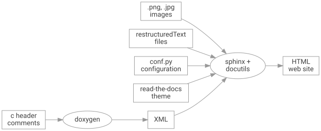
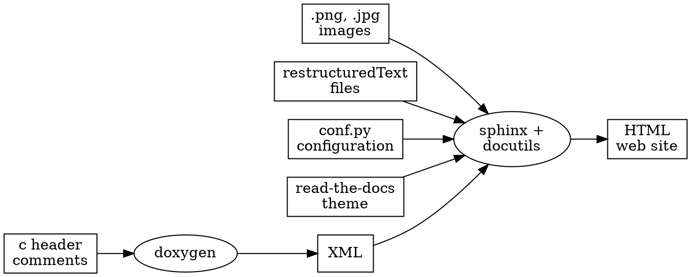

<!-- Copyright 2015-2026 Zephyr Project members and individual contributors. -->
<!-- SPDX-License-Identifier: Apache-2.0 -->
<!-- 中文翻译；编号、导航和明确标注的译注为本地新增。 -->

<a id="documentation-generation"></a>
<a id="zephyr-doc"></a>

# 第11章\_文档生成

原文：[官方页面](https://docs.zephyrproject.org/latest/contribute/documentation/generation.html)。读取日期：2026-10-14；保存的 latest 页面及 HTML 摘要见[来源记录](../SOURCES.md)。

本页说明怎样在本地使用与[官方在线文档](https://docs.zephyrproject.org)相同的来源生成 Zephyr 文档。

<a id="documentation-overview"></a>
<a id="id1"></a>

## 11.1\_文档概览（Documentation Overview）

文档采用 reStructuredText 标记语言（扩展名 `.rst`）和 Sphinx 扩展，经 Sphinx 处理成独立网站。开发者可以直接阅读 `.rst`，也可以生成超文本标记语言（HyperText Markup Language，HTML）内容，在本机浏览器查看。同一来源也用于公开文档网站，但可使用不同主题。详情见 [reStructuredText](https://sphinx-doc.org/rest.html) 和 [Sphinx](https://sphinx-doc.org/) 各自网站。

文档来源包括：

- 生成官网的 reStructuredText 文件。多数位于 `/doc`，另一些与组件放在一起，例如 `/samples`、`/boards`。
- Doxygen 生成的应用程序编程接口（Application Programming Interface，API）资料。
- 脚本根据源码树 Kconfig 文件生成的内核配置选项资料。

> 译注：这里的 `/doc`、`/samples`、`/boards` 表示 Zephyr 仓库根下的目录，不是操作系统根目录。实际操作从自己的源码工作区定位。



原图对应的 DOT 源码一并保留，便于跟踪图的输入关系：



图中 `images` 为图片，`restructuredText files` 为 RST 文件，`conf.py configuration` 为配置，`read-the-docs theme` 为主题，`c header comments` 为 C 头文件注释，`HTML web site` 为 HTML 网站。Doxygen 将注释转换为 XML，Sphinx 与 docutils 结合其余输入生成网站。

Sphinx 处理 RST 并利用 Doxygen 的 API 资料；本地生成还需要下述附加工具。

<a id="installing-the-documentation-processors"></a>
<a id="documentation-processors"></a>

## 11.2\_安装文档处理工具（Installing the Documentation Processors）

原文记载已测试的版本为 Doxygen **1.17.0**、Graphviz **2.43**、Latexmk **4.83**，以及仓库 `doc/requirements.txt` 中列出的全部 Python 依赖。先按[入门指南](../getting_started/P002_入门指南.md#getting-started)安装 Zephyr，再安装只用于文档生成的工具。

### 11.2.1\_Linux

所有 Linux 发行版先安装 Python 文档依赖，原文独立工作区示例为：

```bash
pip install -U -r ~/zephyrproject/zephyr/doc/requirements.txt
```

Ubuntu：

```bash
sudo apt-get install --no-install-recommends doxygen graphviz librsvg2-bin \
texlive-latex-base texlive-latex-extra latexmk texlive-fonts-recommended imagemagick
```

Fedora：

```bash
sudo dnf install doxygen graphviz texlive-latex latexmk \
texlive-collection-fontsrecommended librsvg2-tools ImageMagick
```

Clear Linux：

```bash
sudo swupd bundle-add texlive graphviz ImageMagick
```

Arch Linux：

```bash
sudo pacman -S graphviz doxygen librsvg texlive-core texlive-bin \
texlive-latexextra texlive-fontsextra imagemagick
```

### 11.2.2\_macOS

安装 Python 依赖：

```bash
pip install -U -r ~/zephyrproject/zephyr/doc/requirements.txt
```

用 `brew` 和 `tlmgr` 安装工具：

```bash
brew install doxygen graphviz mactex librsvg imagemagick
tlmgr install latexmk
tlmgr install collection-fontsrecommended
```

### 11.2.3\_Windows

原文的 Python 依赖命令为：

```bat
pip install -U -r %HOMEPATH$\zephyrproject\zephyr\doc\requirements.txt
```

> 译注：原文把变量写成 `%HOMEPATH$`，这不是有效的 cmd 变量闭合写法。若采用原文的用户目录工作区布局，在 cmd 中可写成 `pip install -U -r "%USERPROFILE%\zephyrproject\zephyr\doc\requirements.txt"`；其他布局使用自己的 `doc/requirements.txt` 位置。原命令保留以便对照，这里没有执行安装。

以管理员身份打开 `cmd.exe`，运行：

```bat
choco install doxygen.install graphviz strawberryperl miktex rsvg-convert imagemagick
```

> 原文说明：Windows 的 `sphinx-build.exe` 位于 Python 安装目录的 `Scripts` 文件夹。根据安装方式，可能需要把该目录加入 `PATH` 环境变量；方法见 [Windows Python 路径说明](https://docs.python.org/3/using/windows.html#windows-path-mod)。

<a id="documentation-presentation-theme"></a>

> 译注：Python 文档已调整结构，原 `#finding-the-python-executable` 锚点不存在；上方改到同一官方页面保留的路径说明入口 `#windows-path-mod`，实际配置应按所用 Python 安装方式阅读。

## 11.3\_文档展示主题（Documentation Presentation Theme）

Sphinx 通过主题便于定制生成结果。替换主题文件后再次执行 `make html`，即可改变布局与样式。原文说明 read-the-docs 主题在入门指南的[获取 Zephyr 并安装 Python 依赖](../getting_started/P002_入门指南.md#install-py-requirements)步骤中安装。

<a id="running-the-documentation-processors"></a>

## 11.4\_运行文档处理工具（Running the Documentation Processors）

克隆的仓库 `doc/` 中包含文档来源、额外工具及生成本地文档的 Makefile。以下保留原文的 CMake/Ninja 流程，使用 `zephyrproject/zephyr` 示例布局：

```text
# On Linux/macOS
cd ~/zephyrproject/zephyr/doc
# On Windows
cd %userprofile%\zephyrproject\zephyr\doc

# Use cmake to configure a Ninja-based build system:
cmake -GNinja -B_build .

# Enter the build directory
cd _build

# To generate HTML output, run ninja on the generated build system:
ninja html
# If you modify or add .rst files, run ninja again:
ninja html

# To generate PDF output, run ninja on the generated build system:
ninja pdf
```

英文注释依次表示：选择 Linux/macOS 或 Windows 的进入目录方式；用 CMake 配置 Ninja 构建系统；进入 `_build`；执行 `ninja html` 生成 HTML，修改或增加 RST 后再次执行；执行 `ninja pdf` 生成 PDF。两个平台的 `cd` 分支择一使用，Windows 行使用 cmd 变量语法；其余阶段须在相应当前目录继续。

> 原文警告：构建系统会把所有参与生成的 RST 和其依赖复制到构建目录。Sphinx 的警告与错误指向这些副本，而非受版本控制的原文件。不要误改错误信息中的副本，因为修改不会保存在正式来源中。

原文估计生成可能需要最多15分钟，实际取决于开发系统。完成后从 `doc/_build/html/index.html` 查看网页；若生成了 PDF，位置为 `doc/_build/latex/zephyr.pdf`。

要从零重建，可清理构建文件夹内容，再运行 CMake 和 Ninja。增加或删除文档文件后，需要重新运行 CMake。

Unix 平台可在 `doc/` 用便捷的 [doc/Makefile](https://github.com/zephyrproject-rtos/zephyr/blob/main/doc/Makefile)：

```bash
cd ~/zephyrproject/zephyr/doc

# To generate HTML output
make html

# To generate PDF output
make pdf
```

其中 `make html` 生成 HTML，`make pdf` 生成 PDF。

<a id="developer-mode-document-building"></a>

## 11.5\_开发模式构建（Developer-Mode Document Building）

大量修改文档并反复预览时，可以暂时用占位内容代替自动生成的设备树绑定文档，加快生成。向 CMake 添加：

```text
-DDT_TURBO_MODE=1
```

各开发板支持功能列表的生成也较耗时，可以禁用：

```text
-DHW_FEATURES_TURBO_MODE=1
```

这两个片段是附加的 CMake 选项，不是独立终端命令。下方 Make 目标同时跳过详细绑定和支持功能索引：

```bash
cd ~/zephyrproject/zephyr/doc

# To generate HTML output without detailed Devicetree bindings documentation
# and supported features index
make html-fast
```

进一步的 `SKIP_*` 选项可跳过整类自动生成内容：

| 选项 | 作用 |
| --- | --- |
| `SKIP_DOXYGEN` | 不运行 Doxygen，也不构建 C API 参考。 |
| `SKIP_KCONFIG` | 不生成 Kconfig 选项参考及搜索页。 |
| `SKIP_EXTERNAL_CONTENT` | 不复制 `doc/` 之外的开发板、示例和片段页面，即 [boards](https://github.com/zephyrproject-rtos/zephyr/blob/main/boards)、[samples](https://github.com/zephyrproject-rtos/zephyr/blob/main/samples)、[snippets](https://github.com/zephyrproject-rtos/zephyr/blob/main/snippets) 中的内容。 |

可单独启用，例如：

```bash
make html SKIP_DOXYGEN=1
```

`make html-minimal` 在 `html-fast` 基础上启用全部上述跳过选项，是预览叙述性页面最快的方式：

```bash
make html-minimal
```

> 原文警告：被跳过的生成器原本输出的内容将变为占位符，相关交叉引用显示为普通文本，对应警告也被抑制。因此使用任意 `SKIP_*` 选项的构建只适合本地预览，**不能验证交叉引用，也不得发布其输出**。

只处理某些厂商开发板时，还可限制支持功能列表的生成范围，向 CMake 添加：

```text
-DHW_FEATURES_VENDOR_FILTER=vendor1,vendor2
```

Make 包装入口也支持该选项：

```bash
cd ~/zephyrproject/zephyr/doc

# To generate HTML output with supported features limited to a subset of vendors
make html HW_FEATURES_VENDOR_FILTER=vendor1,vendor2
```

`vendor1,vendor2` 表示所选厂商列表；此例仅生成该子集的硬件功能资料。

<a id="viewing-generated-documentation-locally"></a>

## 11.6\_在本地查看生成结果（Viewing Generated Documentation Locally）

可用 Python 托管生成的 HTML，再用浏览器查看：

```console
$ python3 -m http.server -d _build/html
```

> 原文说明：适用于 Linux 的 Windows 子系统第二版（Windows Subsystem for Linux 2，WSL2）可能需要显式绑定 `127.0.0.1`，使主机能访问：

```console
$ python3 -m http.server -d _build/html --bind 127.0.0.1
```

这两段的 `$` 是终端提示符，当前目录为 `doc/`，`_build/html` 相对该目录解析。

也可运行 `make html-live`、`make html-live-fast` 或 `make html-live-minimal`，同时构建、在本地托管并监视文档目录。发现变化后会自动重建并刷新托管文件。

<a id="building-the-doxygen-documentation-standalone"></a>

## 11.7\_单独生成Doxygen文档（Building the Doxygen Documentation Standalone）

`doxygen` 目标只构建 Doxygen API 文档，比整套生成更快：

```bash
cd ~/zephyrproject/zephyr/doc
make doxygen
```

输出位于 `_build/doxygen/html`。`doxygen-xml` 目标只启用 XML 输出，位于 `_build/doxygen-xml/xml`；这里均相对 `doc/`。

完整构建时，Doxygen 注释中的 `@kconfig{}`、`@dtcompatible{}`、`@rstref{}` 等主文档引用会自动解析为链接，见[引用主文档](../coding_style/P008_Doxygen注释规范.md#doxygen-sphinx-xrefs)。单独构建 Doxygen 时，其余文档不存在，因此保留为纯文本。

<a id="linking-external-doxygen-projects-against-zephyr"></a>

## 11.8\_外部Doxygen项目链接到Zephyr（Linking External Doxygen Projects Against Zephyr）

基于 Zephyr 的外部项目，可以用导出的 [zephyr.tag](https://docs.zephyrproject.org/latest/doxygen/html/zephyr.tag) 标签文件，使 Doxygen 的 `@ref` 引用 Zephyr 文档。下载后，在自己的 `doxyfile.in` 中按原文配置：

```text
TAGFILES = "/path/to/zephyr.tag=https://docs.zephyrproject.org/latest/doxygen/html/"
```

> 译注：`/path/to/zephyr.tag` 是原文占位路径，替换为自己保存标签文件的位置；也可采用相对 Doxygen 执行工作目录的路径。右侧 URL 是链接目的地，不是本地仓库地址。

更多信息见 [Doxygen 外部文档说明](https://www.doxygen.nl/manual/external.html)。


对应官方文档源码：[doc/contribute/documentation/generation.rst](https://raw.githubusercontent.com/zephyrproject-rtos/zephyr/main/doc/contribute/documentation/generation.rst)。

> 译注——源码跟踪：本仓库的[对应源码](../../../doc/contribute/documentation/generation.rst)可用于跟踪，版本可能与网页不同；本批仅翻译和核对文档，没有执行固件构建、模拟运行或烧录。

<a id="id2"></a>
<a id="tab-0-TGludXg="></a>
<a id="tab-0-bWFjT1M="></a>
<a id="tab-0-V2luZG93cw=="></a>
<a id="panel-0-TGludXg="></a>
<a id="panel-0-bWFjT1M="></a>
<a id="panel-0-V2luZG93cw=="></a>

<!-- reading-navigation:start -->

**主线阅读**

[上一篇：文档编写指南](P010_文档编写指南.md) · [本模块主线目录](../reading/contributing.md) · [全部主线](../reading/README.md) · [下一篇：外部组件贡献](P012_外部组件贡献.md)

<details>
<summary>原册编号导航（含扩展参考）</summary>

[上一章](P010_文档编写指南.md) · [返回大纲](大纲.md) · [下一章](P012_外部组件贡献.md)

</details>

<!-- reading-navigation:end -->
