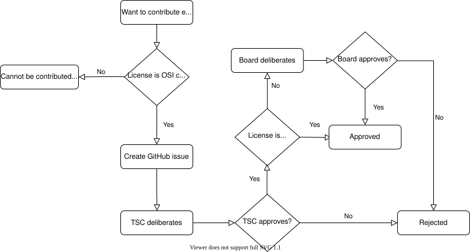

<!-- Copyright 2015-2026 Zephyr Project members and individual contributors. -->
<!-- SPDX-License-Identifier: Apache-2.0 -->
<!-- 中文翻译；编号、导航和明确标注的译注为本地新增。 -->

# 第12章\_外部组件贡献

原文：[官方页面](https://docs.zephyrproject.org/latest/contribute/external.html)。读取日期：2026-10-14；保存的 latest 页面及 HTML 摘要见[来源记录](../SOURCES.md)。

有时复用外部源码可以避免重新实现其他开源项目已有的基础能力或功能。本页说明哪些情况下可以导入，以及接纳流程。评估围绕下文所述的主要因素展开。

本页大部分内容针对最终会编译、链接到镜像并写入目标硬件的组件。只用于编译、代码分析、测试或模拟的工具，见后面的[外部工具贡献](#external-tooling)。

## 12.1\_软件许可（Software License）

> 原文说明：采用 Apache-2.0 许可的外部源码不受本节限制。

对于其他许可，必须充分理解具体情况，并按 [Zephyr 项目章程](https://www.zephyrproject.org/wp-content/uploads/2023/08/LF-Zephyr-Charter-2023.08.21.pdf)由 [管理委员会（governing board）](https://www.zephyrproject.org/governance/)批准。委员会会直接拒绝未获[开放源代码促进会（OSI）](https://opensource.org/licenses/alphabetical)认可的许可。详情见[提交与审查流程](#external-src-process)。

仔细审查潜在贡献，并执行[开发者来源证明（Developer Certificate of Origin，DCO）](P002_贡献指南.md#dco)，有助于保障社区开发产品时不受专利或版权问题困扰。

## 12.2\_引入价值（Merit）

与其他贡献一样，外部源码也要评估价值；但已有项目的代码还有额外问题。技术指导委员会（Technical Steering Committee，TSC）会仔细考察：

- 是否是引入此功能的最佳方式；同时评估内部实现成本和维护外部代码库的成本。
- 外部项目是否持续活跃维护；安全或密码学相关代码尤其重要。
- 是否考虑其他实现，是否有提供相同功能的其他开源项目。

## 12.3\_集成方式（Mode of Integration）

两种主要方式需要逐案选择。

### 12.3.1\_集成到主源码树（Integration in the Main Tree）

直接导入主 `zephyr` 仓库，意味着代码成为主线（mainline）的一部分，须满足：

- 按[Zephyr 编码风格指南](../coding_style/P001_代码风格指南.md#coding-style)排版。
- 遵守[编码准则](P009_编码准则.md#coding-guidelines)。
- 接受与主树其他代码相同的检查和验证，包括静态分析。
- 缺少 SPDX 标签的文件补上标签；SPDX 为软件包数据交换（Software Package Data Exchange）许可标识机制。
- 若不是 Apache 2.0 许可，在根目录 [REUSE.toml](https://github.com/zephyrproject-rtos/zephyr/blob/main/REUSE.toml) 添加描述组件的 `[[annotations]]` 条目；[组件许可页面](https://docs.zephyrproject.org/latest/LICENSING.html#zephyr-licensing)由此生成。

这种方式适合大小不同的代码库，但更常用于小型代码库。

### 12.3.2\_作为模块集成（Integration as a Module）

把第三方项目全部或部分放进独立仓库，再以[模块（module）](../modules/P001_模块与外部项目.md#modules)引入。此时仍视为外部开发，不自动适用上一节全部要求。

#### (1)\_加入主清单（Integration in Main Manifest File）

加入 `west.yml` 主清单的外部代码，限于 Zephyr 子系统使用的库、平台、硬件抽象层（Hardware Abstraction Layer，HAL）驱动，以及构建或测试组件所需的工具。这类模块由持续集成（Continuous Integration，CI）验证，每次发布均验证可用；没有详细迁移计划，不会直接移除。

> 译注：原文小标题写 `west.yaml`，正文和官方主清单实际采用 `west.yml`。此处按实际文件名说明。

#### (2)\_可选模块（Integration as Optional Modules）

独立或松散集成、没有其他组件依赖它的模块或项目，应保持独立并设为可选。直接服务用户，或通过子系统、平台提供价值的可选项目，应加入默认过滤掉的可选清单 `submanifests/optional.yml`。

这些项目可以在自身仓库维护示例和测试。Zephyr Git 源码树不得添加对它们的直接依赖，所有示例和测试应随模块维护。

> 原文说明：此要求适用于所有新可选模块；已有模块在 Zephyr 仓库中的示例和测试会逐步迁出。

#### (3)\_外部模块（Integration as External Modules）

与可选模块类似，但按预定义模板在文档中添加条目，处于 Zephyr 清单之外。文档指导用户和开发者如何集成其功能。

## 12.4\_持续维护（Ongoing Maintenance）

无论采用哪种集成方式，外部代码都需持续维护。提案人必须承诺在可预见的未来维护集成；流程中可能需要向 `MAINTAINERS.yml` 增加条目。

## 12.5\_提交与审查流程（Submission and Review Process）

外部源码在加入前，须经 TSC 审查和接纳，某些情况还需管理委员会批准。在 Zephyr 的 GitHub 问题跟踪器创建问题单，描述代码及其集成方式：

1. 详细阅读[本页外部组件要求](#external-contributions)，理解 TSC 与委员会批准或拒绝的标准。
2. 使用 [新增外部源码问题模板](https://github.com/zephyrproject-rtos/zephyr/issues/new?assignees=&labels=RFC&template=007_ext-source.yml)创建问题单。
3. 填写全部必填部分，提供足够细节供 TSC 评估价值；也可创建展示集成的拉取请求（Pull Request，PR），从问题单链接过去。
4. 等待 TSC 反馈，回应问题单评论中的补充问题。

若 TSC 认为导入是最佳方案，且代码采用 Apache-2.0，流程完成，可以集成。若采用其他许可，还要：

1. TSC 主席将先前问题单链接转交管理委员会。
2. 委员会有 **两周**审查并提问。没有反对意见则结束；两周届满前若全体一致批准，可提前完成。若有人提出无法通过邮件解决的异议，委员会开会讨论是否推翻 TSC 批准，或寻找可消除异议的其他办法。
3. 获得 TSC 与管理委员会批准后，流程完成。

图中步骤与判断依次为：`Want to contribute external source`（希望贡献外部源码）、`License is OSI compliant?`（许可是否获OSI认可）、`Create GitHub issue`（创建问题单）、`TSC deliberates`（TSC审议）、`TSC approves?`（TSC是否批准）、`License is Apache v2?`（是否Apache v2许可）、`Board deliberates`（管理委员会审议）、`Board approves?`（委员会是否批准）。`Yes / No` 为是／否；`Approved` 为批准，`Rejected` 为拒绝，`Cannot be contributed to Zephyr` 为不能贡献给Zephyr。

> 译注：原SVG同时包含完整标签和兼容显示的截短文字，并保留了 `Viewer does not support full SVG 1.1`（查看器不支持完整SVG 1.1）提示。原文件未经改写；上述中文对应完整标签。

## 12.6\_外部工具贡献（Contributing External Tooling）

本节专指辅助编译、测试或模拟，且其代码绝不会成为最终镜像一部分的工具。“加入”指成为 Zephyr 默认发行内容：直接位于主树 `scripts/`，或作为主 `west.yml` 中的 west 项目。因此不适用于仅被构建系统或文档引用、但未纳入发行版的第三方工具链、模拟器等。

工具必须采用 [OSI](https://opensource.org/licenses/alphabetical) 认可的许可。与普通组件一样，可以导入主树或作为 west 项目；但这里的 west 项目 **不是模块**，因为工具不使用、也无需由 Zephyr 构建系统处理。区别见 [模块与west项目](../modules/P001_模块与外部项目.md#modules-vs-projects)。

进入主树的工具应放在 `scripts/`。作为 west 项目时，仓库可以位于 `zephyrproject-rtos` GitHub 组织之外，但须通过主清单 `group-filter:` 设为可选，详见[可选项目说明](../west/P013_west清单文件.md#west-manifest-groups)。

每个引入新外部工具的 PR 都必须获得 TSC 批准，由 TSC 代表逐案分析。

## 12.7\_主清单的附加要求（Additional Considerations About the Main Manifest）

一般而言，[主清单](https://github.com/zephyrproject-rtos/zephyr/blob/main/west.yml)的 `projects:` 部分任何新增或删除都需要 TSC 批准，包括但不限于：增删分组与分组过滤器、增删项目、增删 `import` 导入语句。

对应官方文档源码：[doc/contribute/external.rst](https://raw.githubusercontent.com/zephyrproject-rtos/zephyr/main/doc/contribute/external.rst)。

> 译注——源码跟踪：本仓库的[对应源码](../../../doc/contribute/external.rst)可用于跟踪，版本可能与网页不同；本批仅翻译和核对文档，没有执行固件构建、模拟运行或烧录。

<!-- reading-navigation:start -->

**主线阅读**

[上一篇：文档生成](P011_文档生成.md) · [本模块主线目录](../reading/contributing.md) · [全部主线](../reading/README.md)

原册编号导航（含扩展参考）

[上一章](P011_文档生成.md) · [返回大纲](大纲.md)

<!-- reading-navigation:end -->
