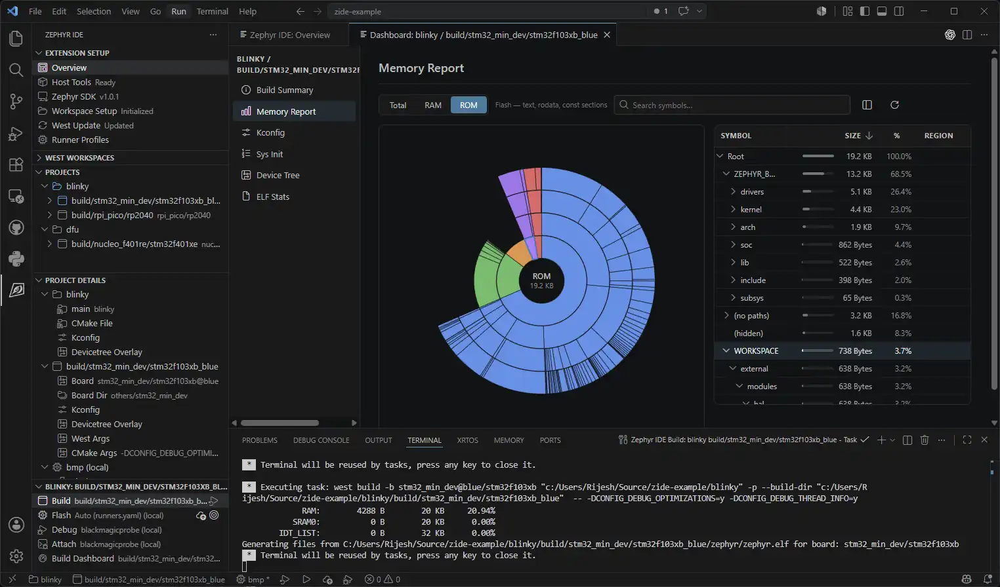
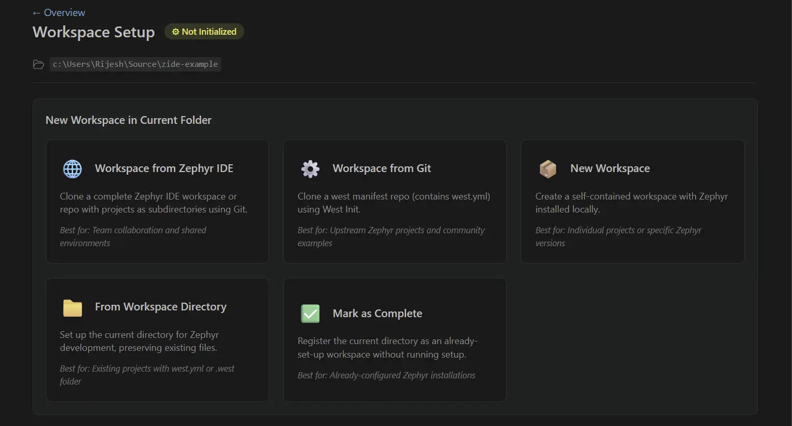

<!-- Copyright 2015-2026 Zephyr Project members and individual contributors. -->
<!-- SPDX-License-Identifier: Apache-2.0 -->
<!-- 中文翻译；编号、导航和明确标注的译注为本地新增。 -->

# 第3章\_IDE for Zephyr扩展

原文：[官方页面](https://docs.zephyrproject.org/latest/develop/tools/ide_for_zephyr_vscode_ext.html)。本次读取日期：2026-10-14；基线为保存的`latest`页面，HTML摘要见[来源记录](../SOURCES.md)。

<a id="ide-for-zephyr-vs-code-extension"></a>
<a id="index-0"></a>

<a id="ide-for-zephyr-vscode-ext"></a>

[IDE for Zephyr](https://marketplace.visualstudio.com/items?itemName=mylonics.zephyr-ide)是一款用于Zephyr实时操作系统（Real-time Operating System，RTOS）开发的Visual Studio Code（VS Code）扩展，支持主机工具管理、west工作区配置、SDK管理、项目创建、构建／烧录和调试。



<a id="key-features"></a>

## 3.1\_主要功能

- 通过内置的`zephyr-ide-cortex`和`zephyr-ide-west`调试器类型，与Cortex-Debug集成，支持ST-Link、J-Link、OpenOCD、Black Magic Probe等探针，并自动解析ELF、GDB和运行器（Runner）路径。
- 集成clangd或C/C++，提供IntelliSense代码智能功能。
- 在构建仪表板（Build Dashboard）中查看内存使用情况、Kconfig和设备树（Devicetree）；无需离开VS Code，即可通过旭日图（Sunburst Chart）查看ROM和RAM。
- 使用内置编辑器交互式编辑Kconfig选项。
- 从项目面板添加、运行和重新配置Twister测试。
- 在Linux、macOS和Windows上自动安装本机主机工具，包括CMake、Python 3、Ninja、DTC、GCC等。
- 安装和管理Zephyr SDK版本及各体系结构的工具链（Toolchain）。
- 从已有应用或Zephyr示例添加项目，支持多个构建，以及每个构建独立的开发板和配置覆盖。
- 将项目配置存储在可纳入版本控制的`.vscode/zephyr-ide.json`中，该文件可指定SDK、软件包和二进制文件（Blob）。

<a id="compatibility"></a>

## 3.2\_兼容性

支持Windows、Linux和macOS。

<a id="getting-started"></a>

## 3.3\_开始使用

### 安装扩展（Install the extension）

从[VS Code Marketplace](https://marketplace.visualstudio.com/items?itemName=mylonics.zephyr-ide)或[Open VSX Registry](https://open-vsx.org/extension/mylonics/zephyr-ide)安装IDE for Zephyr。

还可使用扩展包，其中捆绑了Cortex-Debug、C/C++、Serial Monitor、Devicetree LSP和CMake支持：[VS Code Marketplace扩展包](https://marketplace.visualstudio.com/items?itemName=mylonics.zephyr-ide-extension-pack)、[Open VSX Registry扩展包](https://open-vsx.org/extension/mylonics/zephyr-ide-extension-pack)。

### 打开总览页并安装主机工具（Open the Overview Page and Install Host Tools）

点击 **Host Tools**（主机工具）卡片。扩展会检查`PATH`中是否存在所需构建依赖，包括CMake、Python 3、Ninja、DTC、GCC等，并可自动安装缺少的工具。

### 配置west工作区（Configure a West workspace）

点击 **Workspace**（工作区）卡片，选择一种配置方式：

- **IDE for Zephyr Workspace from Git**：克隆已经包含预配置IDE for Zephyr工作区的仓库。
- **West Workspace from Git**：克隆现有的基于west的Zephyr仓库。
- **Standard Workspace**（标准工作区）：创建新工作区，包含Python虚拟环境、west安装和Zephyr仓库初始化。
- **Open Current Directory**（打开当前目录）：使用已有的`.west`文件夹，或通过[`ZEPHYR_BASE`](../toolchains/P003_环境变量.md)连接外部Zephyr安装。

如果需要，此步骤还会提示安装Zephyr SDK。以后可以通过总览页的 **Zephyr SDK** 卡片管理SDK。



### 添加项目和构建（Add a project and a build）

在 **Project**（项目）面板点击 **Add Project**（添加项目），加入已有应用，或复制Zephyr示例作为起点。

添加项目后，点击 **Add Build**（添加构建）创建构建配置。选择目标开发板，并可选取运行器配置档（Runner Profile）。每个项目可以有多个构建，面向不同开发板或配置。

### 构建和烧录应用（Build and flash the application）

使用状态栏按钮或 **Project Build**（项目构建）面板进行构建、烧录或全新构建（Pristine Build）。构建输出显示在集成终端中。

### 配置并运行调试会话（Configure and run a debug session）

IDE for Zephyr内置`zephyr-ide-west`调试器类型，它从当前构建读取`runners.yaml`，自动转换为Cortex-Debug会话，开始使用时无需在`.vscode/launch.json`中添加条目。`zephyr-ide-west`提供程序接受传给`west debugserver`的参数，而`zephyr-ide-cortex`提供程序接受直接传给`cortex-debug`的参数。也可以自行设置启动配置并将其绑定到构建。扩展提供可在启动时解析的命令。

手动添加启动配置时，可使用以下最小形式：

```json
{
  "name": "Zephyr IDE: Debug",
  "type": "zephyr-ide-west",
  "request": "launch"
}
```

内置提供程序从`runners.yaml`选择运行器，解析ELF和GDB路径，然后将会话转交给Cortex-Debug。

<a id="sharing-project-configuration"></a>

## 3.4\_共享项目配置

项目设置、构建、运行器配置档、Kconfig覆盖、设备树覆盖，以及每个构建的west和CMake参数，都存储在`.vscode/zephyr-ide.json`中。该文件可供人阅读，也可提交到版本控制，使团队成员共享同一套工作区配置。

<a id="useful-links"></a>

## 3.5\_实用链接

- 查看[扩展仓库](https://github.com/mylonics/zephyr-ide)。
- 阅读[完整文档](https://zephyr-ide.mylonics.com/)。
- 尝试[示例项目](https://github.com/mylonics/zephyr-ide-sample-project)。

<!-- reading-navigation:start -->

**主线阅读**

[上一篇：Visual Studio Code](P002_Visual_Studio_Code.md) · [本模块主线目录](../reading/developer_tools.md) · [全部主线](../reading/README.md) · [下一篇：Workbench for Zephyr](P004_Workbench_for_Zephyr.md)

<details>
<summary>原册编号导航（含扩展参考）</summary>

[上一章：Visual Studio Code](P002_Visual_Studio_Code.md) · [返回大纲](大纲.md) · [下一章：Workbench for Zephyr](P004_Workbench_for_Zephyr.md)

</details>

<!-- reading-navigation:end -->
