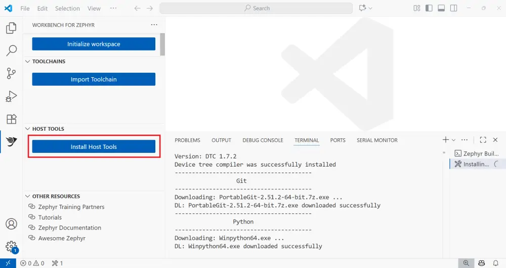
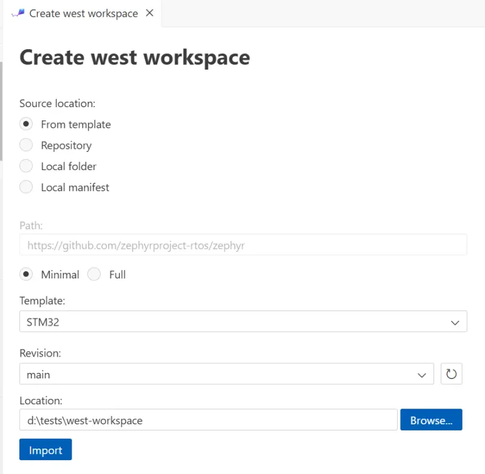
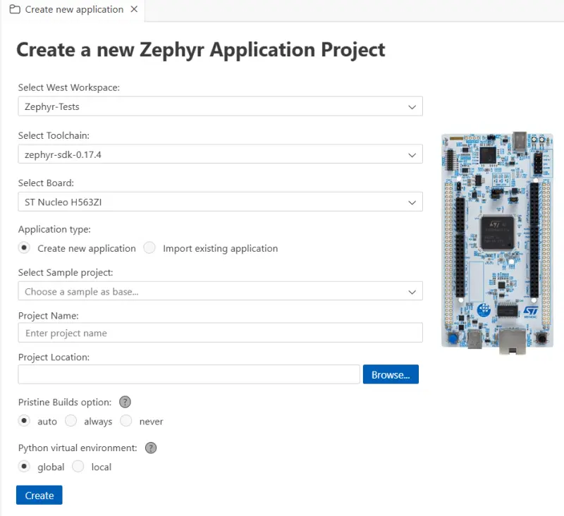
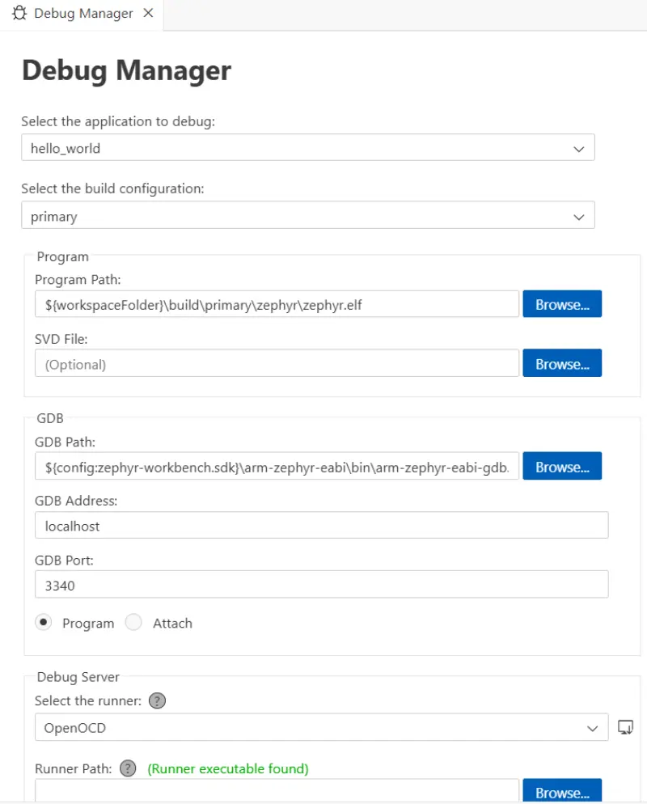

<!-- Copyright 2015-2026 Zephyr Project members and individual contributors. -->
<!-- SPDX-License-Identifier: Apache-2.0 -->
<!-- 中文翻译；编号、导航和明确标注的译注为本地新增。 -->

# 第4章\_Workbench for Zephyr

原文：[官方页面](https://docs.zephyrproject.org/latest/develop/tools/workbench_for_zephyr.html)。本次读取日期：2026-10-14；基线为保存的`latest`页面，HTML摘要见[来源记录](../SOURCES.md)。

Workbench for Zephyr是Visual Studio Code（VS Code）扩展，提供Zephyr开发支持，包括SDK管理、项目创建向导、构建／烧录和调试。可观看[入门教程](https://youtu.be/1RB0GI6rJk0?si=_D2AA3KurzCwLtRv)了解操作过程。

## 4.1\_主要功能

- 安装本机主机工具（Host Tools），如Python、CMake等。
- 安装和指定工具链（Toolchain），如Zephyr SDK、IAR等。
- 导入west工作区（Workspace）。
- 创建和导入Zephyr应用。
- 构建和烧录应用。
- 调试应用。
- 自动安装运行器（Runner）。
- 执行内存分析和静态分析（Static Analysis）。

## 4.2\_兼容性

支持Windows 10–11、macOS，以及x86_64 Linux。Linux发行版包括Ubuntu、Debian和Fedora；其他发行版也可能可用，但尚未测试。

## 4.3\_开始使用

### 安装扩展（Install the extension）

从[VS Code Marketplace](https://marketplace.visualstudio.com/items?itemName=Ac6.zephyr-workbench)安装Workbench for Zephyr。

### 打开Workbench for Zephyr扩展（Open the Workbench for Zephyr extension）

在活动栏（Activity Bar）点击Workbench for Zephyr图标。

### 安装主机工具（Install Host Tools）

点击 **Install Host Tools**，下载并安装本机工具，通常安装到`${HOME}/.zinstaller`。

> 注意（Note）：某些主机工具可能需要管理员权限。Windows上安装7z时需要此权限；Linux上使用软件包管理器安装工具时也需要，例如运行`apt install`时。

### 导入工具链（Import a toolchain）

点击 **Import Toolchain**，选择工具链和目标文件夹。

工具链提供构建和调试Zephyr应用所需的编译器与调试器。推荐使用Zephyr SDK，可安装完整包或针对特定目标的最小版本。Workbench也支持IAR等其他工具链。

### 初始化／导入west工作区（Initialize / Import a West workspace）

点击 **Initialize workspace** 并填写工作区信息。

Workbench将创建工作区，并解析west清单（Manifest）来配置项目。

### 创建新应用（Create a new application）

在Workbench for Zephyr中，新项目以Zephyr源码中的示例为基础。

1. 点击 **Create New Application**（创建新应用）。
2. 选择要关联的 **West Workspace**。
3. 选择要使用的 **Zephyr SDK**。
4. 选择目标 **Board**（开发板），例如ST STM32F4 Discovery。
5. 选择作为基础的 **Sample**（示例）项目，例如`hello_world`。
6. 输入项目名称。
7. 输入项目位置。

### 构建应用（Build the application）

点击状态栏中的 **Build**，或选择要构建的应用文件夹。构建输出显示在集成终端中。

### 配置并运行调试会话（Configure and run a debug session）

使用 **Debug Manager**（调试管理器）生成／更新调试配置`.vscode/launch.json`，包括：

- 生成的ELF文件（**Program Path**）。
- SVD文件，可选。
- GDB／端口／地址，按需设置。
- 调试服务器／运行器，如OpenOCD、J-Link、LinkServer、pyOCD等。

然后通过 **Run and Debug**（运行和调试）正常启动调试。

## 4.4\_安装运行器

Workbench for Zephyr可为某些运行器提供安装程序，例如OpenOCD和STM32CubeProgrammer。使用 **Install Runners** 查看支持的工具并安装，或打开厂商网站。

## 4.5\_实用链接

- 浏览[扩展仓库](https://github.com/Ac6Embedded/vscode-zephyr-workbench)。
- 通过[完整文档](https://z-workbench.com/)了解更多细节。

<!-- reading-navigation:start -->

**主线阅读**

[上一篇：IDE for Zephyr扩展](P003_IDE_for_Zephyr扩展.md) · [本模块主线目录](../reading/developer_tools.md) · [全部主线](../reading/README.md) · [下一篇：CLion](P005_CLion.md)

原册编号导航（含扩展参考）

[上一章：IDE for Zephyr扩展](P003_IDE_for_Zephyr扩展.md) · [返回大纲](大纲.md) · [下一章：CLion](P005_CLion.md)

<!-- reading-navigation:end -->
