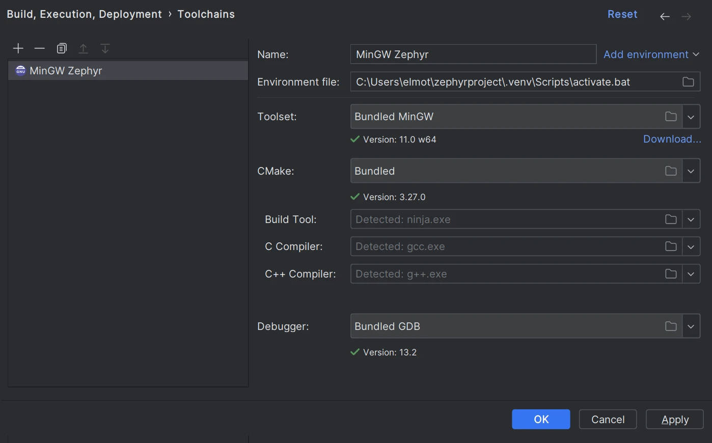
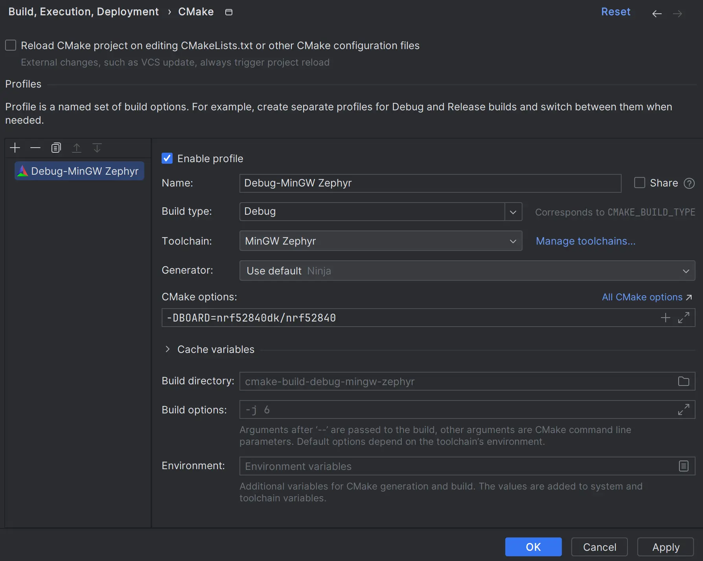
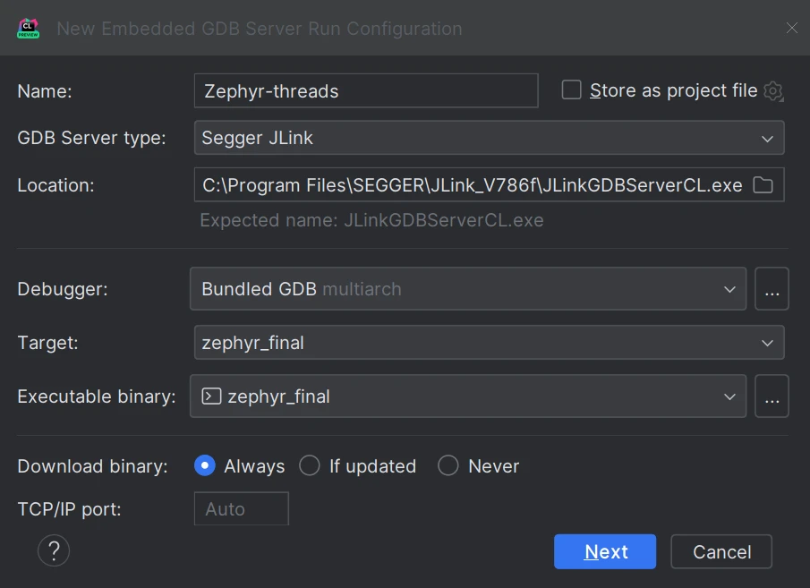
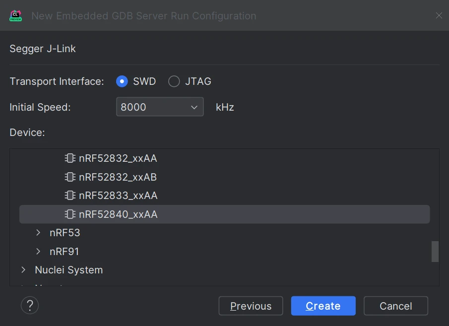
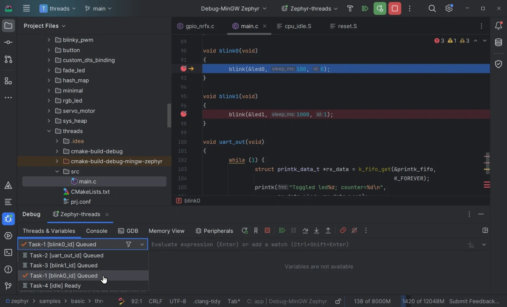

<!-- Copyright 2015-2026 Zephyr Project members and individual contributors. -->
<!-- SPDX-License-Identifier: Apache-2.0 -->
<!-- 中文翻译；编号、导航和明确标注的译注为本地新增。 -->

# 第5章\_CLion

原文：[官方页面](https://docs.zephyrproject.org/latest/develop/tools/clion.html)。本次读取日期：2026-10-14；基线为保存的`latest`页面，HTML摘要见[来源记录](../SOURCES.md)。

<a id="clion-ide"></a>

<a id="clion"></a>

> 注意（Note）：本指南介绍如何使用IDE的CMake集成，在CLion中配置、构建和调试Zephyr示例应用。这种方式已不再是最佳选择。CLion现已提供[原生Zephyr west集成](https://jb.gg/cl_zephyr_doc)，打开、构建和运行／调试Zephyr项目更加简单直观。原文说明本指南将很快更新；如果仍希望使用CMake，本指南依然有效。

[CLion](https://www.jetbrains.com/clion/)是跨平台C/C++集成开发环境（Integrated Development Environment，IDE），支持多线程实时操作系统（Real-time Operating System，RTOS）调试。

本指南介绍如何在CLion中配置、构建和调试Zephyr的[基本线程操作示例](../basic_samples/P002_基本线程操作.md#multi-thread-blinky)。这些步骤已在Windows上测试。就CLion工作流程而言，macOS和Linux步骤相同，但需选择正确的环境文件并调整路径。

<a id="get-clion"></a>

## 5.1\_获取CLion

[下载CLion](https://www.jetbrains.com/clion/download)并安装。

<a id="initialize-a-new-workspace"></a>

## 5.2\_初始化新工作区

本指南详细说明基本线程操作示例的构建和调试；其他Zephyr项目和[工作区布局](../west/P004_工作区.md)的操作也类似。开始之前，请按[入门指南](../getting_started/P002_入门指南.md)准备好可用的Zephyr开发环境。

<a id="open-the-project-in-clion"></a>

### 在CLion中打开项目（Open the project in CLion）

1. 在CLion欢迎界面点击 **Open**，或从主菜单选择 **File → Open**。
2. 找到Zephyr工作区。如果按入门指南操作，它是主目录（HOME）中的`zephyrproject`文件夹。选择`zephyr/samples/basic/threads`或其他示例项目文件夹，然后点击 **OK**。
3. 如果出现提示，点击 **Trust Project**（信任项目）。项目安全方面的更多说明见CLion在线帮助的[Project security](https://www.jetbrains.com/help/clion/project-security.html#projects_security)。

<a id="configure-the-toolchain-and-cmake-profile"></a>

### 配置工具链与CMake配置档（Configure the toolchain and CMake profile）

CLion会打开包含CMake配置档设置的 **Open Project Wizard**（打开项目向导）。如果未打开，前往 **Settings → Build, Execution, Deployment → CMake**。

1. 点击 **Toolchain** 字段旁的 **Manage Toolchains**，打开工具链设置对话框。
2. Windows上推荐使用默认设置的 **Bundled MinGW** 工具链；Unix机器上使用 **System (default)** 工具链。
3. 点击 **Add environment → From file**，选择`..\.venv\Scripts\activate.bat`。



4. 点击 **Apply** 保存更改。
5. 返回CMake配置档设置对话框，在 **CMake options** 字段指定开发板。例如：

```cmake
-DBOARD=nrf52840dk/nrf52840
```



6. 点击 **Apply** 保存更改。CMake加载应成功完成。

<a id="configure-zephyr-parameters-for-debug"></a>

### 配置Zephyr调试参数（Configure Zephyr parameters for debug）

1. 在右上角配置切换器中选择`guiconfig`，点击锤子图标。
2. 使用图形界面应用设置以下标志：

```text
DEBUG_THREAD_INFO
THREAD_RUNTIME_STATS
DEBUG_OPTIMIZATIONS
```

<a id="build-the-project"></a>

### 构建项目（Build the project）

在配置切换器中选择`zephyr_final`，点击锤子图标。此时也可调用`puncover`或`hardenconfig`等其他CMake目标。

<a id="enable-rtos-integration"></a>

### 启用RTOS集成（Enable RTOS integration）

1. 前往 **Settings → Build, Execution, Deployment → Embedded Development → RTOS Integration**。
2. 勾选 **Enable RTOS Integration**。此选项在调试时启用Zephyr任务视图，详见CLion在线帮助的[多线程RTOS调试](https://www.jetbrains.com/help/clion/rtos-debug.html)。选项可以保持 **Auto**，CLion会自动检测Zephyr。

<a id="create-an-embedded-gdb-server-configuration"></a>

### 创建嵌入式GDB服务器配置（Create an Embedded GDB Server configuration）

要在CLion中调试Zephyr应用，需要基于 **Embedded GDB Server** 模板创建运行／调试配置。

下面以Nordic Semiconductor开发板和Segger J-Link调试探针为例。如果硬件配置不同，应相应调整设置。

1. 从主菜单选择 **Run → New Embedded Configuration**。
2. 按下表配置。

| 选项（Option） | 值（Value） |
| --- | --- |
| Name（名称，可选） | `Zephyr-threads` |
| GDB Server Type（GDB服务器类型） | `Segger JLink` |
| Location（位置） | Windows上的`JLinkGDBServerCL.exe`路径，或macOS／Linux上的`JLinkGDBServer`可执行文件路径。 |
| Debugger（调试器） | `Bundled GDB`。注意：对于非ARM、非x86体系结构，使用Zephyr SDK中的GDB可执行文件；务必选择带Python支持的版本，例如`riscv64-zephyr-elf-gdb-py`，并确认Python在系统`PATH`中。 |
| Target（目标） | `zephyr-final` |
| Executable binary（可执行二进制文件） | `zephyr-final` |
| Download binary（下载二进制文件） | `Always` |
| TCP/IP port（TCP/IP端口） | `Auto` |



3. 点击 **Next** 设置Segger J-Link参数。



4. 准备就绪后点击 **Create**。

> 译注：原文构建步骤写`zephyr_final`，本表写`zephyr-final`，两种拼写均照原文保留；使用时应以当前工程实际提供的目标为准。

<a id="start-debugging"></a>

### 开始调试（Start debugging）

1. 点击代码行左侧边栏，设置断点（Breakpoint）。
2. 确认配置切换器已选择`Zephyr-threads`，点击虫子图标或按`Ctrl+D`。
3. 命中断点后，CLion打开 **Debug** 工具窗口。Zephyr任务列在 **Threads & Variables** 面板，可切换任务并检查各任务的变量。



IDE调试功能的详细说明见[CLion在线帮助](https://www.jetbrains.com/help/clion/debugging-code.html)。

<!-- reading-navigation:start -->

**主线阅读**

[上一篇：Workbench for Zephyr](P004_Workbench_for_Zephyr.md) · [本模块主线目录](../reading/developer_tools.md) · [全部主线](../reading/README.md) · [下一篇：STM32CubeIDE](P006_STM32CubeIDE.md)

<details>
<summary>原册编号导航（含扩展参考）</summary>

[上一章：Workbench for Zephyr](P004_Workbench_for_Zephyr.md) · [返回大纲](大纲.md) · [下一章：STM32CubeIDE](P006_STM32CubeIDE.md)

</details>

<!-- reading-navigation:end -->
