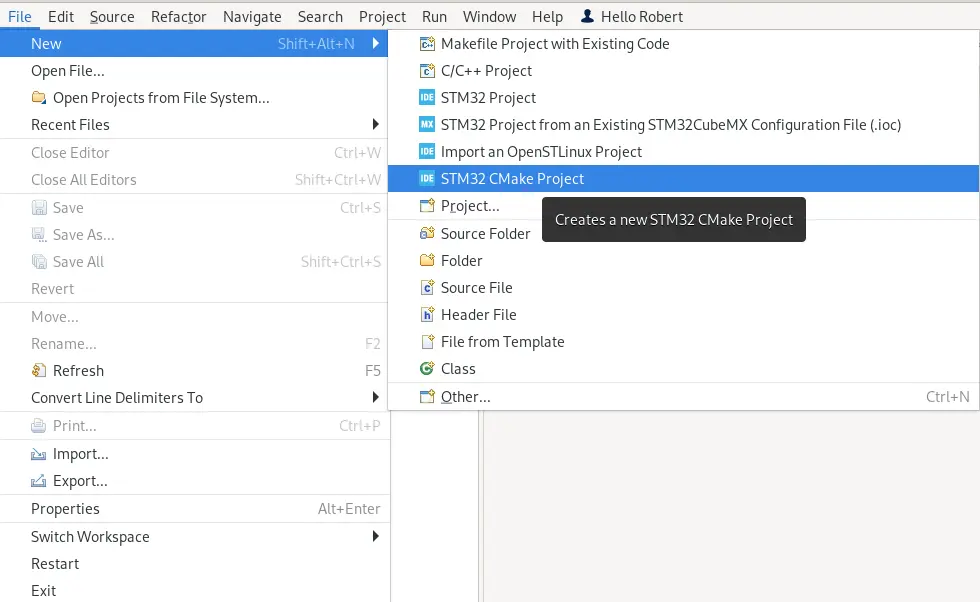
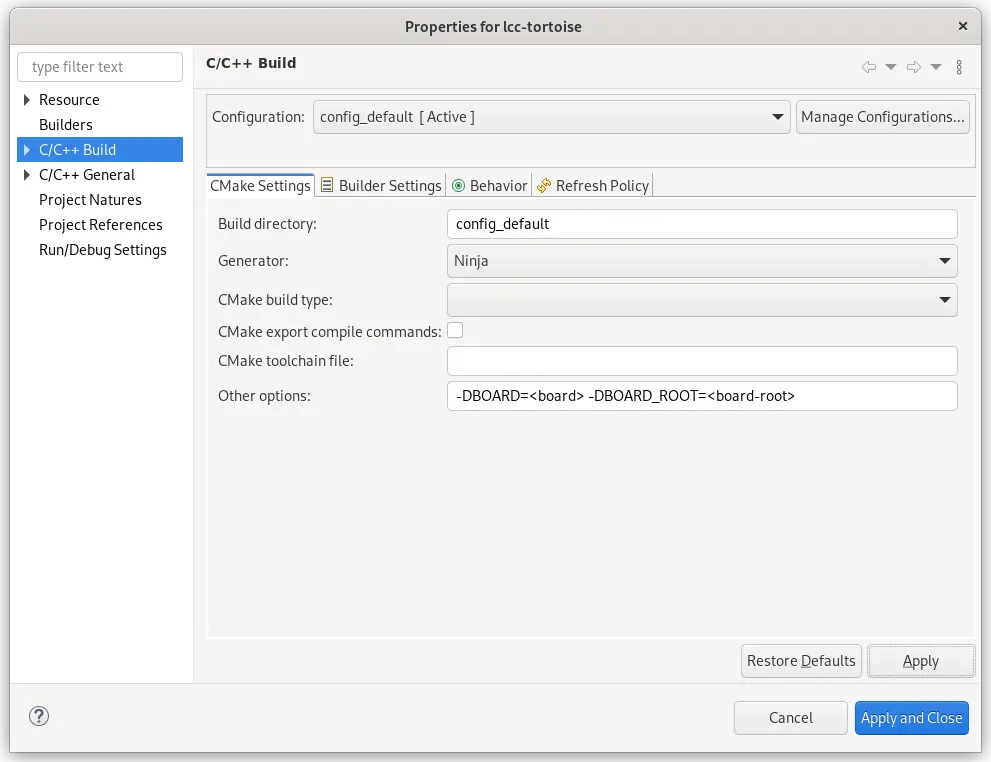
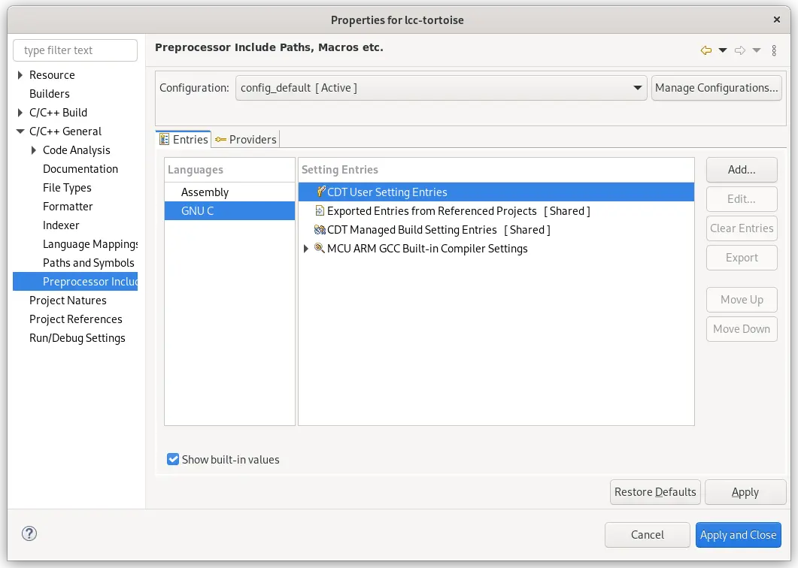
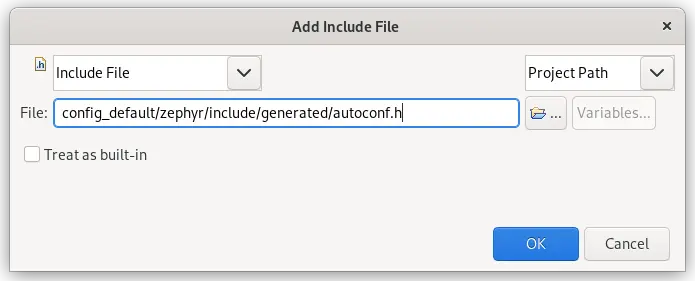
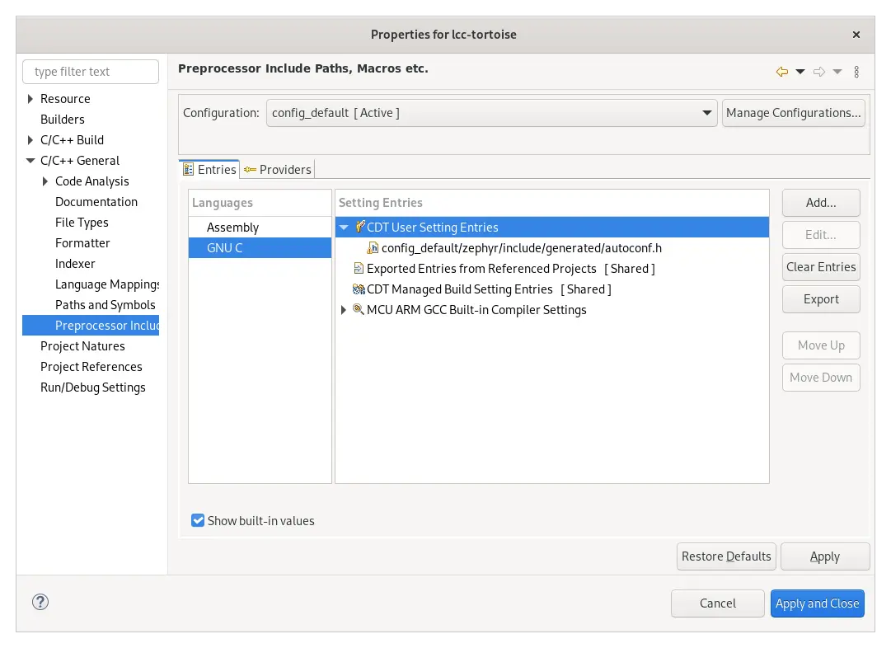
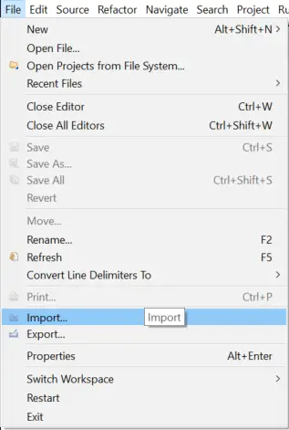
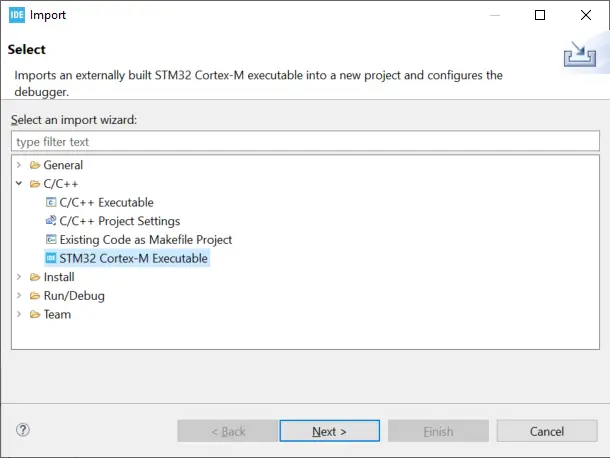

<!-- Copyright 2015-2026 Zephyr Project members and individual contributors. -->
<!-- SPDX-License-Identifier: Apache-2.0 -->
<!-- 中文翻译；编号、导航和明确标注的译注为本地新增。 -->

# 第6章\_STM32CubeIDE

原文：[官方页面](https://docs.zephyrproject.org/latest/develop/tools/stm32cubeide.html)。本次读取日期：2026-10-14；基线为保存的`latest`页面，HTML摘要见[来源记录](../SOURCES.md)。

<a id="stm32cube-ide"></a>

<a id="stm32cubeide"></a>

[STM32CubeIDE](https://www.st.com/en/development-tools/stm32cubeide.html)是STMicroelectronics基于Eclipse开发的集成开发环境（Integrated Development Environment，IDE），面向STM32系列微控制器（Microcontroller Unit，MCU）和微处理器（Microprocessor Unit，MPU）。

本指南介绍使用该IDE配置、构建和调试Zephyr应用的过程。前提是已经使用Zephyr和west创建了项目。原文说明这些步骤已在Linux上的IDE 1.16.0版本验证可用。

<a id="project-setup"></a>

## 6.1\_项目设置

1. 开始之前，请按[入门指南](../getting_started/P002_入门指南.md)准备好可用的Zephyr开发环境。
2. 从Zephyr环境启动STM32CubeIDE，例如：

```shell
$ /opt/st/stm32cubeide_1.16.0/stm32cubeide
```

> 译注：上述路径是官方的Linux安装示例，不是本仓库的位置；实际使用时按自己的IDE安装位置调整。

3. 通过 **File → New → STM32 CMake Project** 打开已有项目：



4. 选择 **Project with existing CMake sources**（使用已有CMake源码的项目），点击 **Next**。
5. 选择 **Next** 并浏览到源码位置。打开的文件夹应包含`CMakeLists.txt`和`prj.conf`。
6. 选择 **Next**，选取适当的MCU，再点击 **Finish**。项目此时应已可用，但仍需进一步配置。
7. 在工作区中右键点击新创建的项目，选择 **Properties**（属性）。
8. 前往 **C/C++ Build** 页面，将 **Generator**（生成器）设置为`Ninja`。在 **Other Options** 中按CMake参数格式指定目标`BOARD`。如果目标是树外开发板（Out-of-tree Board），还必须设置`BOARD_ROOT`。设置页面应类似下图；是否需要这些选项取决于项目是否位于源码树外。



9. 前往 **C/C++ General → Preprocessor Include** 页面。选择 **GNU C** 语言，点击 **CDT User Settings Entries**。



点击 **Add** 添加 **Include File**（包含文件），指向Zephyr的`autoconf.h`，原文给出的位置是`<build dir>/zephyr/include/generated/autoconf.h`。这样可以让STM32CubeIDE识别Zephyr配置选项。出现的对话框按下图填写：

> 译注：官方页面保留了旧的生成位置。当前仓库的[cmake/modules/kconfig.cmake](../../../cmake/modules/kconfig.cmake)将`AUTOCONF_H`默认设置为`${PROJECT_BINARY_DIR}/include/generated/zephyr/autoconf.h`；实际构建请确认生成文件的位置。此处是仓库源码对照，不把本地版本等同于官网页面版本。



添加后，属性页应类似下图：



10. 点击 **Apply and Close**（应用并关闭）。
11. 现在可以使用工具栏中的 **Build** 按钮构建项目，使用 **Run** 按钮运行项目，并使用 **Debug** 按钮调试。

<a id="debugging-only"></a>

## 6.2\_仅用于调试

如果只希望使用STM32CubeIDE调试项目，可按以下步骤操作：

1. 首先确认项目已编译，并已得到`zephyr.elf`。
2. 运行STM32CubeIDE，通过 **File → Import…** 导入项目：



3. 选择 **C/C++ → STM32 Cortex-M Executable**，然后点击 **Next**：



4. 点击 **Browse**，浏览到构建文件夹并选择`zephyr.elf`。
5. 点击 **Select** 选择MCU；如适用，还应选择CPU和／或内核。
6. 点击 **Finish**。

此时可使用 **Debug** 按钮调试项目。

<!-- reading-navigation:start -->

**主线阅读**

[上一篇：CLion](P005_CLion.md) · [本模块主线目录](../reading/developer_tools.md) · [全部主线](../reading/README.md) · [下一篇：Coccinelle](P007_Coccinelle.md)

<details>
<summary>原册编号导航（含扩展参考）</summary>

[上一章：CLion](P005_CLion.md) · [返回大纲](大纲.md) · [下一章：Coccinelle](P007_Coccinelle.md)

</details>

<!-- reading-navigation:end -->
