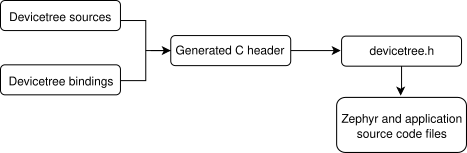

<!-- Copyright 2015-2026 Zephyr Project members and individual contributors. -->
<!-- SPDX-License-Identifier: Apache-2.0 -->

# 第2章\_设备树的范围与用途

原文：[Scope and purpose](https://docs.zephyrproject.org/latest/build/dts/intro-scope-purpose.html)。读取日期：2026-10-12，`latest`。

设备树首先是一种描述硬件的层次数据结构。[Devicetree 规范](https://www.devicetree.org/specifications/)定义其源码和二进制表示。

Zephyr 用设备树描述[支持的开发板和扩展板](https://docs.zephyrproject.org/latest/boards/index.html)上有哪些硬件，以及这些硬件的初始配置。因此对 Zephyr 而言，设备树同时是硬件描述语言和配置语言。与另一主要配置语言 Kconfig 的比较，见[设备树与Kconfig](P005_设备树与Kconfig.md)。

设备树输入分为源码和绑定两类。源码包含设备树本身；绑定描述其中内容的含义，包括数据类型。构建系统结合源码与绑定生成 C 头文件。`devicetree.h` **应用程序编程接口（Application Programming Interface，API）** 对生成内容作了抽象，使程序可以读取设备树信息。简化流程如下，图片来自官方原页：

所有 Zephyr 与应用源码都可以包含并使用 `devicetree.h`，包括设备驱动、应用、测试和内核。

API 基于 C 宏，名称都以 `DT_` 开头。在 Zephyr 源码中遇到这种宏，通常来自 `devicetree.h`。自动生成的 C 头文件中也有 `DT_` 宏，编译错误信息里可能出现它们。区分方法是：生成宏的名称含有小写字母，而 `devicetree.h` 公共宏名称全部使用大写字母。

---

<!-- reading-navigation:start -->

**主线阅读**

[上一篇：设备树介绍](P001_设备树介绍.md) · [本模块主线目录](../reading/devicetree.md) · [全部主线](../reading/README.md) · [下一篇：设备树语法与结构](P003_语法与结构.md)

原册编号导航（含扩展参考）

[上一章：设备树介绍](P001_设备树介绍.md) · [下一章：语法与结构](P003_语法与结构.md) · [返回大纲](大纲.md)

<!-- reading-navigation:end -->
