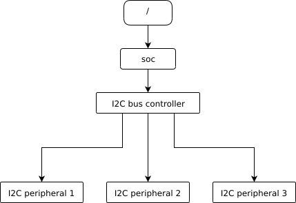
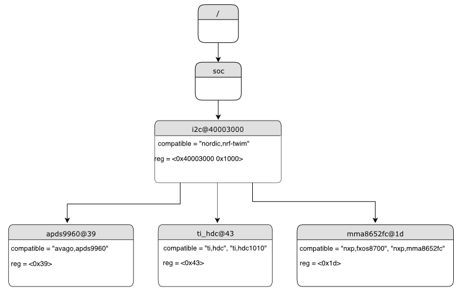

<!-- Copyright 2015-2026 Zephyr Project members and individual contributors. -->
<!-- SPDX-License-Identifier: Apache-2.0 -->
<!-- 中文翻译；阅读编号、导航和译注为本地新增。 -->

# 第3章\_设备树语法与结构

原文：[Syntax and structure](https://docs.zephyrproject.org/latest/build/dts/intro-syntax-structure.html)。读取日期：2026-10-12，`latest`。

设备树是一棵树，其可读文本格式称为 **设备树源文件（Devicetree Source，DTS）**，即 devicetree source，由 [Devicetree 规范](https://www.devicetree.org/specifications/)定义。本页用比规范更循序渐进的方式介绍它，但理解部分细节时仍需查阅规范。

## 3.1\_示例、节点与属性

下面是一个 DTS 文件：

```dts
/dts-v1/;

/ {
        a-node {
                subnode_nodelabel: a-sub-node {
                        foo = <3>;
                };
        };
};
```

`/dts-v1/;` 表示使用 DTS 第 1 版语法，它已取代过时的第 0 版。树中有三个节点：根节点 `/`，根的子节点 `a-node`，以及 `a-node` 的子节点 `a-sub-node`。

节点可以有零个、一个或多个 node label（节点标签），它们是引用该节点的唯一简写。上例 `a-sub-node` 的标签为 `subnode_nodelabel`，设备树其他位置可以通过这个标签引用它。

节点路径标识节点在树中的位置，形式类似 Unix 文件系统路径，用 `/` 分隔祖先节点和自身名称。根路径是 `/`；上例子节点完整路径为 `/a-node/a-sub-node`。

节点还可以包含属性，即名称和值的配对。值可以是任意字节序列；某些值由 cell 数组组成，一个 cell 是 32 位无符号整数。上例 `foo` 属性包含值为 3 的一个 cell，尖括号 `< >` 表明其写法和大小。

## 3.2\_节点层次反映硬件

实际设备树节点通常对应硬件，父子关系反映物理布局。例如一块板上有 **片上系统（System on Chip，SoC）** 的 **集成电路间总线（Inter-Integrated Circuit，I2C）** 控制器，连接三个 I2C 外设：



树中有控制器节点和三个外设节点；外设节点是控制器节点的子节点。其他硬件也有类似表示惯例：

```dts
/dts-v1/;

/ {
        soc {
                i2c-bus-controller {
                        i2c-peripheral-1 {
                        };
                        i2c-peripheral-2 {
                        };
                        i2c-peripheral-3 {
                        };
                };
        };
};
```

## 3.3\_实际属性与单元地址

属性通常描述或配置节点表示的硬件。例如 I2C 外设节点有一个属性指定总线地址。下图使用更接近真实硬件的名称和属性，灰色顶部是节点名，下方各行是 `name=value`：



对应 DTS：

```dts
/dts-v1/;

/ {
        soc {
                i2c@40003000 {
                        compatible = "nordic,nrf-twim";
                        reg = <0x40003000 0x1000>;

                        apds9960@39 {
                                compatible = "avago,apds9960";
                                reg = <0x39>;
                        };
                        ti_hdc@43 {
                                compatible = "ti,hdc", "ti,hdc1010";
                                reg = <0x43>;
                        };
                        mma8652fc@1d {
                                compatible = "nxp,fxos8700", "nxp,mma8652fc";
                                reg = <0x1d>;
                        };
                };
        };
};
```

节点名中 `@` 后的部分是 unit address（单元地址），如 `40003000`、`39`。它是可选的，`soc` 就没有。单元地址描述节点在**父节点地址空间**中的地址：

| 硬件类型 | 单元地址含义及例子 |
| --- | --- |
| 内存映射外设 | 寄存器映射基地址；`i2c@40003000` 的寄存器基址为 `0x40003000` |
| I2C 外设 | I2C 总线地址；`apds9960@39` 为 `0x39` |
| **串行外设接口（Serial Peripheral Interface，SPI）** 外设 | 片选线编号；没有片选线时使用 0 |
| 内存 | 物理起始地址；`memory@2000000` 从 `0x2000000` 开始 |
| 内存映射 Flash | 物理起始地址；`flash@8000000` 从 `0x8000000` 开始 |
| 固定 Flash 分区 | 分区相对于 Flash 起点的偏移 |

固定分区例子：

```dts
flash@8000000 {
    /* ... */
    partitions {
            partition@0 { /* ... */ };
            partition@20000 {  /* ... */ };
            /* ... */
    };
};
```

`partition@0` 偏移为 0，基址 `0x8000000`；`partition@20000` 基址为 `0x8020000`。

> 译注：这些是官方语法示例，寄存器、内存和 Flash 地址不是 HC32F4A0 的硬件记录，不能直接复制到本项目 SoC 描述中。

<a id="dt-important-props"></a>
<a id="important-properties"></a>

## 3.4\_重要属性

设备树规范定义了一组标准属性，下面说明其中对硬件匹配、寻址和启用状态最重要的几项。

### 3.4.1\_compatible

`compatible` 标识节点所代表的硬件。推荐形式是 `"vendor,device"`，例如 `"avago,apds9960"`，也可提供多个字符串，如 `"ti,hdc", "ti,hdc1010"`。厂商缩写见 `dts/bindings/vendor-prefixes.txt`，设备部分通常来自数据手册。

硬件行为通用时，也会采用 `gpio-keys`、`mmio-sram`、`fixed-clock` 等名称。构建系统用它匹配绑定，设备驱动通过 `devicetree.h` 查找相关 compatible 的节点，确定有哪些硬件需要管理。

多个值适用于设备既是具体型号、又属于更通用系列的情况，可让系统按从具体到通用的顺序匹配驱动。在 Zephyr 绑定语法中，该属性类型为 `string-array`。

### 3.4.2\_reg

`reg` 保存寻址信息，解释依设备而异，与 compatible 所表示的硬件相关。一般是 `(address, length)` 对组成的序列，每对称为寄存器块，值惯例上写成十六进制。

内存映射 I/O 的 address 通常是寄存器空间基址，length 是字节数；I2C 设备的 address 是从设备地址，没有 length；SPI 设备的 address 是片选线编号，也没有 length。它与单元地址相似并非巧合：单元地址指出节点位置，`reg` 更详细地描述节点内部的可寻址资源。

### 3.4.3\_status

`status` 字符串描述节点是否启用。规范允许 `"okay"`、`"disabled"`、`"reserved"`、`"fail"`、`"fail-sss"`。Zephyr 把除 `"okay"` 外的值视为禁用；其中 `"reserved"` 表示节点存在，但由别处使用，例如多 domain 应用的另一核，edtlib 对它的处理与 `"disabled"` 相同。Zephyr 当前没有使用剩余的两个 fail 值。

状态为 `"okay"` 或没有 `status` 属性，节点都视为启用；`"disabled"` 则明确禁用。物理设备节点必须启用，对应驱动模型中的 `struct device` 才能被分配和初始化。

**禁用父节点不会隐式禁用子节点**，需要时应显式禁用子节点。

### 3.4.4\_interrupts与旧label属性

`interrupts` 把设备产生的中断编码成一个或多个 interrupt specifier（中断说明项），每项由若干 cell 组成。详情见 [Devicetree 规范 v0.3](https://www.devicetree.org/specifications/)第 2.4 节。Zephyr 绑定语言可为说明项的每个 cell 命名。

早期 Zephyr 常用 `label` **属性**，它不同于标准的节点标签。新绑定不应继续增加这种属性，新代码也不推荐使用 `DT_LABEL`。现有绑定和 overlay 仍保留它通常是历史原因，不应据此沿用到新实现。

## 3.5\_属性值写法

下表介绍 DTS 写法；类型的完整说明见[设备树绑定](https://docs.zephyrproject.org/latest/build/dts/bindings.html)。为便于理解省略了少量规范细节，需要时参阅规范。

| 类型 | 写法 | 示例 |
| --- | --- | --- |
| `string` | 双引号 | `a-string = "hello, world!";` |
| `int` | 尖括号 | `an-int = <1>;` |
| `boolean` | 真值只写属性名、不赋值；假值删除属性，可用 `/delete-property/` | `my-true-boolean;` |
| `array` | 尖括号内以空格分隔 | `foo = <0xdeadbeef 1234 0>;` |
| `uint8-array` | 方括号内写不带 `0x` 的十六进制字节 | `a-byte-array = [00 01 ab];` |
| `string-array` | 逗号分隔字符串 | `a-string-array = "string one", "string two", "string three";` |
| `phandle` | 尖括号内引用节点 | `a-phandle = <&mynode>;` |
| `phandles` | 尖括号内以空格分隔节点引用 | `some-phandles = <&mynode0 &mynode1 &mynode2>;` |
| `phandle-array` | 节点引用及附加 cell，可分组 | `a-phandle-array = <&mynode0 1 2>, <&mynode1 3 4>;` |

phandle 相关类型详见[节点句柄](https://docs.zephyrproject.org/latest/build/dts/phandles.html)。布尔属性存在即真，不应带值；只有完全不存在才为假。

上表 `foo` 依次包含 `0xdeadbeef`、1234、0 三个 cell，允许混用十六进制和十进制。Zephyr 把 DTS 转换成 C 源码，不需要在此指定单个 cell 的字节序。64 位整数用两个 32 位 cell 按大端顺序写，例如 `0xaaaa0000bbbb1111` 写为 `<0xaaaa0000 0xbbbb1111>`。字节数组示例则依次是 `0x00`、`0x01`、`0xab`。

允许括号、算术和位运算，例如以下单个 cell 的值为 64；整个表达式必须用括号包围：

```dts
bar = <(2 * (1 << 5))>;
```

对于 `int` 和 `array` 类型，括号表达式结果为负的 cell，如 `<(-1)>` 或 `<(4 - 6)>`，保留为有符号值。正十进制或十六进制字面量（包括 `0xffffffff`），以及结果非负的表达式，仍为无符号值。

通过 phandle 引用其他节点，`&foo` 中 `foo` 是节点标签：

```dts
foo: device@0 { };

device@1 {
        sibling = <&foo 1 2>;
};
```

`sibling` 依次包含三个 cell：`device@0` 的 phandle（借助标签 `foo` 写成 `&foo`）、1、2。设备树中的 phandle 本身是 32 位无符号 cell；Zephyr 设备树 **应用程序编程接口（Application Programming Interface，API）** 通常把它暴露为节点标识符，详见[从 C/C++ 访问设备树](https://docs.zephyrproject.org/latest/build/dts/api-usage.html)。

数组等属性可拆成多个 `< >` 块。如果值具有逻辑分组，建议这样写以便阅读：

```dts
foo = <1 2>, <3 4>;                         // Okay for 'type: array'
foo = <&label1 &label2>, <&label3 &label4>; // Okay for 'type: phandles'
foo = <&label1 1 2>, <&label2 3 4>;         // Okay for 'type: phandle-array'
```

三行分别适用于 `array`、`phandles`、`phandle-array`，是不同属性类型的写法示例。

## 3.6\_别名与chosen节点

除节点标签外，还可以用 alias（别名）或 chosen 选择引用节点，而不写完整路径：

```dts
/dts-v1/;

/ {
     chosen {
             zephyr,console = &uart0;
     };

     aliases {
             my-uart = &uart0;
     };

     soc {
             uart0: serial@12340000 {
                     ...
             };
     };
};
```

`/aliases` 和 `/chosen` 不代表实际硬件，作用是指定树中其他节点。这里 `my-uart` 是 `/soc/serial@12340000` 的别名；同一节点通过 `uart0` 标签成为 `/chosen` 中 `zephyr,console` 属性的值。

Zephyr 示例常用别名允许通用地替换实际硬件。例如[LED 闪烁示例](../getting_started/P004_LED闪烁示例.md)用 `led0` 表示要闪烁的 **发光二极管（Light-Emitting Diode，LED）**。`/chosen` 属性则选择系统或子系统范围的对象，更多内容见[设备树 API](https://docs.zephyrproject.org/latest/build/dts/api/api.html)。

---

<!-- reading-navigation:start -->

**主线阅读**

[上一篇：设备树的范围与用途](P002_范围与用途.md) · [本模块主线目录](../reading/devicetree.md) · [全部主线](../reading/README.md) · [下一篇：设备树输入与输出文件](P004_输入与输出文件.md)

<details>
<summary>原册编号导航（含扩展参考）</summary>

[上一章：范围与用途](P002_范围与用途.md) · [下一章：输入与输出文件](P004_输入与输出文件.md) · [返回大纲](大纲.md)

</details>

<!-- reading-navigation:end -->
