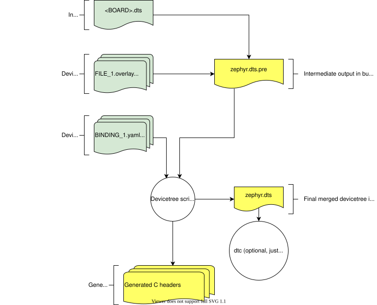

<!-- Copyright 2015-2026 Zephyr Project members and individual contributors. -->
<!-- SPDX-License-Identifier: Apache-2.0 -->
<!-- 中文翻译；阅读编号、导航和译注为本地新增。 -->

<a id="devicetree-in-out-files"></a>

# 第4章\_设备树输入与输出文件

原文：[Input and output files](https://docs.zephyrproject.org/latest/build/dts/intro-input-output.html)。读取日期：2026-10-12，`latest`。

本页进一步说明[范围与用途](P002_范围与用途.md)流程中的文件。官方图中绿色是输入，黄色是输出：



## 4.1\_输入文件

共有四类输入：源码 `.dts`、包含文件 `.dtsi`、覆盖文件 `.overlay`、绑定 `.yaml`。原文给出的 Zephyr 目录示意为：

```text
boards/<ARCH>/<BOARD>/<BOARD>.dts
dts/common/skeleton.dtsi
dts/<ARCH>/.../<SOC>.dtsi
dts/bindings/.../binding.yaml
```

> 译注：首行是原页残留的旧式板目录示意；当前板通常位于 `boards/<VENDOR>/<BOARD>/`。原页紧接着的 `boards/phytec/reel_board/reel_board.dts` 已采用厂商目录。不得据旧占位符为本项目新建架构级板目录。

通常每个板有描述硬件的 `BOARD.dts`，例如 reel_board 的上述文件。它包含一个或多个 `.dtsi`，描述 **中央处理器（Central Processing Unit，CPU）**/**片上系统（System on Chip，SoC）**，也可能继续包含其他 `.dtsi`，或描述多个板共享的硬件；此外，`BOARD.dts` 自身还描述板专用硬件。

`dts/common/skeleton.dtsi` 提供组成完整设备树的最小定义，架构目录 `dts/<ARCH>` 中的 CPU/SoC 文件在此基础上扩展。所有设备树文件都经过 C 预处理以展开宏；虽然 **设备树源文件（Devicetree Source，DTS）** 有 `/include/ "<filename>"` 语法，通常仍用 `#include <filename>` 包含文件。

overlay 可以扩展或修改 `BOARD.dts`；它本身也是 DTS，`.overlay` 扩展名只是表明用途的惯例。应用可用它启用默认禁用的外设、选择特定传感器等。与 Kconfig 配合，就能不改源码而重新配置内核和设备驱动。扩展板（shield）定义也会使用 overlay。

构建系统自动发现特定位置的 `.overlay`，也可通过 CMake 变量 `DTC_OVERLAY_FILE` 显式列出，详见[设置 overlay](https://docs.zephyrproject.org/latest/build/dts/howtos.html#set-devicetree-overlays)。

构建系统把 `BOARD.dts` 与 overlay 连接起来，overlay 放在后面。DTS 允许合并重复定义的节点，因此后面的内容可覆盖板默认值。[FRDM-K64F 与 Hexiwear K64 示例](https://docs.zephyrproject.org/latest/build/dts/design.html)虽然展示 `.dtsi`，但合并原理相同。

YAML 绑定是源码与程序接口之间的衔接：它解释 DTS、DTSI、overlay 的内容，让构建系统生成设备驱动和应用可使用的 C 宏。绑定存放在 `dts/bindings`。

## 4.2\_脚本与工具

原文列出 `scripts/dts/` 相关库和脚本，其源码包含详细说明：

| 库或脚本 | 职责 |
| --- | --- |
| `dtlib.py` | 底层 DTS 解析库 |
| `edtlib.py` | 基于 dtlib，结合绑定解释属性，提供更高层设备树视图；DTS 解析仍由 dtlib 完成 |
| `gen_defines.py` | 使用 edtlib，从设备树和绑定生成 C 预处理宏 |

若系统安装了标准 `dtc`（devicetree compiler），还会用它检查最终设备树的警告或错误，但不使用其输出。板可能需要向 dtc 传额外标志，例如关闭某条警告；可以在板目录的 `pre_dt_board.cmake` 写入：

```cmake
list(APPEND EXTRA_DTC_FLAGS "-Wno-simple_bus_reg")
```

扩展板目录的 `pre_dt_shield.cmake` 具有相同作用。

## 4.3\_输出文件

以下文件由构建系统生成在应用构建目录中。**不要直接包含自动生成头文件**，应使用[从 C/C++ 访问设备树](https://docs.zephyrproject.org/latest/build/dts/api-usage.html)介绍的 **应用程序编程接口（Application Programming Interface，API）**。

| 文件 | 内容与用途 |
| --- | --- |
| `<build>/zephyr/zephyr.dts.pre` | 预处理后的 DTS 中间文件；作为 `gen_defines.py` 输入，生成最终 DTS 和头文件 |
| `<build>/zephyr/include/generated/zephyr/devicetree_generated.h` | 自动生成的宏及描述设备树的注释；由 `devicetree.h` 包含 |
| `<build>/zephyr/zephyr.dts` | `gen_defines.py` 输出的最终合并设备树，适合排查问题；安装了 dtc 时还会检查它 |

---

<!-- reading-navigation:start -->

**主线阅读**

[上一篇：设备树语法与结构](P003_语法与结构.md) · [本模块主线目录](../reading/devicetree.md) · [全部主线](../reading/README.md) · [下一篇：设备树与 Kconfig 的分工](P005_设备树与Kconfig.md)

<details>
<summary>原册编号导航（含扩展参考）</summary>

[上一章：语法与结构](P003_语法与结构.md) · [下一章：设备树与Kconfig](P005_设备树与Kconfig.md) · [返回大纲](大纲.md)

</details>

<!-- reading-navigation:end -->
