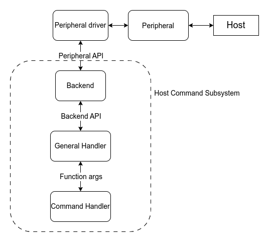
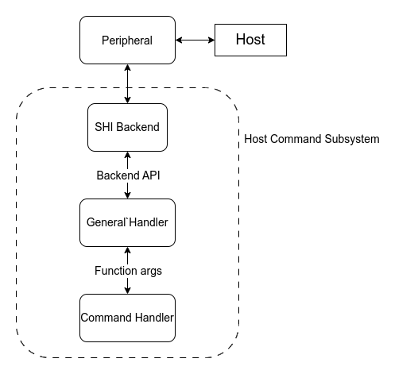

<!-- Copyright 2015-2026 Zephyr Project members and individual contributors. -->
<!-- SPDX-License-Identifier: Apache-2.0 -->
<!-- 中文翻译；阅读编号、导航和译注为本地新增。 -->

# 第20章\_EC主机命令

原文：[EC Host Command](https://docs.zephyrproject.org/latest/services/device_mgmt/ec_host_cmd.html)。读取日期：2026-10-13，`latest`。

## 20.1\_主机与嵌入式控制器

**主机命令（Host Command）**协议定义主机或应用处理器与目标**嵌入式控制器（Embedded Controller，EC）**之间的通信接口。Zephyr的EC主机命令子系统实现目标端：接收主机命令并生成响应。协议存在多个版本，但本实现仅支持第3版。

## 20.2\_常规处理架构

子系统包含**后端（Backend）**、**通用处理器（General Handler）**和**命令处理器（Command Handler）**。后端位于外设驱动和通用处理器之间，负责经选定外设发送、接收命令。通用处理器验证后端数据的长度、校验和等；命令有效且应用提供了对应命令编号的处理器时，调用该处理器。



图中 Host 是主机，Peripheral 是外设，Peripheral Driver 是外设驱动；虚线框内是Host Command Subsystem（主机命令子系统）。**应用程序编程接口（Application Programming Interface，API）**连接相邻层，Function args（函数参数）连接通用处理器和命令处理器。双向箭头表示命令接收及响应返回路径。

## 20.3\_专用串行主机接口

**串行主机接口（Serial Host Interface，SHI）**专用于与主机通信，没有独立外设API，因此把后端与外设驱动合并到一个后端层。



图中的SHI Backend直接连接外设，通用处理器与命令处理器仍保留；与上一图相比，变化是底层外设访问并入后端。

## 20.4\_SPI后端与设备树

**串行外设接口（Serial Peripheral Interface，SPI）**也需要专用后端。当前SPI API不能满足主机命令通信：主机发送的命令长度预先未知，而普通事务要求指定字节数；协议还需要持续发送状态字节，普通SPI模块却按事务启停。因此SPI驱动实现放进后端，与SHI类似，每个芯片系列需提供自己的SPI后端。将来SPI API若扩展可改变这一安排，见[官方讨论](https://github.com/zephyrproject-rtos/zephyr/issues/56091)。

这要求调整**设备树源码（Devicetree Source，DTS）**节点的 `compatible` 属性，选择主机命令版本的SPI驱动，其余属性按通常方式配置。下面是STM32原例：

`dmas` 与 `dma-names` 为收发方向配置 **直接存储器访问（Direct Memory Access，DMA）**；`cs-gpios` 指定从机的**片选（Chip Select，CS）**引脚。**通用输入输出（General-Purpose Input/Output，GPIO）**标志 `GPIO_ACTIVE_LOW` 表示低电平有效，`GPIO_PULL_UP` 表示上拉。这些控制器、通道和引脚只属于原STM32示例，不能直接作为HC32接线或DMA映射。

```dts
&spi1 {
        /* Change the compatible string to use the Host Command version of the
         * STM32 SPI driver
         */
        compatible = "st,stm32-spi-host-cmd";
        status = "okay";

        dmas = <&dma2 3 3 0x38440 0x03>,
             <&dma2 0 3 0x38480 0x03>;
        dma-names = "tx", "rx";
        /* This field is used to point at our CS pin */
        cs-gpios = <&gpioa 4 (GPIO_ACTIVE_LOW | GPIO_PULL_UP)>;
};
```

STM32后端还支持绑定名称 [`st,stm32h7-spi`](../spi_stm32_ti_xilinx_binding_reference/P013_st_stm32h7-spi.md#std-dtcompatible-st-stm32h7-spi) 与 [`st,stm32-spi-fifo`](../spi_stm32_ti_xilinx_binding_reference/P009_st_stm32-spi-fifo.md#std-dtcompatible-st-stm32-spi-fifo)。需要相应变体时添加对应兼容字符串；例如启用 **先进先出缓冲（First In, First Out，FIFO）**及STM32H7 **片上系统（System on Chip，SoC）**支持：

```dts
&spi1 {
    compatible = "st,stm32h7-spi", "st,stm32-spi-fifo", "st,stm32-spi-host-cmd";
    ...
};
```

运行Zephyr的芯片是SPI从机，`cs-gpios` 指向它自己的片选脚；还必须设置后端选择节点 `zephyr,host-cmd-spi-backend`。省略号表示其他实际节点属性，并非可直接编译的完整节点。

## 20.5\_支持的后端

支持的后端和外设驱动如下：

- 模拟器（Simulator）。
- SHI：ITE与NPCX平台，名称为厂商/实现家族标识。
- **增强型串行外设接口（Enhanced Serial Peripheral Interface，eSPI）**：支持Kconfig配置项 [`CONFIG_ESPI_PERIPHERAL_EC_HOST_CMD`](https://docs.zephyrproject.org/latest/kconfig.html#CONFIG_ESPI_PERIPHERAL_EC_HOST_CMD) 和 [`CONFIG_ESPI_PERIPHERAL_CUSTOM_OPCODE`](https://docs.zephyrproject.org/latest/kconfig.html#CONFIG_ESPI_PERIPHERAL_CUSTOM_OPCODE) 的任意eSPI从机驱动。
- **通用异步收发器（Universal Asynchronous Receiver/Transmitter，UART）**：支持异步API的任意UART驱动。
- SPI：STM32。

## 20.6\_初始化与缓冲区

若应用配置下列任一个后端 `chosen` 选择节点，并启用Kconfig配置项 [`CONFIG_EC_HOST_CMD_INITIALIZE_AT_BOOT`](https://docs.zephyrproject.org/latest/kconfig.html#CONFIG_EC_HOST_CMD_INITIALIZE_AT_BOOT)，相应后端通过函数 [`ec_host_cmd_init()`](https://docs.zephyrproject.org/latest/doxygen/html/group__ec__host__cmd__interface.html#gaab1fdcb0fd13a19447d262d496b8aed9) 初始化子系统：

- `zephyr,host-cmd-espi-backend`
- `zephyr,host-cmd-shi-backend`
- `zephyr,host-cmd-uart-backend`
- `zephyr,host-cmd-spi-backend`

没有后端选择节点时，应用必须直接调用 [`ec_host_cmd_init()`](https://docs.zephyrproject.org/latest/doxygen/html/group__ec__host__cmd__interface.html#gaab1fdcb0fd13a19447d262d496b8aed9)。这适用于运行时选择后端，例如依据GPIO状态选择。**译注：**自动初始化有“节点配置”和“启动初始化选项”两个条件，不能只配置节点就假定已经初始化。

通信需要**接收（Receive，RX）**和**发送（Transmit，TX）**缓冲区。Kconfig配置项 [`CONFIG_EC_HOST_CMD_HANDLER_RX_BUFFER_SIZE`](https://docs.zephyrproject.org/latest/kconfig.html#CONFIG_EC_HOST_CMD_HANDLER_RX_BUFFER_SIZE) 大于0时由通用处理器提供接收缓冲；[`CONFIG_EC_HOST_CMD_HANDLER_TX_BUFFER_SIZE`](https://docs.zephyrproject.org/latest/kconfig.html#CONFIG_EC_HOST_CMD_HANDLER_TX_BUFFER_SIZE) 大于0时提供发送缓冲。多后端应用共享缓冲可以减少每个后端各自分配所需的内存。eSPI等外设驱动也可能提供缓冲，应尽可能复用。

## 20.7\_日志与接口

内置日志记录通信活动。日志宏 [`LOG_INF`](../log_core_reference/P002_日志公共接口.md#ga9c338f3170acf38a8532d1181d26704e) 记录新命令编号与非成功响应，重复的同一命令不重复记录；宏 [`LOG_DBG`](../log_core_reference/P002_日志公共接口.md#gafb97e6291db24665313453d192941330) 记录每条命令，包括重复命令。调试日志配合Kconfig配置项 [`CONFIG_EC_HOST_CMD_LOG_DBG_BUFFERS`](https://docs.zephyrproject.org/latest/kconfig.html#CONFIG_EC_HOST_CMD_LOG_DBG_BUFFERS) 时，还记录请求、响应的数据缓冲内容。

完整接口见[EC主机命令API](https://docs.zephyrproject.org/latest/doxygen/html/group__ec__host__cmd__interface.html)。

<!-- reading-navigation:start -->

**主线阅读**

[上一篇：Zephyr管理组](P019_Zephyr管理组.md) · [本模块主线目录](../reading/firmware_update.md) · [全部主线](../reading/README.md)

<details>
<summary>原册编号导航（含扩展参考）</summary>

[上一章：Zephyr管理组](P019_Zephyr管理组.md) · [下一章：管理示例入口](P021_管理示例入口.md) · [返回大纲](大纲.md)

</details>

<!-- reading-navigation:end -->
