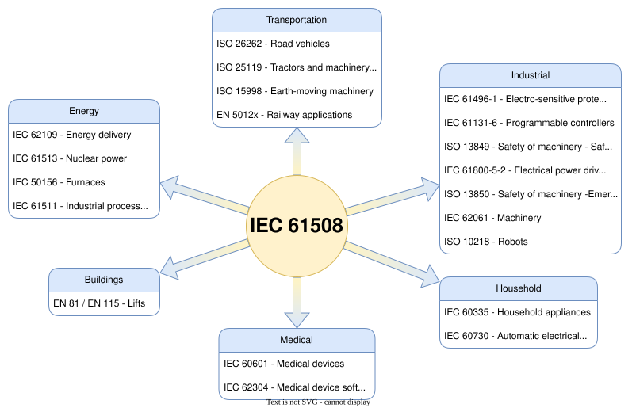
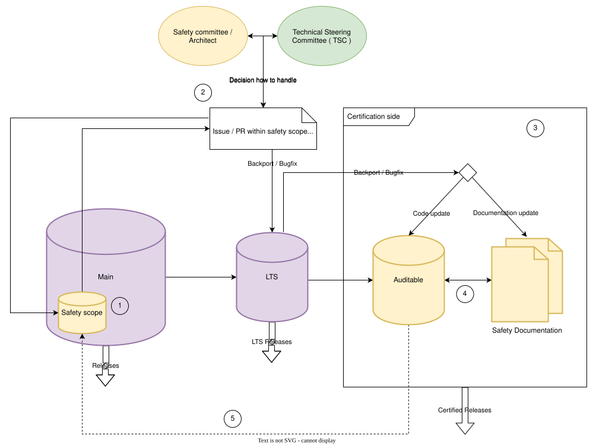

<!-- Copyright 2015-2026 Zephyr Project members and individual contributors. -->
<!-- SPDX-License-Identifier: Apache-2.0 -->
<!-- 中文翻译；编号、导航和明确标注的译注为本地新增。 -->

# 第2章\_Zephyr 功能安全概述（Zephyr Safety Overview）

原文：[官方页面](https://docs.zephyrproject.org/latest/safety/safety_overview.html)。快照读取日期：2026-10-15；来源摘要见[来源记录](../SOURCES.md)。

## 2.1 引言（Introduction）

本文是安全文档，概述安全相关活动，以及 Zephyr 项目和安全工作组／委员会希望实现的目标。

本概述面向对 Zephyr RTOS 功能安全（Functional Safety）开发感兴趣的读者，以及希望为项目安全工作作出贡献的成员。

## 2.2 概述（Overview）

本节说明安全认证的总体目标、拟达到的标准，以及实现认证所需的质量标准和流程。

## 2.3 安全文档更新（Safety Document update）

本文持续维护，可能随着新需求、指南或流程的引入而演变。

1. 相关方通过拉取请求（Pull Request，PR）向 Zephyr 文档仓库提交变更。

2. Zephyr 安全委员会审查变更，给出反馈或接受变更。

3. 通过审查后，变更成为文档的一部分。

## 2.4 总体安全范围（General safety scope）

安全委员会的总体目标，是针对有限的源码范围取得 [IEC 61508](https://en.wikipedia.org/wiki/IEC_61508) 标准的安全完整性等级（Safety Integrity Level，SIL）3／系统性能力（Systematic Capability，SC）3 认证；认证范围仍待确定（TBD）。由于代码库已经存在，项目采用 IEC 61508 定义的 3s／1s 路线。

> 译注——目标与结果：本段描述有限源码范围的认证目标，原文的范围 TBD 仍未给出具体清单。SIL 3／SC 3、路线名称及后续质量指标均是本页的说明，不是本次翻译得出的认证结论。

3s 路线（Route 3s）

评估未按标准合规流程开发的软件，基本上是在已有源码基础上应用 1s 路线。

1s 路线（Route 1s）

合规开发：遵循该标准的要求，避免并控制软件中的系统性故障（Systematic fault）。

### 2.4.1 IEC 61508 标准概述（Summarization）

IEC 61508 是广泛认可的国际标准，涉及电气、电子和可编程电子安全相关系统的功能安全。以下概述其主要安全方面：

1. 危害与风险分析（Hazard and Risk Analysis）：全面分析系统的潜在危害与风险，确定适当的安全措施，使风险降低到可接受水平。

2. 安全完整性等级（SIL）：按照每项安全功能所需的风险降低程度分级。SIL 越高，所要求的风险降低程度越大。

3. 系统设计（System Design）：采用系统化设计方法，包括识别安全需求、制定安全计划，以及选用适当的安全技术与措施，确保系统达到所需 SIL。

4. 验证与确认（Verification and Validation）：严格测试和评估安全相关系统，确认满足指定 SIL 及其他安全要求。包括验证系统设计、确认系统功能，以及持续监测和维护。

5. 文档与可追溯性（Documentation and Traceability）：全面记录安全相关系统的各个方面，建立从安全需求到最终设计与实现的完整追溯关系。

总体而言，IEC 61508 为安全相关系统的设计、开发和实施提供框架，旨在降低事故风险、改善整体安全。遵循该标准有助于组织按最高水平的安全完整性要求设计并实现安全相关系统。

### 2.4.2 为什么选择 IEC 61508？

选择 IEC 61508，是因为它是跨行业适用的基础功能安全标准，提供的框架可作为不同领域专用标准的基础。Zephyr 可用于多种行业，这一特点使 IEC 61508 尤其适合作为其基础标准。

下图展示 IEC 61508 与其他相关标准的关系：

> 译注——图中文字：原始 SVG 保持不变，包括完整文字、截短回退标签和查看器提示。下表按原图解释，不作为相关标准的完整标题、版本清单或合规结论。

| 原图英文 | 中文含义 |
| --- | --- |
| IEC 61508 | IEC 61508（图中基础功能安全标准） |
| Industrial | 工业 |
| IEC 61496-1 - Electro-sensitive protective equipment/light barrier | IEC 61496-1：电敏保护设备／光栅 |
| IEC 61496-1 - Electro-sensitive prote... | 原图的截短回退文字；完整标签含义：IEC 61496-1：电敏保护设备／光栅 |
| IEC 61131-6 - Programmable controllers | IEC 61131-6：可编程控制器 |
| ISO 13849 - Safety of machinery - Safety-related parts of control systems | ISO 13849：机械安全——控制系统安全相关部件 |
| ISO 13849 - Safety of machinery - Saf... | 原图的截短回退文字；完整标签含义：ISO 13849：机械安全——控制系统安全相关部件 |
| IEC 61800-5-2 - Electrical power drive systems | IEC 61800-5-2：电力驱动系统 |
| IEC 61800-5-2 - Electrical power driv... | 原图的截短回退文字；完整标签含义：IEC 61800-5-2：电力驱动系统 |
| ISO 13850 - Safety of machinery -Emergency stop | ISO 13850：机械安全——紧急停止 |
| ISO 13850 - Safety of machinery -Emer... | 原图的截短回退文字；完整标签含义：ISO 13850：机械安全——紧急停止 |
| IEC 62061 - Machinery | IEC 62061：机械 |
| ISO 10218 - Robots | ISO 10218：机器人 |
| Energy | 能源 |
| IEC 62109 - Energy delivery | IEC 62109：能源供给（按原图简写） |
| IEC 61513 - Nuclear power | IEC 61513：核电 |
| IEC 50156 - Furnaces | IEC 50156：炉窑（保留原图标准前缀） |
| IEC 61511 - Industrial processes | IEC 61511：工业过程 |
| IEC 61511 - Industrial process... | 原图的截短回退文字；完整标签含义：IEC 61511：工业过程 |
| Household | 家用领域 |
| IEC 60335 - Household appliances | IEC 60335：家用电器 |
| IEC 60730 - Automatic electrical controls | IEC 60730：自动电气控制 |
| IEC 60730 - Automatic electrical... | 原图的截短回退文字；完整标签含义：IEC 60730：自动电气控制 |
| Medical | 医疗 |
| IEC 60601 - Medical devices | IEC 60601：医疗设备 |
| IEC 62304 - Medical device software | IEC 62304：医疗设备软件 |
| IEC 62304 - Medical device soft... | 原图的截短回退文字；完整标签含义：IEC 62304：医疗设备软件 |
| Buildings | 建筑 |
| EN 81 / EN 115 - Lifts | EN 81／EN 115：升降设备（按原图简写） |
| Transportation | 交通运输 |
| ISO 26262 - Road vehicles | ISO 26262：道路车辆 |
| ISO 25119 - Tractors and machinery for agriculture and foresty | ISO 25119：农业和林业拖拉机及机械（foresty 为原图拼写） |
| ISO 25119 - Tractors and machinery... | 原图的截短回退文字；完整标签含义：ISO 25119：农业和林业拖拉机及机械（foresty 为原图拼写） |
| ISO 15998 - Earth-moving machinery | ISO 15998：土方机械 |
| EN 5012x - Railway applications | EN 5012x：铁路应用 |
| Text is not SVG - cannot display | 文字不是 SVG，无法显示；这是原图查看器兼容性提示 |

**IEC 61508 与其他标准的关系（IEC 61508 relation to other standards）**

## 2.5 质量（Quality）

软件质量是整个行业的基本要求。项目代码库必须达到多项质量目标，才能从安全角度成为可审计的代码库并用于认证。软件质量并非功能安全标准额外施加的要求；功能安全将质量视为既有前提，因此任何项目都应追求“质量受管理”（Quality managed）状态，不论其是否有功能安全目标。以下列出实现可审计代码库所需的质量目标：

1. 基本软件质量标准（Basic software quality standards）

  1. [编码指南（Coding Guidelines）](../contributing/P009_编码准则.md#coding-guidelines)，包括静态代码分析、编码风格等。

  2. [安全需求（Safety Requirements）](P004_安全需求.md#safety-requirements)与需求追溯（Requirements tracing）。

  3. 测试覆盖率（Test coverage）

2. 软件架构设计原则（Software architecture design principles）

  1. 分层架构模型（Layered architecture model）

  2. 封装的组件（Encapsulated components）

  3. 封装的独立功能（Encapsulated single functionality），用于隔离不适合安全要求或难以管理的功能。

### 2.5.1 从安全角度看基本软件质量标准

本节由安全委员会说明，为什么上述质量目标是前提，以及如何使代码库从安全角度具备可审计性。概括而言，这些安全相关质量措施用于降低代码开发过程中的错误率。

#### 2.5.1.1 编码指南（Coding Guidelines）

编码指南为工业软件产品建立共同理解、统一规则和开发风格。对于安全，它不仅用于统一规则，还必须证明开发者遵循一致的开发方式，以预防开发过程中的系统性错误，降低整个软件系统的总体错误率。

IEC 61508 也将采用编码标准／指南作为降低出错可能性的前提和建议。

项目技术指导委员会（Technical Steering Committee，TSC）与安全委员会同意，分阶段、逐步推进编码规则（即编码指南）的符合性，以改善代码库质量和一致性。约定阶段如下：

第一阶段（Stage I，已完成）

已提供可遵循和引用的编码规则，但尚不强制执行。持续集成（Continuous Integration，CI）尚未强制检查，评审者／批准者不能仅因违反规则而阻止 PR。

第二阶段（Stage II）

对代码库任意位置的 PR，评审者／批准者可以因其违反编码指南而阻止合入。

开始在有限范围内强制执行，最初范围为安全认证所涉及的代码。对于容易应用到全库的规则，不应限制在最初范围内。此阶段需要工具、CI 配置和执行策略。

第三阶段（Stage III）

根据前几阶段的经验重新评估编码规则，完善和迭代所选规则。

第四阶段（Stage IV）

将强制执行扩展到更广的代码范围。特定部分可以在具有充分理由时获准例外，例外需经 TSC 批准。

注意（Note）

可以随时提交 GitHub 问题（Issue）／意见征求稿（RFC），申请删除或修改编码规则。

重要（Important）

当前阶段：正在研究完成第二阶段的前提，评估工具，并推进 CI 配置和[执行策略](https://github.com/zephyrproject-rtos/zephyr/issues/58903)。

> 译注——阶段状态：本句与“第一阶段已完成”等标记保留官方快照的陈述。它不是对当前所有 CI 规则或 PR 审批实践的独立核验。

#### 2.5.1.2 需求与需求追溯（Requirements and requirements tracing）

需求及其管理不仅对软件开发重要，对安全也至关重要。一方面，它们在技术层面详细描述软件应做什么；另一方面，它们是验证功能是否按预期实现的必要工具，因此需要将需求追溯到代码层面。建立需求管理和追溯后，即可检查功能是否正确实现并得到测试，从而降低系统性错误率。

IEC 61508 强烈建议采用需求及需求追溯，对认证而言，这相当于不可缺少的条件。

#### 2.5.1.3 测试覆盖率（Test coverage）

高测试覆盖率提供证据，说明代码符合预定用途且不会执行未预期的指令。整个代码库经过测试并达到较高覆盖率（理想值为 100%），还便于快速发现错误变更，进一步降低错误率。不过，安全目标对覆盖率有不同要求，需要考虑 IEC 61508 针对 SIL 3／SC 3 规定的多种指标，其中包括：

> 译注——证据的含义：高覆盖率用于说明测试执行到了哪些结构，不能单独证明系统没有故障、满足所有需求或已经取得安全认证。此处按官方说明保留指标，需与需求验证、分析和其他认证证据一起理解。

- 结构测试覆盖率——入口点（Entry points）：100%。

- 结构测试覆盖率——语句（Statements）：100%。

- 结构测试覆盖率——分支（Branches）：100%。

无法达到 100% 时，例如防御性代码的语句覆盖，应在文档中说明相应部分并给出理由。

### 2.5.2 软件架构设计原则（Software architecture design principles）

为创建和维护结构清晰的软件，还需要考虑各项架构设计，并按安全标准实施，因为有些设计和实现不适合安全目标。这样，整个软件和代码库才能用于审计。Zephyr 已实现其中大部分架构设计，但仍需安全委员会／工作组及安全架构师验证。

#### 2.5.2.1 分层架构模型（Layered architecture model）

IEC 61508 强烈建议采用模块化软件架构。Zephyr 从一开始就采用分层架构，将功能相近的模块或组件组织到同一层，使每层在系统中承担明确角色。从安全角度，这种模型能在高层展示组件和层之间的接口，帮助确定并限定安全相关功能，还可作为多种分析和文档的基础，这些都是认证及认证机构所需的材料。

#### 2.5.2.2 封装的组件（Encapsulated components）

组件封装是安全架构的重要组成部分。最关键的是将安全相关组件与非安全相关组件分离，包括它们的接口，以确保组件不会对其他组件产生不利影响。

#### 2.5.2.3 封装的独立功能（Encapsulated single functionality），用于隔离安全上不合理或难以管理的功能

系统及软件环境还应允许禁用组件中的某些独立功能。如果某项功能在安全上完全不可接受，例如完整的动态内存管理，则应能将其关闭。Zephyr 已通过 Kconfig 及灵活配置提供这种能力。

## 2.6 流程与工作流（Processes and workflow）

> 译注——图中文字：原始 SVG 保持不变，包括完整文字、截短回退标签和查看器提示。下表按原图解释，不作为相关标准的完整标题、版本清单或合规结论。

| 原图英文 | 中文含义 |
| --- | --- |
| Certification side | 认证侧 |
| Releases | 发布版本 |
| Main | 主分支 |
| LTS Releases | 长期支持发布版本 |
| LTS | 长期支持（Long-Term Support） |
| Safety scope | 安全范围 |
| Backport / Bugfix | 回移／缺陷修复 |
| Issue / PR within safety scope or safety relevance | 处于安全范围内或与安全有关的 Issue／PR |
| Issue / PR within safety scope... | 原图的截短回退文字；完整标签含义：处于安全范围内或与安全有关的 Issue／PR |
| Auditable | 可审计分支 |
| Decision how to handle | 决定处理方式 |
| Safety committee / | 安全委员会／ |
| Architect | 架构师 |
| Safety Documentation | 安全文档 |
| Code update | 代码更新 |
| Documentation update | 文档更新 |
| Certified Releases | 经过认证的发布版本 |
| 1 | 步骤 1 |
| 2 | 步骤 2 |
| 3 | 步骤 3 |
| 4 | 步骤 4 |
| 5 | 步骤 5 |
| Technical Steering | 技术指导 |
| Committee ( TSC ) | 委员会（TSC） |
| Text is not SVG - cannot display | 文字不是 SVG，无法显示；这是原图查看器兼容性提示 |

**安全流程与工作流概览（Safety process and workflow overview）**

图中展示安全委员会为 Zephyr 开发定义的总体安全流程。为帮助理解，需要突出若干要点，说明安全架构师和安全委员会的职责。图中只描述变更涉及安全时可能采用的路径。

1. 应在 main 分支上识别项目安全范围，它通常只占整个代码库的一小部分。在 main 的正常开发过程中，使这部分代码达到可审计状态，即对其质量目标（Quality）和安全流程给予特别关注。安全架构师与 TSC 协同监测开发过程，确保架构满足安全要求。 相关链接：[质量（Quality）](#quality)。

2. 此时安全架构师的作用愈加重要。对安全范围内的 PR／Issue，理想情况下应参与小幅变更的讨论和决策，以便及时处理不符合要求的安全相关变更。若变更或改进影响重大，需要更充分讨论或决策，应视情况提交安全委员会或 TSC，由其决定处理方式。

3. 这一部分描述认证侧的工作。代码库此时必须处于可审计状态，理想情况下不应再需要或进行修改。仍保留从 main 到此处的路径，以处理长期支持（Long-Term Support，LTS）分支与可审计分支创建后，在 main 安全范围中发现的严重缺陷或重要变更。安全委员会和架构师必须决定是否将修复／变更集成到 LTS，再集成到可审计分支。集成可仅修改代码、仅更新安全文档，或同时修改两者。

4. 此处描述认证本身所需的安全流程：完成认证机构及目标标准要求的最终分析、测试和文档。如果认证机构在此阶段批准全部内容，且安全流程完成，即可创建并发布安全版本。

5. 从可审计分支回到 main 的路径只应在例外情况下使用，例如认证过程中发现问题，为取得认证，必须先在可审计分支迅速修正。为了下次认证不再遇到同一问题，必须有路径将这些修改合回 main，避免变更丢失，并为后续认证保留成果。

重要（Important）

安全工作不应阻碍项目，也不应限制项目的发展空间。

重要（Important）

待办（TODO）：寻找并定义既适合安全目标、又尽量不影响维护者、评审者、贡献者和安全架构师日常工作的办法、指南及流程。

对应官方文档源码：[doc/safety/safety_overview.rst](https://raw.githubusercontent.com/zephyrproject-rtos/zephyr/main/doc/safety/safety_overview.rst)。

> 译注——源码跟踪：本仓库[对应源码](../../../doc/safety/safety_overview.rst)可用于对照，版本可能与网页不同。本批仅翻译和核对文档，未安装或运行需求工具、生成认证材料或连接设备。

<!-- reading-navigation:start -->

**主线阅读**

[上一篇：功能安全总览](P001_功能安全总览.md) · [本模块主线目录](../reading/functional_safety.md) · [全部主线](../reading/README.md) · [下一篇：安全需求管理](P003_安全需求管理.md)

原册编号导航（含扩展参考）

[上一章](P001_功能安全总览.md) · [返回大纲](大纲.md) · [下一章](P003_安全需求管理.md)

<!-- reading-navigation:end -->
