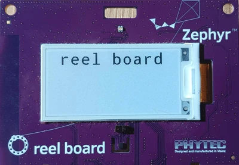

<!-- Copyright 2015-2026 Zephyr Project members and individual contributors. -->
<!-- SPDX-License-Identifier: Apache-2.0 -->
<!-- 本文件为中文翻译；章节编号、导航和明确标出的译注为本地新增。 -->

<a id="getting-started"></a>

# 第2章\_入门指南

原文：[Getting Started Guide](https://docs.zephyrproject.org/latest/develop/getting_started/index.html)。译文基线：2026-10-12 的 `latest` 页面。前一章介绍了 Zephyr 的功能；本指南带你完成以下任务：

- 在 Ubuntu、macOS 或 Windows 上建立命令行开发环境。其他 Linux 发行版见[安装 Linux 主机依赖](P007_Linux主机依赖.md)。
- 获取源代码。
- 构建、烧录和运行一个示例应用。

> 译注：本章保留官方独立工作区示例的系统、终端和 `zephyrproject` 路径。使用已有工作区时应复用其环境与配置，不交叉拼接不同布局的初始化命令。

## 2.1\_选择并更新操作系统

根据你使用的操作系统，选择对应分支。

**Ubuntu：** 本指南适用于 Ubuntu 24.04 LTS 及更新版本。其他 Linux 发行版见[安装 Linux 主机依赖](P007_Linux主机依赖.md)。在 Ubuntu 终端执行：

```bash
sudo apt update
sudo apt upgrade
```

**macOS：** 打开“系统设置 → 通用 → 软件更新”，安装可用更新。详情见 [Apple 的软件更新说明](https://support.apple.com/en-us/108382)。

> 原文说明：不支持 x86-64 macOS。

**Windows：** 打开“开始 → 设置 → 更新和安全 → Windows 更新”，选择“检查更新”，安装可用更新。

> 译注：这是原文列出的菜单名称；不同 Windows 版本的设置位置可能不同。仓库已有 Linux 教程采用 Ubuntu 22.04，其工具补齐步骤与本页 24.04 起点应分别使用。

<a id="install-dependencies"></a>

## 2.2\_安装依赖

接下来安装 Zephyr 配置和构建应用所需要的主机工具。下面使用各操作系统推荐的包管理器，使工具可以从终端调用。

当前主要依赖的最低版本为：

| 工具 | 最低版本 |
| --- | --- |
| [CMake](https://cmake.org/) | 3.28.0 |
| [Python](https://www.python.org/) | 3.12 |
| [设备树编译器](https://www.devicetree.org/) | 1.4.6 |

> 原文说明：强烈建议使用 Python 3.12。在一些系统上使用更新的 Python 版本可能失败，例如在 Windows 上安装必需的 Python 包时。

### 2.2.1\_Ubuntu

在 Ubuntu 终端使用 `apt` 安装所需依赖：

```bash
sudo apt install --no-install-recommends git cmake ninja-build gperf \
  ccache dfu-util device-tree-compiler wget python3-dev python3-venv python3-tk \
  xz-utils file make gcc gcc-multilib g++-multilib libsdl2-dev libmagic1
```

> 原文说明：AArch64（ARM64）系统上没有 `gcc-multilib` 和 `g++-multilib` 包，可能需要从安装列表中去掉这两项。

随后检查主要依赖的版本：

```bash
cmake --version
python3 --version
dtc --version
```

将输出与上表比较。手动更新依赖的更多说明见[安装 Linux 主机依赖](P007_Linux主机依赖.md)。

### 2.2.2\_macOS

在 macOS 终端安装 [Homebrew](https://brew.sh/)：

```bash
/bin/bash -c "$(curl -fsSL https://raw.githubusercontent.com/Homebrew/install/HEAD/install.sh)"
```

安装脚本结束后，按屏幕提示将 Homebrew 加入搜索路径：

```bash
(echo; echo 'eval "$(/opt/homebrew/bin/brew shellenv)"') >> ~/.zprofile
source ~/.zprofile
```

使用 `brew` 安装依赖：

```bash
brew install cmake ninja gperf python3 python-tk ccache qemu dtc libmagic wget openocd
```

将 Homebrew 的 Python 目录加入搜索路径，使 `python`、`pip` 与 `python3`、`pip3` 均可使用：

```bash
(echo; echo 'export PATH="'$(brew --prefix)'/opt/python/libexec/bin:$PATH"') >> ~/.zprofile
source ~/.zprofile
```

### 2.2.3\_Windows

以下步骤面向原生 Windows 环境。也可以使用[适用于 Linux 的 Windows 子系统（WSL）](https://learn.microsoft.com/en-us/windows/wsl/)，然后按照本指南的 Ubuntu 分支操作。在 WSL 内烧录、调试硬件前，需要先让 WSL 能访问对应 **通用串行总线（Universal Serial Bus，USB）** 设备，例如使用 [usbipd-win](https://github.com/dorssel/usbipd-win)。

在 Windows 10 及更新版本上，从 Microsoft Store 安装 Windows Terminal。以下步骤支持 `cmd.exe` 或 PowerShell。

本指南使用 Windows 官方包管理器 [winget](https://learn.microsoft.com/en-us/windows/package-manager/winget/)。如果无法使用 winget，请到各依赖的官方网站安装，并确保命令行工具所在目录已加入 `PATH` 环境变量。

1. 较新的 Windows 默认已预装 winget。先在终端输入 `winget` 检查；若不可用，先[安装 winget](https://aka.ms/getwinget)。
2. 按 Windows 键，搜索并打开 `cmd.exe` 或 PowerShell。
3. 在该终端安装依赖：

```powershell
winget install Kitware.CMake Ninja-build.Ninja oss-winget.gperf Python.Python.3.12 Git.Git oss-winget.dtc wget 7zip.7zip
```

安装完成后关闭终端窗口。

> 原文说明：可能需要把 7zip 安装目录加入 `PATH`。

> 译注：工具安装改变的是主机环境。下一步重新打开终端，才能使用更新后的环境变量；各系统的终端分支按原文保留。

<a id="get-the-code"></a>

<a id="install-py-requirements"></a>

## 2.3\_获取Zephyr并安装Python依赖

使用 **west** 创建工作区，获取 Zephyr 与配套模块。west 是 Zephyr 的工作区管理工具。以下命令以 `zephyrproject` 为工作区名，你可以另选名称和位置；Python 依赖安装在虚拟环境中，与系统 Python 分开。

> 译注：`zephyrproject` 是本次示例新建的工作区，`.venv` 由 Python 创建，`zephyr` 子目录由 `west init` 克隆，模块由 `west update` 下载。不要预先把空目录当成已经下载的源码。

### 2.3.1\_创建虚拟环境

Ubuntu 或 macOS 终端：

```bash
python3 -m venv ~/zephyrproject/.venv
```

Windows 以普通用户打开新的命令提示符或 PowerShell。

命令提示符（cmd.exe）：

```bat
cd %HOMEPATH%
py -3.12 -m venv zephyrproject\.venv
```

PowerShell：

```powershell
cd $Env:HOMEPATH
py -3.12 -m venv zephyrproject\.venv
```

> 译注：原文使用 `HOMEPATH`，该值不一定含盘符。在其他盘符打开终端时，先核对所在位置，并按自己选定的工作区位置执行。

### 2.3.2\_激活虚拟环境

Ubuntu 或 macOS：

```bash
source ~/zephyrproject/.venv/bin/activate
```

Windows 命令提示符，在上一步所在的用户目录执行：

```bat
zephyrproject\.venv\Scripts\activate.bat
```

PowerShell 的激活动作需要运行脚本，因此必须允许脚本执行。原文给出以下当前用户级设置：

```powershell
Set-ExecutionPolicy -ExecutionPolicy RemoteSigned -Scope CurrentUser
```

随后在上一步所在的用户目录激活：

```powershell
zephyrproject\.venv\Scripts\Activate.ps1
```

激活后，终端提示符前会出现 `(.venv)`。可以随时运行 `deactivate` 退出虚拟环境。

> 原文说明：每次新开终端并准备使用 Zephyr 时，都要先激活虚拟环境；否则可能找不到 `west`，或者实际运行在另一个 Python 环境中，产生难以理解的错误。

### 2.3.3\_安装west

在已经激活虚拟环境的终端中执行：

```text
pip install west
```

后续命令使用 west 创建并更新工作区。

### 2.3.4\_获取Zephyr源码

`west init` 创建 west 工作区，并将 `https://github.com/zephyrproject-rtos/zephyr` 克隆为 **清单仓库（manifest repository）**。`west update` 随后获取 Zephyr 清单列出的各个 west 项目，也就是硬件抽象层（HAL）、库等模块仓库。

Ubuntu 或 macOS：

```bash
west init -m https://github.com/zephyrproject-rtos/zephyr ~/zephyrproject
cd ~/zephyrproject
west update
```

Windows 命令提示符或 PowerShell，在前面选定的用户目录中执行：

```text
west init -m https://github.com/zephyrproject-rtos/zephyr zephyrproject
cd zephyrproject
west update
```

> 原文提示：为减少磁盘占用并避免下载不需要的模块或厂商 HAL，可在 `west update` 之前配置[项目组](https://docs.zephyrproject.org/latest/develop/west/manifest.html#project-groups)。

> 译注：若提示已经初始化，应停止这组初始化命令，确认现有工作区。不要删除 `.west` 来绕过提示。正常完成后，终端位于工作区根目录，下面应能看到 `zephyr` 及所下载的模块目录。

### 2.3.5\_安装Zephyr的Python依赖

`west packages` 从已检出的 Zephyr 工作区及其模块读取 Python 需求，使安装的依赖与取得的 Zephyr 版本匹配。在刚才的工作区根目录、同一虚拟环境中执行对应分支。

Ubuntu 或 macOS：

```bash
west packages pip --install
```

Windows 命令提示符：

```bat
cmd /c zephyr\scripts\utils\west-packages-pip-install.cmd
```

Windows PowerShell：

```powershell
python -m pip install @((west packages pip) -split ' ')
```

> 原文说明：安装这些依赖可能升级或降级 west 本身。

### 2.3.6\_导出Zephyr的CMake包

在同一工作区中执行：

```text
west zephyr-export
```

这会把当前 Zephyr 源码检出注册到 CMake 的用户包注册表中，使应用构建时的 `find_package(Zephyr)` 能自动找到它。

## 2.4\_安装Zephyr SDK

**Zephyr **软件开发工具包（Software Development Kit，SDK）** 提供各受支持架构的工具链。工具链包含面向目标硬件构建 Zephyr 应用所需的编译器、汇编器、链接器和其他程序。

SDK 还包含额外的主机工具，例如定制的 QEMU 和 OpenOCD，用于模拟、烧录和调试 Zephyr 应用。

进入 Zephyr 源码仓库，用 `west sdk install` 安装 SDK。

Ubuntu 或 macOS：

```bash
cd ~/zephyrproject/zephyr
west sdk install
```

Windows 命令提示符：

```bat
cd %HOMEPATH%\zephyrproject\zephyr
west sdk install
```

Windows PowerShell：

```powershell
cd $Env:HOMEPATH\zephyrproject\zephyr
west sdk install
```

> 原文提示：可以通过命令选项选择 SDK 安装位置，或只安装选定架构的工具链。详情运行 `west sdk install --help`。

不使用 `west sdk` 命令安装时，参见 [Zephyr SDK 安装指南](https://docs.zephyrproject.org/latest/develop/toolchains/zephyr_sdk.html)。

> 译注：本节介绍官方工具自动安装路线；本次翻译没有执行安装。

## 2.5\_构建Blinky示例

[Blinky](P004_LED闪烁示例.md) 兼容大多数受支持开发板，但并非全部。若开发板不满足其要求，[Hello World](P005_HelloWorld示例.md) 是合适的替代。

不确定 west 使用的开发板名称时，运行 `west boards` 列出 Zephyr 支持的开发板。官方[开发板目录](https://docs.zephyrproject.org/latest/boards/index.html)也列出了应传给 `west build` 的准确目标名称。

使用 `west build` 构建 Blinky，将 `<your-board-name>` 替换为实际开发板目标。

Ubuntu 或 macOS：

```bash
cd ~/zephyrproject/zephyr
west build -p always -b <your-board-name> samples/basic/blinky
```

Windows 命令提示符：

```bat
cd %HOMEPATH%\zephyrproject\zephyr
west build -p always -b <your-board-name> samples\basic\blinky
```

Windows PowerShell：

```powershell
cd $Env:HOMEPATH\zephyrproject\zephyr
west build -p always -b <your-board-name> samples\basic\blinky
```

`-p always` 强制执行干净构建，删除此前配置产生的构建输出，避免入门时受到旧文件影响。以后可改用 `-p auto`，让 `west build` 根据启发式规则判断是否需要干净构建；详情见 `west build -h`。

一块开发板可能包含一个或多个**片上系统（System on Chip，SoC）**，每个 SoC 又可能包含一个或多个处理器簇。为这些开发板构建时，需要指定目标 SoC 或处理器簇。例如，为 nRF5340 DK 的 `cpuapp` 核构建 Blinky 时，开发板参数应为 `nrf5340dk/nrf5340/cpuapp`。详情见[开发板术语](https://docs.zephyrproject.org/latest/hardware/porting/board_porting.html#board-terminology)。

> 译注：尖括号表示占位符，不能原样执行。构建成功只说明得到目标镜像；此时还没有把程序写入开发板。

## 2.6\_烧录示例

连接开发板，通常通过 USB 连接；如果板上有电源开关，将其打开。不确定连接方式时，查看对应开发板的官方页面，因为有些板需要特定的烧录设置或操作流程。

在上一节完成构建的目录中执行：

```text
west flash
```

该命令会把刚刚构建的应用写入所连接的开发板。

> 原文说明：可能还需要安装开发板所需的[主机工具](https://docs.zephyrproject.org/latest/develop/flash_debug/host-tools.html)。如果缺少依赖，`west flash` 会报错。

> 原文说明：在 Linux 上首次通过调试探针烧录前，可能需要配置 udev 规则，详见[入门之后](P003_入门之后.md#udev-rules)。

运行 Blinky 时，**发光二极管（Light-Emitting Diode，LED）** 应开始闪烁。下面是原文展示的 Phytec reel_board 运行 Blinky 的动画，保留官方 WebP 动画文件。



> 译注：动画展示预期现象，不是本次翻译的硬件运行记录。

## 2.7\_下一步

可以继续探索：

- 尝试更多[示例与演示](https://docs.zephyrproject.org/latest/samples/index.html)。
- 学习[应用开发](https://docs.zephyrproject.org/latest/develop/application/index.html)和 [west 工具](https://docs.zephyrproject.org/latest/develop/west/index.html)。
- 了解 west 的[烧录与调试功能](https://docs.zephyrproject.org/latest/develop/west/build-flash-debug.html)，或阅读一般性的[烧录与硬件调试](https://docs.zephyrproject.org/latest/develop/flash_debug/index.html)说明。
- 阅读[入门之后](P003_入门之后.md)，了解其他环境配置方式和建议。
- 查看[社区资源](P001_Zephyr介绍.md#resources)，向 Zephyr 社区寻求帮助。

<a id="asking-for-help"></a>

## 2.8\_如何寻求帮助

求助之前，先搜索官方文档、Zephyr 项目的 GitHub Discussions 和 Issues，以及 Discord 聊天记录。你的问题可能已有答案。也可以使用官方文档每页提供的聊天机器人。

- **邮件列表**：通常应向 `users@lists.zephyrproject.org` 求助，可[搜索归档并订阅](https://lists.zephyrproject.org/g/users)。
- **GitHub**：[Discussions](https://github.com/zephyrproject-rtos/zephyr/discussions) 用于提问，[Issues](https://github.com/zephyrproject-rtos/zephyr/issues) 用于报告缺陷或提出功能请求。
- **Discord**：通过[邀请入口](https://chat.zephyrproject.org)加入。

提问时请包含：

1. 你想完成什么。
2. 你尝试了什么，包括实际执行的命令。
3. 发生了什么，包括完整的文本输出。

复制粘贴文本，不要只分享截图。Discord 或 GitHub 中超过五行的终端输出、源码或日志，请使用三个反引号包围，形成代码片段。

---

<!-- reading-navigation:start -->

**主线阅读**

[上一篇：Zephyr 介绍](P001_Zephyr介绍.md) · [本模块主线目录](../reading/getting_started.md) · [全部主线](../reading/README.md) · [下一篇：入门之后](P003_入门之后.md)

<details>
<summary>原册编号导航（含扩展参考）</summary>

[上一章：Zephyr介绍](P001_Zephyr介绍.md) · [返回大纲](大纲.md) · [下一章：入门之后](P003_入门之后.md)

</details>

<!-- reading-navigation:end -->
