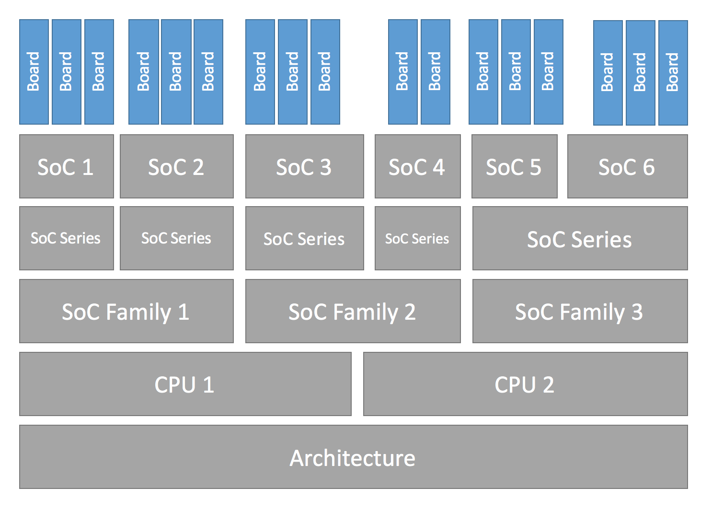
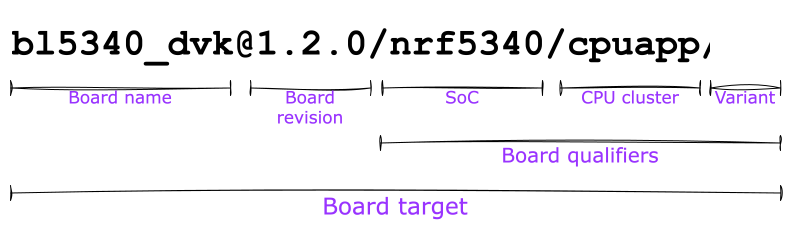

<!-- Copyright 2015-2026 Zephyr Project members and individual contributors. -->
<!-- SPDX-License-Identifier: Apache-2.0 -->
<!-- 中文翻译；阅读编号、导航和译注为本地新增。 -->

# 第1章\_开发板移植指南

原文：[Board Porting Guide](https://docs.zephyrproject.org/latest/hardware/porting/board_porting.html)。读取日期：2026-10-12，`latest`。

要为新**开发板（Board）**增加 Zephyr 支持，至少需要一个包含相关文件的开发板目录。目录中的文件继承至少一个 **片上系统（System on Chip，SoC）** 及其全部特性的支持，因此 Zephyr 也必须支持该板所使用的 SoC。

## 1.1\_迁移到当前硬件模型

Zephyr 3.6.0 发布后不久引入了新的硬件模型，重新设计了 SoC 和开发板的命名、定义方式，并加入多年来确认需要的能力：

- 支持多核、多架构的 AMP（非对称多处理）SoC。
- 支持一块开发板包含多个 SoC。
- 在 Zephyr 构建系统之外复用 SoC 和开发板的 Kconfig 配置树。
- 支持 Sysbuild（系统构建）的高级用法。
- 消除原有 Kconfig 和目录命名中随意、不一致的用法。

本页全部针对当前硬件模型。旧模型已经过时，相关信息应查阅 Zephyr 3.6.0 或更早版本的文档。设计背景、开发过程和概念可查阅[最初的问题讨论](https://github.com/zephyrproject-rtos/zephyr/issues/51831)、[最初的变更讨论](https://github.com/zephyrproject-rtos/zephyr/issues/50305)和[硬件模型 v2 提交](https://github.com/zephyrproject-rtos/zephyr/commit/8dc3f856229ce083c956aa301c31a23e65bd8cd8)。部分非关键特性和改进仍在开发，完整列表见[后续改进问题](https://github.com/zephyrproject-rtos/zephyr/issues/69546)。

从旧模型迁移到通常称为“hardware model v2”的当前模型，需要修改已有开发板和 SoC 定义。项目决定不直接向后兼容旧模型；因此，把树外开发板或 SoC 迁移到 Zephyr 3.7.0 及以后版本时，原文列出两条路线：

1. 将树外开发板转换为当前硬件模型，推荐采用此方式。
2. 将 Zephyr 3.6.0 中的 SoC 定义复制到下游仓库，并通过 Zephyr 模块或 `SOC_ROOT` 让构建系统找到它。原文说明，这可使按旧模型定义的开发板继续工作。

> 译注：第二条是原文的历史迁移说明，不代表任意当前版本都能无修改兼容旧定义；迁移时仍须核对目标版本的构建规则。

转换前建议先读完本页。之后可参考 [example-application 的转换 PR](https://github.com/zephyrproject-rtos/example-application/pull/58)移植简单开发板，也可使用[转换脚本](https://github.com/zephyrproject-rtos/zephyr/blob/main/scripts/utils/board_v1_to_v2.py)。脚本在许多情况下可靠，但可能无法完整处理多核 SoC。硬件模型 v2 提交包含当时全部已有开发板的转换，可作为完整参考。

> 译注：2026-10-12 链接核对时，上述原文转换脚本的 `main` 地址返回 404；它是历史迁移工具，不应当作当前主线仍提供的命令。可通过前述转换 PR 和固定提交查看实际迁移差异。

## 1.2\_硬件支持层次

Zephyr 用分层抽象组织硬件支持。每块板包含一个或多个 SoC；SoC 可以归入一个系列（series），系列又可以归入一个家族（family），这两个层次都是可选的。每个 SoC 有一个或多个 **中央处理器（Central Processing Unit，CPU）** 簇（cluster），每个簇包含一个或多个采用特定架构的 CPU 核。



下表保留原文示例。系列和家族并非总会使用。

| 开发板名称 | 开发板限定符 | SoC | SoC 系列 | SoC 家族 | CPU 核 | 架构 |
| --- | --- | --- | --- | --- | --- | --- |
| nRF52 DK | nrf52832 | nRF52832 | nRF52 | Nordic nRF | Arm Cortex-M4 | ARMv7-M |
| frdm_k64f | mk64f12 | MK64F12 | Kinetis K6x | NXP Kinetis | Arm Cortex-M4 | ARMv7-M |
| rv32m1_vega | openisa_rv32m1/ri5cy | RV32M1 | 不使用 | 不使用 | RI5CY | RISC-V RV32 |
| nRF5340 DK | nrf5340/cpuapp | nRF5340 | nRF53 | Nordic nRF | Arm Cortex-M33 | ARMv8-M |
| nRF5340 DK | nrf5340/cpunet | nRF5340 | nRF53 | Nordic nRF | Arm Cortex-M33 | ARMv8-M |
| mimx8mp_evk | mimx8ml8/a53 | i.MX8M Plus | i.MX8M | NXP i.MX | Arm Cortex-A53 | ARMv8-A |
| mimx8mp_evk | mimx8ml8/m7 | i.MX8M Plus | i.MX8M | NXP i.MX | Arm Cortex-M7 | ARMv7-M |
| mimx8mp_evk | mimx8ml8/adsp | i.MX8M Plus | i.MX8M | NXP i.MX | Cadence HIFI4 | Xtensa LX6 |

### 1.2.1\_开发板术语

下图用 BL5340 DVK 说明开发板相关名称。



- **板名**：`bl5340_dvk`。
- **可选的板修订版本**：`1.2.0`。
- **开发板限定符**：可描述 SoC、CPU 簇和变体，这里是 `nrf5340/cpuapp/ns`。
- **开发板目标**：唯一标识上述组合，供 Zephyr 工具选择构建硬件，这里是 `bl5340_dvk@1.2.0/nrf5340/cpuapp/ns`。

通用格式是 `board name[@revision][/board qualifiers]`，展开为 `board name[@revision][/SoC[/CPU cluster][/variant]]`。

若板上只有一个单核 SoC，可以从目标中省略 SoC。没有额外限定符时，直接用板名作为目标；存在限定符时，省略 SoC 仍须保留对应斜杠 `//`。

BL5340 DVK 是单 SoC 开发板，该 SoC 定义 `cpuapp` 和 `cpunet` 两个 CPU 簇，`cpuapp` 还定义了非安全变体 `ns`。限定符 `nrf5340/cpuapp/ns` 依次表示：

1. `nrf5340`：Nordic nRF5340 双核 SoC。
2. `cpuapp`：含一个 Cortex-M33 核的 CPU 簇。不能仅从限定符推断簇内核数。
3. `ns`：变体名，Zephyr 中通常表示支持 Trusted Firmware-M（TF-M）的开发板所使用的非安全构建。

并非所有 SoC 都显式定义 CPU 簇或变体。例如 Thingy:52 只有一个 SoC，未定义 CPU 簇和变体；`thingy52/nrf52832` 中，`thingy52` 是板名，限定符 `nrf52832` 就是其 Nordic nRF52832 SoC 名。

## 1.3\_确认SoC已经受支持

先确认 Zephyr 是否支持所用 SoC。支持时可直接创建开发板目录；不确定时，检查[受支持开发板与扩展板列表](https://docs.zephyrproject.org/latest/boards/index.html)和各板文档，或询问 SoC 厂商。

如果需要补充 SoC、CPU 簇甚至架构支持，应先完成相应层次的移植。架构部分见[架构移植指南](https://docs.zephyrproject.org/latest/hardware/porting/arch.html)。CPU 核支持位于 `arch` 下的 `core` 子目录，例如 `arch/x86/core`。

受支持编译器、链接器等见[工具链入口](../toolchains/P001_工具链入口.md)。要接入新工具链，可从[构建与配置系统](https://docs.zephyrproject.org/latest/build/index.html)了解构建流程，并与社区讨论或合作。

SoC 支持文件位于 `soc` 中，通常按家族组织。原文还称其为“架构专用子目录”；在新增厂商的例子中使用 `zephyr/soc/<VENDOR>/<YOUR-SOC>`。若厂商已有支持，新系列或家族应尽量提取公共功能到共享文件，避免重复；新增目录应采用含义明确的名字。

> 译注：这段“架构专用子目录”沿用了历史表述。当前硬件模型的目录安排应结合[SoC 移植指南](P002_SoC移植指南.md)的厂商目录规则理解，不能据此把旧目录结构机械搬到新版本。

## 1.4\_创建开发板目录

找到使用同一 SoC 的已有板后，通常可复制其目录，再按实际硬件修改。板名必须唯一，可用 `west boards` 查看已占用的名字。以下假设板名为 `plank`，请不要把这个占位名用于真实板。

先创建 `zephyr/boards/<VENDOR>/plank`，其中 `<VENDOR>` 是厂商子目录。板定义不一定放在 Zephyr 仓库内，但这是容易开始的方式；树外安排见[应用开发中的自定义板、设备树和 SoC 定义](../application/P001_应用开发.md)。

提交上游时厂商子目录必需；放在自己的仓库时，`<your-repo>/boards` 下可以采用其他层次。若厂商在 `dts/bindings/vendor-prefixes.txt` 中，必须用其现有前缀；未列出的板厂商可以使用 `others`。目录名不必等于板名，一个目录还可以定义多块板。

典型目录如下，把 `plank` 换成实际板名：

```text
boards/<VENDOR>/plank
├── board.yml
├── board.cmake
├── CMakeLists.txt
├── doc
│   ├── plank.webp
│   └── index.rst
├── Kconfig.plank
├── Kconfig.defconfig
├── plank_<qualifiers>_defconfig
├── plank_<qualifiers>.dts
└── plank_<qualifiers>.yaml
```

必需文件如下：

| 文件 | 用途 |
| --- | --- |
| `board.yml` | 板名、SoC、变体等高层元数据。多核 SoC 的 CPU 簇继承自 SoC YAML，不在这里重复描述。 |
| `plank_<qualifiers>.dts` | 设备树硬件描述，声明 SoC、连接器、**发光二极管（Light-Emitting Diode，LED）**、按钮、传感器和 **通用串行总线（Universal Serial Bus，USB）**、蓝牙控制器等通信外设。 |
| `Kconfig.plank` | 基础配置，选择 SoC 及板/SoC 相关配置。不得选择可复用板/SoC 配置树之外的符号；通用 Zephyr 配置应放在 `Kconfig`。 |

可选文件如下：

| 文件 | 用途 |
| --- | --- |
| `Kconfig`、`Kconfig.defconfig` | Kconfig 格式的软件功能、外设驱动设置及默认值。 |
| `plank_defconfig`、`plank_<qualifiers>_defconfig` | Kconfig `.conf` 格式的配置片段。 |
| `board.cmake` | 烧录与调试支持。 |
| `CMakeLists.txt` | 向构建加入额外源文件。 |
| `doc/index.rst`、`doc/plank.webp` | 板文档与图片，贡献到 Zephyr 时需要。 |
| `plank_<qualifiers>.yaml` | 测试运行器 Twister 使用的其他元数据。 |

限定符用于文件名时，要把 `/` 规范化为 `_`。例如 `soc1/foo` 对应 `soc1_foo`。

## 1.5\_编写board.yml

该文件描述 SoC、板变体和修订版本等高层信息；具体硬件和软件配置仍由设备树与 Kconfig 完成。基本结构如下：

```yaml
board:
  name: <board-name>
  full_name: <board-full-name>
  vendor: <board-vendor>
  revision:
    format: <major.minor.patch|letter|number|custom>
    default: <default-revision-value>
    exact: <true|false>
    revisions:
    - name: <revA>
    - name: <revB>
      ...
  socs:
  - name: <soc-1>
    variants:
    - name: <variant-1>
    - name: <variant-2>
      variants:
      - name: <sub-variant-2-1>
        ...
  - name: <soc-2>
    ...
```

同一目录含多块板时，使用 `boards` 列表：

```yaml
boards:
- name: <board-name-1>
  vendor: <board-vendor>
  full_name: <board-full-name>
  ...
- name: <board-name-2>
  vendor: <board-vendor>
  full_name: <board-full-name>
  ...
...
```

## 1.6\_编写设备树

板设备树负责把 SoC 描述与板上实际连接结合起来。原文提供以下骨架，包含所选控制台、内存、LED、按钮、别名和外设启用：

```dts
/dts-v1/;
#include <your_soc_vendor/your_soc.dtsi>

/ {
        model = "A human readable name";
        compatible = "yourcompany,plank";

        chosen {
                zephyr,console = &your_uart_console;
                zephyr,sram = &your_memory_node;
                /* other chosen settings  for your hardware */
        };

        /*
         * Your board-specific hardware: buttons, LEDs, sensors, etc.
         */

        leds {
                compatible = "gpio-leds";
                led0: led_0 {
                        gpios = </* GPIO your LED is hooked up to */>;
                        label = "LED 0";
                };
                /* ... other LEDs ... */
        };

        buttons {
                compatible = "gpio-keys";
                /* ... your button definitions ... */
        };

        /* These aliases are provided for compatibility with samples */
        aliases {
                led0 = &led0; /* now you support the blinky sample! */
                /* other aliases go here */
        };
};

&some_peripheral_you_want_to_enable { /* like a GPIO or SPI controller */
        status = "okay";
};

&another_peripheral_you_want {
        status = "okay";
};
```

板只有一个 SoC 且无变体时，也可命名为 `<plank>.dts`，但不推荐：以后增加变体或另一个 SoC 时，这个文件可能不再被使用，而且不会显式提醒。

原文指出，简单硬件可以从已有定义复制并通过试验调整；若想了解细节，应继续阅读[设备树文档](../devicetree/大纲.md)和设备树规范。

> 译注：上面是通用示意代码，不是 HC32F4A0 的可直接使用配置。真实移植须按实际芯片型号、封装引脚和板上连接核对。示例中的 `label` 属性也不能与节点标签混淆；新代码应结合当前绑定及设备树 **应用程序编程接口（Application Programming Interface，API）** 的推荐用法。

### 1.6.1\_FRDM-K64F与Hexiwear K64示例

原文以 [FRDM-K64F 设备树](https://github.com/zephyrproject-rtos/zephyr/blob/main/boards/nxp/frdm_k64f/frdm_k64f.dts)和 [Hexiwear K64 设备树](https://github.com/zephyrproject-rtos/zephyr/blob/main/boards/mikroe/hexiwear/hexiwear_mk64f12.dts)说明具体写法。两块板都采用 NXP Kinetis 家族的 K6X SoC。

共享定义放在 [nxp_k6x.dtsi](https://github.com/zephyrproject-rtos/zephyr/blob/main/dts/arm/nxp/kinetis/k6x/nxp_k6x.dtsi)，两块板的 `.dts` 都包含它；该文件又包含 [armv7-m.dtsi](https://github.com/zephyrproject-rtos/zephyr/blob/main/dts/arm/armv7-m.dtsi)，后者提供 Arm v7-M 核公共定义。

由于 SoC 文件须适用于多块板，许多设备默认通过 `status` 禁用。例如省略无关内容后的 CAN 控制器：

```dts
can0: can@40024000 {
     ...
     status = "disabled";
     ...
};
```

板 `.dts` 或应用 overlay 按需设置 `status = "okay"` 来启用设备。板 `.dts` 还负责板上传感器、LED、按钮等节点和其他板级配置。FRDM-K64F 启用该 CAN 控制器，而 Hexiwear K64 没有：

```dts
&can0 {
     status = "okay";
};
```

`&can0 { ... };` 会增加或覆盖节点标签为 `can0` 的节点属性。其他常见定制包括让 `aliases`、`chosen` 指向正确节点，以及 **通用输入输出（General-Purpose Input/Output，GPIO）** 和引脚复用分配。

> 译注：原文把第一个文件文字写为 `frdm_k64fs.dts`，而链接实际指向 `frdm_k64f.dts`；描述 CAN 时还把节点地址写成 `can@4002400`，代码是 `can@40024000`。原文称上述板片段同时设置总线速度，但展示的代码只有 `status`，并未给出速度设置。本译文保留代码，并明确这些不一致。

## 1.7\_编写Kconfig文件

Zephyr 使用 Kconfig 配置软件功能。编译目标板应用之前，板定义需要提供相应设置。取值规则详见[设置配置值](../kconfig/P003_设置配置值.md)。`plank` 目录中，一个 Kconfig 文件必需，其余按需提供：

```text
boards/<vendor>/plank
├── Kconfig
├── Kconfig.plank
├── Kconfig.defconfig
└── plank_<qualifiers>_defconfig
```

### 1.7.1\_Kconfig.plank

这是可同时被 Zephyr 和 Sysbuild Kconfig 树包含的共享文件。它选择 SoC 及其他相关符号，不得选择可复用板和 SoC 配置树之外的内容。例如：

```kconfig
config BOARD_PLANK
        select SOC_SOC1
```

`BOARD_board` 和 `BOARD_normalized_board_target` 符号由构建系统生成，因此这里不要重新声明类型。

### 1.7.2\_Kconfig

此文件由 `boards/Kconfig` 包含，可增加板专用配置；并非每块板都需要。通常应定义自有符号并提供提示文字：

```kconfig
config BOARD_FEATURE
        bool "Board specific feature"
```

若符号已经存在，只是修改其默认值，应改用 `Kconfig.defconfig`。

### 1.7.3\_Kconfig.defconfig

此文件提供板专用默认值，并非必需。整个文件应置于 `if BOARD_PLANK` 与 `endif` 之间：

```kconfig
if BOARD_PLANK

config FOO
        default y

if NETWORKING

config SOC_ETHERNET_DRIVER
        default y

endif # NETWORKING

endif # BOARD_PLANK
```

### 1.7.4\_目标与修订版本的defconfig

`plank_<qualifiers>_defconfig` 是配置片段，为该目标编译时会原样合入构建目录最终的 `.config`。`plank_defconfig` 仅适用于没有额外限定符、没有变体且只有一个 SoC 的板；不推荐这种命名，因为上游增加 SoC、变体或限定符时，示例、测试或下游用法可能突然失效。

这些候选文件**不会全部合并，也没有回退机制**。例如板含两个 SoC，每个 SoC 有两个变体，则 `plank_defconfig` 完全不会使用；第一个 SoC 的第一个变体使用 `plank_<soc1>_<variant1>_defconfig`，不会自动包含其他文件。

`_defconfig` 应放 **通用异步收发器（Universal Asynchronous Receiver-Transmitter，UART）**、控制台等必需配置。具体内容依架构而异，典型例子如下：

```ini
CONFIG_GPIO=y
CONFIG_CONSOLE=y
CONFIG_UART_CONSOLE=y
CONFIG_SERIAL=y
```

`plank_x_y_z_defconfig` 或 `plank_<qualifiers>_x_y_z_defconfig` 是修订版本 `x.y.z` 对应的配置片段，为该修订版本构建时合入最终 `.config`。

## 1.8\_构建、测试并修正

接下来构建、测试实际应用并修正问题。例如：

```shell
west build -b plank samples/hello_world
west flash
```

`west flash` 需要下节介绍的烧录支持，也可以用其他工具烧录 `build/zephyr/zephyr.elf`、`zephyr.hex` 或 `zephyr.bin`。

提交上游前，应确认新增的每个开发板目标仅使用 Zephyr 主线和其模块中的代码，就能通过最低开源测试集。目前该测试集包含 `samples/philosophers` 和 `tests/kernel`：

```shell
west twister -p plank -T samples/philosophers -T tests/kernel
```

若板有多个 SoC、CPU 簇、变体或修订版本，对每个新增目标重复测试。还推荐先构建 Hello World 作为快速检查：

```shell
west build -p always -b plank/soc1/foo samples/hello_world
west build -p always -b plank@1.0.0/soc1/foo samples/hello_world
```

目标需要 Sysbuild 时应使用 Sysbuild。即使测试元数据通过 `testing: only_tags` 等字段限制测试集合，也应在本地或 CI 中覆盖最低测试集。

> 译注：以上是原文的移植验证要求和命令示例，本次翻译工作没有执行硬件构建、烧录或运行测试，也不据此宣称 HC32F4A0 已通过这些检查。

## 1.9\_通用建议

为保持一致并帮助应用摆脱具体板的依赖，计划贡献到 Zephyr 的板应遵循以下建议；纳入上游时它们是要求。

1. **在设备树中启用有用的板载组件。** LED、按钮、传感器、板载 USB、以太网、BLE、Wi-Fi 等节点应默认启用，并具有正确引脚控制和驱动配置，使其开箱可用。
2. **Kconfig 中默认关闭非必需子系统。** 除非基本运行必需，或属于本节明确例外，不要在板 defconfig 中启用子系统。
3. **配置系统时钟和节拍源。** 确保两者可正常工作。
4. **提供默认控制台。** `zephyr,console` chosen 节点应指向控制台 UART。有板载调试器或 USB 转 UART 时，使用连接该适配器的 UART。仅有 USB 且无调试适配器的板，应包含公共 [USB CDC-ACM Kconfig 片段](https://github.com/zephyrproject-rtos/zephyr/blob/main/boards/common/usb/Kconfig.cdc_acm_serial.defconfig)和 [DTS 片段](https://github.com/zephyrproject-rtos/zephyr/blob/main/boards/common/usb/cdc_acm_serial.dtsi)，让 CDC-ACM UART 成为日志与 shell 的默认后端。
5. **提供扩展板接口定义。** 有标准扩展排针时，增加连接器节点和引脚复用，只启用该连接器预期或标准功能需要的外设。
6. **正确映射引脚和外设实例。** 例如 Arduino **串行外设接口（Serial Peripheral Interface，SPI）** 引脚应映射到对应 SPI，提供支持板功能的默认 pinmux 配置。
7. **启用网络接口。** 有网络硬件时，为各受支持技术配置默认接口，使网络示例可直接使用。
8. **启用 GPIO 控制器。** 连接板载器件或扩展排针的所有 GPIO 端口都应启用。
9. **启用 **内存保护单元（Memory Protection Unit，MPU）** 和栈保护。** 有 MPU 时推荐启用，内存极受限时可例外；启用 MPU 后也推荐 `CONFIG_HW_STACK_PROTECTION`，让内核检测栈溢出，帮助调试。

## 1.10\_烧录与调试支持

Zephyr 通过 west 扩展命令支持[构建、烧录与调试](../west/P007_构建烧录与调试.md)。为板提供 `west flash`、`west debug` 支持，需要在板目录创建 `board.cmake` 配置 runner；支持 `west build` 无须额外的特殊处理。

Runner 是 Zephyr 专用 Python 类，封装主机烧录/调试工具，并接入 west 和构建系统。每种 runner 可支持烧录、调试或两者。`board.cmake` 为这些 Python 工具配置参数，例如：

```cmake
board_runner_args(jlink "--device=nrf52" "--speed=4000")
board_runner_args(pyocd "--target=nrf52" "--frequency=4000000")

include(${ZEPHYR_BASE}/boards/common/nrfutil.board.cmake)
include(${ZEPHYR_BASE}/boards/common/nrfjprog.board.cmake)
include(${ZEPHYR_BASE}/boards/common/jlink.board.cmake)
include(${ZEPHYR_BASE}/boards/common/pyocd.board.cmake)
```

该例配置 `nrfutil`、`nrfjprog`、`jlink` 和 `pyocd`。Runner 通常与封装工具同名，例如 `jlink` 封装 Segger J-Link，但 `--speed` 等参数属于 runner 的 Python 命令行，不能直接认定与底层工具参数相同。

只要底层工具支持多个操作系统，runner 和板配置就不应绑定单一操作系统，也不应依赖特殊系统预配置。例如，不要假设用户已有先验知识、特殊配置或 Linux udev 规则；不要固定为某个 `/dev/X` 设备，这不适用于 Windows/macOS；应允许覆盖所选设备，以便同一主机连接多块板时由用户选择。

进一步查看方法：

- `west flash --context` 列出可用烧录 runner；`west flash --context -r <RUNNER>` 查看某个 runner 的选项。
- `west debug --context` 查看调试 runner。原文把指定 runner 的写法列为 `west debug --context <RUNNER>`；**译注：指定名称应使用 `west debug --context -r <RUNNER>`，与烧录命令一致。**
- `west flash --help`、`west debug --help` 查看顶层选项。
- Python API 参见[构建、烧录与调试](../west/P007_构建烧录与调试.md)中的配置选项，也可参考相似板的 `board.cmake`。

详细输出模式可显示 runner 实际调用的主机工具命令：

```shell
west --verbose flash
west --verbose debug
```

`include()` 的顺序有意义：尚未指定默认 runner 时，第一个相应 include 会设定默认值。例如，**若首先包含** `nrfjprog.board.cmake`，它会成为默认烧录 runner；由于它不支持调试，后面的 J-Link 可以成为默认调试 runner。

> 译注：上面完整代码首先包含的是 `nrfutil.board.cmake`。原文随后的 nrfjprog 说明是另一种包含顺序下的例子，不能据此认定代码中的默认烧录器是 nrfjprog。

## 1.11\_多个开发板修订版本

用户侧用法见[应用开发](../application/P001_应用开发.md)的修订版本构建部分。板定义通过 `board.yml` 的 `revision` 描述版本：

```yaml
board:
  revision:
    format: <major.minor.patch|letter|number|custom>
    default: <default-revision-value>
    exact: <true|false>
    revisions:
    - name: <revA>
    - name: <revB>
```

Zephyr 内置支持 `major.minor.patch` 三段版本（如 `1.2.3`）、`number` 整数版本和 `letter` 单字母版本；字母只允许 `A` 到 `Z`。其他格式使用 `custom`。

### 1.11.1\_模糊匹配与精确匹配

默认启用模糊匹配。如果请求版本位于已有版本之间，选择不大于请求值的最近版本。例如 `plank` 定义 `0.5.0`、`1.5.0`，用户构建 `plank@0.7.0`，实际采用 `0.5.0`，CMake 配置时显示：

```text
-- Board: plank, Revision: 0.7.0 (Active: 0.5.0)
```

因此，只需为引入不兼容变化的修订版本创建配置文件。字母版本同理：定义 `A`、`D`、`F`，请求 `plank@E` 时选择 `D`。

在 `revision` 中指定 `exact: true` 可启用精确匹配。此时上述 `0.7.0` 请求报错：

```text
Board revision `0.7.0` not found.  Please specify a valid board revision.
```

### 1.11.2\_按修订版本调整配置

构建 `plank@<revision>` 时，可以调整正常板配置。基础来自 `<board>.dts` 或 `<board>_<qualifiers>.dts`，以及 `<board>_defconfig` 或 `<board>_<qualifiers>_defconfig`。随后再应用：

- `<board>_<qualifiers>_<revision>_defconfig`：仅作用于该板和限定符所标识 SoC/变体的修订版本配置。
- `<board>_<qualifiers>_<revision>.overlay`：同一目标对应的修订版本设备树覆盖。

原文说明，这种拆分旨在让多 SoC、多核或多变体板共享公共修订调整，同时仍能提供 SoC/变体专用文件。`plank` 的例子如下，两文件分别调整修订版本 `1.5.0`、SoC `soc1`、变体 `foo` 的设备树与 Kconfig：

```text
boards/zephyr/plank
├── plank_soc1_foo_1_5_0.overlay   # DTS overlay for plank board when building for soc1 variant foo on revision 1.5.0
└── plank_soc1_foo_1_5_0_defconfig # Kconfig adjustment for plank board when building for soc1 variant foo on revision 1.5.0
```

### 1.11.3\_自定义revision.cmake

某些板采用字符串等非内置版本格式。字符串可能只是 `blue`、`green`、`red` 等名称，也可能像 `alpha`、`beta`、`gamma` 一样隐含顺序；还可能需要正则匹配。由于形式太多，Zephyr 要求使用自定义版本类型：

```yaml
board:
  revision:
    format: custom
```

此时在板目录创建 `revision.cmake`。构建系统会包含它，由它验证用户指定的版本。用户请求值保存在 `BOARD_REVISION`。

若要改用其他实际版本，该文件可设置 `ACTIVE_BOARD_REVISION`。原文列出的对应文件名是 `<board>_<ACTIVE_BOARD_REVISION>_defconfig` 和 `<board>_<ACTIVE_BOARD_REVISION>.overlay`。

> 译注：前一节列的是带限定符的版本文件，这里原文写的是不带限定符的形式。实际移植含限定符的目标时，应核对目标 Zephyr 版本的文件发现规则，不能自行假定所有这些命名会一起合并。

## 1.12\_贡献开发板

要把开发板贡献到 Zephyr，还需完成以下工作：

1. 遵循本页全部通用建议，它们对上游板是强制要求。
2. 用 [doc/templates/board.tmpl](https://github.com/zephyrproject-rtos/zephyr/blob/main/doc/templates/board.tmpl) 添加板文档，并按[文档生成指南](../contributing/P011_文档生成.md)在提交前构建检查。
3. 按[贡献指南](../contributing/P001_参与Zephyr开发.md)准备增加板支持的 PR。

## 1.13\_扩展已有开发板

Zephyr 硬件模型允许给已有板添加新变体，这种扩展可以放在自己的仓库中。构建时仍能选择原始未修改目标，也能选择新变体。

先按前述目录结构为扩展创建 `board.yml`：

```yaml
board:
  extend: <existing-board-name>
  variants:
    - name: <new-variant>
      qualifier: <existing-qualifier>
```

目录如下，把 `plank` 换成被扩展板的真实名称：

```text
boards/<VENDOR>/plank
├── board.yml
├── plank_<new-qualifiers>_defconfig
└── plank_<new-qualifiers>.dts
```

有时还需要调整 `Kconfig.defconfig`、板 Kconfig 等设置；扩展目录还可以提供以下文件：

```text
boards/<VENDOR>/plank
├── board.cmake
├── Kconfig
├── Kconfig.plank
├── Kconfig.defconfig
└── plank_<new-qualifiers>.yaml
```

---

<!-- reading-navigation:start -->

**主线阅读**

[本模块主线目录](../reading/hardware.md) · [全部主线](../reading/README.md) · [下一篇：SoC移植指南](P002_SoC移植指南.md)

<details>
<summary>原册编号导航（含扩展参考）</summary>

[上一章：从C与C++访问设备树](../devicetree/P012_从C与CPP访问设备树.md) · [下一章：SoC移植指南](P002_SoC移植指南.md) · [返回大纲](大纲.md)

</details>

<!-- reading-navigation:end -->
