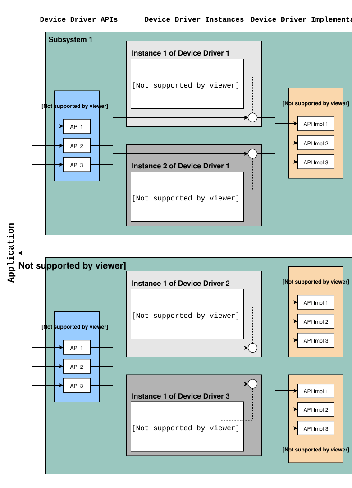

<!-- Copyright 2015-2026 Zephyr Project members and individual contributors. -->
<!-- SPDX-License-Identifier: Apache-2.0 -->
<!-- 中文翻译；阅读编号、导航和译注为本地新增。 -->

<a id="device-model-api"></a>

# 第3章\_设备驱动模型

原文：[Device Driver Model](https://docs.zephyrproject.org/latest/kernel/drivers/index.html)。读取日期：2026-10-12，`latest`。

Zephyr 内核支持多种**设备驱动（Device Driver）**。某个驱动是否可用，取决于开发板和驱动本身。统一的设备模型用于配置系统中的驱动，并负责初始化已配置进入系统的全部驱动。



**通用异步收发器（Universal Asynchronous Receiver-Transmitter，UART）**、**串行外设接口（Serial Peripheral Interface，SPI）**、**集成电路间总线（Inter-Integrated Circuit，I2C）** 等每类驱动都有统一类型的 **应用程序编程接口（Application Programming Interface，API）**。驱动通过一个包含函数指针的结构，把通用操作连接到具体实现。原文导言称在初始化时填写结构指针，并按初始化等级把这些结构放在 **随机存取存储器（Random Access Memory，RAM）** 中。

> 译注：上述 RAM 表述不能泛指全部设备结构。原文后续明确区分构建期只读配置/API 与 RAM 中的可变运行数据；实际开发应以这种划分及所用版本定义为准。本文后面的实例也在构建期初始化 API 表。

## 3.1\_标准驱动与同步调用

原文列出的标准驱动如下，并将其描述为所有受支持板配置中的驱动类型：

| 驱动 | 使用者或用途 |
| --- | --- |
| 中断控制器 | 内核中断管理子系统。 |
| 定时器 | 内核系统时钟及硬件时钟子系统。 |
| 串行通信 | 内核系统控制台。 |
| 熵源 | 为随机数生成子系统提供熵。 |

需要随机值时，应使用随机数 API。不要直接把熵源函数作为随机数生成器，因为有些硬件实现仅用于提供种子熵，不能输出具备密码学安全性的随机数流。

除非硬件完全不提供中断，驱动应支持基于中断的实现。通过 `i2c.h`、`spi.h` 等设备专用接口访问的高层调用，通常设计为同步调用，因此应具有阻塞语义。

> 译注：同步指调用方等待操作结果，并不意味着底层必须轮询；驱动可以通过中断完成传输，再唤醒等待的调用线程。某块板是否实际启用了表中全部功能，仍取决于硬件与配置。

## 3.2\_驱动侧API与数据结构

`device.h` 为驱动提供以下接口。原文将本组列为驱动内部接口，不建议应用直接使用它们创建设备：

| 接口 | 作用 |
| --- | --- |
| `DEVICE_DEFINE()` | 创建设备对象及相关数据结构，并安排启动初始化。 |
| `DEVICE_NAME_GET()` | 把设备标识符转换成设备对象的全局标识符。 |
| `DEVICE_GET()` | 按名称获得设备对象指针。 |
| `DEVICE_DECLARE()` | 前向声明尚未定义的设备对象。 |
| `DEVICE_API()` | 包装驱动 API 声明，使其进入所属 API 类的链接段。实现上游驱动类时必须使用，因为 `DEVICE_API_GET` 和 `DEVICE_API_IS` 依赖这些段进行运行时类别检查。 |

设备初始化宏在构建期填充数据结构，并分为只读部分和运行时可变部分。简化结构如下：

```c
struct device {
      const char *name;
      const void *config;
      const void *api;
      void * const data;
};
```

- `config`：构建期确定的只读配置，例如 **内存映射输入输出（Memory-Mapped Input/Output，MMIO）** 基地址、中断号和其他固定物理属性；它就是传给 `DEVICE_DEFINE()` 等宏的配置指针。
- `data`：位于 RAM，保存每个实例的运行状态，例如引用计数、信号量和临时缓冲区。
- `api`：把通用子系统操作映射到驱动实现，通常只读并在构建期填充。

## 3.3\_子系统与API结构

多数驱动实现与具体设备无关的子系统 API。应用只面向通用接口编程，无须绑定某个驱动实现。驱动 API 实例必须用 `DEVICE_API()` 声明，以便进入正确链接段，并支持运行时类别验证。

子系统接口通常这样定义：

```c
typedef int (*subsystem_do_this_t)(const struct device *dev, int foo, int bar);
typedef void (*subsystem_do_that_t)(const struct device *dev, void *baz);

__subsystem struct subsystem_driver_api {
      subsystem_do_this_t do_this;
      subsystem_do_that_t do_that;
};

static inline int subsystem_do_this(const struct device *dev, int foo, int bar)
{
      return DEVICE_API_GET(subsystem, dev)->do_this(dev, foo, bar);
}

static inline void subsystem_do_that(const struct device *dev, void *baz)
{
      DEVICE_API_GET(subsystem, dev)->do_that(dev, baz);
}
```

驱动提供具体实现，并用 `DEVICE_API()` 填充 API 表：

```c
static int my_driver_do_this(const struct device *dev, int foo, int bar)
{
      ...
}

static void my_driver_do_that(const struct device *dev, void *baz)
{
      ...
}

static DEVICE_API(subsystem, my_driver_api_funcs) = {
      .do_this = my_driver_do_this,
      .do_that = my_driver_do_that,
};
```

随后把 `my_driver_api_funcs` 作为 `api` 参数传给 `DEVICE_DEFINE()`。

即使某个 API 函数未被应用直接调用，API 表对它的函数指针引用仍会使其进入二进制；链接器的 `gc-sections` 也能看到该引用。因此，要对可选驱动功能进行链接期体积优化，通常需要用 Kconfig 控制是否编译该功能。

### 3.3.1\_API类继承

子系统 API 可以扩展另一个 API，形成父子关系。实现子类 API 的设备也能被识别为父类设备。例如 I3C 控制器扩展 I2C API，因此可以用于需要 I2C 设备的场合。

定义子类时，把父 API 结构作为子结构的**第一个成员**，并用 `DEVICE_API_EXTENDS` 声明关系：

```c
__subsystem struct child_driver_api {
      struct subsystem_driver_api parent_api;
      child_do_extra_t do_extra;
};

DEVICE_API_EXTENDS(child, subsystem, parent_api);
```

实现子类的驱动同时填充父类和子类方法：

```c
static DEVICE_API(child, my_child_api) = {
      .parent_api = {
              .do_this = my_child_do_this,
              .do_that = my_child_do_that,
      },
      .do_extra = my_child_do_extra,
};
```

此后，对父类和子类调用 `DEVICE_API_IS` 都返回真；`DEVICE_API_GET` 也可以按任一类型取得 API：

```c
/* Both return true for a child device */
DEVICE_API_IS(subsystem, dev);
DEVICE_API_IS(child, dev);

/* Access through parent API */
DEVICE_API_GET(subsystem, dev)->do_this(dev, foo, bar);
```

支持多级继承，例如孙类继承子类、子类继承父类。兄弟类仍可正确区分：同一父类的两个不同子 API 不会被 `DEVICE_API_IS` 混为一类。

## 3.4\_设备专用API扩展

有些设备符合 **通用输入输出（General-Purpose Input/Output，GPIO）** 等通用子系统模型，但还具有标准 API 无法表达的功能。这类设备可以同时提供子系统操作和设备专用接口，后者在专用头文件中声明。

不需要从用户态线程调用的扩展可以是普通函数；需要用户态调用的扩展声明为系统调用：

```c
#include <zephyr/drivers/subsystem.h>

/* When extensions need not be invoked from user mode threads */
int specific_do_that(const struct device *dev, int foo);

/* When extensions must be invokable from user mode threads */
__syscall int specific_from_user(const struct device *dev, int bar);

/* Only needed when extensions include syscalls */
#include <zephyr/syscalls/specific.h>
```

驱动同时实现通用操作与专用接口：

```c
static int generic_do_this(const struct device *dev, void *arg)
{
   ...
}

static struct generic_api api {
   ...
   .do_this = generic_do_this,
   ...
};

/* supervisor-only API is globally visible */
int specific_do_that(const struct device *dev, int foo)
{
   ...
}

/* syscall API passes through a translation */
int z_impl_specific_from_user(const struct device *dev, int bar)
{
   ...
}

#ifdef CONFIG_USERSPACE

#include <zephyr/internal/syscall_handler.h>

int z_vrfy_specific_from_user(const struct device *dev, int bar)
{
    K_OOPS(K_SYSCALL_SPECIFIC_DRIVER(dev, K_OBJ_DRIVER_GENERIC, &api));
    return z_impl_specific_do_that(dev, bar)
}

#include <zephyr/syscalls/specific_from_user_mrsh.c>

#endif /* CONFIG_USERSPACE */
```

应用可组合使用两类 API。上述注释的含义是：仅供监督态调用的接口为全局可见函数；系统调用接口经过实现入口和用户态校验入口的转换；启用用户空间时加入验证及封送代码。

> 译注：原文此段是含省略号的概念骨架，并有明显语法或命名问题：`static struct generic_api api {` 缺少 `=`；`return z_impl_specific_do_that(dev, bar)` 与前面声明的 `z_impl_specific_from_user()` 不一致，且缺少分号。该旧式 API 表声明也没有采用本页要求的 `DEVICE_API()`。实际实现应统一接口名称、使用对应驱动类的 API 声明，并按所用版本的用户态校验规则编写；不要把该片段当成可直接编译的模板。

## 3.5\_一个驱动的多个实例

系统可能有多个 GPIO 端口或 UART，因此同一驱动可能实例化多次。每个实例有自己的 `config` 和 `data`。

多实例中断配置是特殊情况：`IRQ_CONNECT()` 参数必须在构建期可确定。如果实例使用不同中断线，可为每个实例提供单独的中断配置函数。

假设 `my_driver` 有两个实例，首先在 `drivers/subsystem/subsystem_my_driver.h` 定义配置函数类型：

```c
typedef void (*my_driver_config_irq_t)(const struct device *dev);

struct my_driver_config {
      DEVICE_MMIO_ROM;
      my_driver_config_irq_t config_func;
};
```

公共初始化函数先映射 MMIO、完成通用工作，再调用实例自己的配置函数：

```c
void my_driver_isr(const struct device *dev)
{
      /* Handle interrupt */
      ...
}

int my_driver_init(const struct device *dev)
{
      const struct my_driver_config *config = dev->config;

      DEVICE_MMIO_MAP(dev, K_MEM_CACHE_NONE);

      /* Do other initialization stuff */
      ...

      config->config_func(dev);

      return 0;
}
```

声明具体实例时提供对应中断连接和设备定义：

```c
#if CONFIG_MY_DRIVER_0

DEVICE_DECLARE(my_driver_0);

static void my_driver_config_irq_0(const struct device *dev)
{
      IRQ_CONNECT(MY_DRIVER_0_IRQ, MY_DRIVER_0_PRI, my_driver_isr,
                  DEVICE_GET(my_driver_0), MY_DRIVER_0_FLAGS);
}

const static struct my_driver_config my_driver_config_0 = {
      DEVICE_MMIO_ROM_INIT(DT_DRV_INST(0)),
      .config_func = my_driver_config_irq_0
}

static struct my_data_0;

DEVICE_DEFINE(my_driver_0, MY_DRIVER_0_NAME, my_driver_init,
              NULL, &my_data_0, &my_driver_config_0,
              POST_KERNEL, MY_DRIVER_0_PRIORITY, &my_api_funcs);

#endif /* CONFIG_MY_DRIVER_0 */
```

`DEVICE_DECLARE()` 提供前向声明，解决中断处理函数参数需要设备指针、设备定义又依赖相关配置的循环引用。

> 译注：原文此处的 `my_driver_config_0` 初始化结束后缺少分号，`static struct my_data_0;` 也没有完整给出运行数据类型及实例定义；驱动私有数据需要按实际结构补齐。所有 `...`、**中断请求（Interrupt Request，IRQ）** 常量和实例开关均为示意。这里保留原代码，不将其标为可直接使用的 HC32 驱动。

## 3.6\_初始化时序

驱动可能依赖其他驱动先完成初始化，也可能需要内核服务。`DEVICE_DEFINE()` 及相关接口允许指定启动时调用初始化函数的时间。原文列出以下三个驱动初始化等级：

| 等级 | 用途与约束 |
| --- | --- |
| `PRE_KERNEL_1` | 无其他驱动依赖、只依赖处理器/**片上系统（System on Chip，SoC）** 硬件的设备。此时内核服务不可用，但中断子系统已配置，可以设置中断；初始化函数在中断栈上运行。 |
| `PRE_KERNEL_2` | 依赖 `PRE_KERNEL_1` 设备的驱动。内核服务仍不可用，初始化函数也在中断栈上运行。 |
| `POST_KERNEL` | 初始化需要内核服务的设备；在内核主任务上下文中运行。 |

同一等级内还可指定相对优先级，范围 `0` 到 `999`，数字越小越早。优先级必须是无前导零、无正负号的十进制整数字面量，例如 `32`；也可用展开为该字面量的符号，如 `#define MY_INIT_PRIO 32`。不允许 `CONFIG_KERNEL_INIT_PRIORITY_DEFAULT + 5` 这样的表达式。

驱动或系统工具可调用 `k_is_pre_kernel()` 判断是否仍处于内核服务可用之前的启动阶段。

### 3.6.1\_延迟初始化

可以推迟设备初始化，使 Zephyr 启动时不自动初始化该设备，而由应用之后调用 `device_init()`。

在关联 **设备树源文件（Devicetree Source，DTS）** 节点上添加 `zephyr,deferred-init`：

```dts
/ {
        a-driver@40000000 {
                reg = <0x40000000 0x1000>;
                zephyr,deferred-init;
        };
};
```

### 3.6.2\_只执行启动函数

如果只需启动时运行一个函数，可使用 `SYS_INIT`。它不接收配置或运行数据结构，也不能随后按名称取得设备指针；初始化等级与优先级遵循同类规则。

### 3.6.3\_检查最终初始化顺序

通过 `DEVICE_DEFINE` 及其变体、`SYS_INIT` 声明的初始化函数，会在启动时按等级和优先级依次执行。要检查链接器最终产生的调用顺序，可使用 CMake 的 `initlevels` 目标，例如 `west build -t initlevels`。

## 3.7\_错误处理

原文建议：除非故障在正常运行过程中可能发生（例如存储设备已满），一般优先使用 `__ASSERT()`，而不是层层传播返回值。错误参数、编程错误、一致性检查和不可恢复故障等应通过断言处理。

适合交由调用方检查的错误，成功返回 `0`，失败返回 POSIX `errno.h` 错误码。具体返回码约定见[官方命名规则](https://github.com/zephyrproject-rtos/zephyr/wiki/Naming-Conventions#return-codes)。

> 译注：这里“返回错误码”应结合对应 API 约定理解；许多 Zephyr 驱动 API 使用负的 errno 值。不要据此把既有接口的 `-EINVAL` 改为正值，或将其约定的可恢复输入错误改为断言。

## 3.8\_内存映射

某些系统无法在构建时确定外设 MMIO 的线性地址，常见原因有：

- I/O 范围要在运行时从总线探测，例如 PCI Express。
- 系统启用了 **内存管理单元（Memory Management Unit，MMU）**，物理 MMIO 地址须映射进页表，虚拟地址由内核确定。

这类系统需要在 RAM 中保存 MMIO 范围，并在驱动初始化时建立映射。其他系统可直接使用 DTS 中的物理地址，不需要额外 RAM 存储。

Zephyr 提供 `DEVICE_MMIO` 系列接口及 `device_map()` 处理这些差异。

### 3.8.1\_设备模型中的单个MMIO区域

最简单的情况只有一个区域。在配置和运行数据结构中分别使用 `DEVICE_MMIO_ROM`、`DEVICE_MMIO_RAM`，通过 `DEVICE_MMIO_ROM_INIT` 从 DTS 初始化配置，并在初始化函数调用 `DEVICE_MMIO_MAP()`：

```c
struct my_driver_config {
   DEVICE_MMIO_ROM; /* Must be first */
   ...
}

struct my_driver_dev_data {
   DEVICE_MMIO_RAM; /* Must be first */
   ...
}

const static struct my_driver_config my_driver_config_0 = {
   DEVICE_MMIO_ROM_INIT(DT_DRV_INST(...)),
   ...
}

int my_driver_init(const struct device *dev)
{
   ...
   DEVICE_MMIO_MAP(dev, K_MEM_CACHE_NONE);
   ...
}

int my_driver_some_function(const struct device *dev)
{
   ...
   /* Write some data to the MMIO region */
   sys_write32(0xDEADBEEF, DEVICE_MMIO_GET(dev));
   ...
}
```

两个 MMIO 字段宏必须位于各自结构的首部。运行时通过 `DEVICE_MMIO_GET(dev)` 取得可访问地址，再使用 `sys_write32()` 等访问。

宏的展开依赖配置。在没有 MMU 或 PCIe 需求的配置中，`DEVICE_MMIO_MAP` 和 `DEVICE_MMIO_RAM` 不产生相应映射操作或 RAM 字段。

> 译注——当前配置条件：本次官方头文件在 `CONFIG_MMU`、`CONFIG_PCIE` 或 `CONFIG_EXTERNAL_ADDRESS_TRANSLATION` 任一启用时定义 `DEVICE_MMIO_IS_IN_RAM`。因此不能仅凭未启用 MMU／PCIe 就断定没有 RAM 地址存储；还需检查外部地址转换配置。保存的是可访问地址，不是把寄存器内容搬入 RAM。完整分支和源码依据见[设备 MMIO 管理概述](../device_reference/P011_设备MMIO管理概述.md)。

### 3.8.2\_多个MMIO区域或首成员已有其他用途

有的驱动有多个区域；另一些驱动为了结构继承，必须把其他成员放在配置和运行数据的首部。这些情况可使用 `DEVICE_MMIO_NAMED` 系列宏。

需要先定义 `DEV_CFG()`、`DEV_DATA()`，使其返回类型正确的配置/运行数据指针。例如：

```c
struct my_driver_config {
   ...
     DEVICE_MMIO_NAMED_ROM(corge);
     DEVICE_MMIO_NAMED_ROM(grault);
   ...
}

struct my_driver_dev_data {
        ...
     DEVICE_MMIO_NAMED_RAM(corge);
     DEVICE_MMIO_NAMED_RAM(grault);
     ...
}

#define DEV_CFG(_dev) \
   ((const struct my_driver_config *)((_dev)->config))

#define DEV_DATA(_dev) \
   ((struct my_driver_dev_data *)((_dev)->data))

const static struct my_driver_config my_driver_config_0 = {
   ...
   DEVICE_MMIO_NAMED_ROM_INIT(corge, DT_DRV_INST(...)),
   DEVICE_MMIO_NAMED_ROM_INIT(grault, DT_DRV_INST(...)),
   ...
}

int my_driver_init(const struct device *dev)
{
   ...
   DEVICE_MMIO_NAMED_MAP(dev, corge, K_MEM_CACHE_NONE);
   DEVICE_MMIO_NAMED_MAP(dev, grault, K_MEM_CACHE_NONE);
   ...
}

int my_driver_some_function(const struct device *dev)
{
   ...
   /* Write some data to the MMIO regions */
   sys_write32(0xDEADBEEF, DEVICE_MMIO_GET(dev, grault));
   sys_write32(0xF0CCAC1A, DEVICE_MMIO_GET(dev, corge));
   ...
}
```

> 译注：原文最后两行使用了双参数 `DEVICE_MMIO_GET(dev, name)`。对应的命名区域访问宏应为 `DEVICE_MMIO_NAMED_GET(dev, grault)` 和 `DEVICE_MMIO_NAMED_GET(dev, corge)`；本地 `include/zephyr/sys/device_mmio.h` 也显示普通 `DEVICE_MMIO_GET` 只接收一个参数。原文保留用于对照，移植时应按实际头文件修正。

### 3.8.3\_同一个设备树节点中的多个区域

一个节点也可以通过 `reg-names` 区分多个 `reg` 区域，例如：

```dts
/dts-v1/;

/ {
        a-driver@40000000 {
                reg = <0x40000000 0x1000>,
                      <0x40001000 0x1000>;
                reg-names = "corge", "grault";
        };
};
```

整体方式与上一节相同，但配置初始化改用 `DEVICE_MMIO_NAMED_ROM_INIT_BY_NAME`：

```c
const static struct my_driver_config my_driver_config_0 = {
   ...
   DEVICE_MMIO_NAMED_ROM_INIT_BY_NAME(corge, DT_DRV_INST(...)),
   DEVICE_MMIO_NAMED_ROM_INIT_BY_NAME(grault, DT_DRV_INST(...)),
   ...
}
```

### 3.8.4\_不使用设备模型的代码

部分定时器、中断控制器或类似驱动的代码不使用 Zephyr 设备模型，需要另行存储 MMIO 数据。可使用 `DEVICE_MMIO_TOPLEVEL` 系列宏：

```c
DEVICE_MMIO_TOPLEVEL_STATIC(my_regs, DT_DRV_INST(..));

void some_init_code(...)
{
   ...
   DEVICE_MMIO_TOPLEVEL_MAP(my_regs, K_MEM_CACHE_NONE);
   ...
}

void some_function(...)
   ...
   sys_write32(DEVICE_MMIO_TOPLEVEL_GET(my_regs), 0xDEADBEEF);
   ...
}
```

> 译注：这段原文在 `some_function(...)` 后缺少 `{`，还把 `sys_write32()` 参数顺序写反。该接口顺序是“数据、地址”，因此示意写法应为 `sys_write32(0xDEADBEEF, DEVICE_MMIO_TOPLEVEL_GET(my_regs));`。`DT_DRV_INST(..)` 同样需要换成实际实例编号。

### 3.8.5\_不从DTS取得地址的驱动

例如 PCIe 驱动可能从总线取得 MMIO 物理地址，此时可以直接调用 `device_map()`：

```c
void some_init_code(...)
{
   ...
   struct pcie_bar mbar;
   bool bar_found = pcie_get_mbar(bdf, index, &mbar);

   device_map(DEVICE_MMIO_RAM_PTR(dev), mbar.phys_addr, mbar.size, K_MEM_CACHE_NONE);
   ...
}
```

这种情况下可以省略 `DEVICE_MMIO_ROM` 声明。

> 译注：原文是省略错误处理的骨架；实际代码应先检查 `bar_found`，只有成功取得有效 BAR 后才能使用 `mbar` 建立映射。前述带省略号的 MMIO 结构示例也省略了部分结束分号，不能直接作为完整源文件编译。

## 3.9\_API参考入口

完整设备模型接口见[官方 Device Model API 参考](../device_reference/P001_设备模型公共接口.md)。本页翻译设备驱动模型说明正文，自动生成的接口参考页是独立待翻译页面，未将其计为已完成。

---

<!-- reading-navigation:start -->

**主线阅读**

[上一篇：SoC移植指南](P002_SoC移植指南.md) · [本模块主线目录](../reading/hardware.md) · [全部主线](../reading/README.md) · [下一篇：引脚控制](P004_引脚控制.md)

<details>
<summary>原册编号导航（含扩展参考）</summary>

[上一章：SoC移植指南](P002_SoC移植指南.md) · [下一章：引脚控制](P004_引脚控制.md) · [返回大纲](大纲.md)

</details>

<!-- reading-navigation:end -->
