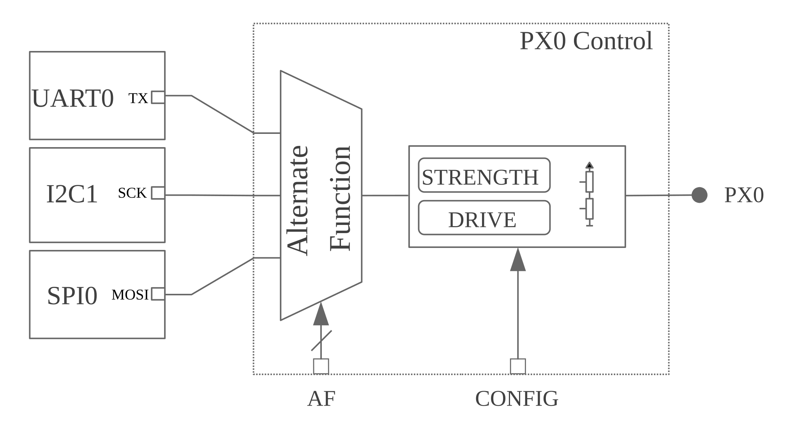
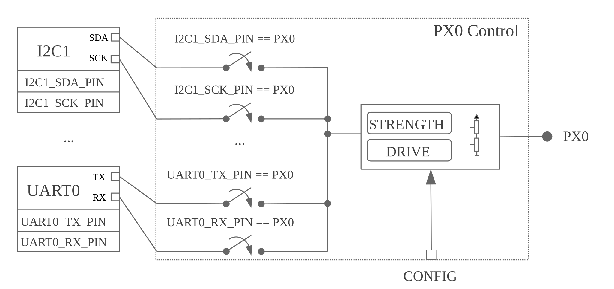

<!-- Copyright 2015-2026 Zephyr Project members and individual contributors. -->
<!-- SPDX-License-Identifier: Apache-2.0 -->
<!-- 中文翻译；阅读编号、导航和译注为本地新增。 -->

# 第4章\_引脚控制

原文：[Pin Control](https://docs.zephyrproject.org/latest/hardware/pinctrl/index.html)。读取日期：2026-10-12，`latest`。

本页从整体介绍**引脚控制（Pin Control，pinctrl）**，具体接口见[官方 Pin Control API](../pinctrl_reference/P001_引脚控制公共接口.md)。

## 4.1\_引脚控制器及其硬件实现

控制引脚复用、方向、上下拉等参数的硬件块称为引脚控制器。它主要服务于 **片上系统（System on Chip，SoC）** 外设，把内部信号连接到外部引脚，例如把 `I2C0` 的 `SDA` 映射到 `PX0`。

它通常还设置外设正常工作所需的电气参数，例如按工作频率选择转换速率（slew rate）。可用配置依厂商和 SoC 而异，从上下拉到去抖、低功耗模式等都有可能。

一种常见实现是集中式控制：包含信号映射在内的全部参数由一个硬件块控制，通常称为 pinmux。下图中，`AF` 控制位决定 `PX0` 连接 `UART0_TX`、`I2C0_SCK` 还是 `SPI0_MOSI`；同一硬件块的 `CONFIG` 位配置上下拉等参数。许多 NXP、STM32 SoC 采用这种方式。



其他厂商采用分布式控制，由多个硬件块共同决定映射和配置。例如 Nordic nRF 的信号映射由外设自身寄存器控制：



使用者无须区分这些实现，始终通过“应用一个状态”来配置引脚。差别在驱动内部；分布式硬件通常更难实现，因为引脚驱动还要掌握相关外设寄存器。

### 4.1.1\_引脚控制与GPIO的区别

引脚控制与 **通用输入输出（General-Purpose Input/Output，GPIO）** 的功能存在交集，例如两者通常都能设置上下拉。Zephyr 中，引脚控制驱动负责外设信号复用及外设正确运行所需的引脚参数，主要使用者是 SoC 外设。GPIO 驱动负责通用引脚控制，即由软件直接读取或控制逻辑电平。

## 4.2\_状态模型

设备驱动正常工作前需要应用某组引脚配置。有些驱动只在初始化时设置一次；另一些会随运行条件切换，例如挂起设备时进入低功耗模式。

Zephyr 用从 Linux 内核借鉴的“状态”模型表达这些需求。每个设备驱动拥有一组状态，每个状态名称唯一，并包含完整引脚配置。状态彼此独立，无须按特定先后顺序应用；这种方式也使设备驱动与具体引脚配置分离。

原文以 `UART0` 为例：

| 信号 | `default` 状态 | `sleep` 状态 |
| --- | --- | --- |
| TX | PA0；无上下拉；不启用低功耗 | PA0；无上下拉；启用低功耗 |
| RX | PA1；上拉；不启用低功耗 | PA1；无上下拉；启用低功耗 |

### 4.2.1\_标准状态

状态的数量和名称取决于驱动需求。很多驱动只需初始化时应用一个状态，也有驱动需要多个。为保持常见用法一致，规定以下标准名称：

| 状态名 | 标识符 | 用途 |
| --- | --- | --- |
| `default` | `PINCTRL_STATE_DEFAULT` | 设备正常工作时的引脚状态。 |
| `sleep` | `PINCTRL_STATE_SLEEP` | 设备处于低功耗或休眠模式时的引脚状态。 |

以后还可能增加其他标准状态。

### 4.2.2\_自定义状态

驱动可以定义标准集合之外的状态。对应标识符应为 `PINCTRL_STATE_{STATE_NAME}`，后半部分是状态名的大写形式。例如 `mystate` 需要在驱动可见范围内定义 `PINCTRL_STATE_MYSTATE`。

自定义状态编号必须从 `PINCTRL_STATE_PRIV_START` 起分配。若驱动外部也需访问这些状态，例如动态引脚控制，应把标识符放在公开头文件中。

### 4.2.3\_跳过不使用的状态

通常，设备树定义的状态都会进入固件。但某些状态只有在特定编译配置下才使用，例如 `sleep` 通常只在启用 `CONFIG_PM` 或 `CONFIG_PM_DEVICE` 时使用。没有电源管理功能的固件若仍保存它，就会浪费只读存储空间。

定义引脚配置时，如果存在展开为 `1` 的 `PINCTRL_SKIP_{STATE_NAME}`，设备树宏会跳过该状态。**应用程序编程接口（Application Programming Interface，API）** 已为 `sleep` 提供以下条件定义：

```c
#if !defined(CONFIG_PM) && !defined(CONFIG_PM_DEVICE)
/** Out of power management configurations, ignore "sleep" state. */
#define PINCTRL_SKIP_SLEEP 1
#endif
```

> 译注——配置条件更新：以上代码保留官方指南原文。本次核对的头文件已通过 `CONFIG_PINCTRL_KEEP_SLEEP_STATE` 决定是否跳过 `sleep`；Kconfig 在 `PM`、`PM_DEVICE` 或 `DEVICE_DEINIT_SUPPORT` 启用时默认保留该状态。具体条件与源码见[引脚控制驱动头文件](../pinctrl_reference/P007_引脚控制驱动头文件源码.md)及[公共接口译注](../pinctrl_reference/P001_引脚控制公共接口.md)，不能把指南中的旧条件视为所有版本的当前实现。

## 4.3\_动态引脚控制

动态引脚控制允许在运行时更换引脚配置。例如，同一固件要运行在外设接到不同引脚的几种相近板型上，可以启用 `CONFIG_PINCTRL_DYNAMIC`。

原文要求只对尚未初始化的设备使用动态配置。设备工作期间更换引脚可能产生意外行为；原文基于“尚不支持设备反初始化”的前提，将使用时机限制在早期启动阶段。

启用后，`pinctrl_dev_config` 会从 **只读存储器（Read-Only Memory，ROM）** 改为存放在 **随机存取存储器（Random Access Memory，RAM）**；这不意味着状态本身或引脚配置数组也会一同转入 RAM。用户可用 `pinctrl_update_states()` 替换该结构引用的状态集合，之后驱动应用状态时就会使用新配置。

> 译注：这里的动态配置是替换设备使用的状态集合，和正常电源管理中在已定义 `default`、`sleep` 间切换不是同一操作。原文关于反初始化的笼统表述带有版本背景；即使某版本或某驱动提供反初始化，也不能据此推断正在运行的外设可随意更换引脚。

## 4.4\_设备树中的表达方式

设备树用于描述硬件，因此适合存储引脚控制配置。状态和具体引脚参数分别按以下方式表示。

### 4.4.1\_状态属性

每个状态对应一个 `pinctrl-N` 属性，`N` 从零开始。`pinctrl-names` 按相同索引给状态命名，例如第 0 个名称对应 `pinctrl-0`：

```dts
periph0: periph@0 {
    ...
    /* state 0 ("default") */
    pinctrl-0 = <...>;
    ...
    /* state N ("mystate") */
    pinctrl-N = <...>;
    /* names for state 0 up to state N */
    pinctrl-names = "default", ..., "mystate";
    ...
};
```

### 4.4.2\_按公共配置分组

具体引脚表示方法可以不同，但最终都编码信号复用和电气参数，例如 `UART_RX` 映射到 `PX0` 并启用上拉。表示方式主要取决于厂商和 SoC，详细规则应查对应引脚控制绑定。

一种常见通用方案是把具有相同配置的引脚分组，减少重复，并将同一状态的全部参数放在一个节点中。板文件先关联状态：

```dts
/* board.dts */
#include "board-pinctrl.dtsi"

&periph0 {
    pinctrl-0 = <&periph0_default>;
    pinctrl-names = "default";
};
```

封装专用头文件列出有效映射，文件可自动生成；它不是必需，但推荐提供：

```c
/* vnd-soc-pkgxx.h
 * File with valid mappings for a specific package (may be autogenerated).
 * This file is optional, but recommended.
 */
...
#define PERIPH0_SIGA_PX0 VNDSOC_PIN(X, 0, MUX0)
#define PERIPH0_SIGB_PY7 VNDSOC_PIN(Y, 7, MUX4)
#define PERIPH0_SIGC_PZ1 VNDSOC_PIN(Z, 1, MUX2)
...
```

引脚文件用分组安排配置。`group1` 把信号 A、C 映射到 PX0、PZ1，并对两者启用上拉；`groupN` 把信号 B 映射到 PY7：

```dts
/* board-pinctrl.dtsi */
#include <vnd-soc-pkgxx.h>

&pinctrl {
    /* Node with pin configuration for default state */
    periph0_default: periph0_default {
        group1 {
            /* Mappings: PERIPH0_SIGA -> PX0, PERIPH0_SIGC -> PZ1 */
            pinmux = <PERIPH0_SIGA_PX0>, <PERIPH0_SIGC_PZ1>;
            /* Pins PX0 and PZ1 have pull-up enabled */
            bias-pull-up;
        };
        ...
        groupN {
            /* Mappings: PERIPH0_SIGB -> PY7 */
            pinmux = <PERIPH0_SIGB_PY7>;
        };
    };
};
```

### 4.4.3\_每个映射和状态单独建节点

另一种常见方式是为每个引脚配置及状态创建节点。板文件可能更短，但每个映射/状态组合都要有节点，通常不能让多个状态复用同一个节点。无法自动生成这些定义时，不推荐此方式。

设备树最终会被解析成 C 头文件，应尽量控制其大小。因此，预生成节点必须加 `/omit-if-no-ref/`，保证未使用的节点被丢弃。

板文件引用多个节点：

```dts
/* board.dts */
#include "board-pinctrl.dtsi"

&periph0 {
    pinctrl-0 = <&periph0_siga_px0_default &periph0_sigb_py7_default
                 &periph0_sigc_pz1_default>;
    pinctrl-names = "default";
};
```

封装文件提供各有效映射节点，同样可以自动生成：

```dts
/* vnd-soc-pkgxx.dtsi
 * File with valid nodes for a specific package (may be autogenerated).
 * This file is optional, but recommended.
 */

&pinctrl {
    /* Mapping for PERIPH0_SIGA -> PX0, to be used for default state */
    /omit-if-no-ref/ periph0_siga_px0_default: periph0_siga_px0_default {
        pinmux = <VNDSOC_PIN(X, 0, MUX0)>;
    };

    /* Mapping for PERIPH0_SIGB -> PY7, to be used for default state */
    /omit-if-no-ref/ periph0_sigb_py7_default: periph0_sigb_py7_default {
        pinmux = <VNDSOC_PIN(Y, 7, MUX4)>;
    };

    /* Mapping for PERIPH0_SIGC -> PZ1, to be used for default state */
    /omit-if-no-ref/ periph0_sigc_pz1_default: periph0_sigc_pz1_default {
        pinmux = <VNDSOC_PIN(Z, 1, MUX2)>;
    };
};
```

板级文件为 PX0 和 PZ1 的默认状态补充上拉：

```dts
/* board-pinctrl.dts */
#include <vnd-soc-pkgxx.dtsi>

/* Enable pull-up for PX0 (default state) */
&periph0_siga_px0_default {
    bias-pull-up;
};

/* Enable pull-up for PZ1 (default state) */
&periph0_sigc_pz1_default {
    bias-pull-up;
};
```

不建议在预定义节点中设置引脚电气默认值。这些选择通常依赖板设计或外设工作条件，应由板决定。例如板上已有上拉，或需要按总线速度选择上拉值时，预先启用内部上拉可能不合适；使用者也可能没注意到隐藏的默认值。原文反例如下，节点名没有明显表明它还隐含上拉：

```dts
/* not evident that "periph0_siga_px0_default" also implies "bias-pull-up" */
/omit-if-no-ref/ periph0_siga_px0_default: periph0_siga_px0_default {
    pinmux = <VNDSOC_PIN(X, 0, MUX0)>;
    bias-pull-up;
};
```

## 4.5\_引脚控制驱动的实现要求

引脚控制驱动只需实现一个接口：`pinctrl_configure_pins()`。它接收要应用的引脚配置数组；启用 `CONFIG_PINCTRL_STORE_REG` 时，还会获得对应设备的寄存器地址，一些驱动需要它执行设备专用操作。

引脚配置用厂商/SoC 专用的不透明类型 `pinctrl_soc_pin_t` 保存。该类型须在可由 Zephyr 包含路径找到的 `pinctrl_soc.h` 中定义，可以是简单整数，也可以是含多个字段的结构。

该头文件还须定义 `Z_PINCTRL_STATE_PINS_INIT` 宏，接收节点标识符和属性名 `pinctrl-N` 两个参数，并生成该属性所包含全部引脚配置的初始化内容。

厂商可以选择适合自己硬件的设备树表示，但应遵循两条规则：

- 用 `pinctrl-N`（`N=0, 1, …`）和 `pinctrl-names` 定义状态；属性由 `dts/bindings/pinctrl/pinctrl-device.yaml` 规定。
- 用 `dts/bindings/pinctrl/pincfg-node.yaml` 定义的标准引脚配置属性。

如果同一厂商在 Linux 等其他操作系统中已经使用另一种表示，不符合这两条的方案也可能被接受。

## 4.6\_外设驱动如何使用引脚控制

首先，在设备 compatible 对应的绑定中包含 `pinctrl-device.yaml`，引入状态属性：

```yaml
include: [base.yaml, pinctrl-device.yaml]
```

驱动侧再完成两个步骤：

1. 用 `PINCTRL_DT_DEFINE` 或 `PINCTRL_DT_INST_DEFINE` 定义全部状态和引脚配置。
2. 保存设备实例对应的 `pinctrl_dev_config` 引用，后续 API 调用需要它。可通过 `PINCTRL_DT_DEV_CONFIG_GET` 或 `PINCTRL_DT_INST_DEV_CONFIG_GET` 获取。

设备与引脚配置的关联仅基于变量命名约定。通过设备树节点标识符即可找到对应配置结构，因此只有真正需要引脚控制的设备才保存引用，减少 ROM 占用。

定义配置并保存引用后，通常调用 `pinctrl_apply_state()` 应用状态。如果提前缓存了状态，例如在初始化时查找，也可以用底层 `pinctrl_apply_state_direct()` 省去再次查找。不过状态查找预计很快，推荐使用普通接口。

原文给出包含配置定义、引用保存、初始化时应用默认状态及实例展开的驱动示例：

```c
/* A driver for the "mydev" compatible device */
#define DT_DRV_COMPAT mydev

...
#include <zephyr/drivers/pinctrl.h>
...

struct mydev_config {
    ...
    /* Reference to mydev pinctrl configuration */
    const struct pinctrl_dev_config *pcfg;
    ...
};

...

static int mydev_init(const struct device *dev)
{
    const struct mydev_config *config = dev->config;
    int ret;
    ...
    /* Select "default" state at initialization time */
    ret = pinctrl_apply_state(config->pcfg, PINCTRL_STATE_DEFAULT);
    if (ret < 0) {
        return ret;
    }
    ...
}

#define MYDEV_DEFINE(i)                                                    \
    /* Define all pinctrl configuration for instance "i" */                \
    PINCTRL_DT_INST_DEFINE(i);                                             \
    ...                                                                    \
    static const struct mydev_config mydev_config_##i = {                  \
        ...                                                                \
        /* Keep a ref. to the pinctrl configuration for instance "i" */    \
        .pcfg = PINCTRL_DT_INST_DEV_CONFIG_GET(i),                         \
        ...                                                                \
    };                                                                     \
    ...                                                                    \
                                                                           \
    DEVICE_DT_INST_DEFINE(i, mydev_init, NULL, &mydev_data##i,             \
                          &mydev_config##i, ...);

DT_INST_FOREACH_STATUS_OKAY(MYDEV_DEFINE)
```

> 译注：这是包含 `...` 的说明骨架。原文配置变量定义为 `mydev_config_##i`，最后却引用 `mydev_config##i`，少了连接编号前的下划线；实际代码应保持两处一致。运行数据、API、初始化等级和成功返回等省略内容也必须补全，不能直接把该片段当作可编译驱动。

## 4.7\_接口、示例与其他参考

- [Pin Control API](../pinctrl_reference/P001_引脚控制公共接口.md)：常规引脚控制接口。
- [Dynamic Pin Control API](../pinctrl_reference/P002_动态引脚控制接口.md)：动态状态配置接口。
- [主时钟输出示例](https://docs.zephyrproject.org/latest/samples/boards/st/mco/README.html)：将内部时钟输出到外部，供应用使用。
- [Linux 引脚复用与 GPIO 控制介绍](https://elinux.org/images/a/a7/ELC-2021_Introduction_to_pin_muxing_and_GPIO_control_under_Linux.pdf)：原文推荐的其他参考材料。

---

<!-- reading-navigation:start -->

**主线阅读**

[上一篇：设备驱动模型](P003_设备驱动模型.md) · [本模块主线目录](../reading/hardware.md) · [全部主线](../reading/README.md) · [下一篇：通用输入输出GPIO](P005_GPIO.md)

<details>
<summary>原册编号导航（含扩展参考）</summary>

[上一章：设备驱动模型](P003_设备驱动模型.md) · [下一章：GPIO](P005_GPIO.md) · [返回大纲](大纲.md)

</details>

<!-- reading-navigation:end -->
