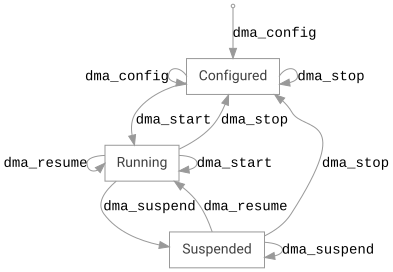

<!-- Copyright 2015-2026 Zephyr Project members and individual contributors. -->
<!-- SPDX-License-Identifier: Apache-2.0 -->
<!-- 中文翻译；阅读编号、导航和译注为本地新增。 -->

# 第11章\_DMA直接内存访问

原文：[Direct Memory Access (DMA)](https://docs.zephyrproject.org/latest/hardware/peripherals/dma.html)。读取日期：2026-10-12，`latest`。

**直接内存访问（Direct Memory Access，DMA）**控制器是一类常见协处理器，可以分担外设与内存之间的数据传输。

DMA 接口不是能完全跨硬件移植的接口：不同控制器有不同的内存要求、外设交互和功能。该接口实际上汇集了树内驱动需要的各种 DMA 能力。对于 DMA IP 大体相同、仅细节不同的平台，谨慎使用仍能形成合适抽象。

DMA 驱动通常不处理缓存一致性，由开发者根据应用负责；相关背景见[缓存基础](https://docs.zephyrproject.org/latest/hardware/cache/guide.html)。

## 11.1\_同步与所有权

从接口角度看，DMA 通道是单一所有者对象。驱动不应为每通道包装互斥量或信号量等内核同步原语。多个通道需要修改共享寄存器时，应以自旋锁保护寄存器更新。

这样接口开销较低，并可从包括**中断服务例程（Interrupt Service Routine，ISR）**在内的各种上下文调用。在 ISR 中启动、停止、挂起、恢复或重新装载传输可能很有用。

> 译注：单一所有者要求调用方管理通道归属，不代表多个无关上下文可无协调地重配同一通道。实际支持哪些操作仍取决于具体驱动和硬件能力。

## 11.2\_传输描述符内存管理

驱动不应使用任何堆分配。需要传输描述符对象池时，其设计也必须保持接口可在 ISR 中调用。许多驱动为每通道建立静态描述符数组，通过 Kconfig 调整数组大小。

## 11.3\_通道状态机

应把通道视为状态机，DMA 接口调用产生状态转移事件。每个驱动自行维护通道状态，调用者应随时能通过 `dma_get_status()` 查询忙状态。

图中的 `Configured`、`Running`、`Suspended` 分别表示已配置、运行中和已挂起。完整转移如下：

| 当前状态 | 调用 | 目标状态 |
| --- | --- | --- |
| 初始 | `dma_config` | 已配置 |
| 已配置 | `dma_start` | 运行中 |
| 已配置 | `dma_stop` | 已配置 |
| 已配置 | `dma_config` | 已配置 |
| 运行中 | `dma_stop` | 已配置 |
| 运行中 | `dma_start` | 运行中 |
| 运行中 | `dma_resume` | 运行中 |
| 运行中 | `dma_suspend` | 已挂起 |
| 已挂起 | `dma_suspend` | 已挂起 |
| 已挂起 | `dma_resume` | 运行中 |
| 已挂起 | `dma_stop` | 已配置 |

## 11.4\_接口与示例

完整参考见 [DMA 接口](../dma_reference/P001_DMA公共接口.md)。[NXP SmartDMA 内存到内存示例](https://docs.zephyrproject.org/latest/samples/boards/nxp/smartdma_mem_to_mem/README.html)使用协处理器，经 Zephyr DMA 接口完成内存间传输。

---

<!-- reading-navigation:start -->

**主线阅读**

[上一篇：DAC数模转换](P010_DAC数模转换.md) · [本模块主线目录](../reading/hardware.md) · [全部主线](../reading/README.md) · [下一篇：Flash闪存](P012_Flash闪存.md)

原册编号导航（含扩展参考）

[上一章：DAC数模转换](P010_DAC数模转换.md) · [下一章：Flash闪存](P012_Flash闪存.md) · [返回大纲](大纲.md)

<!-- reading-navigation:end -->
