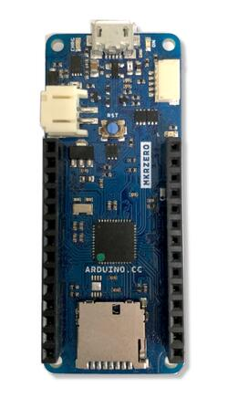
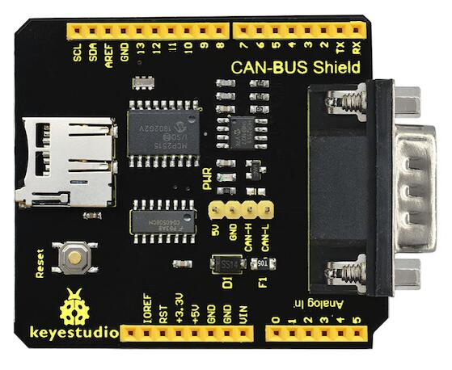
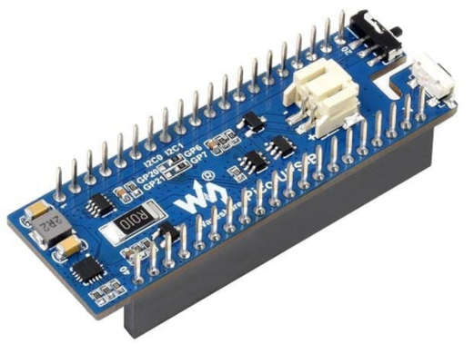
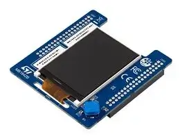
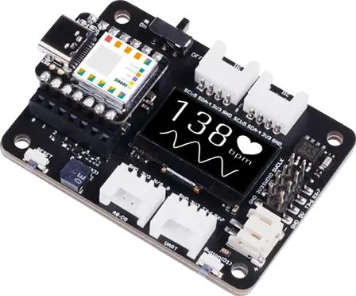

<!-- Copyright 2015-2026 Zephyr Project members and individual contributors. -->
<!-- SPDX-License-Identifier: Apache-2.0 -->
<!-- 中文翻译；阅读编号、导航和译注为本地新增。 -->

# 第28章\_扩展板移植

原文：[Shields](https://docs.zephyrproject.org/latest/hardware/porting/shields.html)。读取日期：2026-10-12，`latest`。

**扩展板（Shield）**，也称附加板（add-on）或子板（daughter board），连接到开发板上，为其增加功能和服务，便于模块化原型开发。Zephyr 的 shield 功能使用符合 Zephyr 格式的扩展板描述，简化与应用程序的配合。

## 28.1\_启用扩展板

在 west 命令中增加对应的 `--shield` 参数，可以启用一个或多个扩展板：

```shell
west build -b your_board --shield x_nucleo_idb05a1 --shield x_nucleo_iks01a1 your_app
```

也可以在项目的 `CMakeLists.txt` 中设为默认值：

```cmake
set(SHIELD x_nucleo_iks01a1)
```

## 28.2\_扩展板接口如何连接

扩展板有两个关键特征：物理连接器决定机械接口，电气信号决定每个引脚实际承担的功能。开发板与扩展板之间的连接通过设备树文件描述。

开发板一侧，设备树使用 **通用输入输出（General-Purpose Input/Output，GPIO）** nexus 节点，把连接器引脚映射到微控制器的实际 GPIO 引脚；还为连接器引出的总线定义节点标签，例如 `arduino_i2c`、`arduino_spi` 和 `arduino_uart`。扩展板一侧，`.overlay` 文件引用这些标签，描述其元件如何连接到开发板。构建时，开发板设备树与扩展板 overlay 合并，形成完整的硬件配置。

例如，开发板带有 Arduino 连接器，但没有板载加速度计，可以通过 Arduino 扩展板添加。开发板设备树中的 `arduino_i2c` 标签表示 Arduino 连接器引出的 **集成电路间总线（Inter-Integrated Circuit，I2C）** 总线；加速度计扩展板的 overlay 也引用 `arduino_i2c`，表明使用同一总线。如果还需要连接器上的 GPIO，则引用开发板定义的 nexus 节点，例如 `arduino_header`。针对该开发板和扩展板构建时，Zephyr 会自动完成描述层面的连接。

> 原文注意：部分开发板和扩展板只支持某种硬件接口的部分功能，具体应查阅各自文档。
>
> 译注：合并设备树不会改变实体接线、电平或电源能力。下面保留各接口实际使用的节点标签；例如 Arduino Uno R3 的串口标签是 `arduino_serial`，不要把前述概念示例中的名称当作所有板卡统一提供的标签。

### 28.2.1\_Arduino MKR

这是 Arduino MKR 系列开发板的外形与连接器规格。



相关节点标签为 `arduino_mkr_header`、`arduino_mkr_i2c`、`arduino_mkr_spi`、`arduino_mkr_serial`。GPIO 引脚定义及设备树包含文件见 [arduino-mkr-header](../gpio_adi_headers_ambiq_binding_reference/P025_arduino-mkr-header.md#std-dtcompatible-arduino-mkr-header)。

### 28.2.2\_Arduino Nano

这是 Arduino Nano 系列开发板的外形与连接器规格。


相关节点标签为 `arduino_nano_header`、`arduino_nano_i2c`、`arduino_nano_spi`、`arduino_nano_serial`。GPIO 引脚定义及设备树包含文件见 [arduino-nano-header](../gpio_adi_headers_ambiq_binding_reference/P026_arduino-nano-header.md#std-dtcompatible-arduino-nano-header)。

### 28.2.3\_Arduino Uno R3

这是 Arduino Uno R3 开发板的外形与连接器规格。



相关节点标签及绑定如下：

| 节点标签 | 定义 |
| --- | --- |
| `arduino_header` | [arduino-header-r3](../gpio_adi_headers_ambiq_binding_reference/P023_arduino-header-r3.md#std-dtcompatible-arduino-header-r3)，GPIO 引脚定义与包含文件 |
| `arduino_adc` | [arduino,uno-adc](https://docs.zephyrproject.org/latest/build/dts/api/bindings/adc/arduino%2Cuno-adc.html#std-dtcompatible-arduino-uno-adc) |
| `arduino_pwm` | [arduino-header-pwm](../pwm_adi_esp_infineon_binding_reference/P006_arduino-header-pwm.md#std-dtcompatible-arduino-header-pwm) |
| `arduino_serial`、`arduino_i2c`、`arduino_spi` | 串口、I2C 和 **串行外设接口（Serial Peripheral Interface，SPI）** 总线 |

技术细节见 [Arduino Uno R3 引脚图](https://docs.arduino.cc/resources/pinouts/A000066-full-pinout.pdf)。

### 28.2.4\_摄像头与显示器连接器

这些绑定描述摄像头与显示器连接，严格说来不属于扩展板：

- [arducam,dvp-20pin-connector](../gpio_adi_headers_ambiq_binding_reference/P021_arducam_dvp-20pin-connector.md#std-dtcompatible-arducam-dvp-20pin-connector)。
- [nxp,cam-44pins-connector](../gpio_microchip_nordic_nuvoton_binding_reference/P026_nxp_cam-44pins-connector.md#std-dtcompatible-nxp-cam-44pins-connector)。
- [nxp,parallel-lcd-connector](../gpio_nxp_expanders_binding_reference/P008_nxp_parallel-lcd-connector.md#std-dtcompatible-nxp-parallel-lcd-connector)。
- [raspberrypi,csi-connector](../gpio_raspberrypi_renesas_binding_reference/P004_raspberrypi_csi-connector.md#std-dtcompatible-raspberrypi-csi-connector)。
- [st,dsi-lcd-qsh-030-connector](../gpio_silabs_st_connectors_binding_reference/P025_st_dsi-lcd-qsh-030-connector.md#std-dtcompatible-st-dsi-lcd-qsh-030-connector)。
- [st,dvp-cam-zif-30-connector](../gpio_silabs_st_connectors_binding_reference/P026_st_dvp-cam-zif-30-connector.md#std-dtcompatible-st-dvp-cam-zif-30-connector)。
- [weact,dcmi-camera-connector](../gpio_ti_xilinx_sdl_binding_reference/P025_weact_dcmi-camera-connector.md#std-dtcompatible-weact-dcmi-camera-connector)。

### 28.2.5\_ESP-01

这是 ESP-01 Wi-Fi 模块使用的八针排针接口。相关节点标签为 `esp_01_header` 和 `esp_01_serial`；GPIO 引脚定义及包含文件见 [esp-01-header](../gpio_connectors_bflb_esp_binding_reference/P021_esp-01-header.md#std-dtcompatible-esp-01-header)。

### 28.2.6\_Feather

这是 Adafruit Feather 系列开发板的外形与连接器规格，配套扩展板称为 Featherwing。


相关节点标签为 `feather_header`、`feather_adc`、`feather_i2c`、`feather_serial`、`feather_spi`。GPIO 引脚定义见 [adafruit-feather-header](../gpio_adi_headers_ambiq_binding_reference/P001_adafruit-feather-header.md#std-dtcompatible-adafruit-feather-header)。

### 28.2.7\_Microbit

这是 Microbit 开发板的板边连接器接口。


GPIO 引脚定义与技术要求链接见 [microbit,edge-connector](../gpio_infineon_intel_ite_microchip_binding_reference/P019_microbit_edge-connector.md#std-dtcompatible-microbit-edge-connector)。

### 28.2.8\_mikroBUS™

这是 Mikroe 制定的附加板接口标准。


相关节点标签为 `mikrobus_header`、`mikrobus_adc`、`mikrobus_i2c`、`mikrobus_pwm`、`mikrobus_spi`、`mikrobus_serial`。GPIO 引脚定义与技术规范链接见 [mikro-bus](../gpio_microchip_nordic_nuvoton_binding_reference/P006_mikro-bus.md#std-dtcompatible-mikro-bus)。有多个 mikroBUS™ 连接器的开发板可能使用带编号的标签，例如 `mikrobus_2_spi`。

### 28.2.9\_Pico

这是 Raspberry Pi Pico 系列开发板的外形与连接器规格。



相关节点标签为 `pico_header`、`pico_i2c`、`pico_i2c0`、`pico_i2c1`、`pico_serial`、`pico_spi`。GPIO 引脚定义见 [raspberrypi,pico-header](../gpio_raspberrypi_renesas_binding_reference/P007_raspberrypi_pico-header.md#std-dtcompatible-raspberrypi-pico-header)。其中 `pico_i2c` 与 `pico_i2c0` 或 `pico_i2c1` 指向同一个节点，表示优先使用或默认使用的 I2C 接口。

### 28.2.10\_ST Morpho

STMicroelectronics 的开发板经常使用 ST Morpho 扩展板接口。



相关节点标签为 `st_morpho_header`、`st_morpho_lcd_spi`、`st_morpho_flash_spi`。GPIO 引脚定义及包含文件见 [st-morpho-header](../gpio_ti_xilinx_sdl_binding_reference/P003_st-morpho-header.md#std-dtcompatible-st-morpho-header)。

### 28.2.11\_ST Zio

STMicroelectronics 的 STM32 Nucleo-144 开发板提供 ST Zio 连接器。它扩展 Arduino Uno V3 连接器，通过 CN7、CN8、CN9、CN10 四组排针引出更多 STM32 I/O。

相关节点标签是 `st_zio_header`。GPIO 引脚定义及包含文件见 [st-zio-header](../gpio_ti_xilinx_sdl_binding_reference/P004_st-zio-header.md#std-dtcompatible-st-zio-header)。

### 28.2.12\_STMod+

这是部分 STMicroelectronics Discovery 和 Evaluation 开发板上的二十针扩展连接器。

相关节点标签为 `stmod_plus_connector`、`stmod_adc`、`stmod_i2c`、`stmod_pwm`、`stmod_serial`、`stmod_spi`。GPIO 引脚定义及包含文件见 [st,stmod-plus-connector](../gpio_ti_xilinx_sdl_binding_reference/P001_st_stmod-plus-connector.md#std-dtcompatible-st-stmod-plus-connector)。如果某个外设连接到了 STMod+，且已在开发板设备树中启用，开发板还可以提供其他接口标签。

### 28.2.13\_WisBlock

这是 RAKwireless 制定的模块化附加板接口标准。它定义 Core、Sensor、I/O 和 Power 插槽，通过二十四针或四十针 WisConnector 接收相应类别的模块。


相关节点标签为 `wisblock_io`、`wisblock_sensor_a`、`wisblock_adc`、`wisblock_pwm`、`wisblock_i2c1`、`wisblock_i2c2`、`wisblock_i2s`、`wisblock_pdm`、`wisblock_spi`、`wisblock_uart0`、`wisblock_uart1`。GPIO 定义分别见 [wisblock-io-slot](../gpio_ti_xilinx_sdl_binding_reference/P026_wisblock-io-slot.md#std-dtcompatible-wisblock-io-slot) 和 [wisblock-sensor-slot](../gpio_ti_xilinx_sdl_binding_reference/P027_wisblock-sensor-slot.md#std-dtcompatible-wisblock-sensor-slot)。传感器插槽按其实现的槽位命名为 `wisblock_sensor_a` 到 `wisblock_sensor_f`。

### 28.2.14\_Xiao

这是 Seeeduino XIAO 系列开发板的外形与连接器规格。



相关节点标签为 `xiao_d`、`xiao_spi`、`xiao_i2c`、`xiao_serial`、`xiao_adc`、`xiao_dac`。GPIO 定义见 [seeed,xiao-gpio](../gpio_silabs_st_connectors_binding_reference/P005_seeed_xiao-gpio.md#std-dtcompatible-seeed-xiao-gpio)。

### 28.2.15\_zephyr_i2c、Stemma QT与Qwiic

这些是四针 I2C 连接器。SparkFun 称其为 Qwiic，Adafruit 称其为 Stemma QT。四根引脚分别是 GND、+3.3 V、I2C 数据和 I2C 时钟，最常见的物理连接器是间距 1.0 mm 的 JST-SH。由于品牌名称不同，统一的接口标签采用 `zephyr_i2c`。


说明及进一步资料见 [stemma-qt-connector](../gpio_ti_xilinx_sdl_binding_reference/P005_stemma-qt-connector.md#std-dtcompatible-stemma-qt-connector) 和 [grove-header](../gpio_connectors_bflb_esp_binding_reference/P029_grove-header.md#std-dtcompatible-grove-header)。相关节点标签为 `zephyr_i2c`。

> 译注：原文标题将 Qwiic 写成 `Quiic`，正文为 Qwiic；这里按正文统一名称。

### 28.2.16\_ST M.2串行存储器连接器

部分 STMicroelectronics Nucleo-144 开发板提供 ST 专用的 M.2 串行存储器连接器，通过 XSPI 接入外部串行存储器，并提供 I2C、连接器 GPIO 等辅助信号。


相关节点标签为 `m2mem_connector`、`m2mem_i2c`、`m2mem_xspi`。GPIO 引脚定义及包含文件见 [st,m2-memory-connector](../gpio_silabs_st_connectors_binding_reference/P027_st_m2-memory-connector.md#std-dtcompatible-st-m2-memory-connector)。

## 28.3\_扩展板移植与配置

扩展板配置位于 [boards/shields](https://github.com/zephyrproject-rtos/zephyr/blob/main/boards/shields) 目录：

```text
boards/shields/<shield>
├── shield.yml
├── <shield>.overlay
├── Kconfig.shield
├── Kconfig.defconfig
└── pre_dt_shield.cmake
```

各文件职责如下：

| 文件 | 职责 |
| --- | --- |
| `shield.yml` | 以 YAML 描述扩展板元数据，字段见下表 |
| `<shield>.overlay` | 使用设备树格式描述扩展板，在编译前与开发板设备树合并 |
| `Kconfig.shield` | 定义默认扩展板配置使用的 Kconfig 符号。为便于应用使用，默认设置应与开发板移植指南的设备树编写约定一致 |
| `Kconfig.defconfig` | 定义扩展板默认配置，并遵循相同约定；配置时应牢记具体功能是否启用由应用负责 |
| `pre_dt_shield.cmake` | 可选文件，用于向设备树编译器 `dtc` 传入额外参数 |

上述设备树说明见[设备树文档](https://docs.zephyrproject.org/latest/build/dts/index.html#dt-guide)，默认配置约定见[开发板移植指南](https://docs.zephyrproject.org/latest/hardware/porting/board_porting.html#default-board-configuration)。

| `shield.yml` 字段 | 是否必需 | 含义 |
| --- | --- | --- |
| `name` | 是 | Kconfig 和构建系统使用的扩展板名称 |
| `full_name` | 是 | 扩展板完整商业名称 |
| `vendor` | 是 | 制造商或供应商 |
| `supported_features` | 否 | 支持的硬件功能列表，使用户无须深入阅读 overlay 即可了解能力。取值应与 [dts/bindings/binding-types.txt](https://github.com/zephyrproject-rtos/zephyr/blob/main/dts/bindings/binding-types.txt) 中的功能类型一致 |

示例：

```yaml
name: foo_shield
full_name: Foo Shield for Arduino
vendor: acme
supported_features:
  - display
  - input
```

为避免与开发板定义的设备发生名称冲突，扩展板设备树尤其应使用 `<device>_<shield>` 形式的节点标签，例如：

```dts
sdhc_myshield: sdhc@1 {
        reg = <1>;
        ...
};
```

### 28.3.1\_添加源代码

扩展板可以添加源代码，用于满足该扩展板专有的配置要求，例如初始化过程、时序限制，使它能够与 Zephyr 各组件正常协作。添加 `CMakeLists.txt` 和对应源文件，再像开发板等其他 Zephyr 目录一样在 CMake 中引用这些源文件即可。

> 原文注意：扩展板中的源代码只能用于上述目的；能够在多个扩展板或目标间复用的通用功能不应放在这里。

## 28.4\_与开发板的兼容性

硬件兼容性依赖流行开发板使用的通用连接器，例如 Arduino、96boards；软件兼容性还要求开发板提供与所支持连接器匹配的配置。这需要两个层面配合：引脚复用配置（Pinmux）应使连接器引脚与扩展板引脚匹配；开发板设备树 `BOARD.dts` 应为每个连接器接口提供附加节点标签。例如 Arduino I2C：

```dts
arduino_i2c: &i2c1 {};
```

### 28.4.1\_针对特定开发板的扩展板配置

如果扩展板需要针对某个开发板或开发板修订版进行调整，可以在扩展板目录中增加相应的覆盖文件：

```text
boards/shields/<shield>
└── boards
    ├── <board>_<revision>.overlay
    ├── <board>.overlay
    ├── <board>.defconfig
    ├── <board>_<revision>.conf
    └── <board>.conf
```

## 28.5\_扩展板变体

有些扩展板支持多个变体或修订版，可以提供多套描述：

```text
boards/shields/<shield>
├── <shield_v1>.overlay
├── <shield_v1>.defconfig
├── <shield_v2>.overlay
└── <shield_v2>.defconfig
```

构建时使用对应扩展板修订版的名称：

```shell
west build -b None --shield shield_v2 your_app
```

> 译注：以上原文命令保留了 `-b None`。实际构建应将 `None` 替换为有效的开发板目标，不能据此认为 `None` 是通用开发板名。

也可以为特定扩展板修订版提供开发板专用配置：

```text
boards/shields/<shield>
├── <shield_v1>.overlay
├── <shield_v1>.defconfig
├── <shield_v2>.overlay
├── <shield_v2>.defconfig
└── boards
    └── <shield_v2>
        ├── <board>.overlay
        └── <board>.defconfig
```

## 28.6\_GPIO nexus节点

扩展板外设访问 GPIO 时，应使用扩展板的 GPIO 抽象，例如 `arduino-header-r3` compatible 定义的连接器引脚。提供该连接器的开发板负责将这些引脚映射到具体 **片上系统（System on Chip，SoC）** 的引脚。方法是在开发板设备树中加入下面这样的 nexus（映射连接点）节点：

```dts
arduino_header: connector {
        compatible = "arduino-header-r3";
        #gpio-cells = <2>;
        gpio-map-mask = <0xffffffff 0xffffffc0>;
        gpio-map-pass-thru = <0 0x3f>;
        gpio-map = <0 0 &gpioa 0 0>,    /* A0 */
                   <1 0 &gpioa 1 0>,    /* A1 */
                   <2 0 &gpioa 4 0>,    /* A2 */
                   <3 0 &gpiob 0 0>,    /* A3 */
                   <4 0 &gpioc 1 0>,    /* A4 */
                   <5 0 &gpioc 0 0>,    /* A5 */
                   <6 0 &gpioa 3 0>,    /* D0 */
                   <7 0 &gpioa 2 0>,    /* D1 */
                   <8 0 &gpioa 10 0>,   /* D2 */
                   <9 0 &gpiob 3 0>,    /* D3 */
                   <10 0 &gpiob 5 0>,   /* D4 */
                   <11 0 &gpiob 4 0>,   /* D5 */
                   <12 0 &gpiob 10 0>,  /* D6 */
                   <13 0 &gpioa 8 0>,   /* D7 */
                   <14 0 &gpioa 9 0>,   /* D8 */
                   <15 0 &gpioc 7 0>,   /* D9 */
                   <16 0 &gpiob 6 0>,   /* D10 */
                   <17 0 &gpioa 7 0>,   /* D11 */
                   <18 0 &gpioa 6 0>,   /* D12 */
                   <19 0 &gpioa 5 0>,   /* D13 */
                   <20 0 &gpiob 9 0>,   /* D14 */
                   <21 0 &gpiob 8 0>;   /* D15 */
};
```

这样就定义了如何把 Arduino 引脚引用 `<&arduino_header 11 0>` 转换为 SoC GPIO 引脚引用 `<&gpiob 4 0>`。

在 Zephyr 中，GPIO specifier 通常有两个参数，由 `#gpio-cells = <2>` 表示，分别为引脚编号与标志集合。标志低六位对应可在设备树中配置的特性。有时必须使用非零标志告诉驱动引脚的特性，例如：

```dts
drdy-gpios = <&arduino_header 11 GPIO_ACTIVE_LOW>;
```

预处理后它变为 `<&arduino_header 11 1>`。通常，非零标志会导致映射查找失败，因为上面的映射表中没有非零标志条目。`gpio-map-mask` 指定查找时匹配引脚编号的所有位，以及标志中除低六位以外的位。随后 `gpio-map-pass-thru` 指定将标志低六位传递到映射结果，于是得到预期的 SoC GPIO 引用 `<&gpiob 4 1>`。

更完整的机制见设备树规范中的 [nexus 节点与 specifier 映射](https://github.com/devicetree-org/devicetree-specification/blob/4b1dac80eaca45b4babf5299452a951008a5d864/source/devicetree-basics.rst#nexus-nodes-and-specifier-mapping)。

> 译注：上表中的端口和引脚仅说明映射方法。移植到 HC32 开发板时必须按本板原理图和已装芯片的实际引脚建立映射，不能直接采用示例的 `gpioa`、`gpiob`、`gpioc` 编号。

<!-- reading-navigation:start -->

**主线阅读**

[上一篇：架构移植指南](P027_架构移植指南.md) · [本模块主线目录](../reading/hardware.md) · [全部主线](../reading/README.md) · [下一篇：CAN总线入口](P029_CAN总线入口.md)

<details>
<summary>原册编号导航（含扩展参考）</summary>

[上一章：架构移植指南](P027_架构移植指南.md) · [下一章：CAN总线入口](P029_CAN总线入口.md) · [返回大纲](大纲.md) · [后续参考：硬件支持总览](P614_硬件支持目录.md)

</details>

<!-- reading-navigation:end -->
