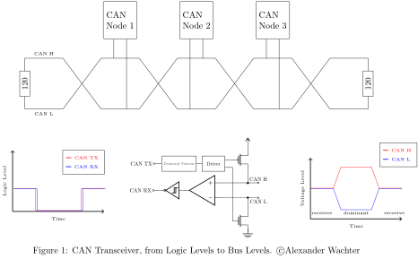

<!-- Copyright 2015-2026 Zephyr Project members and individual contributors. -->
<!-- SPDX-License-Identifier: Apache-2.0 -->
<!-- 中文翻译；阅读编号、导航和译注为本地新增。 -->

# 第31章\_CAN收发器

原文：[CAN Transceiver](https://docs.zephyrproject.org/latest/hardware/peripherals/can/transceiver.html)。读取日期：2026-10-13，`latest`。

## 31.1\_逻辑侧与总线侧

**控制器局域网（Controller Area Network，CAN）**的 **收发器（Transceiver）**是外部器件，将控制器的逻辑电平信号转换成总线电平。

总线两根线分别叫CAN High（CAN H，高线）和CAN Low（CAN L，低线）。控制器到收发器的发送线叫CAN TX，收发器到控制器的接收线叫CAN RX；TX/RX处是逻辑电平，总线侧则依据CAN H与CAN L之间的 **差分电压（Differential Voltage）**解释状态。

图中控制器的发送/接收路径经收发器连接双线总线；两端终端电阻属于总线布线，不能用单个GPIO的上拉配置替代。

## 31.2\_显性、隐性与终端电阻

总线可处于 **隐性状态（Recessive State）**，即逻辑1；也可处于 **显性状态（Dominant State）**，即逻辑0。隐性时CAN H与CAN L的电压大致相同，这也是空闲状态。

原文用开漏晶体管把CAN H拉向电源Vdd、CAN L拉向地来说明显性位的驱动。总线的第一个和最后一个节点在CAN H与CAN L之间放置120欧姆终端电阻。显性总会覆盖隐性，这种结构称为 **线与（Wired-AND）**。

> 译注：这里描述收发器产生差分状态的作用，不是让读者把CAN线直接短接电源和地的接线指令；具体电平和接法应按实际收发器的数据手册。

## 31.3\_接口参考

完整 **应用程序编程接口（Application Programming Interface，API）**见[CAN收发器参考](P041_CAN收发器接口参考.md)。

<!-- reading-navigation:start -->

**主线阅读**

[上一篇：CAN控制器](P030_CAN控制器.md) · [本模块主线目录](../reading/hardware.md) · [全部主线](../reading/README.md) · [下一篇：CAN命令行](P032_CAN命令行.md)

原册编号导航（含扩展参考）

[上一章：CAN控制器](P030_CAN控制器.md) · [下一章：CAN命令行](P032_CAN命令行.md) · [返回大纲](大纲.md)

<!-- reading-navigation:end -->
