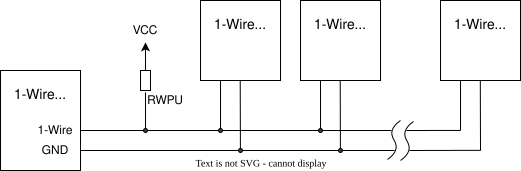

<!-- Copyright 2015-2026 Zephyr Project members and individual contributors. -->
<!-- SPDX-License-Identifier: Apache-2.0 -->
<!-- 中文翻译；阅读编号、导航和译注为本地新增。 -->

# 第73章\_单线总线

原文：[1-Wire Bus](https://docs.zephyrproject.org/latest/hardware/peripherals/w1.html)。读取日期：2026-10-13，`latest`。

## 73.1\_单线总线和典型距离

**单线总线（1-Wire Bus）**是一种低速 **半双工（Half-Duplex）**串行总线，仅用一根信号线加地线进行数据传输和设备供电。与 **集成电路间总线（Inter-Integrated Circuit，I2C）**类似，它使用双向 **集电极开路（Open-Collector）**数据线，是单控制器、多挂接设备的总线；原文使用master/slave术语，表示由一个 **主控（Master）**发起与各 **从设备（Slave）**的所有数据交换。

相比I2C，1-Wire支持较长总线。标准模式最高速率为15.4 kbit/s，**超速模式（Overdrive Mode）**最高为125 kbit/s。

原文给出的典型可用规模为：标准速率下，100米总线上10个节点可可靠通信；超速模式下，10米总线上3个节点预期可稳定工作。优化时序、减少节点可能进一步增加总线长度。这些是原文概括的配置条件，不是脱离电气设计、布线和节点负载的绝对保证。

实现细节见[《iButton标准手册》（Book of iButton Standards）](https://www.analog.com/en/resources/technical-articles/book-of-ibuttonreg-standards.html)。

上图保留官方原始SVG文件，展示一条总线上主控与多个从设备的连接关系；图中文字保留英文，主控和从设备的中英文含义见本节开头。图中VCC为供电标记，RWPU为上拉电阻标记，**地（Ground，GND）**是共同参考点；“Slave n”表示更多从设备。

## 73.2\_主控API与链路层

Zephyr的1-Wire主控 **应用程序编程接口（Application Programming Interface，API）**用于访问温度传感器、串行存储器等从设备，分成下面几层。

**链路层（Link Layer）**处理总线复位、存在检测和位传输等基本通信功能，是Zephyr实现中唯一与硬件相关的层。现有驱动使用Zephyr的 **通用异步收发器（Universal Asynchronous Receiver-Transmitter，UART）**接口，预期适用于多数Zephyr平台；UART说明见[本地章节](P006_UART.md)。

原文把基于 **通用输入／输出（General-Purpose Input/Output，GPIO）**和定时器的驱动、其他专用硬件驱动列为未来可能加入的实现，不是本页确认已经提供的能力。

## 73.3\_网络层与设备发现

1-Wire **网络层（Network Layer）**负责从设备识别和总线仲裁，包括Match ROM、Search ROM等命令。ROM是 **只读存储器（Read-Only Memory）**，这里用于识别设备的ROM命令体系；原文补充资料见[1-Wire设备描述](https://www.analog.com/en/resources/technical-articles/1wire-software-resource-guide-device-description.html)。

每个从设备具有唯一的64位识别号，包含8位 **设备家族码（1-Wire Family Code）**和8位 **循环冗余校验（Cyclic Redundancy Check，CRC）**。为发现总线上的从设备，标准定义了逐个检测全部设备的搜索算法，见[1-Wire搜索算法应用笔记](https://www.analog.com/en/resources/app-notes/1wire-search-algorithm.html)。

通用1-Wire驱动不实现 **传输层（Transport Layer）**和 **表示层（Presentation Layer）**功能，这些需要由各个从设备驱动处理。原文把1-Wire API标为**实验性（Experimental）**接口。

## 73.4\_配置和串行驱动

相关Kconfig配置项为 [`CONFIG_W1`](https://docs.zephyrproject.org/latest/kconfig.html#CONFIG_W1) 与 [`CONFIG_W1_NET`](https://docs.zephyrproject.org/latest/kconfig.html#CONFIG_W1_NET)，分别对应1-Wire支持与网络层。Kconfig是Zephyr配置系统。

`zephyr,w1-serial` 驱动使用UART外设实现1-Wire，把每个1-Wire位编码为一个UART发送字节。标准速率时，数据传输使用115200波特，总线复位／存在检测使用9600波特；超速模式的波特率可配置，默认数据传输为1000000波特，复位／存在检测为115200波特。

> 译注：这些值是UART编码传输所用的波特率，不是将1-Wire总线的15.4／125 kbit/s直接改成相同数值；一个1-Wire位会由UART字节波形表达。

## 73.5\_接口与示例

原页接口入口分别是[1-Wire数据链路层](https://docs.zephyrproject.org/latest/doxygen/html/group__w1__data__link.html)、[1-Wire网络层](https://docs.zephyrproject.org/latest/doxygen/html/group__w1__network.html)，以及[1-Wire通用函数与辅助功能](https://docs.zephyrproject.org/latest/doxygen/html/group__w1__interface.html)；最后一组包含不直接归属某个网络层次的函数。

[1-Wire扫描器示例](../driver_samples/P010_单总线扫描示例.md#w1-scanner)扫描设备并打印设备家族标识与序列号。本章仅翻译文档，没有执行线路扫描或验证上述距离、节点数及速率。

<!-- reading-navigation:start -->

**主线阅读**

[上一篇：本地互连网络](P072_本地互连网络.md) · [本模块主线目录](../reading/hardware.md) · [全部主线](../reading/README.md) · [下一篇：脉冲输入输出](P074_脉冲输入输出.md)

原册编号导航（含扩展参考）

[上一章：本地互连网络](P072_本地互连网络.md) · [下一章：脉冲输入输出](P074_脉冲输入输出.md) · [返回大纲](大纲.md)

<!-- reading-navigation:end -->
