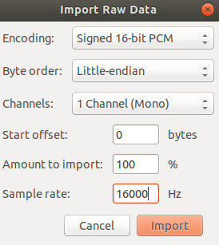
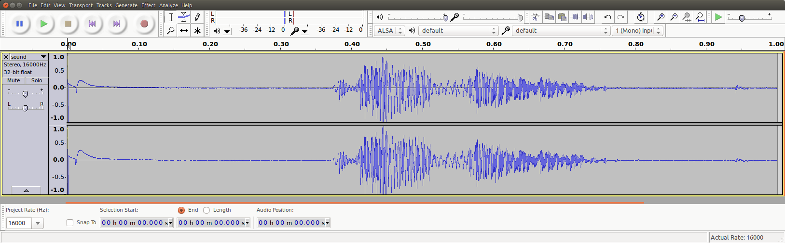

<!-- Copyright 2015-2026 Zephyr Project members and individual contributors. -->
<!-- SPDX-License-Identifier: Apache-2.0 -->
<!-- 中文翻译；阅读编号、导航和译注为本地新增。 -->

<a id="x-nucleo-iks02a1-mic"></a>

# 第82章\_扩展板MEMS麦克风示例

原文：[X-NUCLEO-IKS02A1 shield - MEMS microphone](https://docs.zephyrproject.org/latest/samples/shields/x_nucleo_iks02a1/microphone/README.html)。读取日期：2026-10-13，`latest`。

## 82.1\_扩展板上的数字麦克风

本示例启用X-NUCLEO-IKS02A1 **扩展板（Shield）**上的数字 **微机电系统（Micro-Electro-Mechanical Systems，MEMS）**麦克风，演示音频采集。麦克风产生 **脉冲密度调制（Pulse Density Modulation，PDM）**位流，通过 **芯片间声音总线（Inter-IC Sound，I2S）**外设接收，再用OpenPDM2PCM库转换成 **脉冲编码调制（Pulse Code Modulation，PCM）**。

OpenPDM2PCM是转换库名称。原文给出的工作区相对位置为 `zephyrproject/modules/hal/st/audio/microphone`，属于Zephyr依赖模块内容；实际模块位置应按所用工作区清单确认，不能把示例工作区目录名当成所有机器都已有的路径。

## 82.2\_连接与板级前提

原文要求把X-NUCLEO-IKS02A1叠接到具有匹配Arduino连接器的板上，并称示例通过 **集成电路间总线（Inter-Integrated Circuit，I2C）**与扩展板通信。这里保留其要求；前一节说明的原始麦克风PDM数据采集路径仍是I2S，不能据此把音频数据改接为I2C传输。

对原文使用的板，必须正确闭合SB24和SB29焊桥，使PDM麦克风时钟、数据线连接到 **串行外设接口（Serial Peripheral Interface，SPI）**时钟和 **主控输出、从设备输入（Master Out Slave In，MOSI）**信号。其他板可能也需要核对类似连接。SB编号是该硬件组合的要求，不能直接复制到HC32或其他板。

产品资料见[ST的X-NUCLEO-IKS02A1说明](https://www.st.com/en/ecosystems/x-nucleo-iks02a1.html)。

## 82.3\_构建与音频时钟

原文说明示例可在连接器匹配的板与该扩展板组合上运行，示范板为[Nucleo F411RE](https://docs.zephyrproject.org/latest/boards/st/nucleo_f411re/doc/index.html#nucleo_f411re)。准备Zephyr环境、工具链及硬件配置后，在Ubuntu Bash或已准备好的UCRT64 Bash中，从实验Zephyr源码根目录构建：

```shell
west build -b nucleo_f411re samples/shields/x_nucleo_iks02a1/microphone/
```

切换到其他板之前，必须检查I2S输出时钟配置。Nucleo F411RE的官方[扩展板覆盖文件](https://github.com/zephyrproject-rtos/zephyr/blob/main/boards/shields/x_nucleo_iks02a1/boards/nucleo_f411re.overlay)配置I2S用 **锁相环（Phase-Locked Loop，PLL）**，依赖 **高速外部振荡源（High-Speed External，HSE）**／**高速内部振荡源（High-Speed Internal，HSI）**。

原文要求核对主板默认配置选择的振荡源，并计算最终I2SClk频率，同时给出[板设备树文件](https://github.com/zephyrproject-rtos/zephyr/blob/main/boards/st/nucleo_f411re/nucleo_f411re.dts)作为例子。配置频率、实际输入时钟与驱动能力要一致；单纯换板名不能替代这些检查。原页此处只给出构建命令，运行前还需按对应板文档完成烧录。

## 82.4\_采样格式与启动时机

按下复位按钮后立即开始采集。示例采集1秒音频，通过 **串行通信端口（Communication Port，COM Port）**输出PCM流。音频参数在[官方示例main.c](https://github.com/zephyrproject-rtos/zephyr/blob/main/samples/shields/x_nucleo_iks02a1/microphone/src/main.c)中固定为16 kHz采样率、每采样16位、单通道，即 **单声道（Mono）**。

单声道16 kHz采集1秒产生16000个16位采样，对应32000字节。所请求的PDM时钟应使MP34DT05驱动选择适当的 **过采样／抽取（Oversampling/Decimation）**因子，得到约2 MHz位时钟；PCM和PDM配置都应查看该 `main.c`。

原文指出，可把 `AUDIO_FREQ` 改成32000，此时只采集500 ms。采集结束后，PCM数据以二进制或 **美国信息交换标准代码（American Standard Code for Information Interchange，ASCII）**文本输出；由同一文件中的 `PCM_OUTPUT_IN_ASCII` 宏控制，该选项默认关闭，即采用二进制输出。

## 82.5\_接收二进制PCM

Nucleo F411RE向主机呈现为 **通用串行总线通信设备类（Universal Serial Bus Communications Device Class，USB CDC）**设备。原文Linux例子使用 `/dev/ttyACM0`；这是操作系统的串行设备节点，保留其系统语义，并非机器特定的项目目录。实际枚举节点可能不同。

这一节在Ubuntu等Linux主机的Bash终端执行。先自行创建并进入实验源码根下的 `build/learning-audio` 采集目录，准备实际串口和访问权限；`sound.raw` 由重定向接收数据时生成。端口必须配置为 **原始模式（Raw Mode）**，避免CTRL-Z、CTRL-D等特殊字节被终端行处理机制解释或移除。

下面保留原文命令次序，只把主机临时目录中的输出文件改为当前目录相对路径。开始接收后再按板上复位键触发采集，接收结束后停止 `cat` 才会继续下一条命令：

```shell
stty -F /dev/ttyACM0 115200 raw
cat /dev/ttyACM0 > sound.raw
dos2unix -f sound.raw
```

原文解释，`dos2unix` 用于修复换行字节0x0a被当作NL处理、前面额外插入0x0d回车（Carriage Return，CR）的情况，否则会破坏音频流。

> 译注：这一命令序列描述原文出现过的串行文本转换问题。`dos2unix -f` 会修改文件字节，不能作为所有二进制PCM的常规处理；已经完整按原始模式收到的文件，不应无条件转换。先保留原始文件并核对长度与实际字节变化，确认确有插入回车的问题后再判断是否需要修复。

原文要求最终文件恰为32000字节，但有时开头会出现1或2个多余的0x00字节。只有确认这些是多余字节后，才按实际数量设置 `skip`；其Linux示例是：

```shell
dd if=sound.raw of=sound_clean.raw bs=1 skip=1
```

这会跳过开头1字节，将其余内容写入新文件 `sound_clean.raw`。不能仅因开头是零就删除，静音采样本身也可能含零。文件大小不符合预期时，应返回采样配置和串行接收检查，而不是任意裁剪。

## 82.6\_ASCII输出分支

也可重新编译为ASCII输出，随后再转换为二进制。原文给出的格式如下：

```text
-- start
0xfbe0,
0xfbf0,
0xfc0c,
0xfc24,
0xfc3c,
0xfc4c,
0xfc68,
0xfc48,

[...]

0xfb98,
0xfb98,
0xfbb8,
0xfbac,
0xfbc4,
0xfbe8,
0xfbf4,
-- end
```

`-- start`、`-- end` 是边界标记；中间为十六进制采样文本。原页没有提供完成该文本到二进制转换的脚本，因此不能直接把这些文本按原始PCM导入播放。

## 82.7\_导入并播放PCM

取得二进制PCM文件（例如 `sound.raw`）后，可使用Audacity开源音频编辑／播放工具。选择 **导入→原始数据（Import → Raw Data）**，按以下格式导入：**有符号16位PCM（Signed 16-bit PCM）**、**小端字节序（Little-endian）**、1通道单声道、16000 Hz采样率。



原图中Encoding是编码格式，Byte order是字节序，Channels是通道数，Start offset是起始字节偏移，Amount to import是导入比例，Sample rate是采样率；截图显示偏移0、导入100%、单声道16 kHz。Import为导入按钮。

导入后可以分析、播放这一秒音频，原文提供了下面的Audacity界面截图：



> 译注：此原图左侧轨道显示Stereo与32-bit float，即立体声及32位浮点编辑格式，与前述原始采集的单声道16位格式并不相同。原截图完整保留；导入当前示例文件时仍应依据实际采样数据和前述导入参数，不能从这张编辑器截图反推麦克风输出格式。

相关 **应用程序编程接口（Application Programming Interface，API）**见[数字麦克风接口](https://docs.zephyrproject.org/latest/doxygen/html/group__audio__dmic__interface.html)。本次仅保存与核对官方原图、命令及说明，未焊接、烧录、录音或运行串口转换。

[上一章：数字麦克风采集示例](P081_数字麦克风采集示例.md) · [下一章：I2S编解码器示例](P083_I2S编解码器示例.md) · [返回大纲](大纲.md)
