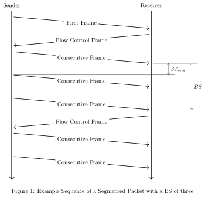

<!-- Copyright 2015-2026 Zephyr Project members and individual contributors. -->
<!-- SPDX-License-Identifier: Apache-2.0 -->
<!-- 中文翻译；阅读编号、导航和译注为本地新增。 -->

# 第379章\_CAN_ISO-TP协议

原文：[ISO-TP Transport Protocol](https://docs.zephyrproject.org/latest/services/connectivity/canbus/isotp.html)。读取日期：2026-10-13，`latest`。

## 379.1\_概述

ISO-TP 是 ISO 标准 ISO 15765-2《道路车辆——控制器局域网诊断通信（Diagnostic Communication over Controller Area Network，DoCAN）——第 2 部分：传输协议与网络层服务》定义的传输协议（Transport Protocol）。如其名称所示，它最初用于、现在仍用于通过控制器局域网（Controller Area Network，CAN）进行道路车辆诊断。不过，其用途并不限于道路车辆或汽车领域。

该传输协议把经典 CAN（Classical CAN）8 字节、灵活数据速率 CAN（CAN with Flexible Data-rate，CAN FD）64 字节的有限有效载荷（Payload）扩展到理论上 4 GB。此外，它提供流量控制（Flow Control）机制来影响发送方的行为。ISO-TP 根据 CAN 帧的有效载荷大小，把数据包分割成小片段；片段的头部称为协议控制信息（Protocol Control Information，PCI）。

在经典 CAN 上，小于或等于 7 字节的数据包称为单帧（Single Frame，SF）。它们无需分段，也不使用流量控制。

更大的数据包会拆成一个首帧（First Frame，FF）和所需数量的连续帧（Consecutive Frame，CF）。首帧包含整个有效载荷的长度信息，以及有效载荷最前面的若干字节。

接收端回复流控帧（Flow Control Frame，FC），拒绝、推迟或接受后续连续帧。流控帧还定义发送条件，即块大小（Block Size，BS）和帧之间的最小间隔（Minimum Separation Time，STmin）。块大小决定发送方在等待下一个流控帧之前，可以发送多少个连续帧。

原图按官方文件原样保存，图中的 SF、FF、CF、FC、BS 与 STmin 对应上文的中英文术语。

## 379.2\_接口参考

[CAN ISO-TP 协议接口](P380_CAN_ISO-TP接口参考.md)。

## 379.3\_相关代码示例

[ISO-TP 库示例](P377_CAN_ISO-TP传输示例.md)：使用 ISO-TP 库在两块开发板之间交换消息。

---

<!-- reading-navigation:start -->

**主线阅读**

[上一篇：CAN总线子系统](P378_CAN总线子系统.md) · [本模块主线目录](../reading/hardware.md) · [全部主线](../reading/README.md) · [下一篇：设备仿真与模拟](P474_设备仿真与模拟.md)

原册编号导航（含扩展参考）

[上一章：CAN总线子系统](P378_CAN总线子系统.md) · [下一章：CAN_ISO-TP接口参考](P380_CAN_ISO-TP接口参考.md) · [返回大纲](大纲.md)

<!-- reading-navigation:end -->
