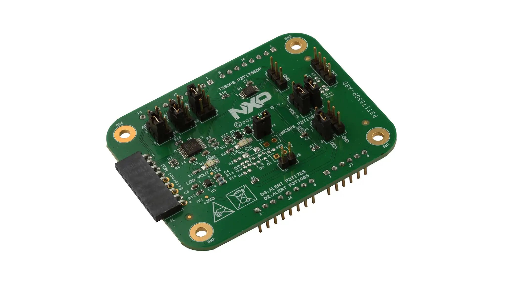

<!-- Copyright 2015-2026 Zephyr Project members and individual contributors. -->
<!-- SPDX-License-Identifier: Apache-2.0 -->
<!-- 中文翻译；阅读编号、导航和译注为本地新增。 -->

# 第430章\_P3T1755DP扩展板

原文：[P3T1755DP Arduino® Shield Evaluation Board](https://docs.zephyrproject.org/latest/boards/shields/p3t1755dp_ard_i3c/doc/index.html)。读取日期：2026-10-13，`latest`。

## 430.1\_概述

P3T1755DP Arduino® 扩展评估板（Shield Evaluation Board）搭载温度数字转换器（Temperature-to-Digital Converter），测量范围为 −40 °C 至 125 °C，精度为 ±0.5 °C。



## 430.2\_设备特性与资料

温度寄存器始终保存 12 位二进制补码（Two’s Complement）数据，温度分辨率为 0.0625 °C。器件支持连续转换（Continuous Conversion）、单次转换（One-shot）和关断（Shutdown）模式。

通信接口采用两线串行总线，支持 **改进型集成电路互连（Improved Inter-Integrated Circuit，I3C）**，最高 12.5 MHz；也支持 **集成电路互连（Inter-Integrated Circuit，I2C / I²C）**，最高 3.4 MHz。

更多信息见 NXP 官方资料：

- [P3T1755DP-ARD 评估板入门指南](https://www.nxp.com/document/guide/getting-started-with-the-p3t1755dp-ard-evaluation-board:GS-P3T1755DP-ARD)。
- [P3T1755DP-ARD 评估板用户手册](https://www.nxp.com/docs/en/user-manual/UM11834.pdf)。

## 430.3\_硬件连接

扩展板标识 `p3t1755dp_ard` 在两种总线模式下的连接如下。J 与 JP 为板上的连接器、跳线标号；`3-5`、`1-2` 等表示原文给出的连接针脚。

`SCL_ARD` 和 `SDA_ARD` 分别是 Arduino 接口的串行时钟（Serial Clock，SCL）与串行数据（Serial Data，SDA）信号名；VDD 为电源引脚。JP1、JP2、JP3 均为板上跳线编号。

| 项目 | I3C 模式 | I2C 模式 |
| --- | --- | --- |
| J10、J11、J12 | 3-5 | 3-5 |
| 官方页面给出的地址 | `0x4800000236152a0090` | `0x48` |
| JP2、JP3 | 1-2 | 2-3 |
| 总线连接 | 从 J13 引出 I3C | Arduino J5 的 pin 9 为 SCL_ARD，pin 10 为 SDA_ARD |
| 电源 VDD | Arduino 提供 3.3 V；JP1 连接 2-3 | Arduino 提供 3.3 V；JP1 连接 2-3 |


译注：原页面把较长的十六进制值标作 I3C 地址，此处忠实保留；它不能直接当作普通 7 位设备地址使用。实际设备树编码及硬件接线应结合该扩展板文件和上述用户手册核对。

## 430.4\_构建程序

调用 `west build` 时指定扩展板参数 `--shield p3t1755dp_ard_i3c`。以下命令在 Zephyr 仓库根目录的开发终端执行，使用 MIMXRT1180-EVK 的 CM33 核心目标构建温度计示例：

```shell
# From the root of the zephyr repository
west build -b mimxrt1180_evk/mimxrt1189/cm33 --shield p3t1755dp_ard_i3c samples/sensor/thermometer
```

---

[上一章：I3C通用命令码参考](P429_I3C通用命令码参考.md) · [下一章：LPS22HH的I3C示例](P431_LPS22HH的I3C示例.md) · [返回大纲](大纲.md)
