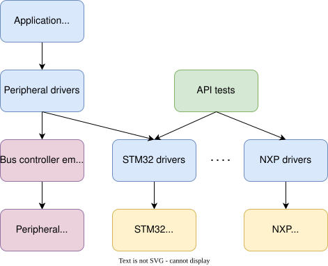
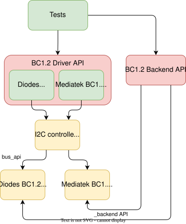

<!-- Copyright 2015-2026 Zephyr Project members and individual contributors. -->
<!-- SPDX-License-Identifier: Apache-2.0 -->
<!-- 中文翻译；阅读编号、导航和译注为本地新增。 -->

# 第475章\_外部总线与外设仿真

原文：[External Bus and Bus Connected Peripherals Emulators](https://docs.zephyrproject.org/latest/hardware/emulator/bus_emulators.html)。读取日期：2026-10-13，`latest`。

## 475.1\_概述

Zephyr 提供一个简单的仿真器框架（Emulator Framework），用于在不需要真实硬件的情况下测试外部外设驱动。仿真器模拟外部硬件设备，以支持各子系统的测试。

例如，可以为 **I2C（Inter-Integrated Circuit，集成电路互连）**罗盘编写仿真器，让它出现在 I2C 总线上，像真实设备一样被使用。

仿真器常提供专门的测试功能：罗盘可以在 I2C 速率过高时返回伪造数据，或在校准尚未完成时返回无效测量值，从而检查上层代码是否正确处理这些情况。如果模拟了所有失效条件，测试覆盖率（Test Coverage）就可以接近 100%。

SPI 为串行外设接口（Serial Peripheral Interface），eSPI 为增强型串行外设接口（Enhanced Serial Peripheral Interface），MSPI 为多线串行外设接口（Multi-bit Serial Peripheral Interface）。

## 475.2\_分层测试的概念

下图顶部是应用代码或高层测试，也就是最终希望运行的软件；其下是外设驱动，例如 AT24 **电可擦可编程只读存储器（Electrically Erasable Programmable Read-Only Memory，EEPROM）**驱动。



外设仿真器通过总线控制器仿真器连接，后者把 AT24 驱动的 I2C 通信转发给 AT24 模拟器，从而测试外设驱动。

另一方面，可以在真实硬件上通过应用程序接口（Application Programming Interface，API）测试，验证 STM32、NXP 等 I2C 控制器驱动。此类测试需要总线上连接某种外设，但能验证驱动的大部分功能。

结合这两类测试，就可以在 `native_sim` 上完整测试应用和外设代码；在已确认真实硬件 I2C 驱动工作的前提下，可以预期应用与外设驱动也能在真实硬件上工作。

利用这一框架，为全部片外驱动提供仿真器后，可以在 `native_sim` 上测试完整应用，例如嵌入式控制器（Embedded Controller）。这种方式可以支持：

- 为图中的绿色驱动分别编写测试，覆盖失效模式和错误条件，以达到驱动 100% 测试覆盖率。
- 测试驱动组合，例如通过 I2C GPIO 扩展器提供通用输入输出（General-Purpose Input/Output，GPIO），再用这些 GPIO 控制充电器；同一组合可用于仿真环境或真实硬件。
- 在主机上开发组合这些组件的复杂应用，使用源码级调试（Source-level Debugging），并在 `native_sim` 上运行。
- 通过增加 Kconfig 和设备树（Devicetree）片段，将应用迁移到提供必要功能的开发板，例如具有 I2C 和足够 GPIO 的板。

## 475.3\_创建设备驱动仿真器

仿真子系统采用[设备驱动模型](https://docs.zephyrproject.org/latest/kernel/drivers/index.html#device-model-api)的组织方式。通过 [`EMUL_DT_DEFINE()`](P476_外设仿真器API.md) 或 [`EMUL_DT_INST_DEFINE()`](P476_外设仿真器API.md) 创建仿真器实例。

外设仿真器复用真实驱动的同一个设备树节点，因此仿真器的 `DT_DRV_COMPAT` 应使用真实驱动相同的兼容值（Compatible Value）。官方示例如下：

```c
/* From drivers/sensor/bm160/bm160.c */
#define DT_DRV_COMPAT bosch_bmi160

/* From drivers/sensor/bmi160/emul_bmi160.c */
#define DT_DRV_COMPAT bosch_bmi160
```

译注：原例第一行文件路径写作 `bm160`，后面使用 `bmi160`；此处保留原注释，不据此改变真实目录名。

`EMUL_DT_DEFINE()` 接受两类 API 参数：

| 参数 | 是否必需 | 作用 |
| --- | --- | --- |
| `bus_api` | 必需 | 指向仿真器上游总线的 API；支持 I2C、SPI、eSPI、MSPI |
| `_backend_api` | 可选 | 指向设备类别专用的仿真器后端 API（Backend API） |

## 475.4\_总线API与设备类别后端

下图以 **BC1.2（Battery Charging 1.2，电池充电规范 1.2）**充电检测器驱动为例，展示两个 API 的逻辑关系。真实代码为绿色，仿真代码为黄色。



`bus_api` 把 BC1.2 仿真器连接到 `native_sim` I2C 控制器。真实 BC1.2 驱动无需改变，其工作方式与系统具有真实 I2C 控制器时相同。`native_sim` 控制器通过 `bus_api` 发起对仿真器寄存器的读写。

`_backend_api` 则允许测试通过带外（Out-of-band）方式控制仿真器。每个设备类别定义自己的 API 函数，面向高层行为，不为某个具体仿真器提供专用钩子。

以 BC1.2 为例，后端 API 可以模拟充电器的接入与拔出。各仿真器负责更新正确的厂商专用寄存器，并在需要时产生中断。

典型测试过程如下：

1. 通过 Zephyr BC1.2 驱动 API 注册检测回调（Callback）。
2. 通过 BC1.2 仿真器后端接入充电器。
3. 验证检测回调被调用，且充电器类型正确。
4. 通过仿真器后端断开充电器。

译注：原流程第 3 步把 BC1.2 拼作 B1.2，此处按同一检测接口理解。此架构使同一个测试可用于同一驱动类别内的所有受支持驱动。

## 475.5\_可用总线仿真器

Zephyr 包含 I2C、SPI、eSPI 和 MSPI 总线仿真驱动，让外设驱动连接仿真器，从而在没有真实硬件时测试。eSPI 仿真器仍在开发更多功能。

## 475.6\_I2C按地址转发

I2C 仿真总线的绑定支持一个按地址转发（Address-based Forwarding）的自定义属性。下面为官方设备树例子，`I2C_BITRATE_STANDARD` 是 I2C 标准速率（Standard Bit Rate）的常量：

```dts
i2c0: i2c@100 {
  status = "okay";
  compatible = "zephyr,i2c-emul-controller";
  clock-frequency = <I2C_BITRATE_STANDARD>;
  #address-cells = <1>;
  #size-cells = <0>;
  #forward-cells = <1>;
  reg = <0x100 4>;
  forwards = <&i2c1 0x20>;
};
```

最后的 `forwards` 属性表示：发往 `i2c0` 地址 `0x20` 的读写请求，转发到 `i2c1`，仍使用地址 `0x20`。这样可以在同一个固件镜像中测试通信的控制器端和目标端。

**`#forward-cells` 必须始终为 1。**每个 `forwards` 条目由节点引用句柄（Phandle）和后面的地址组成。例如 `<&i2c1 0x20>` 中，引用后只有一个地址单元（Cell）；仿真控制器不使用其他单元，因此数量保持为 1。

## 475.7\_示例与API参考

以下命令在 Zephyr 仓库根目录的开发终端构建测试。第一个例子通过 I2C 和 SPI，将 Bosch BMI160 传感器驱动连接到仿真器：

```shell
# From the root of the zephyr repository
west build -b native_sim tests/drivers/sensor/bmi160
```

另一个例子加入第二个 EEPROM，使用经 I2C 连接仿真器的 Atmel AT24 驱动；设备树和额外配置片段通过参数传入：

```shell
# From the root of the zephyr repository
west build -b native_sim tests/drivers/eeprom/api -- -DDTC_OVERLAY_FILE=at2x_emul.overlay -DEXTRA_CONF_FILE=at2x_emul.conf
```

进一步接口见[仿真器API参考](P476_外设仿真器API.md)。

---

<!-- reading-navigation:start -->

**主线阅读**

[上一篇：设备仿真与模拟](P474_设备仿真与模拟.md) · [本模块主线目录](../reading/hardware.md) · [全部主线](../reading/README.md) · [下一篇：虚拟化说明](P569_虚拟化说明.md)

<details>
<summary>原册编号导航（含扩展参考）</summary>

[上一章：设备仿真与模拟](P474_设备仿真与模拟.md) · [下一章：外设仿真器API](P476_外设仿真器API.md) · [返回大纲](大纲.md)

</details>

<!-- reading-navigation:end -->
