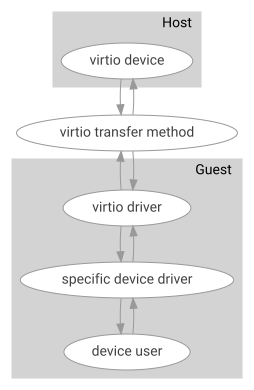

<!-- Copyright 2015-2026 Zephyr Project members and individual contributors. -->
<!-- SPDX-License-Identifier: Apache-2.0 -->
<!-- 中文翻译；阅读编号、导航和译注为本地新增。 -->

# 第570章\_VirtIO虚拟设备

原文：[Virtual I/O (VIRTIO)](https://docs.zephyrproject.org/latest/hardware/virtualization/virtio.html)。读取日期：2026-10-13，`latest`。

## 570.1\_概述

**虚拟输入输出（Virtual I/O，VIRTIO）**是用于与各类设备通信的协议，通常用于虚拟化环境。它的主要目标是在虚拟机内部提供高效、标准化的虚拟设备访问机制。通信依赖**虚拟队列（Virtqueue）**以及 **外围组件互连（Peripheral Component Interconnect，PCI）**或**内存映射输入输出（Memory-Mapped I/O，MMIO）**等标准传输方式。

## 570.2\_主机、客户系统与设备驱动

Virtio 定义初始化与通信中使用的各个组件，同时规定**主机（Host）**和**客户系统（Guest）**两侧的行为。规范将主机侧称为**设备（Device）**，将客户侧称为**驱动（Driver）**。

Zephyr 当前只能作为客户系统运行。可以在 Virtio 驱动提供的能力之上，实现具体设备的驱动，例如网卡驱动。

下图为包含 Virtio 设备的系统概览，保留官方 SVG 原图：

| 原图标注 | 中文含义 |
| --- | --- |
| Host | 主机 |
| Guest | 客户系统 |
| virtio device | Virtio 设备 |
| virtio transfer method | Virtio 传输方式 |
| virtio driver | Virtio 驱动 |
| specific device driver | 具体设备驱动 |
| device user | 设备使用者 |

## 570.3\_配置空间与特性协商

每个设备都提供用于初始化和配置的**配置空间（Configuration Space）**。通过它可以选择设备和驱动特性，启用特定虚拟队列，并设置队列地址。设备配置完成后，大多数配置项必须先复位设备才能修改。配置空间的具体布局取决于传输方式。

配置空间支持协商**特性位（Feature Bit）**，以确定设备的某些非必选能力。实际提供哪些特性位取决于设备和平台。

某些设备还提供**设备专属配置空间（Device-specific Configuration Space）**，用于额外的配置选项。

## 570.4\_虚拟队列

虚拟队列是主机与客户系统之间传输数据的主要机制。不同设备的队列数量不同。例如，支持双向传输的设备通常具有一对或多对**发送/接收（Transmit/Receive，TX/RX）**虚拟队列。

Virtio 定义**分离式虚拟队列（Split Virtqueue）**和**紧凑式虚拟队列（Packed Virtqueue）**两种队列。Zephyr 当前只支持分离式虚拟队列。

分离式虚拟队列包含三个部分：

| 部分 | 作用 |
| --- | --- |
| **描述符表（Descriptor Table）** | 保存缓冲区的物理地址、长度和标志 |
| **可用环（Available Ring）** | 客户系统用来向主机提交描述符链 |
| **已用环（Used Ring）** | 主机用来向客户系统归还描述符，并报告写入的数据量 |

每个**描述符（Descriptor）**要么由设备写入，要么由驱动写入。多个描述符可以连接成**描述符链（Descriptor Chain）**。一条链通常以包含设备待读取数据的描述符开头，以设备可写部分结尾，设备将响应放在后者中。

可用环的主体是一个**环形缓冲区（Circular Buffer）**，其中保存指向描述符表中各项的索引。客户系统决定向主机发送数据时，将描述符链头部的索引加入可用环。

已用环与可用环相似，但由主机用来向客户系统归还描述符。它不仅保存描述符索引，还提供写入描述符所指缓冲区的数据量。

## 570.5\_通用库与设备初始化

Zephyr 提供用于访问 Virtio 设备和虚拟队列的**应用程序编程接口（Application Programming Interface，API）**，覆盖 Virtio 设备生命周期中需要的操作。

Virtio 驱动先完成同一传输方式下各类设备共用的底层初始化，例如在总线上找到设备、映射 Virtio 结构。随后，具体设备驱动借助 Virtio API 完成后续初始化：

1. 调用 [`virtio_read_device_feature_bit()`](P571_VirtIO设备接口.md)，确定设备提供的特性。
2. 调用 [`virtio_write_driver_feature_bit()`](P571_VirtIO设备接口.md)，选择驱动需要的特性。
3. 选择全部所需特性后，调用 [`virtio_commit_feature_bits()`](P571_VirtIO设备接口.md) 提交特性位。
4. 调用 [`virtio_init_virtqueues()`](P571_VirtIO设备接口.md) 初始化虚拟队列。此函数枚举队列，并调用提供的 [`virtio_enumerate_queues`](P571_VirtIO设备接口.md) 回调，确定每个队列所需大小。
5. 调用 [`virtio_finalize_init()`](P571_VirtIO设备接口.md) 完成初始化。如果以上函数均未返回错误，此时队列即可使用。

若具体设备提供专属配置，可调用 [`virtio_get_device_specific_config()`](P571_VirtIO设备接口.md) 获取。

## 570.6\_虚拟队列操作

队列可以工作后，即可用于发送和接收数据：

1. 使用 [`virtio_get_virtqueue()`](P571_VirtIO设备接口.md) 获取第 `n` 个虚拟队列的指针。
2. 使用 [`virtq_add_buffer_chain()`](P572_VirtIO虚拟队列接口.md) 添加待发送的描述符链。除了链本身，此函数还接收回调指针；设备归还该描述符链时调用此回调。
3. 使用 Virtio API 的 [`virtio_notify_virtqueue()`](P571_VirtIO设备接口.md) 通知队列。

## 570.7\_客户侧设备驱动

Zephyr 当前提供基于 PCI 和 MMIO 的 Virtio 传输驱动，以及以下三种具体设备驱动。

**Virtiofs 文件系统驱动。**[virtiofs](https://virtio-fs.gitlab.io/) 允许虚拟机中的客户系统访问主机目录。主机和客户系统通过**用户空间文件系统（Filesystem in Userspace，FUSE）**消息通信，完成打开文件、读取文件等文件系统操作。

客户系统每次发起文件系统操作时，都会向虚拟队列放入一条描述符链：链头为设备可读部分，包含 FUSE 输入头和输入数据；链尾为设备可写部分，为 FUSE 输出头和输出数据预留空间。

**Virtio-entropy 熵源驱动。**此驱动允许 Zephyr 将 virtio-entropy 用作**熵源（Entropy Source）**。驱动向虚拟队列提交缓冲区，设备在其中填入随机数据后归还。

**Virtio-blk 块设备驱动。**此驱动将 virtio-blk 块设备接入 Zephyr 磁盘访问层，可通过[磁盘访问接口](https://docs.zephyrproject.org/latest/services/storage/disk/access.html#disk-access-api)及其上层文件系统使用。

驱动同时保持一个处理中请求，提交的描述符链由请求头、作为一个或多个**分散聚集段（Scatter-Gather Segment）**的调用者数据缓冲区，以及状态字节组成。详情见 [VirtIO块设备驱动](../storage/P029_VirtIO块设备驱动.md)。

## 570.8\_示例与实现阅读入口

[virtiofs 文件系统示例](../storage/P030_Virtiofs文件系统示例.md) 展示了如何使用依赖 Virtio 的设备驱动。

若要查看直接与 Virtio 驱动交互的代码，可以阅读 virtiofs 驱动，重点关注初始化函数 `virtiofs_init()`，以及负责与 Virtio 设备传输数据的 `virtiofs_send_receive()` 和 `virtiofs_recv_cb()`。

## 570.9\_接口参考

- [VIRTIO 接口](P571_VirtIO设备接口.md)。
- [虚拟队列接口（Virtqueue Interface）](P572_VirtIO虚拟队列接口.md)。

---

<!-- reading-navigation:start -->

**主线阅读**

[上一篇：虚拟化说明](P569_虚拟化说明.md) · [本模块主线目录](../reading/hardware.md) · [全部主线](../reading/README.md) · [下一篇：平台固件说明](P596_平台固件说明.md)

原册编号导航（含扩展参考）

[上一章：虚拟化说明](P569_虚拟化说明.md) · [下一章：VirtIO设备接口](P571_VirtIO设备接口.md) · [返回大纲](大纲.md)

<!-- reading-navigation:end -->
