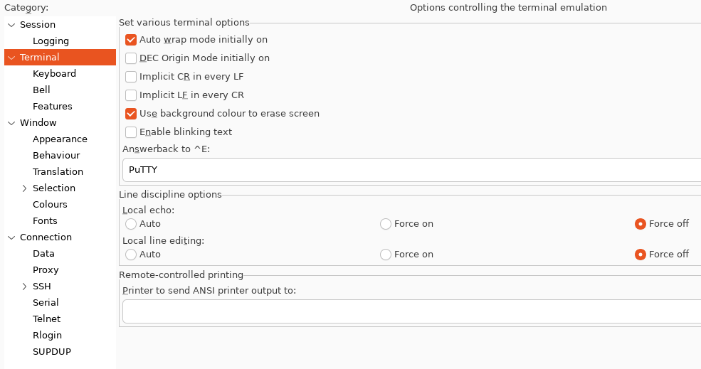
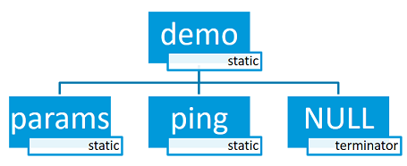
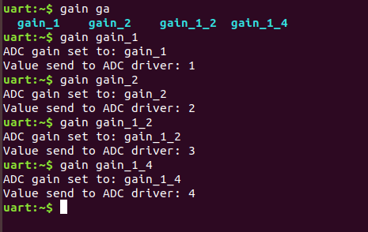
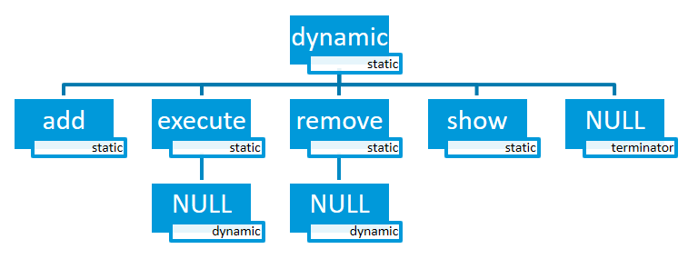
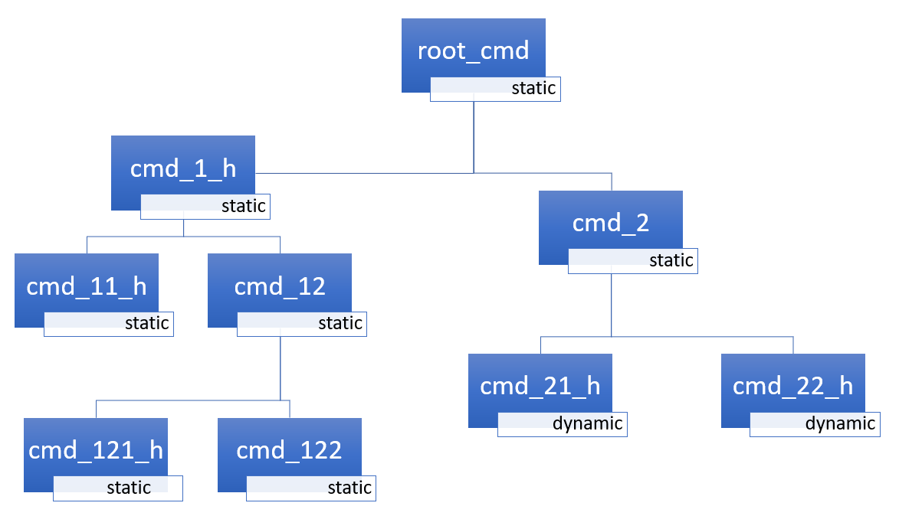
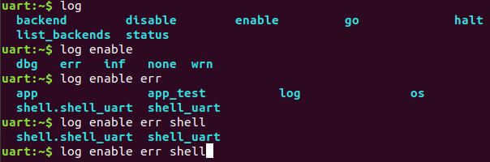
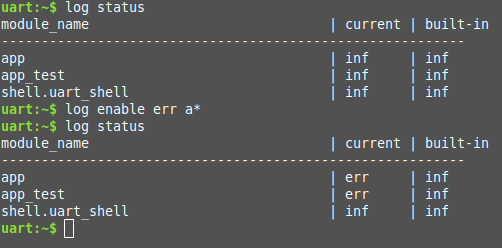

<!-- Copyright 2015-2026 Zephyr Project members and individual contributors. -->
<!-- SPDX-License-Identifier: Apache-2.0 -->
<!-- 中文翻译；阅读编号、导航和译注为本地新增。 -->

<a id="shell-api"></a>

# 第1章\_Shell命令行

原文：[Shell](https://docs.zephyrproject.org/latest/services/shell/index.html)。读取日期：2026-10-12，`latest`。

## 1.1\_概述

本模块可以创建并处理具有用户自定义命令集的**交互式命令解释器（Shell）**。当示例需要比按钮或指示灯更丰富的用户交互时，可以使用它。Zephyr Shell 具有类 Unix 命令行的以下功能：

- 支持多个实例。
- 与[日志子系统（Logging Subsystem）](../observability/P001_日志.md)协同工作。
- 支持静态命令、动态命令和字典命令。
- 支持 Tab 键智能补全。
- 提供 `aliases`、`clear`、`shell`、`colors`、`echo`、`history`、`resize` 等内置命令功能。
- 使用 ↑、↓ 或组合快捷键查看最近执行的命令。
- 使用 ←、→、Backspace、Delete、End、Home、Insert 编辑文字。
- 支持 ANSI 转义码，包括 VT100 与 `ESC[n~`，用于光标控制和彩色输出。
- 支持多行命令编辑。
- 内置命令帮助处理器。
- 支持 `*` 与 `?` 通配符。
- 支持组合快捷键。
- 支持 `getopt` 与 `getopt_long` 选项解析。
- 可通过 Kconfig 配置优化内存占用。

> 原文注意：部分功能显著增加**随机存取存储器（Random Access Memory，RAM）**和**闪存（Flash Memory）**占用，但许多功能可以关闭。希望默认减少资源占用时，启用 `CONFIG_SHELL_MINIMAL`，再逐项打开需要的功能。

> 译注：Kconfig 是 Zephyr 使用的配置系统名称，不是需要扩写的缩写。**美国国家标准学会（American National Standards Institute，ANSI）**的名称在这里用于称呼相关终端转义码；这些码是终端解释的控制字节序列，VT100 是终端兼容约定名称。它们让 Shell 能移动光标、改变颜色，而不仅仅逐行输出文字。下文“后端”负责收发数据，“命令处理器”负责执行命令，两者分工不同；调用它们所用的函数或宏组成**应用程序编程接口（Application Programming Interface，API）**。

## 1.2\_后端

模块可连接任意用于命令输入输出的**传输后端（Transport Backend）**。当前已实现：MQTT、Segger RTT、SMP、Telnet、UART、USB、Bluetooth LE（NUS）、RPMSG，以及不对应物理传输层的 DUMMY 后端。

> 译注：MQTT 是发布/订阅消息协议的名称；这里的 **SMP（Simple Management Protocol，简单管理协议）**属于设备管理传输，不是对称多处理。**通用异步收发器（Universal Asynchronous Receiver-Transmitter，UART）**提供串口，**通用串行总线（Universal Serial Bus，USB）**可提供虚拟串口。**远程处理器消息传递（Remote Processor Messaging，RPMsg）**用于处理器间通信；**空后端（Dummy Backend）**提供不依赖物理连接的 Shell 实例。

### 1.2.1\_Telnet

启用 `CONFIG_SHELL_BACKEND_TELNET` 后，可使用 **Telnet（远程终端协议）**作为后端。通过 PuTTY 或其他 Telnet 客户端连接，例如：

```sh
telnet <ip address> <port>
```

默认不处理 Telnet 命令和配置协商。启用 `CONFIG_SHELL_TELNET_SUPPORT_COMMAND` 可支持有限的一组命令，按需使用。其中支持 ECHO 选项，可让客户端采用类似 UART 的逐字符模式：输入一个字符便立即发送。代价是网络流量明显增加，收益是可使用 Shell 的行编辑、Tab 补全和历史记录功能。

> 译注：这里的 ECHO 是 Telnet 协商选项，关系到客户端回显与输入方式，不要与后文的 Shell 本地回显开关混淆。命令中的 IP 地址和端口须换成实际目标。

### 1.2.2\_USB_CDC_ACM

配置 **通信设备类抽象控制模型（Communications Device Class / Abstract Control Model，CDC ACM）**虚拟串口后端，只需在构建时加入 `cdc-acm-console` **配置片段（Snippet）**：

```sh
west build -S cdc-acm-console [...]
```

具体配置见 [cdc-acm-console.conf](https://github.com/zephyrproject-rtos/zephyr/blob/main/snippets/cdc-acm-console/cdc-acm-console.conf) 与 [cdc-acm-console.overlay](https://github.com/zephyrproject-rtos/zephyr/blob/main/snippets/cdc-acm-console/cdc-acm-console.overlay)。虚拟串口的设备栈要求见[USB CDC ACM](../usb/P003_USB_CDC_ACM.md)。

### 1.2.3\_Bluetooth_LE_NUS

配置**低功耗蓝牙（Bluetooth Low Energy，Bluetooth LE）**的 **Nordic串口服务（Nordic UART Service，NUS）**后端，只需加入 `nus-console` 配置片段：

```sh
west build -S nus-console [...]
```

具体配置见 [nus-console.conf](https://github.com/zephyrproject-rtos/zephyr/blob/main/snippets/nus-console/nus-console.conf) 与 [nus-console.overlay](https://github.com/zephyrproject-rtos/zephyr/blob/main/snippets/nus-console/nus-console.overlay)。

> 译注：`[...]` 表示省略的构建参数，不是直接输入的内容；需继续指定应用、目标板和本次构建所需的其他选项。

### 1.2.4\_Segger_RTT

**SEGGER实时传输（Real Time Transfer，RTT）**通过调试连接交换数据。配置 RTT 后端涉及 `CONFIG_USE_SEGGER_RTT`、`CONFIG_SHELL_BACKEND_RTT`、`CONFIG_SHELL_BACKEND_SERIAL`。其他设置见 [prj_minimal_rtt.conf](https://github.com/zephyrproject-rtos/zephyr/blob/main/samples/subsys/shell/shell_module/prj_minimal_rtt.conf)。

> 译注：原文在此只列配置名称，没有给值。引用的最小 RTT 配置启用前两项，并设置 `CONFIG_SHELL_BACKEND_SERIAL=n`；不能把列出的三项都机械设为 `y`。

使用 west 连接并配置 RTT：

```sh
$ west rtt
```

原文注意：默认 **runner（运行器，west 调用的烧录/调试工具适配器）**不支持 RTT 时，请查看开发板文档中其他支持 RTT 的 runner，并通过 `--runner` 选择：

```sh
$ west rtt --runner <runner>
```

使用 PuTTY 的步骤如下：

1. 打开调试会话，并让应用继续运行。

```sh
west attach
```

2. 打开 PuTTY，连接 Telnet 端口 `19021`。在 Terminal 配置中，将 **Local echo（本地回显）**与 **Local line editing（本地行编辑）**均设为 **Force off（强制关闭）**。



3. 此时已建立通向 RTT 的网络连接，可向 Shell 输入内容。

通过 TCP 连接 SEGGER RTT，例如在 macOS 上：原文说明 `JLinkRTTClient` 在 macOS 上不能用于输入，建议采用以下步骤。

1. 打开第一个终端窗口，执行：

```sh
JLinkRTTLogger -Device NRF52840_XXAA -RTTChannel 1 -if SWD -Speed 4000 ~/rtt.log
```

必要时更换设备名称。

2. 打开第二个终端窗口，执行：

```sh
nc localhost 19021
```

3. 此时可以通过网络连接向 RTT Shell 输入内容。但与 PuTTY 不同，Tab 补全等部分功能不可用。

> 译注：TCP 是**传输控制协议（Transmission Control Protocol）**；`nc` 是 netcat 工具。`NRF52840_XXAA` 是芯片型号参数；**串行线调试（Serial Wire Debug，SWD）**是调试连接协议。该型号、连接方式及 `4000` 速率为原文目标的参数，不是本项目硬件配置。`$` 是会话提示符。上述主机工具和平台差异按原文保留，本批没有实际运行连接测试。

## 1.3\_命令结构与常用命令组

Shell 命令构成一棵树，分为三类：

| 类型 | 特征 |
| --- | --- |
| **根命令（Root Command）**，第 0 层 | 汇集到专用内存段中，并按字母顺序排序 |
| **静态子命令（Static Subcommand）**，第 1 层及以下 | 数量和语法必须在编译时已知，由软件模块创建 |
| **动态子命令（Dynamic Subcommand）**，第 1 层及以下 | 数量和语法不必在编译时已知，由软件模块提供 |

常用命令组及启用选项：

| 命令组 | Kconfig配置 |
| --- | --- |
| GPIO，**通用输入输出（General-Purpose Input/Output）** | `CONFIG_GPIO`、`CONFIG_GPIO_SHELL` |
| I2C，**集成电路间总线（Inter-Integrated Circuit）** | `CONFIG_I2C`、`CONFIG_I2C_SHELL` |
| 传感器（Sensor） | `CONFIG_SENSOR`、`CONFIG_SENSOR_SHELL` |
| 闪存（Flash） | `CONFIG_FLASH`、`CONFIG_FLASH_SHELL` |
| 文件系统（File System） | `CONFIG_FILE_SYSTEM`、`CONFIG_FILE_SYSTEM_SHELL` |
| ADC，**模数转换器（Analog-to-Digital Converter）** | `CONFIG_ADC`、`CONFIG_ADC_SHELL`；仿真器命令为 `CONFIG_ADC_EMUL_SHELL`，需 `CONFIG_ADC_EMUL` |

## 1.4\_创建命令

使用以下宏添加 Shell 命令：

| 宏 | 作用 |
| --- | --- |
| `SHELL_CMD_REGISTER` | 创建根命令，所有根命令必须名称不同 |
| `SHELL_COND_CMD_REGISTER` | 编译时标志启用时创建根命令，根命令名称仍须唯一 |
| `SHELL_CMD_ARG_REGISTER` | 创建带参数的根命令，根命令名称须唯一 |
| `SHELL_COND_CMD_ARG_REGISTER` | 编译时标志启用时创建带参数的根命令，名称须唯一 |
| `SHELL_CMD` | 初始化一个命令 |
| `SHELL_COND_CMD` | 编译时标志启用时初始化命令 |
| `SHELL_EXPR_CMD` | 编译时表达式非零时初始化命令 |
| `SHELL_CMD_ARG` | 初始化带参数的命令 |
| `SHELL_COND_CMD_ARG` | 编译时标志启用时初始化带参数的命令 |
| `SHELL_EXPR_CMD_ARG` | 编译时表达式非零时初始化带参数的命令 |
| `SHELL_STATIC_SUBCMD_SET_CREATE` | 创建静态子命令数组 |
| `SHELL_SUBCMD_DICT_SET_CREATE` | 创建字典子命令数组 |
| `SHELL_DYNAMIC_CMD_CREATE` | 创建动态子命令集合 |

系统中任意包含 [include/zephyr/shell/shell.h](https://github.com/zephyrproject-rtos/zephyr/blob/main/include/zephyr/shell/shell.h) 的文件都可以定义命令。创建的命令对所有 Shell 实例可见。

### 1.4.1\_静态命令

下面创建一个带静态子命令的根命令：

```c
/* Creating subcommands (level 1 command) array for command "demo". */
SHELL_STATIC_SUBCMD_SET_CREATE(sub_demo,
        SHELL_CMD(params, NULL, "Print params command.",
                                               cmd_demo_params),
        SHELL_CMD(ping,   NULL, "Ping command.", cmd_demo_ping),
        SHELL_SUBCMD_SET_END
);
/* Creating root (level 0) command "demo" */
SHELL_CMD_REGISTER(demo, &sub_demo, "Demo commands", NULL);
```

示例实现见 [shell_module/src/main.c](https://github.com/zephyrproject-rtos/zephyr/blob/main/samples/subsys/shell/shell_module/src/main.c)。



### 1.4.2\_字典命令

**字典命令（Dictionary Command）**是特殊的静态命令。当处理器需要使用“字符串 ↔ 对应数据”的配对时，可以使用它。字符串通常用来描述数据，Shell 将其作为可提示的命令语法，而处理器使用对应的数据完成操作。

例如，用命令设置 ADC 增益时，可以建立 `(字符串 gain_value，整数 value)` 配对。字符串便于输入，整数则供 ADC 驱动接口使用。抽象示例：

```c
static int gain_cmd_handler(const struct shell *sh,
                            size_t argc, char **argv, void *data)
{
        int gain;

        /* data is a value corresponding to called command syntax */
        gain = (int)data;
        adc_set_gain(gain);

        shell_print(sh, "ADC gain set to: %s\n"
                           "Value send to ADC driver: %d",
                           argv[0],
                           gain);

        return 0;
}

SHELL_SUBCMD_DICT_SET_CREATE(sub_gain, gain_cmd_handler,
        (gain_1, 1, "gain 1"), (gain_2, 2, "gain 2"),
        (gain_1_2, 3, "gain 1/2"), (gain_1_4, 4, "gain 1/4")
);
SHELL_CMD_REGISTER(gain, &sub_gain, "Set ADC gain", NULL);
```

> 译注：`adc_set_gain()` 是本例的抽象函数名，不是本文给出的完整 Zephyr ADC 驱动调用。`data` 是通过字典映射交给处理器的数据；从指针直接转为 `int` 在不同位宽平台上可能不合适，实际应用须遵守相应 API 的编码约定。

Shell 中的表现如下：



### 1.4.3\_动态命令

下面创建同时带静态与动态子命令的根命令。初始动态命令列表为空，输入以下命令可添加一个新名称：

```text
dynamic add <new_dynamic_command>
```

新添加的命令可以由 Tab 提示或补全。

```c
/* Buffer for 10 dynamic commands */
static char dynamic_cmd_buffer[10][50];

/* commands counter */
static uint8_t dynamic_cmd_cnt;

/* Function returning command dynamically created
 * in  dynamic_cmd_buffer.
 */
static void dynamic_cmd_get(size_t idx,
                            struct shell_static_entry *entry)
{
        if (idx < dynamic_cmd_cnt) {
                entry->syntax = dynamic_cmd_buffer[idx];
                entry->handler  = NULL;
                entry->subcmd = NULL;
                entry->help = "Show dynamic command name.";
        } else {
                /* if there are no more dynamic commands available
                 * syntax must be set to NULL.
                 */
                entry->syntax = NULL;
        }
}

SHELL_DYNAMIC_CMD_CREATE(m_sub_dynamic_set, dynamic_cmd_get);
SHELL_STATIC_SUBCMD_SET_CREATE(m_sub_dynamic,
        SHELL_CMD(add, NULL,"Add new command to dynamic_cmd_buffer and"
                  " sort them alphabetically.",
                  cmd_dynamic_add),
        SHELL_CMD(execute, &m_sub_dynamic_set,
                  "Execute a command.", cmd_dynamic_execute),
        SHELL_CMD(remove, &m_sub_dynamic_set,
                  "Remove a command from dynamic_cmd_buffer.",
                  cmd_dynamic_remove),
        SHELL_CMD(show, NULL,
                  "Show all commands in dynamic_cmd_buffer.",
                  cmd_dynamic_show),
        SHELL_SUBCMD_SET_END
);
SHELL_CMD_REGISTER(dynamic, &m_sub_dynamic,
           "Demonstrate dynamic command usage.", cmd_dynamic);
```

示例实现见 [shell_module/src/dynamic_cmd.c](https://github.com/zephyrproject-rtos/zephyr/blob/main/samples/subsys/shell/shell_module/src/dynamic_cmd.c)。



## 1.5\_执行命令

每个命令或子命令都可以有**命令处理器（Command Handler）**。Shell 执行命令树中匹配到的最深层处理器，把其后没有处理器的子命令作为参数传入。原文称“括号内的字符作为一个参数”；若未找到处理器，Shell 显示错误消息。

> 译注：这里原文的 “parentheses” 表述不准确。本地 `subsys/shell/shell_utils.c` 解析的是单引号或双引号包围的参数，而不是普通圆括号。包含空格的一个参数应按 Shell 支持的引号规则传入；不要据原文把 `(two words)` 当成可靠的单参数写法。

用户应用也可使用任意活动后端，通过 `shell_execute_cmd()` 执行命令：

```c
int main(void)
{
        /* Below code will execute "clear" command on a DUMMY backend */
        shell_execute_cmd(NULL, "clear");

        /* Below code will execute "shell colors off" command on
         * an UART backend
         */
        shell_execute_cmd(shell_backend_uart_get_ptr(),
                          "shell colors off");
}
```

用 `CONFIG_SHELL_BACKEND_DUMMY` 启用 DUMMY 后端。

### 1.5.1\_命令树中的选择示例

假定命令结构如下：`root_cmd` 是无处理器的根命令，`cmd_xxx_h` 有处理器，`cmd_xxx` 无处理器。



| 输入序列 | 实际执行与参数 |
| --- | --- |
| `root_cmd cmd_1_h cmd_12_h cmd_121_h parameter` | 执行 `cmd_121_h`，传入 `parameter` |
| `root_cmd cmd_2 cmd_22_h parameter1 parameter2` | 执行 `cmd_22_h`，传入 `parameter1 parameter2` |
| `root_cmd cmd_1_h parameter1 cmd_121_h parameter2` | 执行 `cmd_1_h`，传入 `parameter1`、`cmd_121_h`、`parameter2` |
| `root_cmd parameter cmd_121_h parameter2` | 不执行任何命令 |

### 1.5.2\_命令处理器

简单处理器示例：

> 译注：代码中的 `ARG_UNUSED` 是标记参数未使用的宏；`SHELL_INFO` 是信息级输出所用的颜色/样式枚举值。下面几种输出函数分别展示一般文本、警告和错误信息，名称本身不需要虚构英文缩写全称。

```c
static int cmd_handler(const struct shell *sh, size_t argc,
                        char **argv)
{
        ARG_UNUSED(argc);
        ARG_UNUSED(argv);

        shell_fprintf(sh, SHELL_INFO, "Print info message\n");

        shell_print(sh, "Print simple text.");

        shell_warn(sh, "Print warning text.");

        shell_error(sh, "Print error text.");

        return 0;
}
```

`shell_fprintf()` 以及 `shell_print`、`shell_info`、`shell_warn`、`shell_error` 输出宏，可在命令处理器或线程中调用，不能在中断上下文中调用。中断处理程序应使用日志子系统输出。

### 1.5.3\_命令帮助

用户定义的命令及子命令都可有自己的帮助说明，分别由 `SHELL_CMD_REGISTER`、`SHELL_CMD_ARG_REGISTER`、`SHELL_CMD`、`SHELL_CMD_ARG` 等宏提供。执行命令或子命令时加入 `-h` 或 `--help`，Shell 即显示帮助。

### 1.5.4\_访问父命令

子命令处理器可通过 `argv` 索引访问参数或父命令：正索引访问参数，负索引访问父命令，索引 0 对应当前处理器所属子命令。

```c
static int cmd_handler(const struct shell *sh, size_t argc,
                       char **argv)
{
        ARG_UNUSED(argc);

        /* If it is a subcommand handler parent command syntax
         * can be found using argv[-1].
         */
        shell_print(sh, "This command has a parent command: %s",
                      argv[-1]);

        /* Print this command syntax */
        shell_print(sh, "This command syntax is: %s", argv[0]);

        /* Print first argument */
        shell_print(sh, "%s", argv[1]);

        return 0;
}
```

> 译注：本例假定当前是有父命令的子命令，并且至少有一个参数。访问 `argv[-1]` 或 `argv[1]` 前，实际处理器必须保证对应命令层级和参数数量成立；不能把负索引用法推广到任意 C 数组。

## 1.6\_内置命令

设置 `CONFIG_SHELL_CMDS=y` 启用内置命令：

| 命令 | 功能与附加配置 |
| --- | --- |
| `aliases` | 显示已配置别名；还需 `CONFIG_SHELL_CMDS_ALIASES=y` |
| `clear` | 清屏 |
| `history` | 显示最近输入的命令 |
| `resize` | 终端宽度不是 80 字符，或宽度变化后应执行，确保多行显示及 ←、→、End、Home 正常；原文说明目前需启用 UART 流控。还需 `CONFIG_SHELL_CMDS_RESIZE=y` |
| `resize default` | 向终端发送宽度 80 的设置，并假定成功 |
| `select` | 选择新的根命令；用 Alt+r 返回主命令树。还需 `CONFIG_SHELL_CMDS_SELECT=y` |
| `shell echo` | 切换 Shell 回显 |
| `shell colors` | 切换彩色语法；蓝牙后端可通过关闭颜色减少传输字节 |
| `shell stats` | 显示 Shell 统计 |

## 1.7\_别名

启用 `CONFIG_SHELL_ALIASES` 后，Shell 可在执行命令前展开**别名（Alias）**。Zephyr 始终提供内置别名 `?`，将其展开为 `help`。

从主机文件载入其他别名时，设置 `CONFIG_SHELL_ALIASES_FILE`，并在应用 `CMakeLists.txt` 中生成相应包含文件。该配置非空时，自动启用 `CONFIG_SHELL_ALIASES_HAS_FILE`。

> 译注：下例 `ZEPHYR_BINARY_DIR` 是 CMake 保存 Zephyr 构建输出目录的变量；生成的 `generated-shell-aliases.inc` 放在该输出目录的 `include/generated/` 中，再加入应用目标的生成依赖。

```cmake
if(CONFIG_SHELL_ALIASES_HAS_FILE)
  set(gen_dir ${ZEPHYR_BINARY_DIR}/include/generated/)
  set(aliases_src ${CONFIG_SHELL_ALIASES_FILE})

  generate_shell_aliases_inc_file_for_target(
    app
    ${aliases_src}
    ${gen_dir}/generated-shell-aliases.inc
  )
endif()
```

别名文件每行一项，格式为 `alias=command`。以 `#` 开头的是注释，包含空格的命令字符串必须加引号。[shell_aliases.txt 示例](https://github.com/zephyrproject-rtos/zephyr/blob/main/samples/net/sockets/echo_service/shell_aliases.txt)采用如下格式：

```text
# Example shell aliases file
stacks="kernel thread stacks"
scan="wifi scan"
connect="wifi connect"
```

运行 `aliases` 命令可检查当前 Shell 可用的别名。

## 1.8\_Tab提示与补全

Tab 键可提示命令或子命令，通过 `CONFIG_SHELL_TAB=y` 启用。它也可部分或完整补全命令，通过 `CONFIG_SHELL_TAB_AUTOCOMPLETION=y` 启用。

用户开始输入命令后按 Tab，Shell 会执行以下三种行为之一：

1. 自动补全命令。
2. 提示可用命令，并在可能时补全共同部分。
3. 没有可用或匹配命令时，不做操作。



## 1.9\_历史记录

设置 `CONFIG_SHELL_HISTORY=y` 启用**命令历史（Command History）**。通过 ↑、↓ 访问；启用组合快捷键后，也可用 Ctrl+n、Ctrl+p。能够保存多少条命令，取决于 `CONFIG_SHELL_HISTORY_BUFFER` 缓冲区大小。

## 1.10\_通配符

Shell 支持**通配符（Wildcard）**。当展开的命令及其子命令没有处理器时，通配符才能按预期解释。例如，要将 `app` 与 `app_test` 模块日志等级设为 `err`，可执行：

```text
log enable err a*
```



通过 `CONFIG_SHELL_WILDCARD=y` 启用。

> 原文注意：启用后，`*` 和 `?` 不能再作为命令或参数中的普通字符使用。

## 1.11\_组合快捷键

设置 `CONFIG_SHELL_METAKEYS=y` 启用**组合快捷键（Meta Keys）**：

| 快捷键 | 动作 |
| --- | --- |
| Ctrl+a | 光标移到行首 |
| Ctrl+b | 向后移动一个字符 |
| Ctrl+c | 在屏幕上保留上一条命令，另起一行输入新命令 |
| Ctrl+d | 删除光标处字符 |
| Ctrl+e | 光标移到行尾 |
| Ctrl+f | 向前移动一个字符 |
| Ctrl+k | 删除光标至行尾的内容 |
| Ctrl+l | 清屏，并将正在输入的命令保留在屏幕顶部 |
| Ctrl+n | 移到下一条历史记录 |
| Ctrl+p | 移到上一条历史记录 |
| Ctrl+t | 启用 `CONFIG_SHELL_LOG_BACKEND` 时，切换 Shell 日志输出 |
| Ctrl+u | 清除正在输入的命令 |
| Ctrl+w | 删除光标左侧单词或部分单词；以句点分隔而非空格分隔的内容按一个单词处理 |
| Alt+b | 向后移动一个单词 |
| Alt+f | 向前移动一个单词 |

## 1.12\_sys_getopt选项解析

除子命令外，应用有时还需要扫描参数字符串，识别命令选项。这通常由 `getopt` 系列函数完成。Shell 支持源于 FreeBSD 的 `getopt` 与 `getopt_long` 变体，名称为 `sys_getopt` 与 `sys_getopt_long`；分别通过 `CONFIG_GETOPT=y` 和 `CONFIG_GETOPT_LONG=y` 启用。

它们可按**线程安全（Thread-safe）**或非线程安全方式使用。下面保留原文的两种调用示例。

非线程安全方式：

```c
char *cvalue = NULL;
while ((char c = sys_getopt(argc, argv, "abhc:")) != -1) {
      switch (c) {
      case 'c':
              cvalue = sys_getopt_optarg;
              break;
      default:
              break;
      }
}
```

线程安全方式：

```c
char *cvalue = NULL;
struct sys_getopt_state *state;
while ((char c = sys_getopt(argc, argv, "abhc:")) != -1) {
      state = sys_getopt_state_get();
      switch (c) {
      case 'c':
              cvalue = state->optarg;
              break;
      default:
              break;
      }
}
```

通过 `CONFIG_SHELL_GETOPT=y` 启用 Shell 的线程安全 `sys_getopt` 支持。

> 译注：原文对“前者兼容普通 getopt、后者略有不同”的指代与示例顺序不一致。应以是否通过 `sys_getopt_state_get()` 取得对应状态、是否启用 Shell 的线程状态支持来理解。它不意味着任意用户线程都自动获得独立状态；本地 Kconfig 明确提示，其他线程可能需要扩展状态取得逻辑。

> 译注：两个原例中的 `while ((char c = ...))` 不是有效的标准 C 写法；返回值还需保留 `-1`，应在循环前声明 `int c;`，然后使用 `while ((c = sys_getopt(...)) != -1)`。这里保留原代码用于对照，实际实现要修正声明位置和类型。

## 1.13\_隐藏输入

**隐藏输入（Obscured Input）**可用于登录提示等场景，使用户输入的字符不直接显示在屏幕上，例如输入密码。

接收隐藏内容后，通常应恢复正常显示；通过 `shell_obscure_set()` 可在运行时切换。登录、退出示例见 [main.c](https://github.com/zephyrproject-rtos/zephyr/blob/main/samples/subsys/shell/shell_module/src/main.c) 与 [prj_login.conf](https://github.com/zephyrproject-rtos/zephyr/blob/main/samples/subsys/shell/shell_module/prj_login.conf)。

`CONFIG_SHELL_START_OBSCURED=y` 可在启动时启用隐藏输入；无论启动配置为何，都可在运行时改变。启用 `CONFIG_SHELL_CMDS_SELECT` 后，利用 `shell_set_root_cmd()` 可限制用户只能输入登录命令。`CONFIG_SHELL_PROMPT_UART` 指定启动时的提示符，之后可用 `shell_prompt_change()` 修改。

> 译注：隐藏输入控制终端显示，本身不等于认证、授权或传输加密。

## 1.14\_读取用户输入

`shell_readline()` 让命令处理器以交互方式读取一行输入，可用于确认提示、多步骤向导或交互数据录入。

函数持续从 Shell 传输层读取，直到收到换行，并将内容保存到调用者缓冲区。换行字符不放入缓冲区；成功时自动以空字符结尾。

调用前可用 `shell_readline_prompt_set()` 设置提示字符串，例如 `"Proceed? [y/N]: "`。提示在读取开始时自动显示；若日志打断当前输入行，会恢复提示；`shell_readline()` 返回时清除该提示。

> 原文注意：应从 Shell 线程内的命令处理器调用 `shell_readline()`；它会阻塞该线程，直到返回结果。

示例：

```c
static int cmd_read_secret(const struct shell *sh, size_t argc, char **argv)
{
        uint8_t input_buf[256];
        int ret;

        shell_obscure_set(sh, true);
        shell_readline_prompt_set(sh, "Enter your secret: ");
        ret = shell_readline(sh, input_buf, sizeof(input_buf), K_SECONDS(10));
        shell_obscure_set(sh, false);

        if (ret < 0) {
                if (ret == -ETIMEDOUT) {
                        shell_error(sh, "Timeout waiting for input");
                } else if (ret == -ECANCELED) {
                        shell_error(sh, "Input canceled");
                } else if (ret == -ENOBUFS) {
                        shell_error(sh, "Input too long");
                }
                return ret;
        }

        shell_print(sh, "Secret input received (%d bytes)", ret);
        return 0;
}
```

> 译注：示例先隐藏输入，`K_SECONDS(10)` 宏将 10 秒表示为内核超时值，等待结束后恢复显示。`-ETIMEDOUT` 表示超时，`-ECANCELED` 表示输入取消，`-ENOBUFS` 表示缓冲区不足。示例只报告长度，不打印收到的秘密内容。

## 1.15\_Shell日志后端

Shell 实例可作为**日志后端（Logging Backend）**，确保日志消息与 Shell 输出正确复用同一输出通道。来自日志线程的消息先入队，再由 Shell 线程处理。队列满时，日志线程等待可配置的时长；超时后移除最旧消息，加入新消息。用 `shell stats show` 查询该 Shell 实例丢弃的日志数量。队列大小与超时是 `SHELL_DEFINE` 的参数。

通过 `CONFIG_SHELL_LOG_BACKEND=y` 启用。

> 原文警告：系统有多个日志后端时，必须谨慎设置入队超时。Shell 传输可能很慢，或因 UART 硬件流控而阻塞。超时过长会阻塞日志线程，影响其他日志后端。

> 原文警告：Shell 是较复杂的日志后端，如果应用在 Shell 线程运行前崩溃，它无法输出日志。可改用系统初始化更早可用的简单后端，例如 `CONFIG_LOG_BACKEND_UART` 或 `CONFIG_LOG_BACKEND_RTT`。

Shell 日志后端由 `shell_start()` 启用。`CONFIG_SHELL_AUTOSTART=y` 时，这发生在 Shell 线程首次被调度执行时。该线程默认优先级较低，因此启动时刻取决于高优先级线程何时阻塞或结束，包括执行系统初始化的主线程。在此之前产生的日志，以及经 `CONFIG_LOG_PRINTK` 路由到日志系统的 `printk()` 输出，都由日志核心处理：

- **延迟模式（Deferred Mode）**，即 `CONFIG_LOG_MODE_DEFERRED`：先缓冲，Shell 启动后再输出，前提是未超出 `CONFIG_LOG_BUFFER_SIZE`。
- **立即模式（Immediate Mode）**，即 `CONFIG_LOG_MODE_IMMEDIATE`：原文所述没有活动后端时，这些消息丢失。

应用若需要尽早向 Shell 输出，可设 `CONFIG_SHELL_AUTOSTART=n` 并显式调用 `shell_start()`。原文举例是在 `SYS_INIT` 钩子中调用，优先级高于 Shell 后端初始化优先级，例如 `CONFIG_SHELL_BACKEND_SERIAL_INIT_PRIORITY`。另一种办法是让 `printk()` 不经过日志系统。

> 译注：这里原文的“优先级高于”容易误解。必须先完成后端的 `shell_init()`，再调用 `shell_start()`；同一初始化级别中较小数值先执行，因此手动启动钩子应排在后端初始化之后，不能只按“优先级更高”把它移到初始化之前。本地串口后端在 `POST_KERNEL` 级别初始化。立即模式的丢失说明也以没有其他活动后端为前提。

## 1.16\_选择RTT通道

可以同时使用 RTT Shell 后端和 RTT 日志后端，让两者走不同通道，替代通过 Shell 后端复用日志。这样既可独立捕获日志，也可让脚本控制 Shell 而不受日志干扰。

默认情况下二者都使用通道 0，因此仅同时启用两者并不能工作。有两种配置方式：

1. 为 Shell 选择其他通道，例如 `CONFIG_SHELL_BACKEND_RTT_BUFFER=1`。此时用 JLinkRTTViewer 监视日志，脚本通过通道 1 访问 Shell。
2. 为日志选择其他通道，例如 `CONFIG_LOG_BACKEND_RTT_BUFFER=1`。此时可在 JLinkRTTViewer 中交互使用 Shell，同时将日志保存到文件。

JLinkRTTViewer 是 SEGGER 提供的 RTT 查看工具，见[官方介绍](https://www.segger.com/products/debug-probes/j-link/technology/about-real-time-transfer/#j-link-rtt-viewer)。RTT 后端的启用方法见本章 1.2.4。

<a id="shell-remote"></a>

## 1.17\_远程Shell

**远程Shell（Remote Shell）**允许使用主核 Shell 接口，在远程核上执行命令。远程客户端支持 Tab 自动补全、历史导航等交互能力。可同时连接多个远程客户端，每个客户端有自己的命令树，命令在对应远程核的上下文执行。核间通信使用 [IPC Service](../intercore_reference/P092_IPC服务使用指南.md)。

> 译注：**进程间通信（Inter-Process Communication，IPC）**在此指 Zephyr 的 IPC Service 组件所提供的核间通信服务。“远程”指另一个处理器核，不要求远端是一台网络主机。

只有一个远程客户端时，注册 `remote_shell` 作为远程命令树根命令；多个客户端时，以 `remote_shell <core_name>` 选择对应客户端。远程客户端也支持 `CONFIG_MULTITHREADING=n` 的无线程配置。

这种设计有两个主要收益：

- 主核与远程核可共用同一 Shell 交互接口。
- 完整 Shell 仅部署在主核，明显减少远程核内存占用。原文给出的实现占用为每客户端不到 3 kB，约一半用于字符串格式化，可与日志等同样使用格式化的模块共享。

如何启用见[自定义 Shell 模块示例](P010_Shell命令模块示例.md#shell-module)。

### 1.17.1\_主核与客户端配置

主核配置：

| 配置项 | 作用 |
| --- | --- |
| `CONFIG_SHELL_REMOTE` | 在主核启用远程 Shell |
| `CONFIG_SHELL_REMOTE_MULTI_CLI` | 启用多个远程客户端 |
| `CONFIG_SHELL_REMOTE_TMP_BUF_SIZE` | 远程命令数据临时缓冲区大小，必须容纳命令及参数 |

远程客户端配置：

| 配置项 | 作用 |
| --- | --- |
| `CONFIG_SHELL_REMOTE_CLI` | 在远程核启用客户端 |
| `CONFIG_SHELL_REMOTE_CLI_BUF_SIZE` | 内部远程消息缓冲区大小，应容纳命令语法与帮助。过小时帮助被截断；该缓冲区也承载 Shell 打印消息，打印内容放不下时改为错误消息 |
| `CONFIG_SHELL_REMOTE_CLI_KWORK` | 使用内核工作队列上下文执行命令 |
| `CONFIG_SHELL_REMOTE_CLI_STACK_SIZE` | 远程客户端线程栈大小 |

单客户端时，根据设备树自动选择 IPC Service 设备。用户可通过 `chosen` 指定 IPC 节点；未指定且只有一个 IPC 设备时，使用该唯一设备。

```devicetree
chosen {
        zephyr,ipc_shell = &ipc0;
};
```

### 1.17.2\_限制

远程客户端不支持**旁路模式（Bypass Mode）**和**根命令选择模式（Select Mode）**。IPC 通信假定两侧具有相同的**字节序（Endianness）**及数据对齐方式。原文已测试的核组合为：

- Cortex-M33 主核与 Cortex-M33 客户端。
- Cortex-M33 主核与 32 位 RISC-V 客户端。

> 译注：旁路模式将输入交给专用处理逻辑，根命令选择模式限制当前命令树入口；上面的“不支持”仅针对远程客户端。字节序决定多字节数值的字节排列，对齐规定对象起始地址约束。原文测试组合与内存占用不是本项目的实测结果。

## 1.18\_使用示例

下面展示简单用法：

```c
int main(void)
{

}

static int cmd_demo_ping(const struct shell *sh, size_t argc,
                         char **argv)
{
        ARG_UNUSED(argc);
        ARG_UNUSED(argv);

        shell_print(sh, "pong");
        return 0;
}

static int cmd_demo_params(const struct shell *sh, size_t argc,
                           char **argv)
{
        int cnt;

        shell_print(sh, "argc = %d", argc);
        for (cnt = 0; cnt < argc; cnt++) {
                shell_print(sh, "  argv[%d] = %s", cnt, argv[cnt]);
        }
        return 0;
}

/* Creating subcommands (level 1 command) array for command "demo". */
SHELL_STATIC_SUBCMD_SET_CREATE(sub_demo,
        SHELL_CMD(params, NULL, "Print params command.",
                                               cmd_demo_params),
        SHELL_CMD(ping,   NULL, "Ping command.", cmd_demo_ping),
        SHELL_SUBCMD_SET_END
);
/* Creating root (level 0) command "demo" without a handler */
SHELL_CMD_REGISTER(demo, &sub_demo, "Demo commands", NULL);

/* Creating root (level 0) command "version" */
SHELL_CMD_REGISTER(version, NULL, "Show kernel version", cmd_version);
```

> 译注：示例省略头文件，并引用了未在片段中定义的 `cmd_version`；需结合完整示例构建。`argc` 的类型为 `size_t`，原例用 `%d` 打印，在一般可移植 C 代码中应改用 `%zu` 并确保所选格式化实现支持它。

用户可以按 Tab 补全命令或子命令，也可以查看当前层级可用的子命令。例如，在命令行起始位置按 Tab，会显示全部第 0 层根命令：

```text
clear  demo  shell  history  log  resize  version
```

> 原文注意：要查看特定命令的子命令，必须先在命令后输入一个空格，再按 Tab。

这些命令由不同模块注册：`clear`、`shell`、`history`、`resize` 是 [subsys/shell/shell.c](https://github.com/zephyrproject-rtos/zephyr/blob/main/subsys/shell/shell.c) 注册的内置命令；`demo` 和 `version` 由上述 `main.c` 示例注册；`log` 由 [subsys/logging/log_cmds.c](https://github.com/zephyrproject-rtos/zephyr/blob/main/subsys/logging/log_cmds.c) 注册。

输入 `demo` 并按前述方式使用 Tab 后，只显示该命令的子命令：

```text
params  ping
```

## 1.19\_接口与相关示例

完整接口见 [Shell API](../shell_core_reference/P001_Shell核心接口.md)。相关示例：

- [自定义 Shell 模块](P010_Shell命令模块示例.md#shell-module)：使用 Shell API 注册命令。
- [devmem load 命令](P012_内存加载Shell示例.md#shell-devmem-load)：通过 devmem Shell 命令向设备内存载入数据。
- [Telnet 控制台](../networking/P209_Telnet控制台示例.md#telnet-console)：通过 Telnet 访问 Zephyr Shell。

<!-- reading-navigation:start -->

**主线阅读**

[本模块主线目录](../reading/interaction.md) · [全部主线](../reading/README.md) · [下一篇：控制台](P002_控制台.md)

<details>
<summary>原册编号导航（含扩展参考）</summary>

[上一模块：USB](../usb/大纲.md) · [下一章：控制台](P002_控制台.md) · [返回大纲](大纲.md)

</details>

<!-- reading-navigation:end -->
