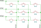
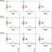
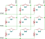
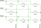

<!-- Copyright 2015-2026 Zephyr Project members and individual contributors. -->
<!-- SPDX-License-Identifier: Apache-2.0 -->
<!-- 中文翻译；阅读编号、导航和译注为本地新增。 -->

# 第4章\_GPIO键盘矩阵

原文：[GPIO Keyboard Matrix](https://docs.zephyrproject.org/latest/services/input/gpio-kbd.html)。读取日期：2026-10-12，`latest`。

[gpio-kbd-matrix](../input_adc_touch_matrix_binding_reference/P018_gpio-kbd-matrix.md#std-dtcompatible-gpio-kbd-matrix) 驱动支持多种**键盘矩阵（Keyboard Matrix）**硬件配置，并提供大量行为配置选项。本章概述常见接法及驱动对它们的支持方式。

这些接法通常都由驱动读取行 **通用输入输出（General-Purpose Input/Output，GPIO）**引脚，将其作为输入；通过列 GPIO 引脚选择要扫描的列，将其作为输出。

## 4.1\_无隔离二极管且GPIO支持中断的基本接法

这是使用薄膜开关与柔性电路板的消费级键盘常见配置。矩阵没有隔离二极管，因此需要**鬼键检测（Ghosting Detection）**；该检测默认启用。

> 译注：多个按键同时闭合时，电流可能经其他开关形成额外通路，让扫描结果看起来像还有一个未按下的键。该虚假按键称为鬼键（Ghost Key）。检测可避免上报这种含糊状态，但也可能限制能够同时识别的按键组合。



系统必须支持 GPIO 中断，并能同时为所有行 GPIO 启用中断。

> 译注：`row-gpios`、`col-gpios` 是设备树属性，分别列出行输入与列输出。`GPIO_PULL_UP` 是上拉配置标志，`GPIO_ACTIVE_LOW` 是低电平有效标志；`&gpio0` 是对 GPIO 控制器节点的引用，随后数字是该控制器内的引脚编号。

```devicetree
kbd-matrix {
     compatible = "gpio-kbd-matrix";
     row-gpios = <&gpio0 0 (GPIO_PULL_UP | GPIO_ACTIVE_LOW)>,
                 <&gpio0 1 (GPIO_PULL_UP | GPIO_ACTIVE_LOW)>,
                 <&gpio0 2 (GPIO_PULL_UP | GPIO_ACTIVE_LOW)>;
     col-gpios = <&gpio0 3 GPIO_ACTIVE_LOW>,
                 <&gpio0 4 GPIO_ACTIVE_LOW>,
                 <&gpio0 5 GPIO_ACTIVE_LOW>;
};
```

此配置下，全部按键松开后，矩阵扫描库进入**空闲模式（Idle Mode）**；只有按键被按下时，键盘矩阵线程才会唤醒。

未被选中的列 GPIO 配置为**高阻态（High-Impedance State）**。因此，切换列之后，行信号可能需要一段时间才能稳定，否则会把上一列的状态误读到下一列。通过 `settle-time-us` 属性调整这个**稳定等待时间（Settle Time）**。

## 4.2\_带隔离二极管的矩阵

每个按键都有**隔离二极管（Isolation Diode）**时，可以：

- 禁用鬼键检测，从而检测任意按键组合。
- 将未选中列主动驱动到非有效电平，而不是高阻态。这样可以缩短稳定等待时间，条件允许时可降至 0；GPIO 引脚连续时，还可自动采用更高效的整端口读取接口。

### 4.2.1\_二极管方向从行到列

二极管从行导向列的矩阵，必须为行启用**上拉（Pull-up）**，列采用**低电平有效（Active Low）**。



```devicetree
kbd-matrix {
     compatible = "gpio-kbd-matrix";
     row-gpios = <&gpio0 0 (GPIO_PULL_UP | GPIO_ACTIVE_LOW)>,
                 <&gpio0 1 (GPIO_PULL_UP | GPIO_ACTIVE_LOW)>,
                 <&gpio0 2 (GPIO_PULL_UP | GPIO_ACTIVE_LOW)>;
     col-gpios = <&gpio0 3 GPIO_ACTIVE_LOW>,
                 <&gpio0 4 GPIO_ACTIVE_LOW>,
                 <&gpio0 5 GPIO_ACTIVE_LOW>;
     col-drive-inactive;
     settle-time-us = <0>;
     no-ghostkey-check;
};
```

### 4.2.2\_二极管方向从列到行

二极管从列导向行的矩阵，必须为行启用**下拉（Pull-down）**，列采用**高电平有效（Active High）**。

> 译注：原例中的 `GPIO_PULL_DOWN` 与 `GPIO_ACTIVE_HIGH` 分别是上述下拉和高电平有效的设备树标志宏。



```devicetree
kbd-matrix {
     compatible = "gpio-kbd-matrix";
     row-gpios = <&gpio0 0 (GPIO_PULL_DOWN | GPIO_ACTIVE_HIGH)>,
                 <&gpio0 1 (GPIO_PULL_DOWN | GPIO_ACTIVE_HIGH)>,
                 <&gpio0 2 (GPIO_PULL_DOWN | GPIO_ACTIVE_HIGH)>;
     col-gpios = <&gpio0 3 GPIO_ACTIVE_HIGH>,
                 <&gpio0 4 GPIO_ACTIVE_HIGH>,
                 <&gpio0 5 GPIO_ACTIVE_HIGH>;
     col-drive-inactive;
     settle-time-us = <0>;
     no-ghostkey-check;
};
```

> 译注：上拉或下拉为开关断开时的输入提供确定电平；“有效”表示驱动把哪个电平解释为选中或按下。`settle-time-us = <0>` 是原例，不是对所有板级布线、电容与 GPIO 扩展器的保证。示例引脚不是本项目的实际接线。

## 4.3\_GPIO不支持中断

某些 GPIO 控制器的中断功能有限，可能不支持同时为所有行引脚启用中断。

这种情况下，可以让驱动完全不使用中断。在空闲时选中所有列，持续**轮询（Polling）**行 GPIO。如果行引脚连续，读取可通过一次 GPIO API 操作完成。

把 `idle-mode` 设为 `poll` 即可启用此配置：

```devicetree
kbd-matrix {
     compatible = "gpio-kbd-matrix";
     ...
     idle-mode = "poll";
};
```

## 4.4\_使用GPIO多路复用器

更特殊的接法可能在列端使用**多路复用器（Multiplexer）**，无法同时选中全部列。此时可以让驱动持续扫描。

将 `idle-mode` 设为 `scan`，并将 `poll-timeout-ms` 设为 0：

```devicetree
kbd-matrix {
     compatible = "gpio-kbd-matrix";
     ...
     poll-timeout-ms = <0>;
     idle-mode = "scan";
};
```

> 译注：带 `...` 的设备树片段省略了已有属性，不可原样作为完整 DTS 文件编译。持续扫描仍需遵守驱动的扫描时序与延时配置，并不意味着无延时地占满处理器。

## 4.5\_选择行列GPIO

若行引脚连续且位于同一 GPIO 控制器，驱动会自动从逐引脚读取改用整端口读取。对于无法通过内存映射直接访问的 GPIO，这尤其有用；例如 GPIO 位于**集成电路间总线（Inter-Integrated Circuit，I2C）**或**串行外设接口（Serial Peripheral Interface，SPI）**扩展器上时，整端口读取可显著减少总线事务数量。

列 GPIO 同样可以优化，但只有配置 `col-drive-inactive` 时才适用，因此只用于带隔离二极管的矩阵。

## 4.6\_十六位行状态

驱动默认用 8 位数据类型保存行状态，因此矩阵最多为 8 行。启用 `CONFIG_INPUT_KBD_MATRIX_16_BIT_ROW` 可把上限提高到 16 行。

## 4.7\_实际按键掩码

如果矩阵没有装满按键，可以通过 `actual-key-mask` 属性指定实际存在的按键。驱动先过滤不存在的键，再检测鬼键；这样可能允许一些原本会被鬼键检测阻止的按键组合。

例如，下面的 3×3 矩阵缺少一个按键：



```devicetree
kbd-matrix {
     compatible = "gpio-kbd-matrix";
     ...
     actual-key-mask = <0x07 0x05 0x07>;
};
```

这样就可以同时检测到 `Sw1`、`SW2` 和 `SW4` 被按下，而不触发防鬼键限制。

启用 `CONFIG_INPUT_KBD_ACTUAL_KEY_MASK_DYNAMIC` 后，可调用 `input_kbd_matrix_actual_key_mask_set()` 在运行时修改实际按键掩码。

> 译注：**位掩码（Bit Mask）**用每一位表示一个位置是否存在。这里每个元素对应一列，位对应行；`0x05` 的二进制为 `101`，表示该列中间一行没有按键。掩码应描述真实装配，不应靠隐藏实际存在的键来掩盖接线问题。

## 4.8\_键位映射配置

键盘矩阵设备报告一组 x、y、touch 事件。通过 [input-keymap](../input_keyboard_optical_ctsu_binding_reference/P002_input-keymap.md#std-dtcompatible-input-keymap) 驱动，可把这些事件映射为普通按键事件。

下面创建一个**键位映射（Keymap）**设备，以 x/y/touch 为输入，输出相应按键事件：

> 译注：`MATRIX_KEY(row, col, code)` 宏把行号、列号与按键事件编码组合为一个映射项；`INPUT_KEY_1` 到 `INPUT_KEY_9` 是数字键 1 到 9 的事件编码宏。`row-size`、`col-size` 分别给出矩阵行列数。

```devicetree
kbd {
    ...
    keymap {
        compatible = "input-keymap";
        keymap = <
            MATRIX_KEY(0, 0, INPUT_KEY_1)
            MATRIX_KEY(0, 1, INPUT_KEY_2)
            MATRIX_KEY(0, 2, INPUT_KEY_3)
            MATRIX_KEY(1, 0, INPUT_KEY_4)
            MATRIX_KEY(1, 1, INPUT_KEY_5)
            MATRIX_KEY(1, 2, INPUT_KEY_6)
            MATRIX_KEY(2, 0, INPUT_KEY_7)
            MATRIX_KEY(2, 1, INPUT_KEY_8)
            MATRIX_KEY(2, 2, INPUT_KEY_9)
        >;
        row-size = <3>;
        col-size = <3>;
    };
};
```

键位映射辅助工具见 [Keymap utilities API](https://docs.zephyrproject.org/latest/doxygen/html/group__input__keymap.html)。

## 4.9\_键盘矩阵Shell命令

`kbd_matrix_state_dump` 命令可测试任何基于键盘矩阵库实现的矩阵驱动。启用后，每次矩阵状态变化都会打印日志；禁用时，会打印所有曾检测到的按键的按位或掩码，可用于设置 `actual-key-mask`。

通过 `CONFIG_INPUT_SHELL_KBD_MATRIX_STATE` 启用该命令。下面是原文的命令与预期交互输出：

```text
uart:~$ device list
devices:
- kbd-matrix (READY)
uart:~$ input kbd_matrix_state_dump kbd-matrix
Keyboard state logging enabled for kbd-matrix
[00:01:41.678,466] <inf> input: kbd-matrix state [01 -- -- --] (1)
[00:01:41.784,912] <inf> input: kbd-matrix state [-- -- -- --] (0)
...
press more buttons
...
uart:~$ input kbd_matrix_state_dump off
Keyboard state logging disabled
[00:01:47.967,651] <inf> input: kbd-matrix key-mask [07 05 07 --] (8)
```

> 译注：Shell 是交互式命令解释器，本例使用 `input` 命令组；输出中的 `READY` 表示设备就绪，`press more buttons` 是操作提示，意为“再按一些按钮”，不是 shell 命令。日志掩码只包含本次测试实际检测到的键，未按过的键不能据此判断为没有装配。

## 4.10\_键盘矩阵库

GPIO 键盘矩阵驱动建立在通用**键盘矩阵库（Keyboard Matrix Library）**之上。该库实现扫描延时、**去抖（Debouncing）**、空闲模式等核心功能，可复用于其他矩阵驱动，包括应用专用驱动。去抖用于过滤开关接触时的短暂重复跳变。

完整接口见 [Keyboard Matrix API](https://docs.zephyrproject.org/latest/doxygen/html/group__input__kbd__matrix.html)。

<!-- reading-navigation:start -->

**主线阅读**

[上一篇：输入子系统](P003_输入子系统.md) · [本模块主线目录](../reading/interaction.md) · [全部主线](../reading/README.md)

<details>
<summary>原册编号导航（含扩展参考）</summary>

[上一章：输入子系统](P003_输入子系统.md) · [后续参考：输入事件转储示例](P014_输入事件转储示例.md#input-dump) · [返回大纲](大纲.md) · [下一章](P005_控制台示例目录.md)

</details>

<!-- reading-navigation:end -->
