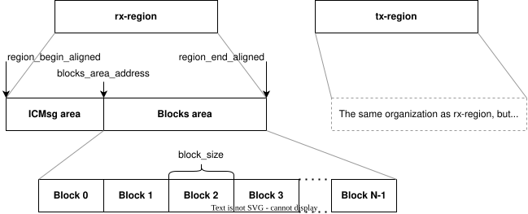

<!-- Copyright 2015-2026 Zephyr Project members and individual contributors. -->
<!-- SPDX-License-Identifier: Apache-2.0 -->
<!-- 中文翻译；阅读编号、导航和译注为本地新增。 -->

# 第94章\_ICBMsg块消息后端

原文：[ICMsg with dynamically allocated buffers backend](https://docs.zephyrproject.org/latest/services/ipc/ipc_service/backends/ipc_service_icbmsg.html)。读取日期：2026-10-13，`latest`。

此后端使用共享内存（Shared Memory）中动态分配的缓冲区传输数据，协议名为ICBMsg。分配操作是线程安全的（Thread-safe），可从任意上下文发起。支持以下能力：

- 多端点（Multiple Endpoints）。
- 无拷贝发送（No-copy Sending）。
- 保留接收缓冲区（Holding RX Buffers）。
- 从中断上下文（Interrupt Context）发送。
- 两级端点优先级（Endpoint Priority）。
- 统计信息，以及可选的利用率报告命令行（Shell）命令。
- 最多32个块（Block）。
- 数据缓存（Data Cache）。
- 较低内存占用，代码约2 kB。

TX表示发送（Transmit），RX表示接收（Receive）。

## 94.1\_缓冲池与发送流程

每个方向预留一个共享内存区域，分为两部分。一部分是定长缓冲池（Buffer Pool），分配器把相邻缓冲块组合成变长缓冲区；另一部分是控制路径（Control Path），每个方向有两个消息队列：生产者队列（Producer Queue）由发送方写、接收方读，消费者队列（Consumer Queue）由接收方写、发送方读。前者保存下一条消息在池内的位置，后者保存已消费消息在池内的位置。

发送流程如下：

1. 发送方分配一个或多个块。连续空闲块不足时，线程上下文按参数指定的超时等待，包括`K_FOREVER`一直等待与`K_NO_WAIT`不等待。
2. 填充数据。首块开头为32位消息头（Message Header），含长度、端点标识及自身块索引。无拷贝方式由调用方填充，否则自动复制。只要仍有足够空闲块，其他线程可继续分配、收发，不会因此被阻塞。
3. 把消息起始块索引写入生产者队列，同时附加端点优先级信息。队列槽位数由`CONFIG_IPC_SERVICE_BACKEND_ICBMSG_MAX_ACTIVE_COUNT`配置选项定义，再通过邮箱（Mailbox，MBOX）通知接收方。
4. 接收方读取生产者队列，优先处理高优先级消息，并可按需要长期保留数据。空闲块充足时其他线程仍可继续操作。
5. 数据不再需要时，接收方把块索引写入消费者队列。
6. 发送方读取消费者队列并释放缓冲区，执行垃圾回收（Garbage Collection）。每次发送消息后，或没有可用缓冲区时，都会进行回收。

## 94.2\_配置项与设备树

后端通过Kconfig与设备树（Devicetree）配置。原文列出以下配置选项：

| 配置选项 | 含义 |
| --- | --- |
| [`CONFIG_IPC_SERVICE_BACKEND_ICBMSG_NUM_EP`](https://docs.zephyrproject.org/latest/kconfig.html#CONFIG_IPC_SERVICE_BACKEND_ICBMSG_NUM_EP) | 注册端点的最大数量 |
| [`CONFIG_IPC_SERVICE_BACKEND_ICBMSG_MAX_ACTIVE_COUNT`](https://docs.zephyrproject.org/latest/kconfig.html#CONFIG_IPC_SERVICE_BACKEND_ICBMSG_MAX_ACTIVE_COUNT) | 队列中的槽位数量 |
| [`CONFIG_IPC_SERVICE_BACKEND_ICBMSG_DEINIT`](https://docs.zephyrproject.org/latest/kconfig.html#CONFIG_IPC_SERVICE_BACKEND_ICBMSG_DEINIT) | 支持注销与关闭 |
| [`CONFIG_IPC_SERVICE_BACKEND_ICBMSG_SHELL`](https://docs.zephyrproject.org/latest/kconfig.html#CONFIG_IPC_SERVICE_BACKEND_ICBMSG_SHELL) | 支持Shell命令 |

如果任何一侧对共享内存使用数据缓存，`dcache-alignment`必须取两侧缓存失效（Invalidation）或写回（Write-back）粒度的最大值；两侧都不使用时可省略。定义`tx-region``rx-region`两个独立、与其他区域不重叠且两侧域或中央处理器（Central Processing Unit，CPU）均可访问的区域；用`tx-blocks``rx-blocks`设置各区域可分配块数。定义MBOX设备通知另一侧数据已写入，并确保对端能够接收。

**原文注意事项：**缓存对齐错误可能暂时没有症状，但之后会出现不稳定行为。启用对齐后还应谨慎选择块数，避免浪费内存；块和控制数据都要满足缓存边界要求。

原文把低利用率原因表述为“块数不是缓存对齐值的倍数时，最后一个块无法高效使用”。其数值例子为：对齐32字节、单向共享区域1024字节，控制数据占64字节，缓冲区剩960字节。配置16块时，每块因对齐只得到32字节；配置15块时，每块得到64字节，利用率更好。**译注：**块数与字节对齐量不是同一单位，原句不宜单独当作判定公式；具体计算按下方原协议的块大小向下取整算法理解，例子中的数值不作改写。

原配置：

```dts
reserved-memory {
   tx: memory@20070000 {
      reg = <0x20070000 0x0800>;
   };

   rx: memory@20078000 {
      reg = <0x20078000 0x0800>;
   };
};

ipc {
   ipc0: ipc0 {
      compatible = "zephyr,ipc-icbmsg";
      dcache-alignment = <32>;
      tx-region = <&tx>;
      rx-region = <&rx>;
      tx-blocks = <16>;
      rx-blocks = <16>;
      mboxes = <&mbox 0>, <&mbox 1>;
      mbox-names = "tx", "rx";
      status = "okay";
   };
};
```

另一侧需要类似配置，但必须交换MBOX通道、发送／接收区域`tx-region``rx-region`，以及块数`tx-blocks``rx-blocks`。

## 94.3\_限制与示例

通信两侧必须采用相同字节序（Endianness）；**不支持检测远端意外复位**。配套用法见[IPC服务多端点示例](P096_IPC服务多端点示例.md)。

## 94.4\_共享内存布局算法

`rx-region`用于接收，`tx-region`用于发送，两侧核心互换这两个区域。区域不必相邻，不要求特定放置顺序，也不必等大。

每个区域包括控制区（Control Area）和块区（Blocks Area）。控制区供生产者、消费者队列使用；块区分成大小相等、满足缓存边界对齐的可分配块，用来承载消息。

算法输入：

| 名称 | 含义 |
| --- | --- |
| `region_begin``region_end` | 区域边界 |
| `local_blocks` | 当前区域的块数 |
| `remote_blocks` | 相反方向区域的块数 |
| `alignment` | 内存缓存对齐量 |

依次计算：

1. 对区域边界作缓存对齐，原表达式为：
   `region_begin_aligned = ROUND_UP(region_begin, alignment)`；
   `region_end_aligned = ROUND_DOWN(region_end, alignment)`；
   `region_size_aligned = region_end_aligned - region_begin_aligned`。
2. 计算控制区最小大小：每个队列需要`IPC_SERVICE_BACKEND_ICBMSG_MAX_ACTIVE_COUNT`字节加8字节队列头。原文说明每方向的控制数据通常小于64字节。
3. 计算块区可用大小：`blocks_area_available_size = region_size_aligned - control_area`。由于块对齐，实际使用大小可能更小。
4. 计算单块大小：`block_size = ROUND_DOWN(blocks_area_available_size / local_blocks, alignment)`。
5. 计算实际块区大小：`blocks_area_size = block_size * local_blocks`。
6. 计算块区起址：`blocks_area_begin = region_end_aligned - blocks_area_size`。

`ROUND_UP`表示向上对齐，`ROUND_DOWN`表示向下对齐。算法结果：`region_begin_aligned`为原文所称ICMsg区域的起点；`blocks_area_begin`为该区域终点、块区起点；`block_size`为单块大小；`region_end_aligned`为块区终点。原文控制区容量符号省略了`CONFIG_`前缀，此处保持原拼写；输入`remote_blocks`也按原文列出。



图中文字：ICMsg area为原图所称ICMsg区域，Blocks area为块区，Block 0至Block N−1为各块；发送区与接收区组织相同，但大小和块数可以不同。图中块区起点写作`blocks_area_address`，正文算法写作`blocks_area_begin`；两种原标识均保留，其他边界与大小标识对应上方算法。

## 94.5\_消息传输协议

协议有控制消息（Control Message，例如绑定、解绑）和数据消息（Data Message，携带用户数据）两类，用途不同但生命周期与流转一致：

1. 发送方准备发送K字节消息。
2. 从自身发送块区预留至少容纳`K + 4`字节的**连续块**；额外4字节供消息头使用。分配管理由发送方负责。没有可用块时，线程上下文可以阻塞，中断上下文则返回错误。
3. 发送方填写消息头。
4. 填充块中的其余数据空间，未使用的空间忽略。
5. 写入生产者队列并发出邮箱信号。
6. 接收方在邮箱中断上下文执行回调，读取生产者队列。
7. 读取块索引，在自身`rx-region`定位消息。
8. 读取端点和消息长度，处理消息。
9. 把块索引写入消费者队列，表示已消费；**此时不发送邮箱信号**。
10. 发送方在每次发送后或发送失败时检查消费者队列，将对应消息缓冲区释放回池。


图中文字：示例消息分配在块1和块2；header (size of data)为消息头（数据大小），占4字节；data为数据，unused为未使用空间，Blocks area为块区。原SVG保留全部英文标签及其格式，不将其替换为重绘图片。

## 94.6\_实例绑定

打开后端实例时，发送包含64位魔数（Magic Number）的绑定消息，启用邮箱回调并等待对端绑定消息。收到后，本实例与远端实例绑定，随后可以注册端点。

## 94.7\_端点绑定的两种先后顺序

端点绑定消息包含端点名称的安全散列算法摘要（Secure Hash Algorithm，SHA）及端点标识（Endpoint ID）；标识是本地端点数据数组的索引。原页没有指定SHA的具体变体。

有两种情况：远端先发来绑定消息，本地随后注册；或本地先注册，随后收到远端绑定消息。

收到绑定消息时，把其中SHA与端点数据数组中的SHA比较。找到匹配说明本地已经注册该端点，保存端点标识并调用绑定回调（Bound Callback）；未匹配则找空槽，保存端点标识与SHA。

本地注册端点时，先计算名称SHA，再与数组中的SHA比较。找到匹配说明已收到远端的绑定消息，此时向远端发送绑定消息并调用绑定回调；未匹配则找空槽保存标识与SHA，向远端发送绑定消息，但端点尚未绑定。

此后，数据消息使用远端端点标识来标识目标端点。

## 94.8\_端点解绑

注销端点时发送解绑控制消息（Unbinding Control Message），并从端点数据数组中移除端点。收到解绑消息时，将对应端点槽标为空，并调用解绑回调（Unbinding Callback）。

---

<!-- reading-navigation:start -->

**主线阅读**

[上一篇：ICMsg消息后端](P093_ICMsg消息后端.md) · [本模块主线目录](../reading/intercore_reference.md) · [全部主线](../reading/README.md)

<details>
<summary>原册编号导航（含扩展参考）</summary>

[上一章：ICMsg消息后端](P093_ICMsg消息后端.md) · [下一章：IPC服务ICMsg示例](P095_IPC服务ICMsg示例.md) · [返回大纲](大纲.md)

</details>

<!-- reading-navigation:end -->
