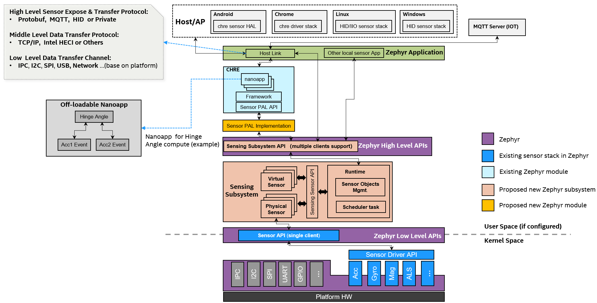
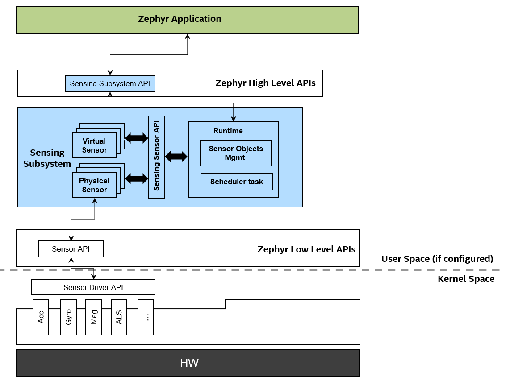
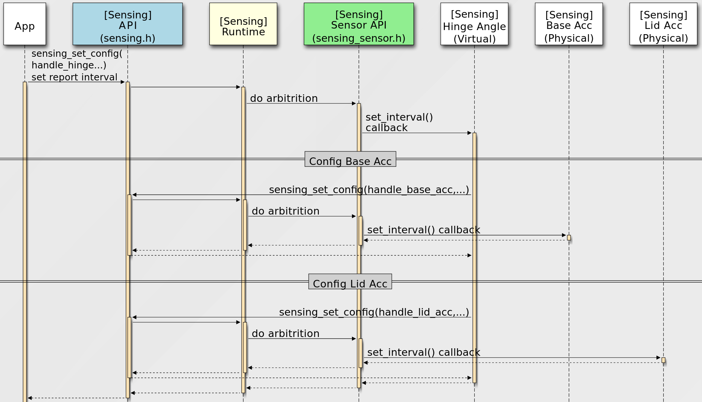
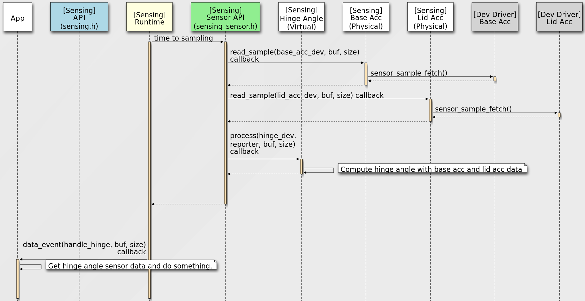
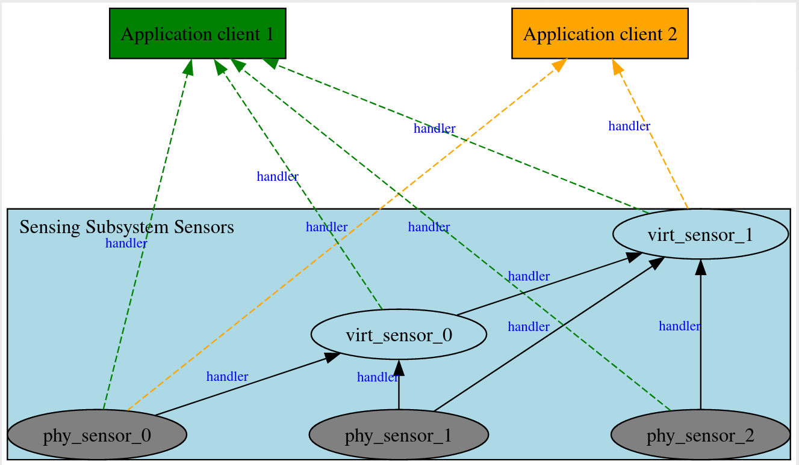

<!-- Copyright 2015-2026 Zephyr Project members and individual contributors. -->
<!-- SPDX-License-Identifier: Apache-2.0 -->
<!-- 中文翻译；阅读编号、导航和译注为本地新增。 -->

<a id="sensing"></a>

# 第2章\_传感子系统

原文：[Sensing Subsystem](https://docs.zephyrproject.org/latest/services/sensing/index.html)。读取日期：2026-10-12，`latest`。

**传感子系统（Sensing Subsystem）**是位于操作系统高层服务中的传感器框架，面向**传感器融合（Sensor Fusion）**、多客户端仲裁、采样、时序、调度，以及基于传感器的电源管理。

它区分**物理传感器（Physical Sensor）**和**虚拟传感器（Virtual Sensor）**对象。物理对象不依赖其他传感器对象提供输入，直接与 Zephyr 传感器驱动交互；虚拟对象以其他物理或虚拟对象的报告为输入。框架据这些对象关系进行调度。

## 2.1\_与低层驱动和上层协议的关系

该子系统通过 Zephyr Sensor 设备接口复用已有驱动，原文举出“100 多种”作为其驱动规模。使用它是可选的；应用若只需访问简单传感器，可以直接使用 [Zephyr传感器API](https://docs.zephyrproject.org/latest/hardware/peripherals/sensor/index.html#sensor)。

将高层算法与驱动层分开，使驱动尽量专注于硬件抽象和设备操作，而虚拟传感器可承载定制处理和融合算法，有利于保持底层简单。

> 译注：原文使用“用户空间服务层”描述架构位置，不应理解为启用该子系统就自动让所有代码在受保护的用户态运行。仓库实现有传感运行线程与分发线程，执行权限及隔离边界仍应核对具体实现和配置。

子系统不绑定特定传感数据呈现或传输协议，可按产品需求支持 **上下文中心运行环境（Context Hub Runtime Environment，CHRE）**、**人机接口设备（Human Interface Device，HID）**传感器应用，以及 MQTT 消息协议应用。多客户端设计还允许不同上层协议应用同时使用。

它的目标是形成可跨主机操作系统、也适合**物联网（Internet of Things，IoT）**传感方案的统一架构。与上层框架的关系见官方原图：



> 图示译注：Host/AP 是主机或应用处理器，Host Link 是主机连接；图中将高层数据协议、中层传输协议和低层物理通道分开。浅蓝色为已有模块，蓝色为已有传感器栈，浅橙色和黄色分别标示图中提出的新子系统与模块；“Proposed”反映原图设计阶段，不能作为当前实现完成度记录。nanoapp 是 CHRE 的小型应用对象，示例用两路加速度事件计算铰链角度。

## 2.2\_可配置性

原文列出以下组织方式：

- 子系统独立、可复用、可配置。
- 基于已有的低层 Sensor 接口，复用现有传感器驱动。
- 对应用提供高层 Sensing 接口。
- 可选的 CHRE Sensor **平台抽象层（Platform Abstraction Layer，PAL）**实现模块用于接入 [CHRE](https://github.com/zephyrproject-rtos/chre)。
- 主机连接协议由应用负责，MQTT、HID 或私有协议等均可按需求配置。

## 2.3\_核心能力与接口边界

| 能力 | 内容 |
| --- | --- |
| 处理范围 | 传感器融合、多客户端、仲裁、采样、时间管理与调度。 |
| 物理传感器抽象 | 直接与设备驱动交互，重点是采集数据。 |
| 虚拟传感器抽象 | 依赖其他物理或虚拟传感器，重点是数据融合。 |
| **轮询模式（Polling Mode）** | 按周期采样频率取样。 |
| **中断模式（Interrupt Mode）** | 使用数据就绪、阈值中断等事件。 |
| 调度 | 原文说明以一个主循环线程进行各传感对象的采样与处理。 |
| **批处理（Batching）**缓冲模式 | 通过设备树配置。 |

接口层次见官方原图：



其中**传感子系统应用接口（Sensing Subsystem API）**面向应用，**传感器对象开发接口（Sensing Sensor API）**面向传感器对象开发；二者不是同一层调用接口。

> 图示译注：Runtime 是运行时管理部分，Sensor Objects Mgmt. 是传感器对象管理，Scheduler task 是调度任务；下方 Acc、Gyro、Mag、ALS 分别标记加速度计、陀螺仪、磁力计与环境光传感器。虚线旁的“User Space (if configured)”意为“配置后可用的用户空间”，保留其条件限制。

## 2.4\_配置与数据流

配置从客户端需求进入框架，再沿传感器关系影响采样等设置。官方配置流程图如下：



> 图示译注：App 是应用，Hinge Angle 是铰链角度虚拟传感器，Base Acc 与 Lid Acc 分别是底座和上盖的物理加速度计。应用设置报告间隔后，Runtime 进行仲裁，再经 `set_interval()` 回调配置虚拟对象及其两路物理报告源。

采样结果再沿报告关系流向使用者，官方数据流程图如下：



> 图示译注：运行时到采样时刻后，经 `read_sample()` 调用两路物理对象，它们通过 `sensor_sample_fetch()` 向驱动取样；随后 `process()` 回调计算铰链角度，最后由 `data_event()` 回调把结果送给应用。两张图中的英文接口及箭头保留原样；配置流描述需求如何送达，数据流描述读数如何报告。实际线程和回调执行位置应按所用版本实现核对，不由箭头推断进程隔离。

## 2.5\_传感器类型与实例

同一传感器类型可以存在多个实例。应用有两种识别和打开方式。

### 2.5.1\_先枚举再打开

[`sensing_get_sensors()`](https://docs.zephyrproject.org/latest/doxygen/html/group__sensing__api.html#gaf3b6c66c2db12115f3ebec0cdba32e86)取得当前板配置支持的实例信息，使用 `sensing_sensor_info` 信息结构。应用再通过 [`sensing_open_sensor()`](https://docs.zephyrproject.org/latest/doxygen/html/group__sensing__api.html#ga8e427d28efc492f15d762af3308d78cd)打开特定实例，以便配置、访问和接收数据。

该方式适合 CHRE、HID 等需要动态枚举底层传感器实例的上层框架。

> 译注：原文把信息称为“指针数组”；当前头文件的接口通过输出参数提供信息数组指针及数量，函数本身返回状态值。不能把整数返回值当成实例数组。

### 2.5.2\_按设备树选择实例

只需访问固定传感器的应用，可使用 [`sensing_open_sensor_by_dt()`](https://docs.zephyrproject.org/latest/doxygen/html/group__sensing__api.html#ga4218453664fee0aa61697018e3193e7a)。原文两种写法为：

```c
sensing_open_sensor_by_dt(DEVICE_DT_GET(DT_NODELABEL(base_accel)), cb_list, handle);
sensing_open_sensor_by_dt(DEVICE_DT_GET(DT_CHOSEN(zephyr_sensing_base_accel)), cb_list, handle);
```

> 译注：`DT_NODELABEL` 按节点标签选择，`DT_CHOSEN` 按 chosen 属性选择，宏 `DEVICE_DT_GET` 转成设备对象指针；所以函数实参是设备指针，并非原始节点名字符串。`cb_list` 是准备好的回调列表指针，`handle` 是用于接收实例句柄的输出参数；代码展示两种选择方式，不要求重复打开两次。使用前应准备这些对象并检查返回状态。

传感器类型遵循 [HID传感器类型标准](https://usb.org/sites/default/files/hutrr39b_0.pdf)，对应定义见 [`sensing_sensor_types.h`](https://github.com/zephyrproject-rtos/zephyr/blob/main/include/zephyr/sensing/sensing_sensor_types.h)。

## 2.6\_实例句柄与报告关系

客户端用 [`sensing_sensor_handle_t`](https://docs.zephyrproject.org/latest/doxygen/html/group__sensing__api.html#gac959e076fcdc105dfaac1d7a984ba293)类型的**句柄（Handle）**操作已打开实例，后续设置和读取等动作都使用这个句柄。

客户端有两类：

- 应用客户端显式调用 `sensing_open_sensor()`，取得句柄。
- 传感器客户端依赖其他传感器提供报告，其**报告源（Reporter）**关系由设备树在注册时建立；不使用单独的打开报告源接口。

框架会自动打开传感器客户端的报告源并创建句柄。传感器客户端通过 [`sensing_sensor_get_reporters()`](https://docs.zephyrproject.org/latest/doxygen/html/group__sensing__sensor.html#gab4c41d02b3731e5829a41e1f5f5154a5)取得这些句柄。

**原文注意：**子系统内部对象间的报告关系和句柄自动由设备树定义建立；应用仍需显式打开实例。

## 2.7\_样本结构与时间戳

每个传感数据结构由公共头部加 `readings[]` 数组组成，例如 `sensing_sensor_value_3d_q31`、`sensing_sensor_value_q31`、`sensing_sensor_value_uint32`。公共头部为 `sensing_sensor_value_header` 结构。

**时间戳（Timestamp）**单位是微秒。头部的 `base_timestamp` 是基准时间，每个读数的 `timestamp_delta` 是相对前一读数的增量；首个读数相对基准时间：

- `readings[0]` 时间 = `header.base_timestamp + readings[0].timestamp_delta`。
- `readings[1]` 时间 = 首个读数时间 + `readings[1].timestamp_delta`。

原文把 `uint32_t` 增量的最大范围概括为 4295 秒。若一批数据相邻读数间隔超过该范围，运行时会拆成多个读数结构并发送多个事件。这个概念借鉴 [CHRE Sensor API](https://github.com/zephyrproject-rtos/chre/blob/zephyr/chre_api/include/chre_api/chre/sensor_types.h)。

> 译注：准确上限是 `(2^32 - 1)` 微秒，即 4294.967295 秒；4295 是原文近似值，不宜作为边界比较常量。原文将公共头部名字写成函数式 `sensing_sensor_value_header()`，当前源码实际是结构体。

## 2.8\_不同类型的读数格式

子系统按传感器类型定义数据结构，并支持**定点Q格式（Fixed-Point Q Format）**，便于使用 Zephyr **数字信号处理（Digital Signal Processing，DSP）**库 `zdsp`。相关类型见 [`include/zephyr/dsp/types.h`](https://github.com/zephyrproject-rtos/zephyr/blob/main/include/zephyr/dsp/types.h)。

例如**惯性测量单元（Inertial Measurement Unit，IMU）**等三维传感器可使用 `sensing_sensor_value_3d_q31`。原文给出的对应关系为：

| 数据结构 | 传感器类型 |
| --- | --- |
| `sensing_sensor_value_3d_q31` | 三维加速度 `SENSING_SENSOR_TYPE_MOTION_ACCELEROMETER_3D`、未校准三维加速度 `SENSING_SENSOR_TYPE_MOTION_UNCALIB_ACCELEROMETER_3D`、三维陀螺仪 `SENSING_SENSOR_TYPE_MOTION_GYROMETER_3D`。 |
| `sensing_sensor_value_uint32` | 环境光 `SENSING_SENSOR_TYPE_LIGHT_AMBIENTLIGHT`。 |
| `sensing_sensor_value_q31` | 铰链角度 `SENSING_SENSOR_TYPE_MOTION_HINGE_ANGLE`。 |

定义见 [`sensing_datatypes.h`](https://github.com/zephyrproject-rtos/zephyr/blob/main/include/zephyr/sensing/sensing_datatypes.h)。原文的整体传感器关系图如下：



> 图示译注：`phy_sensor_*` 是物理对象，`virt_sensor_*` 是虚拟对象。黑色实线体现子系统内部报告关系，绿色和橙色虚线区分两个应用客户端的访问关系；图中 `handler` 对应正文所述实例句柄。一个对象可同时服务于应用和其他传感器对象。

## 2.9\_设备树配置与接口参考

子系统用设备树配置传感器实例、属性和报告关系。可参考官方 [`native_sim.overlay`](https://github.com/zephyrproject-rtos/zephyr/blob/main/samples/subsys/sensing/simple/boards/native_sim.overlay)，这是示例随附的覆盖文件，不是阅读译文后已经应用到当前板的设置。

完整接口见 [Sensing API参考](https://docs.zephyrproject.org/latest/doxygen/html/group__sensing__api.html)，相关 [Sensing示例](P005_传感子系统示例.md#sensing)按设定间隔取得高层传感数据。本次未运行采样或验证传感器硬件。

<!-- reading-navigation:start -->

**主线阅读**

[上一篇：实时输入输出](P001_实时输入输出.md) · [本模块主线目录](../reading/io_services.md) · [全部主线](../reading/README.md) · [下一篇：消息总线zbus](P003_消息总线zbus.md)

<details>
<summary>原册编号导航（含扩展参考）</summary>

[上一章：实时输入输出](P001_实时输入输出.md) · [下一章：消息总线zbus](P003_消息总线zbus.md) · [返回大纲](大纲.md)

</details>

<!-- reading-navigation:end -->
