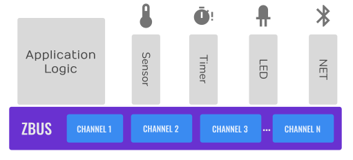
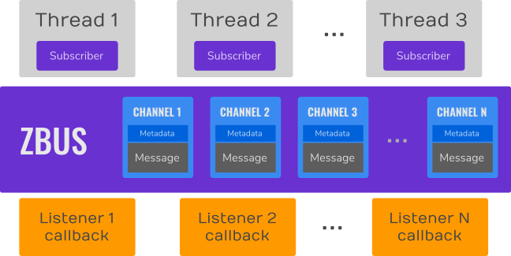
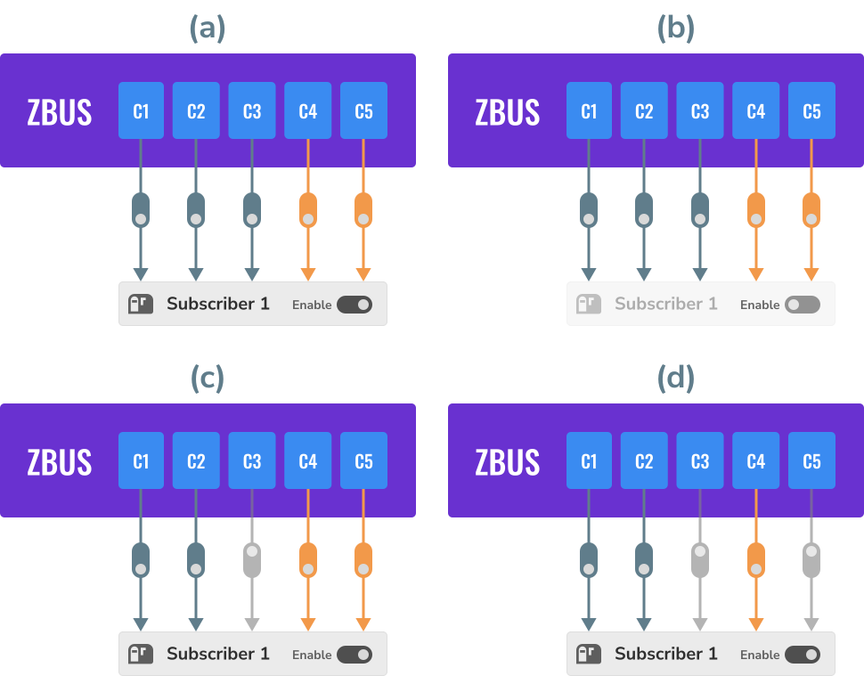
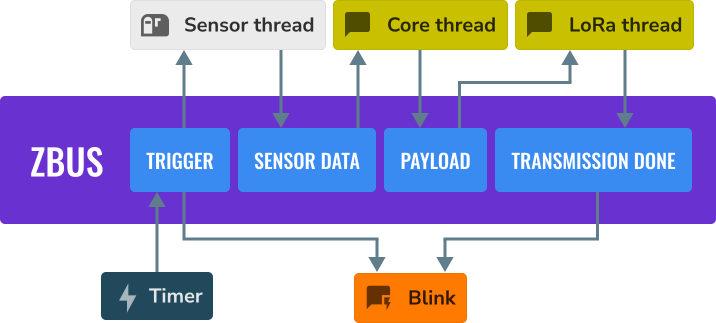
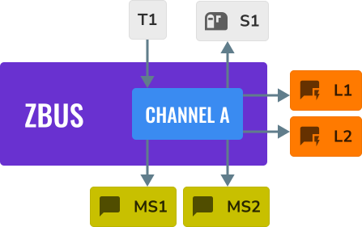
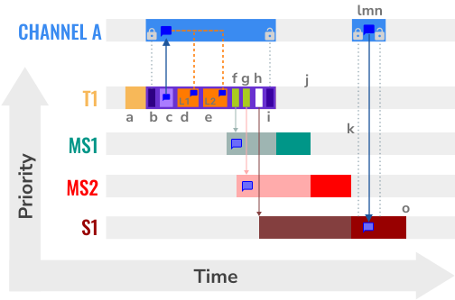
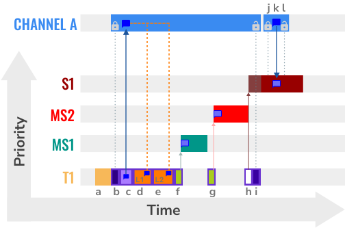
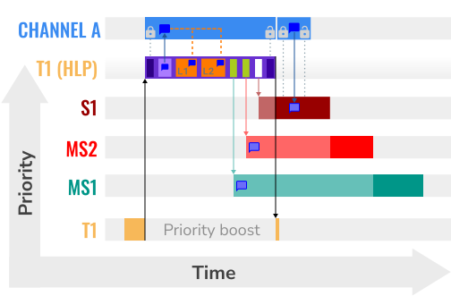
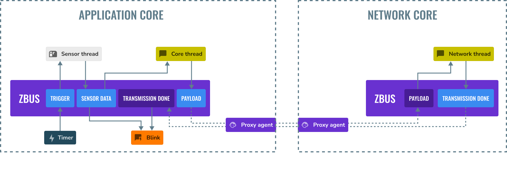

<!-- Copyright 2015-2026 Zephyr Project members and individual contributors. -->
<!-- SPDX-License-Identifier: Apache-2.0 -->
<!-- 中文翻译；阅读编号、导航和译注为本地新增。 -->

# 第3章\_消息总线zbus

原文：[Zephyr bus (zbus)](https://docs.zephyrproject.org/latest/services/zbus/index.html)。读取日期：2026-10-12，`latest`。

Zephyr 的 **消息总线（Message Bus）**子系统 zbus是一种轻量、灵活的软件总线，让线程以多对多方式交换消息。它通过共享内存提供**消息传递（Message Passing）**和**发布/订阅（Publish/Subscribe）**通信，既能同步通知，也能异步处理。

## 3.1\_通道、消息与观察者

zbus 通信以**通道（Channel）**为中心。线程或回调向通道发布消息，或观察通道；消息发布后，总线向该通道的全部有效**观察者（Observer）**提供相应通知。观察者可能直接访问消息、收到消息副本，也可能只收到通道引用。

下图中，与硬件无关的应用逻辑经软件总线和其他线程通信。各线程只需认识通道，不必相互知道实现细节，因此可以解耦：



总线由以下部分组成：

- 保存控制元数据与消息本体的一组通道。
- **虚拟分布式事件分发器（Virtual Distributed Event Dispatcher，VDED）**，即分发通知与消息的逻辑。它在发布动作内部、发布者的执行上下文中运行，不另设一个独立分发线程。
- 发布、读取或接收通知的线程观察者、普通回调，以及被推迟到工作队列执行的异步回调。



总线提供发布、读取、占用、结束占用、通知与订阅操作。发布和读取的基本步骤是锁住通道、向共享消息区复制或从中复制、再解锁。原文说明发布、读取、占用和结束占用可用于线程及**中断服务程序（Interrupt Service Routine，ISR）**；带超时的操作在 ISR 中须使用后文规定的非等待形式。

## 3.2\_四类观察者

观察者的类型决定消息如何到达使用者：


| 类型 | 收到什么、在哪执行 |
| --- | --- |
| **监听器（Listener）** | 观察通道发布或通知时，分发器直接执行回调；处于发布者上下文。 |
| **异步监听器（Async Listener）** | 分发器安排回调到工作队列执行，默认使用系统工作队列。 |
| **订阅者（Subscriber）** | 线程通过消息队列收到变化通道的引用；没有收到消息本体，之后必须自行读取通道。 |
| **消息订阅者（Message Subscriber）** | 线程通过**先进先出队列（First-In, First-Out Queue，FIFO）**取得消息副本。 |

通道与观察者之间的**观察关系（Observation）**是一个通道/观察者配对。可用宏 `ZBUS_CHAN_DEFINE` 或 `ZBUS_CHAN_ADD_OBS` 静态定义，也可运行时建立。既可禁用整个观察者，也可单独屏蔽一个关系；分发器忽略两种禁用状态。



图中 C1 至 C5 对应五个通道，最后两个橙色关系在运行时动态建立。状态 (a) 全部启用；(b) 整个 Subscriber 1 禁用；(c) 观察者启用但 C3 关系被屏蔽；(d) C3 和 C5 的通知均被屏蔽。

## 3.3\_传感器应用中的消息路径

原文用下面的传感应用说明各模块怎样经通道协作：



1. 定时器向 Trigger（触发）通道发布。
2. 传感器线程订阅该通道，被通知后取得传感数据；Blink（闪灯）监听器也因监听 Trigger 而执行。
3. 数据就绪后，传感器线程向 Sensor data（传感数据）通道发布。
4. 核心线程以消息订阅者身份接收副本，处理并存入采样缓冲区，重复直到缓冲区满。
5. 核心线程汇总采样，向 Payload（负载）通道发布待发包。
6. LoRa 通信线程收到负载并发送到云端，结束后向 Transmission done（发送完成）通道发布；Blink 监听器再次执行。

> 译注：原文称传感线程订阅 Trigger 后“收到传感数据”，结合其后步骤应理解为先收到触发通知，再执行采样；通道引用不自动包含尚未采集的数据。LoRa 是此例无线通信技术名，不能由总线本身推断硬件已经支持它。

因为模块依赖通道约定而非其他线程实现，可把定时器触发换成按钮，或把 LoRa 线程换成 Bluetooth（蓝牙）线程，而保持其他模块的接口。行为明确、只使用通道的模块，也可在实现同一组通道的新系统中复用。

zbus 还支持动态或静态分配的消息、同步或异步通知、通道占用控制、`user_data` 自定义元数据和可选的消息校验器，以适应不同设计。

## 3.4\_发布期间的分发步骤

VDED 始终在发布者上下文运行，可以是线程或 ISR。**原文提醒：**从 ISR 发布时，线程调度器不能抢占这个中断中的分发过程，因此必须谨慎控制执行时间。

基本步骤是：

1. 取得通道锁。
2. 通过 C 内存复制函数 `memcpy()` 将新消息直接复制到通道。
3. 按通道观察者列表顺序执行监听器、向消息订阅者发送副本、向订阅者通知队列放入通道引用。监听器此时可用函数 `zbus_chan_const_msg()` 直接读取只读消息，无需复制，因为通道仍被锁住。
4. 解锁通道并完成发布。

### 3.4.1\_示例参与者

下面例子有四个线程 T1、MS1、MS2、S1，两个监听器 L1、L2，以及通道 A：



通道按 L1、L2、MS1、MS2、S1 的顺序观察，`struct a_msg` 仅为示意类型。宏 `ZBUS_OBSERVERS` 列出观察者，宏 `ZBUS_MSG_INIT` 构造消息初值：

```c
ZBUS_CHAN_DEFINE(a_chan,                       /* Name */
         struct a_msg,                         /* Message type */

         NULL,                                 /* Validator */
         NULL,                                 /* User Data */
         ZBUS_OBSERVERS(L1, L2, MS1, MS2, S1), /* observers */
         ZBUS_MSG_INIT(0)                      /* Initial value {0} */
);
```

时间图横轴是时间，纵轴是线程优先级。消息气泡是同一个共享消息区在不同时刻的表示，不是多个消息缓冲区。

### 3.4.2\_发布者优先级最高

第一种情形为 T1 > MS1 > MS2 > S1，`>` 表示调度优先级更高：



| 图中字母 | 动作 |
| --- | --- |
| a | T1 开始运行，随后向 A 发布。 |
| b | VDED 开始，锁住 A。 |
| c | 将 T1 的消息复制到 A 的共享消息区。 |
| d、e | 顺序执行 L1、L2；监听器可用 `zbus_chan_const_msg()` 只读访问。 |
| f、g | 顺序向 MS1、MS2 发送消息副本；线程具备运行条件，但优先级低于 T1。 |
| h | 向 S1 队列发送通知；通道仍被锁住。 |
| i | VDED 解锁 A，图中随后由 MS1 运行。 |
| j | MS1 结束其处理，MS2 运行。 |
| k | MS2 结束其处理，S1 运行。 |
| l、m、n | S1 取得处理机会，按锁定、复制、解锁读取 A，然后继续处理并让出处理器。 |
| o | S1 完成本次工作。 |

> 译注：原文把因低优先级暂未运行的状态也称为 pending；应区分**就绪（Ready）但未获调度**与真正等待锁的**阻塞（Blocked/Pending）**。T1 优先级最高时，解锁本身也不保证它马上停止运行；图中后续顺序还以 T1 随后阻塞、退出或让其他线程可运行等调度条件为前提。Zephyr 优先级数值与“高低”方向不同，图里的 `>` 不是配置数值比较。

### 3.4.3\_观察线程优先级更高

第二种情形为 T1 < MS1 < MS2 < S1：



| 图中字母 | 动作 |
| --- | --- |
| a、b、c | T1 开始发布，VDED 锁住 A 并复制消息。 |
| d、e | 顺序执行 L1 与 L2。 |
| f | 向 MS1 发送副本；MS1 抢占 T1，处理后 T1 恢复。 |
| g | 向 MS2 发送副本；MS2 抢占 T1，处理后 T1 恢复。 |
| h | 向 S1 通知队列发送通道引用。 |
| i | VDED 完成分发并解锁 A。 |
| j、k、l | S1 在通道可用后执行读取，再处理并让出处理器。 |

> 译注：高优先级 S1 收到引用后若立即读取，可能先抢占再因通道锁等待；它与已经得到独立副本的 MS1/MS2 不同。后文的非等待读取错误正来自这个窗口。

## 3.5\_HLP优先级提升

zbus 实现**最高锁定者协议（Highest Locker Protocol，HLP）**。它根据通道的**最高观察者优先级（Highest Observer Priority，HOP）**临时提升发布线程优先级，减少延迟和抢占。即使某观察线程当前没在等待通道，也会纳入优先级计算。

该功能默认启用，可关闭 Kconfig 配置项 `CONFIG_ZBUS_PRIORITY_BOOST`。**原文警告：**运行时观察者不参与 HOP 计算。



观察者必须先绑定到线程，才会取得该线程的优先级。下面把名为 `s1` 的订阅者对象绑定到优先级数值为 2 的线程。宏 `ZBUS_SUBSCRIBER_DEFINE` 定义订阅者并给通知队列设置容量；函数 `zbus_sub_wait()` 等待通知，宏 `K_FOREVER` 表示无限等待。

> 译注：宏 `K_THREAD_DEFINE` 静态定义并启动线程，例子用 Kconfig 配置项 `CONFIG_MAIN_STACK_SIZE` 的值作为栈大小；这不表示新建线程就是主线程。宏 `ARG_UNUSED` 标记未使用的入口参数。

对应代码为：

```c
ZBUS_SUBSCRIBER_DEFINE(s1, 4);
void s1_thread(void *ptr1, void *ptr2, void *ptr3)
{
        ARG_UNUSED(ptr1);
        ARG_UNUSED(ptr2);
        ARG_UNUSED(ptr3);

        const struct zbus_channel *chan;

        zbus_obs_attach_to_thread(&s1);

        while (1) {
                zbus_sub_wait(&s1, &chan, K_FOREVER);

                /* Subscriber implementation */

        }
}
K_THREAD_DEFINE(s1_id, CONFIG_MAIN_STACK_SIZE, s1_thread, NULL, NULL, NULL, 2, 0, 0);
```

`zbus_obs_attach_to_thread()` 完成绑定，`zbus_obs_detach_from_thread()` 可撤销。只有已启用的观察者及观察关系参与计算，屏蔽关系会改变该通道 HOP。

原文列出的收益与取舍包括：相较**互斥锁（Mutex）**的**优先级继承（Priority Inheritance）**，更适合 zbus；避免发布者与观察者间相应的有界**优先级反转（Priority Inversion）**；中间优先级但不参与通信的线程不能抢占提升后的发布者，从而避免这一类无界反转；消息订阅者等待分发结束后再处理，使 VDED 更快、更一致；HLP 优先级可动态变化；操作仍可用于 ISR；可以关闭提升而使用普通信号量锁通道。其**继承相关优先级反转（Inheritance-Related Priority Inversion）**代价，原文认为可接受，因为换来了较小的总线延迟。

> 译注：以上保证属于原文描述的优先级模型与已参与 HOP 计算的观察者范围，不能扩展为“系统不会再有任何延迟或优先级反转”。监听器执行时长、资源不足、未参与计算的动态观察关系仍须按实际设计分析。

## 3.6\_适用边界与消息交付

zbus 不是所有通信问题的最佳工具。原文基准说明，高速字节流更适合内核[管道（Pipe）](https://docs.zephyrproject.org/latest/kernel/services/data_passing/pipes.html#pipes-v2)。

### 3.6.1\_通知不等于保存每条消息

监听器、消息订阅者和异步监听器获得对应消息或副本；普通订阅者只获得通道引用，因此不能保证它读取每个历史值。若通道在读取前发布两次，订阅者虽收到两个通知，共享消息区却只保留最后一次值，读取可能表现为丢失旧值或重复读新值。

改善交付的建议是：监听器尽量短，像处理中断那样控制耗时；耗时工作可移到异步监听器的工作队列；适当提高消费者优先级；为观察者保留足够处理器时间；密集字节传输考虑[消息队列](https://docs.zephyrproject.org/latest/kernel/services/data_passing/message_queues.html#message-queues-v2)或管道。

消息订阅者和异步监听器借助 [`net_buf`网络缓冲区](https://github.com/zephyrproject-rtos/zephyr/blob/main/include/zephyr/net_buf.h)交换数据。必须正确配置 `CONFIG_ZBUS_MSG_SUBSCRIBER_NET_BUF_POOL_SIZE` 与 `CONFIG_HEAP_MEM_POOL_ADD_SIZE_ZBUS`。需要隔离一组通道的池时，使用 `CONFIG_ZBUS_MSG_SUBSCRIBER_NET_BUF_POOL_ISOLATION` 及专用池。

> 译注：原文先概括“总会交付”，随后明确要求足够缓冲区。本译文按这两个条件合并理解：它描述观察方式可保存消息的能力，并不取消超时、内存池耗尽或接口错误的可能。发布者应检查返回值，不能把选择了消息订阅者视为无条件可靠传输。

### 3.6.2\_观察者的分发顺序

顺序依次是：`ZBUS_CHAN_DEFINE` 中列出的静态观察者，按定义次序；`ZBUS_CHAN_ADD_OBS` 增加的定义后静态观察者，按宏中的次序优先级；最后才是 `zbus_chan_add_obs()` 运行时加入的观察者，按加入次序。所有禁用观察者或关系都会被跳过。

## 3.7\_定义通道与观察者

消息通常是普通 C 结构。定义通道时给出消息类型、初值、校验器、用户数据和观察者列表。下面完整原例使用三轴加速度消息，展示监听器、普通订阅者和消息订阅者。宏 `ZBUS_LISTENER_DEFINE` 定义监听器及其回调；宏 `ZBUS_MSG_SUBSCRIBER_DEFINE` 定义接收副本的消息订阅者，后者通过函数 `zbus_sub_wait_msg()` 等待并复制消息。

> 译注：函数 `zbus_chan_read()` 将消息复制到调用方缓冲区。超时宏 `K_NO_WAIT` 表示不等待资源就绪，宏 `LOG_DBG` 和 `LOG_INF` 分别输出调试级和信息级日志。三轴数值的单位由应用消息约定决定，结构体本身不规定单位。

原例代码如下：

```c
struct acc_msg {
        int x;
        int y;
        int z;
};

ZBUS_CHAN_DEFINE(acc_chan,                           /* Name */
         struct acc_msg,                             /* Message type */

         NULL,                                       /* Validator */
         NULL,                                       /* User Data */
         ZBUS_OBSERVERS(my_listener, my_subscriber,
                        my_msg_subscriber),          /* observers */
         ZBUS_MSG_INIT(.x = 0, .y = 0, .z = 0)       /* Initial value */
);

void listener_callback_example(const struct zbus_channel *chan)
{
        const struct acc_msg *acc;
        if (&acc_chan == chan) {
                acc = zbus_chan_const_msg(chan); // Direct message access
                LOG_DBG("From listener -> Acc x=%d, y=%d, z=%d", acc->x, acc->y, acc->z);
        }
}

ZBUS_LISTENER_DEFINE(my_listener, listener_callback_example);

ZBUS_LISTENER_DEFINE(my_listener2, listener_callback_example);

ZBUS_CHAN_ADD_OBS(acc_chan, my_listener2, 3);

ZBUS_SUBSCRIBER_DEFINE(my_subscriber, 4);
void subscriber_task(void)
{
        const struct zbus_channel *chan;

        while (!zbus_sub_wait(&my_subscriber, &chan, K_FOREVER)) {
                struct acc_msg acc = {0};

                if (&acc_chan == chan) {
                        // Indirect message access
                        zbus_chan_read(&acc_chan, &acc, K_NO_WAIT);
                        LOG_DBG("From subscriber -> Acc x=%d, y=%d, z=%d", acc.x, acc.y, acc.z);
                }
        }
}
K_THREAD_DEFINE(subscriber_task_id, 512, subscriber_task, NULL, NULL, NULL, 3, 0, 0);

ZBUS_MSG_SUBSCRIBER_DEFINE(my_msg_subscriber);
static void msg_subscriber_task(void *ptr1, void *ptr2, void *ptr3)
{
        ARG_UNUSED(ptr1);
        ARG_UNUSED(ptr2);
        ARG_UNUSED(ptr3);
        const struct zbus_channel *chan;

        struct acc_msg acc = {0};

        while (!zbus_sub_wait_msg(&my_msg_subscriber, &chan, &acc, K_FOREVER)) {
                if (&acc_chan == chan) {
                        LOG_INF("From msg subscriber -> Acc x=%d, y=%d, z=%d", acc.x, acc.y, acc.z);
                }
        }
}
K_THREAD_DEFINE(msg_subscriber_task_id, 1024, msg_subscriber_task, NULL, NULL, NULL, 3, 0, 0);
```

`ZBUS_CHAN_ADD_OBS` 增加“定义后静态观察者”。它的次序参数只影响这一组，不能改变通道定义内那组观察者的既有次序。

监听器在通道已锁定时调用，可直接只读访问，不需再次占用。普通订阅者收到通知后，则需要调用读取接口或先取得通道锁。

> 译注：原例读取后没有检查返回值，且普通订阅者使用 `K_NO_WAIT`，后文会说明其失败窗口。回调、日志配置及线程函数原型等还需与当前工程配套，这段参考代码不代表已经编译测试。

### 3.7.1\_带消息校验器的通道

**校验器（Validator）**限制可发布的消息格式或取值。原文把这种带约束的通道称为 hard channel；校验失败时，发布立即返回错误。下面仅接受 `move` 为 -1、0 或 1；宏 `ZBUS_OBSERVERS_EMPTY` 表示定义时没有静态观察者：

```c
struct control_msg {
        int move;
};

bool control_validator(const void* msg, size_t msg_size) {
        const struct control_msg* cm = msg;
        bool is_valid = (cm->move == -1) || (cm->move == 0) || (cm->move == 1);
        return is_valid;
}

static int message_count = 0;

ZBUS_CHAN_DEFINE(control_chan,    /* Name */
         struct control_msg,      /* Message type */

         control_validator,       /* Validator */
         &message_count,          /* User data */
         ZBUS_OBSERVERS_EMPTY,    /* observers */
         ZBUS_MSG_INIT(.move = 0) /* Initial value */
);
```

`message_count` 作为用户数据地址传给 `control_chan`。原例未使用 `msg_size` 参数，实际校验器应按消息约定决定是否需要检查长度。

## 3.8\_发布、读取和通知

这些函数的超时表示愿意等待的时间；宏 `K_SECONDS` 以秒构造超时，宏 `K_MSEC` 以毫秒构造超时；在 ISR 中只能使用 `K_NO_WAIT`，不能阻塞等待。

### 3.8.1\_发布

函数 `zbus_chan_pub()` 将消息发布到通道，下例最多等待一秒。消息可以位于调用线程的栈上，因为 VDED 会复制内容：

```c
struct acc_msg acc1 = {.x = 1, .y = 1, .z = 1};
zbus_chan_pub(&acc_chan, &acc1, K_SECONDS(1));
```

### 3.8.2\_读取

`zbus_chan_read()` 将通道消息复制到调用方缓冲区，下例最多等待 500 毫秒：

```c
struct acc_msg acc = {0};
zbus_chan_read(&acc_chan, &acc, K_MSEC(500));
```

**原文警告：**`zbus_sub_wait()` 返回通知后，通道可能仍处于 VDED 锁定期间。使用 `K_NO_WAIT` 读取可能失败，尤其存在多个观察者时；应根据调度与消息时限选择超时，并检查错误。

### 3.8.3\_通知

函数 `zbus_chan_notify()` 强制通知观察者，不先用新消息覆盖通道，因此也可用于无需交换新数据的事件：

```c
zbus_chan_notify(&acc_chan, K_NO_WAIT);
```

ISR 同样只能使用非等待超时。

## 3.9\_跨文件声明与数字标识

从定义文件以外访问通道或观察者时，用宏 `ZBUS_CHAN_DECLARE`、`ZBUS_OBS_DECLARE` 声明，可以一次声明多个：

```c
ZBUS_OBS_DECLARE(my_listener, my_subscriber);
ZBUS_CHAN_DECLARE(acc_chan, version_chan);
```

同名声明指向同一个全局通道；避免重复定义或名称冲突，否则可能链接失败。`version_chan` 是示例中另一个需已有定义的通道。

为方便与外部实体集成，可由 `ZBUS_CHAN_DEFINE_WITH_ID` 分配唯一数字标识，并用 `zbus_chan_from_id()` 查找通道引用：

```c
ZBUS_CHAN_DEFINE_WITH_ID(control_chan,    /* Name */
    0x12345678,              /* Unique channel identifier */
    struct control_msg,      /* Message type */
    control_validator,       /* Validator */
    &message_count,          /* User data */
    ZBUS_OBSERVERS_EMPTY,    /* observers */
    ZBUS_MSG_INIT(.move = 0) /* Initial value */
);

static void channel_retrieve(void)
{
    const struct zbus_channel *chan = zbus_chan_from_id(0x12345678);

    ...
}
```

> 译注：这是前面 `control_chan` 定义的替代形式，不应把同名的两份定义同时放进工程。标识唯一性由设计保证，代码中的省略号表示还需补充的处理。

## 3.10\_运行时创建通道

启用 `CONFIG_ZBUS_RUNTIME_CHANNEL_REGISTRATION` 后，可在运行时创建通道，适用于数量或配置无法在编译期确定的场景。函数 `zbus_runtime_channel_init()` 初始化对象，函数 `zbus_runtime_channel_register()` 将其注册，最后用函数 `zbus_runtime_channel_unregister()` 注销。例中的宏 `LOG_ERR` 输出错误级日志：

```c
struct runtime_msg {
    int data;
};

void create_runtime_channel(void)
{
    struct zbus_runtime_channel runtime_chan;
    struct zbus_channel_data data;
    struct runtime_msg msg = {0};
    int ret;

    /* Initialise and register the runtime channel */
    zbus_runtime_channel_init(&runtime_chan, &data, "chan", 0x12345678, NULL, &msg,
                              sizeof(msg), NULL);
    ret = zbus_runtime_channel_register(&runtime_chan);
    if (ret < 0) {
        LOG_ERR("Failed to register runtime channel (%d)", ret);
        return;
    }

    /* Use the runtime channel here */
    struct runtime_msg pub_data = {42};

    zbus_chan_pub(&runtime_chan.channel, &pub_data, K_MSEC(100));
    ...

    /* Unregister the runtime channel when done */
    zbus_runtime_channel_unregister(&runtime_chan);
}
```

传给注册过程的 `zbus_runtime_channel`、`zbus_channel_data` 以及消息存储，必须持续有效，直到调用 `zbus_runtime_channel_unregister()`。

> 译注：例子把这些对象放在函数局部，因此注销必须在离开函数前完成，且不得仍有访问者引用它们。代码中的注册失败处理与实际退出路径应完整检查；不能把局部对象注册后直接返回继续让其他线程使用。

## 3.11\_遍历通道与观察者

zbus 为通道和观察者使用[可遍历段（Iterable Sections）](https://docs.zephyrproject.org/latest/kernel/iterable_sections/index.html#iterable-sections-api)。遍历函数包括 `zbus_iterate_over_channels()`、`zbus_iterate_over_channels_with_user_data()`、`zbus_iterate_over_observers()` 和 `zbus_iterate_over_observers_with_user_data()`。

传入的回调会依次处理声明的对象；原文说明通道按名字字母顺序遍历。带 `user_data` 的版本还能向回调传入自定义上下文。

> 译注：原例的宏 `STRUCT_SECTION_GET` 按索引取得可遍历段内的对象；宏 `SYS_SLIST_FOR_EACH_CONTAINER_SAFE` 遍历单向链表中的宿主对象并保存下一项。后者的 SAFE 指迭代过程中处理当前项的方式，不代表自动提供线程同步。函数 `zbus_chan_name()`、`zbus_chan_msg_size()` 与 `zbus_obs_name()` 分别查询通道名、消息大小和观察者名。

遍历代码如下：

```c
static bool print_channel_data_iterator(const struct zbus_channel *chan, void *user_data)
{
      int *count = user_data;

      LOG_INF("%d - Channel %s:", *count, zbus_chan_name(chan));
      LOG_INF("      Message size: %d", zbus_chan_msg_size(chan));
      LOG_INF("      Observers:");

      ++(*count);

      struct zbus_channel_observation *observation;

      for (int16_t i = *chan->observers_start_idx, limit = *chan->observers_end_idx; i < limit;
            ++i) {
            STRUCT_SECTION_GET(zbus_channel_observation, i, &observation);

            LOG_INF("      - %s", observation->obs->name);
      }

      struct zbus_observer_node *obs_nd, *tmp;

      SYS_SLIST_FOR_EACH_CONTAINER_SAFE(chan->observers, obs_nd, tmp, node) {
            LOG_INF("      - %s", obs_nd->obs->name);
      }

      return true;
}

static bool print_observer_data_iterator(const struct zbus_observer *obs, void *user_data)
{
      int *count = user_data;

      LOG_INF("%d - %s %s", *count, obs->queue ? "Subscriber" : "Listener", zbus_obs_name(obs));

      ++(*count);

      return true;
}

int main(void)
{
      int count = 0;

      LOG_INF("Channel list:");

      zbus_iterate_over_channels_with_user_data(print_channel_data_iterator, &count);

      count = 0;

      LOG_INF("Observers list:");

      zbus_iterate_over_observers_with_user_data(print_observer_data_iterator, &count);

      return 0;
}
```

原文展示的输出为：

```text
D: Channel list:
D: 0 - Channel acc_chan:
D:       Message size: 12
D:       Observers:
D:       - my_listener
D:       - my_subscriber
D: 1 - Channel version_chan:
D:       Message size: 4
D:       Observers:
D: Observers list:
D: 0 - Listener my_listener
D: 1 - Subscriber my_subscriber
```

> 译注：输出仅列部分示例对象，并且日志前缀为 `D:`，而代码使用 `LOG_INF`；不能当成上一段代码在所有配置下逐字一致的结果。代码直接查看的观察关系内部字段也随版本变化，实际使用应优先核对当前公开遍历接口；静态可遍历段与后加入的运行时对象并不天然是同一份列表。

## 3.12\_监听器访问消息

普通监听器已经处于持锁的发布过程，应用函数 `zbus_chan_const_msg()` 取得只读引用，避免复制。不要把只读指针强转成可写指针修改消息：

```c
void listener_callback_example(const struct zbus_channel *chan)
{
        const struct acc_msg *acc;
        if (&acc_chan == chan) {
                acc = zbus_chan_const_msg(chan); // Use this
                // instead of zbus_chan_read(chan, &acc, K_MSEC(200))
                // or zbus_chan_msg(chan)

                LOG_DBG("From listener -> Acc x=%d, y=%d, z=%d", acc->x, acc->y, acc->z);
        }
}
```

异步监听器使用消息订阅者基础设施，在工作队列上下文执行。默认系统工作队列通常是优先级 -1 的协作线程；原文据此说明，它可能在发布分发后先于普通抢占式应用线程执行。

异步回调收到的是消息副本指针，执行结束后该副本会释放，因此只能在有效期内读取，不能把指针留到回调结束后使用：

```c
static void async_listener_callback(const struct zbus_channel *chan, const void *message)
{
        if (chan != &chan_event) {
                LOG_ERR("Unexpected channel");
                return;
        }

        const struct msg_event *msg = message;

        LOG_INF("From async listener -> Evt=%d | %s", msg->type,
                k_thread_name_get(k_current_get()));
}
```

> 译注：默认工作队列优先级可以随配置变化；“发布后执行”也不是跨所有调度配置的硬性顺序保证。`chan_event`、`struct msg_event` 是原例假设已定义的通道和消息类型。

## 3.13\_用户数据与通道占用

通道定义的 `user_data` 可指向自定义元数据，各通道独立。直接访问它不自动具备线程安全性，需要协调读写。

`zbus_chan_claim()` 占用通道，`zbus_chan_finish()` 结束占用。占用期间其他操作不能取得该通道，结束后恢复可用。**原文警告：**不要直接改通道结构的内部字段，以免破坏一致性和调度；ISR 中占用只能非等待。

### 3.13.1\_安全修改用户数据

下面示例试图统计消息次数：

```c
if (!zbus_chan_claim(&acc_chan, K_MSEC(200))) {
        int *message_counting = (int *) zbus_chan_user_data(&acc_chan);
        *message_counting += 1;
        zbus_chan_finish(&acc_chan);
}
```

> 译注：原文建议把这段放进监听器，但监听器已在同一通道持锁状态，再次 claim 可能等待自己而失败；不可原样嵌入普通监听器。另一个不一致是前例 `acc_chan` 的用户数据为 `NULL`，只有 `control_chan` 绑定了计数变量。实际使用需先为所操作通道提供有效计数存储，并在正确锁语义下访问，不能解引用空指针。

### 3.13.2\_直接写消息再通知

原文将以下代码视作与发布相同的用途：

```c
if (!zbus_chan_claim(&acc_chan, K_MSEC(200))) {
        struct acc_msg *acc1 = (struct acc_msg *) zbus_chan_msg(&acc_chan);
        acc1->x = 1;
        acc1->y = 1;
        acc1->z = 1;
        zbus_chan_finish(&acc_chan);
        zbus_chan_notify(&acc_chan, K_SECONDS(1));
}
```

> 译注：它表达“修改内容再通知”的意图，但不是严格原子等价：finish 解锁到 notify 重新取得锁之间，另一个线程可以修改消息；直接改内容也未经过常规发布的校验器。需要一次完整校验、复制与通知过程时，应使用发布接口。

### 3.13.3\_持锁期间直接读取

原文也给出不复制消息的读取方式：

```c
if (!zbus_chan_claim(&acc_chan, K_MSEC(200))) {
        const struct acc_msg *acc1 = (const struct acc_msg *) zbus_chan_const_msg(&acc_chan);
        // access the acc_msg fields directly.
        zbus_chan_finish(&acc_chan);
}
```

> 译注：只读指针在持锁期间可稳定访问；结束占用后共享内容可能改变，因此它与把值复制到私有缓冲区的 `zbus_chan_read()` 生命周期不同。成功 claim 后应确保所有退出路径都正确 finish。

## 3.14\_运行时注册观察关系

通过 Kconfig 配置项 `CONFIG_ZBUS_RUNTIME_OBSERVERS` 启用。节点分配方式由 Kconfig 选择项 `CONFIG_ZBUS_RUNTIME_OBSERVERS_NODE_ALLOC` 决定：名称后缀 `_DYNAMIC` 表示动态堆分配，后缀 `_STATIC` 表示静态内存块池，后缀 `_NONE` 表示调用方提供节点；完整符号见本页配置表，原文说明动态方式为默认。

静态方式使用**内存块池（Memory Slab）**，需用 `CONFIG_ZBUS_RUNTIME_OBSERVERS_NODE_POOL_SIZE` 设置节点数量。注册与移除示例：

```c
ZBUS_LISTENER_DEFINE(my_listener, callback);
// ...

void thread_entry(void) {
        // ...
        /* Adding the observer to channel chan1 */
        zbus_chan_add_obs(&chan1, &my_listener, K_NO_WAIT);
        /* Removing the observer from channel chan1 */
        zbus_chan_rm_obs(&chan1, &my_listener, K_NO_WAIT);
}
```

**原文警告：**交给函数 `zbus_chan_add_obs_with_node()` 的结构体 `zbus_observer_node`，必须先通过函数 `zbus_chan_rm_obs()` 移除原关系，才能复用。

## 3.15\_实验性的代理通信

**代理通信（Proxy Agent Communication）**可把消息转发到其他执行域，例如另一处理器核或独立设备。**原文警告：**此功能仍是实验性功能，可能不经过弃用流程就改变。



三个核心对象是：**影子通道（Shadow Channel）**，远端通道的只读镜像；**代理（Proxy Agent）**，同步不同域间通道数据的后台服务；**传输后端（Transport Backend）**，代理实际使用的通信机制。

代理由 `ZBUS_PROXY_AGENT_DEFINE` 指定后端与配置。普通本地通道仍用标准定义宏，影子通道则用 `ZBUS_SHADOW_CHAN_DEFINE` 关联代理。

### 3.15.1\_IPC后端与代理实例

**进程间通信（Inter-Process Communication，IPC）**后端用于同一系统的处理器核间消息转发。完整例子见[代理IPC示例](https://docs.zephyrproject.org/latest/samples/subsys/zbus/proxy_agent_ipc/README.html#zbus-proxy-agent-ipc)。

先启用 Kconfig 配置项 `CONFIG_ZBUS_PROXY_AGENT` 与所需后端，并在设备树提供后端设备，然后实例化。例中宏 `DT_NODELABEL` 用节点标签 `ipc0` 取得节点标识。`proxy_agent` 是代理对象的实例名，宏 `ZBUS_PROXY_AGENT_BACKEND_IPC` 选择 IPC 后端，示例宏 `IPC_DEV_NODE` 保存后端设备树节点标识：

```c
#include <zephyr/zbus/proxy_agent/zbus_proxy_agent.h>
#include <zephyr/zbus/proxy_agent/zbus_proxy_agent_ipc.h>

#define IPC_DEV_NODE DT_NODELABEL(ipc0)

ZBUS_PROXY_AGENT_DEFINE(proxy_agent,                   /* Proxy agent name */
                        ZBUS_PROXY_AGENT_BACKEND_IPC,  /* Proxy agent type */
                        IPC_DEV_NODE                   /* Backend node */
);
```


### 3.15.2\_转发本地通道

通过宏 `ZBUS_PROXY_ADD_CHAN` 把本地通道加入代理：

```c
ZBUS_CHAN_DEFINE(my_channel, struct my_msg, NULL, NULL,
                 ZBUS_OBSERVERS_EMPTY, ZBUS_MSG_INIT(0));
ZBUS_PROXY_ADD_CHAN(proxy_agent, my_channel);

zbus_chan_pub(&my_channel, &msg, K_MSEC(100));
```

对 `my_channel` 的发布会由 `proxy_agent` 转发到远端域。

### 3.15.3\_镜像远端通道

远端通道的本地只读镜像由以下宏创建：

```c
ZBUS_SHADOW_CHAN_DEFINE(my_channel_shadow, struct my_msg,
                        proxy_agent, NULL, ZBUS_OBSERVERS_EMPTY,
                        ZBUS_MSG_INIT(0));
```

它可以像普通通道一样被观察，但只能读取。例如加入监听器：

```c
void my_listener_cb(const struct zbus_channel *chan)
{
    const struct my_msg *data = zbus_chan_const_msg(chan);
    printk("Received: %d\n", data->data);
}

ZBUS_LISTENER_DEFINE(my_listener, my_listener_cb);
ZBUS_CHAN_ADD_OBS(my_channel_shadow, my_listener, 0);
```

> 译注：这些是需分配到实际通信两端并配套消息类型、设备树和后端的片段，不是单独复制就形成跨核链路。`struct my_msg` 和 `msg` 需由应用定义；调用发布的语句放在函数体内。实验性接口尤其要以所用版本头文件和完整示例为准。

## 3.16\_官方示例与选择建议

官方示例分别覆盖以下用途。基准数据量沿用原文的 **千字节（Kilobyte，KB）**记号；具体测试字节数以示例实现为准：

| 示例 | 内容 |
| --- | --- |
| [Hello World](https://docs.zephyrproject.org/latest/samples/subsys/zbus/hello_world/README.html#zbus-hello-world) | 三个线程通信，展示基础代码。 |
| [工作队列](https://docs.zephyrproject.org/latest/samples/subsys/zbus/work_queue/README.html#zbus-work-queue) | 多种观察者以及工作队列处理。 |
| [消息订阅者](https://docs.zephyrproject.org/latest/samples/subsys/zbus/msg_subscriber/README.html#zbus-msg-subscriber) | 接收消息副本及内存池隔离。 |
| [异步监听器](https://docs.zephyrproject.org/latest/samples/subsys/zbus/async_listeners/README.html#zbus-async-listeners) | 工作队列回调及相关隔离方式。 |
| [动态消息通道](https://docs.zephyrproject.org/latest/samples/subsys/zbus/dyn_channel/README.html#zbus-dyn-channel) | 动态分配消息数据的交换。 |
| [串口桥接](https://docs.zephyrproject.org/latest/samples/subsys/zbus/uart_bridge/README.html#zbus-uart-bridge) | 将通道事件通过串口送到主机。 |
| [远端模拟](https://docs.zephyrproject.org/latest/samples/subsys/zbus/remote_mock/README.html#zbus-remote-mock) | 在主机模拟外部通信方，经串口发送和接收总线消息。 |
| [优先级提升](https://docs.zephyrproject.org/latest/samples/subsys/zbus/priority_boost/README.html#zbus-priority-boost) | 展示优先级反转场景及提升功能。 |
| [运行时观察关系](https://docs.zephyrproject.org/latest/samples/subsys/zbus/runtime_obs_registration/README.html#zbus-runtime-obs-registration) | 动态注册并过滤生产者数据。 |
| [确认通道](https://docs.zephyrproject.org/latest/samples/subsys/zbus/confirmed_channel/README.html#zbus-confirmed-channel) | 仅以普通订阅者构建消费确认机制。 |
| [基准](https://docs.zephyrproject.org/latest/samples/subsys/zbus/benchmark/README.html#zbus-benchmark) | 按不同输入组合测量生产者向多个消费者发送 256 KB 的时间。 |
| [代理IPC](https://docs.zephyrproject.org/latest/samples/subsys/zbus/proxy_agent_ipc/README.html#zbus-proxy-agent-ipc) | 不同执行域之间的多核转发。 |

zbus 可用于一对一、一对多和多对多的同步或异步消息通信。能容忍丢失旧值或重复读取时可用普通订阅者；需要消息副本并使用线程时选消息订阅者；希望轻量、快速处理时选监听器。若处理要延后，还可能需要消息队列等设施保留待处理消息。

代理可用于应用核与网络核协调，或在多个核间分配工作。生产者到消费者的连续流也能用 zbus，但可能增加通信延迟，应评估管道这一替代方式。

## 3.17\_配置选项

启用总线需要 Kconfig 配置项 `CONFIG_ZBUS`。下表列出原文相关设置，具体依赖、默认值以当前配置为准：

| 配置项 | 作用 |
| --- | --- |
| `CONFIG_ZBUS_PRIORITY_BOOST` | 启用 HLP 优先级提升。 |
| `CONFIG_ZBUS_CHANNELS_SYS_INIT_PRIORITY` | 组织通道观察关系时使用的系统初始化优先级。 |
| `CONFIG_ZBUS_CHANNEL_NAME` | 元数据保存通道名，便于日志等使用。 |
| `CONFIG_ZBUS_OBSERVER_NAME` | 保存观察者名称信息。 |
| `CONFIG_ZBUS_PREFER_DYNAMIC_ALLOCATION` | 内部优先使用动态分配，可关闭再逐项调整。 |
| `CONFIG_ZBUS_MSG_SUBSCRIBER` | 启用消息订阅者类型。 |
| `CONFIG_ZBUS_MSG_SUBSCRIBER_BUF_ALLOC_DYNAMIC` | 消息缓冲区数据使用堆分配。 |
| `CONFIG_ZBUS_MSG_SUBSCRIBER_BUF_ALLOC_STATIC` | 使用固定大小的静态消息缓冲池，见下方译注。 |
| `CONFIG_ZBUS_MSG_SUBSCRIBER_NET_BUF_POOL_SIZE` | 可同时使用的消息缓冲区数量。 |
| `CONFIG_ZBUS_MSG_SUBSCRIBER_NET_BUF_POOL_ISOLATION` | 支持专用池隔离；只有对通道调用函数 `zbus_chan_set_msg_sub_pool()` 后才实际切换到专用池。 |
| `CONFIG_ZBUS_MSG_SUBSCRIBER_NET_BUF_STATIC_DATA_SIZE` | 静态缓冲区所支持的最大消息大小。 |
| `CONFIG_HEAP_MEM_POOL_ADD_SIZE_ZBUS` | 为 zbus 整体预留的堆大小，包含消息缓冲区分配。 |
| `CONFIG_ZBUS_ASYNC_LISTENER` | 启用异步监听器。 |
| `CONFIG_ZBUS_RUNTIME_OBSERVERS` | 启用运行时观察关系。 |
| `CONFIG_ZBUS_RUNTIME_OBSERVERS_NODE_ALLOC_DYNAMIC` | 从堆动态分配关系节点。 |
| `CONFIG_ZBUS_RUNTIME_OBSERVERS_NODE_ALLOC_STATIC` | 从内存块池分配关系节点。 |
| `CONFIG_ZBUS_RUNTIME_OBSERVERS_NODE_POOL_SIZE` | 静态关系节点池数量。 |
| `CONFIG_ZBUS_RUNTIME_OBSERVERS_NODE_ALLOC_NONE` | 使用调用方提供的关系节点。 |
| `CONFIG_ZBUS_PROXY_AGENT` | 启用代理通信。 |

> 译注：原文把静态消息缓冲方式写成“uses the stack”，容易误解为线程栈分配。仓库 `subsys/zbus/Kconfig` 实际说明是固定数据大小的缓冲池，因此这里按静态池解释，并保留该原文差异记录。

## 3.18\_代理专用配置与接口

代理相关 Kconfig 设置为：

| 配置项 | 作用 |
| --- | --- |
| `CONFIG_ZBUS_PROXY_AGENT_LOG_LEVEL` | 代理通信日志级别。 |
| `CONFIG_ZBUS_PROXY_AGENT_IPC` | 启用 IPC 后端。 |
| `CONFIG_ZBUS_PROXY_AGENT_IPC_LOG_LEVEL` | IPC 后端日志级别。 |
| `CONFIG_ZBUS_PROXY_AGENT_MAX_MESSAGE_SIZE` | 代理通道最大消息大小。 |
| `CONFIG_ZBUS_PROXY_AGENT_MAX_CHANNEL_NAME_SIZE` | 代理通信中的通道名最大大小。 |
| `CONFIG_ZBUS_PROXY_AGENT_INIT_PRIORITY` | 代理初始化优先级。 |
| `CONFIG_ZBUS_PROXY_AGENT_WORK_QUEUE_STACK_SIZE` | 接收工作队列线程栈大小。 |
| `CONFIG_ZBUS_PROXY_AGENT_WORK_QUEUE_PRIORITY` | 接收工作队列线程优先级。 |
| `CONFIG_ZBUS_PROXY_AGENT_RX_QUEUE_DEPTH` | 接收远端消息的队列深度。 |

完整函数、宏与结构体的**应用程序编程接口（Application Programming Interface，API）**说明见 [zbus API参考](../intercore_reference/P213_zbus核心接口.md)。本页示例及调度图均来自官方说明，本次没有运行发布/订阅、跨核通信或硬件测试。

<!-- reading-navigation:start -->

**主线阅读**

[上一篇：传感子系统](P002_传感子系统.md) · [本模块主线目录](../reading/io_services.md) · [全部主线](../reading/README.md)

<details>
<summary>原册编号导航（含扩展参考）</summary>

[上一章：传感子系统](P002_传感子系统.md) · [返回大纲](大纲.md) · [下一章](P004_传感子系统示例目录.md)

</details>

<!-- reading-navigation:end -->
