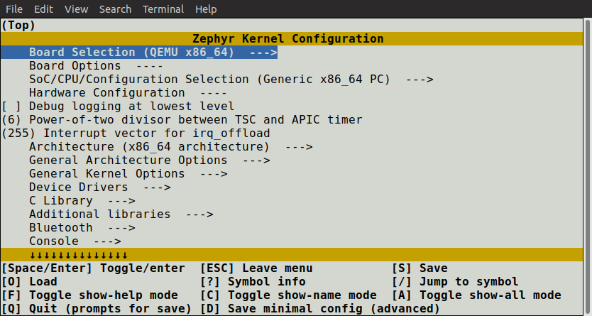
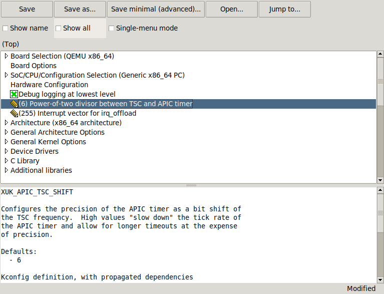
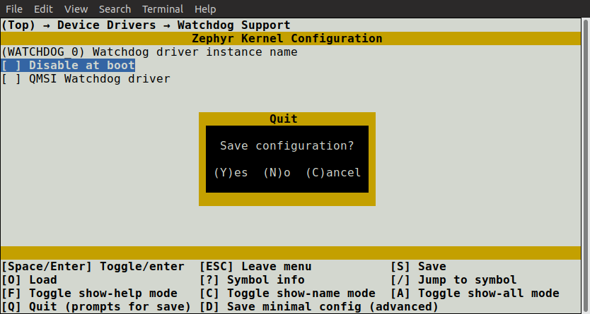
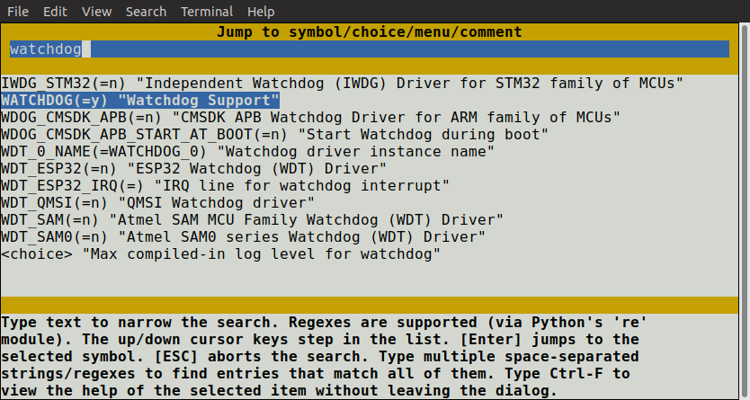
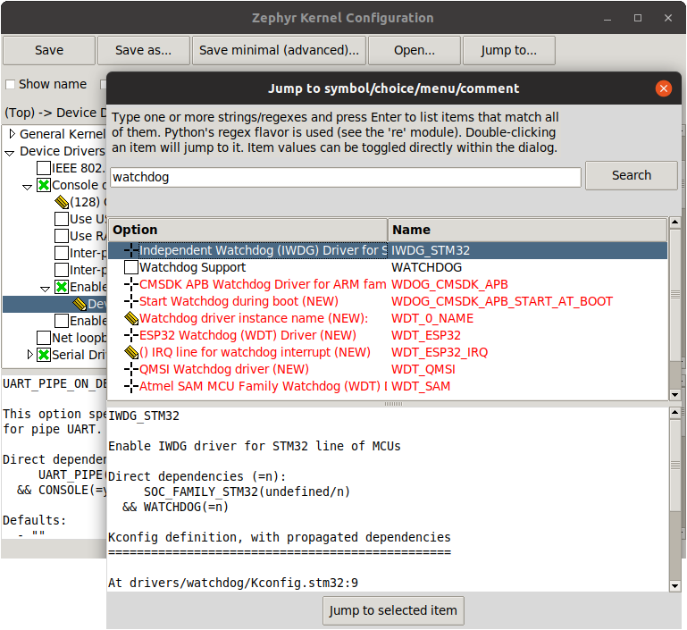

<!-- Copyright 2015-2026 Zephyr Project members and individual contributors. -->
<!-- SPDX-License-Identifier: Apache-2.0 -->
<!-- 中文翻译；阅读编号、导航和译注为本地新增。 -->

# 第2章\_交互式Kconfig配置界面

原文：[Interactive Kconfig interfaces](https://docs.zephyrproject.org/latest/build/kconfig/menuconfig.html)。读取日期：2026-10-12，`latest`。

有两种交互界面可用于浏览配置选项并作临时修改：`menuconfig` 是基于 curses 的终端界面，`guiconfig` 是图形界面。

也可以手工编辑应用构建目录中的 `zephyr/.config`，但交互界面通常更方便，因为它能正确处理符号间依赖。若在 `.config` 中启用依赖未满足的符号，该赋值会在重新配置时被忽略并覆盖。要永久保存设置，应写入 `*.conf`，详见[设置配置值](P003_设置配置值.md)。

一个实用办法是先保存最小配置（例如 menuconfig 中按 `D`），再检查它并转成永久设置。最小配置只列出偏离默认值的符号。

## 2.1\_启动界面

先按通常方式构建应用。在应用目录使用 west：

```text
west build -b <board>
```

或在新建构建目录使用 CMake/Ninja：

```sh
mkdir build && cd build
cmake -GNinja -DBOARD=<board> ..
ninja
```

随后启动终端界面，两种方式择一：

```text
west build -t menuconfig
```

```text
ninja menuconfig
```

启动图形界面则对应使用：

```text
west build -t guiconfig
```

```text
ninja guiconfig
```

> 译注：Ninja 命令在已配置的构建目录执行；west 可以在能发现该构建目录的位置执行，也可用 `-d` 指明。已有目录不必再次 `mkdir`。构建前提见[应用开发](../application/P001_应用开发.md)，这里没有实际运行配置界面。

如果 `guiconfig` 报 `tkinter` 导入错误，说明缺少必要包。尽管 tkinter 属于 Python 标准库，很多 Python 安装并不默认包含它。Linux 通常需 `python3-tk` 或 `python3-tkinter`，参见[Linux 主机依赖](../getting_started/P007_Linux主机依赖.md)。

以下为原文两种界面的截图（在线引用官方图片）。`guiconfig` 底部始终显示当前选项的帮助和相关信息；终端界面按 `?` 查看相同信息。





偏好图形界面的读者，在修改 Kconfig 定义后还应勾选顶部的 single-menu 模式检查。它与 full-tree 模式不同，会区分 `config` 和 `menuconfig` 定义，显示终端 menuconfig 中的菜单组织效果。

## 2.2\_浏览与修改

menuconfig 中使用方向键移动，也支持常见 Vim 按键。`Space` 和 `Enter` 用于进入菜单或切换值；带 `--->` 的条目是菜单，按 `ESC` 回到父菜单。

布尔选项显示为 `[ ]`，数值和字符串显示为 `( )`，不能改变的值显示为 `- -` 或 `-*-`。也可以按 `Y` 或 `N` 直接设置布尔值。按 `?` 查看当前符号的信息及帮助；按 `ESC` 或 `Q` 从帮助返回菜单。

guiconfig 中可点击符号旁的图标改变值，也可双击没有子项的行。如果有子项，双击是展开或收起菜单。它也支持与 menuconfig 类似的键盘操作。

## 2.3\_保存与退出

menuconfig 中按 `Q`，存在修改时会弹出保存并退出对话框。按 `Y` 保存到默认文件 `zephyr/.config`。除非正在试验多套配置，通常保留默认文件名。guiconfig 退出时也会询问是否保存改动。



构建始终使用构建目录的 `zephyr/.config`。若要采用另存的配置，先备份原文件，再把另一配置复制到该位置。Linux/macOS 的 `ls` 默认不显示以 `.` 开头的文件，需要 `ls -a`。

## 2.4\_搜索和理解依赖

在菜单树中逐层寻找符号可能费时。按 `/` 打开搜索跳转对话框，两种界面均支持；可按名称查找并跳转。guiconfig 还允许直接在对话框中改值。





如果跳转到当前不可见的符号，例如依赖没有满足，界面会进入 show-all 模式，显示包括不可见项在内的所有符号。menuconfig 按 `A` 关闭，guiconfig 按 `Ctrl+A` 关闭；当前菜单没有可见条目时不能关闭该模式。

要判断不可见的原因，在 menuconfig 按 `?`，或查看 guiconfig 底部信息，检查直接依赖。如果它依赖另一个尚未启用的符号，再跳到那个符号，确认其是否可以启用。menuconfig 的跳转对话框中还可以按 `Ctrl+F` 查看选中项帮助，而不离开对话框。

更多说明见 Kconfiglib 的 [menuconfig.py](https://github.com/ulfalizer/Kconfiglib/blob/master/menuconfig.py) 和 [guiconfig.py](https://github.com/ulfalizer/Kconfiglib/blob/master/guiconfig.py) 文件顶部 Python docstring。

---

<!-- reading-navigation:start -->

**主线阅读**

[上一篇：配置系统 Kconfig](P001_配置系统概述.md) · [本模块主线目录](../reading/kconfig.md) · [全部主线](../reading/README.md) · [下一篇：设置 Kconfig 配置值](P003_设置配置值.md)

<details>
<summary>原册编号导航（含扩展参考）</summary>

[上一章：配置系统概述](P001_配置系统概述.md) · [下一章：设置配置值](P003_设置配置值.md) · [返回大纲](大纲.md)

</details>

<!-- reading-navigation:end -->
