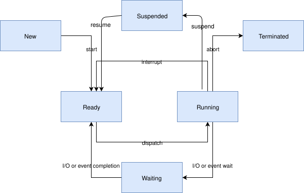
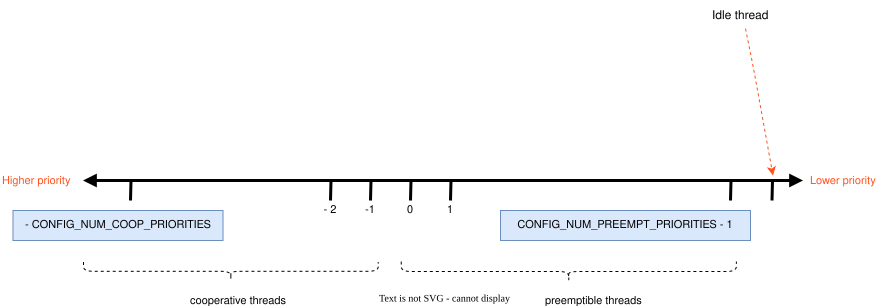

<!-- Copyright 2015-2026 Zephyr Project members and individual contributors. -->
<!-- SPDX-License-Identifier: Apache-2.0 -->
<!-- 中文翻译；阅读编号、导航和译注为本地新增。 -->

<a id="threads-v2"></a>

# 第2章\_线程

原文：[Threads](https://docs.zephyrproject.org/latest/kernel/services/threads/index.html)。读取日期：2026-10-12，`latest`。

本页介绍创建、调度和删除可独立执行指令流的内核服务。Zephyr 也有限度地支持[不启用线程的运行方式](P004_无线程运行.md)。

**线程（Thread）**是一种内核对象，用于执行过长或过复杂、不适合放在 **中断服务例程（Interrupt Service Routine，ISR）** 中的应用处理。应用可定义任意数量的线程，最终受可用 **随机存取存储器（Random Access Memory，RAM）** 限制。每个线程在创建时获得线程 ID，后续通过它引用。

## 2.1\_线程的组成

一个线程包括以下属性：

| 属性 | 作用 |
| --- | --- |
| 栈区域 | 保存 **中央处理器（Central Processing Unit，CPU）** 上下文及调用数据，大小按实际需要配置，必须用专用栈宏或分配接口创建和管理。 |
| 线程控制块 | `k_thread` 实例，供内核保存私有元数据。 |
| 入口函数 | 线程开始时调用，最多接收三个参数。 |
| 调度优先级 | 指示调度器如何分配 CPU 时间。 |
| 线程选项 | 指定某些情况下的特殊处理。 |
| 启动延迟 | 指定创建后等待多久才开始。 |
| 执行模式 | 默认为监督态，可使用特权指令、完整地址空间和外设；启用 `CONFIG_USERSPACE` 后可创建权限受限的用户态线程。 |

## 2.2\_生命周期

线程从创建、开始执行到结束经历不同阶段；暂停、等待和中止分别有不同语义。

### 2.2.1\_创建与延迟启动

使用线程前必须先创建。内核初始化控制块及栈的一端，剩余栈空间通常不初始化。

启动延迟设为 `K_NO_WAIT` 时，内核立即让线程具备执行条件；也可指定超时，例如等待线程使用的硬件就绪。原文说明，在实际开始前可取消延迟启动；已开始后取消无效。成功取消的线程需要重新创建后才能使用。

### 2.2.2\_显式开始执行

以 `K_FOREVER` 为启动延迟创建的线程不会进入就绪队列，直到调用 `k_thread_start()` 才可被调度。对已启动线程再次调用没有效果。此方式适合先建立对象，再等待应用其他准备工作完成。

> 译注：当前官方 **应用程序编程接口（Application Programming Interface，API）** 参考将 `k_thread_start()` 标为保留兼容的接口，现代线程初始化为休眠状态；本节保留说明页的生命周期表述，具体操作以目标版本接口为准。

### 2.2.3\_正常终止

线程通常持续运行，也可从入口函数返回来同步结束，这称为终止。返回前必须自行释放互斥锁、动态内存等共享资源，内核不会自动回收它们。

其他线程可用 `k_thread_join()` 等待目标结束。调用者会阻塞，直到等待超时、目标正常返回，或目标因 `k_thread_abort()`、致命错误等中止。

线程完全终止后，内核保证不再使用其控制块，可以把内存用于其他用途，包括创建新线程。但“线程自己的逻辑已经发出完成信号”不等于内核已完成清理，提前复用可能形成竞争。通常应通过 `k_thread_join()` 或 `k_thread_abort()` 同步结束状态，不要只依赖应用内部的完成通知。

### 2.2.4\_中止

中止是异步结束方式。线程触发空指针解引用等致命错误时，内核会自动中止它；其他线程或自身也可调用 `k_thread_abort()`。通常更推荐通知线程自行有序退出。

中止同样不会自动释放线程持有的共享资源。原文不对应用能否重新创建一个被中止线程作一般保证；本页后面的用户态说明又明确指出，相应线程和栈对象会被标为未初始化以便复用。使用时应区分对象状态复位与应用资源是否已经正确清理。

### 2.2.5\_挂起与恢复

`k_thread_suspend()` 可无限期阻止某个线程执行，包括调用线程自身。重复挂起没有额外效果；只有其他线程调用 `k_thread_resume()` 解除挂起后，它才能重新被调度。

`k_sleep()` 不同：它让当前线程停止执行指定时间，期限到达后自动恢复可执行条件，不需要显式 resume。

## 2.3\_线程状态

没有任何阻止执行因素的线程处于就绪（ready）状态，可被选为当前线程；存在一个或多个阻碍因素则为未就绪（unready），不能被选中。以下情况使线程未就绪：尚未启动、等待内核对象操作完成（如等待不可用的信号量）、等待超时、被挂起、已经终止或中止。



图中的 Ready 和 Running 不应理解为彼此独立的同类状态。Ready 是线程状态，Running 是只适用于就绪线程的调度状态。

## 2.4\_线程栈对象

每个线程都需要独立栈缓冲区供 CPU 保存上下文。按配置可能还需满足：预留内存管理结构；在栈前布置写保护区以检测溢出；为用户态系统调用提供固定大小的特权提升栈；按内存保护区域要求设置栈大小和对齐。

这些约束可能很严格，例如某些 **内存保护单元（Memory Protection Unit，MPU）** 要求区域大小为二的幂，并按自身大小对齐。因此，可移植代码不能随便把字符数组传给 `k_thread_create()`。

静态创建栈使用 `K_KERNEL_STACK`、`K_THREAD_STACK` 系列宏；动态创建使用 `k_thread_stack_alloc()`，之后用 `k_thread_stack_free()` 释放。

### 2.4.1\_仅供内核使用的栈

确定线程永不进入用户态，或栈用于中断等特殊上下文时，优先使用 `K_KERNEL_STACK` 系列。它无需为用户态准备栈保护区域、额外提权栈或专用内存管理数据，因此更省内存。

用户态试图使用这类栈会使调用者发生致命错误。未启用 `CONFIG_USERSPACE` 时，两套栈宏效果相同。

### 2.4.2\_可承载用户线程的栈

确定需要用户态线程，或无法提前确定时，使用 `K_THREAD_STACK` 系列。它可能多占内存，但满足用户态栈要求；未启用用户空间时仍与内核栈宏等效。

## 2.5\_优先级

优先级是可正可负的整数，**数值越小，优先级越高**。例如 `4` 高于 `7`，`-2` 又高于两者。

负数优先级属于协作线程。成为当前线程后，通常一直运行到主动变为未就绪。非负数属于可抢占线程；协作线程，或更高/同级可抢占线程满足相应调度条件时，可能替换它。

线程启动后可以修改优先级，因此也可以在协作与可抢占类别之间转换。调度器不会自行用启发式策略调整优先级，只有应用请求才改变。

`CONFIG_NUM_COOP_PRIORITIES`、`CONFIG_NUM_PREEMPT_PRIORITIES` 决定各类等级数量：协作范围为 `-CONFIG_NUM_COOP_PRIORITIES` 到 `-1`；可抢占范围为 `0` 到 `CONFIG_NUM_PREEMPT_PRIORITIES - 1`。例如分别配置 `5`、`10`，范围就是 `-5…-1`、`0…9`。



> 译注：同级线程不是每次变为就绪都必然立即抢占当前线程，其运行次序还受时间片、让出 CPU 等调度规则影响。协作线程也可主动 yield；下面的 meta-**中断请求（Interrupt Request，IRQ）** 是另一项明确例外。

### 2.5.1\_Meta-IRQ优先级

`CONFIG_NUM_METAIRQ_PRIORITIES` 启用后，在最高、即数值最小的一端保留特殊协作优先级，称为 meta-IRQ 线程。它们按优先级调度，但能抢占所有更低优先级线程，包括协作线程、持有调度锁的线程以及较低级 meta-IRQ 线程。它们仍是线程，仍可被硬件中断打断。

被 meta-IRQ 抢占的协作或调度锁定线程，在未被挂起或中止的前提下恢复时仍处于原 CPU，避免它查询 CPU 专属属性期间意外迁移。

低优先级线程通过创建、`k_sem_give()` 等方式唤醒 meta-IRQ 线程，效果类似同步系统调用；从 ISR 唤醒时则类似 Arm 的挂起中断。目的在于实现驱动中断下半部或 tasklet：被唤醒后，它保证在当前 CPU 返回应用代码前执行。

与某些系统不同，meta-IRQ 使用正常分配的独立线程栈，不使用每 CPU 中断栈；原文说明使用中断栈的设计仍待完成。

这一功能打破普通协作线程“未主动阻塞就不被其他线程调度替换”的承诺，应用应谨慎使用，不能仅把它当成普通的“非常高优先级线程”。

## 2.6\_线程选项

创建时指定选项集合，不需要选项则传 `0`，多个选项用按位或 `|` 组合。

| 选项 | 含义 |
| --- | --- |
| `K_ESSENTIAL` | 标为必要线程，其终止或中止将被视为致命系统错误；默认不是必要线程。 |
| `K_SSE_REGS` | x86 专用，表示线程使用 SSE 寄存器；与浮点保存恢复相关。 |
| `K_FP_REGS` | 表示使用浮点寄存器，要求内核在调度时采取额外保存/恢复措施，详见浮点服务。原文说明未请求时默认不进行该处理。 |
| `K_USER` | 启用 `CONFIG_USERSPACE` 时创建低权限用户线程；未启用时无效果。 |
| `K_INHERIT_PERMS` | 启用用户空间时，继承父线程对内核对象的权限，但不包括父线程对象自身。 |

> 译注：寄存器保存的实际要求与架构和浮点配置有关，不能把本表概述套用于所有目标。主线程正常从 `main()` 返回也是下一章明确说明的特殊情形。

## 2.7\_线程自定义数据

每个线程可有只供自己访问的自定义数据区，初始为零，应用可自行使用。原文把它称为“32 位数据区”。ISR 共用中断上下文，因此不能使用该功能。默认关闭，通过 `CONFIG_THREAD_CUSTOM_DATA` 启用。

`k_thread_custom_data_set()`、`k_thread_custom_data_get()` 分别设置和读取当前线程的数据，不能访问其他线程的自定义值。下面用它统计每个线程调用某函数的次数：

```c
int call_tracking_routine(void)
{
    uint32_t call_count;

    if (k_is_in_isr()) {
        /* ignore any call made by an ISR */
    } else {
        call_count = (uint32_t)k_thread_custom_data_get();
        call_count++;
        k_thread_custom_data_set((void *)call_count);
    }

    /* do rest of routine's processing */
    ...
}
```

这种写法独占整个自定义数据位置，因此只能供一处这样的统计使用。更通用的办法是把它用作指向线程私有结构的指针，让例程取得该线程的专有信息。

> 译注：实际 API 使用 `void *`，本地线程结构也用指针保存，不应把宽度固定理解为所有架构都是 32 位。原文整数/指针强转例子有数据模型限制；需要可移植计数时优先用线程私有结构，或按目标宽度正确转换。该示例的 `int` 函数还省略了返回值。

## 2.8\_线程名称

启用 `CONFIG_THREAD_NAME` 后，可为线程附加可读名称，用于调试、日志和 shell 检查，不参与调度。可通过 `K_THREAD_DEFINE` 静态命名，或运行时调用 `k_thread_name_set()`。

原文称运行时仅保留名称指针，所以字符串须在线程整个生命周期内有效。

> 译注：这条生命周期说明与本地实现不一致：本地 `kernel/thread.c` 会把字符串复制到线程名称缓冲区；官网 API 参考也说明超过 `CONFIG_THREAD_MAX_NAME_LEN` 会截断。这里保留原文说法并明确差异，实际内存管理应以目标版本实现为准，不把说明页的“只保存指针”作为通用事实。

`k_thread_name_get()` 返回名称指针；`k_thread_name_copy()` 复制到调用方缓冲区。用户态可能无权访问其他线程名称所在内存，因此复制接口更合适。

未启用线程名称时，设置接口返回错误，获取指针接口返回 `NULL`。

## 2.9\_运行时检查线程

内核提供以下检查能力：

| 需求 | 接口与条件 |
| --- | --- |
| 当前线程 | `k_current_get()` 返回当前线程 ID，类型为 `k_tid_t`。 |
| 当前优先级 | `k_thread_priority_get()` 返回包括运行时修改在内的当前值；修改接口为 `k_thread_priority_set()`。 |
| 状态文字 | `k_thread_state_str()` 向缓冲区写入 pending、suspended、ready 等诊断文字，不应将它作为程序解析协议。 |
| 遍历线程 | `CONFIG_THREAD_MONITOR` 下，`k_thread_foreach()` 为每个线程调用回调，并持锁阻止创建/终止，得到一致列表，但延迟随线程数增长。`k_thread_foreach_unlocked()` 在回调间释放锁，延迟更低，一致性较弱。 |
| 未用栈空间 | 同时启用 `CONFIG_INIT_STACKS` 和 `CONFIG_THREAD_STACK_INFO` 后，`k_thread_stack_space_get()` 扫描仍保留初始填充值的部分，报告剩余未用字节。 |
| 待到期超时 | `k_thread_timeout_remaining_ticks()` 返回剩余 tick，`k_thread_timeout_expires_ticks()` 返回到期的绝对系统 tick；没有待处理超时时都返回零。 |

最后一组适用于 `k_sleep()` 或带超时的内核对象等待等情形。栈扫描可补充构建期分析及后文运行时栈安全检查。

## 2.10\_创建线程的代码

创建栈和线程控制块后，调用 `k_thread_create()`。静态栈用 `K_THREAD_STACK_DEFINE` 或 `K_KERNEL_STACK_DEFINE`，以满足内存要求。栈大小参数只应采用以下三者之一：最初传给对应栈定义宏的请求大小、线程栈的 `K_THREAD_STACK_SIZEOF()`，或内核栈的 `K_KERNEL_STACK_SIZEOF()`。

也可动态分配栈。创建函数返回线程 ID。以下创建一个立即启动的线程：

```c
#define MY_STACK_SIZE 500
#define MY_PRIORITY 5

extern void my_entry_point(void *, void *, void *);

K_THREAD_STACK_DEFINE(my_stack_area, MY_STACK_SIZE);
struct k_thread my_thread_data;

k_tid_t my_tid = k_thread_create(&my_thread_data, my_stack_area,
                                 K_THREAD_STACK_SIZEOF(my_stack_area),
                                 my_entry_point,
                                 NULL, NULL, NULL,
                                 MY_PRIORITY, 0, K_NO_WAIT);
```

也可在编译期用 `K_THREAD_DEFINE` 声明，它自动定义栈、控制块和 ID，下面效果相同：

```c
#define MY_STACK_SIZE 500
#define MY_PRIORITY 5

extern void my_entry_point(void *, void *, void *);

K_THREAD_DEFINE(my_tid, MY_STACK_SIZE,
                my_entry_point, NULL, NULL, NULL,
                MY_PRIORITY, 0, 0);
```

注意两个延迟参数类型不同：`k_thread_create()` 接收 `k_timeout_t`，立即启动用 `K_NO_WAIT`；`K_THREAD_DEFINE` 接收整数毫秒，立即启动用 `0`。

动态栈示例在 join 完成后释放栈：

```c
extern void my_entry_point(void *, void *, void *);

k_tid_t my_tid;
void *my_stack_area;

my_stack_area = k_thread_stack_alloc(CONFIG_DYNAMIC_THREAD_STACK_SIZE);
my_tid = k_thread_create(&my_thread_data, my_stack_area,
                          CONFIG_DYNAMIC_THREAD_STACK_SIZE,
                          my_entry_point,
                          NULL, NULL, NULL,
                          MY_PRIORITY, 0, K_NO_WAIT);
k_thread_join(my_tid, K_FOREVER);
k_thread_stack_free(my_stack_area);
```

> 译注：原文 `k_thread_stack_alloc()` 少传一个参数。官网 API 声明为 `k_thread_stack_alloc(size_t size, int flags)`；普通内核线程栈可传 `0`，需要用户态栈时按配置使用 `K_USER`。实际代码还应检查分配是否返回 `NULL`，并补齐 `my_thread_data`、优先级等定义。运行时创建、等待、释放语句应置于函数内，示例不是可直接复制为完整源文件的全局声明列表。

### 2.10.1\_用户态创建约束

启用 `CONFIG_USERSPACE` 且调用者为用户线程时，仍使用 `k_thread_create()`，但必须满足以下条件，否则调用者会被终止：

1. 对子线程对象和栈对象都具有权限，这两者都由内核跟踪。
2. 两对象尚未初始化，线程未运行且栈未被使用。
3. 栈大小不超过对象声明时的边界。
4. 必须使用 `K_USER`，用户线程只能创建用户线程。
5. 不得使用 `K_ESSENTIAL`。
6. 子线程优先级必须有效，且不能高于父线程。

### 2.10.2\_降低权限

监督态线程可通过 `k_thread_user_mode_enter()` 单向进入用户态。此操作重置并清零线程栈，并将线程标为非必要线程；不能通过同一机制反向恢复监督态。

### 2.10.3\_结束线程

从入口返回即可正常终止：

```c
void my_entry_point(int unused1, int unused2, int unused3)
{
    while (1) {
        ...
        if (<some condition>) {
            return; /* thread terminates from mid-entry point function */
        }
        ...
    }

    /* thread terminates at end of entry point function */
}
```

启用用户空间时，中止还会把线程和栈对象标为未初始化，使对象可以复用。

> 译注：原文结束示例把入口参数写成 `int`，而本页前面的线程入口原型是三个 `void *`；实际实现应匹配 `k_thread_entry_t`。`<some condition>` 和省略号也应替换为真实逻辑。

## 2.11\_运行时间统计

启用 `CONFIG_THREAD_RUNTIME_STATS` 可收集线程累计执行周期等统计。默认使用内核计时器；某些架构、**片上系统（System on Chip，SoC）** 或板通过 timing functions 提供更高分辨率计时器，可用 `CONFIG_THREAD_RUNTIME_STATS_USE_TIMING_FUNCTIONS` 选择。

```c
k_thread_runtime_stats_t rt_stats_thread;

k_thread_runtime_stats_get(k_current_get(), &rt_stats_thread);

printk("Cycles: %llu\n", rt_stats_thread.execution_cycles);
```

`k_thread_runtime_stats_all_get()` 返回所有线程（包括空闲线程）的聚合运行统计，适合计算整体 CPU 利用率。

启用 `CONFIG_SCHED_THREAD_USAGE` 后，可用 `k_thread_runtime_stats_enable()`、`k_thread_runtime_stats_disable()` 按线程开关收集，并用 `k_thread_runtime_stats_is_enabled()` 查询。关闭不需要的线程统计可减少上下文切换时的记账开销。

## 2.12\_运行时栈安全

`CONFIG_THREAD_RUNTIME_STACK_SAFETY` 提供扫描线程栈的接口。未使用空间低于每线程阈值时，调用用户处理函数。监控软件可以记录警告、挂起或中止线程，甚至重启系统，在栈完全耗尽前作出反应，补充构建期分析和硬件栈溢出检测。

阈值以字节表示；默认 `0` 表示禁用该线程检查。新线程阈值由 `CONFIG_THREAD_RUNTIME_STACK_SAFETY_DEFAULT_UNUSED_THRESHOLD_PCT` 按总栈大小百分比计算。

- `k_thread_runtime_stack_unused_threshold_pct_set()`：按 `0…99` 的百分比设置。
- `k_thread_runtime_stack_unused_threshold_set()`：按绝对字节数设置。
- `k_thread_runtime_stack_unused_threshold_get()`：读取当前字节阈值。

两种实际检查接口都可返回未用空间，并接收 `k_thread_stack_safety_handler_t` 回调及用户参数：`k_thread_runtime_stack_safety_full_check()` 扫描整个栈，得到准确未用量；`k_thread_runtime_stack_safety_threshold_check()` 只检查是否越过阈值，成本较低，但不提供精确余量。

例如，当未用空间低于总量的 10% 时调用处理函数：

```c
void stack_safety_handler(const struct k_thread *thread,
                          size_t unused_space, void *arg)
{
        printk("Thread %p low on stack: %zu bytes unused\n",
               thread, unused_space);
}

/* Trigger the handler once less than 10% of the stack remains unused */
k_thread_runtime_stack_unused_threshold_pct_set(my_tid, 10);

/* Periodically check the thread from a monitoring context */
k_thread_runtime_stack_safety_full_check(my_tid, NULL,
                                         stack_safety_handler, NULL);
```

## 2.13\_使用建议、配置与参考

用线程处理不适合 ISR 的工作；可并发执行、逻辑上独立的操作适合拆为不同线程。

原文相关配置包括 `CONFIG_MAIN_THREAD_PRIORITY`、`CONFIG_MAIN_STACK_SIZE`、`CONFIG_IDLE_STACK_SIZE`、`CONFIG_THREAD_CUSTOM_DATA`、`CONFIG_NUM_COOP_PRIORITIES`、`CONFIG_NUM_PREEMPT_PRIORITIES`、`CONFIG_TIMESLICING`、`CONFIG_TIMESLICE_SIZE`、`CONFIG_TIMESLICE_PRIORITY`、`CONFIG_USERSPACE`、`CONFIG_THREAD_RUNTIME_STACK_SAFETY` 和 `CONFIG_THREAD_RUNTIME_STACK_SAFETY_DEFAULT_UNUSED_THRESHOLD_PCT`。

接口参考为 [Thread APIs](../thread_core_reference/P001_线程公共接口.md) 与 [Thread Stack APIs](../thread_stack_reference/P001_线程栈接口.md)。相关示例：

- [基本同步](../basic_samples/P029_基本同步示例.md)：操作基本内核同步原语。
- [基本线程操作](https://docs.zephyrproject.org/latest/samples/basic/threads/README.html)：多线程闪烁 **发光二极管（Light-Emitting Diode，LED）** 并输出控制台信息。
- [哲学家就餐](../basic_samples/P030_哲学家就餐示例.md)：用内核服务实现就餐问题。
- [多线程简易 HTTP 服务器](https://docs.zephyrproject.org/latest/samples/net/sockets/dumb_http_server_mt/README.html)：通过 BSD sockets 同时处理多个连接。

---

<!-- reading-navigation:start -->

**主线阅读**

[上一篇：中断](P001_中断.md) · [本模块主线目录](../reading/kernel.md) · [全部主线](../reading/README.md) · [下一篇：系统线程](P003_系统线程.md)

<details>
<summary>原册编号导航（含扩展参考）</summary>

[上一章：中断](P001_中断.md) · [下一章：系统线程](P003_系统线程.md) · [返回大纲](大纲.md)

</details>

<!-- reading-navigation:end -->
