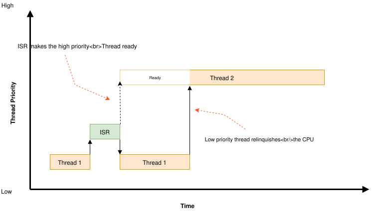
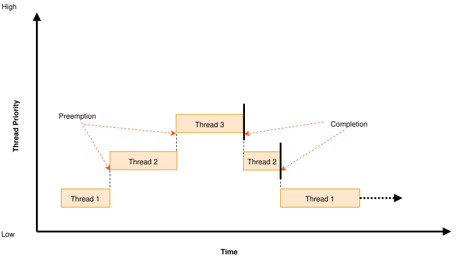
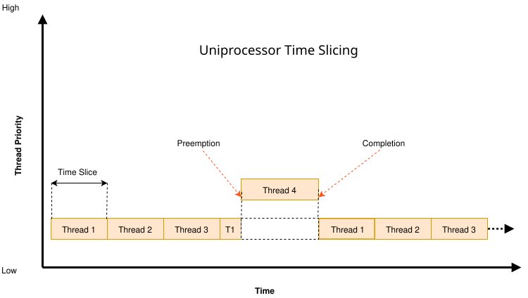

<!-- Copyright 2015-2026 Zephyr Project members and individual contributors. -->
<!-- SPDX-License-Identifier: Apache-2.0 -->
<!-- 中文翻译；阅读编号、导航和译注为本地新增。 -->

# 第5章\_调度与CPU空闲

原文：[Scheduling](https://docs.zephyrproject.org/latest/kernel/services/scheduling/index.html)。读取日期：2026-10-12，`latest`。

内核基于优先级的**调度器（Scheduler）**让应用线程共享 **中央处理器（Central Processing Unit，CPU）**。本页同时包含原文后半部分的 CPU 空闲处理。

## 5.1\_调度时机

调度器决定每一时刻哪个线程可以执行，它就是当前线程。允许重新选择当前线程的时刻称为重调度点，例如：

- 当前线程通过 `k_sem_take()`、`k_sleep()` 等进入等待或挂起状态。
- `k_sem_give()`、`k_thread_start()` 等使线程变为就绪。
- 中断结束返回线程上下文。
- 当前线程调用 `k_yield()`。

线程主动进入等待或挂起时，可概括为睡眠。调度器更换当前线程，或 **中断服务例程（Interrupt Service Routine，ISR）** 接管当前执行时，内核会保存线程 CPU 寄存器；以后恢复线程时再恢复这些值。

## 5.2\_优先级与就绪队列

调度器选择最高优先级的就绪线程。多个线程优先级相同，则优先选择等待最久的。

静态优先级是首要依据。启用 `CONFIG_SCHED_DEADLINE` 后，相同静态优先级内再按最早截止期优先：截止时间越早，调度顺序越靠前。此时只有静态优先级和截止期都相同才算同级。截止期通过 `k_thread_deadline_set()` 设置。

ISR 优先于线程，除非相应中断被屏蔽，协作和可抢占线程都可能被中断。

内核提供三种就绪队列实现，在代码大小、常数开销和大量线程时的扩展性之间取舍：

| 配置 | 实现及适用场景 |
| --- | --- |
| `CONFIG_SCHED_SIMPLE` | 简单无序链表。单个可运行线程时开销很低、代码小，适合同时就绪线程始终很少（原文举例约 3 个）的资源受限系统。多数没有在其他地方使用红黑树的平台可节省约 2 KB 代码。 |
| `CONFIG_SCHED_SCALABLE` | 红黑树。插入删除的常数开销较高，未复用红黑树代码时通常多约 2 KB，但可扩展到数千线程。适合同一时刻大量可运行线程（原文举例约 20 个以上），多数应用不需要。 |
| `CONFIG_SCHED_MULTIQ` | 每优先级一个链表的传统多队列，也是 Zephyr 1.12 之前的方式。相对简单调度器只多很少代码，几乎所有情况为低常数开销的 O(1)，但各链表头占较多 **随机存取存储器（Random Access Memory，RAM）**；不适合需要更细排序的截止期调度和需要遍历线程的 **对称多处理（Symmetric Multiprocessing，SMP）** 亲和性功能。 |

一般只有少量可运行线程的应用优先考虑简单队列。

### 5.2.1\_等待队列

IPC 原语让线程等待并在之后唤醒时使用 `wait_q` 抽象，其后端采用与调度器类似的数据结构选择：

- `CONFIG_WAITQ_SCALABLE`：平衡树，适合一个原语上有很多等待线程的场景。若没有其他红黑树使用者，通常比简单等待队列多约 2 KB 代码；可与可扩展调度器共享。小队列上的挂起/解除操作略慢，但通常不是性能关键路径。
- `CONFIG_WAITQ_SIMPLE`：双向链表，适合每个 IPC 原语只有少量阻塞线程。

## 5.3\_协作式让出CPU

协作线程成为当前线程后，通常持续运行直到主动变为未就绪。长时间计算因此可能延迟其他线程，包括更高或同等优先级线程。



它可以主动让出 CPU：

- `k_yield()` 把当前线程放到按优先级组织的就绪队列后部，再调度。其他更高或同级就绪线程有机会先运行；不存在这样的线程时，当前线程继续，不发生上下文切换。
- `k_sleep()` 使线程在指定时间内未就绪，让所有优先级的其他线程都有机会运行；但不能保证低优先级线程一定会在它醒来之前得到调度。

## 5.4\_可抢占线程与时间片

可抢占线程通常运行到更高优先级线程就绪，或自身进入未就绪。若它长时间计算，同级线程可能迟迟无法运行。



它可以主动 yield/sleep，也可以启用调度器时间片，让同级线程轮流运行。



原文补充：SMP 中大体类似图示单处理器行为，但 Thread 4 后不会立即跟 Thread 1，而可能按 Thread 2、Thread 3、Thread 1 等顺序继续。

每 CPU 的时间片以系统 tick 计量，长度可配置，也可在运行时调整；调度新线程会重置时间片计时。每个时间片结束时，若当前线程可抢占，调度器会等效替它调用 `k_yield()`，给其他同级线程机会；没有同级就绪线程则继续运行当前线程。

优先级高于设定界限的线程免于全局时间片，不被同级线程轮换抢占。应用因此可以只对较低优先级、时间敏感度较低的线程采用时间片。

该算法不保证同级线程获得严格相等的实际 CPU 时间，因为它不累计每个线程真正执行的时间；其保证是受时间片约束的线程不会一直执行超过一个时间片而不被要求让出。

### 5.4.1\_每线程时间片

`k_sched_time_slice_set()` 设置全局时间片，作用于指定优先级及以下的可抢占线程。启用 `CONFIG_TIMESLICE_PER_THREAD` 后，可用 `k_thread_time_slice_set()` 为单个线程设置时间片，优先于全局值，即使其优先级高于全局时间片界限也适用。

除以 tick 表示的时长外，还可注册到期回调。回调在中断上下文执行，此时目标仍是当前线程；可以调整下一次运行的优先级或时间片，也可以挂起线程。

## 5.5\_调度锁

可抢占线程执行关键操作时，可以调用 `k_sched_lock()`，暂时让调度器把它视为协作线程；完成后用 `k_sched_unlock()` 恢复。

若持锁线程主动进入未就绪，调度器仍会切换出去，让其他线程运行。该线程再次成为当前线程时，仍保持锁定带来的不可抢占状态。相对于先把优先级改为负数再恢复，调度锁更高效。

> 译注：调度锁不是中断锁，也不是跨 CPU 互斥锁；meta-**中断请求（Interrupt Request，IRQ）** 线程还可抢占普通锁定线程。对 ISR、其他 CPU 或特殊调度上下文共享的数据，应使用相应同步机制，不能只靠本节规则保护。

## 5.6\_休眠、忙等与主动重调度

`k_sleep()` 在指定时间内让出 CPU，时间到后线程恢复就绪；这表示有资格运行，不保证恰在该时刻立即获得 CPU。

其他线程可用 `k_wakeup()` 提前唤醒休眠线程。有时可用它表达事件，而无须单独信号量；唤醒未休眠线程允许但无效果。

`k_busy_wait()` 在当前执行上下文中忙等，不主动让出 CPU。延迟很短、不值得付出切出和切回的成本时可使用它。

`k_reschedule()` 请求当前 CPU 立即重新评估调度。在中断未锁定的线程上下文调用时立即评估；从 ISR 调用则等 ISR 退出。它与 `k_yield()` 不同，并不保证转给某个同级或更高优先级线程，只根据当前状态重新选择。多数应用不需要直接使用。

## 5.7\_判断当前上下文能否让出

`k_is_preempt_thread()` 只有在调用者是线程、处于可抢占优先级范围且未锁定调度器时才返回非零。

`k_can_yield()` 判断当前上下文能否让出或调用阻塞 **应用程序编程接口（Application Programming Interface，API）**。ISR、内核服务就绪前的初始化阶段、空闲线程等不能 yield 的上下文返回假。

## 5.8\_调度使用建议与配置

原文建议：设备驱动等性能关键工作可使用协作线程；某些场合可利用协作执行实现互斥而不增加互斥锁对象；可抢占线程适合让时间敏感工作优先于不敏感工作。

> 译注：上述“协作执行实现互斥”只适用于满足其假设的执行关系，不能覆盖 ISR、其他 CPU 或 meta-IRQ 并发；不要将它视为通用锁替代品。

相关配置为 `CONFIG_TIMESLICING`、`CONFIG_TIMESLICE_SIZE` 和 `CONFIG_TIMESLICE_PRIORITY`。

## 5.9\_CPU空闲

通常由空闲线程负责 CPU 休眠，但某些受限应用可能由另一线程承担。进入空闲会暂停该 CPU 上的指令执行，直到事件（通常是中断）将其唤醒。

调用 `k_cpu_idle()` 即可进入空闲，通常放在循环中。某些架构返回时会无条件解除中断屏蔽。原文首先给出以下示例：

```c
static k_sem my_sem;

void my_isr(void *unused)
{
    k_sem_give(&my_sem);
}

int main(void)
{
    k_sem_init(&my_sem, 0, 1);

    /* wait for semaphore from ISR, then do related work */

    for (;;) {

        /* wait for ISR to trigger work to perform */
        if (k_sem_take(&my_sem, K_NO_WAIT) == 0) {

            /* ... do processing */

        }

        /* put CPU to sleep to save power */
        k_cpu_idle();
    }
}
```

### 5.9.1\_原子地检查工作并进入空闲

前例存在竞争：信号量检查失败后、CPU 真正空闲前，中断可能已经到来。这样虽然已有待处理事件，CPU 却可能睡到下一次中断；若再无中断，系统可能一直停住。

需要在进入空闲前原子地完成检查时，使用 `k_cpu_atomic_idle()`：

```c
static k_sem my_sem;

void my_isr(void *unused)
{
    k_sem_give(&my_sem);
}

int main(void)
{
    k_sem_init(&my_sem, 0, 1);

    for (;;) {

        unsigned int key = irq_lock();

        /*
         * Wait for semaphore from ISR; if acquired, do related work, then
         * go to next loop iteration (the semaphore might have been given
         * again); else, make the CPU idle.
         */

        if (k_sem_take(&my_sem, K_NO_WAIT) == 0) {

            irq_unlock(key);

            /* ... do processing */


        } else {
            /* put CPU to sleep to save power */
            k_cpu_atomic_idle(key);
        }
    }
}
```

这里先锁中断，取得信号量就解锁并处理；没有工作则通过原子空闲接口完成进入睡眠的转换，避免检查与睡眠之间丢失唤醒。

> 译注：原文两个片段都写了 `static k_sem my_sem;`。普通 C 代码中应使用实际结构类型 `static struct k_sem my_sem;`。另外，这些使用信号量的例子不能当作关闭 `CONFIG_MULTITHREADING` 后仍支持信号量的证据，参见[无线程运行](P004_无线程运行.md)的限制。

### 5.9.2\_适用场景

既要处理工作、又要等事件空闲的线程，应使用原子形式。只有从某时刻起单纯负责 CPU 空闲、再不做其他工作时，才适合直接循环调用普通形式：

```c
int main(void)
{
    /* ... do some system/application initialization */


    /* thread is only used for CPU idling from this point on */
    for (;;) {
        k_cpu_idle();
    }
}
```

除非确有需要，不要在普通应用线程里使用这些接口；正常系统的空闲线程已经负责 CPU 空闲和电源管理。完整接口见[官方 CPU Idling APIs](../fatal_irq_reference/P011_CPU空闲接口.md)。

---

<!-- reading-navigation:start -->

**主线阅读**

[上一篇：不启用线程的运行方式](P004_无线程运行.md) · [本模块主线目录](../reading/kernel.md) · [全部主线](../reading/README.md) · [下一篇：定时器](P006_定时器.md)

<details>
<summary>原册编号导航（含扩展参考）</summary>

[上一章：无线程运行](P004_无线程运行.md) · [下一章：定时器](P006_定时器.md) · [返回大纲](大纲.md)

</details>

<!-- reading-navigation:end -->
