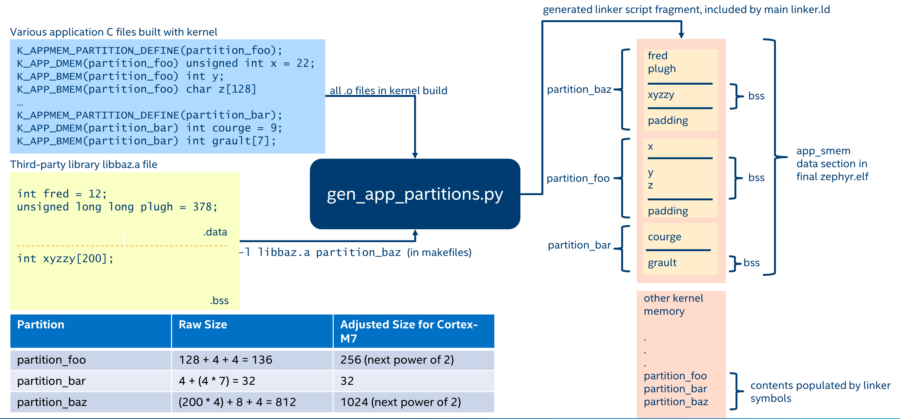

<!-- Copyright 2015-2026 Zephyr Project members and individual contributors. -->
<!-- SPDX-License-Identifier: Apache-2.0 -->
<!-- 中文翻译；阅读编号、导航和译注为本地新增。 -->

# 第41章\_内存保护与内存域

原文：[Memory Protection Design](https://docs.zephyrproject.org/latest/kernel/usermode/memory_domain.html)。读取日期：2026-10-12，`latest`。

Zephyr 内存保护设计面向具有**内存保护单元（Memory Protection Unit，MPU）**的微控制器。原文也说明支持 x86 等带分页**内存管理单元（Memory Management Unit，MMU）**的架构，并以恒等映射页表、类似 MPU 的方式解释其基本保护设计。

下面使用 MPU 术语；在这种概念说明中，可将 MMU 理解为能配置大量区域的保护机制。开启内存保护后，访问策略分为以下层次。

> 译注：这里是保护设计的概念简化，不是断言所有现代 MMU 配置都只能恒等映射；虚拟内存和按需分页等另有文档。

## 41.1\_启动时内存配置

内核启动后的 MPU 配置应包含基本硬件与驱动所需的特殊缓存、写回策略区域。多数 MPU 有可作为背景映射的默认访问策略，覆盖未单独配置的地址范围。原文强烈建议利用它，尽量把有限区域留给应用；Armv7-M/Armv8-M 中称为系统地址映射。设备树中标注属性的方法见[内存属性](https://docs.zephyrproject.org/latest/services/mem_mgmt/index.html#mem-mgmt-api)。

还需要用户模式可访问、只读且可执行的程序正文/只读数据区域。也可把正文与只读数据分开，让数据只读不可执行，但会多消耗一个区域。这样用户线程才能取指和读常量。

根据配置，GCOV、HEP 等功能可能还要求额外的用户可读写区域。若背景映射已允许监督模式访问所需内存，并且正文/常量已授予用户访问，上述配置就构成启动基础。

## 41.2\_硬件栈溢出检测

`CONFIG_HW_STACK_PROTECTION` 是可选的监督模式线程栈溢出检测，针对整个栈缓冲区越界；单个函数栈帧损坏则用编译器辅助的 `CONFIG_STACK_CANARIES`。

监督模式栈溢出与其他监督模式崩溃一样，无法保证系统其他状态仍完整，应视为严重错误。但明确检测仍很有价值，否则可能只表现为难以定位的崩溃或未定义行为。

有些系统运行时在监督栈开始处或紧邻前方建立只读 MPU 保护区，越界写时触发异常。此特性不是检测用户栈越界的必要条件；关闭后可能释放 1—2 个 MPU 区域。另一些处理器提供专用栈边界硬件，不需要额外区域。

## 41.3\_线程栈访问

用户线程必须能访问自己的栈。切入用户线程时，用专用 MPU 区域或 MMU 页表项描述栈边界；超出后将写入无权限区域并触发访问异常。

内存域的基本能力允许同域用户线程访问彼此用户栈。架构若提供 `CONFIG_ARCH_MEM_DOMAIN_SUPPORTS_ISOLATED_STACKS`，可进一步限制为仅访问自身栈。支持时默认启用；若架构同时支持两种模式，可通过 `CONFIG_MEM_DOMAIN_ISOLATED_STACKS` 关闭隔离。某些架构始终强制隔离，不能关闭。

无论上述配置如何，用户线程均不能访问其他内存域线程的用户栈。

## 41.4\_线程资源池

少数系统调用需要分配仅供内核访问的堆内存。调用线程要被分配一个 `k_heap` 资源池，内核通过 `z_thread_malloc()` 取内存，通过 `k_free()` 归还。用户模式不能直接访问这些内部缓冲区。

原文列出的使用者及替代方案如下：

| 接口 | 资源池用途及替代方式 |
| --- | --- |
| `k_stack_alloc_init()` | 为 `k_stack` 分配存储数组。可改用启动时 `K_STACK_DEFINE()`，或监督模式中带自备数组的 `k_stack_init()`。 |
| `k_msgq_alloc_init()` | 为消息队列分配缓冲区。可改用 `K_MSGQ_DEFINE()`，或监督模式 `k_msgq_init()`。 |
| 用户模式 `k_poll()` | 等待期间复制事件数组到内核侧，任何原因返回时释放。 |
| `k_queue_alloc_prepend()` / `k_queue_alloc_append()` | 分配队列容器，避免把内核记账字段放在用户可访问的数据区。 |
| `k_object_alloc()` | 运行时分配整个内核对象，返回用户可用的对象引用。 |

`k_thread_heap_assign()` 为目标线程指定资源池。若启用了系统堆，也可用 `k_thread_system_pool_assign()`，但原文建议不同逻辑应用使用独立池。

<a id="memory-domain"></a>

## 41.5\_内存域

除自己的栈、程序正文和只读数据外，用户线程通过内存域获得额外内存访问权。内存域是一组内存分区，分区数量受可用 MPU 区域限制，因此应尽量减少启动配置占用。

内存域不是控制监督模式访问的接口。有些硬件不支持“用户只读、监督读写”这种组合，配置区域时可能不可避免地影响监督访问，因此必须谨慎，避免内核访问时自己故障。试图用内存域接口管理监督模式权限，至多是未定义行为；监督策略应由启动区域定义。

内存域接口只供监督模式调用。用户模式能间接影响的只是子线程自动继承父线程所属域。

所有线程都属于一个内存域，包括监督线程，尽管后者的访问不由域控制。未明确分配或继承域的线程属于 `k_mem_domain_default`，主线程初始属于默认域。

## 41.6\_分区约束

每个分区由地址、大小、属性组成，用于控制系统内存访问。必须符合硬件区域约束：常见 MPU 要求容量为 2 的幂并按自身大小对齐；MMU 要求页对齐，大小为页大小整数倍。

同一域内分区不得重叠，也没有域内优先级。域分区通常视为高于启动区域，但能否覆盖启动区域取决于架构。同一个分区可以加入多个域，例如共享数据区。

不可给用户直接开放包含内核私有数据的区域。分区主要用于系统 **随机存取存储器（Random Access Memory，RAM）**；架构不一定支持把非 RAM 区域做成域分区，原文尤其指出 MMU 系统的限制。

### 41.6.1\_手工分区

下面定义一个全局数组及其可读写分区：

```c
uint8_t __aligned(32) buf[32];

K_MEM_PARTITION_DEFINE(my_partition, buf, sizeof(buf),
                       K_MEM_PARTITION_P_RW_U_RW);
```

若想将分散在多个 C 文件中的对象收进同一分区，手工方式不易扩展。

### 41.6.2\_自动分区

自动分区由构建系统生成。为全局变量标注目标分区后，构建系统把它们合并为连续区域，启动时清零 BSS，再按实际地址和大小定义分区。



自动分区只配置为读写。`K_APPMEM_PARTITION_DEFINE()` 声明分区；`K_APP_DMEM()` 放已初始化数据，`K_APP_BMEM()` 放 BSS：

```c
#include <zephyr/app_memory/app_memdomain.h>

/* Declare a k_mem_partition "my_partition" that is read-write to
 * user mode. Note that we do not specify a base address or size.
 */
K_APPMEM_PARTITION_DEFINE(my_partition);

/* The global variable var1 will be inside the bounds of my_partition
 * and be initialized with 37 at boot.
 */
K_APP_DMEM(my_partition) int var1 = 37;

/* The global variable var2 will be inside the bounds of my_partition
 * and be zeroed at boot size K_APP_BMEM() was used, indicating a BSS
 * variable.
 */
K_APP_BMEM(my_partition) int var2;
```

构建系统保证起始地址及总大小符合硬件要求，必要时增加填充。多个分区还可用原文 `app_macro_support.h` 中的可变参数宏方式表达：

```c
FOR_EACH(K_APPMEM_PARTITION_DEFINE, part0, part1, part2);
```

> 译注：原例 `FOR_EACH` 写法可能来自旧宏接口。当前本地通用 `FOR_EACH` 还要求分隔符参数，不能直接把这行视为适用于所有版本的语法；按目标头文件展开规则调整。

### 41.6.3\_静态库的全局变量

`scripts/build/gen_app_partitions.py` 实现自动分区逻辑。静态库可通过 `--library` 参数把全部全局变量归到某分区。启用 Newlib 时，顶层构建将其全局变量放到 `z_libc_partition`：

```text
gen_app_partitions.py ... --library libc.a z_libc_partition ..
```

原文说明预编译库尚无项目级配置入口，需要修改顶层 `CMakeLists.txt`。对通过 `zephyr_library` 或 `zephyr_library_named` 创建的 Zephyr 库，则可用 `zephyr_library_app_memory` 指定全局变量分区。

### 41.6.4\_系统预定义分区

`z_malloc_partition` 包含 libc `malloc()` 的系统级内存池。因共享池可能出现资源饥饿，原文推荐为不同域定义独立 `sys_heap`，而不是全部应用共用一个池。

`z_libc_partition` 包含 C 库和运行时全局数据；原文列明 Minimal C 库、Newlib 和启用 `CONFIG_STACK_CANARIES` 时的相关需要。

库专用分区见 [`include/zephyr/app_memory/partitions.h`](https://github.com/zephyrproject-rtos/zephyr/blob/main/include/zephyr/app_memory/partitions.h)。例如用户模式使用 Mbed TLS 时，需把 `k_mbedtls_partition` 加入域。

## 41.7\_创建、修改与分配内存域

用 `struct k_mem_domain` 定义对象，通过 `k_mem_domain_init()` 初始化。空域示例：

```c
struct k_mem_domain app0_domain;

k_mem_domain_init(&app0_domain, 0, NULL);
```

可以在创建时同时加入分区：

```c
/* the start address of the MPU region needs to align with its size */
uint8_t __aligned(32) app0_buf[32];
uint8_t __aligned(32) app1_buf[32];

K_MEM_PARTITION_DEFINE(app0_part0, app0_buf, sizeof(app0_buf),
                       K_MEM_PARTITION_P_RW_U_RW);

K_MEM_PARTITION_DEFINE(app0_part1, app1_buf, sizeof(app1_buf),
                       K_MEM_PARTITION_P_RW_U_RO);

struct k_mem_partition *app0_parts[] = {
    app0_part0,
    app0_part1
};

k_mem_domain_init(&app0_domain, ARRAY_SIZE(app0_parts), app0_parts);
```

> 译注：`app0_parts` 声明为指针数组，原例却直接放入分区对象名，缺少取地址；应分别使用 `&app0_part0`、`&app0_part1`。

也可在初始化后逐个加入：

```c
/* the start address of the MPU region needs to align with its size */
uint8_t __aligned(32) app0_buf[32];
uint8_t __aligned(32) app1_buf[32];

K_MEM_PARTITION_DEFINE(app0_part0, app0_buf, sizeof(app0_buf),
                       K_MEM_PARTITION_P_RW_U_RW);

K_MEM_PARTITION_DEFINE(app0_part1, app1_buf, sizeof(app1_buf),
                       K_MEM_PARTITION_P_RW_U_RO);

k_mem_domain_add_partition(&app0_domain, &app0_part0);
k_mem_domain_add_partition(&app0_domain, &app0_part1);
```

最大分区数量受 MPU 区域或 MMU 表资源上限限制。

一个域可包含多个线程，任意线程可由有权限的监督代码分配到域：

```c
k_mem_domain_add_thread(&app0_domain, app_thread_id);
```

若线程已属于另一个域（包括默认域），就先移除旧成员关系再加入新域。线程创建的子线程也继承该域。

移除分区时：

```c
k_mem_domain_remove_partition(&app0_domain, &app0_part1);
```

该函数查找与参数匹配的分区并将其从域中移除。

## 41.8\_访问属性与接口

分区属性取决于 MPU/MMU 能力。完整集合在 `include/zephyr/arch/<arch>/arch.h` 等架构头文件中，例如[Arm 架构头文件](https://github.com/zephyrproject-rtos/zephyr/blob/main/include/zephyr/arch/arm/arch.h)。原文举例：

```c
/* Denote partition is privileged read/write, unprivileged read/write */
K_MEM_PARTITION_P_RW_U_RW
/* Denote partition is privileged read/write, unprivileged read-only */
K_MEM_PARTITION_P_RW_U_RO
```

`K_MEM_PARTITION_P_RW_U_RW` 表示特权与非特权均可读写，原文认为它适用于绝大多数普通分区；`K_MEM_PARTITION_P_RW_U_RO` 表示特权读写、非特权只读，仍须硬件支持。

相关配置为 `CONFIG_MAX_DOMAIN_PARTITIONS`。声明位于 `include/zephyr/kernel.h`，完整参考见[Memory domain APIs](../memory_domain_reference/P001_内存域接口.md)。

---

<!-- reading-navigation:start -->

**主线阅读**

[上一篇：用户模式内核对象](P040_用户模式内核对象.md) · [本模块主线目录](../reading/kernel.md) · [全部主线](../reading/README.md) · [下一篇：MPU栈对象](P042_MPU栈对象.md)

<details>
<summary>原册编号导航（含扩展参考）</summary>

[上一章：用户模式内核对象](P040_用户模式内核对象.md) · [下一章：MPU栈对象](P042_MPU栈对象.md) · [返回大纲](大纲.md)

</details>

<!-- reading-navigation:end -->
