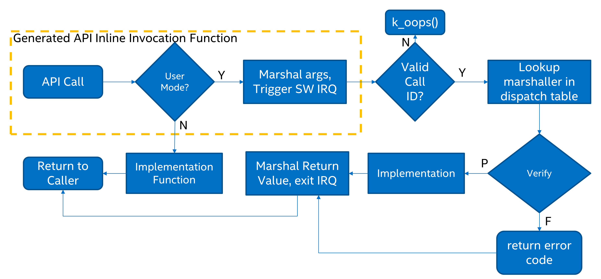

<!-- Copyright 2015-2026 Zephyr Project members and individual contributors. -->
<!-- SPDX-License-Identifier: Apache-2.0 -->
<!-- 中文翻译；阅读编号、导航和译注为本地新增。 -->

<a id="syscalls"></a>

# 第44章\_系统调用

原文：[System Calls](https://docs.zephyrproject.org/latest/kernel/usermode/syscalls.html)。读取日期：2026-10-12，`latest`。

用户线程的权限低于监督线程：不能使用某些 **中央处理器（Central Processing Unit，CPU）** 指令，只能访问内存映射中的有限区域。**系统调用（System Call）**可让用户线程执行原本不能直接执行的操作。

定义系统调用时，必须确保接口的私有数据只能经系统调用接口访问，绝不能把内核私有数据直接暴露给用户线程。原文以 `k_queue` 为例：队列缓冲区中保存了队列管理信息，而缓冲区又对用户模式可见，因此有意不把这些接口开放为系统调用。

> 译注：这里针对的是让用户直接提供含队列管理字段的节点的接口；不要据此推断所有 `k_queue_*` 接口均不能用于用户模式。使用内部节点分配的接口另有权限和资源池规则，见[内存域](P041_内存保护与内存域.md)。

允许注册“在监督模式执行的回调函数”的接口，绝不能作为系统调用暴露给用户模式；这类接口只供监督模式使用。本章说明新系统调用的声明方式及相关实现细节。

## 44.1\_组成部分

一个系统调用由四部分组成：

1. 带 `__syscall` 前缀的 C 接口原型，放在 `include/` 下的头文件或 `SYSCALL_INCLUDE_DIRS` 指定的目录中。不要手工实现这个入口函数；`scripts/build/gen_syscalls.py` 生成它的内联函数体：监督模式直接调用实现函数，用户模式经过特权提升和参数验证。
2. 实现函数：实际执行操作。若由用户模式进入，它可以假设调用参数已经经过验证。
3. 验证函数：包装实现函数，验证所有传入参数。
4. 参数解包函数：自动生成的处理函数，由实现侧源文件包含。

> 译注：原文的“included by user source code”是指由编写系统调用的开发者在源文件中包含，不是把验证处理程序放进不可信的用户线程代码中。

## 44.2\_C 原型与构建选择

C 原型决定用户模式和监督模式使用怎样的接口调用。例如初始化信号量：

```c
__syscall void k_sem_init(struct k_sem *sem, unsigned int initial_count,
                          unsigned int limit);
```

`__syscall` 对 C 编译器展开为 `static inline`；对构建脚本 `scripts/build/parse_syscalls.py`，它则标记一个需要处理的系统调用。脚本解析返回类型和参数类型，存在以下限制：

- 数组参数必须写为指针。例如不能写 `int foo[]` 或 `int foo[12]`，应写成 `int *foo`。
- 简化的解析器不能直接处理复杂函数指针参数；应先用 `typedef` 命名函数指针类型，再在参数表中使用该类型名。
- `__syscall` 必须是原型中的第一个标记。

确定要生成的系统调用集合时，有意不使用预处理器。若某项内核功能未启用，导致已生成的系统调用没有对应验证函数，则该入口会指向“未实现系统调用”的特殊验证处理程序。接口使用的数据类型定义不应对编译器条件性隐藏。

声明系统调用的每个头文件，都必须在文件末尾包含对应生成头文件，命名方式为 `syscalls/<头文件名>`。例如 `include/zephyr/drivers/sensor.h` 的末尾：

```c
#include <zephyr/syscalls/sensor.h>
```

原型应声明在 CMake 变量 `SYSCALL_INCLUDE_DIRS` 列出的目录中。启用 `CONFIG_APPLICATION_DEFINED_SYSCALL` 时，列表包含 `APPLICATION_SOURCE_DIR`；启用 `CONFIG_ZTEST` 时，列表包含 `${ZEPHYR_BASE}/subsys/testsuite/ztest/include`。可通过 CMake 命令行或在 `find_package(Zephyr ...)` 之前执行的 CMake 代码补充路径。`${ZEPHYR_BASE}/include` 总会被扫描以查找潜在系统调用原型。

扫描到的系统调用不一定全部进入最终二进制。`zephyr_syscall_header` 和 `zephyr_syscall_header_ifdef` 用于指定哪些头文件中的系统调用必须保留。`SYSCALL_INCLUDE_DIRS` 所列目录中的系统调用总会纳入最终二进制；要强制纳入全部系统调用，启用 `CONFIG_EMIT_ALL_SYSCALLS`。

### 44.2.1\_调用上下文

若已知某个 C 文件中的代码只在用户模式或只在监督模式运行，可为它定义 `__ZEPHYR_USER__` 或 `__ZEPHYR_SUPERVISOR__`，通常由构建系统加入该文件的编译选项，以省去运行时判断。

| 条件 | 调用行为 |
| --- | --- |
| 未启用 `CONFIG_USERSPACE` | 所有接口直接调用实现函数。 |
| 启用用户模式且未指定上下文宏 | 运行时判断当前特权级，选择系统调用或直接调用实现函数。 |
| 定义 `__ZEPHYR_SUPERVISOR__` | 假定全部代码在监督模式运行，直接调用实现函数。若实际上处于用户模式，一旦执行不允许的操作就产生 CPU 异常。 |
| 定义 `__ZEPHYR_USER__` | 假定全部代码在用户模式运行，无条件发起系统调用。 |

### 44.2.2\_生成文件与架构入口

`gen_syscalls.py` 为带 `__syscall` 的声明生成 C 文件和头文件，位于构建输出目录的 `include/generated/` 下：

- `zephyr/syscall_list.h`：系统调用 ID 枚举，名称为接口名的大写形式加 `K_SYSCALL_` 前缀。
- `zephyr/syscall_dispatch.c`：分发表 `_k_syscall_table` 中的条目。
- 弱验证函数：别名指向“未实现系统调用”验证程序。真正验证函数可能随内核配置不参与构建；例如未启用传感器子系统时调用其用户接口，就进入弱验证函数。
- `zephyr/syscalls/<name>_mrsh.c`：参数解包函数。
- 对应生成头文件：接口的内联函数体以及自动生成的实现函数声明。

> 译注：原文在分发表条目下将“仅包含 CMake 选定头文件或指定目录中的调用”与“启用 `CONFIG_EMIT_ALL_SYSCALLS`”放在同一句，和前文“该选项强制纳入全部调用”矛盾。应区分通常的头文件选择规则与强制全部生成的选项，不把两者组合成新的限制。

例如 `k_sem_init()` 在 `include/zephyr/kernel.h` 声明，该文件末尾包含：

```c
#include <zephyr/syscalls/kernel.h>
```

原文展示的生成函数体如下：

```c
static inline void k_sem_init(struct k_sem * sem, unsigned int initial_count, unsigned int limit)
{
#ifdef CONFIG_USERSPACE
        if (z_syscall_trap()) {
                arch_syscall_invoke3(*(uintptr_t *)&sem, *(uintptr_t *)&initial_count, *(uintptr_t *)&limit, K_SYSCALL_K_SEM_INIT);
                return;
        }
        compiler_barrier();
#endif
        z_impl_k_sem_init(sem, initial_count, limit);
}
```

此例生成一个接受三个参数、返回 `void` 的内联函数，根据调用上下文直接进入实现或执行系统调用提升。

> 译注：以上两处 `k_sem_init` 是原文历史示意，当前接口返回 `int`，不是 `void`。生成文件应由当前版本构建脚本产生，不要照抄示意代码覆盖生成结果；指针转换形式也应以当前生成器输出为准。

最底层是真正的系统调用指令。支持系统调用的架构必须实现七个内联调用入口，原文称为 `_arch_syscall_invoke0()` 至 `_arch_syscall_invoke6()`。它们把参数放入约定的 CPU 寄存器并完成特权提升。参数通常先转换成与寄存器宽度相同的 `uintptr_t`；32 位系统的 64 位参数例外，需要拆成低、高两个部分，占据两个连续参数位置。底层总是返回 `uintptr_t`，不需要返回值时可以忽略。

> 译注：原文此处与末尾接口表使用带前导下划线的名字，而上方代码使用 `arch_syscall_invoke3`。这是原文命名不一致；移植时以目标版本架构头文件中的真实符号为准。



所有架构通过寄存器传递的参数最多六个。更多参数放进调用方地址空间中的数组，因此属于不可信内存；生成器会在入口桩和解包函数中自动加入打包、解包及验证代码。

包装函数把底层返回的 `uintptr_t` 转成接口声明的返回类型。32 位系统不能由该寄存器返回一个完整 64 位值，因此生成包装函数会在自身栈上定义一个 64 位临时变量，将其视为不可信缓冲区，把地址作为最后一个参数传给系统调用；返回后再取出该变量作为接口结果。64 位系统可直接返回 64 位值，不需要这种处理。

## 44.3\_实现函数

实现函数完成接口的实际工作，名称必须是原接口名前加 `z_impl_`。它可以作为 `static inline` 定义在接口所在头文件，也可定义在某个 C 文件中；其原型自动生成，无须手写。

原文说明 Zephyr 通常少做或不做参数错误检查，或用断言检查；这一段称实现函数中的参数检查可选且应使用断言。

> 译注：本页后面的“返回值策略”又要求一般参数检查通常在实现中通过 `CHECKIF()` 完成，并规定用户模式启用运行时错误检查。设计新接口时需同时遵循后面的具体规则，不能把本段历史概述理解为可省去用户输入验证。

<a id="syscall-verification"></a>

## 44.4\_验证函数与参数检查

用户线程发起系统调用后，验证函数在内核侧执行。线程通过软件中断提升至监督模式，公共入口根据用户提供的系统调用 ID 查找并跳转到解包函数，再由解包函数调用验证函数。

验证与解包仅用于来自用户模式的调用；监督模式调用接口时直接进入实现函数，没有软件陷入。验证范围包括：内核对象指针是否为期望类型且调用线程有权限、用户缓冲区是否具备相应读写权限，以及其他有取值范围限制的参数。

`include/zephyr/internal/syscall_handler.h` 提供宏，以简化重复检查代码；编写验证函数应使用这些宏。

### 44.4.1\_参数验证宏

| 宏 | 检查内容 |
| --- | --- |
| `K_SYSCALL_OBJ()` | 地址对应有效内核对象，类型符合预期，调用线程拥有权限，并且对象已经初始化。 |
| `K_SYSCALL_OBJ_INIT()` | 与上一项相同，但允许对象尚未初始化，适合初始化接口的验证。 |
| `K_SYSCALL_OBJ_NEVER_INIT()` | 对象必须尚未初始化；原文说明目前主要用于 `k_thread_create()`。 |
| `K_SYSCALL_MEMORY_READ()` | 调用线程对指定大小的整个缓冲区都有读取权限。 |
| `K_SYSCALL_MEMORY_WRITE()` | 除读取权限外，还必须对整个缓冲区有写入权限。 |
| `K_SYSCALL_MEMORY_ARRAY_READ()` | 分别接受元素数和元素大小，计算总长度时处理乘法溢出，并验证整个数组可读。 |
| `K_SYSCALL_MEMORY_ARRAY_WRITE()` | 与数组读取检查相同，但还要求可写。 |
| `K_SYSCALL_VERIFY_MSG()` | 指定布尔表达式必须为真，否则检查失败并使用给定消息。 |
| `K_SYSCALL_VERIFY` | 不接受消息参数的变体；失败时打印被检查的表达式，只应用于含义明显的检查。 |
| `K_SYSCALL_DRIVER_OP()` | 驱动实例支持指定操作。可以单独使用，更常作为为各驱动子系统自动生成的检查宏的基础，例如 `K_SYSCALL_DRIVER_GPIO()`。 |
| `K_SYSCALL_SPECIFIC_DRIVER()` | 指针是指定设备驱动的有效实例，调用线程拥有权限且驱动已初始化；通过比较实例保存的 **应用程序编程接口（Application Programming Interface，API）** 结构指针与指定驱动 API 结构地址来确认类型。 |

检查失败返回非零。用 `K_OOPS()` 包装检查可触发内核 oops，终止调用线程；采用这种方式而非新增错误返回，是为了保持与监督模式接口一致。

### 44.4.2\_验证函数定义

验证函数名是系统调用名加 `z_vrfy_` 前缀，返回类型和参数类型与被包装接口完全一致。它验证所有参数后执行调用，通常进入实现函数。

自动生成的解包函数负责取出架构层寄存器参数并转换为正确类型。应在实现翻译单元内包含它，通常放在验证函数定义之后，使编译器有机会内联。例如：

```c
static int z_vrfy_k_sem_take(struct k_sem *sem, int32_t timeout)
{
    K_OOPS(K_SYSCALL_OBJ(sem, K_OBJ_SEM));
    return z_impl_k_sem_take(sem, timeout);
}
#include <zephyr/syscalls/k_sem_take_mrsh.c>
```

> 译注：原例超时形参使用旧式 `int32_t`；当前 `k_sem_take()` 使用 `k_timeout_t`。编写实际验证函数必须与当前声明完全一致，不能直接复制旧签名。

## 44.5\_验证时的内存访问策略

通过引用传入的参数需要特别处理：任何有权访问对应内存的用户线程，都可能随时修改其中内容。如果内核依据这块内存作逻辑判断，即使先做过检查也可能受攻击。这类问题称为 TOCTOU，即“检查时”与“使用时”之间的数据发生变化。

正确办法是在验证函数中复制参数，只检查用户线程无法访问的副本，然后将副本传给实现函数。`k_usermode_from_copy()` 从用户内存复制到内核控制的存储；`k_usermode_to_copy()` 将结果复制回用户内存。

C 字符串也需要类似处理：长度事先未知，查找末尾 NUL 时不能读出调用者可访问的内存范围。`k_usermode_string_copy()` 和 `k_usermode_string_alloc_copy()` 用于安全验证并复制用户字符串，之后才交给实现函数。

仅作数据传输、只写或其内容不参与检查和控制流的大缓冲区有例外，限制见本节末尾。

### 44.5.1\_简单输出与输入输出参数

对于输出一个整数值的参数，可先在栈上分配临时变量，把它的地址传入实现函数，再把结果复制到调用者提供的地址：

```c
int z_vrfy_some_syscall(int *out_param)
{
    int local_out_param;
    int ret;

    ret = z_impl_some_syscall(&local_out_param);
    K_OOPS(k_usermode_to_copy(out_param, &local_out_param, sizeof(*out_param)));
    return ret;
}
```

下面这种写法虽然更短，但若实现函数会读取输出内存并据此作判断，就不安全：

```c
int z_vrfy_some_syscall(int *out_param)
{
    K_OOPS(K_SYSCALL_MEMORY_WRITE(out_param, sizeof(*out_param)));
    return z_impl_some_syscall(out_param);
}
```

例如实现可能把计数器保存在该内存中，其他用户线程便能修改计数器。对小型整数值，使用第一种复制方式最安全。

有些参数同时作为输入和输出，例如 `size_t *` 最初表示允许处理的最大长度，之后被更新为实际处理字节数。它也应使用栈上的副本：

```c
int z_vrfy_in_out_syscall(size_t *size_ptr)
{
    size_t size;
    int ret;

    K_OOPS(k_usermode_from_copy(&size, size_ptr, sizeof(size));
    ret = z_impl_in_out_syscall(&size);
    K_OOPS(k_usermode_to_copy(size_ptr, &size, sizeof(size)));
    return ret;
}
```

> 译注：原例第一条 `K_OOPS(k_usermode_from_copy(...))` 少一个右括号，原代码保留；实际代码需补齐。

### 44.5.2\_结构与间接数据

系统调用经常接受结构或相互链接的数据结构；这些内容都应复制。通常在内核栈上创建副本，并把副本中的指针改为指向复制后的子对象：

```c
struct bar {
    ...
};

struct foo {
    ...
    struct bar *bar_left;
    struct bar *bar_right;
};

int z_vrfy_must_alloc(struct foo *foo)
{
    int ret;
    struct foo foo_copy;
    struct bar bar_right_copy;
    struct bar bar_left_copy;

    K_OOPS(k_usermode_from_copy(&foo_copy, foo, sizeof(*foo)));
    K_OOPS(k_usermode_from_copy(&bar_right_copy, foo_copy.bar_right,
                            sizeof(struct bar)));
    foo_copy.bar_right = &bar_right_copy;
    K_OOPS(k_usermode_from_copy(&bar_left_copy, foo_copy.bar_left,
                            sizeof(struct bar)));
    foo_copy.bar_left = &bar_left_copy;

    return z_impl_must_alloc(&foo_copy);
}
```

如果数据量编译时未知，或者太大而不适合放进栈，可能需要用 `z_thread_malloc()` 从调用者的资源池分配内存。这应是最后手段。原文指出功能安全编程规范强烈不鼓励使用堆；确实使用资源池时必须清楚记入接口文档。分配失败应向调用者返回 `-ENOMEM`，绝不能用 `K_OOPS()` 检查分配是否成功。

```c
struct bar {
    ...
};

struct foo {
    size_t count;
    struct bar *bar_list; /* array of struct bar of size count */
};

int z_vrfy_must_alloc(struct foo *foo)
{
    int ret;
    struct foo foo_copy;
    struct bar *bar_list_copy;
    size_t bar_list_bytes;

    /* Safely copy foo into foo_copy */
    K_OOPS(k_usermode_from_copy(&foo_copy, foo, sizeof(*foo)));

    /* Bounds check the count member, in the copy we made */
    if (foo_copy.count > 32) {
        return -EINVAL;
    }

    /* Allocate RAM for the bar_list, replace the pointer in
     * foo_copy */
    bar_list_bytes = foo_copy.count * sizeof(struct_bar);
    bar_list_copy = z_thread_malloc(bar_list_bytes);
    if (bar_list_copy == NULL) {
        return -ENOMEM;
    }
    K_OOPS(k_usermode_from_copy(bar_list_copy, foo_copy.bar_list,
                            bar_list_bytes));
    foo_copy.bar_list = bar_list_copy;

    ret = z_impl_must_alloc(&foo_copy);

    /* All done with the memory, free it and return */
    k_free(foo_copy.bar_list_copy);
    return ret;
}
```

> 译注：原例有两处命名笔误：`sizeof(struct_bar)` 应为这里声明的 `sizeof(struct bar)`；`foo_copy.bar_list_copy` 不是结构成员，释放时应使用已分配的 `bar_list_copy` 或 `foo_copy.bar_list`。此例先限制 `count` 再分配，实际接口也必须确保大小乘法不溢出，并设计好分配后的失败路径；代码作为原文示意保留。

### 44.5.3\_大数据缓冲区的例外

大缓冲区如果只承担用户内存与内核或设备间的数据复制，可以直接把指针传给实现函数，但仍必须用 `K_SYSCALL_MEMORY` 系列验证调用者的访问权限，并满足全部条件：

- 若实现向缓冲区写入数据，例如从 **内存映射输入输出（Memory-Mapped Input/Output，MMIO）** 区域采集的数据，则只能写，不能读回缓冲区内容。
- 若实现读取缓冲区，例如把一块数据发送到硬件，则只能读取原始数据，不得依据内容作条件判断或其他处理。需要此类逻辑时必须先复制。
- 缓冲区只能在本次调用中同步使用。实现不能保存地址，留待中断等异步时机继续访问。

满足这些条件的写入示例如下：

```c
int z_vrfy_get_data_from_kernel(void *buf, size_t size)
{
    K_OOPS(K_SYSCALL_MEMORY_WRITE(buf, size));
    return z_impl_get_data_from_kernel(buf, size);
}
```

## 44.6\_验证失败与返回值策略

需要区分哪些失败应返回错误码，哪些失败应调用 `K_OOPS()` 终止调用线程。原文规定：

- 系统调用已声明但未编译时，调用进入 `handler_no_syscall()`，由它触发 `K_OOPS()`。
- `K_SYSCALL_MEMORY`、`k_usermode_from_copy()`、`k_usermode_to_copy()` 发现无效内存访问时，应触发 `K_OOPS()`，包括权限不足或大小计算溢出。
- 对象检查通过 `K_SYSCALL_OBJ`、`K_SYSCALL_DRIVER_nnnnn` 或手动 `k_object_validate()` 进行。缺少驱动操作、对象指针无效、对象类型错误或初始化状态错误，都应触发 `K_OOPS()`。
- 堆分配失败，例如 `z_thread_malloc()` 失败，应返回 `-ENOMEM`。
- 一般参数检查应在实现函数中完成，多数情况下使用 `CHECKIF()`。其行为取决于配置；启用用户模式时会强制 `CONFIG_RUNTIME_ERROR_CHECKS`，保证执行检查并向调用者返回结果。
- 用户模式绝不能注册任何将在内核模式执行的回调。仅用于安装回调的接口不得暴露为系统调用。某些驱动接口有可选回调参数，其用户模式验证函数必须要求参数为 `NULL`，否则触发 `K_OOPS()`。
- 仅对用户模式强制执行的其他参数检查应放在验证函数中，并尽可能返回错误码。

原文列出的例外有：

- `k_thread_join()` 和 `k_thread_abort()` 对尚未初始化的线程对象不做操作。线程初始化位还兼作“线程正在运行”标志，并在线程退出时清除；原文关联问题编号 `#23030`。
- `k_thread_create()` 的参数检查触发 `K_OOPS()`，因为大量既有调用忽略返回值；原文称此问题也将由 `#23030` 处理。
- `k_thread_abort()` 没有返回值，因此尝试终止关键线程时触发 `K_OOPS()`。
- 多个日志相关系统调用不传播错误码，所以收到错误参数时触发 `K_OOPS()`。

> 译注：上述问题编号和未来处理表述属于所读取原文的状态，不表示本译文已核实该问题当前是否关闭或本地版本是否修改。

## 44.7\_配置与接口

相关配置为 `CONFIG_USERSPACE` 和 `CONFIG_EMIT_ALL_SYSCALLS`。

创建验证函数的帮助宏位于 `include/zephyr/internal/syscall_handler.h`：`K_SYSCALL_OBJ()`、`K_SYSCALL_OBJ_INIT()`、`K_SYSCALL_OBJ_NEVER_INIT()`、`K_OOPS()`、`K_SYSCALL_MEMORY_READ()`、`K_SYSCALL_MEMORY_WRITE()`、`K_SYSCALL_MEMORY_ARRAY_READ()`、`K_SYSCALL_MEMORY_ARRAY_WRITE()`、`K_SYSCALL_VERIFY_MSG()`、`K_SYSCALL_VERIFY`。

原文列出的调用入口位于 `include/zephyr/syscall.h`，为 `_arch_syscall_invoke0()`、`_arch_syscall_invoke1()`、`_arch_syscall_invoke2()`、`_arch_syscall_invoke3()`、`_arch_syscall_invoke4()`、`_arch_syscall_invoke5()`、`_arch_syscall_invoke6()`；命名差异见前文译注。可对照[系统调用官方页面接口区](https://docs.zephyrproject.org/latest/kernel/usermode/syscalls.html#apis)阅读。

---

<!-- reading-navigation:start -->

**主线阅读**

[上一篇：MPU用户空间实现](P043_MPU用户空间实现.md) · [本模块主线目录](../reading/kernel.md) · [全部主线](../reading/README.md) · [下一篇：对称多处理](P045_对称多处理.md)

<details>
<summary>原册编号导航（含扩展参考）</summary>

[上一章：MPU用户空间实现](P043_MPU用户空间实现.md) · [下一章：对称多处理](P045_对称多处理.md) · [返回大纲](大纲.md)

</details>

<!-- reading-navigation:end -->
