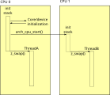

<!-- Copyright 2015-2026 Zephyr Project members and individual contributors. -->
<!-- SPDX-License-Identifier: Apache-2.0 -->
<!-- 中文翻译；阅读编号、导航和译注为本地新增。 -->

<a id="smp-arch"></a>

# 第45章\_对称多处理

原文：[Symmetric Multiprocessing](https://docs.zephyrproject.org/latest/kernel/services/smp/smp.html)。读取日期：2026-10-12，`latest`。

在多处理器架构上，Zephyr 支持多个物理 **中央处理器（Central Processing Unit，CPU）** 同时执行应用代码。所谓**对称多处理（Symmetric Multiprocessing，SMP）**，指默认不特殊对待某个 CPU：任意处理器都能运行任意 Zephyr 线程，并使用全部受支持的标准接口。

应用无需编写特殊代码来利用这一功能。例如在受支持的双处理器设备上，有两个可运行应用线程时，它们可以同时运行。

Kconfig 选项 `CONFIG_SMP=y` 启用 SMP，否则构建单处理器内核。受支持的平台通常默认启用。启用后，`CONFIG_MP_MAX_NUM_CPUS` 给出构建时可用物理 CPU 数，默认通常等于平台 CPU 数，一般应用无须修改。为测试或保留一个 CPU 执行非 Zephyr 代码，可以把它设得更小，但不能超过实际数量。

> 译注：本页讨论多核 Zephyr 通用机制，不表示 HC32F4A0 单核目标需要启用 SMP。

## 45.1\_同步与自旋锁

应用层核心进程间通信及同步原语，在 SMP 内核下保持相同语义。例如用信号量实现会阻塞等待的互斥，仍是可用的应用方案。

底层代码过去常用 `irq_lock()` / `irq_unlock()` 屏蔽中断，以实现细粒度临界区。这些接口通过兼容层继续工作，但“只屏蔽本 CPU 中断”本身无法保护跨 CPU 数据：当前 CPU 不被打断，并不意味着另一 CPU 不会同时读取或修改同一数据。

`k_spin_lock()` 除了屏蔽本地中断，还以原子操作保护共享锁变量，保证同一时间只有一个 CPU 进入该锁保护的临界区。不同自旋锁彼此独立，不能递归获取同一把锁；票号自旋锁及接口见[自旋锁](P027_自旋锁.md)。

### 45.1.1\_旧式中断锁兼容

为兼容面向单处理器编写的应用，SMP 上的 `irq_lock()` / `irq_unlock()` 保持旧有语义。实现使用一把全局自旋锁、嵌套计数，并在切换到带锁线程时原子地重新获取锁。

内核保证所有 CPU 中最多只有一个线程持有此锁；上下文切换时释放锁，切回相应线程时按需要恢复锁状态。其他 CPU 会自旋等待锁释放。

这种兼容有可测量的性能开销。在单核上，屏蔽中断往往只需极少指令，甚至一条；SMP 上则不是如此，而且该锁是全局锁。因此预期运行于 SMP 的代码应尽可能使用自旋锁接口。

## 45.2\_内存一致性

某些多处理器架构的各 CPU 缓存不自动保持一致，一个 CPU 写入的数据可能要刷新缓存后才被其他 CPU 看见。此时共享内核数据必须放在所有 CPU 都能一致观察的内存中。

启用 `CONFIG_KERNEL_COHERENCE` 后，内核把所有共享数据放进具有多处理器一致性的内存，通常是非缓存内存。线程栈仍使用缓存，显式声明为 `__incoherent` 的应用内存也是如此。这个模式只面向缓存不一致架构上的 SMP 内核，隐含接口约定为：传给内核的内存必须具有缓存一致性。

> 译注：原文紧接着写“内核数据结构不能创建在 uncached 区域”，与同段前面的“通常使用 uncached 一致性内存”相矛盾。这里保留并指出该错误；应遵守的是数据结构所在区域必须满足目标架构的一致性要求，不能把缓存不一致的栈或应用区域未经处理直接交给内核。

## 45.3\_CPU 掩码

实时应用可能希望主动把工作分配到物理 CPU，而不完全依赖调度器选择。`CONFIG_SCHED_CPU_MASK` 启用按线程指定允许执行 CPU 集合的接口。

新线程默认可在任何 CPU 运行。`k_thread_cpu_mask_disable()` 禁止线程今后在指定 CPU 上执行；`k_thread_cpu_mask_enable()` 重新允许。还提供清空全部允许位的 `k_thread_cpu_mask_clear()` 与允许全部 CPU 的 `k_thread_cpu_mask_enable_all()`。

这些接口不能用于可运行线程：目标线程必须处于阻塞或挂起状态，否则返回 `-EINVAL`。

三种调度后端都支持 CPU 掩码过滤，性能影响不同：

| 调度配置 | 原文描述的查找开销 |
| --- | --- |
| `CONFIG_SCHED_SIMPLE` | `O(N)` 线性扫描运行队列；每次切换寻找第一个允许在本 CPU 运行的线程，可能扫描完整列表。 |
| `CONFIG_SCHED_SCALABLE` | `O(N)` 中序遍历红黑树；保留优先级顺序，但大量线程被掩码排除时可能遍历全树。 |
| `CONFIG_SCHED_MULTIQ` | 从高到低检查优先级桶并遍历桶内列表；原文给出的最坏界为 `O(P·N)`，其中 `P` 为非空优先级数量。 |

使用 `CONFIG_SCHED_CPU_MASK_PIN_ONLY` 时，每个 CPU 有独立运行队列，无须做掩码过滤。此模式要求每个线程严格绑定一个 CPU，因此不允许 `k_thread_cpu_mask_clear()`、`k_thread_cpu_mask_enable_all()` 或 `k_thread_cpu_mask_disable()`，因为它们可能产生位数不等于一的掩码。

## 45.4\_SMP 启动过程

SMP 内核最初像单处理器内核一样启动：辅助 CPU 在架构层保持禁用，全部常规内核初始化，包括设备初始化，都先在一个 CPU 上完成。

即将进入应用 `main()` 前，内核调用 `z_smp_init()` 启动 SMP 初始化。它枚举配置中的 CPU，对每个辅助 CPU 调用 `arch_cpu_start()`，传入供该 CPU 使用的栈内存、在该 CPU 上运行的 `smp_init_top()` 回调地址，以及用于原子通知的“启动标志”地址。栈区域实际上采用随后将作为该 CPU 中断栈的内存。

架构层在各辅助 CPU 上调用 `smp_init_top()`，此时仍屏蔽中断。该函数调用 `smp_timer_init()` 设置定时器驱动的每 CPU 状态；很多架构的定时器是每 CPU 设备，需要单独配置。之后自旋等待主线程释放启动标志，保证开始执行 Zephyr 应用代码前全部 SMP 初始化已经完成。最后调用 `z_swap()`，经正常调度器切换到适当的可运行线程。



内核默认在启动阶段启动所有可用 CPU。设备树 CPU 节点带 `zephyr,deferred-start` 时，该 CPU 被跳过并保持禁用，以便架构、**片上系统（System on Chip，SoC）**、开发板或应用代码稍后按需启动。延迟是逐 CPU 设置的，可以一部分随启动上线，另一部分留待运行时启动。

用 `k_smp_cpu_start()` 启动延迟 CPU，会执行完整的每 CPU 初始化；`k_smp_cpu_resume()` 用来恢复先前停止的 CPU，不重复一次性初始化。

## 45.5\_处理器间中断

多处理器系统中，本地修改的状态有时必须由其他 CPU 同步处理。例如 `k_thread_abort()` 返回前必须确保目标线程不再可运行；若线程正运行在另一 CPU 上，需要协调停止。

另一个例子是低功耗空闲：设备可能要求尽量禁用或推迟中断，包括周期性定时器中断。CPU 进入这种状态后，如果另一 CPU 使新线程就绪，空闲 CPU 需要一种机制唤醒处理工作。

因此 SMP 架构应尽可能实现处理器间中断（Interprocessor Interrupt，IPI）。架构至少提供 `arch_sched_broadcast_ipi()`，向其他全部 CPU 发中断；也允许同时通知当前 CPU。支持定向 IPI 的架构通过 `CONFIG_ARCH_HAS_DIRECTED_IPIS` 声明，并提供 `arch_sched_directed_ipi()`，只通知指定 CPU。

接收 CPU 随后执行调度器提供的 `z_sched_ipi()`。原文预期这些接口会扩展成支持跨 CPU 调用等功能的更通用框架，再由框架实现调度用途。

支持定向 IPI 时，新线程就绪只通知真正需要重新调度的 CPU，避免打断不需要被抢占的 CPU，从而减少中断负担。

### 45.5.1\_终止线程与空闲唤醒

有些 SMP 架构缺少可用 IPI，或相关机制尚未文档化、实现。Zephyr 提供正确但可能较低效的后备行为。

调用 `k_thread_abort()` 时，调度器可原子地判断目标线程是否正运行于其他 CPU。若是，就广播 IPI 并自旋，等待目标进入 `DEAD` 状态，或重新进入队列后按单核方式终止。每次中断退出都会检查终止状态，所以 IPI 本身不需要专门的终止处理。没有 IPI 时也可自旋等待远端收到任意中断，只是等待可能长得多。

空闲唤醒甚至可以使用空 IPI 处理程序：向空运行队列加入线程时，可能有 CPU 处于空闲，于是广播 IPI；其他 CPU 在中断退出时发现新线程并按需要切换。

没有 IPI 时，依靠中断唤醒的低功耗空闲无法及时响应新线程。此时 Zephyr 不进入系统空闲处理程序，而是在空闲循环里高频检查调度状态。它不会持续持有调度锁自旋，以免引起严重锁竞争。原文预期对功耗敏感的 SMP 系统都应提供 IPI；该后备机制主要用于测试或没有功耗要求的系统。

### 45.5.2\_IPI 级联

内核无法控制各 CPU 处理 IPI 的顺序。通常一轮 IPI 足以让 `N` 个 CPU 执行最高优先级的 `N` 个就绪线程；启用 CPU 掩码后，可能存在多个符合约束的线程组合，而一轮 IPI 甚至不足以形成其中任意一个有效组合。

“有效组合”不等于“最优组合”。不使用掩码时二者一致；使用掩码时可能有多个有效组合，其中某一个更优。例如双 CPU 系统中，T1、T2 优先级分别为 1、2，T2 只能在 CPU0 执行，T1 无绑定。如果 CPU0 执行 T2、CPU1 执行 T1，既有效又最优；如果 CPU0 执行 T1、CPU1 空闲，也有效但不最优。

一轮 IPI 不足时，运行线程集合通常接近有效集合，后续 IPI 一般很快修正。不能接受暂时偏差或修正延迟时，可启用 `CONFIG_SCHED_IPI_CASCADE`，让内核继续产生级联 IPI，直到选出有效组合。

级联默认关闭，因为有三类代价：产生 IPI 的 CPU 在新线程抢占旧线程时，需要比较旧线程与其他 CPU 正执行的线程；接收 CPU 需要处理中断；线程可能因级联短暂运行又马上被换下，表现为断续执行。

### 45.5.3\_IPI 工作项

IPI 工作项允许在其他 CPU 的中断服务程序级别执行函数。用 `k_ipi_work_add()` 将工作加入目标 CPU 的 IPI 工作队列，用 `k_ipi_work_signal()` 发出通知，再用 `k_ipi_work_wait()` 等待完成。同一时刻仅允许一个等待者。

工作只会加入其他 CPU 的队列。如果在线程上下文添加工作，开发者必须确保该线程在完成 IPI 通知前不迁移到另一个 CPU。

下面展示某个 CPU 处理中断后，用 IPI 工作项更新一组 CPU 状态的流程：

```c
struct k_ipi_work my_work;

void remote_cpu_action(struct k_ipi_work *arg)
{
    ...
}

void my_isr(void)
{
    /*
     * Wait for previous use of <my_work> to complete.
     * It assumes that <my_work> was initialized elsewhere.
     */

    uint32_t cpu_mask = <bitmask identifying CPUs to update>;

    while (k_ipi_work_wait(&my_work, K_NO_WAIT) == -EAGAIN) {
    }

    /* Add and signal the new work */

    k_ipi_work_add(&my_work, cpu_mask, remote_cpu_action);

    k_ipi_work_signal();
}
```

> 译注：示例包含占位符，且假定 `my_work` 已在别处初始化。它在中断上下文用 `K_NO_WAIT` 轮询前一工作，不代表所有普通工作队列处理都能搬到中断中；远端函数运行级别也是中断级别。

## 45.6\_SMP 内核内部机制

多数内核代码和应用代码一样，不依赖 CPU 数量，但以下数据布局与切换机制有所不同。

### 45.6.1\_每CPU数据

`_current` 指针必须指向本 CPU 正在运行的线程；每个物理 CPU 也需要自己的中断栈和用于判断 **中断服务例程（Interrupt Service Routine，ISR）** 状态的中断嵌套计数。

这些字段放进独立的 `struct _cpu`，由 `_kernel.cpus[]` 按 CPU ID 索引。兼容字段允许旧单核代码继续用原有语法和汇编偏移访问 `cpus[0]` 中的数据。

架构层必须让内核能快速取得当前 CPU 结构指针。通常 `arch_curr_cpu()` 利用 CPU 专用寄存器或寻址机制，使该值跨任意上下文切换、中断保持可获取。

单核可以只有一个最低优先级的全局空闲线程；SMP 可能每 CPU 需要一个。因此调度器热路径中的 `_is_idle()` 不能只比较线程指针是否等于一个已知静态对象，而是根据线程结构中的独立字段识别空闲线程。

### 45.6.2\_基于switch的上下文切换

传统 `z_swap()` 不接受要切换到的线程作为参数；调度器在上次状态变化时做抢占决定并缓存“下一线程”，架构代码通过固定结构偏移取出它。这在 SMP 下不成立：本 CPU 上次离开调度器后，其他 CPU 可能修改状态，甚至已经运行那个缓存的线程。

因此 SMP 必须在执行切换时同步决定目标。为了不让各架构汇编处理调度器内部状态，Zephyr 要求一个更底层的 `arch_switch()` 原语。调用时中断已屏蔽，它接受两个参数：目标上下文的不透明架构句柄，以及用于保存被换出线程句柄的地址。内核在其上实现可移植的 `z_swap()`，集中处理调度逻辑。

采用这种机制的架构在中断退出时调用 `z_get_next_switch_handle()` 获取下一线程。参数可以是被中断线程的上下文句柄，也可以是 `NULL`，表示该线程还不能交回调度器；选择取决于架构如何保存中断上下文。

寄存器很多的架构，通常在中断入口只保存调用者保存寄存器，以降低中断延迟；直到 `arch_switch()` 才保存被调用者保存寄存器，以减少不必要的切换成本。它们先传 `NULL` 查询是否需要切换；若需要，再执行自身的 `arch_switch()` 或派生实现，否则直接退出中断。切换代码必须在完整保存上下文后，才把生成句柄写入被换出线程的 `switch_handle` 字段。

若架构在中断入口已保存完整线程状态，则可直接把句柄传给 `z_get_next_switch_handle()`，一步完成。

SMP 要求 `CONFIG_USE_SWITCH`，反过来却不成立：即使 `CONFIG_SMP` 关闭，单核架构仍可用 `arch_switch()` 实现上下文切换。

### 45.6.3\_线程队列顺序

在 SMP 系统中，线程被更高优先级线程抢占后，会移动到自身优先级队列的末尾。单处理器系统则保留被抢占线程在同优先级队列中的原位置，等待重新获得 CPU。

---

<!-- reading-navigation:start -->

**主线阅读**

[上一篇：系统调用](P044_系统调用.md) · [本模块主线目录](../reading/kernel.md) · [全部主线](../reading/README.md) · [下一篇：虚拟内存](P046_虚拟内存.md)

<details>
<summary>原册编号导航（含扩展参考）</summary>

[上一章：系统调用](P044_系统调用.md) · [下一章：虚拟内存](P046_虚拟内存.md) · [返回大纲](大纲.md)

</details>

<!-- reading-navigation:end -->
