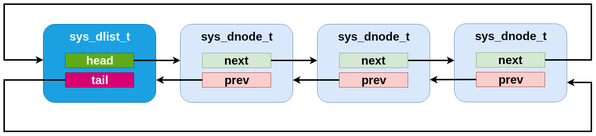
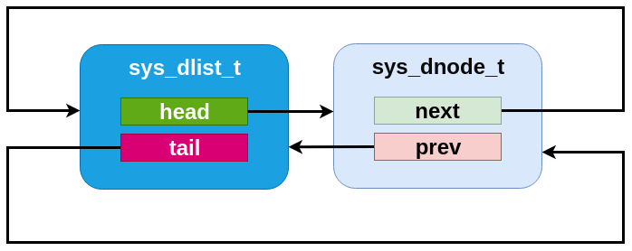
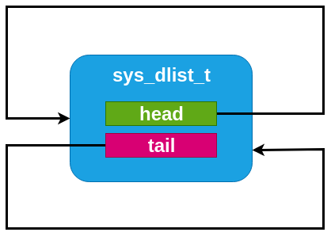

<!-- Copyright 2015-2026 Zephyr Project members and individual contributors. -->
<!-- SPDX-License-Identifier: Apache-2.0 -->
<!-- 中文翻译；阅读编号、导航和译注为本地新增。 -->

# 第53章\_双向链表

原文：[Double-linked List](https://docs.zephyrproject.org/latest/kernel/data_structures/dlist.html)。读取日期：2026-10-12，`latest`。

Zephyr **双向链表（Doubly-Linked List）**与单向链表在很多方面相似：既有单向链表操作保持相同算法复杂度，又允许在任意位置常数时间插入或删除，包括头、尾以及内部节点前后。代价是每节点需要两个指针，代码和内存开销略大。

## 53.1\_初始化与访问

可在任意可访问内存中定义 `sys_dlist_t`，使用前必须调用 `sys_dlist_init()` 或采用 `SYS_DLIST_STATIC_INIT` 初始化。

节点类型是 `sys_dnode_t`，由使用者提供，通常嵌入被跟踪的数据结构。节点使用前必须处于清零的存储中，例如 BSS，或调用 `sys_dnode_init()` 初始化。

`sys_dlist_peek_head()` / `sys_dlist_peek_tail()` 获取头、尾节点；`sys_dlist_peek_next()` / `sys_dlist_peek_prev()` 获取下一、上一节点。空链表或达到相应端点时，这些接口会返回 `NULL`。

## 53.2\_修改与遍历

`sys_dlist_remove()` 删除节点；`sys_dlist_prepend()` / `sys_dlist_append()` 在头、尾添加节点；`sys_dlist_insert()` 在已知节点前插入节点。这些操作都是常数时间。

`SYS_DLIST_FOR_EACH_NODE` 支持以代码块遍历每个节点。还提供从已知位置继续遍历的 `FROM_NODE` 形式、允许循环体删除当前节点的 `SAFE` 形式、直接取得外层结构指针的 `CONTAINER` 形式，以及结合后两种能力的 `CONTAINER_SAFE` 形式。

`sys_dlist_insert_at()` 线性搜索插入位置，使用开发者提供的 C 回调确定位置；`sys_dnode_is_linked()` 判断节点当前是否链接在双向链表中，这项能力不增加普通链表处理的存储开销。

> 译注：常数时间的插入接口与需要线性寻找位置的 `sys_dlist_insert_at()` 要分开理解。`SAFE` 只支持规定的遍历中删除方式，不提供跨线程或中断的互斥保护；并发修改仍由调用方同步。

> 译注——源码对照：完整声明、14个宏／循环示例代码块及源码见[双向链表参考册](../dlist_reference/大纲.md)。remove更新相邻节点并清空被删节点的next／prev；dequeue只摘链而保留旧指针，因此is_linked不能判断dequeue后的节点是否仍在链内。get取头节点时使用remove，返回节点两端已清空。

> 译注——边界与插入：原API页的peek_prev返回文字把边界写成尾节点，当前源码实际在头节点返回NULL，译文保留原文并就地说明。insert_at对现有节点逐项调用cond，首个非零结果为插入点，否则追加；range搬移不检查区间或目标别名，不能把包含当前目标端点的同链移动视为无操作。空链表必须初始化为指向自身的哨兵结构，不能仅清零。

## 53.3\_内部结构

`sys_dlist_t` 只有 `head`、`tail` 指针，`sys_dnode_t` 只有 `prev`、`next` 指针，不保存其他数据。两种结构的内部布局一致，链表管理结构本身作为一个节点加入环中，从而形成对称操作：

- 空链表的管理结构指针指回自身，很容易判断为空。
- 比较节点的前后指针与管理结构地址，即可识别头尾。
- 插入、删除无须专门判断头尾情况，环内没有需要避开的 `NULL` 指针；修改原语可以采用相同操作，不必为端点添加分支。

因此含 `N` 个数据节点的双向链表，可以视作有 `N+1` 个节点的环，其中一个就是管理结构。

> 译注：内部用管理结构作为哨兵，与对外 `peek` 接口在端点返回 `NULL` 并不矛盾；应用应使用接口，不能把内部哨兵当作数据节点。

## 53.4\_接口参考

完整接口见[双向链表参考](../dlist_reference/P001_双向链表公共接口.md)。

---

<!-- reading-navigation:start -->

**主线阅读**

[上一篇：数据结构入口](P052_数据结构入口.md) · [本模块主线目录](../reading/kernel.md) · [全部主线](../reading/README.md) · [下一篇：单向链表](P054_单向链表.md)

原册编号导航（含扩展参考）

[上一章：数据结构入口](P052_数据结构入口.md) · [下一章：单向链表](P054_单向链表.md) · [返回大纲](大纲.md)

<!-- reading-navigation:end -->
