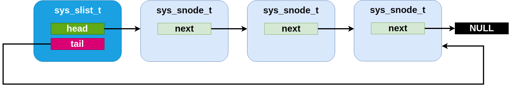

<!-- Copyright 2015-2026 Zephyr Project members and individual contributors. -->
<!-- SPDX-License-Identifier: Apache-2.0 -->
<!-- 中文翻译；阅读编号、导航和译注为本地新增。 -->

# 第54章\_单向链表

原文：[Single-linked List](https://docs.zephyrproject.org/latest/kernel/data_structures/slist.html)。读取日期：2026-10-12，`latest`。

`sys_slist_t` 保存**单向链表（Singly-Linked List）**：每个节点记录下一个节点，不记录前一个。它支持常数时间取得头尾、在头前或尾后插入，以及删除头节点。删除其他节点需要知道其前驱；若没有前驱指针，就必须线性搜索。

## 54.1\_初始化与节点

`sys_slist_t` 可以位于任意可访问内存，使用前调用 `sys_slist_init()`，或用 `SYS_SLIST_STATIC_INIT` 静态初始化。内部字段不透明，用户代码不应直接访问。

`sys_slist_peek_head()` / `sys_slist_peek_tail()` 返回 `sys_snode_t *`，空链表返回 `NULL`。节点通常由调用者管理并嵌入外层业务结构。

`SYS_SLIST_CONTAINER` 从节点指针恢复外层结构地址，需要提供用于确定外层结构类型的信息及节点字段名。节点内部仅包含一个 `next` 指针，使用 `sys_slist_peek_next()` 访问。

> 译注：原文说给容器宏传“结构名”。本地 `SYS_SLIST_CONTAINER(__ln, __cn, __n)` 的第二参数实际是外层结构类型的指针表达式，宏通过 `__typeof__(*(__cn))` 推导类型，不能直接把 C 类型名当成该参数。调用时应对照目标版本宏定义。

## 54.2\_修改与遍历

`sys_slist_prepend()` / `sys_slist_append()` 在头尾添加一个节点；`sys_slist_insert()` 在已知节点后插入；`sys_slist_remove()` 根据节点及其前驱删除节点。这些操作都是常数时间。

更复杂的便利操作包括：`sys_slist_merge_slist()` 把整个链表追加到另一个链表；`sys_slist_append_list()` 常数时间追加由边界限定的节点链；`sys_slist_find_and_remove()` 线性搜索指定节点，找到后删除。

遍历宏避免手工推进 `next`：

- `SYS_SLIST_FOR_EACH_NODE`：把每个节点赋给调用者的局部节点指针。
- `SYS_SLIST_FOR_EACH_NODE_SAFE`：额外使用一个临时变量，允许在循环体中删除当前节点。
- `SYS_SLIST_FOR_EACH_CONTAINER`：直接取得外层结构类型的指针，内部完成偏移换算。
- `SYS_SLIST_FOR_EACH_CONTAINER_SAFE`：同时支持外层结构访问与删除当前节点。
- `SYS_SLIST_ITERATE_FROM_NODE`：从已知位置继续遍历后续节点，跳过更前面的部分。

> 译注：原文将最后一个宏描述为包括给定节点及其后继。本地 `Z_GENLIST_ITERATE_FROM_NODE` 在给定节点非空时，先推进到它的下一节点；传 `NULL` 才从表头开始。因此不要靠该宏重复处理起始节点。`SAFE` 也不表示线程安全；并发保护仍需调用者提供。

> 译注——官方源码对照：新增[单向链表与通用生成宏参考册](../slist_reference/大纲.md)，保留接口、宏展开、循环示例及两个头文件的可见源码。本次官方list_gen.h同样从非NULL初始节点的后继开始遍历。SAFE只预存下一节点／容器，不保护其他访问者或被预存对象的生命周期。原API页的容器安全遍历示例宏名存在不一致，译文保留示例并就地注明实际应使用的宏。

> 译注——修改边界：append_list不主动截断传入尾节点的next，调用者须提供有效、以NULL终止的链段；merge会清空源链表但不复制或释放容器。get／get_not_empty取出头节点后不清next，remove会清next；find查找失败时也可能通过prev输出尾节点，必须先判断布尔返回值。完整条件与定位见参考册，未执行并发、生命周期或实板验证。

## 54.3\_内部实现

单向链表采用最小化的常规结构：`sys_slist_t` 只有 `head`、`tail` 两个指针，`sys_snode_t` 只有 `next`。

具体操作通过内部 `Z_GENLIST` 模板生成。模板可从不同结构提取所需字段，生成指定名称的一组函数，从而让更复杂的单向链表变体复用同样的基础操作。

实现变体时，只需提供每种结构的初始化函数，以及相应 `head`、`tail`、`next` 字段的获取和设置原语，再把这些内联函数传入模板展开。原文说明目前 Zephyr 中这样的变体只有 `sflist`。

## 54.4\_带标志单向链表

`sys_sflist_t` 使用上述模板实现，除符号名使用 `sflist` 而非 `slist`，以及增加标志接口外，其他行为与普通单向链表相同。

每个节点额外提供两个用户自定义标志位，通过 `sys_sfnode_flags_get()` / `sys_sfnode_flags_set()` 访问。实现将标志并入 `next` 指针的最低两位，因此相对普通链表不增加 SRAM 存储开销。

> 译注：复用指针低位依赖节点地址满足相应对齐约束；不要给节点任意未对齐的存储地址，也不要通过裸指针位操作修改库管理的链接字段。

> 译注——2026-10-15带标志节点源码：本次官方头文件提供SYS_SFLIST_FLAG_BITS，并以节点类型对齐计算FLAGS_MASK和位数。4字节对齐时为2位，8字节对齐时为3位；上面的“两位”是指南原文，不能套用到所有ABI。首次入链前应调用sys_sfnode_init初始化节点；链表初始化只处理head／tail，不替各节点初始化标志。

> 译注——标志保留与同步：链接写入保留现有标志，flags_set保留现有后继；remove清除逻辑后继时编码字仍可能因标志而非零。两类修改都可能读改写同一个uintptr_t字段，不能无同步并发执行。完整声明、15个宏／示例代码块及可见源码见[带标志单向链表参考册](../sflist_reference/大纲.md)。

## 54.5\_接口参考

见[单向链表接口](../slist_reference/P001_单向链表公共接口.md)与[带标志单向链表接口](../sflist_reference/P001_带标志单向链表公共接口.md)。

---

<!-- reading-navigation:start -->

**主线阅读**

[上一篇：双向链表](P053_双向链表.md) · [本模块主线目录](../reading/kernel.md) · [全部主线](../reading/README.md) · [下一篇：最小堆](P055_最小堆.md)

原册编号导航（含扩展参考）

[上一章：双向链表](P053_双向链表.md) · [下一章：最小堆](P055_最小堆.md) · [返回大纲](大纲.md)

<!-- reading-navigation:end -->
