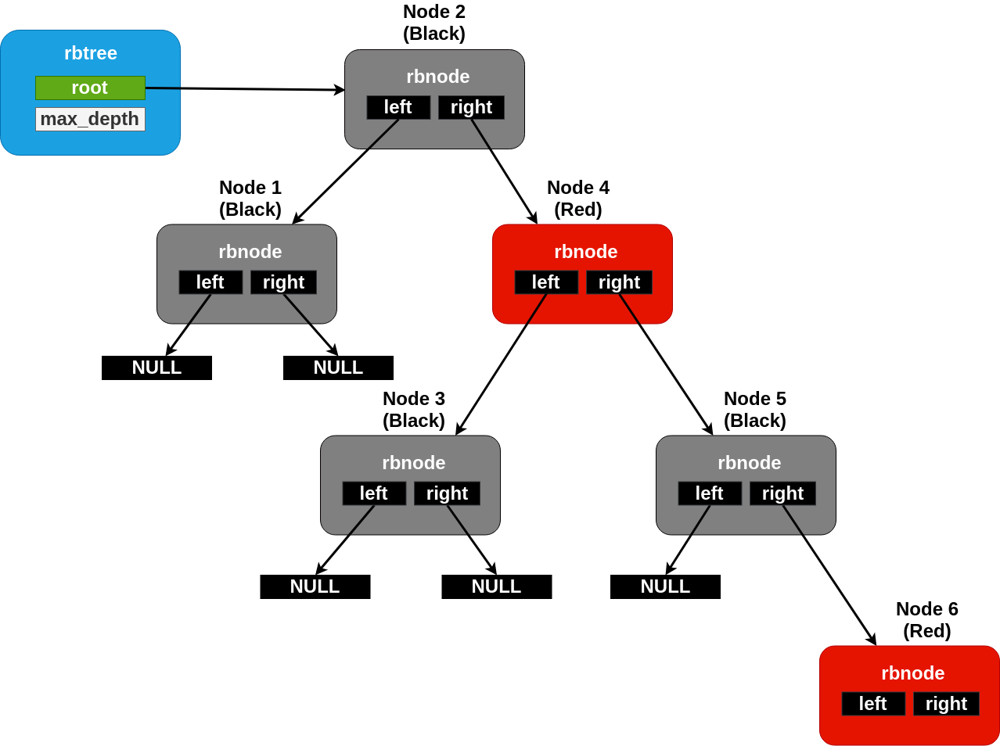

<!-- Copyright 2015-2026 Zephyr Project members and individual contributors. -->
<!-- SPDX-License-Identifier: Apache-2.0 -->
<!-- 中文翻译；阅读编号、导航和译注为本地新增。 -->

# 第56章\_红黑树

原文：[Balanced Red/Black Tree](https://docs.zephyrproject.org/latest/kernel/data_structures/rbtree.html)。读取日期：2026-10-12，`latest`。

有序容器在运行时变大后，链表的线性搜索代价可能不合适。Zephyr 提供平衡树实现，使含 `N` 个节点的树，其查找和删除时间上界为 `O(log2(N))`。实现采用常规**红黑树（Red-Black Tree）**算法。

## 56.1\_初始化、节点与顺序

可以在任意可访问内存中定义 `struct rbtree` 管理结构。首次使用前应先清零，无须调用专门初始化接口。

不同于位置显式给定的链表，树中节点顺序由用户提供的比较谓词决定。在进行任何树操作前，必须给 `lessthan_fn` 字段赋一个符合 `rb_lessthan_t` 的函数：当第一个节点在所需排序关系下小于第二个节点时，返回真。

原文要求树中节点具有唯一且固定的顺序，不允许不同节点处于“相等”关系，否则算法不能正确工作。

> 译注：先清零管理结构，再设置比较函数，二者不是相互替代的初始化步骤。业务键相同的不同对象仍需稳定的次级排序规则；已入树对象若要修改排序关键字段，应先按接口约定移除再重新插入。

`struct rbnode` 节点存储由用户管理，通常嵌入业务结构。其字段完全不透明；用户不能像遍历链表那样读取子指针，手工探索树拓扑。

## 56.2\_增删、查找与遍历

`rb_insert()` 插入，`rb_remove()` 删除；`rb_get_min()` 和 `rb_get_max()` 分别取得按比较关系排序的首尾节点；`rb_contains()` 判断某个节点指针是否属于树。这些接口的最坏复杂度均不超过对数级。

遍历有两种方式：`rb_walk()` 接受 C 回调与无类型用户参数，按顺序对每节点调用回调。实现简单，但调用接口较繁琐，原文将这种回调风格类比 ISO C 的 `bsearch()`。它采用递归，因此不适合禁止递归等栈使用方式的环境。

`RB_FOR_EACH` 用自然的循环代码块遍历，无须回调，也不递归；默认需要随树深度呈对数增长的栈空间。若需避免动态大小的栈缓冲区，可配置为固定最大尺寸。`RB_FOR_EACH_CONTAINER` 则直接取得外层容器结构的指针，而非裸节点指针。

> 译注——源码对照：完整声明、结构和源码浏览见[红黑树参考册](../rbtree_reference/大纲.md)。rb_contains按指针身份及比较路径查找；当前实现对空树与NULL候选返回true，不应据此把NULL视作有效节点。rb_remove的路径记录函数要求非空树，不能从其“未找到便返回”的分支推断空树调用也安全。排序键、节点地址和比较规则需保持稳定。

> 译注——遍历与配置：RB_FOR_EACH没有_SAFE版本，遍历期间不能改树。默认alloca辅助存储在所在函数返回时释放；CONFIG_MISRA_SANE改用同一树对象中的固定数组，嵌套操作可能覆盖正在使用的栈，且该配置下不提供rb_walk。全树遍历为O(N)，每节点两指针的持久开销不包含树管理结构与辅助栈。

## 56.3\_树的内部实现

红黑树低层算法遵循常见定义，本节仅说明 Zephyr 的特点。

平衡性保证从根到任意叶子的路径，最长不超过另一条路径长度的两倍。每节点保存一位颜色，红或黑；任一路径黑节点数相同，红节点不能有红色子节点，因此额外红节点数不超过黑节点数。修改后通过旋转等规则恢复这些约束。

从概念上看，旋转建立在交换两个节点位置的操作上。普通实现有时只需交换节点内部数据指针，但 Zephyr 节点是侵入式的，不能如此处理。因此需要更复杂代码覆盖一个节点是根、两个节点互为父子等边界情况。

`rbnode` 仅保存左右孩子两个指针，不保存常见实现中的第三个父指针。再平衡需要向上遍历时，Zephyr 利用向下查找过程中在局部建立的节点指针栈，并随修改更新它。

因此每节点持久存储开销不超过双向链表：只需两个指针，也不依赖内存分配接口。原文认为同时具备这两点的平衡树实现在业界较少见。

> 译注：这里比较的是节点持久字段，不代表树操作没有临时栈开销；前述遍历与再平衡都可能使用随树高变化的辅助存储。数据结构本身也不提供并发同步。

## 56.4\_接口参考

见[平衡红黑树接口](../rbtree_reference/P001_红黑树公共接口.md)。

---

<!-- reading-navigation:start -->

**主线阅读**

[上一篇：最小堆](P055_最小堆.md) · [本模块主线目录](../reading/kernel.md) · [全部主线](../reading/README.md) · [下一篇：环形队列](P057_环形队列.md)

原册编号导航（含扩展参考）

[上一章：最小堆](P055_最小堆.md) · [下一章：环形队列](P057_环形队列.md) · [返回大纲](大纲.md)

<!-- reading-navigation:end -->
