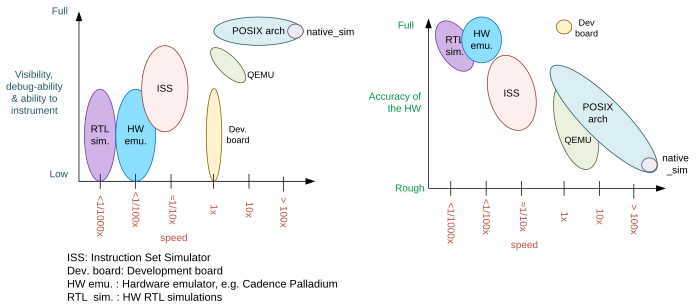
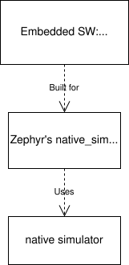

<!-- Copyright 2015-2026 Zephyr Project members and individual contributors. -->
<!-- SPDX-License-Identifier: Apache-2.0 -->
<!-- 中文翻译；编号、导航和明确标注的译注为本地新增。 -->

# 第2章\_POSIX架构

原文：[官方页面](https://docs.zephyrproject.org/latest/boards/native/doc/arch_soc.html)。读取日期：2026-10-15；来源摘要见[来源记录](../SOURCES.md)。

<a id="the-posix-architecture"></a>
<a id="posix-arch"></a>
- <a id="id4"></a>[概述](#overview)
- <a id="id5"></a>[重要限制](#important-limitations)
- <a id="id6"></a>[主要不受支持的特性](#significant-unsupported-features)
- <a id="id7"></a>[移植目的](#rationale-for-this-port)
- <a id="id8"></a>[方案比较](#comparison-with-other-options)
- <a id="id9"></a>[架构与设计](#architecture-and-design)

<a id="overview"></a>

## 2.1\_概述

本机模拟器（Native Simulator）与可移植操作系统接口架构（POSIX Architecture）、`inf_clock` 片上系统层（SoC Layer）共同为一组虚拟测试开发板提供基础、架构层和 SoC 层。

借助这些组件，可以把 Zephyr 应用与 Zephyr 内核一起编译为普通可执行程序，在宿主操作系统（Host OS）上作为本机应用直接运行，无须仿真指令。编译、调试和分析都使用宿主机原生工具，从而在开发早期免去特定目标架构硬件。

> 原文注意：POSIX 架构与 [POSIX 操作系统抽象层](../portability/P010_POSIX文档入口.md#posix-support)没有关系，不能混淆。后者提供适配层（Adaptation Shim），让需要 POSIX API 的应用能够在 Zephyr 上运行。

<a id="types-of-posix-arch-based-boards"></a>

### 2.1.1\_基于POSIX架构的开发板类型

目前有两类：[native_sim](P004_Native_Simulator本机模拟器.md#native_sim) 与 [bsim 开发板](../bsim_reference/P001_Bsim开发板设计.md#bsim-boards)。它们共享主要目标和原则，但前者定位为硬件无关（Hardware-agnostic）的测试平台，某些情况下使用宿主 OS 的外设；后者旨在模拟特定硬件平台，重点是无线电，例如低功耗蓝牙（Bluetooth LE）。bsim 使用 [BabbleSim](https://BabbleSim.github.io) 物理层模拟和框架，并与宿主机完全解耦。

<a id="host-system-dependencies"></a>
<a id="posix-arch-deps"></a>

### 2.1.2\_宿主系统依赖

此移植以 Linux 为设计和测试运行环境。

- 构建32位目标时，系统必须安装32位 C 库；Debian/Ubuntu 由 `gcc-multilib` 软件包提供。
- 由于 macOS 与典型 Unix 系统存在根本差异，已知 POSIX 架构无法在 macOS 上工作。
- 在 Windows 中使用时，需要运行 Linux 客户系统的虚拟机。可以使用适用于 Linux 的 Windows 子系统第2版（WSL 2），或运行所选 Linux 发行版的其他虚拟机。
- 旧版 WSL 1 功能受限，不能运行32位二进制，例如 `native_sim` 默认的32位构建。

<a id="important-limitations"></a>
<a id="posix-arch-limitations"></a>

## 2.2\_重要限制

此移植的基础假设决定了哪些事情可以做、哪些不能做。代码在宿主 CPU 上本机执行，没有插桩（Instrumentation），也没有在模拟 CPU 休眠之外打断它的机制。

可把它理解为模拟 CPU 的时钟无限快：**CPU 运行时，模拟时间不流逝**。因此，代码执行期间不会收到包括定时器中断在内的中断；例外是软件使能中断或解除屏蔽后，先前挂起的中断可以立即到达。这是有意设计的，以提供确定性（Deterministic）的开发与调试环境。更多说明见[移植目的](#rationale-for-this-port)及[架构与设计](#architecture-and-design)。

由此产生以下限制：

- 应用不能通过不让 CPU 休眠的忙等循环（Busy-wait Loop）等待某件事发生。这样的循环会变成无限循环，使执行停滞。下面的代码在实际硬件上可以被中断，但在此会阻塞所有线程、内核和硬件模型：

```c
while (1){}
```

- 同样，如果期待中断处理程序或另一个线程更新 `condition`，下面的代码在此移植上也会使应用停滞：

```c
volatile condition = true;
while (condition){}
```

- 依赖自身执行速度的代码通常无法按预期工作，例如：

```c
peripheral_x->run = true;

/* Wait for a number of CPU cycles */
for (int i = 0; i < 100; i++) NOP;

/* We expect the peripheral done and ready to do something else */
```

代码注释依次表示“等待若干CPU周期”和“我们期望外设已经完成，可以做其他事情”；在本机模拟器中，这种等待不推进模拟时间。

- 此移植既不以调试硬件／软件竞态（HW/SW Race）等时序问题为目标，也无法帮助处理这些问题。
- 不能使用硬编码内存地址，因为没有输入输出（I/O）或内存管理单元（MMU）仿真。

<a id="working-around-these-limitations"></a>

### 2.2.1\_处理这些限制

忙等循环会使应用明显停滞。要定位循环，可在调试器中运行二进制，卡住后暂停；程序将停在循环的某处。

最好的解决办法是去掉忙等循环，改用合适的内核原语（Kernel Primitive）同步线程。忙等通常是不良编码方式，因为它会让 CPU 持续执行并消耗电力。

如果确实无法删除循环，等待中断时可添加有条件编译的 [`k_cpu_idle()`](../fatal_irq_reference/P011_CPU空闲接口.md#ga7b25e1bed511a813b32fbd0f91b09356) 调用；或者调用 [`k_busy_wait()`](../thread_core_reference/P001_线程公共接口.md#ga550b642e071480323e589866abb99c22)，加入少量微秒延时。将前面的例子改成下面这样即可工作：

```c
volatile condition = true;
while (condition) {
 #if defined(CONFIG_ARCH_POSIX)
   k_cpu_idle();
 #endif
}
```

<a id="significant-unsupported-features"></a>
<a id="posix-arch-unsupported"></a>

## 2.3\_主要不受支持的特性

目前最重要的不支持项如下：

- [用户模式／用户空间（User Mode/Userspace）](../kernel/P038_用户模式入口.md#usermode-api)：为这些目标构建时，[`CONFIG_USERSPACE`](https://docs.zephyrproject.org/latest/kconfig.html#CONFIG_USERSPACE) 始终禁用，进入内核的调用都是普通函数调用。
- 栈检查（Stack Checks）：不支持 [`CONFIG_HW_STACK_PROTECTION`](https://docs.zephyrproject.org/latest/kconfig.html#CONFIG_HW_STACK_PROTECTION)、[`CONFIG_STACK_CANARIES`](https://docs.zephyrproject.org/latest/kconfig.html#CONFIG_STACK_CANARIES) 和 [`CONFIG_THREAD_ANALYZER`](https://docs.zephyrproject.org/latest/kconfig.html#CONFIG_THREAD_ANALYZER)。因为 Zephyr 分配的线程栈没有像其他架构那样被实际使用，详见[架构层](#arch-layer)。

<a id="rationale-for-this-port"></a>
<a id="posix-arch-rationale"></a>

## 2.4\_此移植的目的

主要目标为：

- 使用本机工具进行功能调试、插桩及代码分析。
- 进行功能回归测试（Functional Regression Testing）与模拟，同时保留代码的完整功能。
- 快速运行测试：一秒实际经过时间（Wall Time）可推进数分钟模拟时间。
- 能连接运行速度远快于或远慢于实时的外部工具。
- 运行确定、可以重复：除使用宿主外设的情况外，不应存在随机性或不确定性。

结果不应受到代码调试或插桩、在断点暂停后继续、宿主机性能或负载的影响。

目标不包括调试硬件／软件竞态、错过硬件编程期限，或中断在非预期时刻到达的问题。通常应使用周期精确的指令集模拟器（Cycle-accurate Instruction Set Simulator，ISS）或开发板处理这些问题。

<a id="comparison-with-other-options"></a>
<a id="posix-arch-compare"></a>

## 2.5\_与其他方案的比较

此移植补充周期精确 ISS、开发板和 QEMU，主要服务于上一节所述目标。

<a id="id1"></a>



原图说明：真实性（Realism）有多个维度。保留真实内存映射、精确仿真指令执行时间只是其中一部分，准确仿真外设也是另一面。

图中文字对照：`speed` 为速度；`Visibility, debug-ability & ability to instrument` 为可观测性、可调试性与可插桩能力；`Accuracy of the HW` 为硬件准确度；`Full/Rough/Low` 为完整／粗略／低；`POSIX arch` 为 POSIX 架构；`ISS` 为指令集模拟器；`Dev. board` 为开发板；`HW emu.` 为硬件仿真器，例如 Cadence Palladium；`RTL sim.` 为硬件寄存器传输级（RTL）模拟。倍率和工具名称保留在原图中。

本机移植直接把代码编译为宿主架构，通常是 x86，不加入插桩或监视代码；代码直接在宿主 CPU 上以尽可能高的速度运行。模拟时间通常与宿主实际时间解耦；关于如何仿真指令执行速度的问题，通过“代码消耗零模拟时间”的假设解决。

此处没有 I/O 或 MMU 仿真。通过硬编码地址访问内存，会使二进制发生段错误（Segmentation Fault）。对于所支持的外设，驱动和硬件模型会向应用开发者隐藏这一区别。总体而言，本移植用于开发应用代码，不用于开发目标硬件的底层驱动。

代码可以像其他 Linux 应用一样，用普通本机开发工具调试、插桩或分析。执行完全可重现，暂停不会造成副作用。

<a id="how-does-this-port-compare-to-qemu"></a>

### 2.5.1\_与QEMU比较

使用 QEMU 时，将镜像编译为尽可能接近期望开发板的目标，例如 ARM 开发板。QEMU 仿真真实内存布局，加载二进制，通过指令翻译（Instruction Translation）在宿主 CPU 上执行面向 ARM 的二进制。按配置不同，它也提供部分外设模型，某些情况下还能把宿主硬件呈现为目标外设。

原文指出，QEMU 不提供执行速度仿真，而是尽快执行，让宿主 CPU 的速度决定被仿真 CPU 的速度。执行速度依赖宿主性能与负载，因而具有高度不确定性。指令需翻译到宿主架构，同时还要仿真目标 CPU 与 MMU，因此存在性能开销。

可以把 GDB 连接到 QEMU，但其他插桩能力较少。执行不可重现；某些缺陷可能只在部分运行中出现，取决于计算机和负载。

<a id="how-does-this-port-compare-to-an-iss"></a>

### 2.5.2\_与ISS比较

使用周期精确的指令集模拟器时，编译目标是真实 CPU／平台或足够接近的型号；模拟器建模内存布局及部分或全部外设，加载二进制，逐条缓慢解释指令，并累计每条指令所耗时间。

时间是模拟出来的，与实际时间完全解耦；模拟速度通常比实时慢约10至100倍。部分 ISS 可与 GDB 配合，并提供额外代码分析工具。执行完全可重现，通常可以暂停而没有副作用。

<a id="architecture-and-design"></a>
<a id="posix-arch-architecture"></a>

## 2.6\_架构与设计

> 原文注意：下面的说明适用于源码树内的开发板，并不要求其他基于 POSIX 架构的开发板遵循同样设计。

<a id="id2"></a>


原图说明：左侧为针对嵌入式目标构建的 Zephyr 分层，右侧为针对本机模拟器开发板构建的分层。

图中文字对照：`Application` 为应用；`Zephyr Kernel` 为 Zephyr 内核；`Drivers` 为驱动；`Architecture/SOC dependent layer` 为架构／SoC 相关层；`CPU/SOC` 为处理器／片上系统；`HW peripherals` 为硬件外设；`Host OS Kernel` 为宿主操作系统内核，例如 Linux；`Overall scheduler & entry point` 为总体调度器与入口；`CPU emulation` 为 CPU 仿真；`POSIX arch and SOC` 为 POSIX 架构与 SoC 层；`HW models / Host API adaptation` 为硬件模型／宿主 API 适配；`native simulator runner context` 为本机模拟器运行器上下文；`Embedded CPU SW (Zephyr) context` 为嵌入式 CPU 软件上下文。`Normal Zephyr layering` 和 `native_sim & _bsim boards Zephyr layering` 分别指通常的 Zephyr 分层和这两类模拟开发板的分层。

<a id="id3"></a>



图中文字对照：`Zephyr's native_sim` 为 Zephyr 的 native_sim 目标；`native simulator` 为本机模拟器；`Embedded SW` 为嵌入式软件；`Uses` 为使用；`Built for` 为构建目标。

面向 Zephyr 的 `native_sim` 开发板构建时，会把应用、Zephyr 内核及选中的子系统和驱动，与 POSIX 架构、`inf_clock` SoC 层一起构建。这一步生成预链接的 ELF 库（Pre-linked ELF Library），可称为“嵌入式软件”。随后构建[本机模拟器运行器](https://github.com/BabbleSim/native_simulator/)，再将两者链接成最终 Linux 可执行程序，通常名为 `zephyr.exe`，可像其他 Linux 可执行程序一样运行或调试。

运行器提供 Linux 程序入口、命令行参数解析、硬件模型调度器，以及模拟 CPU 启停和 CPU 线程切换的组件；还提供一种机制，注册应在可执行程序生命周期不同阶段运行的函数。面向 `native_sim` 时，还会构建系统定时器和中断控制器等基本硬件模型，详见[本机模拟器设计文档](https://github.com/BabbleSim/native_simulator/blob/main/docs/Design.md)。

`native_sim` 是具有简单硬件模型的单微控制器（MCU）目标。[nrf5340bsim](../bsim_reference/P003_NRF5340模拟开发板.md#nrf5340bsim) 等其他目标则包含多个 MCU：每个 MCU 可构建一个 Zephyr 嵌入式镜像，然后把所有 MCU 镜像与运行器组合成一个可执行程序，使用更精细的 SoC 硬件模型。

<a id="native-simulator-runner-context-and-the-embedded-context"></a>

### 2.6.1\_运行器上下文与嵌入式上下文

嵌入式软件库首先经过预链接：凡能在库内部解析的符号都先解析，然后除少量特殊注解标记的符号外，其余库符号对后续链接隐藏。因此，运行器链接阶段不会链接到这些隐藏符号，也不会与它们冲突，无论引用来自运行器还是其他 CPU 的嵌入式软件库。

所有预期的 Zephyr 段（Section）也会在第一次嵌入式软件库链接时，通过 Zephyr 链接脚本构建并排序。

构建嵌入式软件时，可以链接一个嵌入式 C 标准库；也可以暂时不解析所有 C 库调用，让它们在最终阶段链接到宿主 C 库。

因此，构建可分为两个上下文：嵌入式／Zephyr 上下文构建 Zephyr OS 和某个 MCU 的应用，可以使用嵌入式 C 库；运行器上下文始终使用宿主 C 库，对嵌入式上下文仅有很有限的可见性。

从嵌入式上下文调用运行器很容易：除非第一次链接已把引用绑定到同名嵌入式符号，否则所有运行器符号都可在最终链接阶段解析。反向调用则仅能链接到嵌入式上下文中以 `NATIVE_SIMULATOR_IF` 宏注解的符号。

在 Zephyr 构建系统中，把文件加入 CMake 的 `native_simulator` 库目标，就能要求在运行器上下文中构建该文件。参见 [`arch/posix/CMakeLists.txt`](https://github.com/zephyrproject-rtos/zephyr/blob/main/arch/posix/CMakeLists.txt) 及[本机模拟器构建与符号可见性说明](https://github.com/BabbleSim/native_simulator/blob/main/docs/Design.md#build-and-symbol-visibility)。

<a id="arch-layer"></a>
<a id="posix-arch-design-archl"></a>

### 2.6.2\_架构层

POSIX 架构主要承担两项职责：配置 Zephyr 构建，让它为宿主架构生成静态库，随后用于本机模拟器构建并链接到运行器；在 Zephyr 内核期望的架构 API 与本机模拟器 CPU 线程仿真（Native CPU Threading，NCT）之间提供薄适配层。

该层与 NCT 将每个 Zephyr 线程映射到一个 POSIX pthread，并按 Zephyr 内核命令，每次只允许一个软件线程执行，从而模拟单线程 CPU／MCU。内核需要上下文切换时，POSIX 架构通过 NCT 阻塞和解除阻塞相应 pthread。

它向内核提供与其他架构相同的接口，对应用透明。所有线程使用正常 Linux pthread 栈，**不会把 Zephyr 分配的线程栈用于调用栈或自动变量**。分配在“静态内存”中的 Zephyr 栈仅用于保存线程管理数据（Bookkeeping Data）。

采用此架构时，代码面向宿主系统本机编译，通常生成32位二进制，假设指针和整数类型宽度为32位。

<a id="soc-layer"></a>
<a id="posix-arch-design-socl"></a>

### 2.6.3\_SoC层

SoC 层主要是本机模拟器 CPU 仿真层之上的薄层，处理 CPU 启停模拟、架构层初始化，并在 CPU 启动期间调用 Zephyr 启动函数 `z_cstart()`。它还提供 [NATIVE_TASKS](#native-tasks)，并规定开发板层需提供的其他少量钩子（Hook）。

<a id="board-layer"></a>

### 2.6.4\_开发板层

开发板层提供 SoC 层与运行器需要的全部钩子，包括调用 SoC 层来启动 CPU、处理中断、底层跟踪和忙等处理。总体执行与调度由本机模拟器运行器管理，必要时调用开发板层钩子。运行嵌入式软件的方式见[总体执行设计](https://github.com/BabbleSim/native_simulator/blob/main/docs/Design.md#overall-execution)。

对于 bsim 这类更复杂的模拟开发板，开发板层还提供模拟真实目标和 SoC 所需的逻辑与配置。

此架构的 SoC／开发板划分与其他 Zephyr 目标不同。这样划分，是为了让差异很大的真实 SoC 模拟共享架构与 SoC 层，而把真实 SoC 特有的替代逻辑放到开发板层。

<a id="busy-waits"></a>
<a id="posix-busy-wait"></a>

### 2.6.5\_忙等

忙等依赖开发板和本机模拟器提供的逻辑，不要求所有开发板实现一致。不过，`native_sim` 与 `nrf*bsim` 的方式相似：组合开发板专用的 [`arch_busy_wait()`](../timing_reference/P009_架构计数周期接口.md#gaffc9f3013d53e72c25243ce4f972549f) 和本机模拟器提供的特殊虚拟硬件定时器。详见[忙等设计文档](https://github.com/BabbleSim/native_simulator/blob/main/docs/Design.md#busy-waits)。

<a id="native-tasks"></a>
<a id="posix-arch-design-native-tasks"></a>

### 2.6.6\_NATIVE_TASKS

`soc_inf` 层提供称为 `NATIVE_TASKS` 的特殊钩子，可在构建／链接时注册嵌入式上下文函数，并在进程执行的不同阶段调用：命令行解析前，以便动态注册命令行参数；硬件模型初始化前；模拟 CPU 启动前；模拟 CPU 首次休眠后；以及应用退出时。原文末项写作“application exists”，按上下文译为退出。

这些钩子最终基于[本机模拟器任务（Native Simulator Tasks）](https://github.com/BabbleSim/native_simulator/blob/main/docs/Design.md#native-simulator-tasks)；运行器上下文中的代码也可以直接注册这些任务。

---

[上一章](P001_目录.md) · [本册大纲](大纲.md) · [全站进度](../PROGRESS.md) · [下一章](P003_POSIX架构交叉编译.md)
