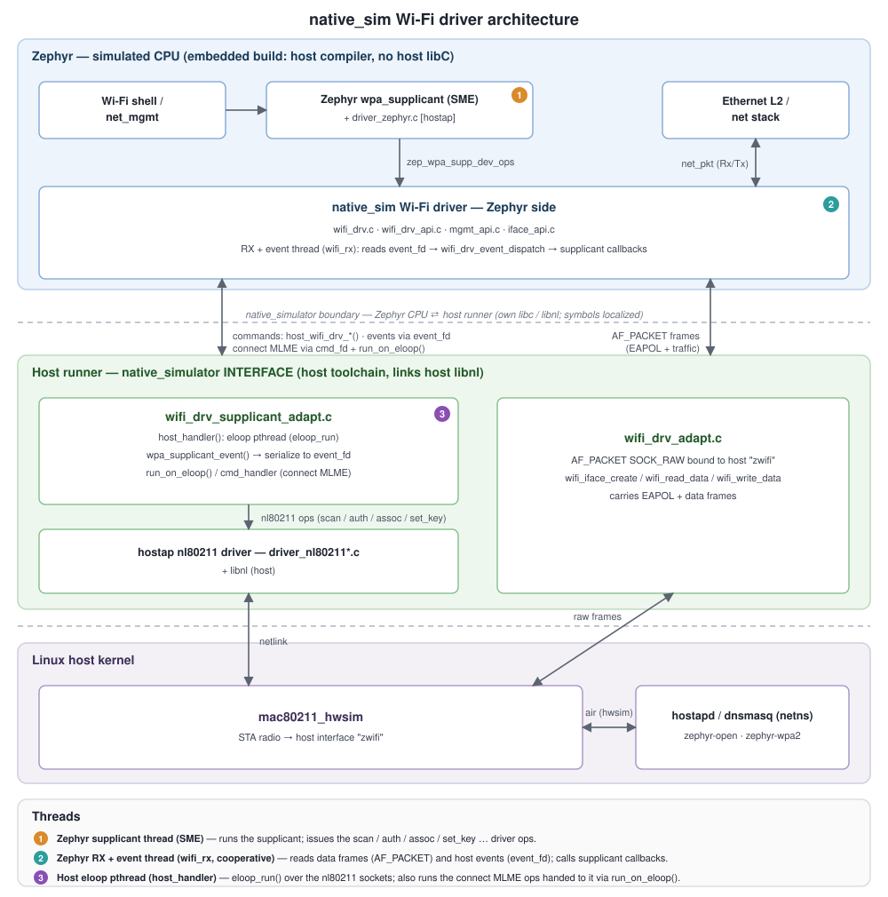

<!-- Copyright 2015-2026 Zephyr Project members and individual contributors. -->
<!-- SPDX-License-Identifier: Apache-2.0 -->
<!-- 中文翻译；编号、导航和明确标注的译注为本地新增。 -->

# 第4章\_Native Simulator本机模拟器

原文：[官方页面](https://docs.zephyrproject.org/latest/boards/native/native_sim/doc/index.html)。读取日期：2026-10-15；来源摘要见[来源记录](../SOURCES.md)。

<a id="native_sim"></a>

## 4.1\_开发板概况与概述

名称：`native_sim`。厂商：[Zephyr Project](https://docs.zephyrproject.org/latest/boards/index.html#vendor=zephyr)。状态：持续维护（Maintained）。架构：[posix](https://docs.zephyrproject.org/latest/boards/index.html#arch=posix)；片上系统（SoC）：[native](https://docs.zephyrproject.org/latest/boards/index.html#soc=native)。

<a id="board-github-link"></a>

[浏览开发板源码](https://github.com/zephyrproject-rtos/zephyr/tree/main/boards/native/native_sim)。

<a id="overview"></a>

`native_sim` 是基于 POSIX 架构的开发板。它将 Zephyr 应用、内核和库一起编译成普通 Linux 可执行程序，基于[本机模拟器（Native Simulator）](https://github.com/BabbleSim/native_simulator/)及[POSIX 架构](P002_POSIX架构.md#posix-arch)。

它不试图模拟特定硬件，而是提供以太网、显示、UART 等少量外设，以便开发和测试需要这些外设的应用代码，详见[外设](#peripherals)。

> 原文注意：`native_sim` 从前身 `native_posix` 演进而来，某些组件、代码、选项名和文档仍使用旧名，但所有可在 `native_posix` 上工作的组件也可在 `native_sim` 上工作。

<a id="host-system-dependencies"></a>

宿主系统依赖见 [POSIX 架构依赖](P002_POSIX架构.md#posix-arch-deps)。

<a id="important-limitations-and-unsupported-features"></a>
<a id="nativesim-important-limitations"></a>

由于基于 POSIX 架构，它继承其[限制与注意事项](P002_POSIX架构.md#posix-arch-limitations)及[不支持的特性](P002_POSIX架构.md#posix-arch-unsupported)。部分驱动还可能存在限制，或没有实现对应驱动 API 的全部可选功能。

<a id="how-to-use-it"></a>
<a id="native-sim-how-to-use"></a>

## 4.2\_使用方法

<a id="compiling"></a>

### 4.2.1\_编译

构建时将 `native_sim` 指定为目标即可：

```shell
west build -b native_sim samples/hello_world
```

<a id="running"></a>

### 4.2.2\_运行

编译生成可执行文件 `zephyr.exe`，位于构建目录的 `zephyr/` 子目录中。像运行其他 Linux 控制台应用一样执行它：

```shell
$ ./build/zephyr/zephyr.exe
# Press Ctrl+C to exit
```

该程序接受的命令行选项取决于编译配置。使用 `--help` 查看可用选项：

```shell
$ ./build/zephyr/zephyr.exe --help
```

Zephyr 内核不会在应用结束后真正退出，而是永久进入空闲循环（Idle Loop），所以必须手动停止，Linux 下按 `Ctrl+C`。代码中的 `Press Ctrl+C to exit` 注释也是这一含义。使用 [ztest 框架](../testing/P002_Ztest测试框架.md#test-framework)的应用测试会在全部测试结束后退出。

如果希望应用到达某处时正常结束，可在该处添加受 [`CONFIG_ARCH_POSIX`](https://docs.zephyrproject.org/latest/kconfig.html#CONFIG_ARCH_POSIX) 条件编译控制的 `nsi_exit(int status)` 调用。

<a id="debugging"></a>
<a id="native-sim-debug"></a>

### 4.2.3\_调试

Zephyr 可执行文件是本机应用，可像其他本机程序一样调试和插桩（Instrumentation）。程序包含调试信息，可直接在 GDB 中运行，或使用 Valgrind 插桩。

通常，Zephyr 应用的执行是确定性的，不包含异步或随机组件；多次执行可得到完全相同的结果，插桩不会影响执行。为了便于调试，可设置 [`CONFIG_NO_OPTIMIZATIONS`](https://docs.zephyrproject.org/latest/kconfig.html#CONFIG_NO_OPTIMIZATIONS)，不使用优化，例如 `-O0`；也可使用集成开发环境（IDE）作为调试器的图形界面（GUI）。

<a id="address-sanitizer-asan"></a>
<a id="native-sim-asan"></a>

### 4.2.4\_地址检查与未定义行为检查

可启用[地址检查器（Address Sanitizer，ASan）](https://github.com/google/sanitizers/wiki/AddressSanitizer)：在应用项目文件、`west build` 或 CMake 命令行中设置 [`CONFIG_ASAN`](https://docs.zephyrproject.org/latest/kconfig.html#CONFIG_ASAN)。系统还需安装 ASan 库，原文在 Debian/Ubuntu 中给出的包名为 `libasan1`。

<a id="undefined-behavior-sanitizer-ubsan"></a>

也可启用[未定义行为检查器（Undefined Behavior Sanitizer，UBSan）](https://clang.llvm.org/docs/UndefinedBehaviorSanitizer.html)，在上述位置设置 [`CONFIG_UBSAN`](https://docs.zephyrproject.org/latest/kconfig.html#CONFIG_UBSAN)。

<a id="coverage-reports"></a>

### 4.2.5\_覆盖率报告

参见[使用POSIX架构生成覆盖率报告](https://docs.zephyrproject.org/latest/develop/test/coverage.html#coverage-posix)。

<a id="and-64bit-versions"></a>
<a id="native-sim32-64"></a>

## 4.3\_32位与64位版本

`native_sim` 提供两种目标。默认的32位 `native_sim` 为 ILP32 应用二进制接口（ABI）编译代码，在 x86 或 x86_64 系统中对应 i386，指针和 `long` 为32位。它模拟 Zephyr 大多数嵌入式目标的 ABI，因此通常最适合测试与调试，因为某些缺陷与指针、`long` 的大小相关。该目标需要安装多库支持（Multilib）的64位系统，或具有32位用户空间的系统。

64位目标 `native_sim/native/64` 使用 LP64 ABI，在 x86 系统中对应 x86-64，指针和 `long` 为64位。如果无法编译或运行32位二进制，可使用该目标。

<a id="c-library-choice"></a>
<a id="native-sim-clib-choice"></a>

## 4.4\_C库选择

默认使用宿主 C 库（[`CONFIG_EXTERNAL_LIBC`](https://docs.zephyrproject.org/latest/kconfig.html#CONFIG_EXTERNAL_LIBC)），也可选择 [`CONFIG_MINIMAL_LIBC`](https://docs.zephyrproject.org/latest/kconfig.html#CONFIG_MINIMAL_LIBC) 或 [`CONFIG_PICOLIBC`](https://docs.zephyrproject.org/latest/kconfig.html#CONFIG_PICOLIBC)。如果选中的功能与宿主 C 库不兼容，则默认改选 Picolibc。

使用 [Minimal](../languages/P004_最小C库.md#c-library-minimal) 或 [Picolibc](https://docs.zephyrproject.org/latest/develop/languages/c/picolibc.html#c-library-picolibc) 时，构建更接近嵌入式目标，可以测试代码与该 C 库的交互，并避免与 [POSIX OS 抽象适配层](../portability/P010_POSIX文档入口.md#posix-support)发生冲突；但从嵌入式代码访问宿主机以进行测试会更困难。

<a id="peripherals-and-backends-c-library-compatibility"></a>
<a id="native-sim-peripherals-c-compat"></a>

多数驱动与后端支持任意 C 库，但以下驱动受到限制：

<a id="id1"></a>

| 驱动类别 | 驱动名称 | Kconfig | 支持的C库 |
| --- | --- | --- | --- |
| 蓝牙（Bluetooth） | Userchan | [`CONFIG_BT_USERCHAN`](https://docs.zephyrproject.org/latest/kconfig.html#CONFIG_BT_USERCHAN) | 宿主 C 库与 Picolibc，原表写 host and pico libC |
| 通用串行总线（USB） | USB native posix | [`CONFIG_USB_NATIVE_POSIX`](https://docs.zephyrproject.org/latest/kconfig.html#CONFIG_USB_NATIVE_POSIX) | 宿主 C 库 |

<a id="cross-compiling-native-sim"></a>

`native_sim` 也支持[交叉编译](P003_POSIX架构交叉编译.md#posix-arch-cross-compile)。

<a id="rationale-for-this-port-and-comparison-with-other-options"></a>

## 4.5\_目的、方案比较与架构

本开发板共享 [POSIX 架构的总体目标](P002_POSIX架构.md#posix-arch-rationale)，同时定位为硬件无关测试平台，某些情况下利用宿主 OS 外设。

它不建模特定硬件，因此只适合开发和测试与硬件充分解耦的应用代码。若软件依赖特定硬件，但仍希望保留 POSIX 架构的优势，应考虑 [bsim 开发板](../bsim_reference/P001_Bsim开发板设计.md#bsim-boards)等方案。进一步比较见 [POSIX 架构与其他开发测试方案](P002_POSIX架构.md#posix-arch-compare)。

<a id="architecture"></a>
<a id="native-sim-architecture"></a>

本开发板基于 Zephyr POSIX 架构移植，共享其[线程及CPU／硬件调度架构](P002_POSIX架构.md#posix-arch-architecture)。本机模拟器内部机制见[模拟器文档](https://github.com/BabbleSim/native_simulator/blob/main/docs/README.md)。此开发板不仿真特定嵌入式 CPU 或 SoC，代码面向宿主系统本机编译，通常是 x86。

<a id="about-time-in-native-sim"></a>

## 4.6\_native_sim中的时间

通常，模拟时间（Simulated Time）与宿主实际时间（Real Host Time）完全解耦，并按宿主算力允许的最高速度推进。这适合调试器运行或批量测试，却不适合与基于实际时间的外部接口交互。

Zephyr 内核只知道硬件模型提供的模拟时间，因此普通 Zephyr 线程也只知道模拟时间。模拟时间与实际／宿主时间之间若存在联系，唯一联系由时钟及定时器模型建立。

可以配置该模型把执行速度放慢到实时：命令行使用 `--rt` 或 `--no-rt`，默认行为由 `CONFIG_NATIVE_SIM_SLOWDOWN_TO_REAL_TIME` 决定。模型只会在下一次系统节拍中断前等待，直到对应的实际时间到来。

如果模拟器因某种原因比实时慢，模型只能不再延迟后续节拍，尽快“追赶”。所以宿主负载过高或在调试器中运行时，模拟时间会落后于实际时间。这种办法让正常运行保持确定性，同时对观察者呈现类似实时的效果。

锁定到实时后，还可让模拟时间比实际时间快或慢，通过 `--rt-ratio=<ratio>` 与原文所写的 `-rt-drift=<drift>` 控制。两者操作同一底层机制，漂移 `drift` 按定义等于 `ratio - 1`。也可调用 `native_rtc_adjust_clock()` 在运行期间调整速度。

例如 `--rt-ratio=2` 使模拟时间以实际时间的两倍推进；`--rt-drift=-100e-6` 使模拟时间慢100 ppm。非实时模式下，这两个选项没有意义。原文选项总述写单横线 `-rt-drift`，而例子使用双横线，此处保留差异。

<a id="how-simulated-time-and-real-time-relate-to-each-other"></a>

### 4.6.1\_模拟时间与实际时间的关系

由实际时间 `rt` 计算模拟时间 `st`：

\[st = (rt - last\_rt) \times ratio + last\_st\]

反过来：

\[rt = (st - last\_st) / ratio + last\_rt\]

`last_rt` 与 `last_st` 分别是最近一次调整时钟比例时的实际时间和模拟时间。所有时间均以微秒（Microsecond）保存。

<a id="peripherals"></a>
<a id="native-sim-peripherals"></a>

## 4.7\_外设

`native_sim` 支持下表列出的硬件特性。片上（on-chip）表示集成于 SoC，板上（on-board）表示位于开发板；数字分别为启用／禁用实例数量，链接指向开发板或 SoC 的设备树源码（DTS）中该状态的第一个实例。兼容字符串（Compatible String，如 `vnd,foo`）链接指向匹配特性的设备树绑定文档。

<a id="native_sim-hw-features"></a>

<a id="native_sim-native_sim/native-hw-features-section"></a>

<a id="native_sim-native_sim/native-hw-features-panel"></a>

<a id="native_sim-native_sim/native-hw-features-memory"></a>

<a id="native_sim-native_sim/native-hw-features-table"></a>

### 4.7.1\_目标 `native_sim/native`

目标存储容量：RAM 为不适用（N/A），Flash 为 2 MiB。

| 类型 | 位置 | 说明 | 启用实例 | 禁用实例 | 兼容字符串 |
| --- | --- | --- | ---: | ---: | --- |
| 中央处理器（CPU） | 板上（on-board） | native_sim 中央处理器（CPU） | [1](https://github.com/zephyrproject-rtos/zephyr/blob/main/boards/native/native_sim/native_sim.dts?plain=1#L58) | — | [`zephyr,native-sim-cpu`](https://docs.zephyrproject.org/latest/build/dts/api/bindings/cpu/zephyr%2Cnative-sim-cpu.html#std-dtcompatible-zephyr-native-sim-cpu) |
| 模数转换器（ADC） | 板上（on-board） | Zephyr 模数转换器模拟器（ADC Emulator） | [1](https://github.com/zephyrproject-rtos/zephyr/blob/main/boards/native/native_sim/native_sim.dts?plain=1#L245) | — | [`zephyr,adc-emul`](https://docs.zephyrproject.org/latest/build/dts/api/bindings/adc/zephyr%2Cadc-emul.html#std-dtcompatible-zephyr-adc-emul) |
| 音频（Audio） | 板上（on-board） | 虚拟编解码器（Dummy Codec） | [1](https://github.com/zephyrproject-rtos/zephyr/blob/main/boards/native/native_sim/native_sim.dts?plain=1#L252) | — | [`zephyr,dummy-codec`](../audio_stm32_ti_wolfson_binding_reference/P014_zephyr_dummy-codec.md#std-dtcompatible-zephyr-dummy-codec) |
| 音频（Audio） | 板上（on-board） | 本机模拟器数字麦克风控制器（Digital Microphone Controller） | [1](https://github.com/zephyrproject-rtos/zephyr/blob/main/boards/native/native_sim/native_sim.dts?plain=1#L257) | — | [`zephyr,native-sim-dmic`](../audio_stm32_ti_wolfson_binding_reference/P015_zephyr_native-sim-dmic.md#std-dtcompatible-zephyr-native-sim-dmic) |
| 蓝牙（Bluetooth） | 板上（on-board） | 由Linux HCI用户通道套接字提供的蓝牙主机控制器接口（Bluetooth HCI） | [1](https://github.com/zephyrproject-rtos/zephyr/blob/main/boards/native/native_sim/native_sim.dts?plain=1#L286) | — | [`zephyr,bt-hci-userchan`](../bluetooth_st_transport_binding_reference/P014_zephyr_bt-hci-userchan.md#std-dtcompatible-zephyr-bt-hci-userchan) |
| 控制器局域网（CAN） | 板上（on-board） | Zephyr仿真CAN回环控制器（Emulated CAN Loopback Controller） | [1](https://github.com/zephyrproject-rtos/zephyr/blob/main/boards/native/native_sim/native_sim.dts?plain=1#L225) | — | [`zephyr,can-loopback`](https://docs.zephyrproject.org/latest/build/dts/api/bindings/can/zephyr%2Ccan-loopback.html#std-dtcompatible-zephyr-can-loopback) |
| 控制器局域网（CAN） | 板上（on-board） | 使用Linux SocketCAN的Zephyr CAN驱动 | — | [1](https://github.com/zephyrproject-rtos/zephyr/blob/main/boards/native/native_sim/native_sim.dts?plain=1#L230) | [`zephyr,native-linux-can`](../can_nxp_renesas_stm32_ti_binding_reference/P016_zephyr_native-linux-can.md#std-dtcompatible-zephyr-native-linux-can) |
| 计数器（Counter） | 板上（on-board） | Native_sim计数器（Counter） | [1](https://github.com/zephyrproject-rtos/zephyr/blob/main/boards/native/native_sim/native_sim.dts?plain=1#L192) | — | [`zephyr,native-sim-counter`](https://docs.zephyrproject.org/latest/build/dts/api/bindings/counter/zephyr%2Cnative-sim-counter.html#std-dtcompatible-zephyr-native-sim-counter) |
| 显示（Display） | 板上（on-board） | 基于简单直接媒体层（SDL）的仿真显示控制器 | [1](https://github.com/zephyrproject-rtos/zephyr/blob/main/boards/native/native_sim/native_sim.dts?plain=1#L213) | — | [`zephyr,sdl-dc`](../display_st_ultrachip_zephyr_binding_reference/P014_zephyr_sdl-dc.md#std-dtcompatible-zephyr-sdl-dc) |
| 直接存储器访问（DMA） | 板上（on-board） | 仿真DMA控制器（Emulated DMA Controller） | [1](https://github.com/zephyrproject-rtos/zephyr/blob/main/boards/native/native_sim/native_sim.dts?plain=1#L280) | — | [`zephyr,dma-emul`](https://docs.zephyrproject.org/latest/build/dts/api/bindings/dma/zephyr%2Cdma-emul.html#std-dtcompatible-zephyr-dma-emul) |
| 增强串行外设接口（eSPI） | 板上（on-board） | Zephyr eSPI仿真控制器（Emulation Controller） | [1](https://github.com/zephyrproject-rtos/zephyr/blob/main/boards/native/native_sim/native_sim.dts?plain=1#L152) | — | [`zephyr,espi-emul-controller`](https://docs.zephyrproject.org/latest/build/dts/api/bindings/espi/zephyr%2Cespi-emul-controller.html#std-dtcompatible-zephyr-espi-emul-controller) |
| 以太网（Ethernet） | 板上（on-board） | Native Sim TAP以太网 | [1](https://github.com/zephyrproject-rtos/zephyr/blob/main/boards/native/native_sim/native_sim.dts?plain=1#L311) | — | [`zephyr,native-tap`](../ethernet_synopsys_st_xilinx_binding_reference/P026_zephyr_native-tap.md#std-dtcompatible-zephyr-native-tap) |
| 以太网（Ethernet） | 板上（on-board） | Native Sim精确时间协议时钟（PTP Clock） | [1](https://github.com/zephyrproject-rtos/zephyr/blob/main/boards/native/native_sim/native_sim.dts?plain=1#L318) | — | [`zephyr,native-ptp-clock`](../ethernet_synopsys_st_xilinx_binding_reference/P025_zephyr_native-ptp-clock.md#std-dtcompatible-zephyr-native-ptp-clock) |
| 闪存控制器（Flash Controller） | 板上（on-board） | 模拟闪存（Simulated Flash Memory） | [1](https://github.com/zephyrproject-rtos/zephyr/blob/main/boards/native/native_sim/native_sim.dts?plain=1#L64) | — | [`zephyr,sim-flash`](https://docs.zephyrproject.org/latest/build/dts/api/bindings/flash_controller/zephyr%2Csim-flash.html#std-dtcompatible-zephyr-sim-flash) |
| 通用输入输出与接针（GPIO & Headers） | 板上（on-board） | GPIO模拟器（GPIO Emulator） | [1](https://github.com/zephyrproject-rtos/zephyr/blob/main/boards/native/native_sim/native_sim.dts?plain=1#L198) | — | [`zephyr,gpio-emul`](https://docs.zephyrproject.org/latest/build/dts/api/bindings/gpio/zephyr%2Cgpio-emul.html#std-dtcompatible-zephyr-gpio-emul) |
| 集成电路间总线（I2C） | 板上（on-board） | Zephyr I2C仿真控制器（Emulation Controller） | [1](https://github.com/zephyrproject-rtos/zephyr/blob/main/boards/native/native_sim/native_sim.dts?plain=1#L133) | — | [`zephyr,i2c-emul-controller`](https://docs.zephyrproject.org/latest/build/dts/api/bindings/i2c/zephyr%2Ci2c-emul-controller.html#std-dtcompatible-zephyr-i2c-emul-controller) |
| 芯片间声音接口（I2S） | 板上（on-board） | Native_sim文件支持的I2S控制器（File-backed I2S Controller） | [3](https://github.com/zephyrproject-rtos/zephyr/blob/main/boards/native/native_sim/native_sim.dts?plain=1#L262) | — | [`zephyr,native-sim-i2s`](../i2s_binding_reference/P019_zephyr_native-sim-i2s.md#std-dtcompatible-zephyr-native-sim-i2s) |
| 输入（Input） | 板上（on-board） | 基于SDL的仿真触摸面板（Emulated Touch Panel） | [1](https://github.com/zephyrproject-rtos/zephyr/blob/main/boards/native/native_sim/native_sim.dts?plain=1#L220) | — | [`zephyr,input-sdl-touch`](../input_touch_lvgl_gesture_binding_reference/P016_zephyr_input-sdl-touch.md#std-dtcompatible-zephyr-input-sdl-touch) |
| 发光二极管（LED） | 板上（on-board） | 一组GPIO控制的LED（GPIO-controlled LEDs） | [1](https://github.com/zephyrproject-rtos/zephyr/blob/main/boards/native/native_sim/native_sim.dts?plain=1#L44) | — | [`gpio-leds`](https://docs.zephyrproject.org/latest/build/dts/api/bindings/led/gpio-leds.html#std-dtcompatible-gpio-leds) |
| 多位串行外设接口（Multi-bit SPI，MSPI） | 板上（on-board） | Zephyr MSPI仿真控制器（Emulation Controller） | [1](https://github.com/zephyrproject-rtos/zephyr/blob/main/boards/native/native_sim/native_sim.dts?plain=1#L160) | — | [`zephyr,mspi-emul-controller`](https://docs.zephyrproject.org/latest/build/dts/api/bindings/mspi/zephyr%2Cmspi-emul-controller.html#std-dtcompatible-zephyr-mspi-emul-controller) |
| 存储技术设备（MTD） | 板上（on-board） | 闪存节点（Flash Node） | [1](https://github.com/zephyrproject-rtos/zephyr/blob/main/boards/native/native_sim/native_sim.dts?plain=1#L73) | — | [`soc-nv-flash`](../mtd_nxp_st_ti_partition_binding_reference/P013_soc-nv-flash.md#std-dtcompatible-soc-nv-flash) |
| 存储技术设备（MTD） | 板上（on-board） | 闪存或其他非易失性存储器的内存映射分区（Memory-mapped Partition） | [5](https://github.com/zephyrproject-rtos/zephyr/blob/main/boards/native/native_sim/native_sim.dts?plain=1#L88) | — | [`zephyr,mapped-partition`](../mtd_nxp_st_ti_partition_binding_reference/P023_zephyr_mapped-partition.md#std-dtcompatible-zephyr-mapped-partition) |
| 存储技术设备（MTD） | 板上（on-board） | Zephyr模拟EEPROM设备（Simulated EEPROM Device） | [1](https://github.com/zephyrproject-rtos/zephyr/blob/main/boards/native/native_sim/native_sim.dts?plain=1#L121) | — | [`zephyr,sim-eeprom`](https://docs.zephyrproject.org/latest/build/dts/api/bindings/mtd/zephyr%2Csim-eeprom.html#std-dtcompatible-zephyr-sim-eeprom) |
| 一次性可编程存储器（OTP Memory） | 板上（on-board） | Zephyr OTP存储器仿真外设（Memory Emulation Peripheral） | [1](https://github.com/zephyrproject-rtos/zephyr/blob/main/boards/native/native_sim/native_sim.dts?plain=1#L127) | — | [`zephyr,otp-emul`](https://docs.zephyrproject.org/latest/build/dts/api/bindings/otp/zephyr%2Cotp-emul.html#std-dtcompatible-zephyr-otp-emul) |
| 性能状态（Performance State） | 板上（on-board） | Native Sim性能状态pstate自定义属性的模拟实现（Mock Implementation） | [3](https://github.com/zephyrproject-rtos/zephyr/blob/main/boards/native/native_sim/native_sim.dts?plain=1#L292) | — | [`zephyr,native-sim-pstate`](https://docs.zephyrproject.org/latest/build/dts/api/bindings/p_state/zephyr%2Cnative-sim-pstate.html#std-dtcompatible-zephyr-native-sim-pstate) |
| 随机数发生器（RNG） | 板上（on-board） | 本机模拟器随机数发生器／熵设备（RNG/Entropy） | [1](https://github.com/zephyrproject-rtos/zephyr/blob/main/boards/native/native_sim/native_sim.dts?plain=1#L187) | — | [`zephyr,native-sim-rng`](https://docs.zephyrproject.org/latest/build/dts/api/bindings/rng/zephyr%2Cnative-sim-rng.html#std-dtcompatible-zephyr-native-sim-rng) |
| 实时时钟（RTC） | 板上（on-board） | 仿真实时时钟设备（Emulated RTC Device） | [1](https://github.com/zephyrproject-rtos/zephyr/blob/main/boards/native/native_sim/native_sim.dts?plain=1#L239) | — | [`zephyr,rtc-emul`](https://docs.zephyrproject.org/latest/build/dts/api/bindings/rtc/zephyr%2Crtc-emul.html#std-dtcompatible-zephyr-rtc-emul) |
| 串行控制器（Serial Controller） | 板上（on-board） | 本机伪终端通用异步收发器（PTY UART） | [1](https://github.com/zephyrproject-rtos/zephyr/blob/main/boards/native/native_sim/native_sim.dts?plain=1#L169) | [1](https://github.com/zephyrproject-rtos/zephyr/blob/main/boards/native/native_sim/native_sim.dts?plain=1#L178) | [`zephyr,native-pty-uart`](../uart_ti_wch_virtual_binding_reference/P013_zephyr_native-pty-uart.md#std-dtcompatible-zephyr-native-pty-uart) |
| 串行外设接口（SPI） | 板上（on-board） | Zephyr SPI仿真控制器（Emulation Controller） | [1](https://github.com/zephyrproject-rtos/zephyr/blob/main/boards/native/native_sim/native_sim.dts?plain=1#L143) | — | [`zephyr,spi-emul-controller`](https://docs.zephyrproject.org/latest/build/dts/api/bindings/spi/zephyr%2Cspi-emul-controller.html#std-dtcompatible-zephyr-spi-emul-controller) |
| 通用串行总线（USB） | 板上（on-board） | 本机POSIX USB设备控制器（Device Controller） | [1](https://github.com/zephyrproject-rtos/zephyr/blob/main/boards/native/native_sim/native_sim.dts?plain=1#L209) | — | [`zephyr,native-posix-udc`](../usb_stm32_audio_binding_reference/P015_zephyr_native-posix-udc.md#std-dtcompatible-zephyr-native-posix-udc) |

<a id="native_sim-native_sim/native/64-hw-features-section"></a>

<a id="native_sim-native_sim/native/64-hw-features-panel"></a>

<a id="native_sim-native_sim/native/64-hw-features-memory"></a>

<a id="native_sim-native_sim/native/64-hw-features-table"></a>

### 4.7.2\_目标 `native_sim/native/64`

目标存储容量：RAM 为不适用（N/A），Flash 为 2 MiB。

| 类型 | 位置 | 说明 | 启用实例 | 禁用实例 | 兼容字符串 |
| --- | --- | --- | ---: | ---: | --- |
| 中央处理器（CPU） | 板上（on-board） | native_sim 中央处理器（CPU） | [1](https://github.com/zephyrproject-rtos/zephyr/blob/main/boards/native/native_sim/native_sim.dts?plain=1#L58) | — | [`zephyr,native-sim-cpu`](https://docs.zephyrproject.org/latest/build/dts/api/bindings/cpu/zephyr%2Cnative-sim-cpu.html#std-dtcompatible-zephyr-native-sim-cpu) |
| 模数转换器（ADC） | 板上（on-board） | Zephyr 模数转换器模拟器（ADC Emulator） | [1](https://github.com/zephyrproject-rtos/zephyr/blob/main/boards/native/native_sim/native_sim.dts?plain=1#L245) | — | [`zephyr,adc-emul`](https://docs.zephyrproject.org/latest/build/dts/api/bindings/adc/zephyr%2Cadc-emul.html#std-dtcompatible-zephyr-adc-emul) |
| 音频（Audio） | 板上（on-board） | 虚拟编解码器（Dummy Codec） | [1](https://github.com/zephyrproject-rtos/zephyr/blob/main/boards/native/native_sim/native_sim.dts?plain=1#L252) | — | [`zephyr,dummy-codec`](../audio_stm32_ti_wolfson_binding_reference/P014_zephyr_dummy-codec.md#std-dtcompatible-zephyr-dummy-codec) |
| 音频（Audio） | 板上（on-board） | 本机模拟器数字麦克风控制器（Digital Microphone Controller） | [1](https://github.com/zephyrproject-rtos/zephyr/blob/main/boards/native/native_sim/native_sim.dts?plain=1#L257) | — | [`zephyr,native-sim-dmic`](../audio_stm32_ti_wolfson_binding_reference/P015_zephyr_native-sim-dmic.md#std-dtcompatible-zephyr-native-sim-dmic) |
| 蓝牙（Bluetooth） | 板上（on-board） | 由Linux HCI用户通道套接字提供的蓝牙主机控制器接口（Bluetooth HCI） | [1](https://github.com/zephyrproject-rtos/zephyr/blob/main/boards/native/native_sim/native_sim.dts?plain=1#L286) | — | [`zephyr,bt-hci-userchan`](../bluetooth_st_transport_binding_reference/P014_zephyr_bt-hci-userchan.md#std-dtcompatible-zephyr-bt-hci-userchan) |
| 控制器局域网（CAN） | 板上（on-board） | Zephyr仿真CAN回环控制器（Emulated CAN Loopback Controller） | [1](https://github.com/zephyrproject-rtos/zephyr/blob/main/boards/native/native_sim/native_sim.dts?plain=1#L225) | — | [`zephyr,can-loopback`](https://docs.zephyrproject.org/latest/build/dts/api/bindings/can/zephyr%2Ccan-loopback.html#std-dtcompatible-zephyr-can-loopback) |
| 控制器局域网（CAN） | 板上（on-board） | 使用Linux SocketCAN的Zephyr CAN驱动 | — | [1](https://github.com/zephyrproject-rtos/zephyr/blob/main/boards/native/native_sim/native_sim.dts?plain=1#L230) | [`zephyr,native-linux-can`](../can_nxp_renesas_stm32_ti_binding_reference/P016_zephyr_native-linux-can.md#std-dtcompatible-zephyr-native-linux-can) |
| 计数器（Counter） | 板上（on-board） | Native_sim计数器（Counter） | [1](https://github.com/zephyrproject-rtos/zephyr/blob/main/boards/native/native_sim/native_sim.dts?plain=1#L192) | — | [`zephyr,native-sim-counter`](https://docs.zephyrproject.org/latest/build/dts/api/bindings/counter/zephyr%2Cnative-sim-counter.html#std-dtcompatible-zephyr-native-sim-counter) |
| 显示（Display） | 板上（on-board） | 基于简单直接媒体层（SDL）的仿真显示控制器 | [1](https://github.com/zephyrproject-rtos/zephyr/blob/main/boards/native/native_sim/native_sim.dts?plain=1#L213) | — | [`zephyr,sdl-dc`](../display_st_ultrachip_zephyr_binding_reference/P014_zephyr_sdl-dc.md#std-dtcompatible-zephyr-sdl-dc) |
| 直接存储器访问（DMA） | 板上（on-board） | 仿真DMA控制器（Emulated DMA Controller） | [1](https://github.com/zephyrproject-rtos/zephyr/blob/main/boards/native/native_sim/native_sim.dts?plain=1#L280) | — | [`zephyr,dma-emul`](https://docs.zephyrproject.org/latest/build/dts/api/bindings/dma/zephyr%2Cdma-emul.html#std-dtcompatible-zephyr-dma-emul) |
| 增强串行外设接口（eSPI） | 板上（on-board） | Zephyr eSPI仿真控制器（Emulation Controller） | [1](https://github.com/zephyrproject-rtos/zephyr/blob/main/boards/native/native_sim/native_sim.dts?plain=1#L152) | — | [`zephyr,espi-emul-controller`](https://docs.zephyrproject.org/latest/build/dts/api/bindings/espi/zephyr%2Cespi-emul-controller.html#std-dtcompatible-zephyr-espi-emul-controller) |
| 以太网（Ethernet） | 板上（on-board） | Native Sim TAP以太网 | [1](https://github.com/zephyrproject-rtos/zephyr/blob/main/boards/native/native_sim/native_sim.dts?plain=1#L311) | — | [`zephyr,native-tap`](../ethernet_synopsys_st_xilinx_binding_reference/P026_zephyr_native-tap.md#std-dtcompatible-zephyr-native-tap) |
| 以太网（Ethernet） | 板上（on-board） | Native Sim精确时间协议时钟（PTP Clock） | [1](https://github.com/zephyrproject-rtos/zephyr/blob/main/boards/native/native_sim/native_sim.dts?plain=1#L318) | — | [`zephyr,native-ptp-clock`](../ethernet_synopsys_st_xilinx_binding_reference/P025_zephyr_native-ptp-clock.md#std-dtcompatible-zephyr-native-ptp-clock) |
| 闪存控制器（Flash Controller） | 板上（on-board） | 模拟闪存（Simulated Flash Memory） | [1](https://github.com/zephyrproject-rtos/zephyr/blob/main/boards/native/native_sim/native_sim.dts?plain=1#L64) | — | [`zephyr,sim-flash`](https://docs.zephyrproject.org/latest/build/dts/api/bindings/flash_controller/zephyr%2Csim-flash.html#std-dtcompatible-zephyr-sim-flash) |
| 通用输入输出与接针（GPIO & Headers） | 板上（on-board） | GPIO模拟器（GPIO Emulator） | [1](https://github.com/zephyrproject-rtos/zephyr/blob/main/boards/native/native_sim/native_sim.dts?plain=1#L198) | — | [`zephyr,gpio-emul`](https://docs.zephyrproject.org/latest/build/dts/api/bindings/gpio/zephyr%2Cgpio-emul.html#std-dtcompatible-zephyr-gpio-emul) |
| 集成电路间总线（I2C） | 板上（on-board） | Zephyr I2C仿真控制器（Emulation Controller） | [1](https://github.com/zephyrproject-rtos/zephyr/blob/main/boards/native/native_sim/native_sim.dts?plain=1#L133) | — | [`zephyr,i2c-emul-controller`](https://docs.zephyrproject.org/latest/build/dts/api/bindings/i2c/zephyr%2Ci2c-emul-controller.html#std-dtcompatible-zephyr-i2c-emul-controller) |
| 芯片间声音接口（I2S） | 板上（on-board） | Native_sim文件支持的I2S控制器（File-backed I2S Controller） | [3](https://github.com/zephyrproject-rtos/zephyr/blob/main/boards/native/native_sim/native_sim.dts?plain=1#L262) | — | [`zephyr,native-sim-i2s`](../i2s_binding_reference/P019_zephyr_native-sim-i2s.md#std-dtcompatible-zephyr-native-sim-i2s) |
| 输入（Input） | 板上（on-board） | 基于SDL的仿真触摸面板（Emulated Touch Panel） | [1](https://github.com/zephyrproject-rtos/zephyr/blob/main/boards/native/native_sim/native_sim.dts?plain=1#L220) | — | [`zephyr,input-sdl-touch`](../input_touch_lvgl_gesture_binding_reference/P016_zephyr_input-sdl-touch.md#std-dtcompatible-zephyr-input-sdl-touch) |
| 发光二极管（LED） | 板上（on-board） | 一组GPIO控制的LED（GPIO-controlled LEDs） | [1](https://github.com/zephyrproject-rtos/zephyr/blob/main/boards/native/native_sim/native_sim.dts?plain=1#L44) | — | [`gpio-leds`](https://docs.zephyrproject.org/latest/build/dts/api/bindings/led/gpio-leds.html#std-dtcompatible-gpio-leds) |
| 多位串行外设接口（Multi-bit SPI，MSPI） | 板上（on-board） | Zephyr MSPI仿真控制器（Emulation Controller） | [1](https://github.com/zephyrproject-rtos/zephyr/blob/main/boards/native/native_sim/native_sim.dts?plain=1#L160) | — | [`zephyr,mspi-emul-controller`](https://docs.zephyrproject.org/latest/build/dts/api/bindings/mspi/zephyr%2Cmspi-emul-controller.html#std-dtcompatible-zephyr-mspi-emul-controller) |
| 存储技术设备（MTD） | 板上（on-board） | 闪存节点（Flash Node） | [1](https://github.com/zephyrproject-rtos/zephyr/blob/main/boards/native/native_sim/native_sim.dts?plain=1#L73) | — | [`soc-nv-flash`](../mtd_nxp_st_ti_partition_binding_reference/P013_soc-nv-flash.md#std-dtcompatible-soc-nv-flash) |
| 存储技术设备（MTD） | 板上（on-board） | 闪存或其他非易失性存储器的内存映射分区（Memory-mapped Partition） | [5](https://github.com/zephyrproject-rtos/zephyr/blob/main/boards/native/native_sim/native_sim.dts?plain=1#L88) | — | [`zephyr,mapped-partition`](../mtd_nxp_st_ti_partition_binding_reference/P023_zephyr_mapped-partition.md#std-dtcompatible-zephyr-mapped-partition) |
| 存储技术设备（MTD） | 板上（on-board） | Zephyr模拟EEPROM设备（Simulated EEPROM Device） | [1](https://github.com/zephyrproject-rtos/zephyr/blob/main/boards/native/native_sim/native_sim.dts?plain=1#L121) | — | [`zephyr,sim-eeprom`](https://docs.zephyrproject.org/latest/build/dts/api/bindings/mtd/zephyr%2Csim-eeprom.html#std-dtcompatible-zephyr-sim-eeprom) |
| 一次性可编程存储器（OTP Memory） | 板上（on-board） | Zephyr OTP存储器仿真外设（Memory Emulation Peripheral） | [1](https://github.com/zephyrproject-rtos/zephyr/blob/main/boards/native/native_sim/native_sim.dts?plain=1#L127) | — | [`zephyr,otp-emul`](https://docs.zephyrproject.org/latest/build/dts/api/bindings/otp/zephyr%2Cotp-emul.html#std-dtcompatible-zephyr-otp-emul) |
| 性能状态（Performance State） | 板上（on-board） | Native Sim性能状态pstate自定义属性的模拟实现（Mock Implementation） | [3](https://github.com/zephyrproject-rtos/zephyr/blob/main/boards/native/native_sim/native_sim.dts?plain=1#L292) | — | [`zephyr,native-sim-pstate`](https://docs.zephyrproject.org/latest/build/dts/api/bindings/p_state/zephyr%2Cnative-sim-pstate.html#std-dtcompatible-zephyr-native-sim-pstate) |
| 随机数发生器（RNG） | 板上（on-board） | 本机模拟器随机数发生器／熵设备（RNG/Entropy） | [1](https://github.com/zephyrproject-rtos/zephyr/blob/main/boards/native/native_sim/native_sim.dts?plain=1#L187) | — | [`zephyr,native-sim-rng`](https://docs.zephyrproject.org/latest/build/dts/api/bindings/rng/zephyr%2Cnative-sim-rng.html#std-dtcompatible-zephyr-native-sim-rng) |
| 实时时钟（RTC） | 板上（on-board） | 仿真实时时钟设备（Emulated RTC Device） | [1](https://github.com/zephyrproject-rtos/zephyr/blob/main/boards/native/native_sim/native_sim.dts?plain=1#L239) | — | [`zephyr,rtc-emul`](https://docs.zephyrproject.org/latest/build/dts/api/bindings/rtc/zephyr%2Crtc-emul.html#std-dtcompatible-zephyr-rtc-emul) |
| 串行控制器（Serial Controller） | 板上（on-board） | 本机伪终端通用异步收发器（PTY UART） | [1](https://github.com/zephyrproject-rtos/zephyr/blob/main/boards/native/native_sim/native_sim.dts?plain=1#L169) | [1](https://github.com/zephyrproject-rtos/zephyr/blob/main/boards/native/native_sim/native_sim.dts?plain=1#L178) | [`zephyr,native-pty-uart`](../uart_ti_wch_virtual_binding_reference/P013_zephyr_native-pty-uart.md#std-dtcompatible-zephyr-native-pty-uart) |
| 串行外设接口（SPI） | 板上（on-board） | Zephyr SPI仿真控制器（Emulation Controller） | [1](https://github.com/zephyrproject-rtos/zephyr/blob/main/boards/native/native_sim/native_sim.dts?plain=1#L143) | — | [`zephyr,spi-emul-controller`](https://docs.zephyrproject.org/latest/build/dts/api/bindings/spi/zephyr%2Cspi-emul-controller.html#std-dtcompatible-zephyr-spi-emul-controller) |
| 通用串行总线（USB） | 板上（on-board） | 本机POSIX USB设备控制器（Device Controller） | [1](https://github.com/zephyrproject-rtos/zephyr/blob/main/boards/native/native_sim/native_sim.dts?plain=1#L209) | — | [`zephyr,native-posix-udc`](../usb_stm32_audio_binding_reference/P015_zephyr_native-posix-udc.md#std-dtcompatible-zephyr-native-posix-udc) |


下面进一步说明当前提供的外设。

### 4.7.3\_中断控制器、时钟与UART概览

中断控制器（Interrupt Controller）简单而通用，支持中断嵌套、优先级、单独屏蔽／解除屏蔽中断，以及软件中断（Software Interrupt）。

时钟、定时器与系统节拍模型提供系统节拍定时器（System Tick Timer）。默认由 [`CONFIG_SYS_CLOCK_TICKS_PER_SEC`](https://docs.zephyrproject.org/latest/kconfig.html#CONFIG_SYS_CLOCK_TICKS_PER_SEC) 配置为每10 ms一个节拍，时间行为见[时间说明](#about-time-in-native-sim)。

提供两种可选本机 UART 驱动：伪终端驱动（PTY，`UART_NATIVE_PTY`）创建 Zephyr UART 设备，可连接 Linux 进程的标准输入／输出（stdin/stdout）或新建伪终端；终端设备驱动（TTY，`UART_NATIVE_TTY`）用于访问宿主连接的串口设备，例如 USB 转 UART 适配器。详见后文 [PTY UART](#pty-uart) 与 [TTY UART](#tty-uart)。

### 4.7.4\_数字麦克风与I2S

`native_sim` 提供由文件支持的数字麦克风（Digital Microphone，DMIC）驱动，从宿主文件系统的二进制文件读取脉冲编码调制（PCM）样本，并通过 Zephyr DMIC API 提供，便于测试音频采集处理流程。

默认输入路径来自 [`CONFIG_AUDIO_DMIC_NATIVE_SIM_FILE_PATH`](https://docs.zephyrproject.org/latest/kconfig.html#CONFIG_AUDIO_DMIC_NATIVE_SIM_FILE_PATH)。每个 DMIC 实例有独立命令行覆盖项 `--<device>_file=<path>`；默认实例使用 `--dmic0_file=<path>`。宿主输入文件不存在时，运行器侧打印警告，并提供全零数据，即静音。

文件支持的芯片间声音接口（Inter-IC Sound，I2S）驱动可配置为接收（RX）、发送（TX）或双向，经 Zephyr I2S API 从宿主文件读取或向文件写入 PCM 样本，适合测试流处理和回环（Loopback）。

默认 RX、TX 路径分别来自 [`CONFIG_I2S_NATIVE_SIM_RX_FILE_PATH`](https://docs.zephyrproject.org/latest/kconfig.html#CONFIG_I2S_NATIVE_SIM_RX_FILE_PATH)、[`CONFIG_I2S_NATIVE_SIM_TX_FILE_PATH`](https://docs.zephyrproject.org/latest/kconfig.html#CONFIG_I2S_NATIVE_SIM_TX_FILE_PATH)。每个实例有独立覆盖项 `--<device>_rx=<path>` 与 `--<device>_tx=<path>`；例如默认双向实例使用 `--i2s_rxtx_rx=<path>`、`--i2s_rxtx_tx=<path>`。

RX 输入文件打不开时，运行器侧打印警告，在本次流运行中提供静音；TX 输出文件打不开时，打印警告并丢弃本次流运行的发送数据。

### 4.7.5\_实时时钟

实时时钟（Real-Time Clock，RTC）模型模拟持续供电的时钟，默认在启动时初始化为宿主时间。`--rtc-reset` 可使它从时间0开始；`--rtc-offset=<offset>` 可设置启动偏移，`native_rtc_offset()` 可动态调整偏移。

启动后，RTC 随模拟时间推进，所以受模拟时间速度比例影响，详见[时间说明](#about-time-in-native-sim)。可用 `native_rtc_gettime_us()` 和 `native_rtc_gettime()` 查询，二者都接受时钟源参数：

| 时钟源 | 含义 |
| --- | --- |
| `RTC_CLOCK_BOOT` | 启动后经过的模拟时间，不受偏移调整影响 |
| `RTC_CLOCK_REALTIME` | RTC 持续时间，受偏移调整影响 |
| `RTC_CLOCK_PSEUDOHOSTREALTIME` | 一种宿主实际时间的变体，仿佛宿主也受到模拟时钟及RTC的速度比例和偏移调整影响 |

第三种时钟值通常会领先模拟时间几百分之一微秒，具体取决于宿主执行速度。应谨慎使用：受 `native_sim` 实际执行速度及宿主负载影响，它可能显著领先模拟时间。

此设备目前还没有兼容 [RTC API](https://docs.zephyrproject.org/latest/hardware/peripherals/rtc.html#rtc-api) 的驱动。

### 4.7.6\_熵设备与以太网驱动

<a id="nsim-per-entr"></a>

熵设备（Entropy Device）基于宿主 `random()` API；相同随机种子（Random Seed）产生相同随机数序列。可用 `--seed=<random_seed>` 改变种子，数值是32位整数，例如十进制 `97229`、十六进制 `0x17BCD` 或八进制 `0275715`。

<a id="nsim-per-ethe"></a>

以太网驱动基于简单的 TAP 虚拟网络设备，要求宿主已有 `zeth` 网络接口。可用 Zephyr [`net-tools`](https://github.com/zephyrproject-rtos/net-tools) 项目仓库中的 `net-setup.sh` 创建，再通过 `zeth` 与 Zephyr 实例通信。可按需创建多个 TAP 接口，并为每个实例分别指定 IP 地址配置。此设备仅适用于 Linux 宿主机。

<a id="nsim-per-wifi"></a>

### 4.7.7\_Wi-Fi驱动

本机 Wi-Fi 驱动在 Zephyr 中呈现由 Linux 宿主无线电支持的 Wi-Fi 站点接口（Station Interface）。它运行 Zephyr `wpa_supplicant`，通过宿主 `nl80211` 接口驱动 Linux `mac80211_hwsim` 模拟无线电。无线电由 Linux 内核模拟，但控制它的 nl80211/mac80211 协议栈是正常的 Linux 实现，因此可完全在宿主机上测试扫描、连接开放网络与 WPA2-PSK 网络、断开连接的流程。

<a id="id2"></a>



图中文字对照：`Zephyr simulated CPU` 为 Zephyr 模拟CPU；`embedded build: host compiler, no host libC` 指嵌入式构建使用宿主编译器但不使用宿主C库；`Wi-Fi shell / net_mgmt` 为Wi-Fi命令行／网络管理；`Ethernet L2 / net stack` 为以太网二层／网络协议栈；`native_simulator boundary` 为Zephyr CPU与宿主运行器的边界，运行器使用独立libc/libnl，符号局部化；`Host runner` 为宿主运行器；`AF_PACKET SOCK_RAW bound to host zwifi` 为绑定宿主zwifi接口的原始套接字；`EAPOL + data frames` 为基于局域网的可扩展认证协议帧与数据帧；`nl80211 ops` 包括扫描、认证、关联和密钥设置；`commands/events` 为命令／事件，分别涉及 `cmd_fd` 和 `event_fd`；`netlink/raw frames/air(hwsim)` 为Netlink通信／原始帧／模拟无线介质。`Linux host kernel` 为宿主内核，`STA radio` 为站点无线电，`hostapd / dnsmasq (netns)` 为网络命名空间中的接入点与地址／名称服务，开放和加密接入点名称为 `zephyr-open`、`zephyr-wpa2`。

原图的三个线程分别为：

1. Zephyr supplicant线程（SME，站点管理实体）运行认证客户端，发起扫描、认证、关联及密钥设置等驱动操作。
2. Zephyr接收与事件线程 `wifi_rx` 为协作线程，读取AF_PACKET数据帧及 `event_fd` 宿主事件，调用supplicant回调。
3. 宿主事件循环pthread `host_handler` 在nl80211套接字上运行 `eloop_run()`，也执行通过 `run_on_eloop()` 交给它的连接MLME（介质访问控制层管理实体）操作。

图中源码文件、函数名、`zep_wpa_supp_dev_ops`、`net_pkt`、`wifi_iface_create`、`wifi_read_data`、`wifi_write_data`、`wifi_drv_event_dispatch`、`wpa_supplicant_event()` 等标识保持原样；它们分别标识接口、网络包、接口创建、数据读写、事件分发及事件回调路径。

设备树存在 `zephyr,native-sim-wifi` 兼容节点时构建此驱动，可通过设备树覆盖文件（Overlay）添加。`host-interface` 选择绑定的 Linux 接口，MAC 地址来自标准 `local-mac-address`／`zephyr,random-mac-address` 属性：

```dts
/ {
        wifi0: wifi {
                compatible = "zephyr,native-sim-wifi";
                host-interface = "zwifi";
                zephyr,random-mac-address;
        };
};
```

接口及 MAC 地址还可由命令行 `--wifi-if=<name>`、`--wifi-mac-addr=<mac>` 覆盖。

目前不支持64位 `native_sim/native/64`，因为驱动引入的 hostap 源码不能顺利构建为64位；只能在 Linux 宿主上构建32位 `native_sim` 镜像。构建链接宿主 libnl，其字长必须与镜像一致，因此需要32位 libnl 开发库。Debian/Ubuntu 示例：

```shell
$ sudo dpkg --add-architecture i386
$ sudo apt update
$ sudo apt install gcc-multilib pkg-config libnl-3-dev:i386 libnl-genl-3-dev:i386
$ export PKG_CONFIG_PATH=/usr/lib/i386-linux-gnu/pkgconfig
```

宿主模拟无线电及其连接的接入点，通过 [`net-tools`](https://github.com/zephyrproject-rtos/net-tools) 仓库的 `net-setup.sh` 和 `zwifi` 配置创建。它加载 `mac80211_hwsim` 内核模块、创建 `zwifi` 站点接口，并启动由 hostapd、dnsmasq 提供的接入点，因此还要安装 `iw`、`hostapd` 和 `dnsmasq`。

二进制会打开 AF_PACKET 与 nl80211 套接字，所以 `zephyr.exe` 必须获得 `cap_net_raw`、`cap_net_admin` 能力，例如 `sudo setcap cap_net_raw,cap_net_admin+ep zephyr.exe`，或者作为 root 运行。

[`tests/net/wifi/interop`](https://github.com/zephyrproject-rtos/zephyr/blob/main/tests/net/wifi/interop) 测试提供完整可运行示例，包括宿主配置及可选Docker包装。驱动仅适用于Linux宿主机。

<a id="nsim-per-offloaded-sockets"></a>

### 4.7.8\_套接字卸载驱动

套接字卸载（Offloaded Sockets）驱动是TAP以太网驱动的替代方案。它使用Linux标准BSD套接字API，让多个Zephyr应用通过Linux回环接口（Loopback Interface）通信，无须在Linux侧配置虚拟网络。

优点是不需要root权限，进程连接与其他Linux进程相同的接口，便于测试且无需额外宿主配置。缺点是没有测试到Zephyr网络栈的二层（L2）。

### 4.7.9\_蓝牙与USB控制器

<a id="nsim-bt-host-cont"></a>

可把宿主蓝牙适配器作为Zephyr蓝牙控制器。将主机控制器接口（HCI）设备通过命令行传给 `zephyr.exe`，例如使用 `hci0`：`sudo zephyr.exe --bt-dev=hci0`。需要root权限，更准确地说是 `CAP_NET_ADMIN` POSIX能力，因此原文使用sudo。所选HCI设备必须处于关闭状态，并支持低功耗蓝牙，即蓝牙规范4.0或更高版本。

也可通过TCP上的HCI服务器使用[虚拟蓝牙控制器](../bluetooth/P008_蓝牙开发工具.md#bluetooth-virtual-posix)。需指定服务器IP地址及端口。原文说明写IP为 `127.0.0.0`、端口1020，但命令例子为 `zephyr.exe --bt-dev=127.0.0.1:1020`；两者按原文保留。此方案主要用于不依赖Linux蓝牙栈及其HCI接口的虚拟控制器连接测试。

<a id="nsim-per-usb"></a>

USB控制器可使用基于USB/IP协议的虚拟USB控制器，详见[在native_sim上通过USB/IP测试USB](../usb/P008_旧版USB设备支持.md#testing-usb-native-sim)；原文链接标题将USB/IP拼作USP/IP。

<a id="nsim-per-disp-sdl"></a>

### 4.7.10\_显示驱动

显示驱动在宿主机创建窗口并渲染显示内容。默认32位目标要求宿主安装32位[SDL2](https://www.libsdl.org)开发库；64位构建需要64位库。还可能需要配置 `pkg-config`，使其正确找到SDL2安装路径。

Ubuntu中的包名为 `libsdl2-dev`，64位版本可能已默认安装。Ubuntu 18.04宿主上，可安装 `pkg-config` 与32位 `libsdl2-dev:i386`，并设置搜索路径：

```shell
$ sudo dpkg --add-architecture i386
$ sudo apt update
$ sudo apt-get install pkg-config libsdl2-dev:i386
$ export PKG_CONFIG_PATH=/usr/lib/i386-linux-gnu/pkgconfig
```

<a id="nsim-per-video-fifo"></a>

### 4.7.11\_视频采集驱动

视频采集驱动从宿主命名管道（FIFO）读取原始帧，通过[Zephyr视频API](https://docs.zephyrproject.org/latest/hardware/peripherals/video.html#video-api)作为普通 `zephyr,camera` 设备提供。这样无须摄像头硬件，也能向应用输入真实摄像头、视频文件或生成测试图案的帧。

可使用 [`video-native-fifo` 配置片段](https://docs.zephyrproject.org/latest/snippets/video-native-fifo/README.html#snippet-video-native-fifo)（Snippet），或添加 `zephyr,native-sim-video-fifo` 设备树节点来实例化。应用通过 [`video_set_format()`](https://docs.zephyrproject.org/latest/doxygen/html/group__video__api__format.html#ga1deb2dbafd7f4eeb602a3f78aaeb5e33) 选择像素格式及帧大小，最大1920×1080，默认320×240 RGB565。驱动不缩放或转换，因此宿主写入端必须生成匹配格式；ffmpeg中RGB565、YUYV、GREY分别对应 `rgb565le`、`yuyv422`、`gray`。

FIFO路径来自 `fifo-path` 属性，默认为 `/tmp/zephyr-<device>-<pid>.fifo`。每个实例有命令行覆盖项 `--<device>=<path>`；节点名为 `video-fifo` 时，使用 `--video-fifo=<path>`。由驱动创建的FIFO会在模拟器退出时删除。

驱动在应用开始流传输时才创建FIFO，因此写入端必须自行先创建，例如用 `mkfifo`，或等驱动创建后再启动。例如：

```shell
$ mkfifo /tmp/zephyr-cam.fifo
$ zephyr.exe --video-fifo=/tmp/zephyr-cam.fifo
```

随后在另一终端输入默认格式的测试图案：

```shell
$ ffmpeg -re -f lavfi -i testsrc2=size=320x240:rate=10 \
    -pix_fmt rgb565le -f rawvideo -y /tmp/zephyr-cam.fifo
```

改从网络摄像头采集：

```shell
$ ffmpeg -f v4l2 -i /dev/video0 \
    -vf "scale=320:240:force_original_aspect_ratio=increase,crop=320:240,fps=10" \
    -pix_fmt rgb565le -f rawvideo -y /tmp/zephyr-cam.fifo
```

路径已存在但不是FIFO时，驱动打印错误并拒绝开始流传输。FIFO以非阻塞方式打开，由专用线程轮询，模拟不会被阻塞；没有宿主写入端连接时，不交付帧。若写入端在一帧中途断开，丢弃不完整帧，让下一个写入端从帧边界恢复。

帧到达后立即交给应用，驱动不自行控制节奏，帧率完全取决于宿主写入端。宿主仍有数据且应用仍有空闲缓冲时，驱动持续读取而不等待；只有宿主暂时没有数据时，`poll-interval-ms` 才生效。

驱动扩大宿主管道，使其能容纳两帧。非特权进程的单管道大小受 `/proc/sys/fs/pipe-max-size` 限制，默认1 MiB；所有管道总用量受 `/proc/sys/fs/pipe-user-pages-soft` 限制。容量不足两帧时，驱动记录警告，因为帧率可能受限：宿主写入端需等待驱动按 `poll-interval-ms` 腾出空间。

可用root权限运行 `zephyr.exe`，更准确地说授予 `CAP_SYS_RESOURCE` POSIX能力，或事先提高限制。16 MiB足以容纳任何受支持格式的两帧：

```shell
$ sudo sysctl fs.pipe-max-size=16777216
```

缩短 `poll-interval-ms` 也有帮助，最短为一个系统节拍，参见 [`CONFIG_SYS_CLOCK_TICKS_PER_SEC`](https://docs.zephyrproject.org/latest/kconfig.html#CONFIG_SYS_CLOCK_TICKS_PER_SEC)。

应用占有全部缓冲时，驱动停止读取，管道填满后宿主写入端阻塞，所以驱动不会丢弃数据。应使用 `ffmpeg -re` 等限速写入端；不限速时，只要应用归还缓冲，驱动就尽快读取。

<a id="nsim-per-flash-simu"></a>

### 4.7.12\_EEPROM与闪存模拟器

原生目标也可使用电可擦可编程只读存储器（EEPROM）模拟器，并额外支持把内容保存在宿主文件系统中。默认文件为当前工作目录下的 `eeprom.bin`，可用 `--eeprom` 选择路径及名称，更多说明见[EEPROM模拟器文档](https://docs.zephyrproject.org/latest/hardware/emulator/index.html#emul-eeprom-simu-brief)。

闪存模拟器可把内容保存在宿主二进制文件或RAM中，通过开发板设备树或 [`CONFIG_FLASH_SIMULATOR`](https://docs.zephyrproject.org/latest/kconfig.html#CONFIG_FLASH_SIMULATOR) 下的Kconfig设置配置设备行为。

默认文件为当前工作目录下的 `flash.bin`，可用 `--flash` 改变位置。数据按原始格式（Raw Format）保存，文件截断至设备树指定大小；不存在时创建，存在时使用已有文件。更多说明见[闪存模拟器文档](https://docs.zephyrproject.org/latest/hardware/emulator/index.html#emul-flash-simu-brief)。宿主访问内容的方式见[FUSE文件系统访问](#host-fuse-filesystem-access)。

### 4.7.13\_输入事件

提供两种可选本机输入驱动。

**evdev驱动：**读取Linux evdev输入设备的事件，再注入Zephyr输入子系统。启用 [`CONFIG_INPUT`](https://docs.zephyrproject.org/latest/kconfig.html#CONFIG_INPUT) 且设备树含如下节点时，驱动自动启用：

```dts
evdev {
  compatible = "zephyr,native-linux-evdev";
};
```

运行时以命令行指定evdev设备节点，例如 `zephyr.exe --evdev=/dev/input/event0`。

**SDL触摸输入：**使用SDL库模拟触摸面板，可通过 [`CONFIG_INPUT_SDL_TOUCH`](https://docs.zephyrproject.org/latest/kconfig.html#CONFIG_INPUT_SDL_TOUCH) 启用，并用 `zephyr,input-sdl-touch` 绑定配置。SDL及显示驱动的使用见上文显示驱动部分。

### 4.7.14\_CAN、LED与温度传感器

可以通过本机SocketCAN Linux驱动使用宿主控制器局域网（CAN）控制器。通过 [`CONFIG_CAN_NATIVE_LINUX`](https://docs.zephyrproject.org/latest/kconfig.html#CONFIG_CAN_NATIVE_LINUX) 启用，以 `zephyr,native-linux-can` 绑定配置。

默认期望名为 `zcan0` 的SocketCAN网络设备，可用 `--can-if` 指定应用使用的接口；该选项覆盖所有Linux SocketCAN驱动实例，使它们使用同一个指定接口。也可通过 [`socketcan-native-sim` 配置片段](../snippets/P018_原生模拟器SocketCAN配置片段.md#snippet-socketcan-native-sim)启用支持。

LED设备由Linux发光二极管（LED）实现支持。把设备树 `path` 属性设为 `/sys/class/leds` 中显示的LED名称，选择使用的Linux LED：

```dts
leds {
  compatible = "zephyr,native-linux-leds";

  led0: led_0 {
    /* /sys/class/leds/tpacpi::lid_logo_dot/brightness */
    path = "tpacpi::lid_logo_dot";
  };
  led1: led_1 {
    /* /sys/class/leds/tpacpi::power/brightness */
    path = "tpacpi::power";
  };
};
```

<a id="native-linux-temp-sensor"></a>

温度传感器驱动通过Zephyr传感器API读取Linux宿主文件中的温度值，可用 [`CONFIG_NATIVE_LINUX_TEMP`](https://docs.zephyrproject.org/latest/kconfig.html#CONFIG_NATIVE_LINUX_TEMP) 启用，以 [`zephyr,native-linux-temp`](../sensor_ti_vishay_wurth_sensing_binding_reference/P030_zephyr_native-linux-temp.md#std-dtcompatible-zephyr-native-linux-temp) 绑定配置。

Linux硬件监控（hwmon）温度文件通常以千分之一摄氏度提供数值，例如 `/sys/class/hwmon/hwmon0/temp1_input`：

```dts
temp_sensor: host_temp {
  compatible = "zephyr,native-linux-temp";
  path = "/sys/class/hwmon/hwmon0/temp1_input";
};
```

<a id="pty-uart"></a>
<a id="native-ptty-uart"></a>

### 4.7.15\_PTY UART

设备树中存在兼容字符串为 `zephyr,native-pty-uart`、状态为 `okay` 的节点，且设置 [`CONFIG_SERIAL`](https://docs.zephyrproject.org/latest/kconfig.html#CONFIG_SERIAL) 时，此驱动自动启用。DTS默认配置一个就绪UART，可按需启用任意数量。

通常，每个UART连接新建伪终端（Pseudoterminal，PTY），即原文所写的 `/dev/pts<nbr>`；也可把其中一个映射到可执行程序的stdin/stdout。两种方法是：使用 `--<uart_name>_stdinout`，其中 `<uart_name>` 是UART的DTS节点名；或者对第一个PTY UART实例选择 [`CONFIG_UART_NATIVE_PTY_0_ON_STDINOUT`](https://docs.zephyrproject.org/latest/kconfig.html#CONFIG_UART_NATIVE_PTY_0_ON_STDINOUT)，取代默认的 [`CONFIG_UART_NATIVE_PTY_0_ON_OWN_PTY`](https://docs.zephyrproject.org/latest/kconfig.html#CONFIG_UART_NATIVE_PTY_0_ON_OWN_PTY)。

与[Shell](../interaction/P001_Shell命令行.md#shell-api)交互时推荐PTY选项；STDINOUT适合自动测试，例如把其他进程输出通过管道传入以控制它。这是因为Shell子系统要求原始终端（Raw Terminal），而普通Linux终端默认不是原始终端。

连接新PTY时，控制台会显示新UART伪终端的名称。手动交互需要连接终端仿真器（Terminal Emulator），例如：

```shell
$ xterm -e screen /dev/<ptyn> &
# Or if you prefer gnome-terminal:
$ gnome-terminal -- screen /dev/<ptyn> &
```

将 `/dev/<ptyn>` 替换为实际PTY设备。代码注释说明第二条命令用于更偏好 `gnome-terminal` 的情况。

也可自动为UART连接终端仿真器：`-attach_uart` 对全部UART生效，`-<uart_name>_attach_uart` 只对指定UART生效。自动连接命令可由 `-attach_uart_cmd=<"cmd">` 为全部UART设置，或用 `-<uart_name>_attach_uart_cmd` 单独设置，默认命令来自 [`CONFIG_UART_NATIVE_PTY_AUTOATTACH_DEFAULT_CMD`](https://docs.zephyrproject.org/latest/kconfig.html#CONFIG_UART_NATIVE_PTY_AUTOATTACH_DEFAULT_CMD)。

默认命令假定系统已安装 `xterm` 和 `screen`。这些 `uart_cmd` 实际上可以是任意shell命令，包括命令列表，因此可以调用其他脚本或程序；它们在PTY创建后立即运行。例如，为新PTY创建链接并在程序结束后删除链接：

```shell
$ zephyr.exe --uart_attach_uart_cmd='ln -s %s /tmp/somename' ; rm /tmp/somename
```

该驱动支持轮询（Poll）、中断（Interrupt）和异步（Async）模式，但不支持运行时配置（Runtime Configuration）或线路控制（Line Control）。

<a id="tty-uart"></a>
<a id="native-tty-uart"></a>

### 4.7.16\_TTY UART

应用可使用轮询或中断UART API，向已连接的串口设备写入字符或从中读取字符。设备树中存在 `zephyr,native-tty-uart` 兼容节点且状态为 `okay` 时，驱动自动启用，例如：

```dts
uart {
  status = "okay";
  compatible = "zephyr,native-tty-uart";
  serial-port = "/dev/ttyUSB0";
  current-speed = <115200>;
};
```

串口交互可按以下方式配置：

- `serial-port` 和 `current-speed` 设备树属性分别指定默认串口与波特率（Baud Rate）；`serial-port` 可省略。
- 命令行 `X_port`、`X_baud` 也可指定串口和波特率，其中 `X` 是节点名；命令行覆盖设备树值。
- 数据位、停止位、校验位以及波特率等其余配置，可在运行时通过 `uart_configure` 设置。
- 启用 [`CONFIG_UART_INTERRUPT_DRIVEN`](https://docs.zephyrproject.org/latest/kconfig.html#CONFIG_UART_INTERRUPT_DRIVEN) 可模拟中断驱动UART。
- 支持多个驱动实例。

[Native TTY UART示例应用](../hardware/P351_UART原生TTY示例.md#uart-native-tty)提供可工作的例子。该驱动只支持轮询和中断模式，不支持异步模式；支持运行时配置，但不支持线路控制。

<a id="subsystems-backends"></a>
<a id="native-sim-backends"></a>

## 4.8\_子系统后端

除自身外设外，`native_sim` 还为部分Zephyr子系统提供专用后端（Backend），通过更紧密地集成宿主OS来简化开发。

<a id="nsim-back-console"></a>

**控制台后端（Console Backend）：**默认将全部 [`printk()`](https://docs.zephyrproject.org/latest/doxygen/html/printk_8h.html#a1bce54a738ce2d9dd6d95ee842ec237c) 输出重定向到宿主应用的stdout。没有编入UART驱动时默认选择此后端，否则设置 [`CONFIG_UART_CONSOLE`](https://docs.zephyrproject.org/latest/kconfig.html#CONFIG_UART_CONSOLE)，使用UART作为控制台后端。

<a id="nsim-back-logger"></a>

**日志后端（Logger Backend）：**把全部日志输出到进程stdout。支持由 [`CONFIG_LOG_BACKEND_FORMAT_TIMESTAMP`](https://docs.zephyrproject.org/latest/kconfig.html#CONFIG_LOG_BACKEND_FORMAT_TIMESTAMP) 启用的时间戳；彩色输出由 [`CONFIG_LOG_BACKEND_SHOW_COLOR`](https://docs.zephyrproject.org/latest/kconfig.html#CONFIG_LOG_BACKEND_SHOW_COLOR) 启用，并受 `--color`、`--no-color`、`--force-color` 控制。`native_sim` 默认使用 [`CONFIG_LOG_MODE_IMMEDIATE`](https://docs.zephyrproject.org/latest/kconfig.html#CONFIG_LOG_MODE_IMMEDIATE) 即时日志模式。此后端由 [`CONFIG_LOG_BACKEND_NATIVE_POSIX`](https://docs.zephyrproject.org/latest/kconfig.html#CONFIG_LOG_BACKEND_NATIVE_POSIX) 选择，默认启用。

<a id="nsim-back-trace"></a>

**跟踪（Tracing）：**为Zephyr通用跟踪格式（Common Trace Format，CTF）跟踪子系统提供后端／底层实现，把跟踪数据写入宿主文件系统，更多内容见[通用跟踪格式文档](https://docs.zephyrproject.org/latest/services/tracing/index.html#ctf)。

<a id="emulators"></a>

## 4.9\_模拟器与文件系统

所有[可用硬件模拟器（Hardware Emulators）](https://docs.zephyrproject.org/latest/hardware/emulator/index.html#emulators)都可与 `native_sim` 配合使用。

<a id="host-fuse-filesystem-access"></a>
<a id="native-fuse-flash"></a>

### 4.9.1\_宿主FUSE文件系统访问

构建包含文件系统的Zephyr时，可启用 [`CONFIG_FUSE_FS_ACCESS`](https://docs.zephyrproject.org/latest/kconfig.html#CONFIG_FUSE_FS_ACCESS)，通过宿主文件系统公开设备分区。这会启用用户空间文件系统（Filesystem in Userspace，FUSE）层，将模拟嵌入式文件系统挂载到宿主文件系统，把Zephyr文件系统调用映射为所需的UNIX文件系统调用，并允许用 `cd`、`ls`、`mkdir` 等普通OS命令访问分区。

默认通过当前工作目录下的 `flash/` 公开分区，可用 `--flash-mount` 更改。应用退出时会卸载目录；如果应用崩溃，可以用 `fusermount` 清理残留挂载点：

```shell
$ fusermount -u flash
```

通过 [`CONFIG_FUSE_LIBRARY_VERSION`](https://docs.zephyrproject.org/latest/kconfig.html#CONFIG_FUSE_LIBRARY_VERSION) 可选择FUSE宿主库v2或v3，默认v3。v2至少需要2.6版，v3用3.0即可。还需配置 `pkg-config`，正确取得FUSE安装路径及编译器标志。

32位 `native_sim` 必须使用相应FUSE库的32位版本。例如，在Ubuntu 24.04宿主上使用v3时，安装 `pkg-config`，32位构建安装 `libfuse3-dev:i386`，64位构建安装 `libfuse3-dev`：

```shell
$ sudo dpkg --add-architecture i386
$ sudo apt update
$ sudo apt-get install pkg-config libfuse3-dev:i386 libfuse3-dev
$ export PKG_CONFIG_PATH=/usr/lib/i386-linux-gnu/pkgconfig
```

同样，`libfuse-dev:i386` 和 `libfuse-dev` 分别提供32位、64位FUSE v2库及头文件。

<a id="host-filesystem-mount"></a>
<a id="native-mount-fs"></a>

### 4.9.2\_挂载宿主文件系统

启用 [`CONFIG_FILE_SYSTEM_NATIVE_MOUNT`](https://docs.zephyrproject.org/latest/kconfig.html#CONFIG_FILE_SYSTEM_NATIVE_MOUNT)，可把宿主文件系统路径挂载到Zephyr文件系统层级中，让Zephyr像访问其他嵌入式挂载点一样访问和修改宿主文件、目录。

在运行可执行程序时传入 `-volume` 选项以挂载宿主目录：

```shell
$ zephyr.exe -volume=/host/dir:/zephyr/dir
```

选项遵循Docker卷挂载语法 `HOST-DIR:ZEPHYR-DIR[:ro]`。可选后缀 `:ro` 以只读方式挂载；多次提供该选项可挂载多个宿主目录。

译注：原页中的 `/dev/...`、`/sys/...`、`/proc/...`、`/usr/...` 是Linux设备、系统接口或软件包路径，`/tmp/...` 与 `/host/dir:/zephyr/dir` 是原始示例路径。它们按官方代码保留，不代表本仓库的位置。本次只完成文档翻译，未执行安装、权限调整、挂载或固件测试命令。

---

[上一章](P003_POSIX架构交叉编译.md) · [本册大纲](大纲.md) · [全站进度](../PROGRESS.md)
