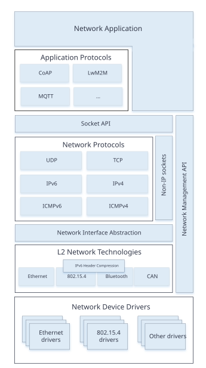
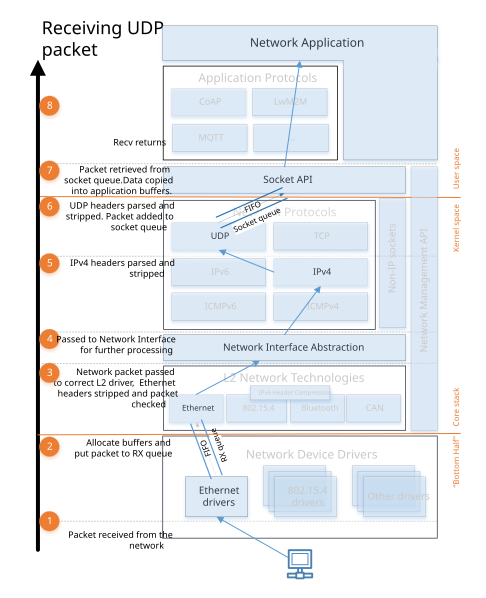
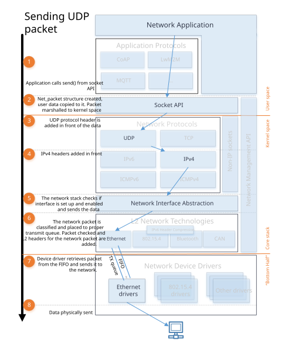

<!-- Copyright 2015-2026 Zephyr Project members and individual contributors. -->
<!-- SPDX-License-Identifier: Apache-2.0 -->
<!-- 中文翻译；编号、导航和明确标注的译注为本地新增。 -->

# 第3章\_网络协议栈架构

原文：[官方页面](https://docs.zephyrproject.org/latest/services/connectivity/networking/net-stack-architecture.html)。读取日期：2026-10-14；保存的 latest 页面及 HTML 摘要见[来源记录](../SOURCES.md)。

Zephyr 网络协议栈（Network Stack）是专为 Zephyr 操作系统设计的原生协议栈。它由多层组成，每层为其他层提供特定服务；功能可通过 Kconfig 选项进行高度定制。

## 3.1\_协议栈整体结构

图：网络协议栈总览（Network Stack Overview）。

协议栈按层组织，包含以下部分：

- **网络应用（Network Application）**：可使用现成的应用层协议库，也可直接调用 [BSD套接字API](P040_BSD套接字.md#bsd-sockets-interface)，完成创建连接、收发数据及关闭连接。还可使用 [网络管理API](P022_网络管理.md#net-mgmt-interface) 配置网络和相关参数，例如设置链路选项、在支持时启动扫描、监听网络配置事件等。[网络接口API](P023_网络接口.md#net-if-interface) 则用于给接口设置 IP 地址、关闭接口等。
- **网络协议（Network Protocols）**：包括 CoAP、LwM2M、MQTT 等应用层协议，详见 [应用协议章节](P161_网络协议目录.md#net-protocols)；也包括 IPv6、IPv4、UDP、TCP、ICMPv4、ICMPv6 等核心协议，可通过 BSD 套接字 API 使用。
- **网络接口抽象（Network Interface Abstraction）**：提供各类接口共有的功能，例如关闭接口。系统可以有多个接口，详见 [网络接口概览](P023_网络接口.md#net-if-interface)。
- **第二层网络技术（L2 Network Technologies）**：提供与实际网络设备收发数据的公共 API，详见 [L2概览](P024_二层管理.md#net-l2-interface)。技术包括 [以太网（Ethernet）](P106_以太网.md#ethernet-interface)、[IEEE 802.15.4](P170_IEEE802154无线网络.md#ieee802154-interface)、[蓝牙（Bluetooth）](../bluetooth/P010_蓝牙API导航.md#bluetooth-api)、[CAN总线（CANBUS）](https://docs.zephyrproject.org/latest/hardware/peripherals/can/controller.html#can-api) 等。一部分技术支持 IPv6 报头压缩（Header Compression，6Lo），见 [RFC 6282](https://datatracker.ietf.org/doc/html/rfc6282.html)；IPv4 的地址解析协议（Address Resolution Protocol，ARP；[RFC 826](https://datatracker.ietf.org/doc/html/rfc826.html)）由 [以太网组件](P106_以太网.md#ethernet-interface)处理。
- **网络设备驱动（Network Device Drivers）**：实际的底层驱动负责物理发送和接收网络分组。

## 3.2\_网络数据流

应用通常由一个或多个[线程（Threads）](https://docs.zephyrproject.org/latest/kernel/services/threads/index.html#threads-v2)执行应用逻辑。使用 BSD 套接字 API 时，数据流如下。

### 3.2.1\_接收数据

图：网络接收数据流（Network RX Data Flow）。

1. 设备驱动收到网络数据分组。
2. 驱动分配足够的网络缓冲区保存数据，将分组放入适当接收队列，队列由 [`k_fifo`](https://docs.zephyrproject.org/latest/kernel/services/data_passing/fifos.html#fifos-v2) 实现。默认只有一个接收队列，最多可有8个，按不同优先级处理分组；详见 [流量分类（Traffic Classification）](P119_流量分类.md#traffic-class-support)。队列同时隔离数据处理的下半部（Bottom Half）：驱动处于中断上下文，应尽快完成当前处理。
3. 分组交给对应 L2 驱动。L2 驱动检查分组有效性，并在需要时修改，例如剥离 L2 报头和帧校验序列（Frame Check Sequence）。
4. 网络接口处理分组；启用 [`CONFIG_NET_STATISTICS`](https://docs.zephyrproject.org/latest/kconfig.html#CONFIG_NET_STATISTICS) 时收集网络统计。
5. 分组进入第三层（L3）处理。对于 IP 分组，L3 检查它是否为有效 IPv6 或 IPv4 分组。
6. 套接字处理程序找到分组所属的活动套接字，将其放入该套接字队列，隔离网络代码与应用。通常应用在用户空间上下文执行，协议栈在内核上下文执行。
7. 应用收到数据并按需处理。应用应已使用 BSD 套接字 API 创建接收数据的套接字。

### 3.2.2\_发送数据

图：网络发送数据流（Network TX Data Flow）。

1. 应用应通过 BSD 套接字 API 发送数据。
2. 准备将应用数据交给内核空间，然后复制到内部 `net_buf` 结构。
3. 根据套接字类型在数据前加协议报头。例如 UDP 套接字会构造 UDP 报头并置于数据之前。
4. 对 UDP 或 TCP 分组，再添加 IP 报头。
5. 协议栈确认分组的网络接口设置正确，并在数据进入发送队列前确认接口已启用。
6. 分组被分类并放入由 [`k_fifo`](https://docs.zephyrproject.org/latest/kernel/services/data_passing/fifos.html#fifos-v2) 实现的适当发送队列。原文说明默认只有一个发送队列，最多8个，按不同优先级处理；详见流量分类。分类后由对应 L2 模块执行额外数据检查并创建所需 L2 报头。如果一切正常，数据交给网络设备驱动发送。
7. 驱动将分组发送到网络。

在发送（Transmit，TX）和接收（Receive，RX）路径上，[`k_fifo`](https://docs.zephyrproject.org/latest/kernel/services/data_passing/fifos.html#fifos-v2) 队列都构成线程之间的数据交接点。这些线程可能处于不同上下文（内核或用户空间），也可能具有不同优先级（Priority）。

> 译注：原文描述的是带发送队列的数据路径。实际是否使用发送类别线程受 [`CONFIG_NET_TC_TX_COUNT`](https://docs.zephyrproject.org/latest/kconfig.html#CONFIG_NET_TC_TX_COUNT) 等配置影响，可以为0；详见[网络配置指南](P004_网络配置指南.md)。概览所说的“尽量减少复制”不等于所有套接字发送路径都零复制，本页仍明确描述向内部缓冲区复制应用数据。

## 3.3\_分组处理统计

网络处理统计见[网络分组处理统计](P006_网络分组处理统计.md#net-pkt-processing-stats)。

<!-- reading-navigation:start -->

**主线阅读**

[上一篇：网络概览](P002_网络概览.md) · [本模块主线目录](../reading/networking.md) · [全部主线](../reading/README.md) · [下一篇：网络配置指南](P004_网络配置指南.md)

原册编号导航（含扩展参考）

[上一章](P002_网络概览.md) · [返回大纲](大纲.md) · [下一章](P004_网络配置指南.md)

<!-- reading-navigation:end -->
