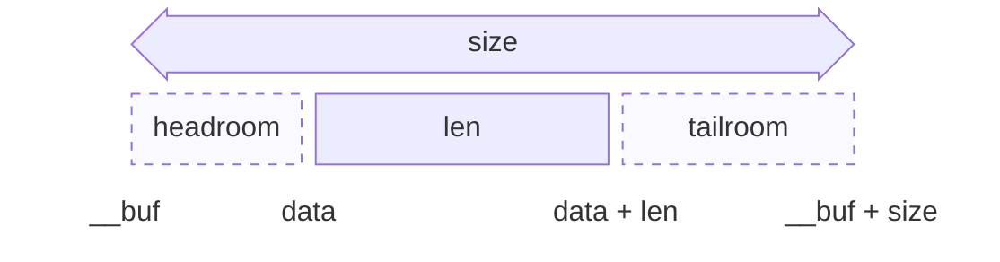
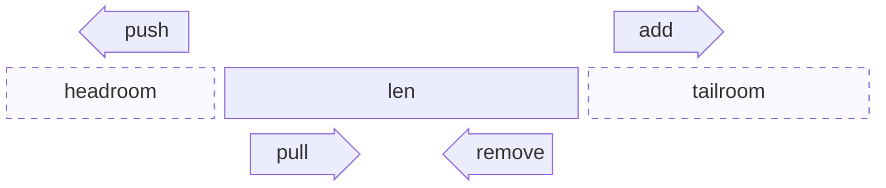
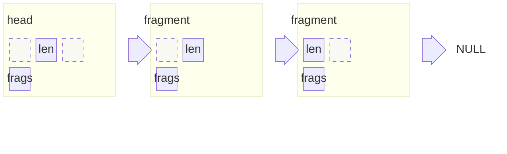

<!-- Copyright 2015-2026 Zephyr Project members and individual contributors. -->
<!-- SPDX-License-Identifier: Apache-2.0 -->
<!-- 中文翻译；编号、导航和明确标注的译注为本地新增。 -->

# 第5章\_网络缓冲区

原文：[官方页面](https://docs.zephyrproject.org/latest/services/net_buf/index.html)。读取日期：2026-10-14；保存的 latest 页面及 HTML 摘要见[来源记录](../SOURCES.md)。

## 5.1\_概述

网络缓冲区（Network Buffer）是网络协议栈和蓝牙协议栈传递数据的核心概念，其 API 定义在 [`include/zephyr/net_buf.h`](https://github.com/zephyrproject-rtos/zephyr/blob/main/include/zephyr/net_buf.h)。

## 5.2\_缓冲区布局

缓冲区数据保存在一块存储空间中，空间大小在分配缓冲区时确定。数据不必从存储块开头开始：前面的空闲空间称为头部预留空间（Headroom），后面的空闲空间称为尾部剩余空间（Tailroom）。



图：网络缓冲区布局（Layout of a Network Buffer）。[官方原始Mermaid源码](images/net_buf_layout.mmd)保持原有内容；图中 `size` 为总存储大小，`len` 为有效数据长度。

| 字段 | 含义 |
| --- | --- |
| `data` | 指向数据起点。 |
| `len` | `data` 指针之后的数据长度。 |
| `size` | 存储块大小，包括 headroom 和 tailroom。 |
| `__buf` | 存储块起点，不应直接访问，应使用 `data` 指针。 |

[`net_buf_headroom()`](https://docs.zephyrproject.org/latest/doxygen/html/group__net__buf.html#gac9a09897f44e708f920064826aa2f703) 返回头部预留空间，[`net_buf_tailroom()`](https://docs.zephyrproject.org/latest/doxygen/html/group__net__buf.html#gaecbc6adf16469e3366c88445ea7a553a) 返回尾部剩余空间，[`net_buf_tail()`](https://docs.zephyrproject.org/latest/doxygen/html/group__net__buf.html#gaedb10a84b352a3d7716bef979af2ab31) 返回 `data + len`，也就是下一个追加字节的位置。可继续容纳数据的空间是 tailroom，**不是 `size - len`**，因为 `size` 还包括 headroom。

## 5.3\_创建缓冲区

[`net_buf`](https://docs.zephyrproject.org/latest/doxygen/html/structnet__buf.html) 从池（Pool）中分配，使用前需通过对应池类型的宏定义池，见后面的池类型说明。[`net_buf_simple`](https://docs.zephyrproject.org/latest/doxygen/html/structnet__buf__simple.html) 不需要池，见简单缓冲区一节。固定大小缓冲区池定义如下：

```c
NET_BUF_POOL_FIXED_DEFINE(pool_name, buf_count, buf_size, user_data_size, NULL);
```

池是静态变量（Static Variable）；如果要供其他模块使用，需要另行提供指针。定义池后，可以从中分配缓冲区：

```c
buf = net_buf_alloc(&pool_name, timeout);
```

池及其缓冲区没有显式初始化函数，而是在调用 [`net_buf_alloc()`](https://docs.zephyrproject.org/latest/doxygen/html/group__net__buf.html#ga534366f3b5c7f41a28372c12149ca005) 时隐式初始化。

若以后需要在数据前添加协议报头，可以预先保留 headroom：

```c
net_buf_reserve(buf, headroom);
```

除了实际协议数据和通用解析上下文，缓冲区还可包含协议专用上下文，称为用户数据（User Data）。用户数据大小是池的属性，每个缓冲区都有 `user_data_size` 字节，可通过 [`net_buf_user_data()`](https://docs.zephyrproject.org/latest/doxygen/html/group__net__buf.html#gaf2df457abe3e56d47107b76bdc004756) 取得。

池定义的最后一个参数是可选的销毁回调（Destroy Callback）。释放缓冲区最后一个引用时，如果提供此回调，就调用它而不立即把缓冲区归还池；回调最终必须调用 [`net_buf_destroy()`](https://docs.zephyrproject.org/latest/doxygen/html/group__net__buf.html#ga739249547eb37b839b3c1ebdbcb88d28) 将其归还。

缓冲区原生支持通过 `k_fifo` 内核对象传递。使用 [`k_fifo_put()`](../queue_reference/P003_FIFO公共接口.md#ga3addb10f86f19e245c23362433d5c913) 和 [`k_fifo_get()`](../queue_reference/P003_FIFO公共接口.md#ga1e2c480e2124116af97e94e7b4435de6) 可以在线程之间交接缓冲区。

缓冲区还可通过 `node` 字段保存在 [`sys_slist_t`](../slist_reference/P001_单向链表公共接口.md#ga44658c336b634c03938a251cdc8134f8) 单向链表中。[`net_buf_slist_put()`](https://docs.zephyrproject.org/latest/doxygen/html/group__net__buf.html#ga6d2dfc45e1e5acf21fe08359a4f92a18) 和 [`net_buf_slist_get()`](https://docs.zephyrproject.org/latest/doxygen/html/group__net__buf.html#ga218d4a0c160c57a44946154478724cb3) 在自旋锁（Spinlock）保护下追加、移除缓冲区；只要所有访问都经过这两个函数，链表就可在线程和中断处理程序之间共享。对这种链表应使用这两个函数，而非 [`sys_slist_append()`](../slist_reference/P001_单向链表公共接口.md#ga829fd7b6f1944dc38e10685e861e62b5)、[`sys_slist_get()`](../slist_reference/P001_单向链表公共接口.md#ga497d7e9069c08e25a03ebc212ef8bbb3)。缓冲区只有一个 `node` 字段，因此无论有多少引用，同一时刻只能位于一个 FIFO 或链表中。

### 5.3.1\_池类型

池类型决定缓冲区数据的来源：

| 池定义宏 | 数据存储 | 数据分配方式 |
| --- | --- | --- |
| [`NET_BUF_POOL_FIXED_DEFINE`](https://docs.zephyrproject.org/latest/doxygen/html/group__net__buf.html#gacc53824e01db7935bcc9cad564b716cd) | 静态数组，每个缓冲区一块 `data_size` 字节空间。 | 总是分配完整块，不等待数据存储。 |
| [`NET_BUF_POOL_VAR_DEFINE`](https://docs.zephyrproject.org/latest/doxygen/html/group__net__buf.html#ga90e691e793c964847d737f5ecf7646ec) | 池内所有缓冲区共享一个 `data_size` 字节的堆。 | 按每个缓冲区的请求大小分配，等待堆内存直到分配超时。 |
| [`NET_BUF_POOL_VAR_ALIGN_DEFINE`](https://docs.zephyrproject.org/latest/doxygen/html/group__net__buf.html#gaf9d47aed60bc1da8fa40cc8160251ecd) | 与 [`NET_BUF_POOL_VAR_DEFINE`](https://docs.zephyrproject.org/latest/doxygen/html/group__net__buf.html#ga90e691e793c964847d737f5ecf7646ec) 相同。 | 同样按需分配，但数据起点按 `align` 对齐，分配大小向上取整为其倍数。请求小于 `align` 字节时失败，完全不申请数据空间的情况除外。 |
| [`NET_BUF_POOL_HEAP_DEFINE`](https://docs.zephyrproject.org/latest/doxygen/html/group__net__buf.html#ga61671ac866081d31dfe9eddbf3b6f210) | 通过 [`k_malloc()`](../heap_reference/P001_内核堆公共接口.md#gaa8edf1e63e5d5dd78d7adcfd787394ee) 使用系统堆，需要 [`CONFIG_HEAP_MEM_POOL_SIZE`](https://docs.zephyrproject.org/latest/kconfig.html#CONFIG_HEAP_MEM_POOL_SIZE)。 | 按请求大小分配，不等待数据存储；堆耗尽时立即失败。 |

所有类型的池，其缓冲区对象本身都来自具有 `buf_count` 个条目的固定数组。分配时先等待空闲对象，直到超时；然后在同一次超时预算的剩余时间内分配数据。因此，即便使用 [`K_FOREVER`](https://docs.zephyrproject.org/latest/doxygen/html/group__clock__apis.html#ga0bb4b83f0222193b21a8910311bab0ca)，系统堆池分配仍可能返回 `NULL`。可变池或堆池的每次数据分配还需要少量堆空间保存管理信息，设置可变池堆大小时必须留出这部分开销。

[`net_buf_alloc()`](https://docs.zephyrproject.org/latest/doxygen/html/group__net__buf.html#ga534366f3b5c7f41a28372c12149ca005) 按池的固定数据大小分配，适用于固定池；对可变池或堆池调用时，得到的缓冲区没有数据存储，应改用 [`net_buf_alloc_len()`](https://docs.zephyrproject.org/latest/doxygen/html/group__net__buf.html#ga11d489aedcca82117965fa6ba9d11ca5)。

[`net_buf_alloc_with_data()`](https://docs.zephyrproject.org/latest/doxygen/html/group__net__buf.html#ga8c24d0761d6d38facb6cca60c7c13c0c) 适用于所有池类型。此时缓冲区使用调用者提供的存储，池不再为其分配数据空间；一开始整个存储都被视作有效数据，因此没有 tailroom。释放缓冲区不会释放这块存储，调用者必须确保它在缓冲区整个存续期间保持有效。

### 5.3.2\_分配超时

分配超时（Allocation Timeout）表示最多等待空闲缓冲区多久；对可变池，还包括等待数据内存的时间。中断处理程序不能等待，必须使用 [`K_NO_WAIT`](https://docs.zephyrproject.org/latest/doxygen/html/group__clock__apis.html#ga3d9541cfe2e8395af66d186efa77362f)。

如果某个池的缓冲区只能由当前线程释放，或只能由当前线程处理的工作来释放，而该线程又以 [`K_FOREVER`](https://docs.zephyrproject.org/latest/doxygen/html/group__clock__apis.html#ga0bb4b83f0222193b21a8910311bab0ca) 等待分配，就永远无法被唤醒。此类上下文应使用有限超时，并处理 `NULL` 返回值。

## 5.4\_常用操作

缓冲区 API 提供数据编码和解码的辅助函数。先理解以下基本操作名称：



图：四种操作改变数据的位置。[官方原始Mermaid源码](images/net_buf_operations.mmd)保留原文。

| 操作 | 作用位置 | 改变字段 | 前提 | 典型用途 |
| --- | --- | --- | --- | --- |
| 追加（Add） | 数据末尾 | `len` | 足够的 tailroom | 从消息开头向后编码 |
| 移除（Remove） | 数据末尾 | `len` | 足够的有效数据 | 解码校验和等尾部字段 |
| 前插（Push） | 数据开头 | `data`、`len` | 足够的 headroom | 添加更低层协议报头 |
| 拉取（Pull） | 数据开头 | `data`、`len` | 足够的有效数据 | 解码报头 |

每种操作都有针对不同数据类型的函数，例如 Add：

- `net_buf_add_mem()`：复制一段内存。
- `net_buf_add_u8()`：追加8位值。
- `net_buf_add_le16()`、`net_buf_add_be16()`：按小端（Little-endian）或大端（Big-endian）字节序追加16位值；24、32、40、48和64位也均有两种字节序版本。

Push、Pull、Remove 具有相同系列，分别命名为 `net_buf_push_*()`、`net_buf_pull_*()`、`net_buf_remove_*()`。Pull 和 Remove 的固定宽度版本返回取出的值。[`net_buf_add()`](https://docs.zephyrproject.org/latest/doxygen/html/group__net__buf.html#ga30776d2b21f06d244c083af5c25b0f3e)、[`net_buf_push()`](https://docs.zephyrproject.org/latest/doxygen/html/group__net__buf.html#ga96a2b1f07f3a7958057d9c7cc1f01b73) 和 [`net_buf_pull()`](https://docs.zephyrproject.org/latest/doxygen/html/group__net__buf.html#gaef433d92734dd8691c292abdb823ba0e) 仅按指定长度移动边界，不复制内容，并返回缓冲区内部指针：

```c
struct foo_hdr *hdr = net_buf_push(buf, sizeof(*hdr));

hdr->opcode = FOO_OP_WRITE;
hdr->len = sys_cpu_to_le16(len);
```

## 5.5\_简单缓冲区

[`net_buf`](https://docs.zephyrproject.org/latest/doxygen/html/structnet__buf.html) 基于 [`net_buf_simple`](https://docs.zephyrproject.org/latest/doxygen/html/structnet__buf__simple.html) 构建。后者只有布局中的四个字段；前者额外提供跨上下文传递所需的引用计数（Reference Count）、归还的池、FIFO／链表节点、片段链（Fragment Chain）及用户数据。

如果一个缓冲区只供某个函数或对象独立使用，例如在栈上编码短消息，使用 [`net_buf_simple`](https://docs.zephyrproject.org/latest/doxygen/html/structnet__buf__simple.html) 即可。[`NET_BUF_SIMPLE_DEFINE`](https://docs.zephyrproject.org/latest/doxygen/html/group__net__buf.html#gaf85aa0b705bb4fbe2630191fde802501) 同时定义简单缓冲区及其存储，[`NET_BUF_SIMPLE_DEFINE_STATIC`](https://docs.zephyrproject.org/latest/doxygen/html/group__net__buf.html#ga21ced8b3082d57bf071008de5fffc0f4) 则定义静态对象。Add、Remove、Push、Pull 均有 `net_buf_simple_` 版本：

```c
NET_BUF_SIMPLE_DEFINE(msg, 8);

net_buf_simple_add_u8(&msg, opcode);
net_buf_simple_add_le16(&msg, handle);
```

解析器将缓冲区交给会从中拉取数据的代码前，可以用 [`net_buf_simple_save()`](https://docs.zephyrproject.org/latest/doxygen/html/group__net__buf.html#gabf5b098aa0926d9b7fb88baff8a3e2d8) 保存位置，之后用 [`net_buf_simple_restore()`](https://docs.zephyrproject.org/latest/doxygen/html/group__net__buf.html#gaedd36481657a7a9d108659d56e131721) 恢复：

```c
NET_BUF_SIMPLE_DEFINE(msg, 32);
struct net_buf_simple_state state;

net_buf_simple_add_mem(&msg, data, len);

net_buf_simple_save(&msg, &state);
err = parse_header(&msg);
net_buf_simple_restore(&msg, &state);
```

保存的是数据位置，而不是内容；期间向缓冲区写入的数据不会被撤销。

## 5.6\_片段

放不进单个缓冲区的数据，或需要由多个部分拼接的数据，可以保存在通过 `frags` 字段连接的缓冲区链中。第一个缓冲区称为链头（Head）。



图：由三个缓冲区组成的链（A Chain of Three Buffers）。[官方原始Mermaid源码](images/net_buf_fragments.mmd)保留原文，fragment 表示片段。

每个缓冲区有自己的 headroom、tailroom，其 `len` 只计自身数据。[`net_buf_frags_len()`](https://docs.zephyrproject.org/latest/doxygen/html/group__net__buf.html#gaebb95f08dbd4d38a250170aa78ddeb44) 返回整条链的数据长度。

[`net_buf_frag_add()`](https://docs.zephyrproject.org/latest/doxygen/html/group__net__buf.html#ga0d7e310802a2bc7b2078f9310827535f) 向链尾追加片段；[`net_buf_frag_insert()`](https://docs.zephyrproject.org/latest/doxygen/html/group__net__buf.html#gac032b44db4a845dba8303fecfe1b63e7) 在指定缓冲区之后插入片段；[`net_buf_frag_del()`](https://docs.zephyrproject.org/latest/doxygen/html/group__net__buf.html#ga602a99833bd401a0ada5bd5defa7a2ff) 移除片段并释放链持有的该片段引用。链的所有权（Ownership）见下一节。

一些函数直接处理整条链的数据：[`net_buf_linearize()`](https://docs.zephyrproject.org/latest/doxygen/html/group__net__buf.html#gaffd49f2de8e72d5f7585b4e5167923d8) 将数据复制到连续缓冲区；[`net_buf_append_bytes()`](https://docs.zephyrproject.org/latest/doxygen/html/group__net__buf.html#ga646d680491753b3ed29fa83c26732d1a) 在链尾追加数据，并按需分配更多片段；[`net_buf_data_match()`](https://docs.zephyrproject.org/latest/doxygen/html/group__net__buf.html#gaef938c3ab676a5bd5bf8338b8d7cb30c) 将数据与链内容比较。这些函数都返回长度，可能小于请求长度。[`net_buf_skip()`](https://docs.zephyrproject.org/latest/doxygen/html/group__net__buf.html#ga2d7096280d4fa6f5e32c4674d542889b) 从链首移除数据，释放因此变空的片段，并返回剩余链。

## 5.7\_所有权

与 [`net_buf_simple`](https://docs.zephyrproject.org/latest/doxygen/html/structnet__buf__simple.html) 不同，[`net_buf`](https://docs.zephyrproject.org/latest/doxygen/html/structnet__buf.html) 使用引用计数。新分配的缓冲区有一个引用，最后一个引用释放后才归还池。每个引用恰好有一个所有者；所有者要么把引用转移给新所有者，如 FIFO、链表或接管缓冲区的函数，要么释放它。转移后，原所有者不得再使用缓冲区，除非它此前通过 [`net_buf_ref()`](https://docs.zephyrproject.org/latest/doxygen/html/group__net__buf.html#ga29387b2a672bf2bb8739046a46f3601f) 取得了另一个属于自己的引用。

两个辅助函数操作保存引用的指针，使原所有者留下 `NULL`，而非仍指向已不归自己所有的缓冲区：[`net_buf_take()`](https://docs.zephyrproject.org/latest/doxygen/html/group__net__buf.html#ga4ff24d6ae1aff46e17647ef91db593ca) 从指针移出引用，[`net_buf_drop()`](https://docs.zephyrproject.org/latest/doxygen/html/group__net__buf.html#ga6b43ad0740b23c0544d706c77c9f1e13) 释放引用。[`net_buf_drop()`](https://docs.zephyrproject.org/latest/doxygen/html/group__net__buf.html#ga6b43ad0740b23c0544d706c77c9f1e13) 适合释放后仍存在的指针，例如结构体成员，也适合可能已经为 `NULL` 的指针。持有引用的局部指针即将离开作用域时，只需 [`net_buf_unref()`](https://docs.zephyrproject.org/latest/doxygen/html/group__net__buf.html#gabedcb728bc2fc0c2b5319a8fd87e8273)。

片段链通过链头拥有。每个缓冲区持有下一个片段的引用，并在自身释放时释放它。因此，释放链头最后一个引用，会沿链释放，直到遇到仍被其他地方引用的第一个片段。[`net_buf_frag_insert()`](https://docs.zephyrproject.org/latest/doxygen/html/group__net__buf.html#gac032b44db4a845dba8303fecfe1b63e7) 接管传入片段；链头非 `NULL` 时，[`net_buf_frag_add()`](https://docs.zephyrproject.org/latest/doxygen/html/group__net__buf.html#ga0d7e310802a2bc7b2078f9310827535f) 也接管片段。链头为 `NULL` 时，[`net_buf_frag_add()`](https://docs.zephyrproject.org/latest/doxygen/html/group__net__buf.html#ga0d7e310802a2bc7b2078f9310827535f) 返回带有一个新引用的片段，而调用者保留原来的引用。

接收缓冲区的函数或回调，对引用应采用以下一种方式，并在文档中说明：

| 约定 | 含义 |
| --- | --- |
| 借用（Borrows） | 返回前可以使用，但不能保留或转移。如需保留，必须先用 [`net_buf_ref()`](https://docs.zephyrproject.org/latest/doxygen/html/group__net__buf.html#ga29387b2a672bf2bb8739046a46f3601f) 取得自己的引用。 |
| 接管所有权（Takes Ownership） | 无论成功还是错误返回，引用都转移给函数。 |
| 成功时接管所有权（Takes Ownership on Success） | 仅成功时转移；出错时仍由调用者持有。 |

把缓冲区放入 FIFO 或链表，会把引用转交队列。接收方可能在 [`k_fifo_put()`](../queue_reference/P003_FIFO公共接口.md#ga3addb10f86f19e245c23362433d5c913) 返回前就已处理并释放缓冲区，例如更高优先级线程正在等待 FIFO。应在同一个表达式中通过 [`net_buf_take()`](https://docs.zephyrproject.org/latest/doxygen/html/group__net__buf.html#ga4ff24d6ae1aff46e17647ef91db593ca) 转移引用：

```c
k_fifo_put(&tx_queue, net_buf_take(&buf));
```

即使 `buf` 在调用后立即离开作用域，也应这样写。普通指针参数看不出是借用还是转移，而 [`net_buf_take()`](https://docs.zephyrproject.org/latest/doxygen/html/group__net__buf.html#ga4ff24d6ae1aff46e17647ef91db593ca) 能在调用位置明确表达引用转移。

把 `net_buf_take(&buf)` 直接用作参数，只适用于总会接管所有权的调用，例如 [`k_fifo_put()`](../queue_reference/P003_FIFO公共接口.md#ga3addb10f86f19e245c23362433d5c913)、[`net_buf_slist_put()`](https://docs.zephyrproject.org/latest/doxygen/html/group__net__buf.html#ga6d2dfc45e1e5acf21fe08359a4f92a18)、[`net_buf_frag_insert()`](https://docs.zephyrproject.org/latest/doxygen/html/group__net__buf.html#gac032b44db4a845dba8303fecfe1b63e7)。若函数只在成功时接管，而调用者传入普通指针，则无论结果如何调用者的指针都不变，只能根据返回值判断缓冲区是否仍归自己所有。

因此，新设计的接管函数宜接收调用者缓冲区指针的地址，在真正接管时使用 [`net_buf_take()`](https://docs.zephyrproject.org/latest/doxygen/html/group__net__buf.html#ga4ff24d6ae1aff46e17647ef91db593ca) 移出引用。这样，调用者指针恰好在转移成功时变为 `NULL`，调用后无论结果如何都可正确使用 [`net_buf_drop()`](https://docs.zephyrproject.org/latest/doxygen/html/group__net__buf.html#ga6b43ad0740b23c0544d706c77c9f1e13)：

```c
int foo_send(struct foo *foo, struct net_buf **buf)
{
    if (!foo->ready) {
        return -EAGAIN;
    }

    k_fifo_put(&foo->tx_queue, net_buf_take(buf));

    return 0;
}

err = foo_send(foo, &buf);
if (err != 0) {
    LOG_WRN("Not sent (err %d)", err);
}

/* Releases the buffer only if foo_send() did not take it */
net_buf_drop(&buf);
```

代码末尾注释译文：仅当 `foo_send()` 没有接管缓冲区时才释放它。把既有函数改成此形式会破坏调用者兼容性，因此最好与原本就要进行的函数重构一起完成。

## 5.8\_调试

| 配置 | 用途 |
| --- | --- |
| [`CONFIG_NET_BUF_LOG`](https://docs.zephyrproject.org/latest/kconfig.html#CONFIG_NET_BUF_LOG) | 启用库日志。在警告日志级别或更详细级别中，当使用 [`K_FOREVER`](https://docs.zephyrproject.org/latest/doxygen/html/group__clock__apis.html#ga0bb4b83f0222193b21a8910311bab0ca) 的分配需要等待缓冲区时会给出警告，提示可能存在前述分配超时一节中的死锁。 |
| [`CONFIG_NET_BUF_POOL_USAGE`](https://docs.zephyrproject.org/latest/kconfig.html#CONFIG_NET_BUF_POOL_USAGE) | 跟踪每个池的空闲数量和同时使用数量的峰值，分别由 [`net_buf_get_available()`](https://docs.zephyrproject.org/latest/doxygen/html/group__net__buf.html#ga9cd6d30ea47a91647d3c4a60d82b5cd4)、[`net_buf_get_max_used()`](https://docs.zephyrproject.org/latest/doxygen/html/group__net__buf.html#gad652ef7d2895f8077c366a564b785291) 返回，便于确定池容量。 |
| [`CONFIG_NET_BUF_HARDENING`](https://docs.zephyrproject.org/latest/kconfig.html#CONFIG_NET_BUF_HARDENING) | 为 Add、Remove、Push、Pull 增加不依赖断言（Assertion）的检查；断言默认禁用。操作被拒绝时，不一定都会向调用者报告。[`net_buf_is_valid()`](https://docs.zephyrproject.org/latest/doxygen/html/group__net__buf.html#ga8d258ef1e4241c438a726486bc7fe766) 可按需检查缓冲区是否一致且仍被引用。 |

## 5.9\_常见错误

**所有权**：错误路径未释放缓冲区，会使它从池中永久丢失，直到很久以后、远离根因的位置才表现为池耗尽。重复释放可能使其他所有者还在使用的缓冲区提前归还池。每个引用只能有一个所有者；向队列或总会接管的函数转移时使用 [`net_buf_take()`](https://docs.zephyrproject.org/latest/doxygen/html/group__net__buf.html#ga4ff24d6ae1aff46e17647ef91db593ca)，释放保存的引用时使用 [`net_buf_drop()`](https://docs.zephyrproject.org/latest/doxygen/html/group__net__buf.html#ga6b43ad0740b23c0544d706c77c9f1e13)。

**两个线程操作同一缓冲区**：池保护并发分配和释放，但不保护单个缓冲区字段。两个线程不能同时修改同一缓冲区的 `data`、`len` 或 `frags`。可通过队列交接，或各持一个引用并保持内容不变。拉取数据也会修改缓冲区；解析共享缓冲区的线程应使用自己的 [`net_buf_simple`](https://docs.zephyrproject.org/latest/doxygen/html/structnet__buf__simple.html)，通过 [`net_buf_simple_clone()`](https://docs.zephyrproject.org/latest/doxygen/html/group__net__buf.html#ga0186c153b72a379affdd3e2e3994b5a7) 建立指向相同数据的视图，再从该视图拉取。

**头尾空间**：[`net_buf_push()`](https://docs.zephyrproject.org/latest/doxygen/html/group__net__buf.html#ga96a2b1f07f3a7958057d9c7cc1f01b73) 需要在添加任何数据之前由 [`net_buf_reserve()`](https://docs.zephyrproject.org/latest/doxygen/html/group__net__buf.html#ga8ac58ad4f73b498bef2ff3ac7e30c6c3) 预留 headroom；[`net_buf_add()`](https://docs.zephyrproject.org/latest/doxygen/html/group__net__buf.html#ga30776d2b21f06d244c083af5c25b0f3e) 需要 tailroom。剩余容量应查 [`net_buf_tailroom()`](https://docs.zephyrproject.org/latest/doxygen/html/group__net__buf.html#gaecbc6adf16469e3366c88445ea7a553a)，而非 `size`。头尾空间不足仅由默认禁用的断言或 [`CONFIG_NET_BUF_HARDENING`](https://docs.zephyrproject.org/latest/kconfig.html#CONFIG_NET_BUF_HARDENING) 检查。Push、Pull 还会移动 `data` 指针，因此之前保存的副本会过时，而这种情况没有自动检查。

**池容量**：发送和接收等独立数据流共享池，可能使其中一方饿死另一方。应为各数据流设置独立池，并根据 [`CONFIG_NET_BUF_POOL_USAGE`](https://docs.zephyrproject.org/latest/kconfig.html#CONFIG_NET_BUF_POOL_USAGE) 测得的同时使用数量确定容量，见调试一节。

**用户数据**：持有缓冲区的每一层都能读写其用户数据，用户数据随缓冲区一起交接。除非接收 API 明确保证，否则不能假设传递后仍保持原值。仅供一个模块使用的状态，可以另存于池旁的数组，以 [`net_buf_id()`](https://docs.zephyrproject.org/latest/doxygen/html/group__net__buf.html#gacdf048dc0afc7ef67027117e0d51d3a3) 作为索引。

## 5.10\_接口参考

[网络缓冲区库（Network Buffer Library）](https://docs.zephyrproject.org/latest/doxygen/html/group__net__buf.html)。

译注：本页保存原代码和3份原始 Mermaid 源码。第一幅图源码中的英文注释意为“每列最宽标签决定文字尺寸，因此长标签跨越多列”。未把图源码渲染成静态截图替代原件，也未把本指南计作详细 API 已完成。


<a id="network-buffers"></a>
<a id="net-buf-interface"></a>
<a id="contents"></a>
<a id="id4"></a>
<a id="id5"></a>
<a id="id6"></a>
<a id="id7"></a>
<a id="id8"></a>
<a id="id9"></a>
<a id="id10"></a>
<a id="id11"></a>
<a id="id12"></a>
<a id="id13"></a>
<a id="id14"></a>
<a id="id15"></a>
<a id="overview"></a>
<a id="buffer-layout"></a>
<a id="id1"></a>
<a id="creating-buffers"></a>
<a id="pool-types"></a>
<a id="allocation-timeouts"></a>
<a id="common-operations"></a>
<a id="id2"></a>
<a id="simple-buffers"></a>
<a id="fragments"></a>
<a id="id3"></a>
<a id="ownership"></a>
<a id="debugging"></a>
<a id="common-mistakes"></a>
<a id="api-reference"></a>

<!-- reading-navigation:start -->

**主线阅读**

[上一篇：网络配置指南](P004_网络配置指南.md) · [本模块主线目录](../reading/networking.md) · [全部主线](../reading/README.md) · [下一篇：网络分组处理统计](P006_网络分组处理统计.md)

<details>
<summary>原册编号导航（含扩展参考）</summary>

[上一章](P004_网络配置指南.md) · [返回大纲](大纲.md) · [下一章](P006_网络分组处理统计.md)

</details>

<!-- reading-navigation:end -->
